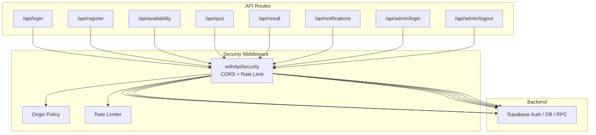
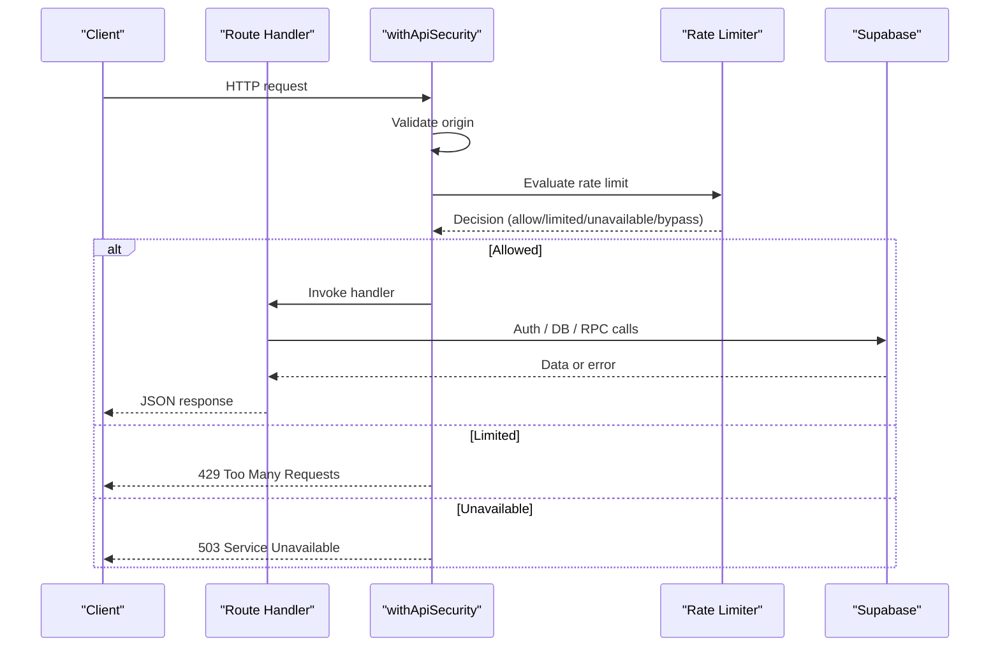
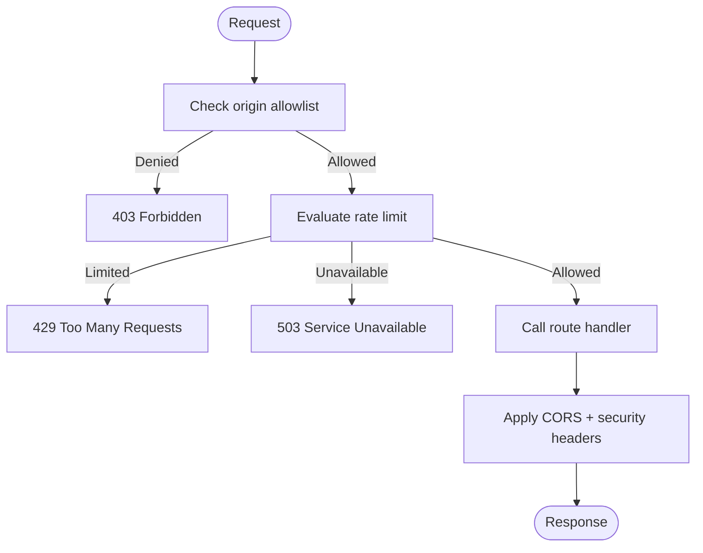
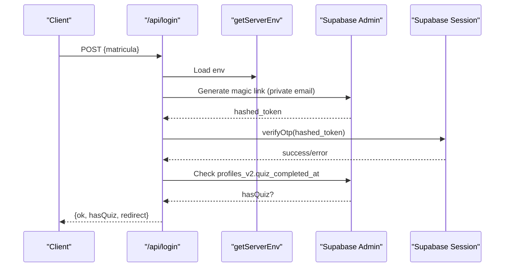
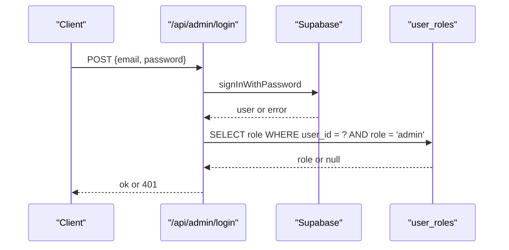
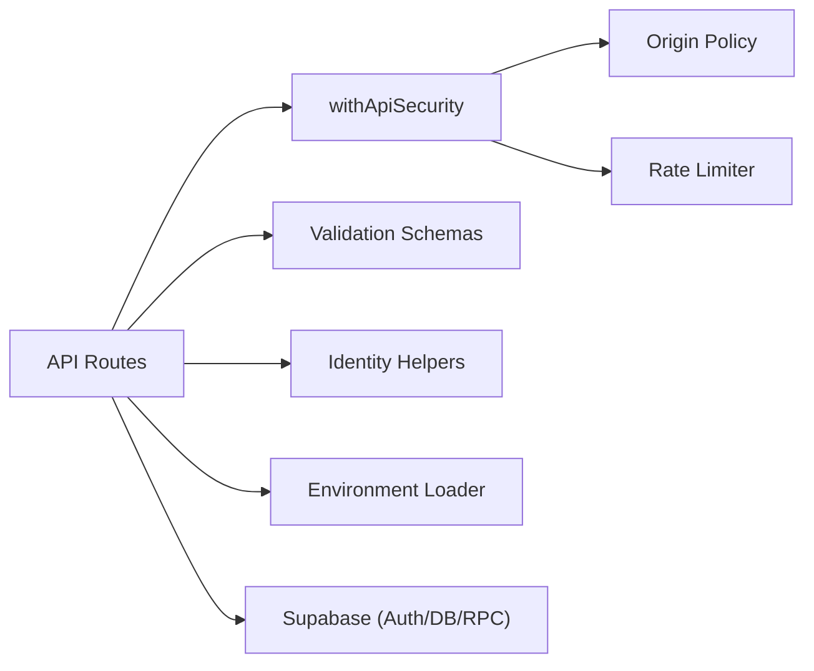

# API Layer & Security

<cite>
**Referenced Files in This Document**
- [api.server.ts](file://src/lib/security/api.server.ts)
- [origin.ts](file://src/lib/security/origin.ts)
- [rate-limit.server.ts](file://src/lib/security/rate-limit.server.ts)
- [route.ts (login)](file://src/app\api\login\route.ts)
- [route.ts (register)](file://src/app\api\register\route.ts)
- [route.ts (availability)](file://src/app\api\availability\route.ts)
- [route.ts (quiz)](file://src/app\api\quiz\route.ts)
- [route.ts (result)](file://src/app\api/result\route.ts)
- [route.ts (notifications)](file://src/app\api\notifications\route.ts)
- [route.ts (admin login)](file://src/app\api\admin\login\route.ts)
- [route.ts (admin logout)](file://src/app\api\admin\logout\route.ts)
- [identity.server.ts](file://src/lib/identity.server.ts)
- [validation.ts](file://src/lib/validation.ts)
- [env.server.ts](file://src/lib/env.server.ts)
- [admin-auth.server.ts](file://src/lib/admin-auth.server.ts)
</cite>

## Table of Contents
1. Introduction
2. Project Structure
3. Core Components
4. Architecture Overview
5. Detailed Component Analysis
6. Dependency Analysis
7. Performance Considerations
8. Troubleshooting Guide
9. Conclusion

## Introduction
This document explains the API layer and security model for the application. It covers how requests are validated, authenticated, rate-limited, and routed to backend services. It also documents admin-only flows, data validation schemas, and environment configuration used by the API endpoints.

## Project Structure
The API is implemented as Next.js Route Handlers under src/app/api. Each endpoint:
- Validates input with Zod schemas
- Enforces CORS and origin allowlisting
- Applies per-endpoint rate limiting
- Authenticates users via Supabase session or service role where appropriate
- Persists or queries data through Supabase RPCs and tables

**Diagram sources**
- [api.server.ts:68-100](file://src/lib/security/api.server.ts#L68-L100)
- [origin.ts:20-34](file://src/lib/security/origin.ts#L20-L34)
- [rate-limit.server.ts:76-116](file://src/lib/security/rate-limit.server.ts#L76-L116)

**Section sources**
- [api.server.ts:1-117](file://src/lib/security/api.server.ts#L1-L117)
- [origin.ts:1-46](file://src/lib/security/origin.ts#L1-L46)
- [rate-limit.server.ts:1-117](file://src/lib/security/rate-limit.server.ts#L1-L117)

## Core Components
- API security middleware: enforces allowed origins, CORS headers, and per-endpoint rate limits; returns standardized security headers.
- Origin policy: parses configured origins, allows same-origin and non-browser requests, and rejects disallowed origins.
- Rate limiter: fixed-window counter backed by Upstash Redis; fails open in development, fails closed in production when unavailable.
- Identity helpers: HMAC hashing of matricula and generation of private email addresses for internal auth flows.
- Validation schemas: strict Zod schemas for availability checks, registration, quiz submissions, and notification payloads.
- Environment loader: validates required server-side environment variables before use.

**Section sources**
- [api.server.ts:1-117](file://src/lib/security/api.server.ts#L1-L117)
- [origin.ts:1-46](file://src/lib/security/origin.ts#L1-L46)
- [rate-limit.server.ts:1-117](file://src/lib/security/rate-limit.server.ts#L1-L117)
- [identity.server.ts:1-10](file://src/lib/identity.server.ts#L1-L10)
- [validation.ts:1-63](file://src/lib/validation.ts#L1-L63)
- [env.server.ts:1-22](file://src/lib/env.server.ts#L1-L22)

## Architecture Overview
All public endpoints are wrapped with withApiSecurity, which performs:
- Origin allowlist check
- Rate limit evaluation
- CORS header application
- Security headers injection (Cache-Control, X-Content-Type-Options)

Authenticated endpoints verify the current user via Supabase session. Admin endpoints additionally enforce a role check against a database table.

**Diagram sources**
- [api.server.ts:68-100](file://src/lib/security/api.server.ts#L68-L100)
- [rate-limit.server.ts:76-116](file://src/lib/security/rate-limit.server.ts#L76-L116)

## Detailed Component Analysis

### API Security Middleware
Responsibilities:
- Allow only same-origin or explicitly configured origins
- Apply CORS headers including credentials support
- Enforce per-endpoint rate limits using Upstash Redis
- Add security headers to all responses

Key behaviors:
- Preflight OPTIONS handling with caching
- Fail-open in development if rate limiter is unreachable
- Consistent Cache-Control: no-store on sensitive responses

**Diagram sources**
- [api.server.ts:13-66](file://src/lib/security/api.server.ts#L13-L66)
- [api.server.ts:68-100](file://src/lib/security/api.server.ts#L68-L100)
- [api.server.ts:103-117](file://src/lib/security/api.server.ts#L103-L117)

**Section sources**
- [api.server.ts:1-117](file://src/lib/security/api.server.ts#L1-L117)

### Origin Policy
- Parses comma-separated origins from environment into normalized origins
- Allows same-origin and non-browser requests (no Origin header)
- Rejects malformed or disallowed origins

**Section sources**
- [origin.ts:1-46](file://src/lib/security/origin.ts#L1-L46)

### Rate Limiter
- Fixed-window algorithm using Redis INCR/EXPIRE via Upstash REST
- Produces decision objects with remaining quota and reset timestamps
- In development, bypasses limits on failure; in production, returns 503 when unavailable

**Section sources**
- [rate-limit.server.ts:1-117](file://src/lib/security/rate-limit.server.ts#L1-L117)

### Identity Helpers
- Hashes matricula with HMAC-SHA256 using a secret
- Generates private email addresses for internal authentication flows

**Section sources**
- [identity.server.ts:1-10](file://src/lib/identity.server.ts#L1-L10)

### Validation Schemas
- Availability: requires normalized matricula
- Registration: requires matricula and password with minimum length
- Quiz submission: requires exactly the expected set of item IDs with valid Likert values
- Body parser: safely parses JSON bodies

**Section sources**
- [validation.ts:1-63](file://src/lib/validation.ts#L1-L63)

### Environment Configuration
- Requires Supabase URL, service role key, and HMAC secret
- Returns null if any required variable is missing or invalid

**Section sources**
- [env.server.ts:1-22](file://src/lib/env.server.ts#L1-L22)

### Endpoint: User Login (/api/login)
Flow:
- Validate availability-style payload containing matricula
- Compute HMAC hash and derive private email
- Use service role client to generate a magic link token
- Verify OTP token via session client to establish SSR cookies
- Determine redirect based on v2 quiz completion status

Error handling:
- Invalid input -> 400
- Missing profile -> 404
- Service issues -> 503

**Diagram sources**
- [route.ts (login):19-99](file://src/app\api\login\route.ts#L19-L99)

**Section sources**
- [route.ts (login):1-111](file://src/app\api\login\route.ts#L1-L111)

### Endpoint: Registration (/api/register)
Flow:
- Validate matricula and password
- Create user via service role client with auto confirmation
- Insert profile record
- Sign in via session client to set cookies
- Roll back user creation on profile insertion or sign-in failure

Error handling:
- Invalid input -> 400
- Conflict or service errors -> 409/503

**Section sources**
- [route.ts (register):1-74](file://src/app\api\register\route.ts#L1-L74)

### Endpoint: Availability Check (/api/availability)
Flow:
- Validate matricula
- Hash matricula and call RPC to check availability

Error handling:
- Invalid input -> 400
- Service issues -> 503

**Section sources**
- [route.ts (availability):1-47](file://src/app\api\availability\route.ts#L1-L47)

### Endpoint: Quiz Submission (/api/quiz)
Flow:
- Authenticate user via session
- Validate answers schema
- Score microtest locally
- Persist results and refresh matches via RPC

Error handling:
- Unauthorized -> 401
- Invalid input -> 400
- Service issues -> 503

**Section sources**
- [route.ts (quiz):1-72](file://src/app\api\quiz\route.ts#L1-L72)

### Endpoint: Results (/api/result)
Flow:
- Authenticate user via session
- Fetch profile and matches concurrently
- Validate matches array shape
- Return alias, archetype, and matches

Error handling:
- Unauthorized -> 401
- Service issues -> 503

**Section sources**
- [route.ts (result):1-71](file://src/app\api/result\route.ts#L1-L71)

### Endpoint: Notifications (/api/notifications)
GET:
- Authenticate user
- Optionally include read notifications via query param
- Validate returned notifications array

PATCH:
- Authenticate user
- Validate list of notification IDs
- Mark notifications read via RPC

Error handling:
- Unauthorized -> 401
- Invalid input -> 400
- Service issues -> 503

**Section sources**
- [route.ts (notifications):1-99](file://src/app\api\notifications\route.ts#L1-L99)

### Admin Authentication
Admin login:
- Validates email/password
- Signs in via Supabase
- Checks user_roles table for admin role
- Wraps with rate limiting

Admin logout:
- Signs out via Supabase

Admin context helper:
- Verifies authenticated user and admin role
- Loads dashboard metrics via RPC

**Diagram sources**
- [route.ts (admin login):15-43](file://src/app\api\admin\login\route.ts#L15-L43)

**Section sources**
- [route.ts (admin login):1-55](file://src/app\api\admin\login\route.ts#L1-L55)
- [route.ts (admin logout):1-27](file://src/app\api\admin\logout\route.ts#L1-L27)
- [admin-auth.server.ts:1-37](file://src/lib/admin-auth.server.ts#L1-L37)

## Dependency Analysis
High-level dependencies between components:

**Diagram sources**
- [api.server.ts:68-100](file://src/lib/security/api.server.ts#L68-L100)
- [origin.ts:20-34](file://src/lib/security/origin.ts#L20-L34)
- [rate-limit.server.ts:76-116](file://src/lib/security/rate-limit.server.ts#L76-L116)
- [validation.ts:1-63](file://src/lib/validation.ts#L1-L63)
- [identity.server.ts:1-10](file://src/lib/identity.server.ts#L1-L10)
- [env.server.ts:1-22](file://src/lib/env.server.ts#L1-L22)

**Section sources**
- [api.server.ts:1-117](file://src/lib/security/api.server.ts#L1-L117)
- [origin.ts:1-46](file://src/lib/security/origin.ts#L1-L46)
- [rate-limit.server.ts:1-117](file://src/lib/security/rate-limit.server.ts#L1-L117)
- [validation.ts:1-63](file://src/lib/validation.ts#L1-L63)
- [identity.server.ts:1-10](file://src/lib/identity.server.ts#L1-L10)
- [env.server.ts:1-22](file://src/lib/env.server.ts#L1-L22)

## Performance Considerations
- All responses set Cache-Control: no-store to avoid caching sensitive data.
- Preflight responses cache metadata for 600 seconds to reduce repeated CORS overhead.
- Rate limiting uses a single Redis round-trip per request with a short timeout to minimize latency impact.
- Parallel data fetching is used where possible (e.g., concurrent profile and matches retrieval).

[No sources needed since this section provides general guidance]

## Troubleshooting Guide
Common issues and resolutions:
- 403 Origin not allowed: Ensure the client’s origin is either same-origin or included in CORS_ALLOWED_ORIGINS.
- 429 Too many requests: Respect Retry-After and X-RateLimit headers; adjust client retry strategy.
- 503 Service unavailable: Indicates missing environment variables, rate limiter outage, or Supabase connectivity issues.
- 401 Unauthorized: Verify Supabase session cookies are present and valid; re-login if necessary.
- 400 Invalid request: Check payload structure against the relevant Zod schema.

Operational tips:
- Inspect X-RateLimit-* headers to understand quota usage.
- Confirm that SUPABASE_SERVICE_ROLE_KEY and MATRICULA_HMAC_SECRET are correctly set for admin and identity operations.
- For admin flows, ensure the user has the admin role in user_roles.

**Section sources**
- [api.server.ts:68-100](file://src/lib/security/api.server.ts#L68-L100)
- [rate-limit.server.ts:46-65](file://src/lib/security/rate-limit.server.ts#L46-L65)
- [env.server.ts:1-22](file://src/lib/env.server.ts#L1-L22)

## Conclusion
The API layer combines strict input validation, robust origin control, and per-endpoint rate limiting to provide a secure surface. Authentication is handled via Supabase sessions, with additional admin role enforcement. The design favors fail-open behavior for rate limiting in development while maintaining strict controls in production. Proper environment configuration and consistent error handling ensure predictable behavior across environments.