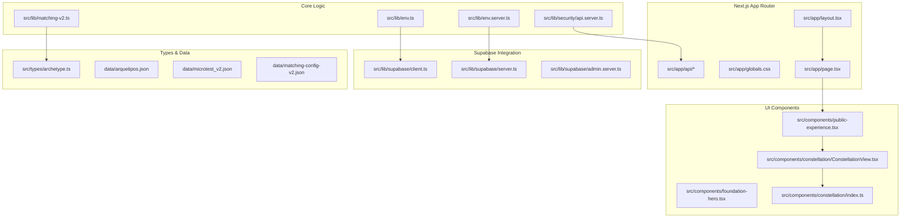
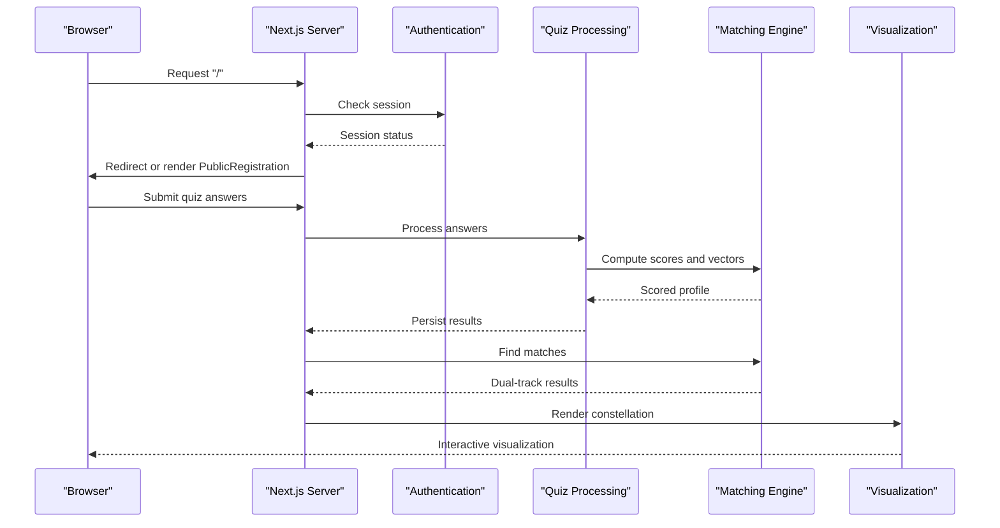
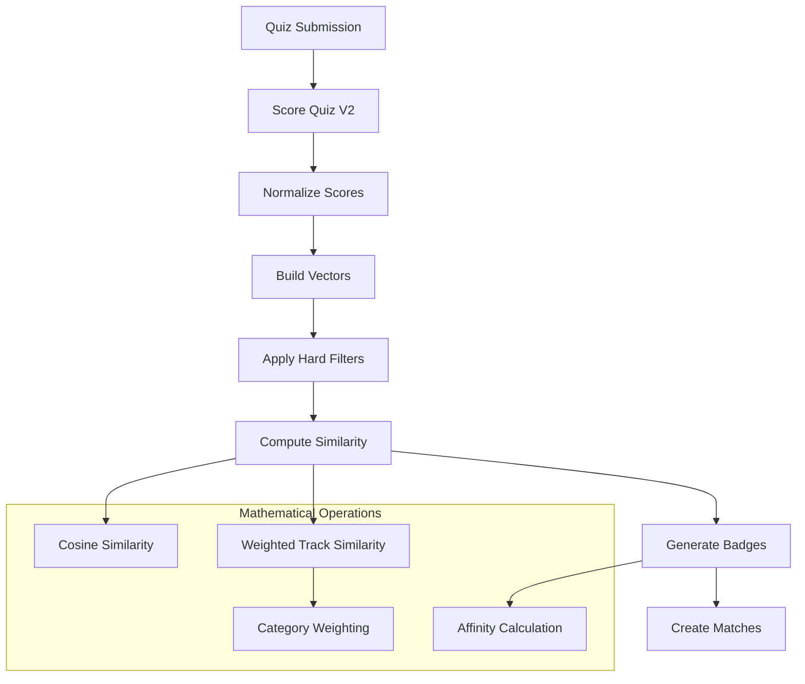
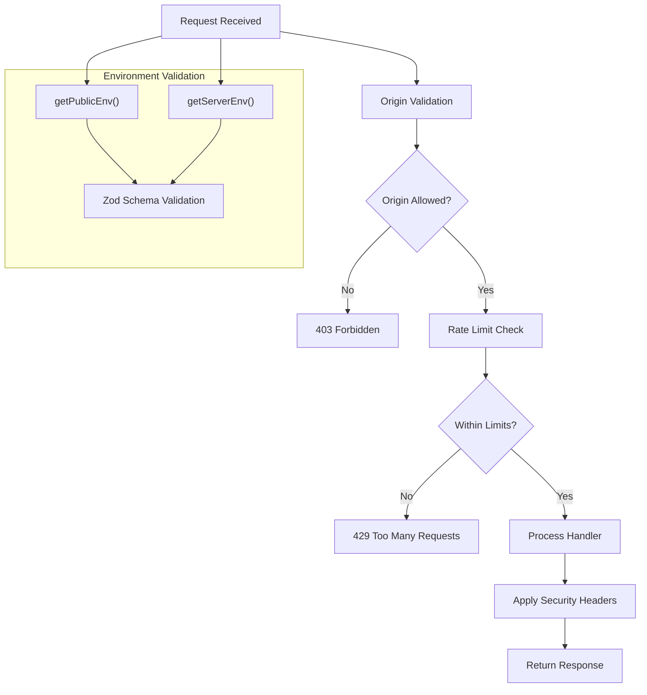
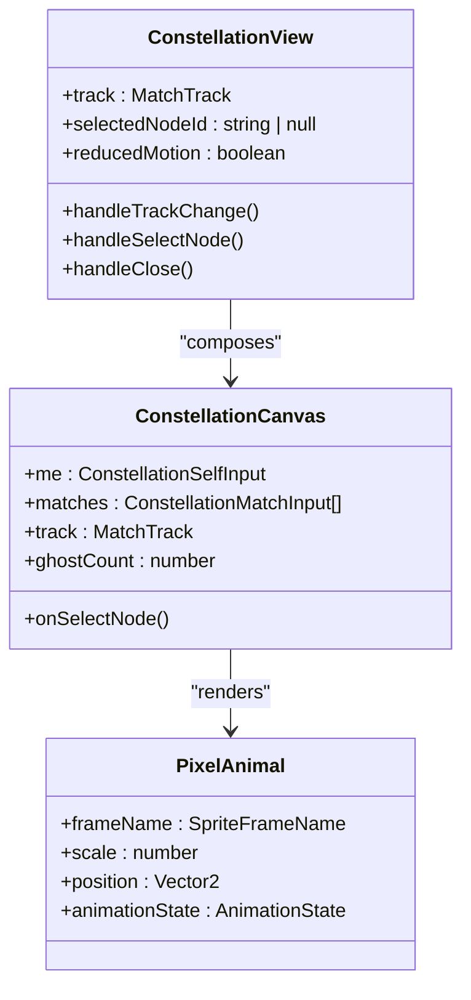
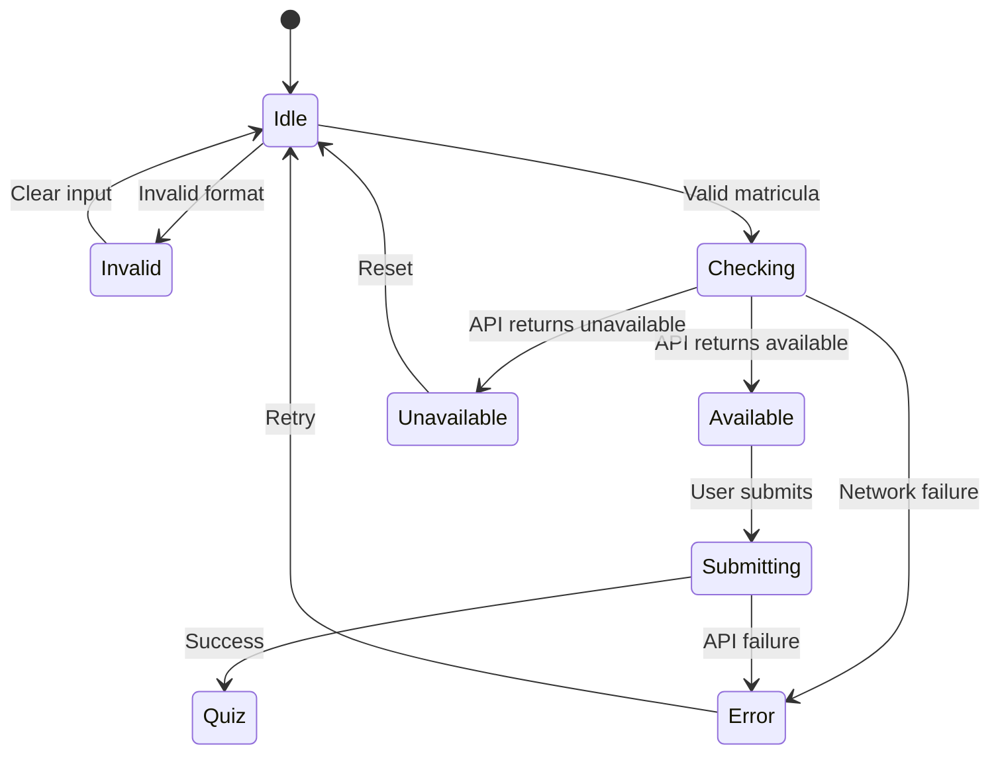
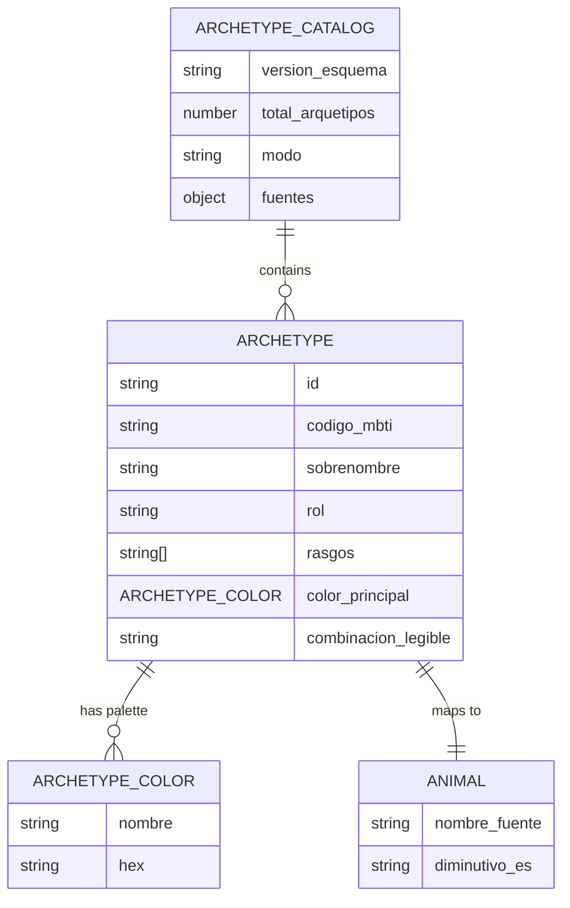
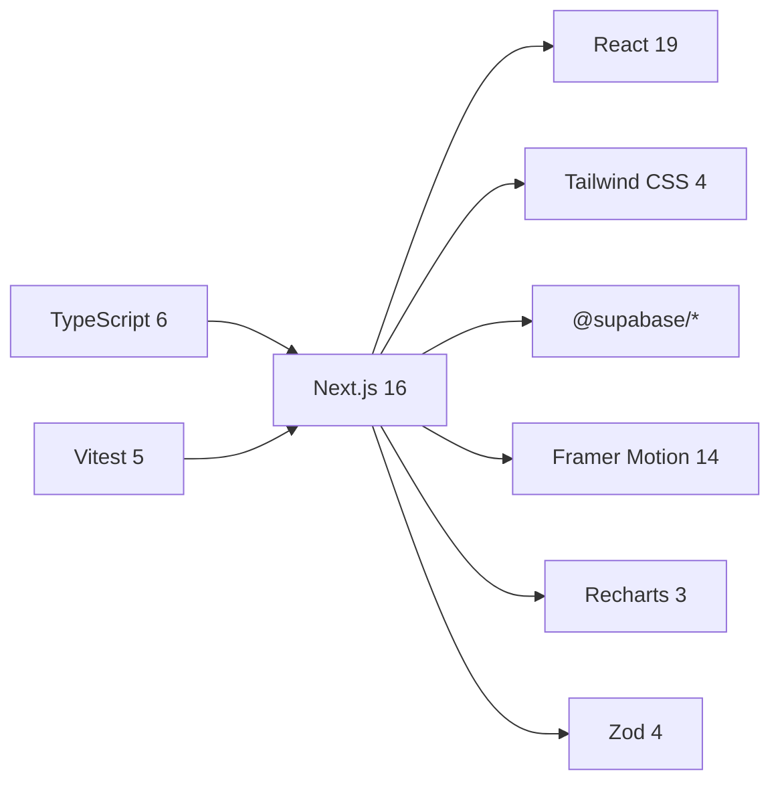

# Architecture Overview

<cite>
**Referenced Files in This Document**
- [page.tsx](file://src/app/page.tsx)
- [layout.tsx](file://src/app/layout.tsx)
- [foundation-hero.tsx](file://src/components/foundation-hero.tsx)
- [public-experience.tsx](file://src/components/public-experience.tsx)
- [ConstellationView.tsx](file://src/components/constellation/ConstellationView.tsx)
- [index.ts](file://src/components/constellation/index.ts)
- [archetype.ts](file://src/types/archetype.ts)
- [matching-v2.ts](file://src/lib/matching-v2.ts)
- [env.ts](file://src/lib/env.ts)
- [env.server.ts](file://src/lib/env.server.ts)
- [client.ts](file://src/lib/supabase/client.ts)
- [server.ts](file://src/lib/supabase/server.ts)
- [admin.server.ts](file://src/lib/supabase/admin.server.ts)
- [api.server.ts](file://src/lib/security/api.server.ts)
- [next.config.ts](file://next.config.ts)
- [package.json](file://package.json)
</cite>

## Update Summary
**Changes Made**
- Expanded architecture layers to include the full public experience flow, constellation visualization system, and dual-track matching engine
- Added detailed data pipeline documentation covering questionnaire scoring, vector computation, and match discovery
- Documented security measures including CORS, rate limiting, environment validation, and Supabase integration patterns
- Enhanced Next.js stack documentation with SSR/CSR boundaries and client/server component separation
- Added mathematical foundations of matching algorithms including cosine similarity, weighted track similarity, and hard filter compatibility
- Updated component hierarchy from page.tsx through PublicRegistration to constellation visualization components

## Table of Contents
1. [Introduction](#introduction)
2. [Project Structure](#project-structure)
3. [Core Components](#core-components)
4. [Architecture Overview](#architecture-overview)
5. [Data Pipeline and Matching Engine](#data-pipeline-and-matching-engine)
6. [Security and Configuration](#security-and-configuration)
7. [Constellation Visualization System](#constellation-visualization-system)
8. [Detailed Component Analysis](#detailed-component-analysis)
9. [Dependency Analysis](#dependency-analysis)
10. [Performance Considerations](#performance-considerations)
11. [Troubleshooting Guide](#troubleshooting-guide)
12. [Conclusion](#conclusion)

## Introduction
ZooMatch is a Next.js application that presents personality archetypes as animal metaphors with curated color palettes. The current implementation has evolved from a simple foundation UI into a comprehensive personality matching platform featuring:

- **Public Experience Flow**: Registration, questionnaire, and result viewing with real-time availability checking
- **Dual-Track Matching Engine**: Mathematical core computing romance and friendship compatibility using weighted cosine similarity across 26 and 16 dimensions respectively
- **Constellation Visualization System**: Interactive pixel-art visualization of matches with deterministic physics and sprite generation
- **Enterprise Security**: CORS protection, rate limiting, environment validation, and secure Supabase integration

The project follows the Next.js App Router architecture with clear separation between server-rendered pages, client components, shared utilities, type definitions, and mathematical engines.

## Project Structure
The repository organizes code by feature and architectural layer:
- Application routes under `src/app` with API endpoints for authentication, quiz processing, and results
- Reusable UI components under `src/components` including the constellation visualization system
- Shared types under `src/types` defining MBTI codes, microtest schemas, and archetype models
- Core logic under `src/lib` including matching algorithms, security utilities, and environment validation
- Static configuration and data under `data` directory
- Build and tooling configuration at the repository root

**Diagram sources**
- [layout.tsx:1-17](file://src/app/layout.tsx#L1-L17)
- [page.tsx:1-6](file://src/app/page.tsx#L1-L6)
- [public-experience.tsx:1-707](file://src/components/public-experience.tsx#L1-L707)
- [ConstellationView.tsx:1-134](file://src/components/constellation/ConstellationView.tsx#L1-L134)
- [index.ts:1-72](file://src/components/constellation/index.ts#L1-L72)
- [matching-v2.ts:1-580](file://src/lib/matching-v2.ts#L1-L580)
- [env.ts:1-24](file://src/lib/env.ts#L1-L24)
- [env.server.ts:1-22](file://src/lib/env.server.ts#L1-L22)
- [api.server.ts:1-117](file://src/lib/security/api.server.ts#L1-L117)

**Section sources**
- [layout.tsx:1-17](file://src/app/layout.tsx#L1-L17)
- [page.tsx:1-6](file://src/app/page.tsx#L1-L6)
- [next.config.ts:1-39](file://next.config.ts#L1-L39)
- [package.json:1-40](file://package.json#L1-L40)

## Core Components
This section outlines the primary building blocks and their responsibilities across the expanded architecture.

### Root Layout and Page Routes
- **Root layout (`layout.tsx`)**: Defines global metadata and wraps the application shell with security headers.
- **Page route (`page.tsx`)**: Entry point rendering the PublicRegistration component for user onboarding.

### Public Experience Components
- **PublicRegistration**: Handles user registration with matricula validation, availability checking, and session management.
- **PublicQuiz**: Manages the 24-question microtest with progress tracking, local storage persistence, and answer submission.
- **PublicResultView**: Displays personalized results with archetype information and computed matches.

### Constellation Visualization System
- **ConstellationView**: Main composition component managing track selection, node selection, and reduced motion preferences.
- **ConstellationCanvas**: Renders the interactive pixel-art visualization with deterministic physics.
- **Supporting Components**: TrackToggle, NodeDetailSheet, PixelAnimal for specialized visualization tasks.

### Type Definitions
- **Archetype Types**: Strongly typed models for MBTI codes, colors, archetypes, and catalog metadata.
- **Microtest Types**: Schema definitions for v2 questionnaire items, Likert scales, and dimension mappings.

**Section sources**
- [layout.tsx:1-17](file://src/app/layout.tsx#L1-L17)
- [page.tsx:1-6](file://src/app/page.tsx#L1-L6)
- [public-experience.tsx:1-707](file://src/components/public-experience.tsx#L1-L707)
- [ConstellationView.tsx:1-134](file://src/components/constellation/ConstellationView.tsx#L1-L134)
- [index.ts:1-72](file://src/components/constellation/index.ts#L1-L72)
- [archetype.ts:1-47](file://src/types/archetype.ts#L1-L47)

## Architecture Overview
ZooMatch uses the Next.js App Router with clear separation between server-rendered pages, client components, and pure mathematical engines. The architecture follows these key principles:

### Layer Separation
- **Presentation Layer**: React components handle UI state, animations, and user interactions
- **Business Logic Layer**: Pure functions compute scores, similarities, and match discoveries
- **Data Layer**: Supabase clients manage database operations with proper environment validation
- **Security Layer**: CORS, rate limiting, and input validation protect all API endpoints

### Client vs Server Boundaries
- **Server Components**: Handle data fetching, authentication, and sensitive operations
- **Client Components**: Manage animations, user interactions, and browser APIs
- **Shared Utilities**: Pure functions and type definitions used across both layers

**Diagram sources**
- [page.tsx:1-6](file://src/app/page.tsx#L1-L6)
- [public-experience.tsx:1-707](file://src/components/public-experience.tsx#L1-L707)
- [matching-v2.ts:1-580](file://src/lib/matching-v2.ts#L1-L580)
- [ConstellationView.tsx:1-134](file://src/components/constellation/ConstellationView.tsx#L1-L134)

## Data Pipeline and Matching Engine
The matching engine implements a sophisticated dual-track system for computing romantic and friendship compatibility.

### Questionnaire Scoring Pipeline
1. **Input Validation**: Likert scale responses are validated and normalized
2. **Dimension Scoring**: Items contribute to 26 personality dimensions with reverse scoring support
3. **Vector Construction**: Normalized scores form high-dimensional vectors for each track
4. **MBTI Derivation**: Personality traits map to MBTI codes using threshold-based classification

### Mathematical Foundations
- **Cosine Similarity**: Standard vector similarity computation for comparing personality profiles
- **Weighted Track Similarity**: Category-weighted similarity preventing high-dimension categories from dominating
- **Hard Filter Compatibility**: Boolean gates for orientation, gender identity, and relationship type compatibility

### Dual-Track Architecture
- **Romance Track**: 26 dimensions including BigFive, Identity, Cultural, Intimacy, and Values factors
- **Friendship Track**: 16 dimensions focusing on BigFive, Cultural, and Values without hard filters
- **Badge Generation**: Top affinity dimensions generate human-readable compatibility explanations

**Diagram sources**
- [matching-v2.ts:220-281](file://src/lib/matching-v2.ts#L220-L281)
- [matching-v2.ts:368-448](file://src/lib/matching-v2.ts#L368-L448)
- [matching-v2.ts:461-488](file://src/lib/matching-v2.ts#L461-L488)
- [matching-v2.ts:517-579](file://src/lib/matching-v2.ts#L517-L579)

**Section sources**
- [matching-v2.ts:1-580](file://src/lib/matching-v2.ts#L1-L580)

## Security and Configuration
ZooMatch implements enterprise-grade security measures across all layers of the application.

### Environment Validation
- **Public Environment**: Zod schema validates Supabase URL and publishable key for client-side usage
- **Server Environment**: Additional validation for service role keys and HMAC secrets for server-side operations
- **Build Safety**: All environment access is wrapped in safe parsing with null fallbacks

### API Security Framework
- **CORS Protection**: Configurable origin allowlist with preflight handling and dynamic header injection
- **Rate Limiting**: Per-route rate limiting with configurable windows and distributed Redis support
- **Security Headers**: Comprehensive CSP, HSTS, X-Frame-Options, and other protective headers

### Supabase Integration Patterns
- **Client Creation**: Lazy initialization with environment validation and singleton pattern
- **Server Integration**: Cookie-aware client for server components with proper session handling
- **Admin Access**: Service role client for administrative operations with disabled auto-refresh

**Diagram sources**
- [api.server.ts:68-101](file://src/lib/security/api.server.ts#L68-L101)
- [env.ts:12-24](file://src/lib/env.ts#L12-L24)
- [env.server.ts:13-22](file://src/lib/env.server.ts#L13-L22)

**Section sources**
- [env.ts:1-24](file://src/lib/env.ts#L1-L24)
- [env.server.ts:1-22](file://src/lib/env.server.ts#L1-L22)
- [api.server.ts:1-117](file://src/lib/security/api.server.ts#L1-L117)
- [client.ts:1-25](file://src/lib/supabase/client.ts#L1-L25)
- [server.ts:1-34](file://src/lib/supabase/server.ts#L1-L34)
- [admin.server.ts:1-22](file://src/lib/supabase/admin.server.ts#L1-L22)
- [next.config.ts:1-39](file://next.config.ts#L1-L39)

## Constellation Visualization System
The constellation visualization provides an interactive, pixel-art representation of personality matches with deterministic physics and animation.

### Component Architecture
- **ConstellationView**: Composition component managing state for active track, selected nodes, and motion preferences
- **ConstellationCanvas**: Canvas-based rendering engine with optimized drawing operations
- **PixelAnimal**: Individual sprite rendering with frame animation support
- **NodeDetailSheet**: Slide-out panel displaying detailed match information

### Data Adaptation Layer
- **Structure Building**: Converts match data into visualization-ready structures
- **Sprite Management**: Generates SVG spritesheets programmatically
- **Animation Hooks**: Provides reduced motion detection and animation lifecycle management

### Rendering Pipeline
1. **Data Transformation**: Raw match data adapted to constellation-specific format
2. **Structure Building**: Hierarchical organization of nodes and connections
3. **Sprite Generation**: Programmatic creation of pixel art assets
4. **Canvas Rendering**: Optimized drawing with requestAnimationFrame
5. **Interaction Handling**: Mouse/touch events for node selection and navigation

**Diagram sources**
- [ConstellationView.tsx:34-131](file://src/components/constellation/ConstellationView.tsx#L34-L131)
- [index.ts:17-72](file://src/components/constellation/index.ts#L17-L72)

**Section sources**
- [ConstellationView.tsx:1-134](file://src/components/constellation/ConstellationView.tsx#L1-L134)
- [index.ts:1-72](file://src/components/constellation/index.ts#L1-L72)

## Detailed Component Analysis

### Public Registration Flow
The PublicRegistration component orchestrates the complete user onboarding experience:

- **Matricula Validation**: Real-time validation of university ID format (4-32 alphanumeric characters)
- **Availability Checking**: Debounced API calls to check if a matricula is available for registration
- **Session Management**: Secure password generation and session establishment
- **Error Handling**: Comprehensive error states for network failures, conflicts, and validation errors

**Diagram sources**
- [public-experience.tsx:70-266](file://src/components/public-experience.tsx#L70-L266)

**Section sources**
- [public-experience.tsx:1-707](file://src/components/public-experience.tsx#L1-L707)

### Foundation Hero Component
The foundation hero serves as the entry point showcasing the app's design language:

- **Responsive Design**: Fluid typography and grid layouts adapting to screen sizes
- **Accessibility**: Motion preference detection and ARIA labels throughout
- **Visual Indicators**: Supabase configuration status displayed through color-coded indicators
- **Sample Specimens**: Inline display of three representative archetypes with color swatches

**Section sources**
- [foundation-hero.tsx:1-117](file://src/components/foundation-hero.tsx#L1-L117)

### Type Definitions
The type system provides strong contracts across the entire application:

- **MBTI Code Union**: Strict typing for all 16 MBTI personality types
- **Archetype Color Interface**: Typed color objects with hex validation
- **Archetype Catalog**: Structured metadata for archetype collections
- **Microtest Schemas**: Comprehensive typing for questionnaire data structures

**Diagram sources**
- [archetype.ts:1-47](file://src/types/archetype.ts#L1-L47)

**Section sources**
- [archetype.ts:1-47](file://src/types/archetype.ts#L1-L47)

## Dependency Analysis
The application's dependencies reflect a modern Next.js stack with emphasis on animation, visualization, and validation libraries.

### Core Dependencies
- **Next.js 16**: Latest framework with App Router and enhanced TypeScript support
- **React 19**: Modern React with concurrent features and improved performance
- **Framer Motion 14**: Advanced animation library for smooth transitions and gestures
- **Supabase SDK**: Complete database, authentication, and real-time capabilities
- **Zod 4**: Runtime type validation with excellent TypeScript integration

### Development Tools
- **TypeScript 6**: Latest language features with strict type checking
- **Vitest**: Fast testing framework with excellent React integration
- **Tailwind CSS 4**: Utility-first CSS framework with latest features
- **ESLint 10**: Modern linting with Next.js specific rules

**Diagram sources**
- [package.json:17-39](file://package.json#L17-L39)

**Section sources**
- [package.json:1-40](file://package.json#L1-L40)

## Performance Considerations
The architecture implements several performance optimization strategies:

### Client vs Server Optimization
- **Component Isolation**: Heavy client logic isolated in dedicated client components
- **Bundle Splitting**: Route-based code splitting with Next.js automatic optimizations
- **Animation Performance**: Reduced motion detection prevents unnecessary reflows
- **Memory Management**: Proper cleanup of event listeners and timers

### Data Loading Strategies
- **Lazy Initialization**: Supabase clients created only when needed
- **Memoization**: Expensive computations cached with useMemo and useCallback
- **Debouncing**: API calls debounced to prevent excessive network requests
- **Local Storage**: Quiz drafts persisted locally for resilience

### Rendering Efficiency
- **Stable Keys**: Consistent keys for list items to minimize re-renders
- **Virtual Scrolling**: Large datasets handled with virtualization techniques
- **Canvas Rendering**: Constellation visualization uses canvas for optimal performance
- **Sprite Optimization**: Programmatic sprite generation reduces asset loading

## Troubleshooting Guide

### Environment Configuration Issues
- **Missing Supabase Variables**: Verify NEXT_PUBLIC_SUPABASE_URL and NEXT_PUBLIC_SUPABASE_PUBLISHABLE_KEY are set correctly
- **Invalid URL Format**: Ensure Supabase URL follows proper URL format with https protocol
- **Service Role Key**: For admin operations, verify SUPABASE_SERVICE_ROLE_KEY meets minimum length requirements

### Authentication and Session Problems
- **Session Expiration**: Check if user sessions have expired and redirect to login
- **CORS Errors**: Verify CORS_ALLOWED_ORIGINS includes the correct domain
- **Rate Limiting**: Monitor X-RateLimit headers for throttling information

### Quiz and Matching Issues
- **Incomplete Answers**: Validate that all required Likert questions have been answered
- **Network Failures**: Implement retry logic for failed API calls during quiz submission
- **Match Threshold**: Adjust minimum_similarity_exclusive in matching configuration if needed

### Visualization Problems
- **Animation Performance**: Enable reduced motion mode for users with motion sensitivity
- **Canvas Rendering**: Check browser compatibility for canvas operations
- **Sprite Loading**: Verify programmatic sprite generation completes successfully

**Section sources**
- [env.ts:1-24](file://src/lib/env.ts#L1-L24)
- [env.server.ts:1-22](file://src/lib/env.server.ts#L1-L22)
- [api.server.ts:1-117](file://src/lib/security/api.server.ts#L1-L117)
- [public-experience.tsx:1-707](file://src/components/public-experience.tsx#L1-L707)

## Conclusion
ZooMatch's architecture represents a mature, production-ready personality matching platform that successfully balances complexity with maintainability:

### Architectural Strengths
- **Clear Separation of Concerns**: Distinct layers for presentation, business logic, data access, and security
- **Mathematical Rigor**: Pure functional matching engine with comprehensive test coverage
- **Security First**: Enterprise-grade security measures protecting user data and API endpoints
- **Scalable Design**: Modular components and services supporting future expansion

### Technology Stack Decisions
- **Next.js App Router**: Provides optimal server-client boundary management and routing
- **TypeScript**: Ensures type safety across the entire application stack
- **Supabase**: Offers comprehensive backend-as-a-service capabilities with real-time features
- **Framer Motion**: Enables sophisticated animations while respecting accessibility preferences

### Future Expansion Points
- **Additional Match Tracks**: Extending the dual-track system to support other relationship types
- **Advanced Analytics**: Integrating more sophisticated personality analysis and reporting
- **Mobile Optimization**: Enhancing mobile experience with responsive design improvements
- **Social Features**: Adding community aspects like group matching and shared experiences

This architecture provides a solid foundation for continued development while maintaining code quality, security, and performance standards appropriate for a production educational platform.