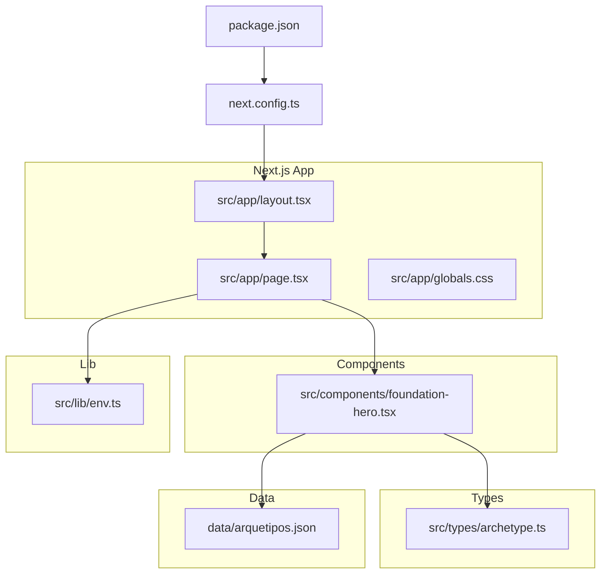
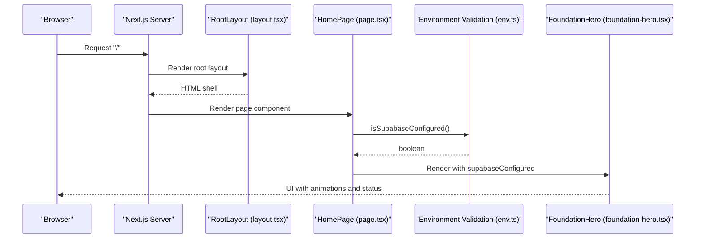
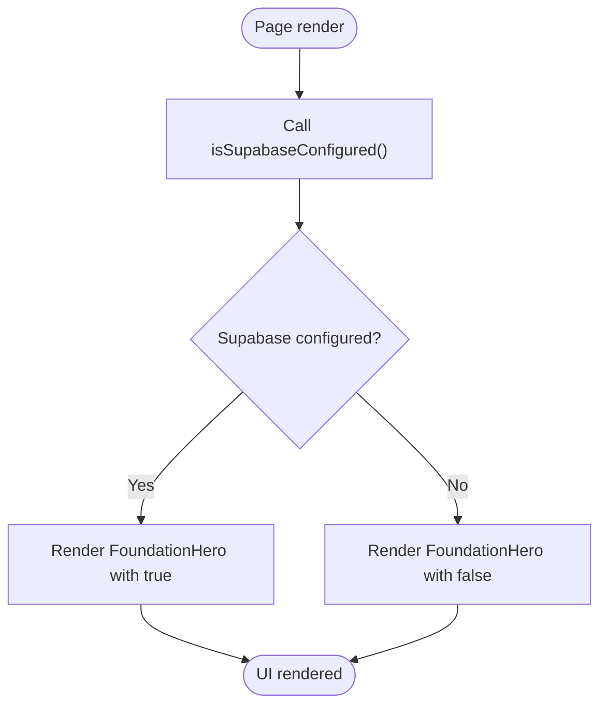
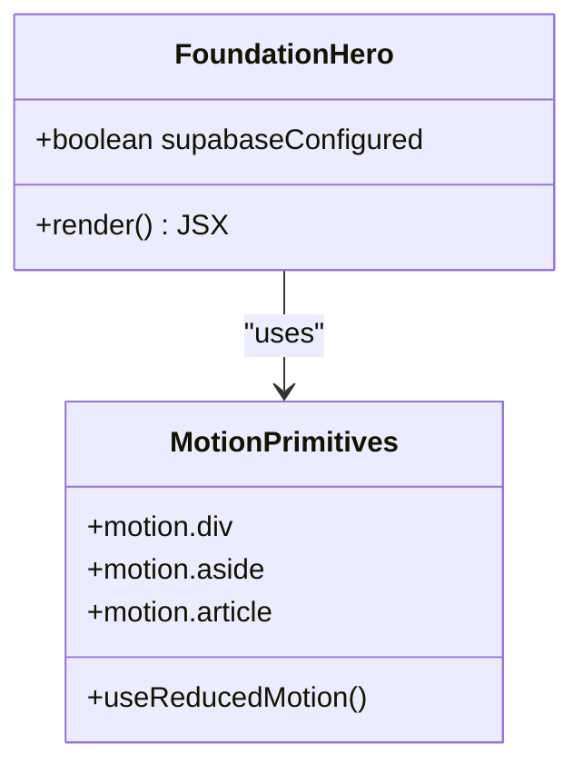
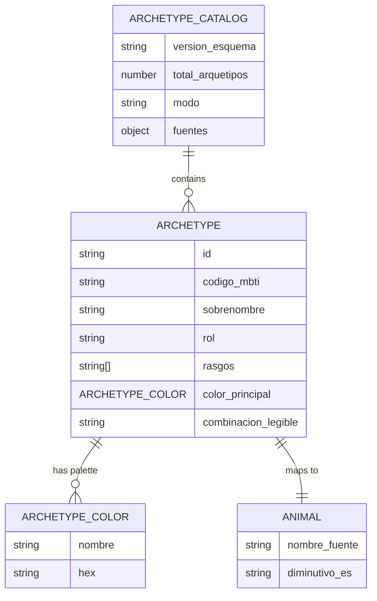
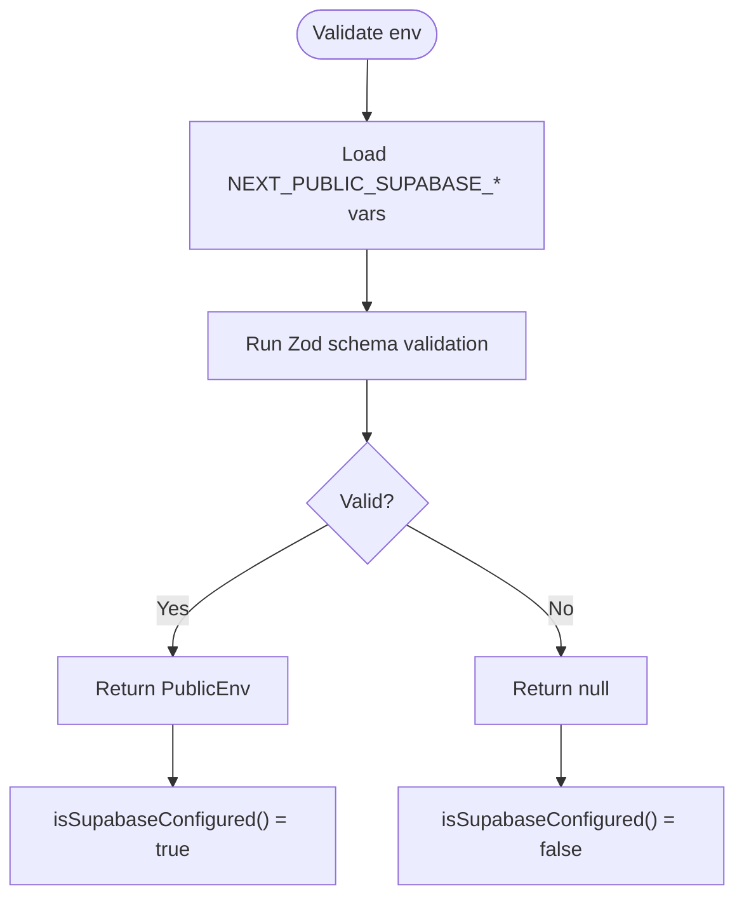

# Architecture Overview

<cite>
**Referenced Files in This Document**
- [page.tsx](file://src/app/page.tsx)
- [layout.tsx](file://src/app/layout.tsx)
- [foundation-hero.tsx](file://src/components/foundation-hero.tsx)
- [archetype.ts](file://src/types/archetype.ts)
- [arquetipos.json](file://data/arquetipos.json)
- [env.ts](file://src/lib/env.ts)
- [next.config.ts](file://next.config.ts)
- [package.json](file://package.json)
</cite>

## Table of Contents
1. [Introduction](#introduction)
2. [Project Structure](#project-structure)
3. [Core Components](#core-components)
4. [Architecture Overview](#architecture-overview)
5. [Detailed Component Analysis](#detailed-component-analysis)
6. [Dependency Analysis](#dependency-analysis)
7. [Performance Considerations](#performance-considerations)
8. [Troubleshooting Guide](#troubleshooting-guide)
9. [Conclusion](#conclusion)

## Introduction
ZooMatch is a Next.js application that presents personality archetypes as animal metaphors with curated color palettes. The current implementation focuses on the foundation UI: a landing page that renders a hero section and communicates whether Supabase environment configuration is available. Data modeling uses TypeScript interfaces, while static archetype data lives in a JSON file for future integration.

The project follows the Next.js App Router architecture, separates UI components from shared utilities and type definitions, and validates runtime environment variables using Zod.

## Project Structure
The repository organizes code by feature and layer:
- Application routes under `src/app`
- Reusable UI components under `src/components`
- Shared types under `src/types`
- Environment validation under `src/lib`
- Static data under `data`
- Build and tooling configuration at the repository root



**Diagram sources**
- [layout.tsx:1-17](file://src/app/layout.tsx#L1-L17)
- [page.tsx:1-10](file://src/app/page.tsx#L1-L10)
- [foundation-hero.tsx:1-117](file://src/components/foundation-hero.tsx#L1-L117)
- [archetype.ts:1-47](file://src/types/archetype.ts#L1-L47)
- [env.ts:1-26](file://src/lib/env.ts#L1-L26)
- [arquetipos.json:1-592](file://data/arquetipos.json#L1-L592)
- [next.config.ts:1-8](file://next.config.ts#L1-L8)
- [package.json:1-40](file://package.json#L1-L40)

**Section sources**
- [layout.tsx:1-17](file://src/app/layout.tsx#L1-L17)
- [page.tsx:1-10](file://src/app/page.tsx#L1-L10)
- [next.config.ts:1-8](file://next.config.ts#L1-L8)
- [package.json:1-40](file://package.json#L1-L40)

## Core Components
This section outlines the primary building blocks and their responsibilities.

- Root layout (`layout.tsx`)
  - Defines global metadata and wraps the application shell.
  - Loads global styles.

- Page route (`page.tsx`)
  - Renders the top-level page component.
  - Reads Supabase configuration status via an environment utility.
  - Passes configuration state to the hero component.

- Foundation hero (`foundation-hero.tsx`)
  - Client-side React component responsible for rendering the landing hero.
  - Uses motion animations and accessibility-aware behavior.
  - Displays sample specimens and indicates Supabase readiness.

- Type definitions (`archetype.ts`)
  - Strongly typed models for MBTI codes, colors, archetypes, and catalog metadata.
  - Provides a contract for future data loading and rendering logic.

- Environment validation (`env.ts`)
  - Validates public environment variables required by Supabase using Zod.
  - Exposes helpers to check configuration availability.

**Section sources**
- [layout.tsx:1-17](file://src/app/layout.tsx#L1-L17)
- [page.tsx:1-10](file://src/app/page.tsx#L1-L10)
- [foundation-hero.tsx:1-117](file://src/components/foundation-hero.tsx#L1-L117)
- [archetype.ts:1-47](file://src/types/archetype.ts#L1-L47)
- [env.ts:1-26](file://src/lib/env.ts#L1-L26)

## Architecture Overview
ZooMatch uses the Next.js App Router with a clear separation between server-rendered pages and client components. The root layout provides global metadata and CSS. The page component composes the foundation hero, which is a client component with animations. Configuration validation occurs before rendering to inform UI state.



**Diagram sources**
- [layout.tsx:1-17](file://src/app/layout.tsx#L1-L17)
- [page.tsx:1-10](file://src/app/page.tsx#L1-L10)
- [env.ts:1-26](file://src/lib/env.ts#L1-L26)
- [foundation-hero.tsx:1-117](file://src/components/foundation-hero.tsx#L1-L117)

## Detailed Component Analysis

### Root Layout
- Responsibilities
  - Declares document metadata such as title and description.
  - Wraps children in a minimal HTML structure.
  - Imports global styles.

- Design notes
  - Keeps the app shell thin to avoid unnecessary overhead.
  - Centralizes global styling import for consistent theming.

**Section sources**
- [layout.tsx:1-17](file://src/app/layout.tsx#L1-L17)

### Page Route
- Responsibilities
  - Imports the foundation hero component.
  - Evaluates Supabase configuration using the environment helper.
  - Renders the hero with the configuration flag.

- Data flow
  - Configuration evaluation happens during page render.
  - The boolean result is passed down as a prop to control UI state.



**Diagram sources**
- [page.tsx:1-10](file://src/app/page.tsx#L1-L10)
- [env.ts:1-26](file://src/lib/env.ts#L1-L26)

**Section sources**
- [page.tsx:1-10](file://src/app/page.tsx#L1-L10)
- [env.ts:1-26](file://src/lib/env.ts#L1-L26)

### Foundation Hero Component
- Responsibilities
  - Renders the landing hero section with typography, grid layout, and specimen cards.
  - Adapts animations based on user motion preferences.
  - Reflects Supabase configuration status through a visual indicator.

- Client-side behavior
  - Uses motion primitives for entrance animations.
  - Respects reduced motion settings for accessibility.

- Props
  - `supabaseConfigured`: Boolean indicating whether required environment variables are present.



**Diagram sources**
- [foundation-hero.tsx:1-117](file://src/components/foundation-hero.tsx#L1-L117)

**Section sources**
- [foundation-hero.tsx:1-117](file://src/components/foundation-hero.tsx#L1-L117)

### Type Definitions
- Purpose
  - Define strict contracts for archetype data, including MBTI codes, color palettes, and catalog metadata.
  - Enable type safety across data processing and UI layers.

- Key structures
  - MBTI code union type.
  - Archetype color interface.
  - Archetype interface with nested animal and palette information.
  - Archetype catalog interface with metadata and array of archetypes.



**Diagram sources**
- [archetype.ts:1-47](file://src/types/archetype.ts#L1-L47)

**Section sources**
- [archetype.ts:1-47](file://src/types/archetype.ts#L1-L47)

### Environment Configuration Validation
- Purpose
  - Validate public environment variables required by Supabase.
  - Provide a boolean helper to gate features or UI states.

- Implementation approach
  - Uses Zod schema to enforce presence and format of environment variables.
  - Returns null when validation fails; otherwise returns typed configuration.
  - Exposes a convenience function to check configuration availability.



**Diagram sources**
- [env.ts:1-26](file://src/lib/env.ts#L1-L26)

**Section sources**
- [env.ts:1-26](file://src/lib/env.ts#L1-L26)

### Static Archetype Data
- Purpose
  - Store the canonical set of 16 archetypes with MBTI codes, roles, traits, animals, and curated color palettes.
  - Serve as the source of truth for future data loading and rendering logic.

- Current usage
  - Types define the expected shape of this data.
  - The hero component currently shows a small subset of specimens inline for demonstration.

**Section sources**
- [arquetipos.json:1-592](file://data/arquetipos.json#L1-L592)
- [archetype.ts:1-47](file://src/types/archetype.ts#L1-L47)

## Dependency Analysis
The application’s dependencies reflect a modern Next.js stack with animation, visualization, and validation libraries.

```mermaid
graph LR
NextJS["Next.js"]
React["React / ReactDOM"]
Framer["framer-motion"]
Supabase["@supabase/supabase-js", "@supabase/ssr"]
Charts["recharts"]
Zod["zod"]
Tailwind["tailwindcss"]
NextJS --> React
NextJS --> Tailwind
NextJS --> Supabase
NextJS --> Framer
NextJS --> Charts
NextJS --> Zod
```

**Diagram sources**
- [package.json:17-25](file://package.json#L17-L25)

**Section sources**
- [package.json:1-40](file://package.json#L1-L40)

## Performance Considerations
- Client vs server boundaries
  - The hero component is explicitly marked as a client component due to animations and browser APIs. Keep heavy client logic isolated to minimize server bundle size.
- Animation performance
  - Respect reduced motion preferences to improve accessibility and reduce unnecessary reflows.
- Data handling
  - Static archetype data should be loaded once and memoized if used across multiple components to avoid repeated parsing or network calls.
- Rendering efficiency
  - Use stable keys for list items and avoid unnecessary re-renders by passing primitive props where possible.

[No sources needed since this section provides general guidance]

## Troubleshooting Guide
- Missing Supabase environment variables
  - Symptom: The hero displays a non-ready state indicator.
  - Cause: Required `NEXT_PUBLIC_SUPABASE_URL` and `NEXT_PUBLIC_SUPABASE_PUBLISHABLE_KEY` are missing or invalid.
  - Resolution: Set both environment variables and ensure they pass Zod validation.

- Validation failures
  - Symptom: `isSupabaseConfigured()` returns false even when variables appear set.
  - Cause: Variables may not be exposed to the client or do not match expected formats.
  - Resolution: Verify variable names and values; confirm they are prefixed correctly for Next.js public environment variables.

- Animation issues
  - Symptom: Animations feel janky or cause accessibility concerns.
  - Cause: Complex transitions or ignoring reduced motion settings.
  - Resolution: Simplify transitions and respect `useReducedMotion`.

**Section sources**
- [env.ts:1-26](file://src/lib/env.ts#L1-L26)
- [foundation-hero.tsx:1-117](file://src/components/foundation-hero.tsx#L1-L117)

## Conclusion
ZooMatch’s architecture cleanly separates concerns:
- The App Router defines the application shell and page composition.
- UI components encapsulate presentation and interaction.
- Type definitions provide a strong contract for data.
- Environment validation ensures safe runtime configuration.

This structure supports future expansion, such as loading the full archetype catalog, integrating Supabase services, and adding interactive features while maintaining clarity and maintainability.

[No sources needed since this section summarizes without analyzing specific files]