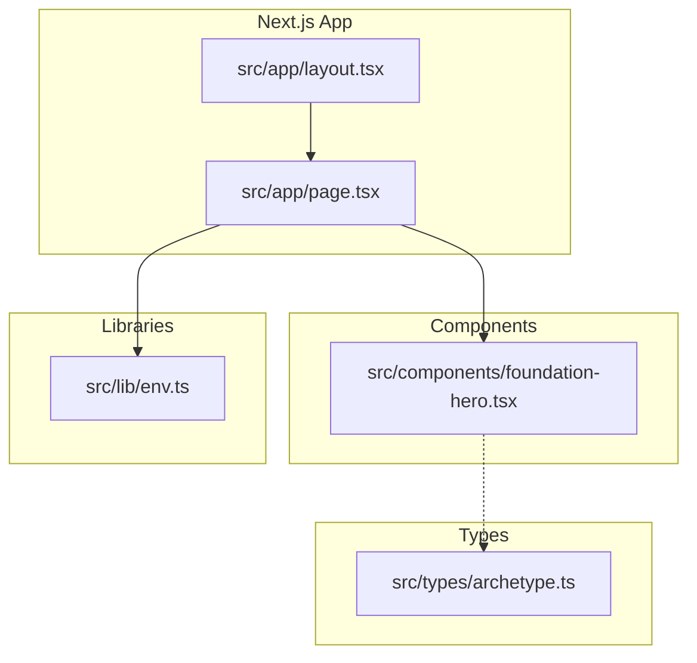
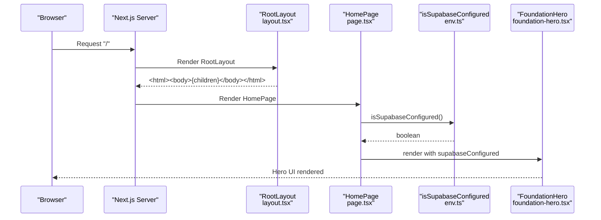
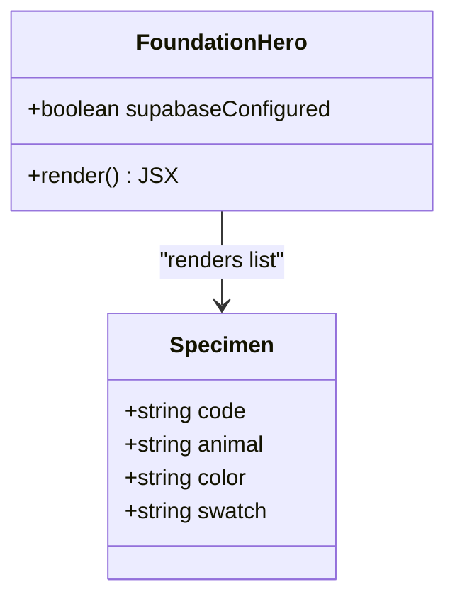
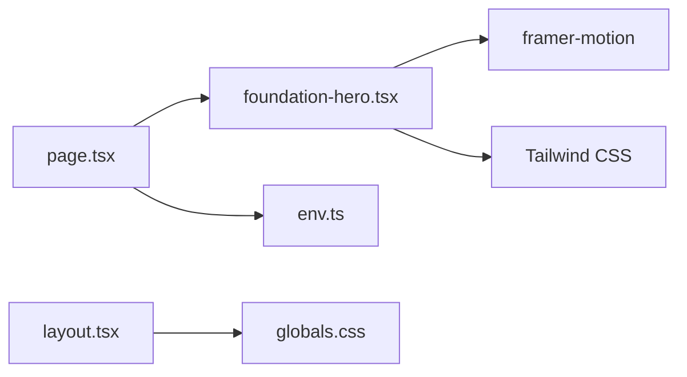

# Component Architecture

<cite>
**Referenced Files in This Document**   
- [page.tsx](file://src/app/page.tsx)
- [foundation-hero.tsx](file://src/components/foundation-hero.tsx)
- [layout.tsx](file://src/app/layout.tsx)
- [env.ts](file://src/lib/env.ts)
- [archetype.ts](file://src/types/archetype.ts)
- [package.json](file://package.json)
</cite>

## Table of Contents
1. [Introduction](#introduction)
2. [Project Structure](#project-structure)
3. [Core Components](#core-components)
4. [Architecture Overview](#architecture-overview)
5. [Detailed Component Analysis](#detailed-component-analysis)
6. [Dependency Analysis](#dependency-analysis)
7. [Performance Considerations](#performance-considerations)
8. [Troubleshooting Guide](#troubleshooting-guide)
9. [Conclusion](#conclusion)

## Introduction
This document explains the ZooMatch component architecture with a focus on the Next.js App Router entry point and the primary UI component, FoundationHero. It covers the component hierarchy, prop passing patterns, data flow from parent to child, composition strategies, state management approaches, and the separation between presentation and logic layers.

## Project Structure
The project follows a clean separation:
- App Router pages under src/app define routes and compose UI components.
- Reusable UI components live under src/components.
- Shared types are defined under src/types.
- Environment validation and configuration utilities are under src/lib.

**Diagram sources**
- [layout.tsx:1-17](file://src/app/layout.tsx#L1-L17)
- [page.tsx:1-10](file://src/app/page.tsx#L1-L10)
- [foundation-hero.tsx:1-117](file://src/components/foundation-hero.tsx#L1-L117)
- [env.ts:1-26](file://src/lib/env.ts#L1-L26)
- [archetype.ts:1-47](file://src/types/archetype.ts#L1-L47)

**Section sources**
- [layout.tsx:1-17](file://src/app/layout.tsx#L1-L17)
- [page.tsx:1-10](file://src/app/page.tsx#L1-L10)

## Core Components
- HomePage (src/app/page.tsx): The App Router page that renders the root layout content and composes the FoundationHero component. It passes a boolean indicating whether Supabase is configured.
- FoundationHero (src/components/foundation-hero.tsx): A client-side React component that renders the hero section, including animated panels and specimen cards. It receives supabaseConfigured as a prop to reflect environment readiness.

Key responsibilities:
- HomePage: route entry, composition, and configuration gating via props.
- FoundationHero: presentation layer for the hero UI, animations, and static specimen list.

**Section sources**
- [page.tsx:1-10](file://src/app/page.tsx#L1-L10)
- [foundation-hero.tsx:1-117](file://src/components/foundation-hero.tsx#L1-L117)

## Architecture Overview
The runtime flow starts at the Next.js server, renders the root layout, then the page component, which composes FoundationHero. Configuration status is computed once and passed down as a prop.

**Diagram sources**
- [layout.tsx:11-16](file://src/app/layout.tsx#L11-L16)
- [page.tsx:1-10](file://src/app/page.tsx#L1-L10)
- [env.ts:22-26](file://src/lib/env.ts#L22-L26)
- [foundation-hero.tsx:15-32](file://src/components/foundation-hero.tsx#L15-L32)

## Detailed Component Analysis

### HomePage (src/app/page.tsx)
Responsibilities:
- Imports FoundationHero and the environment check utility.
- Renders a main element containing FoundationHero.
- Passes supabaseConfigured derived from isSupabaseConfigured().

Data flow:
- Reads environment configuration via env.ts.
- Propagates a boolean to FoundationHero to reflect foundation readiness.

Composition pattern:
- Simple composition: one child component with a single boolean prop.

State management:
- No local state; configuration is read-only and passed down.

Accessibility and semantics:
- Uses semantic <main> to structure the page content.

**Section sources**
- [page.tsx:1-10](file://src/app/page.tsx#L1-L10)

### FoundationHero (src/components/foundation-hero.tsx)
Responsibilities:
- Client-side component rendering the hero section.
- Displays a header with a status indicator reflecting supabaseConfigured.
- Presents a two-panel layout: left panel with headline and call-to-action; right panel with selected specimens.
- Uses framer-motion for entrance animations and respects reduced motion preferences.

Props:
- supabaseConfigured: boolean controlling the visual status indicator.

Internal data:
- A static array of specimen entries used to render sample archetype cards.

Animation strategy:
- Uses useReducedMotion to disable animations when preferred by the user.
- Staggered transitions for specimen cards.

Styling:
- Tailwind CSS classes for responsive layout and typography.

Accessibility:
- aria-hidden on decorative elements.
- Semantic HTML sections, headers, articles.

**Diagram sources**
- [foundation-hero.tsx:5-13](file://src/components/foundation-hero.tsx#L5-L13)
- [foundation-hero.tsx:15-117](file://src/components/foundation-hero.tsx#L15-L117)

**Section sources**
- [foundation-hero.tsx:1-117](file://src/components/foundation-hero.tsx#L1-L117)

### RootLayout (src/app/layout.tsx)
Responsibilities:
- Defines site metadata (title and description).
- Wraps children in html and body tags.
- Imports global styles.

Role in architecture:
- Provides the shell around all pages, ensuring consistent document structure and global styles.

**Section sources**
- [layout.tsx:1-17](file://src/app/layout.tsx#L1-L17)

### Environment Utilities (src/lib/env.ts)
Responsibilities:
- Validates public environment variables using Zod.
- Exposes getPublicEnv for typed access.
- Exposes isSupabaseConfigured to return a boolean based on validation result.

Usage:
- Called by HomePage to determine if Supabase is configured and pass the result to FoundationHero.

**Section sources**
- [env.ts:1-26](file://src/lib/env.ts#L1-L26)

### Types (src/types/archetype.ts)
Responsibilities:
- Defines TypeScript types for MBTI codes, ArchetypeColor, Archetype, and ArchetypeCatalog.
- Supports future integration with archetype data structures.

Current usage:
- Not directly imported by current components, but available for extension and data modeling.

**Section sources**
- [archetype.ts:1-47](file://src/types/archetype.ts#L1-L47)

## Dependency Analysis
Component-level dependencies:
- HomePage depends on FoundationHero and isSupabaseConfigured.
- FoundationHero depends on framer-motion for animations and uses Tailwind CSS for styling.
- RootLayout imports global CSS and provides metadata.

External libraries:
- next, react, react-dom: core framework and runtime.
- framer-motion: animation library.
- zod: runtime schema validation for environment variables.
- tailwindcss: utility-first CSS framework.

**Diagram sources**
- [page.tsx:1-10](file://src/app/page.tsx#L1-L10)
- [foundation-hero.tsx:1-117](file://src/components/foundation-hero.tsx#L1-L117)
- [env.ts:1-26](file://src/lib/env.ts#L1-L26)
- [layout.tsx:1-17](file://src/app/layout.tsx#L1-L17)
- [package.json:17-25](file://package.json#L17-L25)

**Section sources**
- [package.json:17-25](file://package.json#L17-L25)

## Performance Considerations
- Client-side animations: FoundationHero uses framer-motion; consider reducing motion for accessibility and performance on low-end devices.
- Static data: The specimen list is static and small; no additional optimization needed.
- Hydration: Since FoundationHero is a client component, ensure minimal heavy computations during mount to avoid jank.
- CSS: Tailwind classes are compiled; keep component structure simple to minimize reflows.

[No sources needed since this section provides general guidance]

## Troubleshooting Guide
Common issues and resolutions:
- Missing or invalid Supabase environment variables:
  - Symptom: FoundationHero shows “Foundation ready” with a non-active indicator.
  - Cause: isSupabaseConfigured returns false due to missing/invalid NEXT_PUBLIC_SUPABASE_URL or NEXT_PUBLIC_SUPABASE_PUBLISHABLE_KEY.
  - Resolution: Ensure both environment variables are set and valid. See env.ts for validation rules.

- Animations not appearing:
  - Symptom: No entrance animations on load.
  - Cause: User prefers reduced motion or browser settings disable animations.
  - Resolution: Check useReducedMotion behavior in FoundationHero; adjust if necessary for testing.

- Build errors related to environment:
  - Symptom: Type errors or runtime checks fail.
  - Cause: Invalid environment variable formats.
  - Resolution: Validate values against the Zod schema in env.ts.

**Section sources**
- [env.ts:1-26](file://src/lib/env.ts#L1-L26)
- [foundation-hero.tsx:15-32](file://src/components/foundation-hero.tsx#L15-L32)

## Conclusion
ZooMatch’s component architecture cleanly separates concerns:
- HomePage orchestrates composition and configuration gating.
- FoundationHero encapsulates presentation and animation logic.
- Environment validation is isolated in env.ts and consumed declaratively via props.
This design promotes clarity, testability, and maintainability while keeping the UI focused and accessible.

[No sources needed since this section summarizes without analyzing specific files]