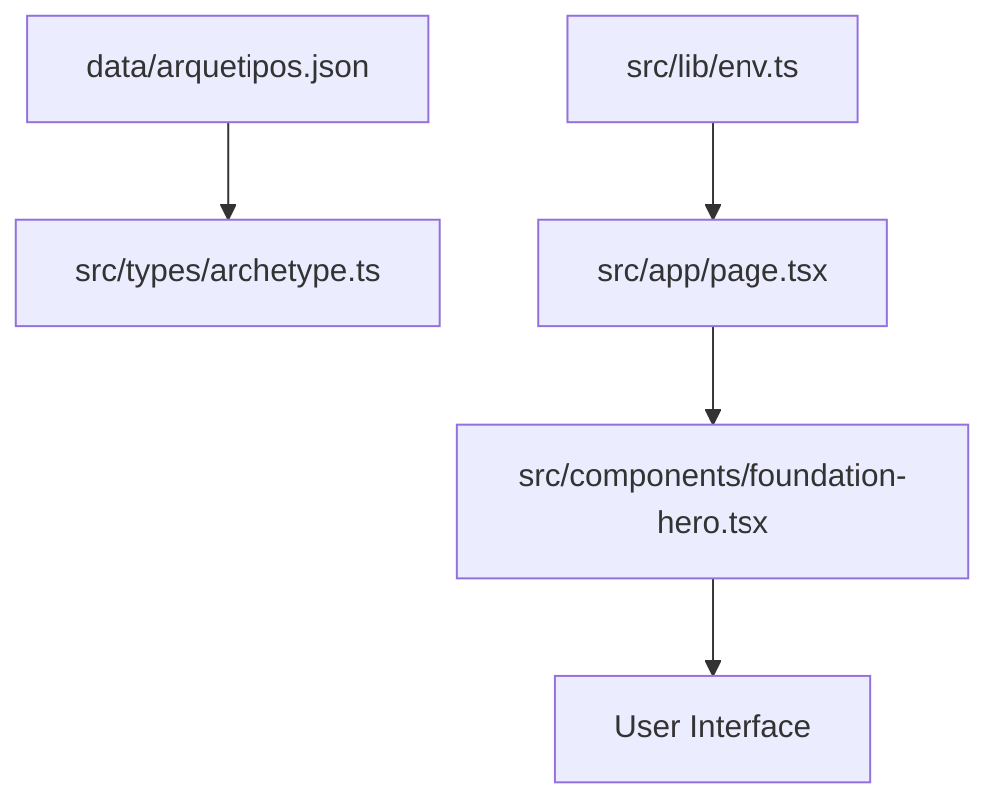
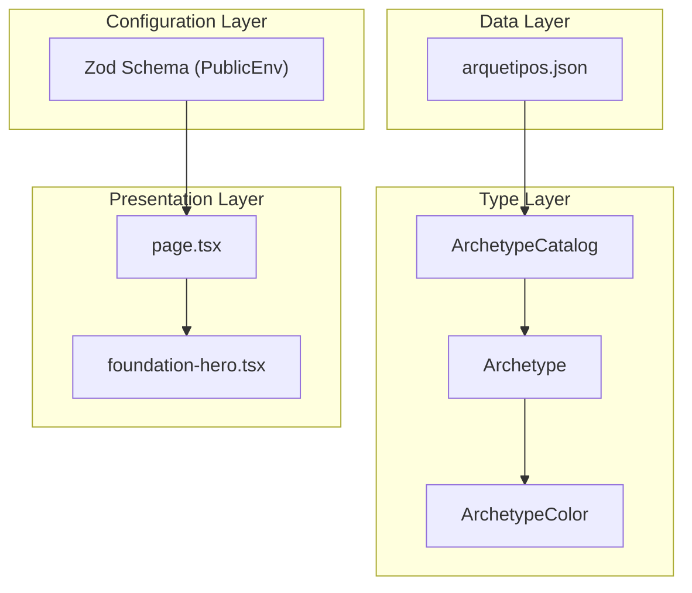
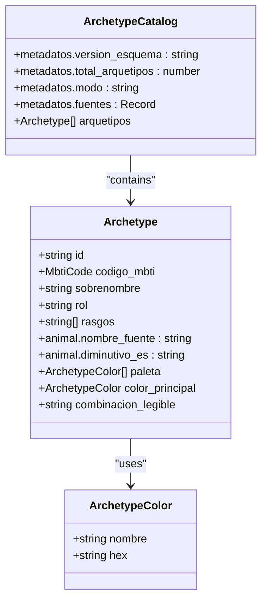
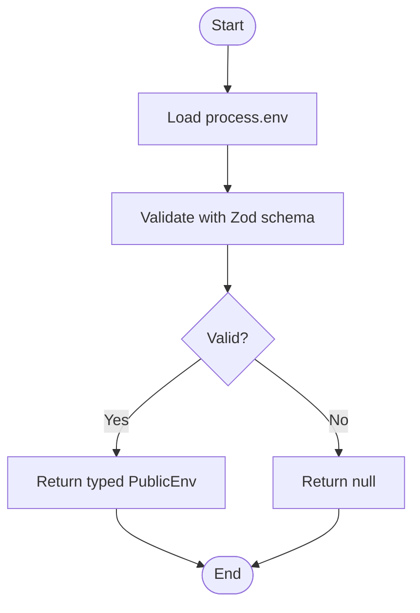
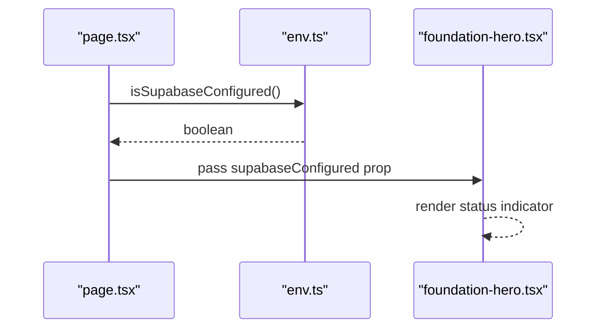
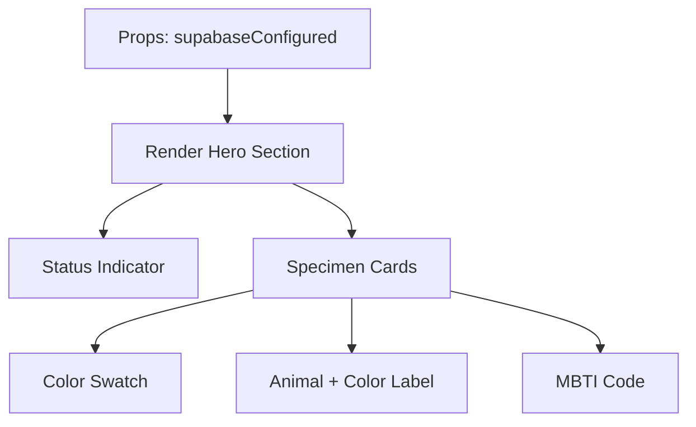
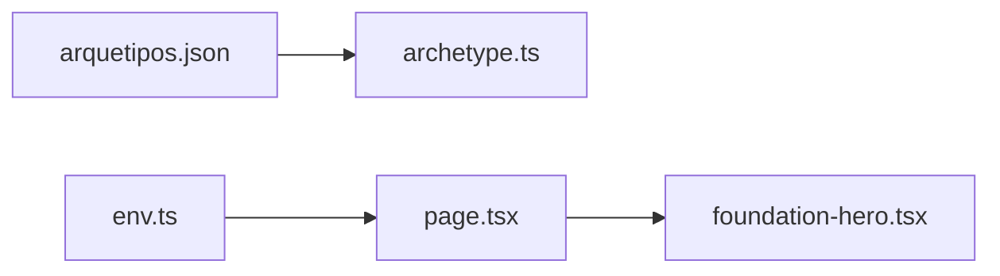

# Data Flow Patterns

<cite>
**Referenced Files in This Document**
- [arquetipos.json](file://data/arquetipos.json)
- [archetype.ts](file://src/types/archetype.ts)
- [env.ts](file://src/lib/env.ts)
- [page.tsx](file://src/app/page.tsx)
- [foundation-hero.tsx](file://src/components/foundation-hero.tsx)
</cite>

## Table of Contents
1. [Introduction](#introduction)
2. [Project Structure](#project-structure)
3. [Core Components](#core-components)
4. [Architecture Overview](#architecture-overview)
5. [Detailed Component Analysis](#detailed-component-analysis)
6. [Dependency Analysis](#dependency-analysis)
7. [Performance Considerations](#performance-considerations)
8. [Troubleshooting Guide](#troubleshooting-guide)
9. [Conclusion](#conclusion)

## Introduction
This document explains the data flow patterns in ZooMatch, focusing on how static archetype data from arquetipos.json is modeled with TypeScript interfaces and consumed by React components. It also covers environment configuration validation using Zod schemas and its integration with Supabase client setup. The goal is to clarify the contract between the data layer and presentation layer, including type safety, transformation strategies, validation, and error handling.

## Project Structure
ZooMatch organizes data, types, runtime configuration, and UI into clear layers:
- Static data lives under data/ as JSON files.
- Type definitions live under src/types/.
- Environment validation lives under src/lib/.
- Application pages and components live under src/app/ and src/components/.

**Diagram sources**
- [arquetipos.json:1-592](file://data/arquetipos.json#L1-L592)
- [archetype.ts:1-47](file://src/types/archetype.ts#L1-L47)
- [env.ts:1-26](file://src/lib/env.ts#L1-L26)
- [page.tsx:1-10](file://src/app/page.tsx#L1-L10)
- [foundation-hero.tsx:1-117](file://src/components/foundation-hero.tsx#L1-L117)

**Section sources**
- [arquetipos.json:1-592](file://data/arquetipos.json#L1-L592)
- [archetype.ts:1-47](file://src/types/archetype.ts#L1-L47)
- [env.ts:1-26](file://src/lib/env.ts#L1-L26)
- [page.tsx:1-10](file://src/app/page.tsx#L1-L10)
- [foundation-hero.tsx:1-117](file://src/components/foundation-hero.tsx#L1-L117)

## Core Components
- ArchetypeCatalog: Represents the top-level shape of arquetipos.json, including metadata and an array of archetypes.
- Archetype: Represents a single archetype entry with MBTI code, traits, animal mapping, color palette, and primary color.
- ArchetypeColor: Represents a named color with a hex value.
- PublicEnv: Runtime environment variables validated via Zod for Supabase connectivity.

Key responsibilities:
- Types define the contract for static data and runtime configuration.
- Validation ensures environment variables are present and correctly shaped before initializing Supabase.
- Components consume typed data and configuration to render UI safely.

**Section sources**
- [archetype.ts:1-47](file://src/types/archetype.ts#L1-L47)
- [env.ts:1-26](file://src/lib/env.ts#L1-L26)

## Architecture Overview
The application follows a layered architecture:
- Data Layer: Static JSON file provides archetype catalog.
- Type Layer: TypeScript interfaces model the JSON structure and ensure compile-time safety.
- Configuration Layer: Zod validates environment variables required by Supabase.
- Presentation Layer: React components render UI based on typed data and configuration.

**Diagram sources**
- [arquetipos.json:1-592](file://data/arquetipos.json#L1-L592)
- [archetype.ts:1-47](file://src/types/archetype.ts#L1-L47)
- [env.ts:1-26](file://src/lib/env.ts#L1-L26)
- [page.tsx:1-10](file://src/app/page.tsx#L1-L10)
- [foundation-hero.tsx:1-117](file://src/components/foundation-hero.tsx#L1-L117)

## Detailed Component Analysis

### Static Data Model: ArchetypeCatalog, Archetype, ArchetypeColor
The JSON file defines a catalog of archetypes with metadata and an array of entries. Each archetype includes:
- Identification fields: id, codigo_mbti, sobrenombre, rol
- Traits: rasgos array
- Animal mapping: nombre_fuente and diminutivo_es
- Color system: paleta array and color_principal object
- Readable combination label: combinacion_legible

The TypeScript interfaces mirror this structure:
- ArchetypeColor enforces a named color and a hex string.
- Archetype constrains codigo_mbti to a union of valid MBTI codes and models nested structures.
- ArchetypeCatalog wraps metadata and the archetypes array.

**Diagram sources**
- [archetype.ts:1-47](file://src/types/archetype.ts#L1-L47)

**Section sources**
- [arquetipos.json:1-592](file://data/arquetipos.json#L1-L592)
- [archetype.ts:1-47](file://src/types/archetype.ts#L1-L47)

### Environment Configuration Validation with Zod
The environment module uses Zod to validate public environment variables required by Supabase:
- NEXT_PUBLIC_SUPABASE_URL must be a valid URL.
- NEXT_PUBLIC_SUPABASE_PUBLISHABLE_KEY must be a non-empty string.

Functions:
- getPublicEnv: Validates environment variables and returns either a typed object or null.
- isSupabaseConfigured: Returns a boolean indicating whether the environment is valid.

**Diagram sources**
- [env.ts:1-26](file://src/lib/env.ts#L1-L26)

**Section sources**
- [env.ts:1-26](file://src/lib/env.ts#L1-L26)

### Page Integration and Supabase Readiness
The root page component imports the environment validation function and passes a boolean flag to the FoundationHero component:
- isSupabaseConfigured() determines if Supabase is configured.
- The boolean controls UI state indicators in the hero section.

**Diagram sources**
- [page.tsx:1-10](file://src/app/page.tsx#L1-L10)
- [env.ts:1-26](file://src/lib/env.ts#L1-L26)
- [foundation-hero.tsx:1-117](file://src/components/foundation-hero.tsx#L1-L117)

**Section sources**
- [page.tsx:1-10](file://src/app/page.tsx#L1-L10)
- [env.ts:1-26](file://src/lib/env.ts#L1-L26)
- [foundation-hero.tsx:1-117](file://src/components/foundation-hero.tsx#L1-L117)

### Data Consumption in Components
The FoundationHero component currently renders a small set of sample specimens directly within the component. While it does not yet consume the full ArchetypeCatalog, it demonstrates the pattern for rendering specimen cards with color swatches and labels.

Key observations:
- The component accepts a supabaseConfigured boolean prop to reflect runtime configuration.
- It renders a curated list of specimens with hardcoded values for demonstration.
- Future integration can replace these samples with data derived from ArchetypeCatalog, ensuring type safety through Archetype and ArchetypeColor.

**Diagram sources**
- [foundation-hero.tsx:1-117](file://src/components/foundation-hero.tsx#L1-L117)

**Section sources**
- [foundation-hero.tsx:1-117](file://src/components/foundation-hero.tsx#L1-L117)

### Contract Between Data Layer and Presentation Layer
- Data Layer: Provides static archetype catalog in JSON format.
- Type Layer: Defines ArchetypeCatalog, Archetype, and ArchetypeColor to enforce structure and constraints.
- Presentation Layer: Consumes typed data and configuration to render UI safely.

Recommended integration steps:
- Import ArchetypeCatalog and Archetype types.
- Load arquetipos.json at build time or runtime and cast to ArchetypeCatalog.
- Validate the loaded data against the ArchetypeCatalog shape (optional runtime validation).
- Pass Archetype[] to components that need to display archetype information.
- Use ArchetypeColor for consistent color usage across UI elements.

[No sources needed since this section outlines recommended integration steps without analyzing specific files]

## Dependency Analysis
The following diagram shows dependencies among core modules:

**Diagram sources**
- [arquetipos.json:1-592](file://data/arquetipos.json#L1-L592)
- [archetype.ts:1-47](file://src/types/archetype.ts#L1-L47)
- [env.ts:1-26](file://src/lib/env.ts#L1-L26)
- [page.tsx:1-10](file://src/app/page.tsx#L1-L10)
- [foundation-hero.tsx:1-117](file://src/components/foundation-hero.tsx#L1-L117)

**Section sources**
- [arquetipos.json:1-592](file://data/arquetipos.json#L1-L592)
- [archetype.ts:1-47](file://src/types/archetype.ts#L1-L47)
- [env.ts:1-26](file://src/lib/env.ts#L1-L26)
- [page.tsx:1-10](file://src/app/page.tsx#L1-L10)
- [foundation-hero.tsx:1-117](file://src/components/foundation-hero.tsx#L1-L117)

## Performance Considerations
- Static JSON loading: Since arquetipos.json is static, consider importing it at build time to avoid runtime parsing overhead.
- Memoization: When passing large archetype lists to components, memoize derived data to prevent unnecessary re-renders.
- Reduced motion: The hero component respects user preferences for reduced motion, improving accessibility and performance on constrained devices.

[No sources needed since this section provides general guidance]

## Troubleshooting Guide
Common issues and resolutions:
- Missing or invalid environment variables: If NEXT_PUBLIC_SUPABASE_URL or NEXT_PUBLIC_SUPABASE_PUBLISHABLE_KEY are missing or malformed, isSupabaseConfigured will return false. Ensure environment variables are set correctly.
- Type mismatches: If the JSON structure changes, update ArchetypeCatalog and related interfaces accordingly to maintain type safety.
- UI state confusion: The hero component’s status indicator reflects the Supabase configuration; verify the boolean prop when debugging UI states.

**Section sources**
- [env.ts:1-26](file://src/lib/env.ts#L1-L26)
- [foundation-hero.tsx:1-117](file://src/components/foundation-hero.tsx#L1-L117)

## Conclusion
ZooMatch establishes a clear separation between static data, type definitions, environment validation, and UI components. The ArchetypeCatalog, Archetype, and ArchetypeColor interfaces provide strong typing for archetype data, while Zod-based environment validation ensures safe initialization of Supabase. The current hero component demonstrates consumption patterns and readiness indicators. Extending the UI to consume the full archetype catalog will further strengthen the contract between the data layer and presentation layer, maintaining type safety and predictable behavior.

[No sources needed since this section summarizes without analyzing specific files]