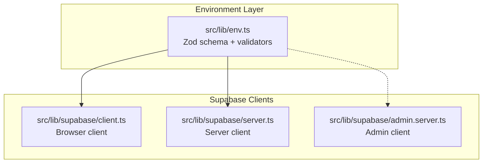
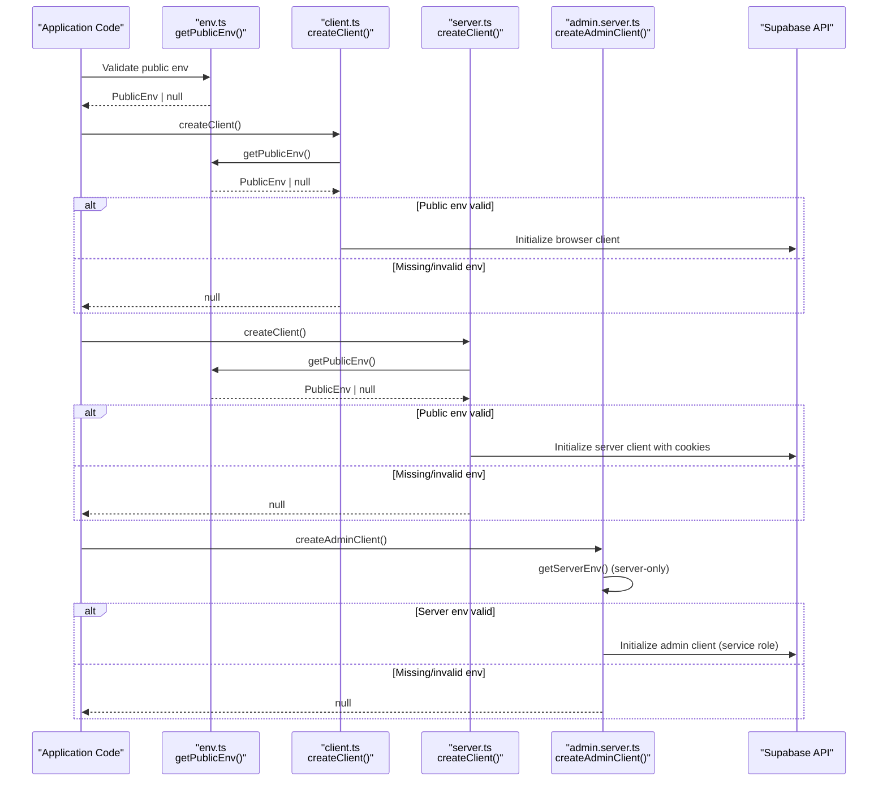
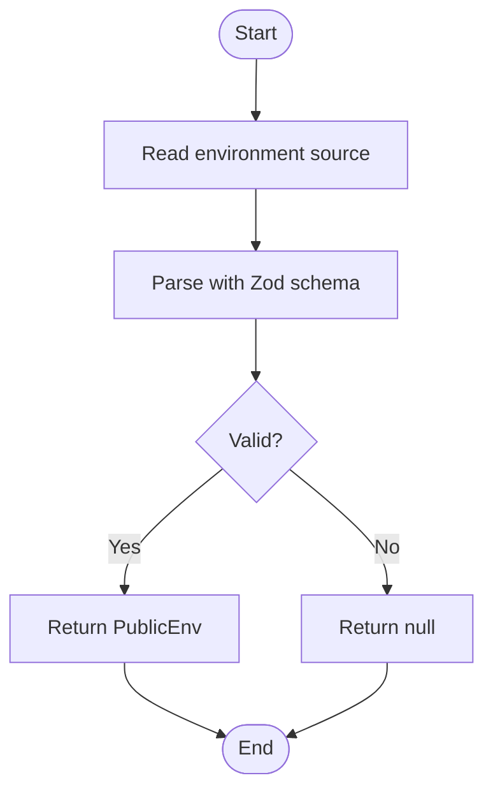
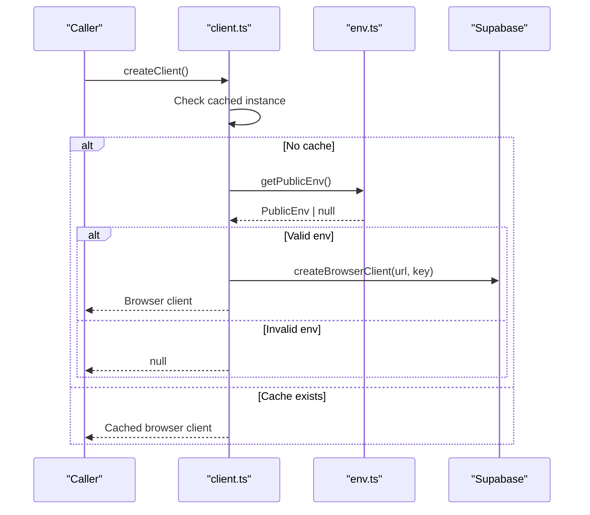
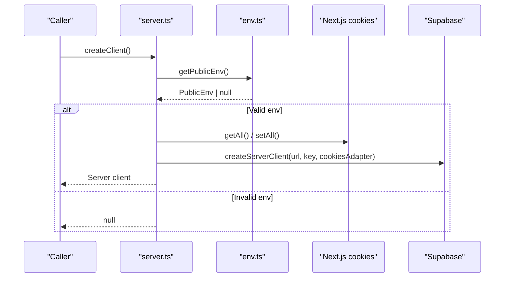
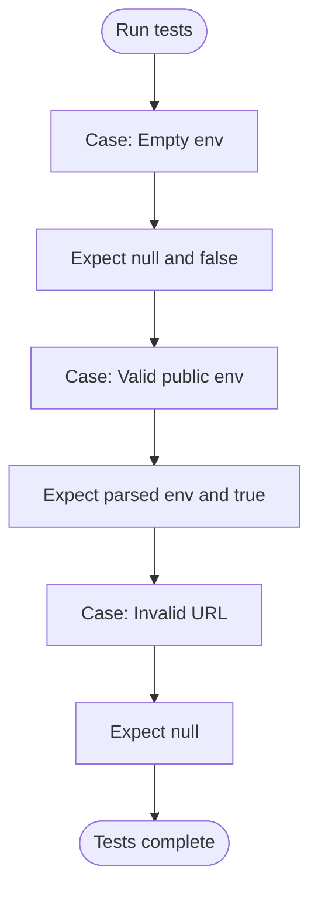
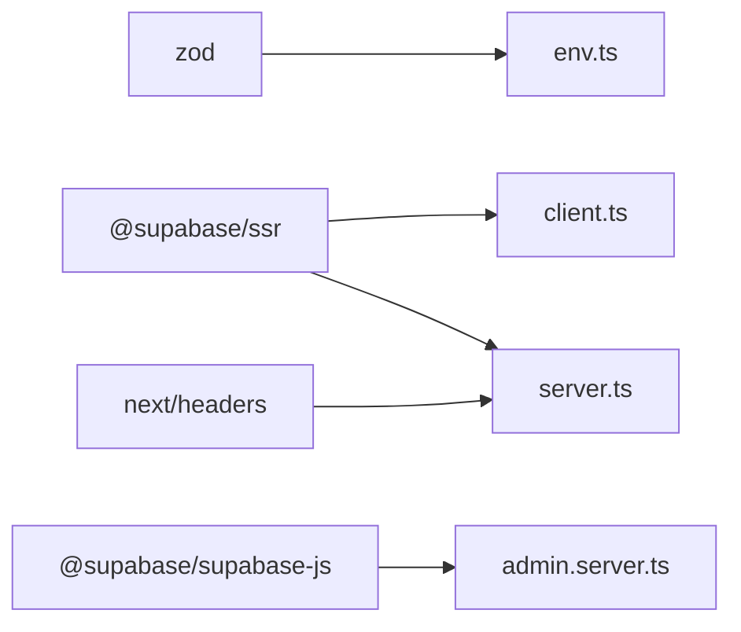

# Environment Configuration Flow

<cite>
**Referenced Files in This Document**
- [env.ts](file://src/lib/env.ts)
- [env.test.ts](file://src/lib/env.test.ts)
- [client.ts](file://src/lib/supabase/client.ts)
- [server.ts](file://src/lib/supabase/server.ts)
- [admin.server.ts](file://src/lib/supabase/admin.server.ts)
- [package.json](file://package.json)
</cite>

## Table of Contents
1. [Introduction](#introduction)
2. [Project Structure](#project-structure)
3. [Core Components](#core-components)
4. [Architecture Overview](#architecture-overview)
5. [Detailed Component Analysis](#detailed-component-analysis)
6. [Dependency Analysis](#dependency-analysis)
7. [Performance Considerations](#performance-considerations)
8. [Troubleshooting Guide](#troubleshooting-guide)
9. [Conclusion](#conclusion)
10. [Appendices](#appendices)

## Introduction
This document explains how ZooMatch validates and initializes environment configuration at runtime using Zod schemas, focusing on Supabase credentials and other public settings. It covers:
- How public environment variables are validated with Zod
- How client and server Supabase clients are initialized differently for browser and server environments
- Error handling when environment variables are missing or invalid
- Security considerations for sensitive data
- Examples for local development, testing, and deployment

## Project Structure
The environment configuration and Supabase initialization live under `src/lib`:
- `src/lib/env.ts` defines the Zod schema and validation helpers for public environment variables
- `src/lib/supabase/client.ts` creates a browser-safe Supabase client
- `src/lib/supabase/server.ts` creates a server-side Supabase client with cookie handling
- `src/lib/supabase/admin.server.ts` creates an admin client that uses server-only secrets (requires a server env module)
- `src/lib/env.test.ts` contains tests validating the environment parsing behavior

**Diagram sources**
- [env.ts:1-26](file://src/lib/env.ts#L1-L26)
- [client.ts:1-25](file://src/lib/supabase/client.ts#L1-L25)
- [server.ts:1-34](file://src/lib/supabase/server.ts#L1-L34)
- [admin.server.ts:1-23](file://src/lib/supabase/admin.server.ts#L1-L23)

**Section sources**
- [env.ts:1-26](file://src/lib/env.ts#L1-L26)
- [client.ts:1-25](file://src/lib/supabase/client.ts#L1-L25)
- [server.ts:1-34](file://src/lib/supabase/server.ts#L1-L34)
- [admin.server.ts:1-23](file://src/lib/supabase/admin.server.ts#L1-L23)

## Core Components
- Public environment schema and validators:
  - A Zod object schema enforces that `NEXT_PUBLIC_SUPABASE_URL` is a valid URL and `NEXT_PUBLIC_SUPABASE_PUBLISHABLE_KEY` is present.
  - `getPublicEnv(source)` returns parsed public environment or `null` if validation fails.
  - `isSupabaseConfigured(source)` returns a boolean indicating whether public Supabase configuration is valid.
- Browser client:
  - Uses `@supabase/ssr`’s `createBrowserClient`.
  - Lazily caches the client instance to avoid recreating it.
  - Returns `null` if public environment is not configured.
- Server client:
  - Uses `@supabase/ssr`’s `createServerClient`.
  - Integrates with Next.js cookies via `next/headers`.
  - Gracefully handles cookie write failures in Server Components by catching errors.
  - Returns `null` if public environment is not configured.
- Admin client:
  - Uses `@supabase/supabase-js` directly with service role key.
  - Disables session persistence and auto-refresh for server-side admin usage.
  - Requires a server-only environment module (`getServerEnv`) which is imported but not present in this repository snapshot.

**Section sources**
- [env.ts:1-26](file://src/lib/env.ts#L1-L26)
- [client.ts:1-25](file://src/lib/supabase/client.ts#L1-L25)
- [server.ts:1-34](file://src/lib/supabase/server.ts#L1-L34)
- [admin.server.ts:1-23](file://src/lib/supabase/admin.server.ts#L1-L23)

## Architecture Overview
The environment configuration flow ensures that only validated public variables reach the browser and that server-only secrets never leak into client bundles.

**Diagram sources**
- [env.ts:10-25](file://src/lib/env.ts#L10-L25)
- [client.ts:9-24](file://src/lib/supabase/client.ts#L9-L24)
- [server.ts:6-33](file://src/lib/supabase/server.ts#L6-L33)
- [admin.server.ts:5-21](file://src/lib/supabase/admin.server.ts#L5-L21)

## Detailed Component Analysis

### Environment Validation with Zod
- Schema definition:
  - Enforces `NEXT_PUBLIC_SUPABASE_URL` must be a valid URL string.
  - Enforces `NEXT_PUBLIC_SUPABASE_PUBLISHABLE_KEY` must be a non-empty string.
- Validation functions:
  - `getPublicEnv(source)` parses the provided environment source (defaults to `process.env`) against the schema and returns either the typed public environment object or `null`.
  - `isSupabaseConfigured(source)` is a convenience check returning `true` when public environment is valid.
- Type safety:
  - Exposes a TypeScript type derived from the Zod schema for compile-time guarantees.

**Diagram sources**
- [env.ts:3-19](file://src/lib/env.ts#L3-L19)

**Section sources**
- [env.ts:1-26](file://src/lib/env.ts#L1-L26)

### Browser Client Initialization
- Purpose: Create a Supabase client suitable for the browser.
- Behavior:
  - Lazily creates and caches a single client instance per process.
  - Reads public environment via `getPublicEnv()` and constructs the client only if valid.
  - Returns `null` when environment is missing or invalid, allowing callers to guard UI or logic accordingly.

**Diagram sources**
- [client.ts:7-24](file://src/lib/supabase/client.ts#L7-L24)
- [env.ts:10-19](file://src/lib/env.ts#L10-L19)

**Section sources**
- [client.ts:1-25](file://src/lib/supabase/client.ts#L1-L25)

### Server Client Initialization
- Purpose: Create a Supabase client for server-side code with cookie integration.
- Behavior:
  - Validates public environment before creating the client.
  - Uses Next.js `cookies()` to read and write session cookies through a custom adapter.
  - Handles cookie write errors gracefully (e.g., in Server Components where writes are restricted).
  - Returns `null` if public environment is invalid.

**Diagram sources**
- [server.ts:6-33](file://src/lib/supabase/server.ts#L6-L33)
- [env.ts:10-19](file://src/lib/env.ts#L10-L19)

**Section sources**
- [server.ts:1-34](file://src/lib/supabase/server.ts#L1-L34)

### Admin Client Initialization
- Purpose: Create a privileged Supabase client using the service role key for server-only operations.
- Behavior:
  - Imports a server-only environment getter (`getServerEnv`) to access secrets like `SUPABASE_SERVICE_ROLE_KEY`.
  - Disables automatic token refresh and session detection/persistence since it runs on the server.
  - Returns `null` if server environment is invalid.

Note: The referenced server environment module (`@/lib/env.server`) is not present in this repository snapshot; ensure it exports a function that validates server-only variables similarly to `getPublicEnv`.

**Section sources**
- [admin.server.ts:1-23](file://src/lib/supabase/admin.server.ts#L1-L23)

### Testing Environment Validation
- Tests verify:
  - Absence of public Supabase credentials yields `null` and `isSupabaseConfigured` returns `false`.
  - Valid public credentials pass validation and return the expected object.
  - Malformed URLs are rejected.

**Diagram sources**
- [env.test.ts:5-28](file://src/lib/env.test.ts#L5-L28)

**Section sources**
- [env.test.ts:1-29](file://src/lib/env.test.ts#L1-L29)

## Dependency Analysis
- Runtime dependencies relevant to environment and Supabase:
  - `zod` for schema validation
  - `@supabase/ssr` for browser and server client creation
  - `@supabase/supabase-js` for direct admin client creation
  - `next/headers` for cookie handling in server client

**Diagram sources**
- [package.json:17-26](file://package.json#L17-L26)
- [env.ts:1-1](file://src/lib/env.ts#L1-L1)
- [client.ts:3-3](file://src/lib/supabase/client.ts#L3-L3)
- [server.ts:1-2](file://src/lib/supabase/server.ts#L1-L2)
- [admin.server.ts:1-1](file://src/lib/supabase/admin.server.ts#L1-L1)

**Section sources**
- [package.json:17-26](file://package.json#L17-L26)

## Performance Considerations
- Browser client caching avoids repeated client instantiation, reducing overhead during component mounts.
- Server client cookie adapter catches write errors to prevent request failures when cookies cannot be written in certain server contexts.
- Using Zod’s `safeParse` prevents throwing exceptions during environment validation, enabling graceful fallbacks.

[No sources needed since this section provides general guidance]

## Troubleshooting Guide
Common issues and resolutions:
- Missing or malformed `NEXT_PUBLIC_SUPABASE_URL`:
  - Validation fails; both browser and server clients will return `null`.
  - Ensure the value is a well-formed HTTPS URL pointing to your Supabase project.
- Missing `NEXT_PUBLIC_SUPABASE_PUBLISHABLE_KEY`:
  - Validation fails; clients will return `null`.
  - Provide a valid publishable key from your Supabase project settings.
- Admin client not working:
  - Verify that the server-only environment module exports required secrets such as `SUPABASE_SERVICE_ROLE_KEY`.
  - Confirm that server-only variables are not exposed to the browser.
- Cookie-related errors in server components:
  - The server client already handles cookie write errors; if you see issues, ensure middleware is used to refresh cookies when necessary.

**Section sources**
- [env.ts:10-25](file://src/lib/env.ts#L10-L25)
- [client.ts:14-17](file://src/lib/supabase/client.ts#L14-L17)
- [server.ts:22-29](file://src/lib/supabase/server.ts#L22-L29)
- [admin.server.ts:5-21](file://src/lib/supabase/admin.server.ts#L5-L21)

## Conclusion
ZooMatch uses Zod to validate public environment variables at runtime, ensuring that only safe, verified values reach the browser. The Supabase client initialization differs between browser and server environments:
- Browser client: lightweight, cached, and guarded by environment validation.
- Server client: integrates with Next.js cookies and handles edge cases gracefully.
- Admin client: uses server-only secrets for privileged operations.

By following the patterns described here, you can safely configure Supabase across environments while keeping sensitive data secure.

[No sources needed since this section summarizes without analyzing specific files]

## Appendices

### Environment Variables Reference
- Public variables (exposed to the browser):
  - `NEXT_PUBLIC_SUPABASE_URL`: Must be a valid URL.
  - `NEXT_PUBLIC_SUPABASE_PUBLISHABLE_KEY`: Must be a non-empty string.
- Server-only variables (not exposed to the browser):
  - `SUPABASE_SERVICE_ROLE_KEY`: Used by the admin client for privileged operations.

[No sources needed since this section provides general guidance]

### Example Setup Scenarios

- Local development:
  - Set `NEXT_PUBLIC_SUPABASE_URL` and `NEXT_PUBLIC_SUPABASE_PUBLISHABLE_KEY` in your `.env.local`.
  - Optionally set `SUPABASE_SERVICE_ROLE_KEY` for server-side admin tasks.

- Testing:
  - Use the existing tests to assert behavior when environment variables are absent or invalid.
  - Extend tests to cover additional public variables if you add them later.

- Deployment:
  - Configure public variables in your hosting platform’s environment settings.
  - Keep server-only variables out of client bundles and restrict access to server processes.

[No sources needed since this section provides general guidance]