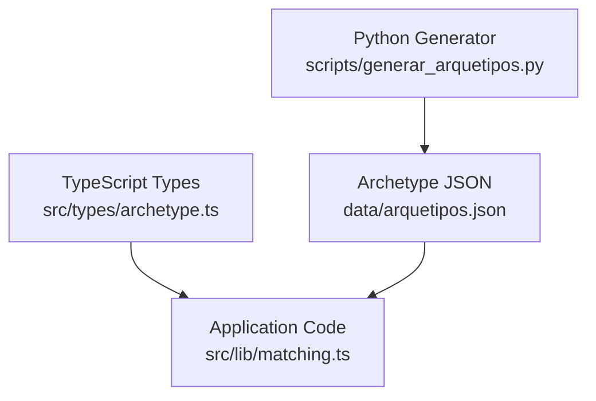
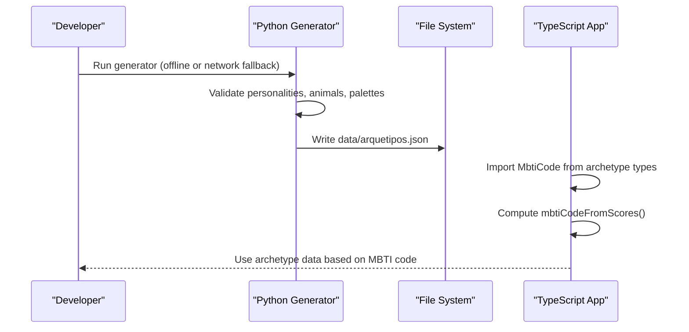
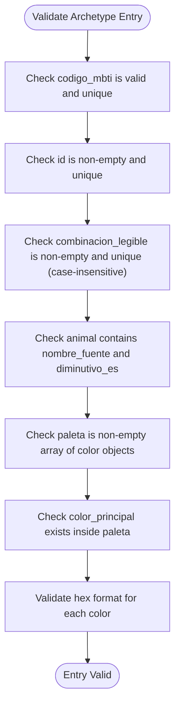
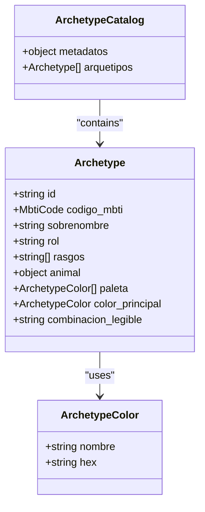
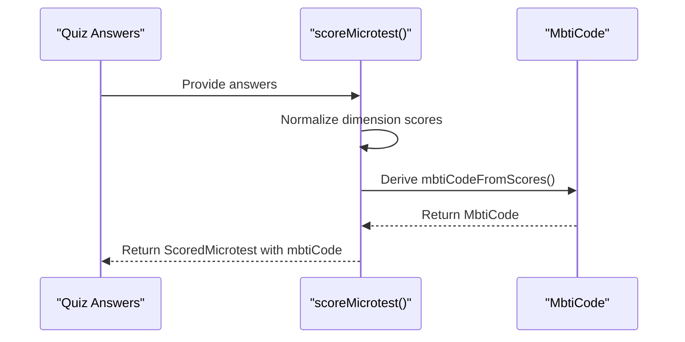
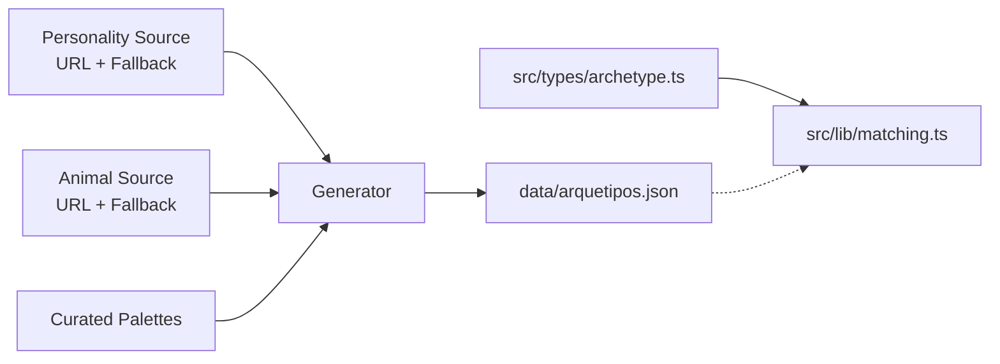

# Archetype Data Structure

<cite>
**Referenced Files in This Document**
- [arquetipos.json](file://data/arquetipos.json)
- [archetype.ts](file://src/types/archetype.ts)
- [matching.ts](file://src/lib/matching.ts)
- [generar_arquetipos.py](file://scripts/generar_arquetipos.py)
</cite>

## Table of Contents
1. [Introduction](#introduction)
2. [Project Structure](#project-structure)
3. [Core Components](#core-components)
4. [Architecture Overview](#architecture-overview)
5. [Detailed Component Analysis](#detailed-component-analysis)
6. [Dependency Analysis](#dependency-analysis)
7. [Performance Considerations](#performance-considerations)
8. [Troubleshooting Guide](#troubleshooting-guide)
9. [Conclusion](#conclusion)

## Introduction
This document explains the archetype data structure used by ZooMatch to represent MBTI personality mappings. It focuses on the JSON schema defined in `data/arquetipos.json`, including its metadata and the main archetypes array with all 16 MBTI types. It also documents how TypeScript interfaces model this data and how it is consumed across the application, especially through the matching logic that derives an MBTI code from quiz results.

The goal is to provide a clear, code-backed reference for developers who need to understand, validate, extend, or consume the archetype dataset safely and consistently.

## Project Structure
At a high level, the archetype data lives in a static JSON file and is modeled by TypeScript types. A Python script generates and validates the JSON during build time, ensuring consistency between sources (personality data, animal mapping, curated color palettes) and the final artifact consumed by the app.

**Diagram sources**
- [generar_arquetipos.py:248-315](file://scripts/generar_arquetipos.py#L248-L315)
- [arquetipos.json:1-29](file://data/arquetipos.json#L1-L29)
- [archetype.ts:1-47](file://src/types/archetype.ts#L1-L47)
- [matching.ts:1-23](file://src/lib/matching.ts#L1-L23)

**Section sources**
- [arquetipos.json:1-29](file://data/arquetipos.json#L1-L29)
- [archetype.ts:1-47](file://src/types/archetype.ts#L1-L47)
- [matching.ts:1-23](file://src/lib/matching.ts#L1-L23)
- [generar_arquetipos.py:248-315](file://scripts/generar_arquetipos.py#L248-L315)

## Core Components
The archetype dataset has two primary layers:

- Metadata layer (`metadatos`): versioning, mode, and source information.
- Archetypes layer (`arquetipos`): an array of 16 personality records, one per MBTI type.

Each archetype record includes:
- `id`: stable unique identifier generated deterministically.
- `codigo_mbti`: MBTI code (e.g., INTJ).
- `sobrenombre`: nickname label for the personality.
- `rol`: personality category (Analysts, Diplomats, Sentinels, Explorers).
- `rasgos`: trait array describing the four MBTI dimensions.
- `animal`: object with source animal name and Spanish diminutive.
- `paleta`: array of color objects with names and hex codes.
- `color_principal`: selected primary color from the palette.
- `combinacion_legible`: human-readable combination string combining the Spanish diminutive and the primary color name.

These fields are enforced by both the generator’s validation logic and the TypeScript interface definitions.

**Section sources**
- [arquetipos.json:29-590](file://data/arquetipos.json#L29-L590)
- [archetype.ts:19-47](file://src/types/archetype.ts#L19-L47)
- [generar_arquetipos.py:318-357](file://scripts/generar_arquetipos.py#L318-L357)

## Architecture Overview
The archetype data flows from generation to consumption:

1. The Python generator collects personality data, animal mappings, and curated palettes.
2. It constructs each archetype record, generating stable IDs and readable combinations.
3. It writes a validated JSON document to `data/arquetipos.json`.
4. The TypeScript application imports the archetype types and uses the MBTI code derived from quiz scores to select or display the corresponding archetype.

**Diagram sources**
- [generar_arquetipos.py:402-423](file://scripts/generar_arquetipos.py#L402-L423)
- [matching.ts:34-37](file://src/lib/matching.ts#L34-L37)

**Section sources**
- [generar_arquetipos.py:402-423](file://scripts/generar_arquetipos.py#L402-L423)
- [matching.ts:34-37](file://src/lib/matching.ts#L34-L37)

## Detailed Component Analysis

### JSON Schema: Metadata Section
The metadata section describes schema version, total archetype count, operating mode, and source provenance for personalities, animals, and palettes.

Key fields:
- `version_esquema`: schema version string.
- `total_arquetipos`: expected number of archetype entries (16).
- `modo`: indicates offline or network-with-fallback operation.
- `fuentes.personalidades.url`: source URL for personality data.
- `fuentes.personalidades.estado`: status indicating local fallback or remote extraction.
- `fuentes.personalidades.campos`: list of fields extracted from the personality source.
- `fuentes.animales.url`: source URL for animal mapping table.
- `fuentes.animales.estado`: status indicating HTML extraction or local fallback.
- `fuentes.paletas.origen`: indicates curated local palettes.
- `fuentes.paletas.extraida`: indicates whether palettes were scraped.
- `fuentes.paletas.nota`: clarifies that palettes were created for the project.

Validation rules enforced by the generator:
- Exactly 16 archetypes must be present.
- All required MBTI codes must exist exactly once.
- Source URLs and statuses reflect actual retrieval behavior.

**Section sources**
- [arquetipos.json:1-28](file://data/arquetipos.json#L1-L28)
- [generar_arquetipos.py:289-314](file://scripts/generar_arquetipos.py#L289-L314)

### JSON Schema: Archetypes Array
Each entry in the archetypes array represents one MBTI personality with associated animal, colors, and identifiers.

Field definitions:
- `id`: deterministic unique identifier generated from animal diminutive, primary color name, and MBTI code.
- `codigo_mbti`: MBTI code; must match one of the 16 expected values.
- `sobrenombre`: personality nickname (e.g., Architect, Logician).
- `rol`: personality category (Analysts, Diplomats, Sentinels, Explorers).
- `rasgos`: array of four trait strings representing MBTI dimensions.
- `animal.nombre_fuente`: original animal name from source.
- `animal.diminutivo_es`: Spanish diminutive used for UI and readable combinations.
- `paleta`: array of color objects, each with `nombre` and `hex`.
- `color_principal`: selected primary color object from `paleta`.
- `combinacion_legible`: human-readable string combining Spanish diminutive and lowercase primary color name.

Validation rules enforced by the generator:
- `codigo_mbti` must be one of the 16 expected codes and appear exactly once.
- `id` must be a non-empty string and unique across all entries.
- `combinacion_legible` must be a non-empty string and unique across all entries (case-insensitive).
- `animal` must contain both `diminutivo_es` and `nombre_fuente`.
- `paleta` must be a non-empty array of color objects with valid `nombre` and `hex`.
- `color_principal` must be an object present within `paleta`.
- Each `hex` must match a strict six-digit hexadecimal pattern.

**Diagram sources**
- [generar_arquetipos.py:318-357](file://scripts/generar_arquetipos.py#L318-L357)

**Section sources**
- [arquetipos.json:29-590](file://data/arquetipos.json#L29-L590)
- [generar_arquetipos.py:318-357](file://scripts/generar_arquetipos.py#L318-L357)

### TypeScript Interfaces
The TypeScript module defines strongly-typed models that mirror the JSON structure:

- `MbtiCode`: union of the 16 MBTI codes.
- `ArchetypeColor`: color object with `nombre` and `hex`.
- `Archetype`: full archetype record matching the JSON fields.
- `ArchetypeCatalog`: top-level catalog containing `metadatos` and `arquetipos`.

These interfaces ensure compile-time safety when consuming the archetype data and help prevent mismatches between JSON and application code.

**Diagram sources**
- [archetype.ts:19-47](file://src/types/archetype.ts#L19-L47)

**Section sources**
- [archetype.ts:1-47](file://src/types/archetype.ts#L1-L47)

### Consumption in Application Logic
The matching logic imports `MbtiCode` and computes an MBTI code from quiz answers. While the archetype JSON itself is not directly imported at runtime in the shown files, the typed MBTI code ensures that any downstream selection of archetype data remains consistent with the 16 supported types.

**Diagram sources**
- [matching.ts:34-37](file://src/lib/matching.ts#L34-L37)
- [matching.ts:39-77](file://src/lib/matching.ts#L39-L77)

**Section sources**
- [matching.ts:1-23](file://src/lib/matching.ts#L1-L23)
- [matching.ts:34-37](file://src/lib/matching.ts#L34-L37)
- [matching.ts:39-77](file://src/lib/matching.ts#L39-L77)

## Dependency Analysis
The archetype system has clear boundaries:

- Generator dependencies:
  - Personality source URL and fallback data.
  - Animal mapping source URL and fallback data.
  - Curated palettes mapped by MBTI code.
  - Deterministic ID generation using slugification and hashing.
- Runtime dependencies:
  - TypeScript types define the contract for archetype data.
  - Matching logic depends only on the MBTI code type, not on the full JSON payload.

**Diagram sources**
- [generar_arquetipos.py:20-80](file://scripts/generar_arquetipos.py#L20-L80)
- [archetype.ts:1-47](file://src/types/archetype.ts#L1-L47)
- [matching.ts:1-23](file://src/lib/matching.ts#L1-L23)

**Section sources**
- [generar_arquetipos.py:20-80](file://scripts/generar_arquetipos.py#L20-L80)
- [archetype.ts:1-47](file://src/types/archetype.ts#L1-L47)
- [matching.ts:1-23](file://src/lib/matching.ts#L1-L23)

## Performance Considerations
- Generation performance:
  - Network requests include retries and timeouts; failures fall back to local data quickly.
  - Validation runs over a fixed set of 16 entries, keeping complexity low.
- Runtime performance:
  - The matching logic performs vector operations over a small fixed-size array, which is efficient.
  - Archetype data can be preloaded or cached if needed by UI components to avoid repeated parsing.

[No sources needed since this section provides general guidance]

## Troubleshooting Guide
Common issues and resolutions:

- Missing or invalid MBTI codes:
  - Ensure the generator receives exactly 16 personality entries and animal mappings covering all expected codes.
  - If network retrieval fails, verify that local fallbacks are intact.
- Duplicate identifiers or combinations:
  - The generator enforces uniqueness for `id` and `combinacion_legible`; duplicates will raise validation errors.
- Invalid color palettes:
  - Each color must have a valid `nombre` and a six-digit hexadecimal `hex`.
  - `color_principal` must be present within `paleta`.
- Mismatched TypeScript types:
  - Keep `MbtiCode` aligned with the 16 expected MBTI codes.
  - Ensure `Archetype` and `ArchetypeCatalog` match the JSON structure.

Operational checks:
- Run the generator in offline mode to confirm local fallbacks produce a valid JSON.
- Validate the output JSON against the documented schema before committing changes.

**Section sources**
- [generar_arquetipos.py:137-150](file://scripts/generar_arquetipos.py#L137-L150)
- [generar_arquetipos.py:318-357](file://scripts/generar_arquetipos.py#L318-L357)
- [archetype.ts:1-47](file://src/types/archetype.ts#L1-L47)

## Conclusion
The archetype data structure in ZooMatch is a well-defined, validated dataset that maps MBTI personalities to animals and curated color palettes. The metadata provides provenance and operational context, while the archetypes array offers rich, structured data for UI and logic. TypeScript interfaces enforce type safety, and the generator ensures consistency and integrity of the dataset. By following the documented field semantics and validation rules, developers can confidently extend or consume the archetype data across the application.

[No sources needed since this section summarizes without analyzing specific files]