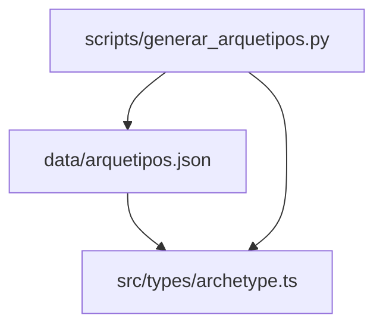
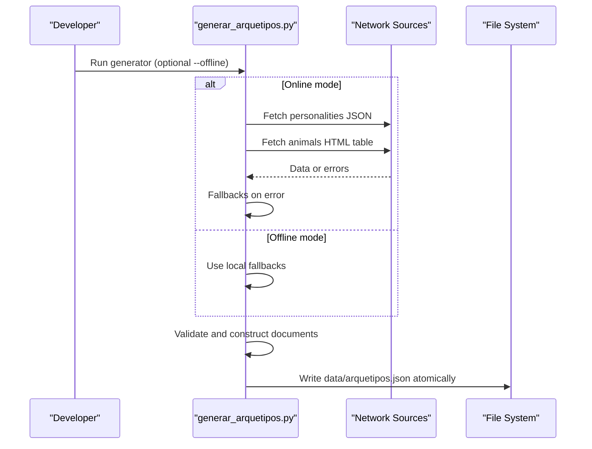
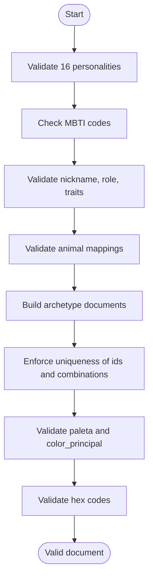

# JSON Schema Definition

<cite>
**Referenced Files in This Document**
- [arquetipos.json](file://data/arquetipos.json)
- [archetype.ts](file://src/types/archetype.ts)
- [generar_arquetipos.py](file://scripts/generar_arquetipos.py)
</cite>

## Table of Contents
1. [Introduction](#introduction)
2. [Project Structure](#project-structure)
3. [Core Components](#core-components)
4. [Architecture Overview](#architecture-overview)
5. [Detailed Component Analysis](#detailed-component-analysis)
6. [Dependency Analysis](#dependency-analysis)
7. [Performance Considerations](#performance-considerations)
8. [Troubleshooting Guide](#troubleshooting-guide)
9. [Conclusion](#conclusion)

## Introduction
This document defines the complete JSON schema for archetype data used by the project. It describes the metadata section (versioning, sources, and offline mode), the main archetypes array with all 16 MBTI personality mappings, and every field’s purpose and constraints. It also provides validation rules, data constraints, and examples of valid structures.

## Project Structure
The archetype dataset is stored as a JSON file and typed in TypeScript. A Python script generates or regenerates this dataset from curated local data and optional online sources.

**Diagram sources**
- [arquetipos.json:1-592](file://data/arquetipos.json#L1-L592)
- [archetype.ts:1-47](file://src/types/archetype.ts#L1-L47)
- [generar_arquetipos.py:248-315](file://scripts/generar_arquetipos.py#L248-L315)

**Section sources**
- [arquetipos.json:1-592](file://data/arquetipos.json#L1-L592)
- [archetype.ts:1-47](file://src/types/archetype.ts#L1-L47)
- [generar_arquetipos.py:248-315](file://scripts/generar_arquetipos.py#L248-L315)

## Core Components
The JSON schema has two top-level sections:

- metadatos: versioning, total count, operating mode, and source information.
- arquetipos: an array of exactly 16 archetype objects, one per MBTI type.

Key fields in each archetype object:
- id: unique identifier string.
- codigo_mbti: MBTI code (one of the 16 types).
- sobrenombre: nickname label.
- rol: personality category.
- rasgos: trait array with four entries.
- animal: object with nombre_fuente and diminutivo_es.
- paleta: color palette array of three colors.
- color_principal: primary color object present in paleta.
- combinacion_legible: readable combination string.

Validation and constraints are enforced both at runtime by the generator and statically by the TypeScript types.

**Section sources**
- [arquetipos.json:1-592](file://data/arquetipos.json#L1-L592)
- [archetype.ts:1-47](file://src/types/archetype.ts#L1-L47)
- [generar_arquetipos.py:137-150](file://scripts/generar_arquetipos.py#L137-L150)
- [generar_arquetipos.py:318-357](file://scripts/generar_arquetipos.py#L318-L357)

## Architecture Overview
The system composes archetype records from curated local data and optional network sources. The generator validates inputs, constructs identifiers, builds palettes, and writes atomic JSON output.

**Diagram sources**
- [generar_arquetipos.py:91-134](file://scripts/generar_arquetipos.py#L91-L134)
- [generar_arquetipos.py:153-168](file://scripts/generar_arquetipos.py#L153-L168)
- [generar_arquetipos.py:201-211](file://scripts/generar_arquetipos.py#L201-L211)
- [generar_arquetipos.py:248-315](file://scripts/generar_arquetipos.py#L248-L315)
- [generar_arquetipos.py:360-383](file://scripts/generar_arquetipos.py#L360-L383)

## Detailed Component Analysis

### Metadata Section
The metadata object contains:
- version_esquema: schema version string.
- total_arquetipos: number of archetype entries (must be 16).
- modo: operation mode; in the provided dataset it is set to offline.
- fuentes: detailed source information for personalities, animals, and palettes.

Constraints and semantics:
- version_esquema is a string indicating schema version.
- total_arquetipos must equal the length of the arquetipos array.
- modo indicates whether the dataset was generated in offline mode or with network access and fallbacks.
- fuentes includes:
  - personalidades.url and .estado describing where personality data came from and its current state.
  - animales.url and .metodo describing how animal mappings were obtained.
  - paletas.origen, .extraida, and .nota clarifying that palettes are locally curated and not scraped.

Examples of valid values:
- version_esquema: "1.0"
- total_arquetipos: 16
- modo: "offline"
- fuentes.personalidades.estado: "fallback_local_modo_offline"
- fuentes.animales.metodo: "tabla HTML con fallback local completo"
- fuentes.paletas.origen: "curadas_localmente"

**Section sources**
- [arquetipos.json:1-28](file://data/arquetipos.json#L1-L28)
- [archetype.ts:39-46](file://src/types/archetype.ts#L39-L46)
- [generar_arquetipos.py:289-310](file://scripts/generar_arquetipos.py#L289-L310)

### Archetypes Array
The arquetipos array must contain exactly 16 entries, one for each MBTI type. Each entry represents a personality mapping enriched with animal associations, curated color palettes, and a readable combination string.

Required fields and constraints:
- id: non-empty string, globally unique across the dataset.
- codigo_mbti: one of the 16 MBTI codes.
- sobrenombre: non-empty string.
- rol: non-empty string representing the personality category.
- rasgos: array of exactly four non-empty strings.
- animal: object with:
  - nombre_fuente: non-empty string.
  - diminutivo_es: non-empty string.
- paleta: array of exactly three color objects, each with:
  - nombre: non-empty string.
  - hex: six-digit hexadecimal color code starting with "#".
- color_principal: object present within paleta, with nombre and hex.
- combinacion_legible: non-empty string combining the Spanish diminutive and the primary color name.

Uniqueness and consistency rules:
- All codigo_mbti values must be distinct and cover the full set of 16 types.
- All id values must be unique.
- All combinacion_legible values must be unique when normalized to lowercase.
- color_principal must be one of the items in paleta.
- Every color in paleta must have a valid hex code matching the pattern #RRGGBB.

Examples of valid structures:
- An archetype with:
  - codigo_mbti: "INTJ"
  - rasgos: ["Introverted", "Intuitive", "Thinking", "Judging"]
  - animal.nombre_fuente: "Octopus"
  - animal.diminutivo_es: "pulpito"
  - paleta: three color objects with names and hex codes
  - color_principal: first item of paleta
  - combinacion_legible: "pulpito azul abisal"

**Section sources**
- [arquetipos.json:29-590](file://data/arquetipos.json#L29-L590)
- [archetype.ts:1-37](file://src/types/archetype.ts#L1-L37)
- [generar_arquetipos.py:219-245](file://scripts/generar_arquetipos.py#L219-L245)
- [generar_arquetipos.py:318-357](file://scripts/generar_arquetipos.py#L318-L357)

### Field Reference
- id
  - Type: string
  - Constraints: non-empty, unique across the dataset
  - Purpose: stable identifier for the archetype record
- codigo_mbti
  - Type: enum of 16 MBTI codes
  - Constraints: must be one of the defined codes, unique per record
  - Purpose: links the archetype to a specific MBTI personality type
- sobrenombre
  - Type: string
  - Constraints: non-empty
  - Purpose: human-readable nickname for the personality
- rol
  - Type: string
  - Constraints: non-empty
  - Purpose: high-level personality category (e.g., Analysts, Diplomats, Sentinels, Explorers)
- rasgos
  - Type: string[]
  - Constraints: exactly four non-empty strings
  - Purpose: descriptive traits associated with the personality
- animal
  - Type: object
  - Fields:
    - nombre_fuente: string, non-empty
    - diminutivo_es: string, non-empty
  - Purpose: associates the archetype with an animal and a Spanish diminutive form
- paleta
  - Type: ArchetypeColor[]
  - Constraints: exactly three items; each item has nombre (string) and hex (#RRGGBB)
  - Purpose: curated color palette for visual identity
- color_principal
  - Type: ArchetypeColor
  - Constraints: must be present in paleta; has nombre and hex
  - Purpose: highlights the primary brand color for the archetype
- combinacion_legible
  - Type: string
  - Constraints: non-empty, unique when normalized to lowercase
  - Purpose: human-readable combination of animal diminutive and primary color name

**Section sources**
- [archetype.ts:1-37](file://src/types/archetype.ts#L1-L37)
- [generar_arquetipos.py:318-357](file://scripts/generar_arquetipos.py#L318-L357)

### Validation Rules and Data Constraints
The generator enforces comprehensive validation:

- Personality data validation:
  - Exactly 16 personality entries.
  - Codes must match the expected set of 16 MBTI types.
  - Each entry must have a non-empty nickname, role, and exactly four non-empty traits.

- Animal mapping validation:
  - Must include all 16 MBTI codes.
  - If fetched from HTML, requires a complete table with Type and Animal columns.

- Document-level validation:
  - Exactly 16 archetype records.
  - Unique codigo_mbti values covering all expected types.
  - Unique id values.
  - Unique combinacion_legible values (case-insensitive).
  - Valid animal objects with required fields.
  - Valid paleta arrays with three color objects.
  - color_principal must exist within paleta.
  - Hex codes must match the exact six-character pattern.

- Offline behavior:
  - When offline, the generator uses local fallbacks for personalities and animals.
  - Palettes are always locally curated.

**Diagram sources**
- [generar_arquetipos.py:137-150](file://scripts/generar_arquetipos.py#L137-L150)
- [generar_arquetipos.py:201-211](file://scripts/generar_arquetipos.py#L201-L211)
- [generar_arquetipos.py:318-357](file://scripts/generar_arquetipos.py#L318-L357)

**Section sources**
- [generar_arquetipos.py:137-150](file://scripts/generar_arquetipos.py#L137-L150)
- [generar_arquetipos.py:201-211](file://scripts/generar_arquetipos.py#L201-L211)
- [generar_arquetipos.py:318-357](file://scripts/generar_arquetipos.py#L318-L357)

### Examples of Valid JSON Structures
Below are concise examples illustrating valid structures without including full content.

- Metadata example:
  - version_esquema: "1.0"
  - total_arquetipos: 16
  - modo: "offline"
  - fuentes.personalidades.url: "https://www.16personalities.com/for-ai.json"
  - fuentes.personalidades.estado: "fallback_local_modo_offline"
  - fuentes.animales.url: "https://pigment.is/blogs/blogs/mbti-test-animal-version"
  - fuentes.animales.metodo: "tabla HTML con fallback local completo"
  - fuentes.paletas.origen: "curadas_localmente"
  - fuentes.paletas.extraida: false
  - fuentes.paletas.nota: "Paletas creadas para este proyecto; paletadecolores.org no fue consultado ni scrapeado."

- Archetype example:
  - id: "pulpito-azul-abisal"
  - codigo_mbti: "INTJ"
  - sobrenombre: "Architect"
  - rol: "Analysts"
  - rasgos: ["Introverted", "Intuitive", "Thinking", "Judging"]
  - animal.nombre_fuente: "Octopus"
  - animal.diminutivo_es: "pulpito"
  - paleta:
    - {nombre: "Azul abisal", hex: "#123B5D"}
    - {nombre: "Tinta marina", hex: "#0B1F33"}
    - {nombre: "Coral lúcido", hex: "#FF7A59"}
  - color_principal: {nombre: "Azul abisal", hex: "#123B5D"}
  - combinacion_legible: "pulpito azul abisal"

**Section sources**
- [arquetipos.json:1-64](file://data/arquetipos.json#L1-L64)

## Dependency Analysis
The TypeScript types define the contract for the JSON structure, while the Python generator ensures data integrity and produces the final dataset.

**Diagram sources**
- [archetype.ts:1-47](file://src/types/archetype.ts#L1-L47)
- [generar_arquetipos.py:248-315](file://scripts/generar_arquetipos.py#L248-L315)
- [arquetipos.json:1-592](file://data/arquetipos.json#L1-L592)

**Section sources**
- [archetype.ts:1-47](file://src/types/archetype.ts#L1-L47)
- [generar_arquetipos.py:248-315](file://scripts/generar_arquetipos.py#L248-L315)
- [arquetipos.json:1-592](file://data/arquetipos.json#L1-L592)

## Performance Considerations
- Atomic writes: The generator writes to a temporary file and then replaces the target file to avoid partial writes.
- Network resilience: HTTP requests use retries and timeouts; failures fall back to local data.
- Local curation: Palettes are pre-curated, avoiding expensive scraping and ensuring consistent performance.

[No sources needed since this section provides general guidance]

## Troubleshooting Guide
Common issues and resolutions:
- Missing or incorrect MBTI codes: Ensure all 16 codes are present and unique.
- Invalid hex codes: Verify each color hex matches the six-character pattern.
- Duplicate identifiers: Confirm all id values are unique.
- Inconsistent paleta and color_principal: Ensure color_principal exists within paleta.
- Network errors: Switch to offline mode to use local fallbacks.

Relevant validations:
- Personality validation checks counts, codes, and required fields.
- Document validation enforces uniqueness and structural integrity.
- Hex pattern validation ensures correct color formatting.

**Section sources**
- [generar_arquetipos.py:137-150](file://scripts/generar_arquetipos.py#L137-L150)
- [generar_arquetipos.py:318-357](file://scripts/generar_arquetipos.py#L318-L357)

## Conclusion
The archetype JSON schema defines a robust, validated structure for MBTI personality mappings enriched with animal associations and curated color palettes. The metadata section documents versioning, sources, and operational mode, while the archetypes array provides consistent, constraint-checked records. The TypeScript types enforce static contracts, and the Python generator ensures data integrity and reliable generation, including offline fallbacks.

[No sources needed since this section summarizes without analyzing specific files]