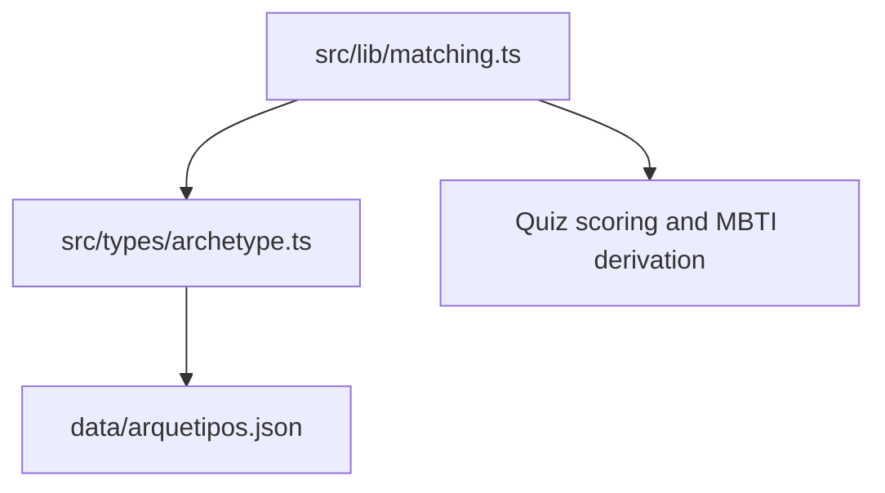
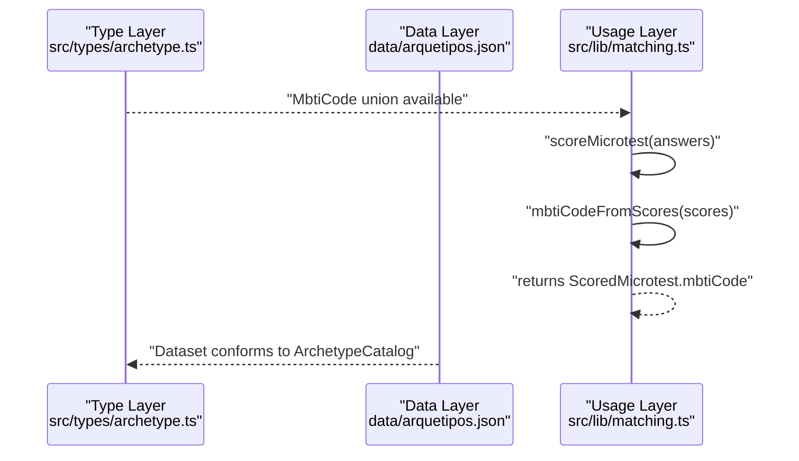
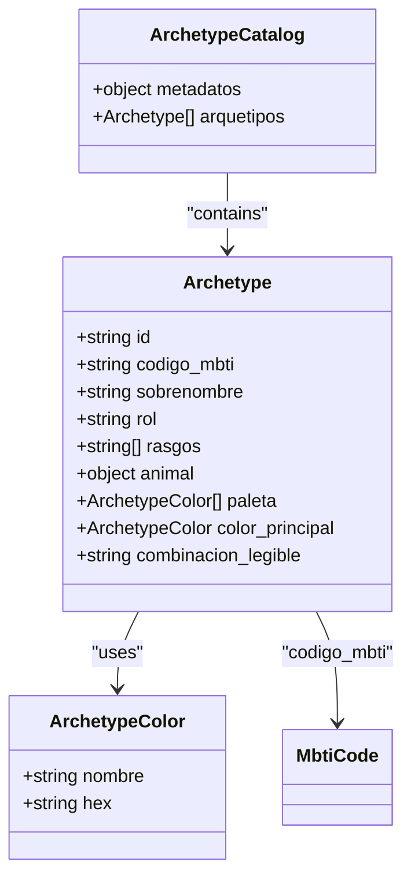
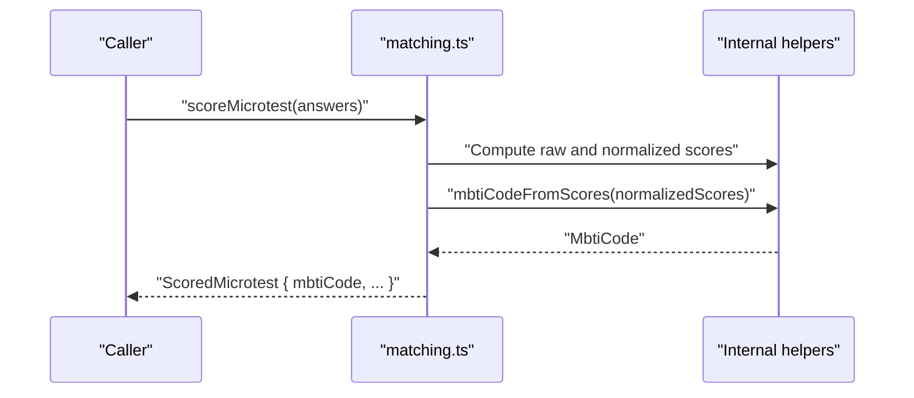
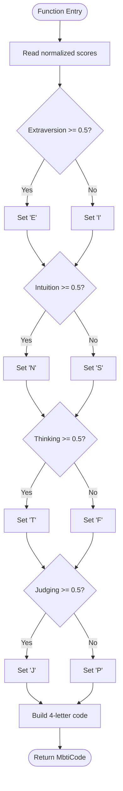
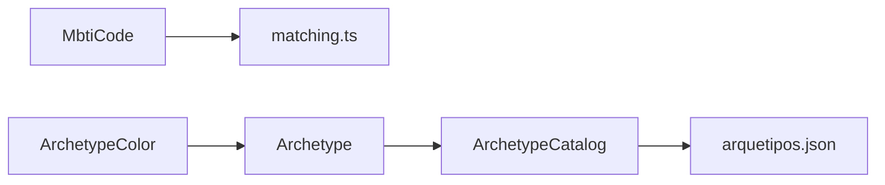

# TypeScript Type Definitions

<cite>
**Referenced Files in This Document**
- [archetype.ts](file://src/types/archetype.ts)
- [arquetipos.json](file://data/arquetipos.json)
- [matching.ts](file://src/lib/matching.ts)
</cite>

## Table of Contents
1. [Introduction](#introduction)
2. [Project Structure](#project-structure)
3. [Core Components](#core-components)
4. [Architecture Overview](#architecture-overview)
5. [Detailed Component Analysis](#detailed-component-analysis)
6. [Dependency Analysis](#dependency-analysis)
7. [Performance Considerations](#performance-considerations)
8. [Troubleshooting Guide](#troubleshooting-guide)
9. [Conclusion](#conclusion)

## Introduction
This document explains the TypeScript type definitions that model the archetype data structure used across the application. It focuses on:
- The Archetype interface and its nested structures
- The ArchetypeColor interface for color entries
- The MbtiCode union representing all MBTI personality codes
- How these types enforce data integrity and provide IntelliSense support
- The relationship between the TypeScript interfaces and the JSON schema defined by arquetipos.json
- Practical usage examples showing how components and utilities consume these types

## Project Structure
The relevant parts of the project are organized as follows:
- src/types/archetype.ts defines the core type contracts for archetypes, colors, and MBTI codes
- data/arquetipos.json is the runtime dataset that conforms to the ArchetypeCatalog shape
- src/lib/matching.ts consumes MbtiCode to compute scores and derive MBTI codes from quiz results

**Diagram sources**
- [archetype.ts:1-47](file://src/types/archetype.ts#L1-L47)
- [arquetipos.json:1-592](file://data/arquetipos.json#L1-L592)
- [matching.ts:1-116](file://src/lib/matching.ts#L1-L116)

**Section sources**
- [archetype.ts:1-47](file://src/types/archetype.ts#L1-L47)
- [arquetipos.json:1-592](file://data/arquetipos.json#L1-L592)
- [matching.ts:1-116](file://src/lib/matching.ts#L1-L116)

## Core Components
This section documents the primary types and their responsibilities.

- MbtiCode: A string union enumerating all 16 valid MBTI codes. It prevents invalid codes at compile time and enables autocomplete in editors.
- ArchetypeColor: Represents a single color entry with a human-readable name and a hex value constrained to a literal pattern starting with “#”.
- Archetype: Describes one archetype record, including identifiers, MBTI code, nickname, role, traits, animal mapping, palette, primary color, and a readable combination label.
- ArchetypeCatalog: The top-level container for the dataset, including metadata and an array of Archetype records.

These types together define a strict contract for the archetype dataset. Any mismatch between the JSON and the TypeScript definitions will be caught during compilation or build-time checks when using tools like tsc.

**Section sources**
- [archetype.ts:1-47](file://src/types/archetype.ts#L1-L47)

## Architecture Overview
The architecture connects three layers:
- Type layer (src/types/archetype.ts): Defines the canonical shape of archetype data
- Data layer (data/arquetipos.json): Provides the actual dataset conforming to ArchetypeCatalog
- Usage layer (src/lib/matching.ts): Consumes MbtiCode to compute matching vectors and MBTI codes from quiz answers

**Diagram sources**
- [archetype.ts:1-47](file://src/types/archetype.ts#L1-L47)
- [arquetipos.json:1-592](file://data/arquetipos.json#L1-L592)
- [matching.ts:34-77](file://src/lib/matching.ts#L34-L77)

## Detailed Component Analysis

### MbtiCode Union
- Purpose: Enumerates exactly the 16 valid MBTI codes.
- Benefits:
  - Compile-time validation: Only allowed strings can be assigned to variables typed as MbtiCode.
  - IntelliSense: Editors suggest only valid codes.
  - Exhaustiveness: Switch statements over MbtiCode can be exhaustive, reducing missed cases.

Typical consumption:
- Imported by utilities that compute MBTI codes from quiz scores.
- Used as a return type to ensure downstream consumers receive a valid code.

**Section sources**
- [archetype.ts:1-17](file://src/types/archetype.ts#L1-L17)
- [matching.ts:1-37](file://src/lib/matching.ts#L1-L37)

### ArchetypeColor Interface
- Fields:
  - nombre: Human-readable color name
  - hex: Hexadecimal color string constrained to start with “#”
- Guarantees:
  - Color objects always include both fields
  - Hex values follow a consistent format, improving UI rendering reliability

Relationship to JSON:
- Each element in the paleta array and the color_principal object must match this interface.

**Section sources**
- [archetype.ts:19-22](file://src/types/archetype.ts#L19-L22)
- [arquetipos.json:45-63](file://data/arquetipos.json#L45-L63)

### Archetype Interface
- Fields:
  - id: Stable identifier for the archetype
  - codigo_mbti: MBTI code from the MbtiCode union
  - sobrenombre: Display nickname
  - rol: Personality group (e.g., Analysts, Diplomats, Sentinels, Explorers)
  - rasgos: Array of trait strings
  - animal: Nested object with source animal name and Spanish diminutive
  - paleta: Array of ArchetypeColor
  - color_principal: Selected primary color from the palette
  - combinacion_legible: Readable label combining animal and color name
- Guarantees:
  - Every archetype has a complete set of fields
  - Nested structures are validated (animal, paleta, color_principal)
  - mbti code is restricted to the MbtiCode union

Relationship to JSON:
- Each item in the arquetipos array must conform to this interface.

**Section sources**
- [archetype.ts:24-37](file://src/types/archetype.ts#L24-L37)
- [arquetipos.json:29-64](file://data/arquetipos.json#L29-L64)

### ArchetypeCatalog Interface
- Fields:
  - metadatos: Schema version, total count, mode, and sources information
  - arquetipos: Array of Archetype
- Guarantees:
  - Top-level dataset includes required metadata and a list of archetypes
  - Enables safe iteration and indexing of archetype data

Relationship to JSON:
- The root object in arquetipos.json matches this interface.

**Section sources**
- [archetype.ts:39-47](file://src/types/archetype.ts#L39-L47)
- [arquetipos.json:1-28](file://data/arquetipos.json#L1-L28)

### Class Diagram of Type Relationships

**Diagram sources**
- [archetype.ts:1-47](file://src/types/archetype.ts#L1-L47)

### Sequence Diagram: Computing MBTI Code from Quiz Scores

**Diagram sources**
- [matching.ts:30-77](file://src/lib/matching.ts#L30-L77)

### Flowchart: MbtiCode Derivation Logic

**Diagram sources**
- [matching.ts:34-37](file://src/lib/matching.ts#L34-L37)

## Dependency Analysis
- Type dependencies:
  - MbtiCode is consumed by matching.ts to represent computed MBTI codes
  - ArchetypeColor is referenced by Archetype for palette and primary color
  - Archetype is referenced by ArchetypeCatalog as the collection item
- Data dependencies:
  - arquetipos.json provides the dataset that must conform to ArchetypeCatalog
- Runtime behavior:
  - matching.ts computes MBTI codes from quiz answers and returns them as MbtiCode, ensuring downstream consumers receive valid codes

**Diagram sources**
- [archetype.ts:1-47](file://src/types/archetype.ts#L1-L47)
- [arquetipos.json:1-592](file://data/arquetipos.json#L1-L592)
- [matching.ts:1-116](file://src/lib/matching.ts#L1-L116)

**Section sources**
- [archetype.ts:1-47](file://src/types/archetype.ts#L1-L47)
- [arquetipos.json:1-592](file://data/arquetipos.json#L1-L592)
- [matching.ts:1-116](file://src/lib/matching.ts#L1-L116)

## Performance Considerations
- Type definitions add no runtime overhead; they are erased during compilation.
- Using MbtiCode reduces branching errors and improves maintainability without impacting performance.
- Accessing fields on Archetype and ArchetypeColor is straightforward and efficient.

[No sources needed since this section provides general guidance]

## Troubleshooting Guide
Common issues and resolutions:
- Invalid MBTI code:
  - Symptom: TypeScript error when assigning a string to MbtiCode
  - Resolution: Use only the 16 allowed codes defined by the MbtiCode union
- Mismatched color format:
  - Symptom: TypeScript error on hex field not matching the expected pattern
  - Resolution: Ensure hex values start with “#” and contain valid hexadecimal characters
- Missing or extra fields in JSON:
  - Symptom: Build-time or runtime validation failures if the dataset does not conform to ArchetypeCatalog
  - Resolution: Align arquetipos.json with the Archetype and ArchetypeCatalog interfaces
- Incomplete quiz results:
  - Symptom: Error thrown when computing scores due to missing answers
  - Resolution: Provide all required answers before calling scoreMicrotest

**Section sources**
- [matching.ts:39-77](file://src/lib/matching.ts#L39-L77)

## Conclusion
The TypeScript type definitions in src/types/archetype.ts establish a robust contract for archetype data:
- MbtiCode ensures only valid personality codes are used throughout the app
- ArchetypeColor enforces consistent color representation
- Archetype models each archetype record with strong typing for nested structures
- ArchetypeCatalog describes the full dataset shape

Together with arquetipos.json and utilities like matching.ts, these types provide compile-time safety, better developer experience through IntelliSense, and reliable runtime behavior.