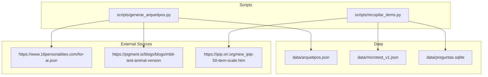
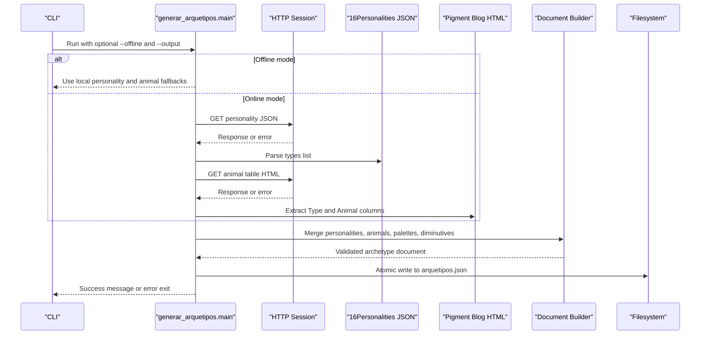
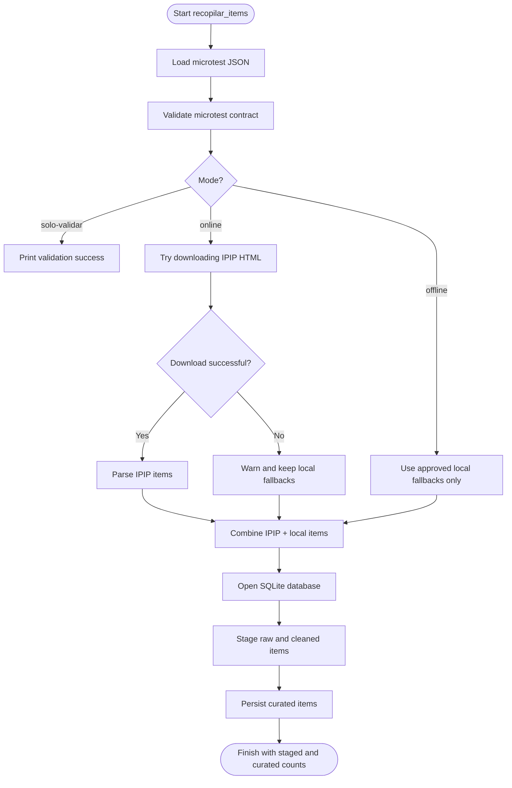
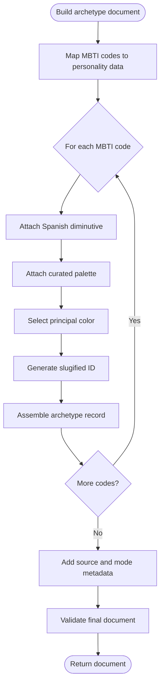
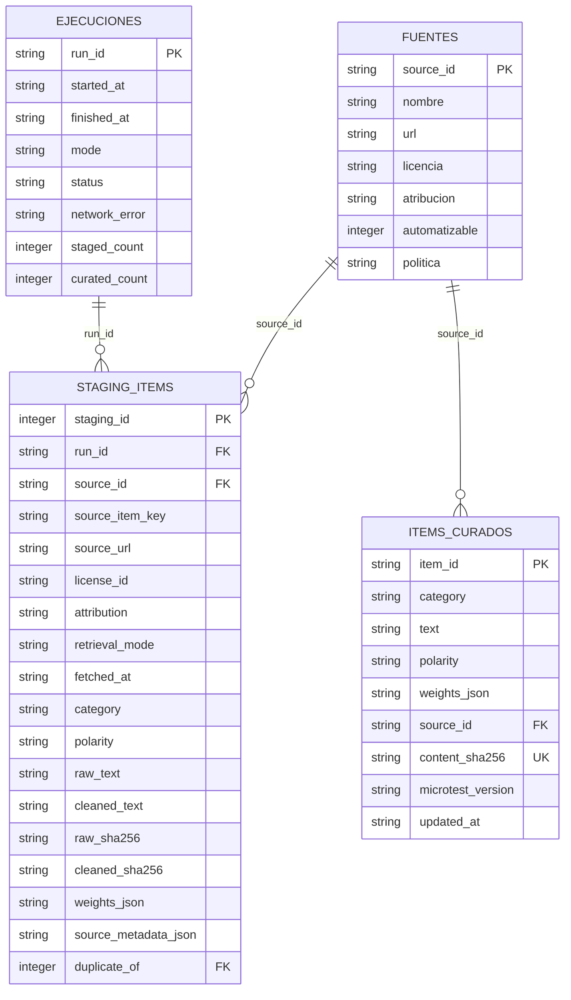
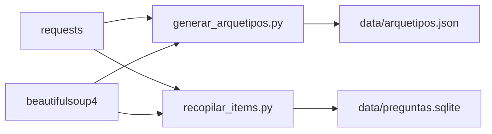

# Python Generation Pipeline

<cite>
**Referenced Files in This Document**
- [generar_arquetipos.py](file://scripts/generar_arquetipos.py)
- [recopilar_items.py](file://scripts/recopilar_items.py)
- [arquetipos.json](file://data/arquetipos.json)
- [requirements.txt](file://requirements.txt)
</cite>

## Table of Contents
1. [Introduction](#introduction)
2. [Project Structure](#project-structure)
3. [Core Components](#core-components)
4. [Architecture Overview](#architecture-overview)
5. [Detailed Component Analysis](#detailed-component-analysis)
6. [Dependency Analysis](#dependency-analysis)
7. [Performance Considerations](#performance-considerations)
8. [Troubleshooting Guide](#troubleshooting-guide)
9. [Conclusion](#conclusion)

## Introduction
This document explains the Python generation pipeline that creates and maintains the archetype data used by the project. The pipeline has two main responsibilities:

- Generate the standardized archetype dataset in `data/arquetipos.json`.
- Collect, validate, stage, and persist psychometric items for a microtest.

The primary orchestrator is `scripts/generar_arquetipos.py`, which scrapes personality metadata from an external JSON endpoint and animal mappings from an HTML blog page. It then merges this information with curated local color palettes and Spanish diminutives to produce a stable, validated output file.

The item collection script `scripts/recopilar_items.py` focuses on licensing-safe data collection. It can scrape approved public-domain content, but it also provides fully local fallbacks for MBTI, relationship, and gender-related items. It validates a canonical 24-item microtest, stages raw and cleaned items in SQLite, and persists curated items with full traceability.

## Project Structure
At a high level, the Python generation pipeline lives under `scripts/`, while its outputs live under `data/`. The runtime dependencies are declared in `requirements.txt`.

**Diagram sources**
- [generar_arquetipos.py:20-21](file://scripts/generar_arquetipos.py#L20-L21)
- [recopilar_items.py:63-65](file://scripts/recopilar_items.py#L63-L65)
- [recopilar_items.py:38-40](file://scripts/recopilar_items.py#L38-L40)

**Section sources**
- [generar_arquetipos.py:1-28](file://scripts/generar_arquetipos.py#L1-L28)
- [recopilar_items.py:17-65](file://scripts/recopilar_items.py#L17-L65)
- [requirements.txt:1-3](file://requirements.txt#L1-L3)

## Core Components
The pipeline consists of two scripts with distinct roles:

| Component | Purpose | Main Inputs | Main Outputs | Key Behaviors |
|---|---|---|---|---|
| `generar_arquetipos.py` | Orchestrates archetype generation | External JSON and HTML, local fallbacks | `data/arquetipos.json` | Scrapes or falls back, normalizes, validates, builds schema, writes atomically |
| `recopilar_items.py` | Collects and prepares psychometric items | Canonical microtest JSON, optional IPIP HTML | SQLite staging and curated tables | Validates contract, optionally scrapes public-domain items, persists with licenses and hashes |

Both scripts:
- Use `requests` with retry-backed sessions.
- Parse HTML with BeautifulSoup.
- Validate data against strict contracts.
- Provide offline modes that rely on local fallbacks.
- Exit with non-zero status on validation or source errors.

**Section sources**
- [generar_arquetipos.py:91-134](file://scripts/generar_arquetipos.py#L91-L134)
- [generar_arquetipos.py:153-168](file://scripts/generar_arquetipos.py#L153-L168)
- [generar_arquetipos.py:201-211](file://scripts/generar_arquetipos.py#L201-L211)
- [generar_arquetipos.py:386-427](file://scripts/generar_arquetipos.py#L386-L427)
- [recopilar_items.py:123-151](file://scripts/recopilar_items.py#L123-L151)
- [recopilar_items.py:229-318](file://scripts/recopilar_items.py#L229-L318)
- [recopilar_items.py:505-559](file://scripts/recopilar_items.py#L505-L559)
- [recopilar_items.py:601-622](file://scripts/recopilar_items.py#L601-L622)

## Architecture Overview
The archetype generation architecture follows a clear orchestration pattern:

**Diagram sources**
- [generar_arquetipos.py:153-168](file://scripts/generar_arquetipos.py#L153-L168)
- [generar_arquetipos.py:175-211](file://scripts/generar_arquetipos.py#L175-L211)
- [generar_arquetipos.py:248-315](file://scripts/generar_arquetipos.py#L248-L315)
- [generar_arquetipos.py:360-383](file://scripts/generar_arquetipos.py#L360-L383)
- [generar_arquetipos.py:402-427](file://scripts/generar_arquetipos.py#L402-L427)

The item collection architecture separates validation, optional scraping, staging, and curation:

**Diagram sources**
- [recopilar_items.py:229-318](file://scripts/recopilar_items.py#L229-L318)
- [recopilar_items.py:336-391](file://scripts/recopilar_items.py#L336-L391)
- [recopilar_items.py:428-502](file://scripts/recopilar_items.py#L428-L502)
- [recopilar_items.py:505-559](file://scripts/recopilar_items.py#L505-L559)
- [recopilar_items.py:601-622](file://scripts/recopilar_items.py#L601-L622)

## Detailed Component Analysis

### Archetype Generator: `generar_arquetipos.py`

#### Role and Responsibilities
`generar_arquetipos.py` is the central generator for the archetype dataset. Its responsibilities include:

- Creating a resilient HTTP session with retries and safe headers.
- Downloading personality metadata from `https://www.16personalities.com/for-ai.json`.
- Scraping animal mappings from `https://pigment.is/blogs/blogs/mbti-test-animal-version`.
- Falling back to local data when network access fails or when running in offline mode.
- Building a normalized, validated archetype document.
- Writing `data/arquetipos.json` atomically.

#### Data Sources and Fallback Strategy
The script defines expected MBTI codes and uses them as the canonical set. If online fetching fails, it switches to local fallbacks:

| Source | Online URL | Fallback Behavior |
|---|---|---|
| Personalities | `https://www.16personalities.com/for-ai.json` | Uses a hardcoded list of 16 personality objects |
| Animals | Pigment blog HTML table | Uses a hardcoded mapping from MBTI code to animal name |
| Color palettes | Not scraped | Uses curated local palettes per MBTI code |

The fallback strategy ensures deterministic output even when external services are unavailable.

**Section sources**
- [generar_arquetipos.py:20-27](file://scripts/generar_arquetipos.py#L20-L27)
- [generar_arquetipos.py:30-80](file://scripts/generar_arquetipos.py#L30-L80)
- [generar_arquetipos.py:153-168](file://scripts/generar_arquetipos.py#L153-L168)
- [generar_arquetipos.py:201-211](file://scripts/generar_arquetipos.py#L201-L211)

#### Web Scraping Logic

##### Personality JSON Extraction
The script expects a JSON object containing a `types` array. Each entry must have:
- A valid MBTI code.
- A nickname.
- A role group.
- Exactly four trait strings.

If the structure is invalid, missing, or does not contain all 16 expected codes, the script logs a warning and uses the local fallback.

**Section sources**
- [generar_arquetipos.py:137-168](file://scripts/generar_arquetipos.py#L137-L168)

##### Animal HTML Table Extraction
The script parses HTML using BeautifulSoup and looks for tables with both `Type` and `Animal` columns. It:
- Normalizes header names.
- Finds the column indices for type and animal.
- Reads rows and maps MBTI codes to animal names.
- Requires all 16 MBTI codes to be present before accepting the table.

If no complete table is found, it raises a source error and falls back to the local animal mapping.

**Section sources**
- [generar_arquetipos.py:171-198](file://scripts/generar_arquetipos.py#L171-L198)
- [generar_arquetipos.py:201-211](file://scripts/generar_arquetipos.py#L201-L211)

#### Data Transformation Logic
The transformation phase converts external inputs into the standardized archetype format:

1. Build a lookup map from MBTI code to personality data.
2. For each expected MBTI code:
   - Attach the Spanish diminutive.
   - Attach the curated palette.
   - Choose the first palette color as the principal color.
   - Generate a stable unique identifier based on the diminutive, color name, and MBTI code.
   - Assemble the final archetype record.
3. Wrap records in a document with metadata describing sources, modes, and schema version.

**Diagram sources**
- [generar_arquetipos.py:248-315](file://scripts/generar_arquetipos.py#L248-L315)

**Section sources**
- [generar_arquetipos.py:214-245](file://scripts/generar_arquetipos.py#L214-L245)
- [generar_arquetipos.py:248-315](file://scripts/generar_arquetipos.py#L248-L315)

#### Validation Process
Validation occurs at multiple levels:

| Validation Layer | What It Checks | Error Type |
|---|---|---|
| Personality validation | Exactly 16 entries, correct MBTI codes, required fields, four traits | `ErrorValidacion` |
| Animal mapping validation | Exactly 16 MBTI-to-animal mappings | `ErrorValidacion` |
| Document validation | Exactly 16 archetypes, unique IDs, unique readable combinations, valid animal objects, valid palette structures, valid hex colors | `ErrorValidacion` |

The validator also ensures that:
- No MBTI code appears twice.
- Every generated ID is unique.
- Every readable combination like “diminutive + principal color” is unique.
- Hexadecimal color values match a strict six-character uppercase hex pattern.

**Section sources**
- [generar_arquetipos.py:137-150](file://scripts/generar_arquetipos.py#L137-L150)
- [generar_arquetipos.py:318-357](file://scripts/generar_arquetipos.py#L318-L357)

#### Output Generation
The output writer uses atomic file operations:
- Writes to a temporary file in the target directory.
- Flushes and syncs to disk.
- Replaces the target file atomically.
- Cleans up the temporary file if writing fails.

This prevents partially written or corrupted JSON files.

**Section sources**
- [generar_arquetipos.py:360-383](file://scripts/generar_arquetipos.py#L360-L383)

#### CLI Interface
The script supports:
- `--output` or `-o`: Target JSON path, defaulting to `data/arquetipos.json`.
- `--offline`: Skip network requests and use local fallbacks completely.

On success, it prints a confirmation message. On failure, it exits with status code 1 and prints an error message.

**Section sources**
- [generar_arquetipos.py:386-427](file://scripts/generar_arquetipos.py#L386-L427)

### Item Collection Script: `recopilar_items.py`

#### Role and Responsibilities
`recopilar_items.py` manages psychometric item data with explicit licensing and traceability. Its responsibilities include:

- Loading and validating a canonical microtest JSON.
- Optionally scraping the public-domain IPIP 50-item scale.
- Converting items into a unified internal representation.
- Staging raw and cleaned items in SQLite.
- Persisting curated items with content hashes and source metadata.
- Recording execution runs, modes, and network errors.

#### Licensing and Approved Sources
The script enforces a strict policy:

| Source ID | License | Automation Policy |
|---|---|---|
| `ipip-50` | Public Domain | Automated download allowed |
| `oejts-referencia` | CC BY-NC-SA | Reference only; never downloaded or copied |
| `zoomatch-original-mbti` | ZooMatch original | Local fallback only |
| `zoomatch-original-relaciones` | ZooMatch original | Local fallback only |
| `zoomatch-original-genero` | ZooMatch original | Local fallback only |

OEJTS is explicitly treated as a methodological reference and is not automated.

**Section sources**
- [recopilar_items.py:67-108](file://scripts/recopilar_items.py#L67-L108)

#### Microtest Contract Validation
The script validates a 24-item microtest with these rules:

- Exactly 24 items.
- Exactly six items per category: BigFive, MBTI, Relaciones, Genero.
- Likert scale must be exactly `[1, 2, 3, 4]`.
- Dimensions must match the expected ordered list.
- Items must have valid IDs, categories, texts, polarities, weights, and source references.
- Texts must pass length and uniqueness checks after cleaning.
- Weights must be numeric values in `[-1, 1]`, with exactly one active weight of `-1` or `1`.
- Polarity must match the active weight sign.
- Source references must be approved and usable.

**Section sources**
- [recopilar_items.py:240-318](file://scripts/recopilar_items.py#L240-L318)

#### IPIP Scraping and Cleaning
When online mode is enabled, the script attempts to download IPIP HTML:

1. Check license and automation policy.
2. Download the page with a timeout.
3. Validate content type and minimum size.
4. Parse rows and extract candidate question texts.
5. Normalize text, remove invisible characters, collapse whitespace, and strip numbering.
6. Deduplicate by cleaned text hash.
7. Assign polarity based on IPIP scoring keys.
8. Require at least 40 extracted items.

If any step fails, the script warns and continues with local fallbacks.

**Section sources**
- [recopilar_items.py:154-168](file://scripts/recopilar_items.py#L154-L168)
- [recopilar_items.py:171-181](file://scripts/recopilar_items.py#L171-L181)
- [recopilar_items.py:184-226](file://scripts/recopilar_items.py#L184-L226)

#### SQLite Schema and Persistence
The script creates a SQLite database with:

- `fuentes`: Approved source definitions.
- `ejecuciones`: Execution run metadata.
- `staging_items`: Raw and cleaned items with hashes, source metadata, and duplicate links.
- `items_curados`: Final curated items with content hashes and microtest version.

It also creates a view for unique staging items and indexes for efficient duplicate detection.

**Diagram sources**
- [recopilar_items.py:336-391](file://scripts/recopilar_items.py#L336-L391)

**Section sources**
- [recopilar_items.py:336-402](file://scripts/recopilar_items.py#L336-L402)
- [recopilar_items.py:405-425](file://scripts/recopilar_items.py#L405-L425)
- [recopilar_items.py:428-502](file://scripts/recopilar_items.py#L428-L502)

#### Pipeline Execution Flow
The pipeline:

1. Loads the microtest JSON.
2. Validates the microtest contract.
3. Optionally downloads and parses IPIP items.
4. Opens SQLite and registers approved sources.
5. Starts an execution run.
6. Stages all collected items.
7. Persists curated items.
8. Marks the run completed or failed.
9. Prints summary statistics.

**Section sources**
- [recopilar_items.py:505-559](file://scripts/recopilar_items.py#L505-L559)
- [recopilar_items.py:601-622](file://scripts/recopilar_items.py#L601-L622)

## Dependency Analysis
The Python generation pipeline depends on two core libraries:

| Dependency | Version Constraint | Usage |
|---|---:|---|
| `requests` | `>=2.32,<3` | HTTP client with retry adapters |
| `beautifulsoup4` | `>=4.12,<5` | HTML parsing for blog and IPIP pages |

There are no direct imports between the two scripts. They share similar patterns but operate independently:
- `generar_arquetipos.py` produces `data/arquetipos.json`.
- `recopilar_items.py` reads `data/microtest_v1.json` and writes `data/preguntas.sqlite`.

**Diagram sources**
- [requirements.txt:1-3](file://requirements.txt#L1-L3)
- [generar_arquetipos.py:15-18](file://scripts/generar_arquetipos.py#L15-L18)
- [recopilar_items.py:33-36](file://scripts/recopilar_items.py#L33-L36)

**Section sources**
- [requirements.txt:1-3](file://requirements.txt#L1-L3)
- [generar_arquetipos.py:15-18](file://scripts/generar_arquetipos.py#L15-L18)
- [recopilar_items.py:33-36](file://scripts/recopilar_items.py#L33-L36)

## Performance Considerations
- **Retry strategy**: Both scripts configure retry policies with exponential backoff for transient network failures.
- **Connection reuse**: Sessions are reused across requests to reduce connection overhead.
- **HTML parsing**: BeautifulSoup is used for targeted table extraction rather than heavy DOM processing.
- **SQLite optimizations**: WAL journal mode, busy timeouts, and foreign key enforcement improve reliability and concurrency safety.
- **Atomic writes**: Archetype JSON is written through a temporary file and atomic replace to avoid partial outputs.
- **Hash-based deduplication**: Item collection uses SHA-256 hashes to detect duplicates efficiently.

[No sources needed since this section provides general guidance]

## Troubleshooting Guide

### Common Errors in Archetype Generation
| Symptom | Likely Cause | Resolution |
|---|---|---|
| Missing MBTI codes in output | External JSON structure changed or incomplete | Run with `--offline` to use local fallbacks |
| Animal mapping missing | Pigment blog table structure changed | Verify table contains `Type` and `Animal` columns |
| Invalid hexadecimal color | Corrupted or malformed palette data | Palettes are curated locally; do not modify without validation |
| Duplicate ID or combination | Generated identifiers collide | Ensure input diminutives and color names remain consistent |
| File write failure | Permission or filesystem issue | Check target directory permissions and available disk space |

**Section sources**
- [generar_arquetipos.py:137-168](file://scripts/generar_arquetipos.py#L137-L168)
- [generar_arquetipos.py:175-211](file://scripts/generar_arquetipos.py#L175-L211)
- [generar_arquetipos.py:318-383](file://scripts/generar_arquetipos.py#L318-L383)

### Common Errors in Item Collection
| Symptom | Likely Cause | Resolution |
|---|---|---|
| Microtest validation fails | Wrong number of items, wrong categories, invalid weights | Fix `data/microtest_v1.json` to match the contract |
| IPIP download fails | Network error, blocked site, or unexpected content type | Use `--offline` or adjust network conditions |
| Too few IPIP items parsed | HTML structure changed | Inspect IPIP page structure or fall back to local items |
| SQLite write fails | Database lock or permission issue | Close other processes using the database and check permissions |
| OEJTS referenced incorrectly | Licensing violation | Keep OEJTS as a reference-only source |

**Section sources**
- [recopilar_items.py:229-318](file://scripts/recopilar_items.py#L229-L318)
- [recopilar_items.py:154-168](file://scripts/recopilar_items.py#L154-L168)
- [recopilar_items.py:505-559](file://scripts/recopilar_items.py#L505-L559)

## Conclusion
The Python generation pipeline provides a robust, licensed-safe, and deterministic process for maintaining archetype and psychometric item data. `generar_arquetipos.py` orchestrates external data collection and transforms it into a standardized archetype JSON file, while `recopilar_items.py` enforces licensing policy, validates a canonical microtest, and persists staged and curated items in SQLite.

Key strengths include:
- Strong validation at every stage.
- Clear fallback strategies when external sources are unavailable.
- Explicit licensing and attribution handling.
- Atomic file writes and reliable SQLite persistence.
- Offline-first behavior for reproducibility.

For future maintenance, changes to external source formats should be accompanied by updated parsers and expanded validation. Any modification to the archetype schema or microtest contract should preserve backward compatibility or clearly version the schema.

[No sources needed since this section summarizes without analyzing specific files]