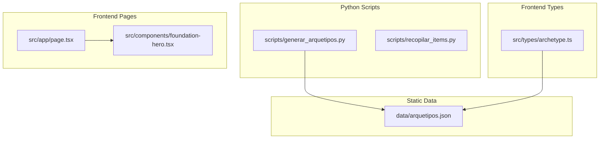
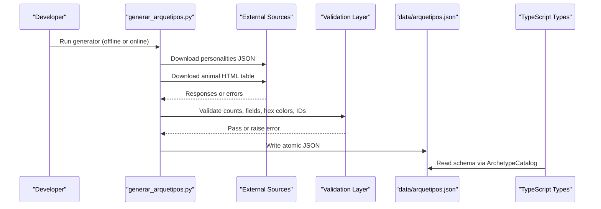
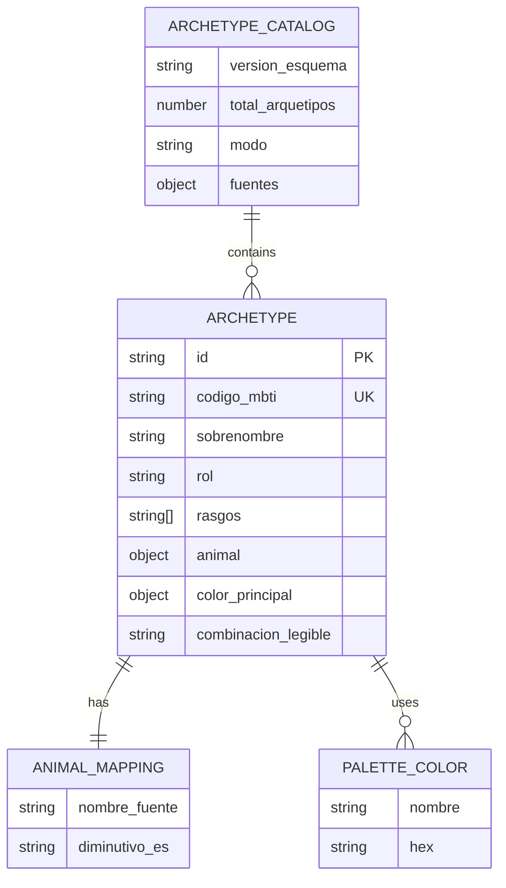
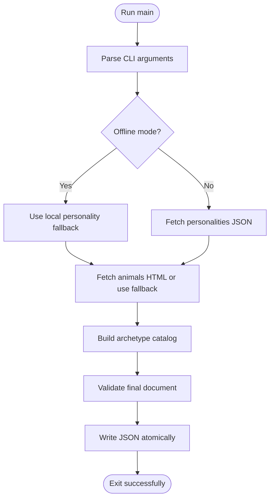
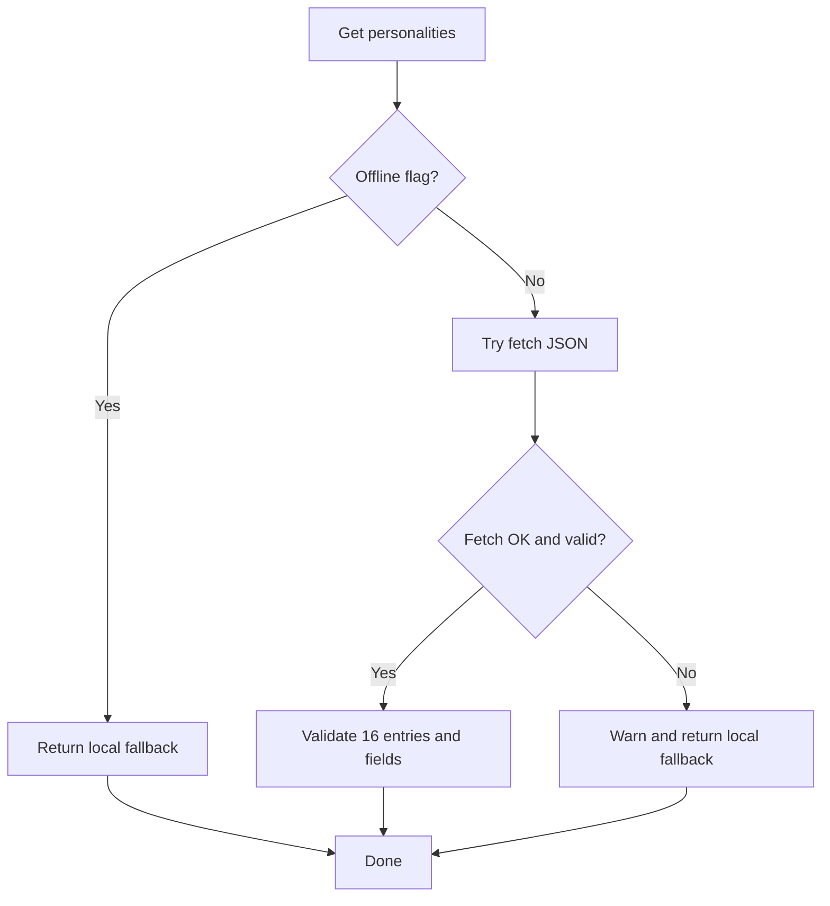
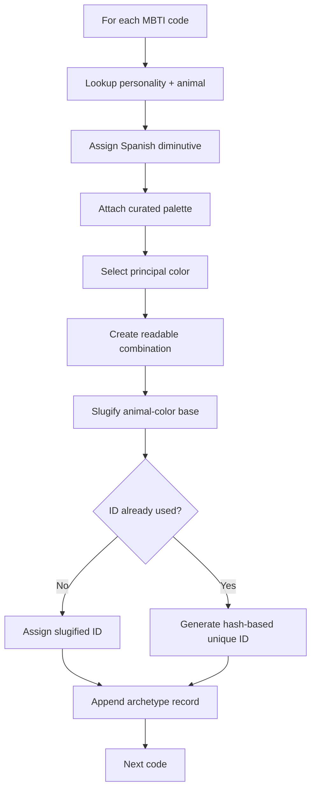
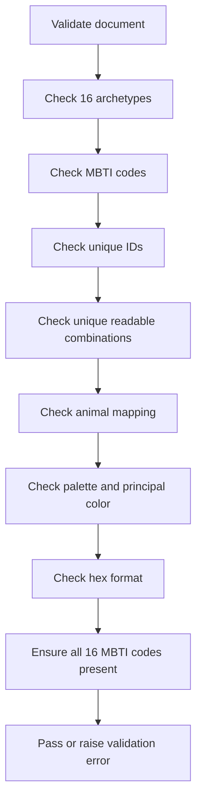
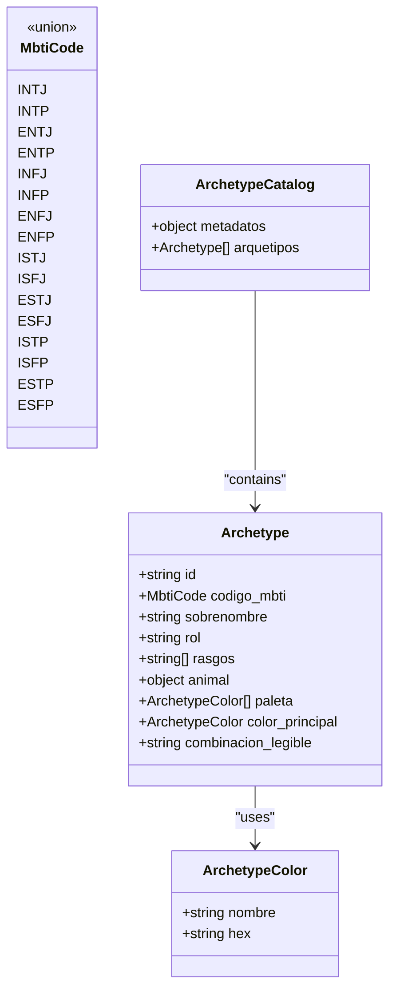
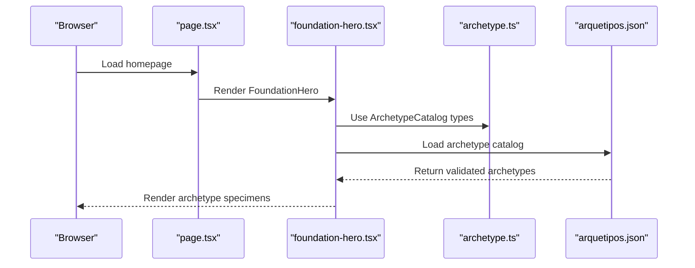
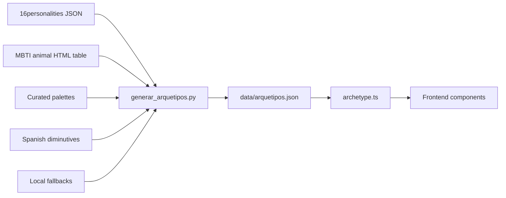

# Static Data Processing

<cite>
**Referenced Files in This Document**
- [arquetipos.json](file://data/arquetipos.json)
- [generar_arquetipos.py](file://scripts/generar_arquetipos.py)
- [recopilar_items.py](file://scripts/recopilar_items.py)
- [archetype.ts](file://src/types/archetype.ts)
- [page.tsx](file://src/app/page.tsx)
- [foundation-hero.tsx](file://src/components/foundation-hero.tsx)
</cite>

## Table of Contents
1. [Introduction](#introduction)
2. [Project Structure](#project-structure)
3. [Core Components](#core-components)
4. [Architecture Overview](#architecture-overview)
5. [Detailed Component Analysis](#detailed-component-analysis)
6. [Dependency Analysis](#dependency-analysis)
7. [Performance Considerations](#performance-considerations)
8. [Troubleshooting Guide](#troubleshooting-guide)
9. [Conclusion](#conclusion)
10. [Appendices](#appendices)

## Introduction
This document explains how ZooMatch produces and consumes static data for personality-animal archetypes. The canonical artifact is `data/arquetipos.json`, which maps the sixteen MBTI codes to animals, Spanish diminutives, curated color palettes, and stable identifiers. A Python generator script builds this file by scraping external sources when possible and falling back to local, curated data when not. The frontend TypeScript types define the contract that the JSON must satisfy.

The goal is to make it clear:
- What `arquetipos.json` represents.
- How the Python scripts generate and validate it.
- How missing or malformed data is handled.
- How new archetypes can be added safely.
- How the frontend consumes the resulting schema.

## Project Structure
At a high level, the relevant parts of the repository are:

**Diagram sources**
- [arquetipos.json:1-28](file://data/arquetipos.json#L1-L28)
- [generar_arquetipos.py:20-80](file://scripts/generar_arquetipos.py#L20-L80)
- [recopilar_items.py:38-108](file://scripts/recopilar_items.py#L38-L108)
- [archetype.ts:1-47](file://src/types/archetype.ts#L1-L47)
- [page.tsx:1-10](file://src/app/page.tsx#L1-L10)
- [foundation-hero.tsx:9-13](file://src/components/foundation-hero.tsx#L9-L13)

**Section sources**
- [arquetipos.json:1-28](file://data/arquetipos.json#L1-L28)
- [generar_arquetipos.py:1-28](file://scripts/generar_arquetipos.py#L1-L28)
- [recopilar_items.py:1-15](file://scripts/recopilar_items.py#L1-L15)
- [archetype.ts:1-47](file://src/types/archetype.ts#L1-L47)
- [page.tsx:1-10](file://src/app/page.tsx#L1-L10)
- [foundation-hero.tsx:1-13](file://src/components/foundation-hero.tsx#L1-L13)

## Core Components
- **Canonical static catalog**: `data/arquetipos.json` contains metadata about schema version, source status, and an array of sixteen archetype records.
- **Generator script**: `scripts/generar_arquetipos.py` scrapes personality and animal data, validates it, merges it with curated palettes and Spanish diminutives, and writes atomic JSON output.
- **Type contract**: `src/types/archetype.ts` defines the TypeScript interface for the archetype catalog consumed by the frontend.
- **Related pipeline script**: `scripts/recopilar_items.py` is part of the broader static-data pipeline; it validates and persists psychometric items but does not directly produce `arquetipos.json`. It demonstrates the project’s validation, fallback, and persistence patterns.

**Section sources**
- [arquetipos.json:1-28](file://data/arquetipos.json#L1-L28)
- [generar_arquetipos.py:83-112](file://scripts/generar_arquetipos.py#L83-L112)
- [archetype.ts:19-47](file://src/types/archetype.ts#L19-L47)
- [recopilar_items.py:229-318](file://scripts/recopilar_items.py#L229-L318)

## Architecture Overview
The static data architecture has three layers:

1. **Source layer**: External URLs for personality definitions and an HTML table mapping MBTI codes to animals.
2. **Processing layer**: Python logic that downloads, parses, validates, normalizes, and assembles the final catalog.
3. **Consumption layer**: Frontend TypeScript types and UI components that rely on the generated JSON structure.

**Diagram sources**
- [generar_arquetipos.py:153-168](file://scripts/generar_arquetipos.py#L153-L168)
- [generar_arquetipos.py:201-211](file://scripts/generar_arquetipos.py#L201-L211)
- [generar_arquetipos.py:248-315](file://scripts/generar_arquetipos.py#L248-L315)
- [generar_arquetipos.py:318-357](file://scripts/generar_arquetipos.py#L318-L357)
- [generar_arquetipos.py:360-383](file://scripts/generar_arquetipos.py#L360-L383)
- [archetype.ts:39-47](file://src/types/archetype.ts#L39-L47)

## Detailed Component Analysis

### Canonical Catalog: `data/arquetipos.json`
`arquetipos.json` is the single source of truth for the sixteen archetypes. Its top-level structure includes:

- `metadatos`: Schema version, total archetype count, operating mode, and source information.
- `arquetipos`: An array of exactly sixteen archetype objects.

Each archetype object contains:
- Stable identifier (`id`).
- MBTI code (`codigo_mbti`).
- Personality nickname and role.
- Trait list.
- Animal mapping with source name and Spanish diminutive.
- Curated palette with at least one primary color.
- Human-readable combination string used for display.

**Diagram sources**
- [arquetipos.json:1-28](file://data/arquetipos.json#L1-L28)
- [arquetipos.json:29-64](file://data/arquetipos.json#L29-L64)
- [arquetipos.json:41-63](file://data/arquetipos.json#L41-L63)

**Section sources**
- [arquetipos.json:1-28](file://data/arquetipos.json#L1-L28)
- [arquetipos.json:29-64](file://data/arquetipos.json#L29-L64)

### Generator Script: `scripts/generar_arquetipos.py`
The generator is responsible for:
- Creating a resilient HTTP session with retries and headers.
- Downloading personality data from a JSON endpoint.
- Scraping an HTML table for MBTI-to-animal mappings.
- Validating both sources against expected contracts.
- Merging results with curated palettes and Spanish diminutives.
- Generating stable, unique identifiers.
- Writing the final JSON atomically.

#### Key responsibilities and flow

**Diagram sources**
- [generar_arquetipos.py:91-112](file://scripts/generar_arquetipos.py#L91-L112)
- [generar_arquetipos.py:153-168](file://scripts/generar_arquetipos.py#L153-L168)
- [generar_arquetipos.py:201-211](file://scripts/generar_arquetipos.py#L201-L211)
- [generar_arquetipos.py:248-315](file://scripts/generar_arquetipos.py#L248-L315)
- [generar_arquetipos.py:318-383](file://scripts/generar_arquetipos.py#L318-L383)
- [generar_arquetipos.py:402-423](file://scripts/generar_arquetipos.py#L402-L423)

#### Source fetching and fallback strategy
- Personalities:
  - Online: Downloads JSON, checks for a `types` list, validates exactly sixteen entries, required fields, and four traits per entry.
  - Offline or on error: Uses a hardcoded fallback list of sixteen personalities.
- Animals:
  - Online: Parses HTML tables looking for columns named `type` and `animal`, extracts MBTI-to-animal mappings, and requires all sixteen codes.
  - Offline or on error: Uses a hardcoded fallback map.

**Diagram sources**
- [generar_arquetipos.py:153-168](file://scripts/generar_arquetipos.py#L153-L168)

#### Data transformation and ID generation
For each MBTI code:
- The script looks up personality data.
- It assigns a Spanish diminutive.
- It attaches a curated palette and selects the first palette color as the principal color.
- It creates a human-readable combination string.
- It generates a stable identifier based on the animal diminutive, principal color name, and MBTI code. If collisions occur, it uses hashing and counters to ensure uniqueness.

**Diagram sources**
- [generar_arquetipos.py:214-245](file://scripts/generar_arquetipos.py#L214-L245)
- [generar_arquetipos.py:248-287](file://scripts/generar_arquetipos.py#L248-L287)

#### Validation rules
The generator enforces:
- Exactly sixteen personalities.
- Exact set of MBTI codes.
- Required personality fields: nickname, role, and four non-empty trait strings.
- Exactly sixteen animal mappings covering all MBTI codes.
- Final document must contain exactly sixteen archetypes.
- Unique MBTI codes, unique IDs, and unique readable combinations.
- Animal mapping must include source name and Spanish diminutive.
- Palette must be a non-empty list where the principal color is included.
- Each palette color must have a valid six-character hexadecimal value.

**Diagram sources**
- [generar_arquetipos.py:318-357](file://scripts/generar_arquetipos.py#L318-L357)

#### Atomic write behavior
The script writes to a temporary file in the target directory, flushes and syncs, then replaces the destination file. On OS errors, it cleans up the temporary file. This prevents partially written JSON files from becoming the canonical catalog.

**Section sources**
- [generar_arquetipos.py:91-112](file://scripts/generar_arquetipos.py#L91-L112)
- [generar_arquetipos.py:153-168](file://scripts/generar_arquetipos.py#L153-L168)
- [generar_arquetipos.py:175-211](file://scripts/generar_arquetipos.py#L175-L211)
- [generar_arquetipos.py:214-287](file://scripts/generar_arquetipos.py#L214-L287)
- [generar_arquetipos.py:318-383](file://scripts/generar_arquetipos.py#L318-L383)
- [generar_arquetipos.py:402-423](file://scripts/generar_arquetipos.py#L402-L423)

### Type Contract: `src/types/archetype.ts`
The frontend type contract mirrors the structure of `arquetipos.json`:

- `MbtiCode`: Union of the sixteen MBTI codes.
- `ArchetypeColor`: Color name and hex value.
- `Archetype`: Full archetype record including animal mapping, palette, principal color, and readable combination.
- `ArchetypeCatalog`: Top-level catalog with metadata and archetype array.

This type definition ensures that any change to the JSON structure should also update the TypeScript types, keeping the frontend safe against malformed or evolving static data.

**Diagram sources**
- [archetype.ts:1-47](file://src/types/archetype.ts#L1-L47)

**Section sources**
- [archetype.ts:1-47](file://src/types/archetype.ts#L1-L47)

### Related Pipeline: `scripts/recopilar_items.py`
Although this script does not generate `arquetipos.json`, it illustrates the project’s approach to static data processing:

- Validates a microtest JSON with strict contracts: twenty-four items, six per category, exact Likert scale values, exact dimension order, approved sources, and consistent polarity/weights.
- Optionally scrapes IPIP content when allowed by license policy.
- Persists staging and curated items into SQLite with run tracking, deduplication, and SHA-256 hashes.
- Provides offline-only execution using approved local fallbacks.

This reinforces the same principles applied to archetypes: explicit validation, fallbacks, traceability, and deterministic outputs.

**Section sources**
- [recopilar_items.py:1-15](file://scripts/recopilar_items.py#L1-L15)
- [recopilar_items.py:67-108](file://scripts/recopilar_items.py#L67-L108)
- [recopilar_items.py:229-318](file://scripts/recopilar_items.py#L229-L318)
- [recopilar_items.py:336-391](file://scripts/recopilar_items.py#L336-L391)
- [recopilar_items.py:505-559](file://scripts/recopilar_items.py#L505-L559)
- [recopilar_items.py:601-618](file://scripts/recopilar_items.py#L601-L618)

### Frontend Consumption
The current frontend page renders a foundation hero component. The hero component currently uses inline specimen data rather than loading `arquetipos.json`. However, the TypeScript types define the intended contract for consuming the archetype catalog. When the frontend begins loading the static catalog, it should:

- Load `data/arquetipos.json`.
- Parse it into `ArchetypeCatalog`.
- Validate it against `Archetype` and `ArchetypeColor` types.
- Render archetype cards using `codigo_mbti`, `sobrenombre`, `animal.diminutivo_es`, `color_principal.hex`, and `combinacion_legible`.

**Diagram sources**
- [page.tsx:1-10](file://src/app/page.tsx#L1-L10)
- [foundation-hero.tsx:1-13](file://src/components/foundation-hero.tsx#L1-L13)
- [archetype.ts:39-47](file://src/types/archetype.ts#L39-L47)
- [arquetipos.json:1-28](file://data/arquetipos.json#L1-L28)

**Section sources**
- [page.tsx:1-10](file://src/app/page.tsx#L1-L10)
- [foundation-hero.tsx:9-13](file://src/components/foundation-hero.tsx#L9-L13)
- [archetype.ts:19-47](file://src/types/archetype.ts#L19-L47)

## Dependency Analysis
The static data pipeline has clear dependencies:

- `generar_arquetipos.py` depends on:
  - External personality JSON.
  - External HTML table for MBTI-to-animal mapping.
  - Local curated palettes.
  - Local Spanish diminutives.
  - Local fallbacks for both personalities and animals.
- `arquetipos.json` depends on the generator’s output and the schema defined by `archetype.ts`.
- The frontend depends on `archetype.ts` and, when fully integrated, on `arquetipos.json`.

**Diagram sources**
- [generar_arquetipos.py:20-80](file://scripts/generar_arquetipos.py#L20-L80)
- [generar_arquetipos.py:153-168](file://scripts/generar_arquetipos.py#L153-L168)
- [generar_arquetipos.py:201-211](file://scripts/generar_arquetipos.py#L201-L211)
- [archetype.ts:1-47](file://src/types/archetype.ts#L1-L47)

**Section sources**
- [generar_arquetipos.py:20-80](file://scripts/generar_arquetipos.py#L20-L80)
- [archetype.ts:1-47](file://src/types/archetype.ts#L1-L47)

## Performance Considerations
- Network requests are retried with exponential backoff and limited methods, reducing load spikes and transient failures.
- HTML parsing uses BeautifulSoup with a simple table scan; performance is acceptable for a single small table.
- JSON writing is atomic, avoiding partial reads during deployment or concurrent access.
- The generator processes exactly sixteen records, so time complexity is constant relative to dataset size.
- The frontend types add compile-time safety without runtime overhead.

[No sources needed since this section provides general guidance]

## Troubleshooting Guide
Common issues and their handling:

- **External personality JSON unavailable or malformed**:
  - The generator logs a warning and falls back to the local personality list.
  - Validation ensures the fallback still produces exactly sixteen valid entries.
- **Animal HTML table missing required columns or incomplete mapping**:
  - The scraper raises a source error if no complete table is found.
  - The generator falls back to the local animal map.
- **Invalid hex colors or palette structure**:
  - Validation rejects invalid hex formats and palette inconsistencies.
- **Duplicate IDs or readable combinations**:
  - Validation fails early to prevent ambiguous archetypes.
- **Atomic write failure**:
  - Temporary files are cleaned up; the original catalog remains intact.

Recommended debugging steps:
- Run the generator in offline mode to isolate network issues.
- Inspect the metadata in `arquetipos.json` to see whether sources were fetched online or fell back locally.
- Validate the JSON against `ArchetypeCatalog` types in TypeScript.
- Compare the generated archetype count and MBTI codes against the expected sixteen.

**Section sources**
- [generar_arquetipos.py:153-168](file://scripts/generar_arquetipos.py#L153-L168)
- [generar_arquetipos.py:201-211](file://scripts/generar_arquetipos.py#L201-L211)
- [generar_arquetipos.py:318-383](file://scripts/generar_arquetipos.py#L318-L383)
- [arquetipos.json:1-28](file://data/arquetipos.json#L1-L28)

## Conclusion
ZooMatch’s static data processing centers on a robust generator that combines external sources with curated local data, validates every step, and writes a stable, typed JSON catalog. `arquetipos.json` is the authoritative artifact for personality-animal mappings, while `archetype.ts` guarantees that the frontend understands the expected shape. The related item pipeline demonstrates the same disciplined approach to validation, fallbacks, and traceability. Adding new archetypes requires updating both the generator’s curated data and the TypeScript types, ensuring consistency across the entire system.

[No sources needed since this section summarizes without analyzing specific files]

## Appendices

### How to Add a New Archetype
Adding a new archetype is not straightforward because the current system is explicitly designed around the sixteen MBTI codes. If the project evolves beyond MBTI, the following changes would be necessary:

1. Update the expected code set in the generator.
2. Add personality fallback data for the new code.
3. Add animal fallback mapping for the new code.
4. Add Spanish diminutive mapping for the new code.
5. Add curated palette data for the new code.
6. Update the TypeScript `MbtiCode` union and related interfaces.
7. Regenerate `arquetipos.json` and verify validation passes.

Current constraints:
- The generator expects exactly sixteen MBTI codes.
- The archetype catalog metadata reports sixteen archetypes.
- The TypeScript type defines exactly sixteen MBTI codes.

**Section sources**
- [generar_arquetipos.py:22-27](file://scripts/generar_arquetipos.py#L22-L27)
- [generar_arquetipos.py:30-80](file://scripts/generar_arquetipos.py#L30-L80)
- [generar_arquetipos.py:137-150](file://scripts/generar_arquetipos.py#L137-L150)
- [generar_arquetipos.py:248-315](file://scripts/generar_arquetipos.py#L248-L315)
- [archetype.ts:1-17](file://src/types/archetype.ts#L1-L17)
- [arquetipos.json:1-5](file://data/arquetipos.json#L1-L5)

### Data Structure Evolution and Migration Patterns
The catalog includes a schema version field in its metadata. Current migration practices implied by the codebase:

- Keep `version_esquema` synchronized with structural changes.
- Preserve backward compatibility when possible by adding optional fields rather than removing required ones.
- Validate both old and new structures during transition periods.
- Use the generator’s validation layer to catch breaking changes before deployment.
- Maintain stable identifiers through slugification and hashing to reduce frontend breakage.

**Section sources**
- [arquetipos.json:1-5](file://data/arquetipos.json#L1-L5)
- [generar_arquetipos.py:290-310](file://scripts/generar_arquetipos.py#L290-L310)
- [generar_arquetipos.py:318-357](file://scripts/generar_arquetipos.py#L318-L357)