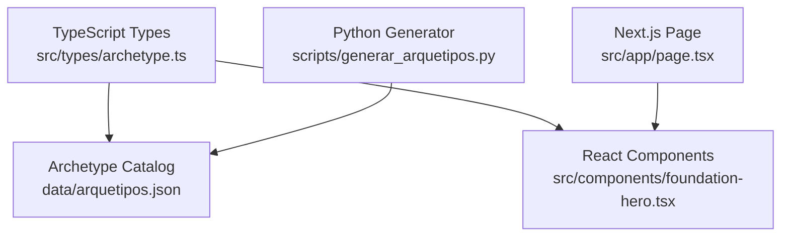
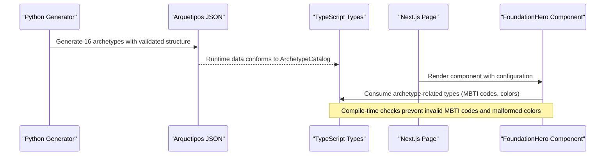
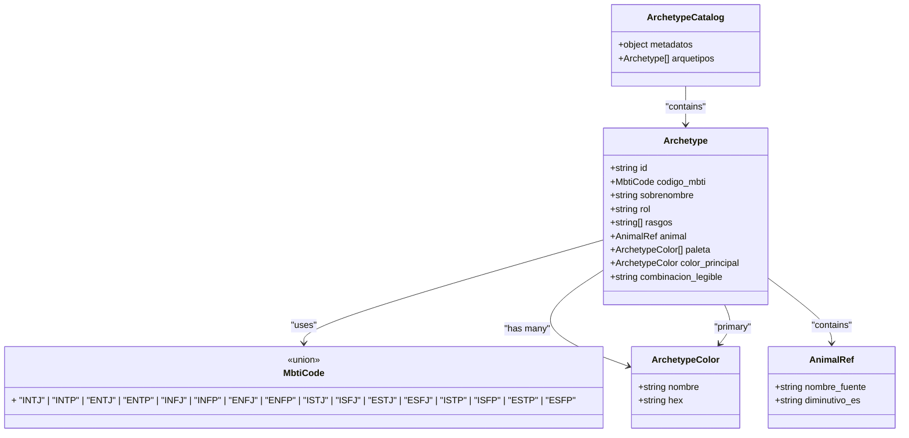
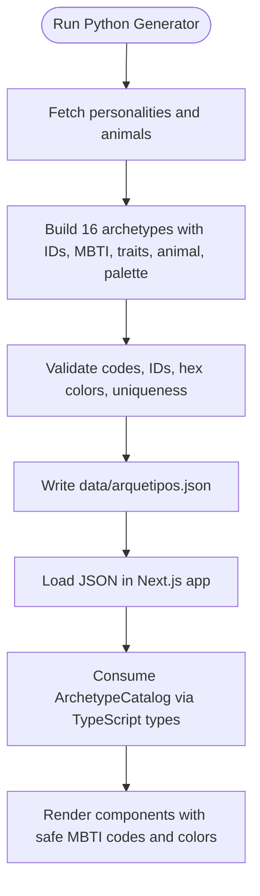
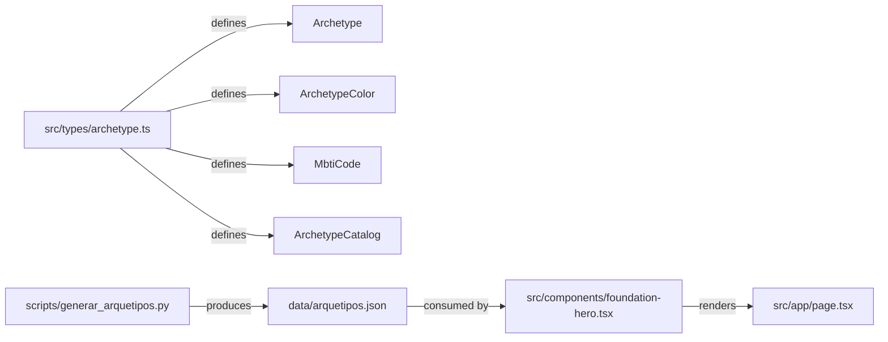

# Type System Design

<cite>
**Referenced Files in This Document**
- [archetype.ts](file://src/types/archetype.ts)
- [arquetipos.json](file://data/arquetipos.json)
- [page.tsx](file://src/app/page.tsx)
- [foundation-hero.tsx](file://src/components/foundation-hero.tsx)
- [generar_arquetipos.py](file://scripts/generar_arquetipos.py)
</cite>

## Table of Contents
1. [Introduction](#introduction)
2. [Project Structure](#project-structure)
3. [Core Components](#core-components)
4. [Architecture Overview](#architecture-overview)
5. [Detailed Component Analysis](#detailed-component-analysis)
6. [Dependency Analysis](#dependency-analysis)
7. [Performance Considerations](#performance-considerations)
8. [Troubleshooting Guide](#troubleshooting-guide)
9. [Conclusion](#conclusion)
10. [Appendices](#appendices)

## Introduction
This document explains the TypeScript type system design used by ZooMatch to model MBTI-based archetypes, their animal associations, color palettes, and how these types enforce compile-time safety across the application. It covers the core interfaces, the MBTI code union, data contracts with JSON, and integration points with React components. It also provides guidance for extending archetype data safely and maintaining type consistency.

## Project Structure
ZooMatch’s type system is centered around a single TypeScript module that defines shared domain types. The runtime data is provided by a curated JSON file generated by a Python script. React components consume this data through typed props and local sample arrays.

**Diagram sources**
- [archetype.ts:1-47](file://src/types/archetype.ts#L1-L47)
- [arquetipos.json:1-592](file://data/arquetipos.json#L1-L592)
- [foundation-hero.tsx:1-117](file://src/components/foundation-hero.tsx#L1-L117)
- [page.tsx:1-10](file://src/app/page.tsx#L1-L10)
- [generar_arquetipos.py:248-315](file://scripts/generar_arquetipos.py#L248-L315)

**Section sources**
- [archetype.ts:1-47](file://src/types/archetype.ts#L1-L47)
- [arquetipos.json:1-592](file://data/arquetipos.json#L1-L592)
- [foundation-hero.tsx:1-117](file://src/components/foundation-hero.tsx#L1-L117)
- [page.tsx:1-10](file://src/app/page.tsx#L1-L10)
- [generar_arquetipos.py:248-315](file://scripts/generar_arquetipos.py#L248-L315)

## Core Components
The type system defines:
- A strict MBTI code union ensuring only valid personality codes are accepted.
- A color token interface for palette entries.
- An Archetype interface modeling each personality profile, including MBTI mapping, nickname, role, traits, animal association, palette, primary color, and a human-readable combination key.
- A catalog wrapper containing metadata and an array of archetypes.

Key responsibilities:
- MbtiCode: restricts string literals to the canonical 16 MBTI codes.
- ArchetypeColor: enforces a name and a hex color literal pattern.
- Archetype: central contract for all UI and logic consuming archetype data.
- ArchetypeCatalog: top-level schema for the JSON dataset.

These types provide compile-time guarantees that:
- Only valid MBTI codes flow into components.
- Color tokens always include a name and a hex value.
- Every archetype has required fields such as id, animal, palette, and color_principal.

**Section sources**
- [archetype.ts:1-47](file://src/types/archetype.ts#L1-L47)

## Architecture Overview
The architecture connects three layers:
- Type layer: TypeScript definitions in src/types/archetype.ts.
- Data layer: Curated JSON in data/arquetipos.json produced by scripts/generar_arquetipos.py.
- Presentation layer: React components in src/components/foundation-hero.tsx and Next.js page entry in src/app/page.tsx.

**Diagram sources**
- [generar_arquetipos.py:248-315](file://scripts/generar_arquetipos.py#L248-L315)
- [arquetipos.json:1-592](file://data/arquetipos.json#L1-L592)
- [archetype.ts:1-47](file://src/types/archetype.ts#L1-L47)
- [page.tsx:1-10](file://src/app/page.tsx#L1-L10)
- [foundation-hero.tsx:1-117](file://src/components/foundation-hero.tsx#L1-L117)

## Detailed Component Analysis

### MBTI Code Union
MbtiCode is a union of exactly 16 uppercase MBTI strings. This ensures that any field typed as MbtiCode can only be one of the supported personality codes.

Benefits:
- Prevents typos or unsupported codes from entering the app.
- Enables exhaustive handling in switch statements or discriminated unions.
- Aligns with the generator’s expected set of codes.

Usage patterns:
- As a property on Archetype (codigo_mbti).
- In components when filtering or rendering samples keyed by MBTI code.

**Section sources**
- [archetype.ts:1-17](file://src/types/archetype.ts#L1-L17)
- [generar_arquetipos.py:256-257](file://scripts/generar_arquetipos.py#L256-L257)

### ArchetypeColor Interface
ArchetypeColor models a named color token with a hex value. The hex field uses a template literal type requiring a leading “#” followed by a string, which helps catch malformed color values at compile time.

Responsibilities:
- Represent individual swatches in palettes.
- Provide a primary color per archetype.
- Ensure consistent naming and format across the catalog.

Integration:
- Used within Archetype.paleta and Archetype.color_principal.
- Drives visual styling in components via swatch properties.

**Section sources**
- [archetype.ts:19-22](file://src/types/archetype.ts#L19-L22)
- [arquetipos.json:45-63](file://data/arquetipos.json#L45-L63)

### Archetype Interface
Archetype is the central contract for a personality profile. It includes:
- id: stable identifier for the archetype.
- codigo_mbti: MBTI code mapped to the MbtiCode union.
- sobrenombre: display nickname.
- rol: personality group (e.g., Analysts, Diplomats, Sentinels, Explorers).
- rasgos: list of trait descriptors.
- animal: nested object with source animal name and Spanish diminutive.
- paleta: array of ArchetypeColor.
- color_principal: selected primary color from the palette.
- combinacion_legible: human-readable combination string used for labeling.

Design notes:
- Strong typing prevents missing fields during rendering or processing.
- Nested animal object separates source data from localized labels.
- Palette and primary color ensure consistent theming.

**Section sources**
- [archetype.ts:24-37](file://src/types/archetype.ts#L24-L37)
- [arquetipos.json:30-64](file://data/arquetipos.json#L30-L64)

### ArchetypeCatalog Interface
ArchetypeCatalog wraps the full dataset:
- metadatos: schema version, total count, mode, and sources.
- arquetipos: array of Archetype.

Purpose:
- Provides a single root shape for the JSON payload.
- Encourages validation at ingestion points.

**Section sources**
- [archetype.ts:39-47](file://src/types/archetype.ts#L39-L47)
- [arquetipos.json:1-28](file://data/arquetipos.json#L1-L28)

### React Integration Patterns
Components consume archetype-related types through props and local sample arrays. While the current FoundationHero component demonstrates MBTI codes and color swatches inline, the same patterns apply when loading ArchetypeCatalog from JSON.

Example usage patterns:
- Define props using MbtiCode to constrain allowed values.
- Map over Archetype.paleta to render swatches.
- Use Archetype.combinacion_legible for accessible labels.

Current component highlights:
- foundation-hero.tsx shows a small set of specimens with MBTI codes and color swatches.
- page.tsx composes the hero component and passes environment configuration.

Best practices:
- Prefer importing Archetype and ArchetypeCatalog from src/types/archetype.ts instead of ad-hoc shapes.
- Validate loaded JSON against ArchetypeCatalog before rendering.
- Use MbtiCode in component props to avoid invalid codes.

**Section sources**
- [foundation-hero.tsx:9-13](file://src/components/foundation-hero.tsx#L9-L13)
- [foundation-hero.tsx:84-105](file://src/components/foundation-hero.tsx#L84-L105)
- [page.tsx:1-10](file://src/app/page.tsx#L1-L10)

### Class Diagram of Core Types

**Diagram sources**
- [archetype.ts:1-47](file://src/types/archetype.ts#L1-L47)

### Data Flow from Generator to Types

**Diagram sources**
- [generar_arquetipos.py:248-315](file://scripts/generar_arquetipos.py#L248-L315)
- [generar_arquetipos.py:318-357](file://scripts/generar_arquetipos.py#L318-L357)
- [arquetipos.json:1-592](file://data/arquetipos.json#L1-L592)
- [archetype.ts:1-47](file://src/types/archetype.ts#L1-L47)

## Dependency Analysis
The type system introduces minimal coupling while providing strong contracts:
- Types depend only on built-in TypeScript primitives and template literal constraints.
- JSON data depends on the generator’s output conforming to ArchetypeCatalog.
- Components depend on types for props and data shaping.

**Diagram sources**
- [archetype.ts:1-47](file://src/types/archetype.ts#L1-L47)
- [generar_arquetipos.py:248-315](file://scripts/generar_arquetipos.py#L248-L315)
- [arquetipos.json:1-592](file://data/arquetipos.json#L1-L592)
- [foundation-hero.tsx:1-117](file://src/components/foundation-hero.tsx#L1-L117)
- [page.tsx:1-10](file://src/app/page.tsx#L1-L10)

**Section sources**
- [archetype.ts:1-47](file://src/types/archetype.ts#L1-L47)
- [generar_arquetipos.py:248-315](file://scripts/generar_arquetipos.py#L248-L315)
- [arquetipos.json:1-592](file://data/arquetipos.json#L1-L592)
- [foundation-hero.tsx:1-117](file://src/components/foundation-hero.tsx#L1-L117)
- [page.tsx:1-10](file://src/app/page.tsx#L1-L10)

## Performance Considerations
- Type checking occurs at build time; runtime performance is unaffected by the presence of MbtiCode or ArchetypeColor.
- Keeping archetype data in a single JSON file avoids repeated network calls if cached appropriately.
- Rendering components should map over small arrays (e.g., paleta) efficiently; consider memoization if palettes grow significantly.

[No sources needed since this section provides general guidance]

## Troubleshooting Guide
Common issues and resolutions:
- Invalid MBTI code in components:
  - Symptom: TypeScript error indicating a string is not assignable to MbtiCode.
  - Resolution: Replace the string with one of the allowed codes defined in the MbtiCode union.
- Malformed color hex:
  - Symptom: TypeScript error due to incorrect hex format.
  - Resolution: Ensure the color string starts with “#” and follows the expected pattern.
- Missing archetype fields:
  - Symptom: TypeScript error about missing properties on Archetype.
  - Resolution: Add required fields such as id, codigo_mbti, animal, paleta, color_principal, and combinacion_legible.
- JSON mismatch:
  - Symptom: Runtime errors when accessing fields like arquetipos or metadatos.
  - Resolution: Regenerate data/arquetipos.json using the Python generator to ensure it matches ArchetypeCatalog.

Validation helpers in the generator:
- Ensures exactly 16 archetypes.
- Validates unique IDs and MBTI codes.
- Validates hex color formats.

**Section sources**
- [archetype.ts:1-47](file://src/types/archetype.ts#L1-L47)
- [generar_arquetipos.py:318-357](file://scripts/generar_arquetipos.py#L318-L357)

## Conclusion
ZooMatch’s type system centers on a compact set of TypeScript interfaces and a strict MBTI code union. These types enforce compile-time safety for MBTI codes, color tokens, and archetype structures, aligning runtime JSON data with React components. By adhering to Archetype and ArchetypeCatalog, developers can extend archetype data confidently while preserving consistency across the application.

[No sources needed since this section summarizes without analyzing specific files]

## Appendices

### Extending Archetype Data Safely
Guidelines:
- When adding new archetypes, ensure codigo_mbti remains within the MbtiCode union.
- Maintain ArchetypeColor entries with both nombre and hex.
- Keep ArchetypeCatalog.arquetipos synchronized with the generator’s output.
- Update any component props to accept MbtiCode where applicable.

Recommended workflow:
1. Extend archetype data in data/arquetipos.json via the generator.
2. Verify TypeScript compilation succeeds with existing types.
3. Update components to consume new fields if necessary.
4. Run tests or lint checks to validate consistency.

**Section sources**
- [archetype.ts:1-47](file://src/types/archetype.ts#L1-L47)
- [generar_arquetipos.py:248-315](file://scripts/generar_arquetipos.py#L248-L315)