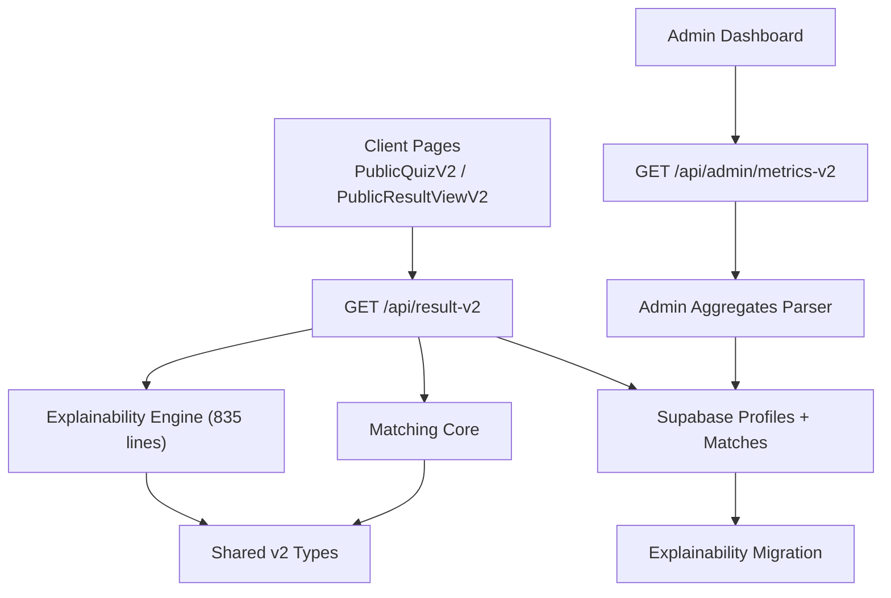
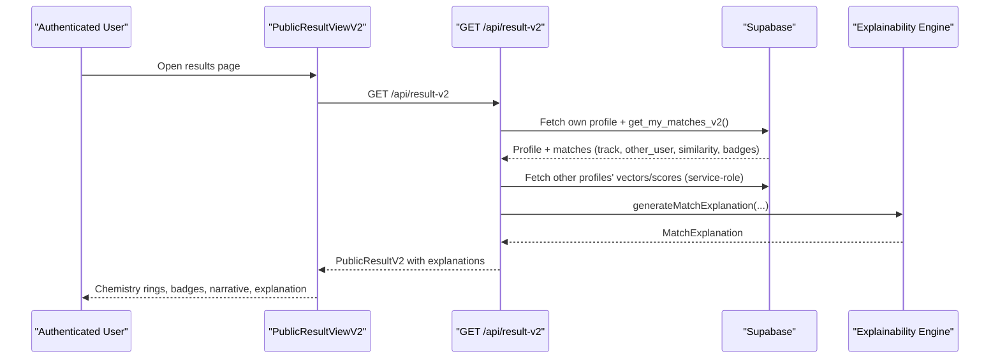
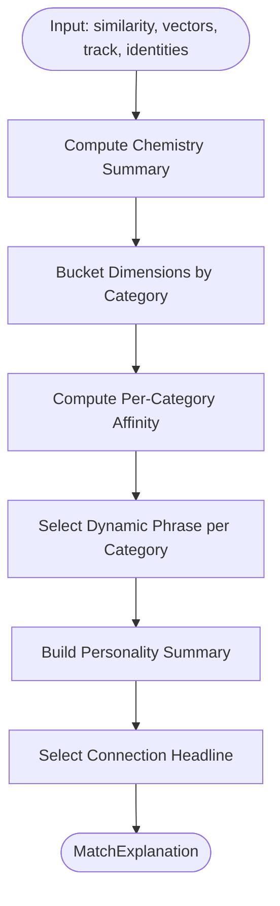
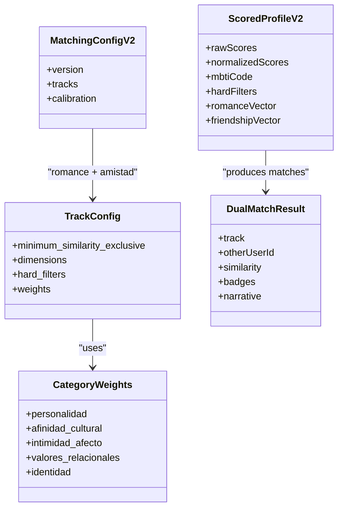
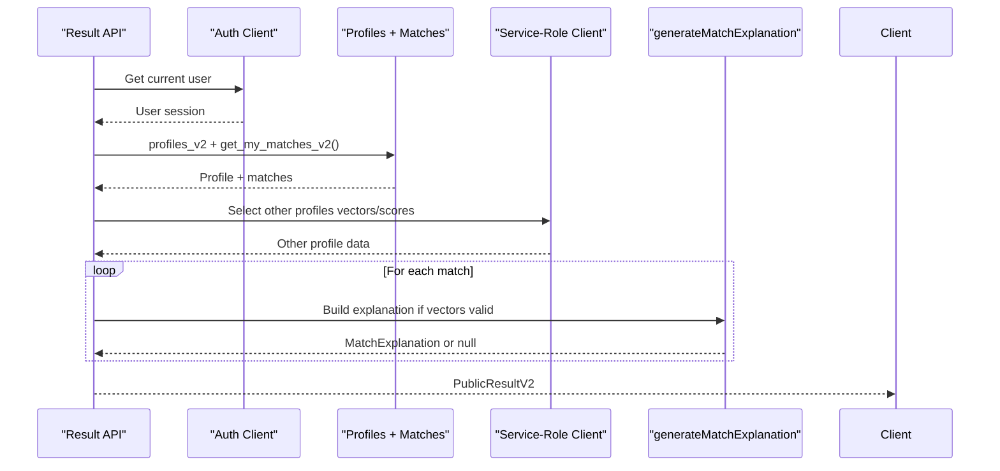
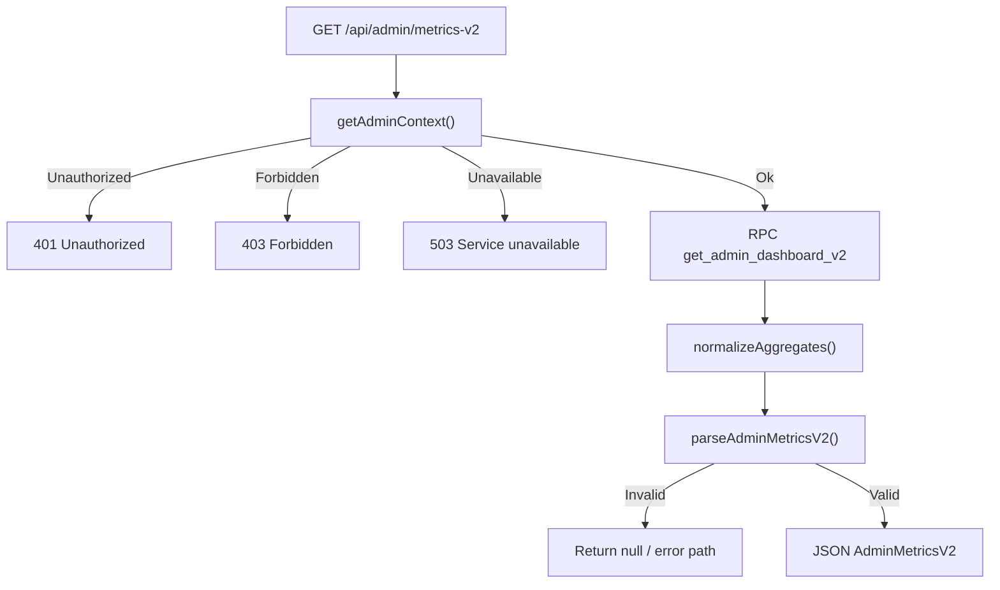
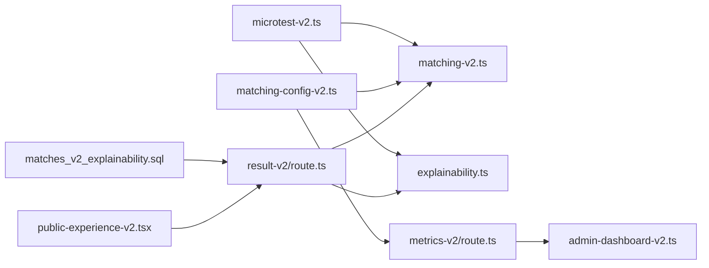

# Explainability & Analytics

<cite>
**Referenced Files in This Document**
- [explainability.ts](file://src/lib/explainability.ts)
- [matching-v2.ts](file://src/lib/matching-v2.ts)
- [microtest-v2.ts](file://src/types/microtest-v2.ts)
- [result-v2\route.ts](file://src/app/api/result-v2/route.ts)
- [public-experience-utils-v2.ts](file://src/components/public-experience-utils-v2.ts)
- [public-experience-v2.tsx](file://src/components/public-experience-v2.tsx)
- [admin-dashboard-v2.ts](file://src/lib/admin-dashboard-v2.ts)
- [metrics-v2\route.ts](file://src/app/api/admin/metrics-v2/route.ts)
- [matching-config-v2.ts](file://src/lib/matching-config-v2.ts)
- [202610240001_matches_v2_explainability.sql](file://supabase/migrations/202610240001_matches_v2_explainability.sql)
</cite>

## Update Summary
**Changes Made**
- Updated to reflect the new 835-line explainability system integrated with the result endpoint
- Added comprehensive documentation for the human-readable explanation generation pipeline
- Enhanced architecture diagrams to show the complete explainability flow
- Updated component analysis to include the new Spanish-language warm summaries
- Expanded troubleshooting guide to cover explainability-specific scenarios

## Table of Contents
1. [Introduction](#introduction)
2. [Project Structure](#project-structure)
3. [Core Components](#core-components)
4. [Architecture Overview](#architecture-overview)
5. [Detailed Component Analysis](#detailed-component-analysis)
6. [Dependency Analysis](#dependency-analysis)
7. [Performance Considerations](#performance-considerations)
8. [Troubleshooting Guide](#troubleshooting-guide)
9. [Conclusion](#conclusion)

## Introduction
This document explains the explainability and analytics layer behind ZooMatch v2. It focuses on how raw matching scores are transformed into human-readable Spanish explanations, how dual-track romance and friendship matches are computed, and how administrators consume aggregate metrics. The system is intentionally deterministic: identical inputs produce identical outputs, and user-facing copy is warm, inclusive, and non-clinical.

The explainability engine does not compute similarity itself; it consumes the vectors and scores produced by the matching core and turns them into:
- A chemistry summary with percentage and qualitative band.
- A per-category affinity breakdown with dynamic affective phrases.
- A concise personality summary for the matched profile.
- A one-line poetic headline describing the connection.

Analytics are exposed through an admin dashboard that reports thresholds, match counts, top animals/colors, and MBTI distribution, all validated before reaching the UI or CSV export.

## Project Structure
The explainability and analytics features span server routes, pure library modules, shared types, Supabase migrations, and client components.

**Diagram sources**
- [public-experience-v2.tsx:500-550](file://src/components/public-experience-v2.tsx#L500-L550)
- [result-v2\route.ts:110-220](file://src/app/api/result-v2/route.ts#L110-L220)
- [explainability.ts:572-836](file://src/lib/explainability.ts#L572-L836)
- [matching-v2.ts:517-579](file://src/lib/matching-v2.ts#L517-L579)
- [metrics-v2\route.ts:33-61](file://src/app/api/admin/metrics-v2/route.ts#L33-L61)
- [admin-dashboard-v2.ts:40-63](file://src/lib/admin-dashboard-v2.ts#L40-L63)
- [202610240001_matches_v2_explainability.sql:17-54](file://supabase/migrations/202610240001_matches_v2_explainability.sql#L17-L54)

**Section sources**
- [public-experience-v2.tsx:105-237](file://src/components/public-experience-v2.tsx#L105-L237)
- [public-experience-v2.tsx:500-755](file://src/components/public-experience-v2.tsx#L500-L755)
- [result-v2\route.ts:1-232](file://src/app/api/result-v2/route.ts#L1-L232)
- [metrics-v2\route.ts:1-73](file://src/app/api/admin/metrics-v2/route.ts#L1-L73)

## Core Components
- **Explainability engine**: Converts raw cosine-similarity results into a chemistry summary, category breakdown, personality summary, and headline. This 835-line module provides deterministic, side-effect-free transformation with warm Spanish-language output.
- **Matching core**: Scores quiz answers into normalized dimensions, derives MBTI codes, applies hard filters, computes weighted track similarity, and generates compatibility badges.
- **Result API**: Authenticates users, fetches their profile and matches, loads counterpart profiles via a service-role client, and builds affective explanations using the explainability engine.
- **Admin metrics route**: Enforces admin authorization, calls a database RPC with configured thresholds, normalizes aggregates, validates them, and returns safe metrics.
- **Shared types**: Define dimension categories, vector orders, scoring shapes, badge structures, and configuration contracts.
- **Migration**: Extends the public matches RPC to include the matched user's identifier so the result API can look up their vectors and scores for explanation generation.

**Section sources**
- [explainability.ts:1-85](file://src/lib/explainability.ts#L1-L85)
- [matching-v2.ts:1-39](file://src/lib/matching-v2.ts#L1-L39)
- [result-v2\route.ts:1-48](file://src/app/api/result-v2/route.ts#L1-L48)
- [metrics-v2\route.ts:1-31](file://src/app/api/admin/metrics-v2/route.ts#L1-L31)
- [microtest-v2.ts:1-160](file://src/types/microtest-v2.ts#L1-L160)
- [202610240001_matches_v2_explainability.sql:1-59](file://supabase/migrations/202610240001_matches_v2_explainability.sql#L1-L59)

## Architecture Overview
The end-to-end flow for explainable results integrates the new explainability engine with the existing matching infrastructure:

**Diagram sources**
- [public-experience-v2.tsx:508-550](file://src/components/public-experience-v2.tsx#L508-L550)
- [result-v2\route.ts:110-220](file://src/app/api/result-v2/route.ts#L110-L220)
- [explainability.ts:795-836](file://src/lib/explainability.ts#L795-L836)
- [202610240001_matches_v2_explainability.sql:17-54](file://supabase/migrations/202610240001_matches_v2_explainability.sql#L17-L54)

## Detailed Component Analysis

### Explainability Engine
The explainability module is a deterministic, side-effect-free transformer spanning 835 lines of code. It receives:
- A raw similarity score between 0 and 1.
- Two ordered dimension vectors for the active track.
- Track identity (`romance` or `amistad`).
- Matched user's animal, color, MBTI code, and Big Five scores.
- Querying user's animal and Big Five scores.

It produces:
- `ChemistrySummary`: integer percentage, display text, machine-readable level, and Spanish label.
- `AffinityBreakdown[]`: per-category affinity percentages, labels, icons, and dynamic phrases.
- `PersonalitySummary`: three-line description, MBTI label, and key traits.
- `headline`: a poetic one-line summary selected deterministically from pools.

Key implementation characteristics:
- Category mapping uses dimension prefixes such as `personalidad_`, `cultural_`, `intimidad_`, `valores_`, and `identidad_`.
- Affinity per category is computed as `1 - mean(|a[i] - b[i]|)` over the category's indices.
- Phrase selection uses predefined ladders evaluated from highest minimum threshold to lowest.
- Personality summary composes identity, MBTI descriptor, and a complementary trait clause derived from Big Five comparisons.
- Headline selection hashes the combination of user animal, match animal, track, and top category to pick deterministically from category-specific and animal-metaphor pools.

**Diagram sources**
- [explainability.ts:572-589](file://src/lib/explainability.ts#L572-L589)
- [explainability.ts:605-647](file://src/lib/explainability.ts#L605-L647)
- [explainability.ts:709-748](file://src/lib/explainability.ts#L709-L748)
- [explainability.ts:760-791](file://src/lib/explainability.ts#L760-L791)

**Section sources**
- [explainability.ts:27-85](file://src/lib/explainability.ts#L27-L85)
- [explainability.ts:133-156](file://src/lib/explainability.ts#L133-L156)
- [explainability.ts:172-265](file://src/lib/explainability.ts#L172-L265)
- [explainability.ts:278-365](file://src/lib/explainability.ts#L278-L365)
- [explainability.ts:407-507](file://src/lib/explainability.ts#L407-L507)
- [explainability.ts:512-560](file://src/lib/explainability.ts#L512-L560)
- [explainability.ts:572-836](file://src/lib/explainability.ts#L572-L836)

### Matching Core
The matching core performs:
- Quiz scoring into normalized dimension scores.
- MBTI code derivation from normalized MBTI dimensions.
- Hard filter extraction and validation.
- Construction of romance and friendship vectors.
- Weighted cosine similarity across tracks.
- Compatibility badge generation.
- Dual-match discovery with thresholds.

Important behaviors:
- Negatively weighted Likert items are reverse-scored before aggregation.
- Dimensions without contributing items default to neutral score `0.5`.
- Romance track applies hard filters; friendship track does not.
- Category weights prevent large intimacy categories from dominating smaller ones.
- Badges rank dimensions by affinity and return a fixed limit per track.

**Diagram sources**
- [matching-v2.ts:189-281](file://src/lib/matching-v2.ts#L189-L281)
- [matching-v2.ts:416-448](file://src/lib/matching-v2.ts#L416-L448)
- [matching-v2.ts:461-488](file://src/lib/matching-v2.ts#L461-L488)
- [matching-v2.ts:517-579](file://src/lib/matching-v2.ts#L517-L579)
- [microtest-v2.ts:126-160](file://src/types/microtest-v2.ts#L126-L160)
- [microtest-v2.ts:250-278](file://src/types/microtest-v2.ts#L250-L278)

**Section sources**
- [matching-v2.ts:42-114](file://src/lib/matching-v2.ts#L42-L114)
- [matching-v2.ts:189-281](file://src/lib/matching-v2.ts#L189-L281)
- [matching-v2.ts:285-358](file://src/lib/matching-v2.ts#L285-L358)
- [matching-v2.ts:368-448](file://src/lib/matching-v2.ts#L368-L448)
- [matching-v2.ts:461-579](file://src/lib/matching-v2.ts#L461-L579)

### Result API and Explanation Integration
The result API now integrates seamlessly with the explainability engine:
- Authenticates the current user.
- Fetches the user's profile and matches using the authenticated client.
- Parses and validates match rows.
- Loads matched users' vectors and scores using a service-role client because profiles are RLS-restricted.
- Builds a short narrative per match.
- Calls the explainability engine when both user and match have valid track vectors.
- Returns a structured public result including romance and amistad matches.

Graceful degradation:
- If either user's vector data is missing or malformed, the explanation is set to `null` instead of throwing.
- If RPC or profile queries fail, the API returns appropriate error responses.

**Diagram sources**
- [result-v2\route.ts:110-220](file://src/app/api/result-v2/route.ts#L110-L220)
- [result-v2\route.ts:71-108](file://src/app/api/result-v2/route.ts#L71-L108)
- [202610240001_matches_v2_explainability.sql:17-54](file://supabase/migrations/202610240001_matches_v2_explainability.sql#L17-L54)

**Section sources**
- [result-v2\route.ts:16-48](file://src/app/api/result-v2/route.ts#L16-L48)
- [result-v2\route.ts:49-108](file://src/app/api/result-v2/route.ts#L49-L108)
- [result-v2\route.ts:110-220](file://src/app/api/result-v2/route.ts#L110-L220)

### Admin Analytics
The admin metrics route:
- Requires admin context and security wrapping.
- Calls a Supabase RPC with configured romance and friendship thresholds.
- Normalizes SQL aggregates that may be `NULL` for empty sets.
- Validates the payload with Zod before returning it.
- Provides CSV serialization and formula protection for spreadsheet safety.

**Diagram sources**
- [metrics-v2\route.ts:33-61](file://src/app/api/admin/metrics-v2/route.ts#L33-L61)
- [admin-dashboard-v2.ts:40-63](file://src/lib/admin-dashboard-v2.ts#L40-L63)
- [admin-dashboard-v2.ts:78-110](file://src/lib/admin-dashboard-v2.ts#L78-L110)

**Section sources**
- [metrics-v2\route.ts:1-73](file://src/app/api/admin/metrics-v2/route.ts#L1-L73)
- [admin-dashboard-v2.ts:1-117](file://src/lib/admin-dashboard-v2.ts#L1-L117)

### Configuration and Thresholds
Matching thresholds are loaded from a JSON configuration file and validated at runtime. If validation fails, safe fallback thresholds are substituted so matching never runs with invalid gates. The admin metrics route reads these thresholds to pass into the database RPC.

**Section sources**
- [matching-config-v2.ts:1-68](file://src/lib/matching-config-v2.ts#L1-L68)
- [metrics-v2\route.ts:3-5](file://src/app/api/admin/metrics-v2/route.ts#L3-L5)

### Client-Side Result Presentation
The client component now displays the rich explanations generated by the explainability engine:
- Submits the questionnaire and navigates to the results page.
- Fetches `/api/result-v2` with a minimum analysis delay and maximum timeout.
- Parses the response into `PublicResultV2`.
- Displays chemistry rings, badges, narratives, and optional explanations.
- Supports romance and amistad tabs.
- Shows expandable "¿Por qué hicimos match?" sections with detailed explanations.

**Section sources**
- [public-experience-v2.tsx:105-237](file://src/components/public-experience-v2.tsx#L105-L237)
- [public-experience-v2.tsx:500-755](file://src/components/public-experience-v2.tsx#L500-L755)
- [public-experience-v2.tsx:645-687](file://src/components/public-experience-v2.tsx#L645-L687)
- [public-experience-utils-v2.ts:21-41](file://src/components/public-experience-utils-v2.ts#L21-L41)
- [public-experience-utils-v2.ts:183-227](file://src/components/public-experience-utils-v2.ts#L183-L227)

## Dependency Analysis
The explainability and analytics layers depend on shared types, configuration, and database operations.

**Diagram sources**
- [microtest-v2.ts:163-246](file://src/types/microtest-v2.ts#L163-L246)
- [matching-v2.ts:31-38](file://src/lib/matching-v2.ts#L31-L38)
- [matching-config-v2.ts:1-68](file://src/lib/matching-config-v2.ts#L1-L68)
- [202610240001_matches_v2_explainability.sql:1-59](file://supabase/migrations/202610240001_matches_v2_explainability.sql#L1-L59)
- [result-v2\route.ts:1-11](file://src/app/api/result-v2/route.ts#L1-L11)
- [metrics-v2\route.ts:1-7](file://src/app/api/admin/metrics-v2/route.ts#L1-L7)
- [public-experience-v2.tsx:16-27](file://src/components/public-experience-v2.tsx#L16-L27)

**Section sources**
- [microtest-v2.ts:1-303](file://src/types/microtest-v2.ts#L1-L303)
- [matching-v2.ts:1-580](file://src/lib/matching-v2.ts#L1-L580)
- [explainability.ts:1-836](file://src/lib/explainability.ts#L1-L836)
- [result-v2\route.ts:1-232](file://src/app/api/result-v2/route.ts#L1-L232)
- [metrics-v2\route.ts:1-73](file://src/app/api/admin/metrics-v2/route.ts#L1-L73)
- [admin-dashboard-v2.ts:1-117](file://src/lib/admin-dashboard-v2.ts#L1-L117)
- [matching-config-v2.ts:1-68](file://src/lib/matching-config-v2.ts#L1-L68)
- [202610240001_matches_v2_explainability.sql:1-59](file://supabase/migrations/202610240001_matches_v2_explainability.sql#L1-L59)
- [public-experience-v2.tsx:1-755](file://src/components/public-experience-v2.tsx#L1-L755)

## Performance Considerations
- Vector length checks are enforced early in similarity and explanation functions to avoid expensive downstream errors.
- Category bucketing avoids recomputing mappings repeatedly during breakdown generation.
- Badge generation sorts by affinity and slices to a fixed limit, keeping output bounded.
- The result API batches profile and match fetching and only loads counterpart profiles when needed.
- Admin metrics use a single RPC call and validate once before exposing data.
- The explainability engine uses deterministic hashing for headline selection to ensure consistent output.

## Troubleshooting Guide
Common issues and where they surface:

- Missing quiz answers:
  - Scoring throws when required Likert items are absent.
  - Check questionnaire submission completeness.

- Vector length mismatch:
  - Similarity and explanation functions throw when vectors and dimensions do not share lengths.
  - Ensure track vectors correspond to the expected romance or friendship dimension order.

- No explanation generated:
  - If either user's vector data is missing or malformed, the result API sets explanation to `null`.
  - Verify that `dimension_scores`, `romance_vector`, and `amistad_vector` exist for both users.
  - Check that the migration added the `other_user` column to the matches RPC.

- Admin metrics unavailable:
  - RPC failure or invalid payload returns null or error paths.
  - Validate thresholds and ensure the admin RPC exists and returns the expected shape.

- Client parsing failures:
  - Public result parsing rejects malformed animal/color objects or invalid hex values.
  - Confirm that the API response conforms to `PublicResultV2`.

- Explainability-specific issues:
  - The explainability engine requires both users to have valid track vectors for explanation generation.
  - Warm Spanish-language phrases are selected based on predefined ladders; check phrase thresholds if output seems inconsistent.
  - Personality summaries rely on MBTI codes and Big Five scores; fallback behavior uses generic descriptors when data is incomplete.

**Section sources**
- [matching-v2.ts:220-240](file://src/lib/matching-v2.ts#L220-L240)
- [matching-v2.ts:368-387](file://src/lib/matching-v2.ts#L368-L387)
- [explainability.ts:605-613](file://src/lib/explainability.ts#L605-L613)
- [result-v2\route.ts:71-108](file://src/app/api/result-v2/route.ts#L71-L108)
- [result-v2\route.ts:110-220](file://src/app/api/result-v2/route.ts#L110-L220)
- [metrics-v2\route.ts:33-61](file://src/app/api/admin/metrics-v2/route.ts#L33-L61)
- [public-experience-utils-v2.ts:183-227](file://src/components/public-experience-utils-v2.ts#L183-L227)
- [202610240001_matches_v2_explainability.sql:17-54](file://supabase/migrations/202610240001_matches_v2_explainability.sql#L17-L54)

## Conclusion
ZooMatch v2's explainability and analytics layer separates mathematical matching from human-readable interpretation. The matching core computes robust, weighted similarities across romance and friendship tracks, while the new 835-line explainability engine translates those scores into empathetic, deterministic Spanish explanations. The result API integrates both layers safely, and the admin analytics pipeline provides validated, secure aggregates for operational insight. Together, they deliver transparent, user-friendly match explanations with warm, inclusive language and trustworthy administrative visibility.