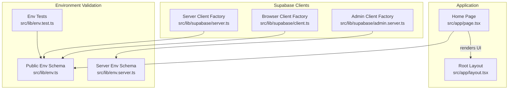
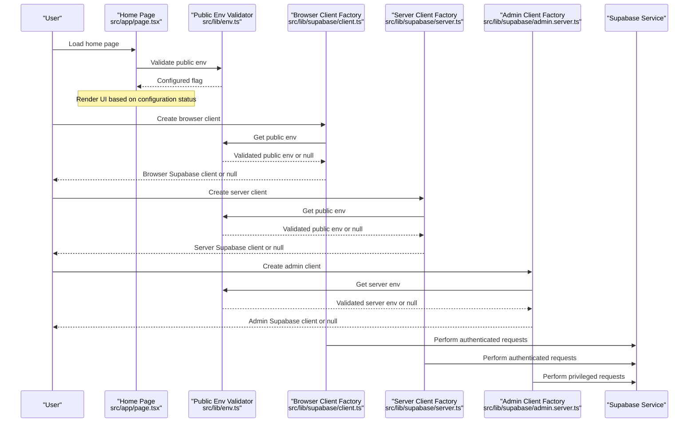
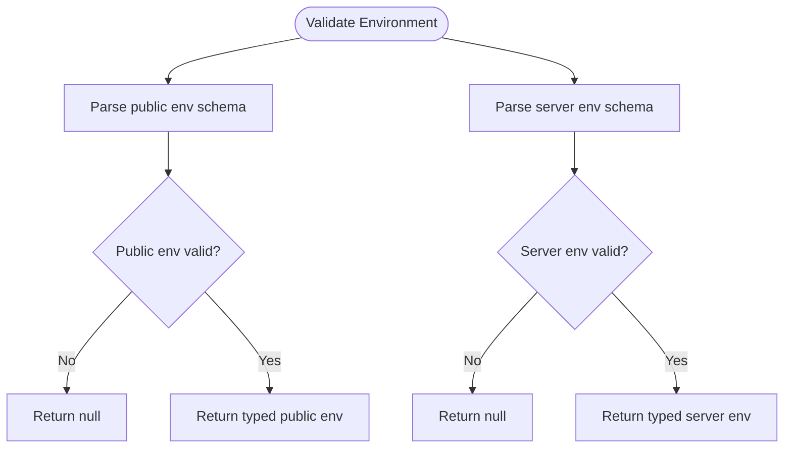
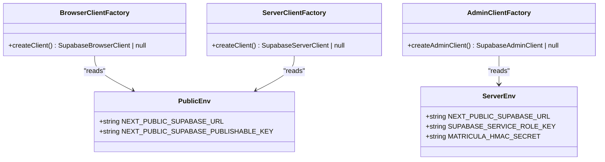
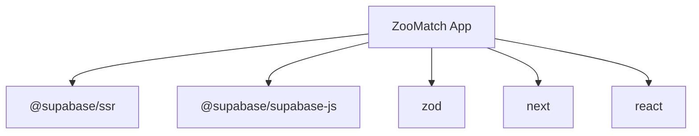

# Integration Patterns

<cite>
**Referenced Files in This Document**
- [env.ts](file://src/lib/env.ts)
- [env.server.ts](file://src/lib/env.server.ts)
- [env.test.ts](file://src/lib/env.test.ts)
- [client.ts](file://src/lib/supabase/client.ts)
- [server.ts](file://src/lib/supabase/server.ts)
- [admin.server.ts](file://src/lib/supabase/admin.server.ts)
- [page.tsx](file://src/app/page.tsx)
- [layout.tsx](file://src/app/layout.tsx)
- [package.json](file://package.json)
- [next.config.ts](file://next.config.ts)
</cite>

## Table of Contents
1. [Introduction](#introduction)
2. [Project Structure](#project-structure)
3. [Core Components](#core-components)
4. [Architecture Overview](#architecture-overview)
5. [Detailed Component Analysis](#detailed-component-analysis)
6. [Dependency Analysis](#dependency-analysis)
7. [Performance Considerations](#performance-considerations)
8. [Troubleshooting Guide](#troubleshooting-guide)
9. [Conclusion](#conclusion)

## Introduction
This document explains the integration patterns used in ZooMatch for connecting to external services, with a focus on Supabase client setup across browser and server contexts. It also documents environment variable validation using Zod, authentication flows, database connection handling, and best practices for keeping core application logic decoupled from third-party dependencies.

The project uses Next.js with React Server Components and Client Components. Environment configuration is validated before any Supabase client is created, ensuring that missing or malformed variables fail fast and safely. The codebase separates public (browser-safe) and secret (server-only) environment variables, and provides dedicated client factories for browser, server, and admin operations.

## Project Structure
ZooMatch organizes integration concerns under `src/lib`, with separate modules for environment validation and Supabase clients:

- Environment validation:
  - Public environment schema and helpers: `src/lib/env.ts`
  - Server-only environment schema and helpers: `src/lib/env.server.ts`
  - Tests for public environment validation: `src/lib/env.test.ts`
- Supabase integration:
  - Browser client factory: `src/lib/supabase/client.ts`
  - Server client factory: `src/lib/supabase/server.ts`
  - Admin client factory: `src/lib/supabase/admin.server.ts`
- Application entry points:
  - Root layout: `src/app/layout.tsx`
  - Home page: `src/app/page.tsx`
- Build and runtime configuration:
  - Next.js config: `next.config.ts`
  - Dependencies and scripts: `package.json`

**Diagram sources**
- [page.tsx:1-10](file://src/app/page.tsx#L1-L10)
- [layout.tsx:1-17](file://src/app/layout.tsx#L1-L17)
- [env.ts:1-26](file://src/lib/env.ts#L1-L26)
- [env.server.ts:1-22](file://src/lib/env.server.ts#L1-L22)
- [env.test.ts:1-29](file://src/lib/env.test.ts#L1-L29)
- [client.ts:1-25](file://src/lib/supabase/client.ts#L1-L25)
- [server.ts:1-34](file://src/lib/supabase/server.ts#L1-L34)
- [admin.server.ts:1-23](file://src/lib/supabase/admin.server.ts#L1-L23)

**Section sources**
- [page.tsx:1-10](file://src/app/page.tsx#L1-L10)
- [layout.tsx:1-17](file://src/app/layout.tsx#L1-L17)
- [env.ts:1-26](file://src/lib/env.ts#L1-L26)
- [env.server.ts:1-22](file://src/lib/env.server.ts#L1-L22)
- [env.test.ts:1-29](file://src/lib/env.test.ts#L1-L29)
- [client.ts:1-25](file://src/lib/supabase/client.ts#L1-L25)
- [server.ts:1-34](file://src/lib/supabase/server.ts#L1-L34)
- [admin.server.ts:1-23](file://src/lib/supabase/admin.server.ts#L1-L23)

## Core Components
This section summarizes the key integration components and their responsibilities.

- Environment validation:
  - Public environment schema validates browser-safe variables such as Supabase URL and publishable key.
  - Server environment schema validates secret variables such as service role key and HMAC secret.
  - Both schemas return typed objects when valid or null when invalid, enabling safe early exits.
- Supabase clients:
  - Browser client factory creates a browser-compatible Supabase client using public environment variables.
  - Server client factory creates a server-side Supabase client with cookie integration for session handling.
  - Admin client factory creates a privileged Supabase client using server-only secrets and disables automatic session management.

Key behaviors:
- All client factories guard against missing or invalid environment variables by returning null.
- Public and secret environments are strictly separated to prevent accidental leakage of secrets into the browser bundle.
- Tests verify that malformed or missing environment values are rejected.

**Section sources**
- [env.ts:1-26](file://src/lib/env.ts#L1-L26)
- [env.server.ts:1-22](file://src/lib/env.server.ts#L1-L22)
- [client.ts:1-25](file://src/lib/supabase/client.ts#L1-L25)
- [server.ts:1-34](file://src/lib/supabase/server.ts#L1-L34)
- [admin.server.ts:1-23](file://src/lib/supabase/admin.server.ts#L1-L23)
- [env.test.ts:1-29](file://src/lib/env.test.ts#L1-L29)

## Architecture Overview
The integration architecture follows a layered approach:

- Configuration layer:
  - Zod schemas validate environment variables at startup or request time.
  - Public and server-only configurations are isolated.
- Client layer:
  - Browser client for client components and interactive features.
  - Server client for server components and API routes with cookie-aware sessions.
  - Admin client for privileged operations using service role keys.
- Application layer:
  - Pages and components consume validated environment flags and client factories.

**Diagram sources**
- [page.tsx:1-10](file://src/app/page.tsx#L1-L10)
- [env.ts:1-26](file://src/lib/env.ts#L1-L26)
- [client.ts:1-25](file://src/lib/supabase/client.ts#L1-L25)
- [server.ts:1-34](file://src/lib/supabase/server.ts#L1-L34)
- [admin.server.ts:1-23](file://src/lib/supabase/admin.server.ts#L1-L23)

## Detailed Component Analysis

### Environment Validation with Zod
Zod schemas enforce strict validation for both public and server-only environment variables.

- Public environment schema:
  - Validates Supabase URL format and presence of a publishable key.
  - Returns a typed object when valid; returns null otherwise.
  - Provides helper functions to retrieve validated public env and check if Supabase is configured.
- Server environment schema:
  - Validates Supabase URL, service role key length, and HMAC secret length.
  - Returns a typed object when valid; returns null otherwise.

Validation flow:
- Schemas parse environment data using safe parsing to avoid throwing errors.
- Callers receive null on invalid configuration, enabling graceful fallbacks or early exits.
- Tests assert behavior for missing, valid, and malformed inputs.

**Diagram sources**
- [env.ts:1-26](file://src/lib/env.ts#L1-L26)
- [env.server.ts:1-22](file://src/lib/env.server.ts#L1-L22)
- [env.test.ts:1-29](file://src/lib/env.test.ts#L1-L29)

**Section sources**
- [env.ts:1-26](file://src/lib/env.ts#L1-L26)
- [env.server.ts:1-22](file://src/lib/env.server.ts#L1-L22)
- [env.test.ts:1-29](file://src/lib/env.test.ts#L1-L29)

### Supabase Client Setup: Browser vs Server
ZooMatch provides three client factories tailored to different execution contexts.

- Browser client:
  - Uses `createBrowserClient` from `@supabase/ssr`.
  - Reads public environment variables via the validated public env helper.
  - Caches the client instance to avoid repeated creation.
  - Returns null if environment validation fails.
- Server client:
  - Uses `createServerClient` from `@supabase/ssr`.
  - Integrates with Next.js cookies to manage sessions.
  - Wraps cookie writes in try/catch because server components cannot write cookies directly.
  - Returns null if environment validation fails.
- Admin client:
  - Uses `createClient` from `@supabase/supabase-js`.
  - Reads server-only environment variables via the validated server env helper.
  - Disables automatic token refresh and session persistence for privileged operations.
  - Returns null if environment validation fails.

**Diagram sources**
- [env.ts:1-26](file://src/lib/env.ts#L1-L26)
- [env.server.ts:1-22](file://src/lib/env.server.ts#L1-L22)
- [client.ts:1-25](file://src/lib/supabase/client.ts#L1-L25)
- [server.ts:1-34](file://src/lib/supabase/server.ts#L1-L34)
- [admin.server.ts:1-23](file://src/lib/supabase/admin.server.ts#L1-L23)

**Section sources**
- [client.ts:1-25](file://src/lib/supabase/client.ts#L1-L25)
- [server.ts:1-34](file://src/lib/supabase/server.ts#L1-L34)
- [admin.server.ts:1-23](file://src/lib/supabase/admin.server.ts#L1-L23)

### Authentication Patterns
Authentication integrates differently depending on the client context:

- Browser client:
  - Relies on Supabase’s browser session handling through `@supabase/ssr`.
  - Session state is managed in the browser environment.
- Server client:
  - Integrates with Next.js cookies to read and write session cookies.
  - Handles cookie write failures gracefully since server components cannot write cookies directly.
- Admin client:
  - Uses service role credentials for privileged operations without user session management.
  - Disables automatic token refresh and session detection/persistence.

Best practices:
- Never expose service role keys or HMAC secrets to the browser.
- Use the server client for server components and API routes where session cookies are available.
- Use the admin client only for backend tasks requiring elevated privileges.

**Section sources**
- [server.ts:1-34](file://src/lib/supabase/server.ts#L1-L34)
- [admin.server.ts:1-23](file://src/lib/supabase/admin.server.ts#L1-L23)

### Database Connection Handling
Database connections are abstracted behind the Supabase client factories:

- Each factory validates environment variables before creating a client.
- If validation fails, factories return null, preventing runtime errors due to misconfiguration.
- Browser and server clients use `@supabase/ssr` for context-aware session handling.
- Admin client uses direct Supabase JS client with explicit auth settings.

Operational guidance:
- Always check for null clients before performing operations.
- Centralize error handling around client usage to provide meaningful feedback.
- Keep database access logic in service layers rather than components.

**Section sources**
- [client.ts:1-25](file://src/lib/supabase/client.ts#L1-L25)
- [server.ts:1-34](file://src/lib/supabase/server.ts#L1-L34)
- [admin.server.ts:1-23](file://src/lib/supabase/admin.server.ts#L1-L23)

### Error Boundary Implementations
The current codebase does not include explicit React error boundaries. However, it implements robust configuration-time error prevention:

- Environment validation returns null on invalid configuration, allowing callers to handle missing clients gracefully.
- Cookie write attempts in server client are wrapped in try/catch to avoid crashing server component rendering.
- Tests cover scenarios where environment variables are absent or malformed.

Recommendations:
- Add React error boundaries around critical UI sections to catch rendering errors.
- Introduce global error handlers for uncaught exceptions in client and server code paths.
- Log configuration validation failures for easier debugging in production.

**Section sources**
- [env.ts:1-26](file://src/lib/env.ts#L1-L26)
- [server.ts:1-34](file://src/lib/supabase/server.ts#L1-L34)
- [env.test.ts:1-29](file://src/lib/env.test.ts#L1-L29)

### Service Integration Examples
Integration examples demonstrate how to use the client factories and environment validators:

- Home page checks whether Supabase is configured and passes this information to a UI component.
- Browser client factory caches the client instance after successful initialization.
- Server client factory integrates with Next.js cookies for session management.
- Admin client factory configures privileged access with disabled session features.

Usage patterns:
- Guard all Supabase operations with null checks for clients.
- Prefer server client for server components and API routes.
- Use admin client only for backend tasks requiring elevated privileges.

**Section sources**
- [page.tsx:1-10](file://src/app/page.tsx#L1-L10)
- [client.ts:1-25](file://src/lib/supabase/client.ts#L1-L25)
- [server.ts:1-34](file://src/lib/supabase/server.ts#L1-L34)
- [admin.server.ts:1-23](file://src/lib/supabase/admin.server.ts#L1-L23)

### Best Practices for Clean Separation
To maintain clean separation between core application logic and external dependencies:

- Isolate third-party integrations in dedicated modules under `src/lib`.
- Use environment validation as a gatekeeper before initializing external clients.
- Expose minimal interfaces from integration modules (e.g., client factories).
- Avoid leaking secrets into browser bundles by separating public and server environments.
- Write tests for environment validation and integration boundaries.

These practices reduce coupling, improve testability, and make it easier to swap or upgrade external libraries.

**Section sources**
- [env.ts:1-26](file://src/lib/env.ts#L1-L26)
- [env.server.ts:1-22](file://src/lib/env.server.ts#L1-L22)
- [client.ts:1-25](file://src/lib/supabase/client.ts#L1-L25)
- [server.ts:1-34](file://src/lib/supabase/server.ts#L1-L34)
- [admin.server.ts:1-23](file://src/lib/supabase/admin.server.ts#L1-L23)

## Dependency Analysis
External dependencies relevant to integration:

- Supabase:
  - `@supabase/ssr` for browser and server client factories.
  - `@supabase/supabase-js` for admin client creation.
- Validation:
  - `zod` for environment schema validation.
- Framework:
  - `next` and `react` for application runtime.

**Diagram sources**
- [package.json:17-26](file://package.json#L17-L26)

**Section sources**
- [package.json:17-26](file://package.json#L17-L26)

## Performance Considerations
- Client caching:
  - Browser client factory caches the client instance to avoid redundant initialization.
- Lazy validation:
  - Environment validation occurs at client creation time, minimizing overhead during module load.
- Cookie handling:
  - Server client wraps cookie writes in try/catch to prevent blocking server component rendering.
- Minimal surface area:
  - Integration modules expose small, focused APIs to reduce complexity and improve performance.

Recommendations:
- Avoid heavy initialization in top-level modules; prefer lazy loading for expensive resources.
- Cache validated environment objects if they are accessed frequently within a request lifecycle.
- Monitor network calls to Supabase and implement retries/backoff strategies where appropriate.

[No sources needed since this section provides general guidance]

## Troubleshooting Guide
Common issues and resolutions:

- Missing environment variables:
  - Symptom: Client factories return null.
  - Resolution: Ensure required public or server environment variables are set according to the Zod schemas.
- Malformed URLs or short secrets:
  - Symptom: Validation fails and returns null.
  - Resolution: Correct the URL format and ensure secrets meet minimum length requirements.
- Cookie write errors in server components:
  - Symptom: Warnings or failures when setting cookies during server component rendering.
  - Resolution: Rely on middleware to refresh cookies later; the server client already handles write failures gracefully.
- Unauthorized admin operations:
  - Symptom: Errors when using admin client without proper service role key.
  - Resolution: Verify server-only environment variables and restrict admin client usage to trusted server-side code.

Debugging tips:
- Run tests to validate environment configuration behavior.
- Log the result of environment validation before creating clients.
- Inspect Next.js build output for warnings about missing environment variables.

**Section sources**
- [env.ts:1-26](file://src/lib/env.ts#L1-L26)
- [env.server.ts:1-22](file://src/lib/env.server.ts#L1-L22)
- [server.ts:1-34](file://src/lib/supabase/server.ts#L1-L34)
- [env.test.ts:1-29](file://src/lib/env.test.ts#L1-L29)

## Conclusion
ZooMatch’s integration patterns emphasize safety, clarity, and separation of concerns. Environment validation with Zod ensures that applications initialize only with correct configuration. Separate client factories for browser, server, and admin contexts provide clear boundaries for authentication and privilege levels. By isolating external dependencies and validating configuration early, the codebase maintains robustness and testability while remaining accessible to developers integrating new services.

[No sources needed since this section summarizes without analyzing specific files]