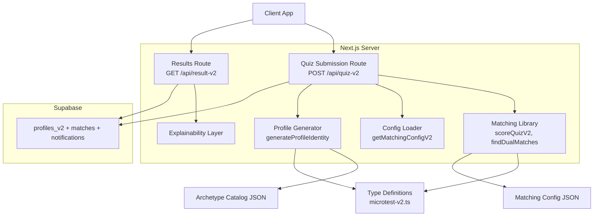
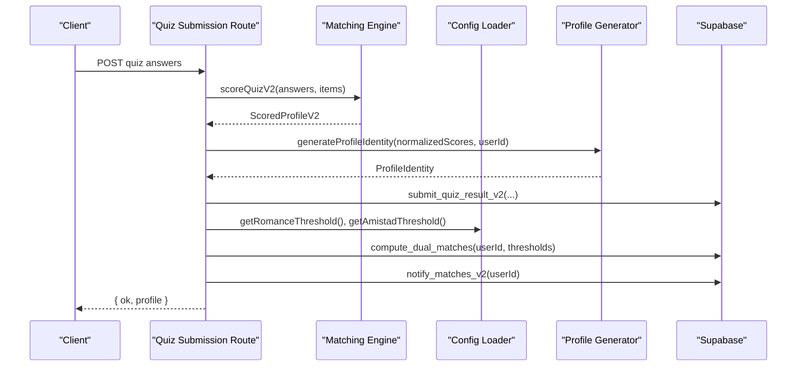
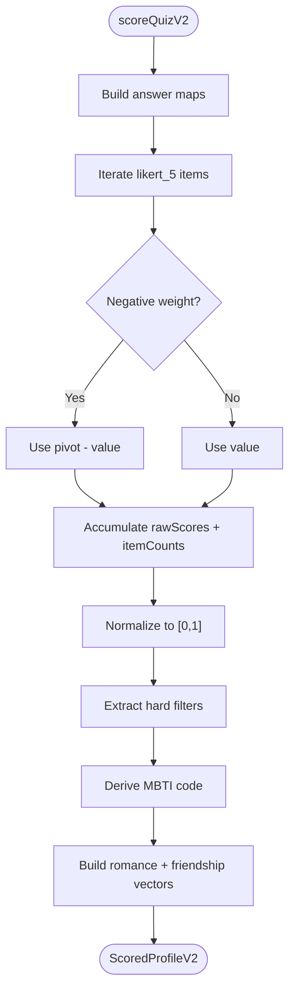
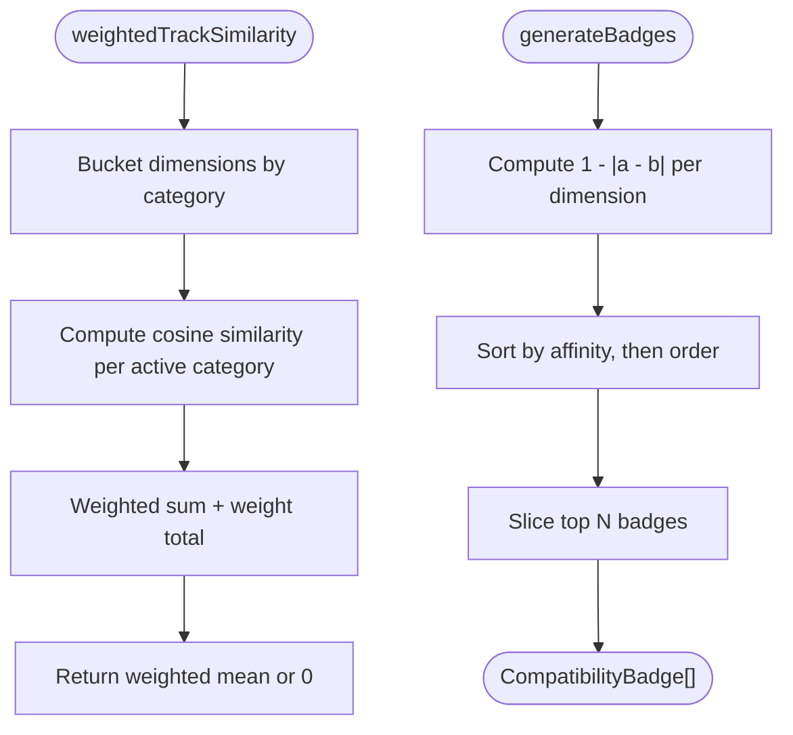
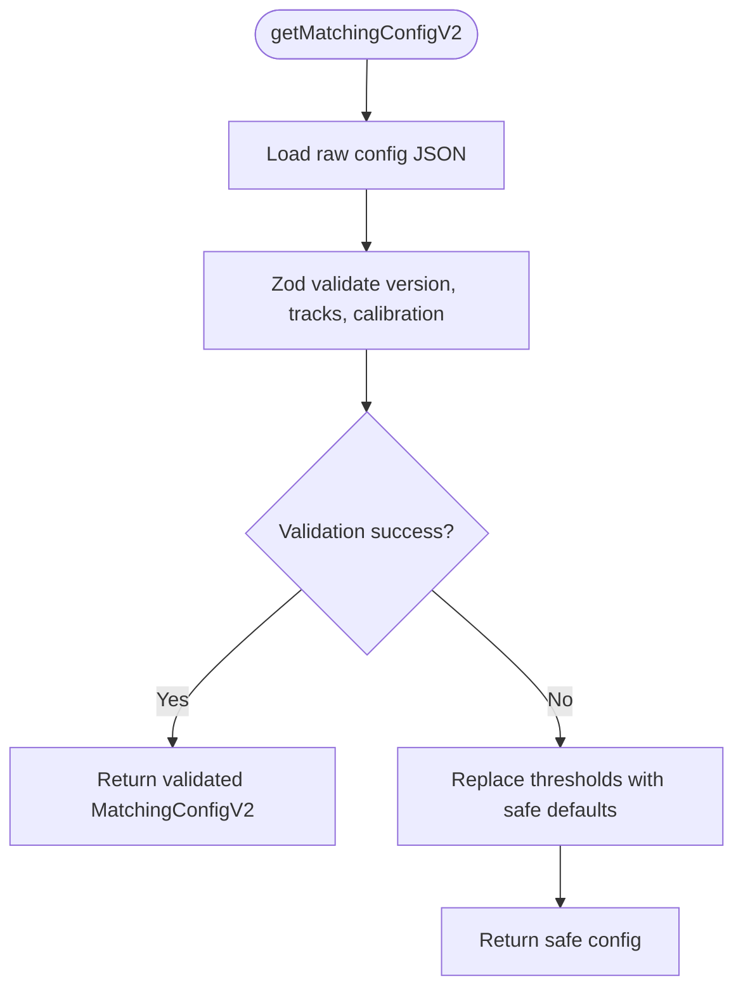
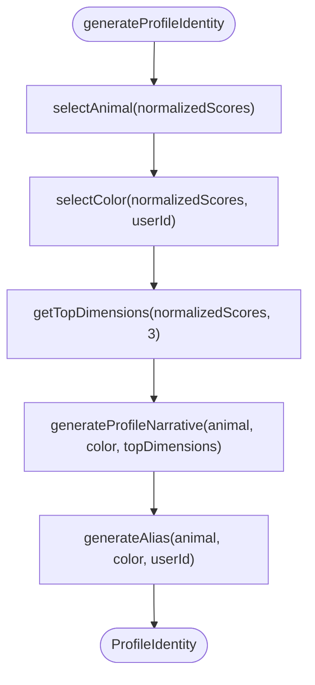
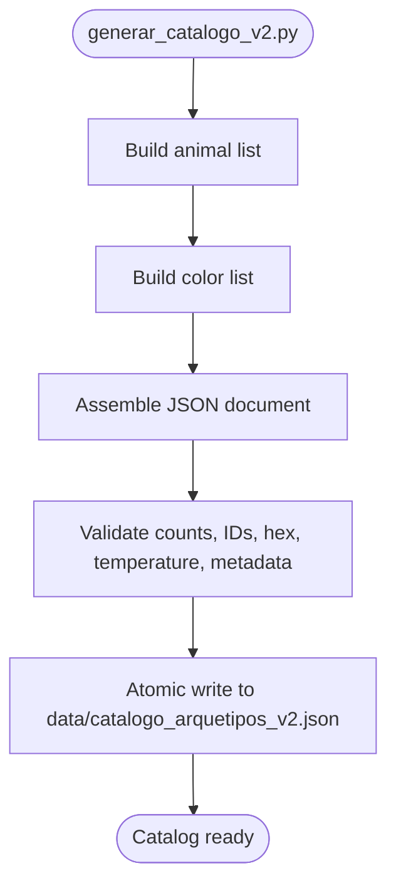
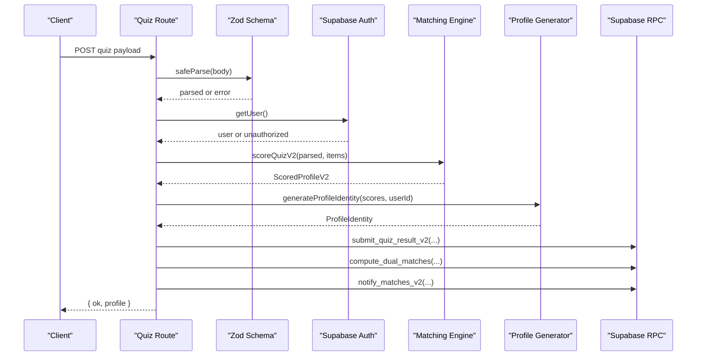
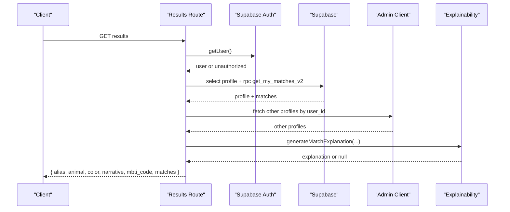
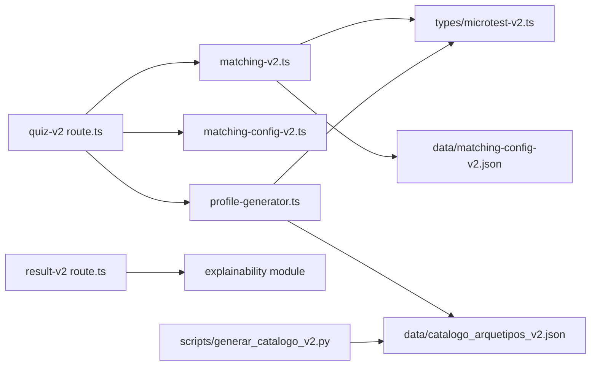

# Profile Generation System

<cite>
**Referenced Files in This Document**
- [package.json](file://package.json)
- [microtest-v2.ts](file://src/types/microtest-v2.ts)
- [matching-v2.ts](file://src/lib/matching-v2.ts)
- [matching-config-v2.ts](file://src/lib/matching-config-v2.ts)
- [profile-generator.ts](file://src/lib/profile-generator.ts)
- [catalogo_arquetipos_v2.json](file://data/catalogo_arquetipos_v2.json)
- [matching-config-v2.json](file://data/matching-config-v2.json)
- [quiz-v2 route.ts](file://src/app/api/quiz-v2/route.ts)
- [result-v2 route.ts](file://src/app/api/result-v2/route.ts)
- [generar_catalogo_v2.py](file://scripts/generar_catalogo_v2.py)
</cite>

## Table of Contents
1. [Introduction](#introduction)
2. [Project Structure](#project-structure)
3. [Core Components](#core-components)
4. [Architecture Overview](#architecture-overview)
5. [Detailed Component Analysis](#detailed-component-analysis)
6. [Dependency Analysis](#dependency-analysis)
7. [Performance Considerations](#performance-considerations)
8. [Troubleshooting Guide](#troubleshooting-guide)
9. [Conclusion](#conclusion)

## Introduction
This document explains the Profile Generation System used by ZooMatch v2. The system turns a completed multidimensional questionnaire into:
- A scored profile with normalized personality, cultural, intimacy, and values dimensions.
- Two matching tracks: romance and friendship.
- A public identity composed of an animal archetype, color, alias, and empowering narrative.
- Match results with similarity scores, compatibility badges, and optional explanations.

The implementation is built on Next.js, TypeScript, Supabase, and deterministic mathematical logic. Data such as question items, matching thresholds, and archetype catalogs are stored in JSON files and validated at runtime.

## Project Structure
The relevant parts of the repository for profile generation are organized around:
- API routes handling quiz submission and result retrieval.
- Pure library modules for scoring, matching, configuration validation, and profile identity generation.
- Type definitions describing questionnaire items, scores, vectors, and match results.
- Static data files defining questionnaire items, matching configuration, and archetype catalogs.
- A Python script that generates the archetype catalog consumed by the profile generator.



**Diagram sources**
- [quiz-v2 route.ts:16-118](file://src/app/api/quiz-v2/route.ts#L16-L118)
- [result-v2 route.ts:134-255](file://src/app/api/result-v2/route.ts#L134-L255)
- [matching-v2.ts:220-281](file://src/lib/matching-v2.ts#L220-L281)
- [matching-config-v2.ts:40-59](file://src/lib/matching-config-v2.ts#L40-L59)
- [profile-generator.ts:684-703](file://src/lib/profile-generator.ts#L684-L703)
- [microtest-v2.ts:102-142](file://src/types/microtest-v2.ts#L102-L142)

**Section sources**
- [package.json:1-40](file://package.json#L1-L40)
- [quiz-v2 route.ts:1-129](file://src/app/api/quiz-v2/route.ts#L1-L129)
- [result-v2 route.ts:1-267](file://src/app/api/result-v2/route.ts#L1-L267)

## Core Components
The profile generation system has five core components:

| Component | Responsibility | Key Outputs |
|---|---|---|
| Questionnaire types and dimension arrays | Define all scoring dimensions, vector layouts, and item schemas | `DimensionScoresV2`, `ScoredProfileV2`, `ROMANCE_VECTOR_DIMENSIONS`, `FRIENDSHIP_VECTOR_DIMENSIONS` |
| Matching engine | Scores answers, derives MBTI code, applies hard filters, computes weighted cosine similarity | `ScoredProfileV2`, dual-track match results |
| Configuration loader | Validates matching thresholds and weights from JSON | Safe `MatchingConfigV2` with fallback thresholds |
| Profile identity generator | Selects animal, color, alias, and narrative based on scores | `ProfileIdentity` |
| API routes | Authenticate users, persist results, compute matches, return profiles and matches | HTTP responses with profile and match data |

**Section sources**
- [microtest-v2.ts:102-142](file://src/types/microtest-v2.ts#L102-L142)
- [microtest-v2.ts:163-246](file://src/types/microtest-v2.ts#L163-L246)
- [matching-v2.ts:220-281](file://src/lib/matching-v2.ts#L220-L281)
- [matching-config-v2.ts:15-59](file://src/lib/matching-config-v2.ts#L15-L59)
- [profile-generator.ts:483-505](file://src/lib/profile-generator.ts#L483-L505)
- [profile-generator.ts:516-570](file://src/lib/profile-generator.ts#L516-L570)
- [profile-generator.ts:684-703](file://src/lib/profile-generator.ts#L684-L703)

## Architecture Overview
At runtime, the system follows two main flows:

1. **Quiz submission flow**: The client sends Likert and filter answers. The server validates them, scores the user, generates a profile identity, persists the result, computes matches, and optionally sends a welcome notification.
2. **Result retrieval flow**: The client requests their profile and matches. The server fetches the user’s profile, queries computed matches, enriches counterpart profiles, builds narratives and explanations, and returns structured match data.



**Diagram sources**
- [quiz-v2 route.ts:16-118](file://src/app/api/quiz-v2/route.ts#L16-L118)
- [matching-v2.ts:220-281](file://src/lib/matching-v2.ts#L220-L281)
- [matching-config-v2.ts:40-67](file://src/lib/matching-config-v2.ts#L40-L67)
- [profile-generator.ts:684-703](file://src/lib/profile-generator.ts#L684-L703)

## Detailed Component Analysis

### Questionnaire Types and Dimension Model
The type layer defines:
- Categories: Big Five, MBTI, identity, cultural affinity, intimacy, relational values.
- Dimensions: concrete keys used across scoring, vectors, and matching.
- Vectors: ordered arrays for romance (26 dimensions) and friendship (16 dimensions).
- Submission model: Likert answers and multi-select filter answers.
- Scored profile: raw scores, normalized scores, MBTI code, hard filters, and track vectors.

This structure ensures that both the matching engine and the profile generator operate over consistent dimension names and vector lengths.

```mermaid
classDiagram
class DimensionScoresV2 {
"+Record~DimensionV2, number~"
}
class HardFilters {
"+string[] orientacion_sexual"
"+string[] identidad_genero"
"+string[] tipo_relacion_busca"
}
class ScoredProfileV2 {
"+DimensionScoresV2 rawScores"
"+DimensionScoresV2 normalizedScores"
"+string mbtiCode"
"+HardFilters hardFilters"
"+number[] romanceVector"
"+number[] friendshipVector"
}
class ProfileIdentity {
"+string animalId"
"+string animalDiminutivo"
"+string colorId"
"+string colorNombre"
"+string colorHex"
"+string alias"
"+string narrative"
}
ScoredProfileV2 --> DimensionScoresV2 : "uses"
ScoredProfileV2 --> HardFilters : "uses"
ProfileIdentity --> DimensionScoresV2 : "generated from"
```

**Diagram sources**
- [microtest-v2.ts:127-142](file://src/types/microtest-v2.ts#L127-L142)
- [microtest-v2.ts:294-302](file://src/types/microtest-v2.ts#L294-L302)

**Section sources**
- [microtest-v2.ts:6-71](file://src/types/microtest-v2.ts#L6-L71)
- [microtest-v2.ts:102-142](file://src/types/microtest-v2.ts#L102-L142)
- [microtest-v2.ts:163-246](file://src/types/microtest-v2.ts#L163-L246)
- [microtest-v2.ts:294-302](file://src/types/microtest-v2.ts#L294-L302)

### Matching Engine
The matching engine performs three major tasks:

1. **Scoring**: Converts Likert answers into normalized dimension scores between 0 and 1. Negatively weighted items are reverse-scored. Missing contributing dimensions receive a neutral score of 0.5. It also extracts hard filters and derives an MBTI code.
2. **Similarity computation**: Computes category-weighted cosine similarity per track. Personality, cultural affinity, intimacy, identity, and relational values are grouped into categories; each category contributes proportionally to its configured weight.
3. **Dual-match discovery**: For romance, it applies hard filters before computing similarity. Friendship does not apply hard filters. Results include similarity, top badges, and a short narrative.



**Diagram sources**
- [matching-v2.ts:220-281](file://src/lib/matching-v2.ts#L220-L281)

For similarity and badges:



**Diagram sources**
- [matching-v2.ts:416-448](file://src/lib/matching-v2.ts#L416-L448)
- [matching-v2.ts:461-488](file://src/lib/matching-v2.ts#L461-L488)

**Section sources**
- [matching-v2.ts:187-281](file://src/lib/matching-v2.ts#L187-L281)
- [matching-v2.ts:360-448](file://src/lib/matching-v2.ts#L360-L448)
- [matching-v2.ts:450-579](file://src/lib/matching-v2.ts#L450-L579)

### Matching Configuration Loader
The configuration loader reads `data/matching-config-v2.json` and validates it using Zod. If validation fails, it substitutes safe default thresholds while preserving the rest of the configuration. This prevents matching from running with invalid gates.

Key behaviors:
- Romance threshold defaults to 0.8 when unsafe.
- Friendship threshold defaults to 0.75 when unsafe.
- Track dimensions, hard filters, and weights are preserved if valid.



**Diagram sources**
- [matching-config-v2.ts:15-59](file://src/lib/matching-config-v2.ts#L15-L59)

**Section sources**
- [matching-config-v2.ts:1-68](file://src/lib/matching-config-v2.ts#L1-L68)
- [matching-config-v2.json:1-77](file://data/matching-config-v2.json#L1-L77)

### Profile Identity Generator
The profile generator creates a public identity from normalized scores. It selects:
- An animal based on cosine similarity between the user’s Big Five vector and each animal’s personality affinity vector.
- A color based on emotional temperature derived from extraversion, openness, cultural aesthetics, and intimacy, plus preferred texture selection.
- A unique alias combining animal diminutive, color name, and a short hash.
- A narrative combining animal traits, top dimensions, color temperature modifiers, community phrases, and closing affirmations.



**Diagram sources**
- [profile-generator.ts:483-505](file://src/lib/profile-generator.ts#L483-L505)
- [profile-generator.ts:516-570](file://src/lib/profile-generator.ts#L516-L570)
- [profile-generator.ts:577-591](file://src/lib/profile-generator.ts#L577-L591)
- [profile-generator.ts:600-660](file://src/lib/profile-generator.ts#L600-L660)
- [profile-generator.ts:672-676](file://src/lib/profile-generator.ts#L672-L676)
- [profile-generator.ts:684-703](file://src/lib/profile-generator.ts#L684-L703)

**Section sources**
- [profile-generator.ts:6-38](file://src/lib/profile-generator.ts#L6-L38)
- [profile-generator.ts:41-72](file://src/lib/profile-generator.ts#L41-L72)
- [profile-generator.ts:74-138](file://src/lib/profile-generator.ts#L74-L138)
- [profile-generator.ts:140-431](file://src/lib/profile-generator.ts#L140-L431)
- [profile-generator.ts:433-470](file://src/lib/profile-generator.ts#L433-L470)
- [profile-generator.ts:472-570](file://src/lib/profile-generator.ts#L472-L570)
- [profile-generator.ts:572-703](file://src/lib/profile-generator.ts#L572-L703)

### Archetype Catalog
The archetype catalog contains:
- 61 animals with Spanish diminutives, fauna categories, and Big Five personality affinities.
- 55 colors with hex codes, textures, and temperature labels.
- Metadata including version, generation timestamp, totals, and the generating script.

The catalog is generated by a Python script that validates minimum counts, unique IDs, valid hex codes, valid temperatures, and metadata consistency.



**Diagram sources**
- [generar_catalogo_v2.py:292-322](file://scripts/generar_catalogo_v2.py#L292-L322)
- [generar_catalogo_v2.py:207-262](file://scripts/generar_catalogo_v2.py#L207-L262)

**Section sources**
- [catalogo_arquetipos_v2.json:1-800](file://data/catalogo_arquetipos_v2.json#L1-L800)
- [generar_catalogo_v2.py:1-327](file://scripts/generar_catalogo_v2.py#L1-L327)

### API Routes

#### Quiz Submission Route
The quiz submission route:
- Parses and validates the request body.
- Authenticates the user.
- Scores the quiz.
- Generates the profile identity.
- Persists answers, scores, vectors, MBTI code, hard filters, and identity.
- Computes dual matches using configured thresholds.
- Sends match notifications.
- Inserts a welcome notification for first-time submissions.



**Diagram sources**
- [quiz-v2 route.ts:16-118](file://src/app/api/quiz-v2/route.ts#L16-L118)

**Section sources**
- [quiz-v2 route.ts:1-129](file://src/app/api/quiz-v2/route.ts#L1-L129)

#### Results Route
The results route:
- Authenticates the user.
- Fetches the user’s profile and computed matches.
- Parses match rows with Zod.
- Enriches matched users’ vectors and scores via admin client.
- Builds match narratives and explanations.
- Returns romance and friendship matches separately.



**Diagram sources**
- [result-v2 route.ts:134-255](file://src/app/api/result-v2/route.ts#L134-L255)

**Section sources**
- [result-v2 route.ts:1-267](file://src/app/api/result-v2/route.ts#L1-L267)

## Dependency Analysis
The following diagram shows how the main modules depend on each other and on static data.



**Diagram sources**
- [quiz-v2 route.ts:1-129](file://src/app/api/quiz-v2/route.ts#L1-L129)
- [result-v2 route.ts:1-267](file://src/app/api/result-v2/route.ts#L1-L267)
- [matching-v2.ts:31-39](file://src/lib/matching-v2.ts#L31-L39)
- [profile-generator.ts:6-8](file://src/lib/profile-generator.ts#L6-L8)
- [generar_catalogo_v2.py:292-322](file://scripts/generar_catalogo_v2.py#L292-L322)

**Section sources**
- [matching-v2.ts:15-39](file://src/lib/matching-v2.ts#L15-L39)
- [profile-generator.ts:6-8](file://src/lib/profile-generator.ts#L6-L8)
- [quiz-v2 route.ts:1-129](file://src/app/api/quiz-v2/route.ts#L1-L129)
- [result-v2 route.ts:1-267](file://src/app/api/result-v2/route.ts#L1-L267)

## Performance Considerations
- **Deterministic math**: Scoring, similarity, and profile generation are pure functions without side effects, making them cacheable and testable.
- **Vector operations**: Cosine similarity and weighted category similarity are linear in vector length. Romance uses 26 dimensions; friendship uses 16.
- **Configuration validation**: Zod validation runs once per request path where the config is loaded; safe fallbacks prevent expensive failures during matching.
- **Database calls**: The quiz route batches persistence and RPC calls; the results route fetches profile and matches concurrently.
- **Catalog size**: The archetype catalog contains 61 animals and 55 colors; animal selection iterates through all animals, which is acceptable for this scale.

[No sources needed since this section provides general guidance]

## Troubleshooting Guide
Common issues and their likely causes:

| Symptom | Likely Cause | Resolution |
|---|---|---|
| Invalid request on quiz submission | Request body failed Zod schema validation | Ensure Likert and filter answers match `QuizSubmissionV2`. |
| Unauthorized response | No authenticated session | Verify authentication headers and session state. |
| Service unavailable | Supabase clients missing | Check environment variables for Supabase URL and keys. |
| Unable to save result | RPC call failed | Inspect Supabase RPC logs for `submit_quiz_result_v2`, `compute_dual_matches`, or `notify_matches_v2`. |
| Quiz not completed | No profile found for user | Complete the quiz before requesting results. |
| Result unavailable | RPC or parsing error | Validate match row schema and vector lengths. |
| Explanation missing | Vector data malformed or wrong length | Ensure romance/friendship vectors have expected lengths and dimension ordering. |
| Threshold mismatch | Invalid matching config | Let the config loader substitute safe thresholds or fix `minimum_similarity_exclusive`. |

**Section sources**
- [quiz-v2 route.ts:16-118](file://src/app/api/quiz-v2/route.ts#L16-L118)
- [result-v2 route.ts:134-255](file://src/app/api/result-v2/route.ts#L134-L255)
- [matching-config-v2.ts:40-59](file://src/lib/matching-config-v2.ts#L40-L59)

## Conclusion
The Profile Generation System combines a robust questionnaire model, deterministic scoring, configurable matching, and expressive identity generation. Its architecture separates concerns cleanly:
- API routes handle authentication, persistence, and orchestration.
- The matching engine implements pure mathematical logic with clear categories and thresholds.
- The profile generator translates scores into meaningful, positive identities.
- Static data and validation ensure stability and reproducibility.

For future improvements, consider:
- Caching repeated profile identity generation for identical score fingerprints.
- Adding unit tests for edge cases in hard-filter compatibility.
- Extending explainability with more detailed dimension breakdowns.
- Monitoring RPC performance for large match pools.

[No sources needed since this section summarizes without analyzing specific files]