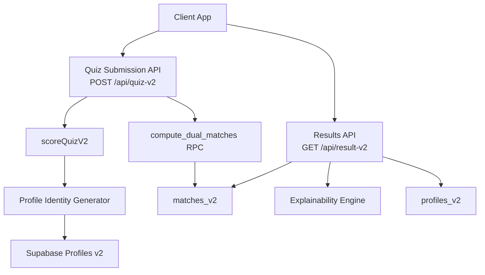
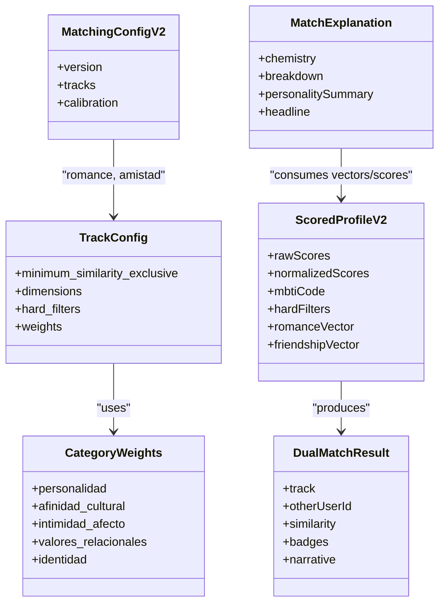
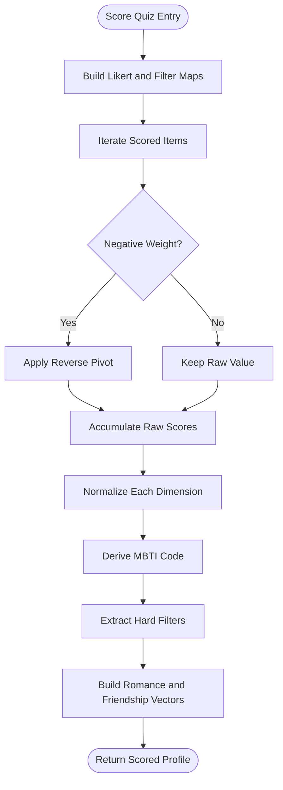
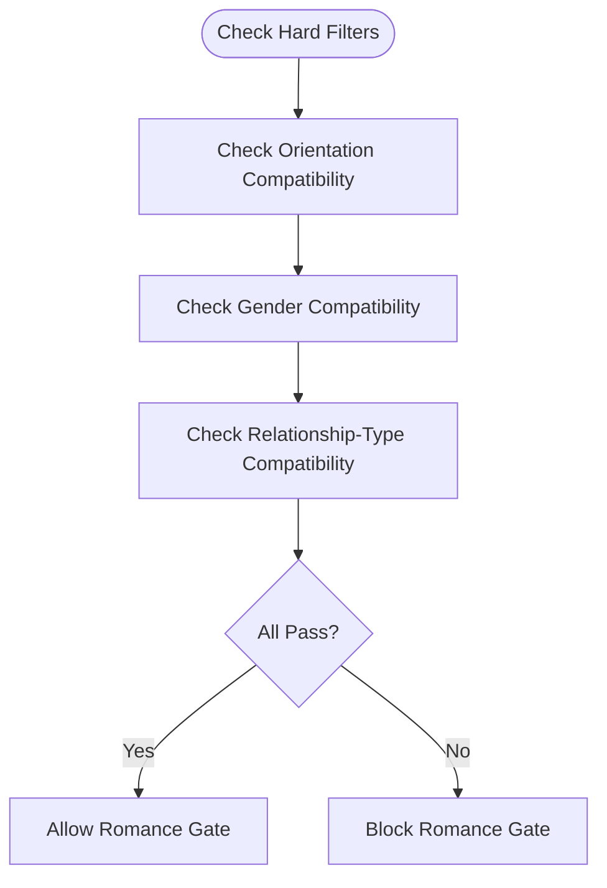
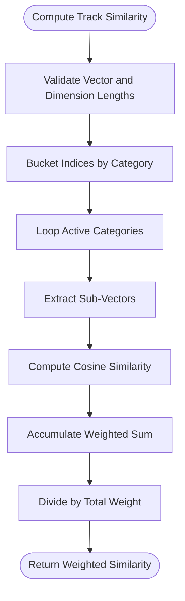
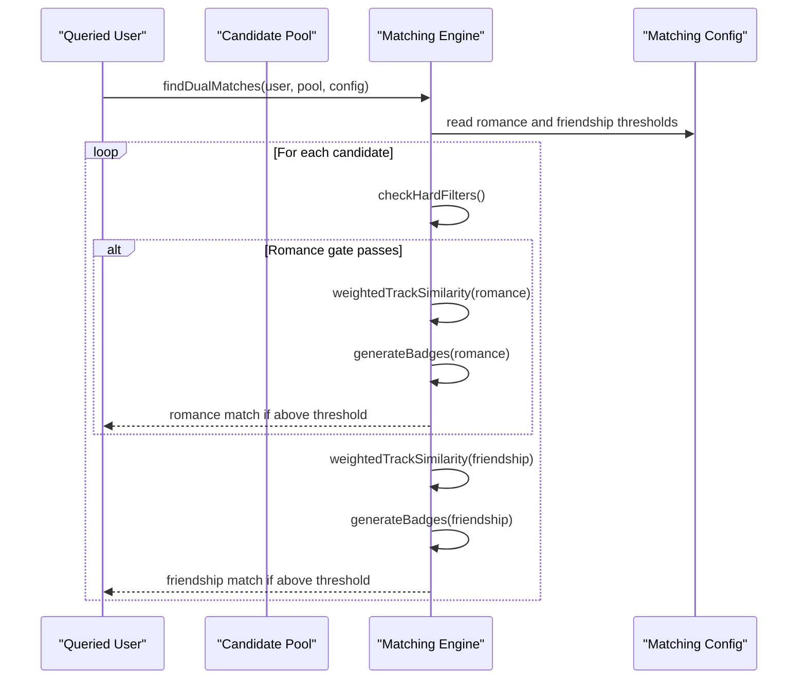
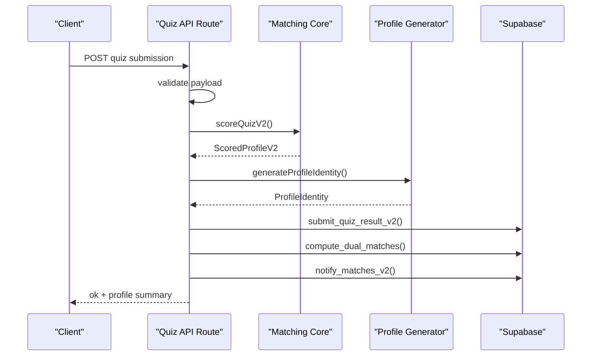
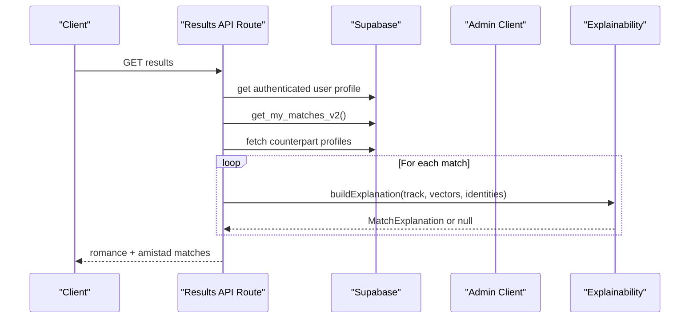
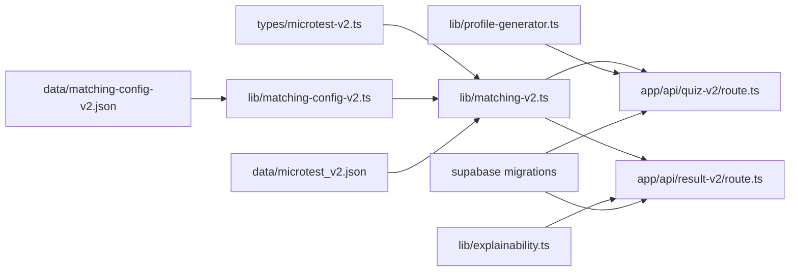

# ZooMatch v2 Matching Engine

<cite>
**Referenced Files in This Document**
- [matching-v2.ts](file://src/lib/matching-v2.ts)
- [matching-config-v2.ts](file://src/lib/matching-config-v2.ts)
- [microtest-v2.ts](file://src/types/microtest-v2.ts)
- [matching-config-v2.json](file://data/matching-config-v2.json)
- [microtest_v2.json](file://data/microtest_v2.json)
- [route.ts](file://src/app/api/quiz-v2/route.ts)
- [route.ts](file://src/app/api/result-v2/route.ts)
- [explainability.ts](file://src/lib/explainability.ts)
- [profile-generator.ts](file://src/lib/profile-generator.ts)
- [202610230001_multidimensional_v2.sql](file://supabase/migrations/202610230001_multidimensional_v2.sql)
</cite>

## Table of Contents
1. [Introduction](#introduction)
2. [Project Structure](#project-structure)
3. [Core Components](#core-components)
4. [Architecture Overview](#architecture-overview)
5. [Detailed Component Analysis](#detailed-component-analysis)
6. [Dependency Analysis](#dependency-analysis)
7. [Performance Considerations](#performance-considerations)
8. [Troubleshooting Guide](#troubleshooting-guide)
9. [Conclusion](#conclusion)

## Introduction
ZooMatch v2 is a dual-track matching engine that turns a completed multidimensional questionnaire into two independent compatibility profiles: romance and friendship. The system scores user answers, derives MBTI-style personality codes, applies hard filters for romance, computes weighted cosine similarity across psychological and cultural dimensions, and returns explainable match results with badges, narratives, and affective summaries.

At a high level:
- Users complete the v2 questionnaire through a Next.js API route.
- The backend scores answers, generates a profile identity (animal, color, alias, narrative), stores vectors and dimension scores, and computes matches.
- A second API endpoint retrieves stored matches and enriches them with human-readable explanations.

The core matching logic is intentionally deterministic, side-effect free, and separated from I/O so it can be tested independently.

## Project Structure
The v2 matching engine spans several layers:

- Types and configuration define the data model, track dimensions, thresholds, and calibration settings.
- The pure matching core transforms quiz submissions into scored profiles and computes dual-track matches.
- API routes handle authentication, validation, persistence, RPC calls, and response formatting.
- Explainability translates raw similarity into warm Spanish-language summaries.
- Profile generation assigns animal archetypes, colors, aliases, and empowering narratives.
- Database migrations define tables, constraints, indexes, row-level security policies, and server-side matching procedures.

**Diagram sources**
- [route.ts:1-129](file://src/app/api/quiz-v2/route.ts#L1-L129)
- [route.ts:1-232](file://src/app/api/result-v2/route.ts#L1-L232)
- [matching-v2.ts:1-580](file://src/lib/matching-v2.ts#L1-L580)
- [profile-generator.ts:1-704](file://src/lib/profile-generator.ts#L1-L704)
- [explainability.ts:1-836](file://src/lib/explainability.ts#L1-L836)
- [202610230001_multidimensional_v2.sql:1-200](file://supabase/migrations/202610230001_multidimensional_v2.sql#L1-L200)

**Section sources**
- [matching-v2.ts:1-580](file://src/lib/matching-v2.ts#L1-L580)
- [microtest-v2.ts:1-303](file://src/types/microtest-v2.ts#L1-L303)
- [matching-config-v2.json:1-77](file://data/matching-config-v2.json#L1-L77)

## Core Components
The v2 engine is built around five main responsibilities:

1. **Questionnaire scoring**: Converts Likert and filter answers into normalized dimension scores, MBTI code, hard filters, and romance/friendship vectors.
2. **Hard-filter compatibility**: Validates orientation, gender identity, and relationship-type preferences for romance gating.
3. **Similarity computation**: Applies category-weighted cosine similarity over ordered dimension vectors.
4. **Dual-match discovery**: Finds romance and friendship matches above configured thresholds, generating badges and short narratives.
5. **Explainability and identity**: Produces human-friendly chemistry summaries, affinity breakdowns, personality summaries, connection headlines, and user identity artifacts.

Key exported capabilities include:
- `scoreQuizV2`
- `isOrientationCompatible`, `isGenderCompatible`, `isRelationshipCompatible`, `checkHardFilters`
- `cosineSimilarity`, `weightedTrackSimilarity`
- `generateBadges`, `findDualMatches`
- Configuration loaders and threshold getters
- Explainability pipeline functions
- Profile identity generator

**Section sources**
- [matching-v2.ts:220-281](file://src/lib/matching-v2.ts#L220-L281)
- [matching-v2.ts:285-358](file://src/lib/matching-v2.ts#L285-L358)
- [matching-v2.ts:368-448](file://src/lib/matching-v2.ts#L368-L448)
- [matching-v2.ts:461-579](file://src/lib/matching-v2.ts#L461-L579)
- [matching-config-v2.ts:40-67](file://src/lib/matching-config-v2.ts#L40-L67)
- [explainability.ts:572-836](file://src/lib/explainability.ts#L572-L836)
- [profile-generator.ts:483-704](file://src/lib/profile-generator.ts#L483-L704)

## Architecture Overview
The v2 architecture separates pure math from application flow:

- **Pure matching layer**: Functions in the matching module do not access databases or networks. They accept typed inputs and return deterministic outputs.
- **Configuration layer**: JSON configuration defines track dimensions, weights, thresholds, and calibration metadata; Zod validates it at runtime.
- **API layer**: Next.js routes authenticate users, validate payloads, call the matching core, persist results via Supabase RPCs, and format responses.
- **Persistence layer**: PostgreSQL tables store profiles, quiz items, responses, matches, and notifications, with RLS policies and GIN indexes for performance.
- **Explanation layer**: Translates numerical similarity into empathetic Spanish copy without changing the underlying algorithm.

**Diagram sources**
- [microtest-v2.ts:127-160](file://src/types/microtest-v2.ts#L127-L160)
- [microtest-v2.ts:251-278](file://src/types/microtest-v2.ts#L251-L278)
- [matching-v2.ts:96-107](file://src/lib/matching-v2.ts#L96-L107)
- [matching-v2.ts:517-579](file://src/lib/matching-v2.ts#L517-L579)
- [explainability.ts:78-84](file://src/lib/explainability.ts#L78-L84)

## Detailed Component Analysis

### Questionnaire Scoring and Profile Construction
The scoring function processes two kinds of answers:
- Likert answers mapped to dimension weights.
- Filter answers extracted as hard filters for romance gating.

Scoring steps:
1. Build lookup maps for Likert values and filter selections.
2. Accumulate raw scores per dimension, applying reverse scoring when item polarity is negative.
3. Normalize each dimension by its minimum and maximum possible range, clamping to `[0, 1]`.
4. Derive an MBTI code using a threshold on four MBTI-related dimensions.
5. Extract hard filters from items marked as hard filters.
6. Construct romance and friendship vectors by selecting ordered dimension subsets.

Complexity:
- Time: proportional to the number of scored items and dimensions.
- Space: proportional to the number of dimensions and answer lookups.

Error handling:
- Missing Likert answers throw an error indicating incomplete quiz data.
- Normalization guards against zero-range dimensions by assigning a neutral score.

**Diagram sources**
- [matching-v2.ts:220-281](file://src/lib/matching-v2.ts#L220-L281)

**Section sources**
- [matching-v2.ts:220-281](file://src/lib/matching-v2.ts#L220-L281)
- [microtest-v2.ts:102-142](file://src/types/microtest-v2.ts#L102-L142)
- [microtest-v2.ts:211-246](file://src/types/microtest-v2.ts#L211-L246)

### Hard Filters and Romance Gating
Romance matching is gated by three hard filters:
- Sexual orientation compatibility.
- Gender identity compatibility.
- Relationship-type compatibility.

Compatibility rules:
- Orientation uses a symmetric compatibility map plus wildcards like inclusive options and opt-outs.
- Gender identity is deliberately permissive because attraction is governed by orientation rather than identity alone.
- Relationship types allow monogamy, ethical non-monogamy, polyamory, relational anarchy, undefined preferences, and friendship-only preferences with defined overlap rules.

A pair passes romance gating only if all three filter checks pass.

**Diagram sources**
- [matching-v2.ts:285-358](file://src/lib/matching-v2.ts#L285-L358)

**Section sources**
- [matching-v2.ts:285-358](file://src/lib/matching-v2.ts#L285-L358)

### Similarity Computation
The engine computes similarity in two stages:

1. **Cosine similarity**: Standard vector cosine between equal-length arrays. Returns zero when either magnitude is zero.
2. **Weighted track similarity**: Groups dimensions by category, computes cosine similarity within each category sub-vector, then combines results as a weighted mean. Categories absent from the track or with zero weight are ignored.

This design prevents categories with many dimensions from dominating categories with fewer dimensions.

**Diagram sources**
- [matching-v2.ts:368-448](file://src/lib/matching-v2.ts#L368-L448)

**Section sources**
- [matching-v2.ts:368-448](file://src/lib/matching-v2.ts#L368-L448)

### Dual-Match Discovery
For each candidate profile:
- Romance track: apply hard filters, compute weighted track similarity, compare strictly above the configured threshold, generate up to five badges, and create a short narrative.
- Friendship track: skip hard filters, compute weighted track similarity, compare strictly above the configured threshold, generate up to three badges, and create a short narrative.

A single other user may appear twice in the result set: once for romance and once for friendship.

**Diagram sources**
- [matching-v2.ts:517-579](file://src/lib/matching-v2.ts#L517-L579)
- [matching-config-v2.json:1-77](file://data/matching-config-v2.json#L1-L77)

**Section sources**
- [matching-v2.ts:517-579](file://src/lib/matching-v2.ts#L517-L579)

### API Workflow: Quiz Submission
The quiz submission route performs these steps:
1. Parse and validate the request body.
2. Authenticate the user.
3. Score the quiz using the pure matching core.
4. Generate profile identity (animal, color, alias, narrative).
5. Upsert the user's profile and vectors into the database.
6. Trigger server-side match computation RPCs.
7. Optionally insert a welcome notification for first-time submissions.
8. Return a minimal success response.

**Diagram sources**
- [route.ts:1-129](file://src/app/api/quiz-v2/route.ts#L1-L129)
- [matching-v2.ts:220-281](file://src/lib/matching-v2.ts#L220-L281)
- [profile-generator.ts:684-704](file://src/lib/profile-generator.ts#L684-L704)

**Section sources**
- [route.ts:16-118](file://src/app/api/quiz-v2/route.ts#L16-L118)

### API Workflow: Results Retrieval
The results route:
1. Authenticates the user.
2. Fetches the current user's profile and their stored matches.
3. Parses and validates match rows.
4. Loads counterpart profiles using an admin client.
5. Builds romance and friendship match entries.
6. Generates affective explanations where vector data is available.
7. Returns structured results with narratives, badges, and no-match messaging.

**Diagram sources**
- [route.ts:1-232](file://src/app/api/result-v2/route.ts#L1-L232)
- [explainability.ts:71-108](file://src/lib/explainability.ts#L71-L108)

**Section sources**
- [route.ts:110-221](file://src/app/api/result-v2/route.ts#L110-L221)

### Explainability Engine
The explainability engine converts raw similarity and vector comparisons into:
- Chemistry summary: percentage, display text, qualitative band, and label.
- Affinity breakdown: per-category percentages and dynamic phrases.
- Personality summary: identity line, MBTI-based description, complementary trait phrase, and key traits.
- Connection headline: deterministic poetic headline based on top category and animal metaphors.

It is designed to be deterministic and side-effect free, producing consistent Spanish-language output for identical inputs.

**Section sources**
- [explainability.ts:1-84](file://src/lib/explainability.ts#L1-L84)
- [explainability.ts:572-836](file://src/lib/explainability.ts#L572-L836)

### Profile Identity Generator
The profile generator selects:
- An animal archetype by comparing the user's Big Five vector to catalog affinities using cosine similarity.
- A color by computing emotional temperature and preferred texture, then deterministically selecting among candidates.
- Top dimensions, narrative sentences, community phrases, and closing affirmations.
- A unique alias combining animal diminutive, color name, and hash.

This produces a warm, empowering public identity tied to the user's psychological profile.

**Section sources**
- [profile-generator.ts:483-704](file://src/lib/profile-generator.ts#L483-L704)

### Database Schema and Server-Side Matching
The migration defines:
- Catalog tables for animals and colors.
- Quiz items and responses for v2.
- Profiles storing vectors, dimension scores, MBTI code, and hard filters.
- Matches table for dual-track results.
- Notifications table for match and welcome messages.
- Constraints ensuring vector lengths and valid enums.
- GIN indexes for fast hard-filter overlap queries.
- Row-level security policies restricting access to own data or admin roles.
- Server-side RPCs including `compute_dual_matches`, which performs SQL-level matching using stored vectors and thresholds.

**Section sources**
- [202610230001_multidimensional_v2.sql:18-200](file://supabase/migrations/202610230001_multidimensional_v2.sql#L18-L200)
- [202610230001_multidimensional_v2.sql:361-402](file://supabase/migrations/202610230001_multidimensional_v2.sql#L361-L402)

## Dependency Analysis
The matching engine has clear separation between pure logic and I/O:

- `matching-v2.ts` depends on type definitions and static JSON configuration.
- `matching-config-v2.ts` validates JSON configuration with Zod and exposes thresholds.
- API routes depend on authentication, Supabase clients, validation helpers, and the matching core.
- Explainability depends on track dimension arrays and user profile data.
- Profile generation depends on catalog data and normalized scores.
- Database schema defines the contract for persisted vectors, filters, and matches.

**Diagram sources**
- [matching-v2.ts:15-38](file://src/lib/matching-v2.ts#L15-L38)
- [matching-config-v2.ts:1-6](file://src/lib/matching-config-v2.ts#L1-L6)
- [route.ts:1-129](file://src/app/api/quiz-v2/route.ts#L1-L129)
- [route.ts:1-232](file://src/app/api/result-v2/route.ts#L1-L232)
- [explainability.ts:20-25](file://src/lib/explainability.ts#L20-L25)
- [profile-generator.ts:6-8](file://src/lib/profile-generator.ts#L6-L8)
- [202610230001_multidimensional_v2.sql:1-200](file://supabase/migrations/202610230001_multidimensional_v2.sql#L1-L200)

**Section sources**
- [matching-v2.ts:15-38](file://src/lib/matching-v2.ts#L15-L38)
- [matching-config-v2.ts:1-67](file://src/lib/matching-config-v2.ts#L1-L67)
- [route.ts:1-129](file://src/app/api/quiz-v2/route.ts#L1-L129)
- [route.ts:1-232](file://src/app/api/result-v2/route.ts#L1-L232)

## Performance Considerations
- **Vector operations**: Cosine similarity and weighted track similarity are linear in vector length. Romance vectors have 26 dimensions; friendship vectors have 16.
- **Category bucketing**: Weighted similarity groups dimensions by category, reducing repeated category mapping overhead during comparison.
- **Database indexing**: GIN indexes on hard-filter arrays enable fast overlap checks for orientation, gender identity, and relationship type.
- **Threshold gates**: Strictly greater-than thresholds reduce unnecessary badge and explanation computation for low-similarity pairs.
- **Server-side matching**: Storing precomputed vectors allows PostgreSQL to perform efficient cosine similarity calculations without transferring full dimension bags repeatedly.
- **Deterministic selection**: Hash-based tie-breaking avoids randomness and ensures stable results across runs.

[No sources needed since this section provides general guidance]

## Troubleshooting Guide
Common issues and how to diagnose them:

- **Incomplete quiz submission**: If a required Likert answer is missing, scoring throws an error. Check that every item contributing to a dimension has a corresponding answer.
- **Invalid request payload**: The quiz submission route validates input with Zod; malformed requests return a 400 error.
- **Service unavailable**: Missing Supabase clients or authentication failures return 503 or 401 responses. Verify environment configuration and session state.
- **Mismatched vector lengths**: Similarity functions require equal-length vectors and matching dimension arrays. Ensure stored vectors match expected lengths: 26 for romance, 16 for friendship.
- **No matches returned**: Thresholds may be too strict. Adjust `minimum_similarity_exclusive` in configuration or review calibration settings.
- **Missing explanations**: Explanations degrade gracefully when vector data is absent or malformed; verify that both user and counterpart profiles have valid vectors and dimension scores.

**Section sources**
- [matching-v2.ts:237-240](file://src/lib/matching-v2.ts#L237-L240)
- [matching-v2.ts:368-387](file://src/lib/matching-v2.ts#L368-L387)
- [route.ts:17-39](file://src/app/api/quiz-v2/route.ts#L17-L39)
- [route.ts:110-143](file://src/app/api/result-v2/route.ts#L110-L143)
- [route.ts:71-108](file://src/app/api/result-v2/route.ts#L71-L108)

## Conclusion
ZooMatch v2 implements a clean, testable matching engine that separates mathematical core logic from application concerns. It supports dual-track compatibility, configurable thresholds, robust hard filtering, and rich explainability. The system is designed for deterministic behavior, secure data access, and scalable matching through precomputed vectors and server-side procedures. Future tuning should focus on calibration thresholds, category weights, and explanation phrasing while preserving the purity and safety guarantees of the core matching functions.

[No sources needed since this section summarizes without analyzing specific files]