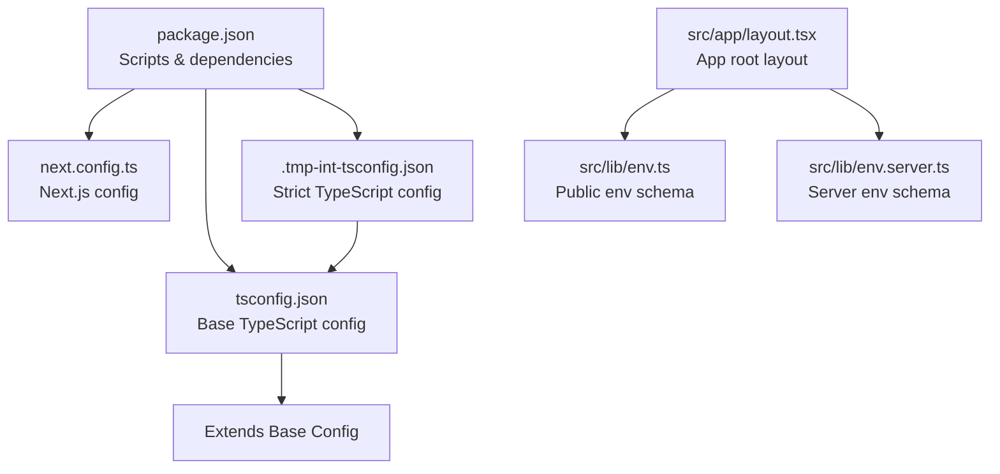
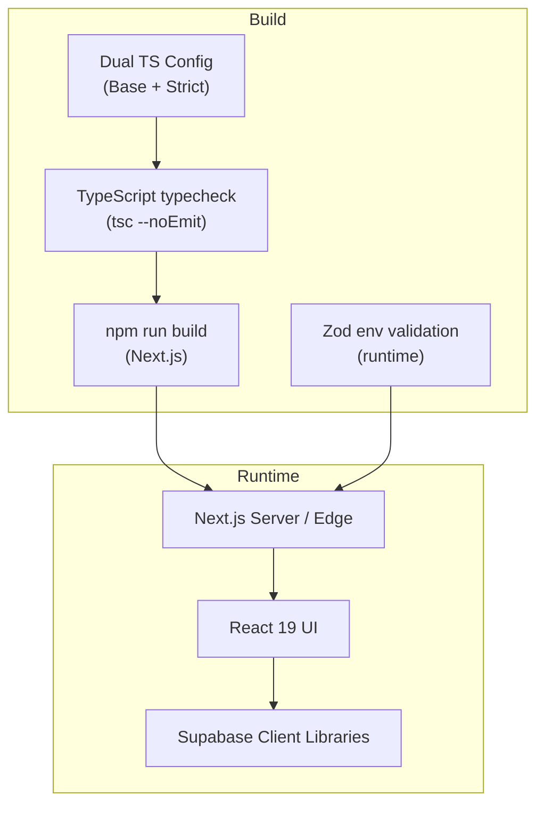
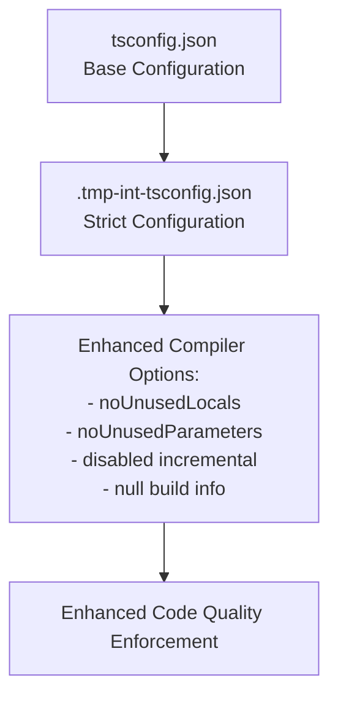
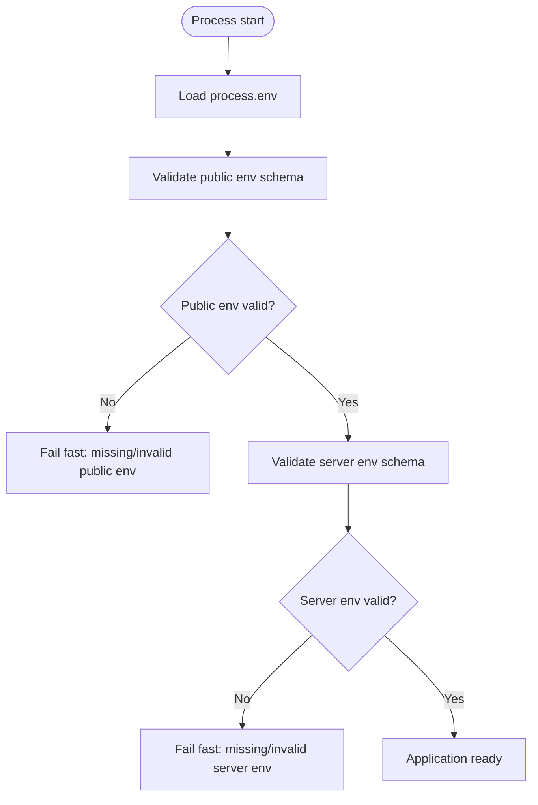
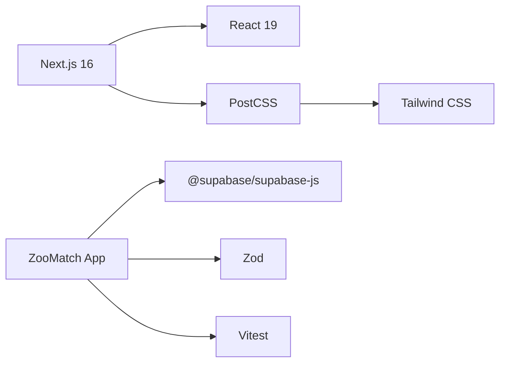

# Build & Deployment

<cite>
**Referenced Files in This Document**
- [next.config.ts](file://next.config.ts)
- [tsconfig.json](file://tsconfig.json)
- [.tmp-int-tsconfig.json](file://.tmp-int-tsconfig.json)
- [package.json](file://package.json)
- [src/lib/env.ts](file://src/lib/env.ts)
- [src/lib/env.server.ts](file://src/lib/env.server.ts)
- [src/app/layout.tsx](file://src/app/layout.tsx)
</cite>

## Update Summary
**Changes Made**
- Added documentation for new TypeScript configuration file (.tmp-int-tsconfig.json) with strict compiler options
- Updated TypeScript compilation settings section to include both base and strict configurations
- Enhanced build pipeline documentation to reflect dual TypeScript configuration strategy

## Table of Contents
1. [Introduction](#introduction)
2. [Project Structure](#project-structure)
3. [Core Components](#core-components)
4. [Architecture Overview](#architecture-overview)
5. [Detailed Component Analysis](#detailed-component-analysis)
6. [Dependency Analysis](#dependency-analysis)
7. [Performance Considerations](#performance-considerations)
8. [Troubleshooting Guide](#troubleshooting-guide)
9. [Conclusion](#conclusion)

## Introduction
This document explains how to build, optimize, and deploy ZooMatch, a Next.js application. It covers the Next.js build configuration, TypeScript compilation settings with dual configuration strategy, environment variable management for production, deployment options across platforms, performance monitoring, caching strategies, asset optimization techniques, and common troubleshooting steps.

## Project Structure
ZooMatch is a Next.js app with:
- Application entry and metadata in the App Router layout
- Environment validation utilities for public and server-side variables
- Dual TypeScript configuration strategy (base + strict)
- Build and runtime scripts defined in package.json

**Diagram sources**
- [package.json:8-16](file://package.json#L8-L16)
- [next.config.ts:1-39](file://next.config.ts#L1-L39)
- [tsconfig.json:1-30](file://tsconfig.json#L1-L30)
- [.tmp-int-tsconfig.json:1-10](file://.tmp-int-tsconfig.json#L1-L10)
- [src/app/layout.tsx:1-17](file://src/app/layout.tsx#L1-L17)
- [src/lib/env.ts:1-24](file://src/lib/env.ts#L1-L24)
- [src/lib/env.server.ts:1-22](file://src/lib/env.server.ts#L1-L22)

**Section sources**
- [package.json:1-40](file://package.json#L1-L40)
- [next.config.ts:1-39](file://next.config.ts#L1-L39)
- [tsconfig.json:1-30](file://tsconfig.json#L1-L30)
- [.tmp-int-tsconfig.json:1-10](file://.tmp-int-tsconfig.json#L1-L10)
- [src/app/layout.tsx:1-17](file://src/app/layout.tsx#L1-L17)

## Core Components
- Next.js build pipeline driven by Next.js v16 via npm scripts
- Dual TypeScript configuration strategy: base config for development and strict config for enhanced code quality
- Environment validation using Zod for both client-visible and server-only variables
- Root layout sets page metadata and global styles

Key responsibilities:
- Build and start commands are provided by Next.js; no custom build tooling is present
- Type safety and compile-time checks are enforced through TypeScript with strict mode
- Environment variables are validated at runtime before use
- Strict TypeScript configuration ensures unused variables and parameters are flagged

**Section sources**
- [package.json:8-16](file://package.json#L8-L16)
- [next.config.ts:1-39](file://next.config.ts#L1-L39)
- [tsconfig.json:1-30](file://tsconfig.json#L1-L30)
- [.tmp-int-tsconfig.json:1-10](file://.tmp-int-tsconfig.json#L1-L10)
- [src/lib/env.ts:1-24](file://src/lib/env.ts#L1-L24)
- [src/lib/env.server.ts:1-22](file://src/lib/env.server.ts#L1-L22)
- [src/app/layout.tsx:1-17](file://src/app/layout.tsx#L1-L17)

## Architecture Overview
The build and runtime architecture centers on Next.js with TypeScript and Zod-based environment validation. The application uses React 19 and Tailwind CSS (via PostCSS). Supabase client libraries are included as dependencies, indicating integration with Supabase services.

**Diagram sources**
- [package.json:17-26](file://package.json#L17-L26)
- [package.json:27-39](file://package.json#L27-L39)
- [tsconfig.json:1-30](file://tsconfig.json#L1-L30)
- [.tmp-int-tsconfig.json:1-10](file://.tmp-int-tsconfig.json#L1-L10)
- [src/lib/env.ts:1-24](file://src/lib/env.ts#L1-L24)
- [src/lib/env.server.ts:1-22](file://src/lib/env.server.ts#L1-L22)

## Detailed Component Analysis

### Next.js Build Configuration
- React Strict Mode is enabled
- Typed routes are enabled for safer routing types
- Content Security Policy headers configured for production security
- No additional Next.js optimizations are explicitly configured in this repository

Implications:
- Standard Next.js production build behavior applies
- Route types are generated during build for improved developer experience
- Enhanced security headers are automatically applied to all routes

Recommendations:
- Consider enabling image optimization, font optimization, or CDN-related settings if needed
- Add experimental features only when necessary and validate their impact

**Section sources**
- [next.config.ts:1-39](file://next.config.ts#L1-L39)

### TypeScript Compilation Settings
The project uses a dual TypeScript configuration strategy:

**Base Configuration (tsconfig.json)**:
- Target: ES2022
- Libs: DOM, DOM iterable, ESNext
- Strict mode enabled
- Module resolution set to bundler
- Path alias @/* mapped to src/*
- Incremental compilation enabled for faster builds
- JSX preserved for Next.js processing
- noEmit true (Next.js handles emit)

**Strict Configuration (.tmp-int-tsconfig.json)**:
- Extends base configuration
- Enables noUnusedLocals for better code hygiene
- Enables noUnusedParameters to prevent dead code
- Disables incremental compilation for clean builds
- Sets tsBuildInfoFile to null to avoid stale build artifacts

**Diagram sources**
- [tsconfig.json:1-30](file://tsconfig.json#L1-L30)
- [.tmp-int-tsconfig.json:1-10](file://.tmp-int-tsconfig.json#L1-L10)

Implications:
- Strong typing and modern JS target with enhanced code quality checks
- Fast incremental builds in development with strict validation in CI/CD
- Clean separation between source and emitted artifacts
- Unused code detection prevents technical debt accumulation

Recommendations:
- Keep strict mode enabled for reliability
- Ensure all imports use the @/* alias consistently
- Use the strict configuration for CI/CD pipelines to catch code quality issues early

**Section sources**
- [tsconfig.json:1-30](file://tsconfig.json#L1-L30)
- [.tmp-int-tsconfig.json:1-10](file://.tmp-int-tsconfig.json#L1-L10)

### Environment Variables Management
Two Zod schemas define required variables:
- Public env schema requires Supabase URL and publishable key
- Server env schema adds service role key and HMAC secret

Validation functions return typed objects or null, allowing safe early exits when configuration is missing.

Production guidance:
- Set NEXT_PUBLIC_SUPABASE_URL and NEXT_PUBLIC_SUPABASE_PUBLISHABLE_KEY on the hosting platform
- For server-side operations, also set SUPABASE_SERVICE_ROLE_KEY and MATRICULA_HMAC_SECRET
- Validate environment at startup and fail fast if required values are missing

**Diagram sources**
- [src/lib/env.ts:1-24](file://src/lib/env.ts#L1-L24)
- [src/lib/env.server.ts:1-22](file://src/lib/env.server.ts#L1-L22)

**Section sources**
- [src/lib/env.ts:1-24](file://src/lib/env.ts#L1-L24)
- [src/lib/env.server.ts:1-22](file://src/lib/env.server.ts#L1-L22)

### Build Scripts and Commands
- Development: next dev
- Production build: next build
- Production server: next start
- Linting: eslint .
- Type checking: tsc --noEmit
- Testing: vitest run (watch mode available)

Recommended CI flow:
- Install dependencies
- Run typecheck with strict configuration
- Run linter
- Run tests
- Build production bundle
- Deploy output

**Section sources**
- [package.json:8-16](file://package.json#L8-L16)

### Application Layout and Metadata
- Root layout defines page title and description
- Global CSS imported at the app level

This ensures consistent metadata and styling across pages.

**Section sources**
- [src/app/layout.tsx:1-17](file://src/app/layout.tsx#L1-L17)

## Dependency Analysis
ZooMatch depends on:
- Next.js 16 for framework and build system
- React 19 and React DOM for UI rendering
- Supabase client libraries for backend integration
- Tailwind CSS and PostCSS for styling
- Zod for runtime environment validation
- Vitest for testing

**Diagram sources**
- [package.json:17-26](file://package.json#L17-L26)
- [package.json:27-39](file://package.json#L27-L39)

**Section sources**
- [package.json:17-39](file://package.json#L17-L39)

## Performance Considerations
General recommendations for production:
- Use Next.js default optimizations (code splitting, tree-shaking, static generation where applicable)
- Enable image optimization if images are used
- Minimize client-side JavaScript by moving logic to server components or API routes
- Leverage browser caching via proper cache headers from your hosting provider
- Monitor bundle size and remove unused dependencies
- Use environment-specific configurations to disable development-only features in production
- Utilize the strict TypeScript configuration in CI/CD to maintain code quality without impacting development performance

## Troubleshooting Guide
Common issues and resolutions:
- Missing environment variables:
  - Ensure NEXT_PUBLIC_SUPABASE_URL and NEXT_PUBLIC_SUPABASE_PUBLISHABLE_KEY are set in your hosting platform's environment settings
  - For server-side code, also set SUPABASE_SERVICE_ROLE_KEY and MATRICULA_HMAC_SECRET
- Build failures due to type errors:
  - Run typecheck locally with the provided script to catch issues early
  - Use the strict TypeScript configuration to identify unused variables and parameters
- Runtime crashes due to invalid environment:
  - Validate environment at startup and fail fast if required values are missing
- Styling not applied:
  - Confirm PostCSS and Tailwind are installed and configured correctly
- Test failures:
  - Use the test script to run Vitest suites and fix failing assertions
- TypeScript compilation issues:
  - Check both base and strict TypeScript configurations for conflicts
  - Ensure unused variables and parameters are properly handled

Operational tips:
- Log environment validation results in development to quickly identify misconfiguration
- Pin Node.js version to the engines requirement in package.json to avoid compatibility issues
- Use the strict TypeScript configuration in CI/CD pipelines to enforce code quality standards

**Section sources**
- [package.json:5-7](file://package.json#L5-L7)
- [package.json:8-16](file://package.json#L8-L16)
- [tsconfig.json:1-30](file://tsconfig.json#L1-L30)
- [.tmp-int-tsconfig.json:1-10](file://.tmp-int-tsconfig.json#L1-L10)
- [src/lib/env.ts:1-24](file://src/lib/env.ts#L1-L24)
- [src/lib/env.server.ts:1-22](file://src/lib/env.server.ts#L1-L22)

## Conclusion
ZooMatch relies on Next.js for building and serving the application, with a dual TypeScript configuration strategy ensuring strong typing and enhanced code quality. The base configuration provides development-friendly settings while the strict configuration enforces code hygiene standards. Zod validates environment variables at runtime. The repository provides clear scripts for development, building, linting, typechecking, and testing. For production, ensure environment variables are properly configured on your hosting platform, monitor performance metrics, and apply standard optimization practices such as caching and asset optimization. The strict TypeScript configuration helps maintain code quality by catching unused variables and parameters during the build process.