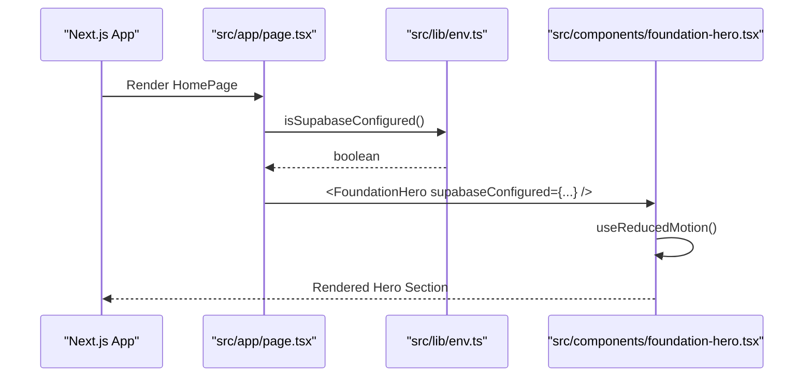
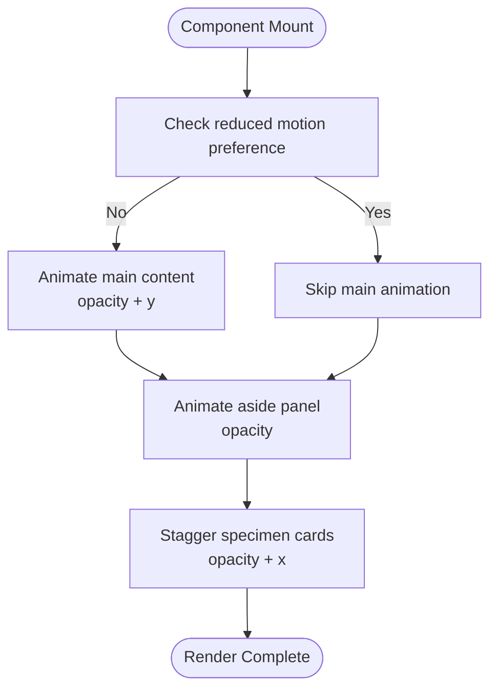
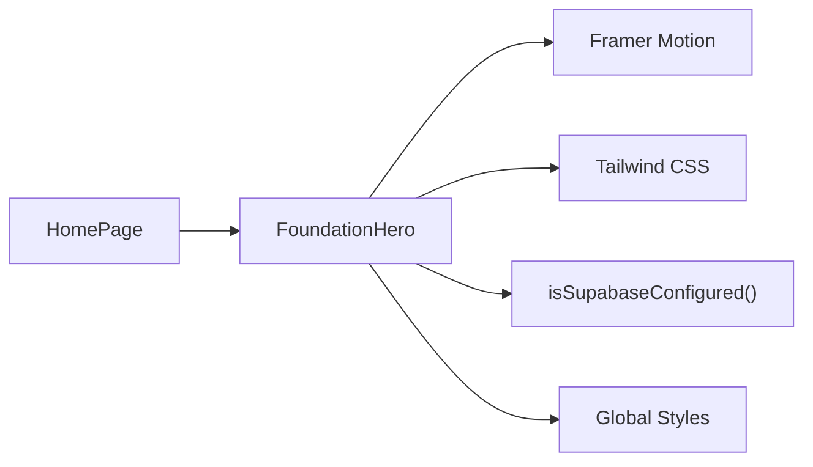

# Core Components

<cite>
**Referenced Files in This Document**   
- [foundation-hero.tsx](file://src/components/foundation-hero.tsx)
- [page.tsx](file://src/app/page.tsx)
- [archetype.ts](file://src/types/archetype.ts)
- [arquetipos.json](file://data/arquetipos.json)
- [env.ts](file://src/lib/env.ts)
- [globals.css](file://src/app/globals.css)
</cite>

## Table of Contents
1. [Introduction](#introduction)
2. [Project Structure](#project-structure)
3. [Core Components](#core-components)
4. [Architecture Overview](#architecture-overview)
5. [Detailed Component Analysis](#detailed-component-analysis)
6. [Dependency Analysis](#dependency-analysis)
7. [Performance Considerations](#performance-considerations)
8. [Troubleshooting Guide](#troubleshooting-guide)
9. [Conclusion](#conclusion)
10. [Appendices](#appendices)

## Introduction
This document explains the core UI components in ZooMatch with a focus on the FoundationHero component. FoundationHero is the primary landing interface that introduces personality-animal mappings and sets the visual language for the application. It showcases selected archetype specimens, uses Framer Motion for entrance animations, and follows responsive design patterns to adapt across screen sizes. The component integrates with environment configuration to indicate whether Supabase is configured and provides a clear entry point into the rest of the app.

## Project Structure
ZooMatch is a Next.js application using Tailwind CSS for styling and Framer Motion for animations. The relevant files for this documentation are:
- The FoundationHero component under src/components
- The root page that renders FoundationHero
- Type definitions for archetypes
- A JSON dataset containing all 16 archetypes
- Environment utilities for Supabase configuration detection
- Global styles defining colors, fonts, and motion preferences

```mermaid
graph TB
subgraph "App"
Page["src/app/page.tsx"]
end
subgraph "Components"
Hero["src/components/foundation-hero.tsx"]
end
subgraph "Types"
Types["src/types/archetype.ts"]
end
subgraph "Data"
Data["data/arquetipos.json"]
end
subgraph "Lib"
Env["src/lib/env.ts"]
end
subgraph "Styles"
CSS["src/app/globals.css"]
end
Page --> Hero
Hero --> Env
Hero -.-> Types
Hero -.-> Data
Hero --> CSS
```

**Diagram sources**
- [page.tsx:1-10](file://src/app/page.tsx#L1-L10)
- [foundation-hero.tsx:1-117](file://src/components/foundation-hero.tsx#L1-L117)
- [env.ts:1-26](file://src/lib/env.ts#L1-L26)
- [globals.css:1-95](file://src/app/globals.css#L1-L95)

**Section sources**
- [page.tsx:1-10](file://src/app/page.tsx#L1-L10)
- [foundation-hero.tsx:1-117](file://src/components/foundation-hero.tsx#L1-L117)
- [archetype.ts:1-47](file://src/types/archetype.ts#L1-L47)
- [arquetipos.json:1-592](file://data/arquetipos.json#L1-L592)
- [env.ts:1-26](file://src/lib/env.ts#L1-L26)
- [globals.css:1-95](file://src/app/globals.css#L1-L95)

## Core Components
FoundationHero is a client-side React component that:
- Accepts a single prop indicating whether Supabase is configured
- Renders a hero section with a header, headline, description, and call-to-action
- Displays a curated list of specimen cards (animal + color + MBTI code)
- Uses Framer Motion for staggered entrance animations
- Respects user motion preferences via useReducedMotion
- Applies responsive layouts using Tailwind CSS classes

Key responsibilities:
- Visual introduction to the personality-animal mapping concept
- Demonstration of design tokens (colors, typography, spacing)
- Accessibility-friendly structure and labels
- Smooth, performant animations with reduced-motion support

**Section sources**
- [foundation-hero.tsx:1-117](file://src/components/foundation-hero.tsx#L1-L117)

## Architecture Overview
The FoundationHero component is rendered by the root page and receives an environment flag from the environment utility. The component composes layout, typography, and animation primitives to present a polished hero experience.



**Diagram sources**
- [page.tsx:1-10](file://src/app/page.tsx#L1-L10)
- [env.ts:22-26](file://src/lib/env.ts#L22-L26)
- [foundation-hero.tsx:1-117](file://src/components/foundation-hero.tsx#L1-L117)

## Detailed Component Analysis

### Props and Integration
- Prop: supabaseConfigured (boolean)
  - Controls the status indicator in the header
  - Derived from environment configuration via isSupabaseConfigured()
- Integration:
  - Root page passes the boolean to FoundationHero
  - No direct data dependency on arquetipos.json or Archetype types within this component; it uses a small local specimens array for demonstration

Usage example:
- Import and render FoundationHero in your page component
- Pass supabaseConfigured based on environment checks

Customization options:
- Replace the local specimens array with dynamic data from arquetipos.json
- Extend props to accept theme overrides or content customization
- Add interaction handlers for specimen selection or navigation

Accessibility highlights:
- Semantic HTML elements (section, header, aside, article)
- aria-hidden used for decorative elements
- Status indicator includes visible text and a colored dot for quick scanning

**Section sources**
- [foundation-hero.tsx:5-7](file://src/components/foundation-hero.tsx#L5-L7)
- [foundation-hero.tsx:23-32](file://src/components/foundation-hero.tsx#L23-L32)
- [page.tsx:1-10](file://src/app/page.tsx#L1-L10)
- [env.ts:22-26](file://src/lib/env.ts#L22-L26)

### State Management
FoundationHero does not maintain complex state. It reads:
- Reduced motion preference via useReducedMotion hook
- Prop value supabaseConfigured to determine status indicator color

State considerations:
- Minimal re-renders due to lack of local state
- Animation states are managed internally by Framer Motion

**Section sources**
- [foundation-hero.tsx:15-17](file://src/components/foundation-hero.tsx#L15-L17)

### Animation Implementation (Framer Motion)
Animations include:
- Fade-in and slide-up for the main content area
- Fade-in for the right panel
- Staggered fade-in and slide-in for each specimen card
- Respect for prefers-reduced-motion to disable animations when requested

Animation properties:
- initial values set conditionally based on reduced motion
- animate transitions with duration and easing curves
- delay offsets for staggered effects

Performance considerations:
- Animations are GPU-accelerated transforms and opacity changes
- useReducedMotion ensures accessibility and performance for sensitive users



**Diagram sources**
- [foundation-hero.tsx:35-39](file://src/components/foundation-hero.tsx#L35-L39)
- [foundation-hero.tsx:69-74](file://src/components/foundation-hero.tsx#L69-L74)
- [foundation-hero.tsx:84-90](file://src/components/foundation-hero.tsx#L84-L90)

**Section sources**
- [foundation-hero.tsx:35-39](file://src/components/foundation-hero.tsx#L35-L39)
- [foundation-hero.tsx:69-74](file://src/components/foundation-hero.tsx#L69-L74)
- [foundation-hero.tsx:84-90](file://src/components/foundation-hero.tsx#L84-L90)

### Responsive Design Patterns
FoundationHero uses Tailwind CSS responsive utilities to adapt layout:
- Full-width hero section with padding adjustments at different breakpoints
- Grid layout switching between stacked and two-column arrangements
- Typography scaling using clamp-based sizing for headings
- Spacing and border adjustments for readability on various devices

Key patterns:
- Mobile-first base styles with sm:, lg: breakpoints
- Flexible grid columns and alignment
- Fluid typography and line-height for large headings

**Section sources**
- [foundation-hero.tsx:20-22](file://src/components/foundation-hero.tsx#L20-L22)
- [foundation-hero.tsx:34-40](file://src/components/foundation-hero.tsx#L34-L40)
- [foundation-hero.tsx:46-49](file://src/components/foundation-hero.tsx#L46-L49)
- [foundation-hero.tsx:52-66](file://src/components/foundation-hero.tsx#L52-L66)
- [foundation-hero.tsx:74-112](file://src/components/foundation-hero.tsx#L74-L112)

### Rendering Archetype Data and Specimens
FoundationHero currently renders a small local specimens array showcasing three personality-animal-color mappings. This demonstrates how archetype data can be presented visually:
- Each specimen shows an animal name, color name, and MBTI code
- Color swatches are applied inline via backgroundColor style
- Cards have hover effects defined in global CSS

Integration with archetype data:
- The full archetype catalog exists in arquetipos.json and matches the Archetype type definition
- To scale, replace the local specimens array with data from arquetipos.json and map fields accordingly

Example mapping approach:
- Map arquetipos.json entries to display fields: animal.nombre_fuente, paleta[0].hex, codigo_mbti
- Use id or codigo_mbti as stable keys for list rendering

**Section sources**
- [foundation-hero.tsx:9-13](file://src/components/foundation-hero.tsx#L9-L13)
- [foundation-hero.tsx:84-105](file://src/components/foundation-hero.tsx#L84-L105)
- [arquetipos.json:29-64](file://data/arquetipos.json#L29-L64)
- [archetype.ts:24-37](file://src/types/archetype.ts#L24-L37)

### User Interactions
Current interactions:
- Hover effects on specimen cards (CSS-driven transform and shine effect)
- Link anchor to #foundation for navigation within the page

Future enhancements:
- Click handlers to select a specimen and navigate to detailed views
- Keyboard navigation and focus management for accessibility
- Optional tooltip or modal with additional archetype details

**Section sources**
- [foundation-hero.tsx:57-65](file://src/components/foundation-hero.tsx#L57-L65)
- [globals.css:55-80](file://src/app/globals.css#L55-L80)

### Accessibility Features
- Semantic structure improves screen reader navigation
- Decorative elements marked with aria-hidden
- Status indicator includes both text and color cue
- Reduced motion support via useReducedMotion and CSS media query

Best practices:
- Ensure interactive elements have sufficient contrast
- Provide keyboard focus styles
- Avoid relying solely on color to convey meaning

**Section sources**
- [foundation-hero.tsx:23-32](file://src/components/foundation-hero.tsx#L23-L32)
- [foundation-hero.tsx:76-78](file://src/components/foundation-hero.tsx#L76-L78)
- [foundation-hero.tsx:92-96](file://src/components/foundation-hero.tsx#L92-L96)
- [globals.css:82-95](file://src/app/globals.css#L82-L95)

### Performance Considerations
- Animations use transform and opacity for GPU acceleration
- useReducedMotion prevents unnecessary work for users who prefer reduced motion
- Local specimens array keeps rendering lightweight
- Global CSS handles hover effects without JavaScript overhead

Optimization tips:
- Lazy-load heavy assets if adding images or icons
- Memoize expensive computations if extending component logic
- Consider virtualizing lists if displaying many specimens

**Section sources**
- [foundation-hero.tsx:15-17](file://src/components/foundation-hero.tsx#L15-L17)
- [foundation-hero.tsx:35-39](file://src/components/foundation-hero.tsx#L35-L39)
- [foundation-hero.tsx:69-74](file://src/components/foundation-hero.tsx#L69-L74)
- [foundation-hero.tsx:84-90](file://src/components/foundation-hero.tsx#L84-L90)
- [globals.css:82-95](file://src/app/globals.css#L82-L95)

## Dependency Analysis
FoundationHero depends on:
- Framer Motion for animations
- Tailwind CSS for styling
- Environment utility for Supabase configuration status
- Global CSS for design tokens and hover effects



**Diagram sources**
- [foundation-hero.tsx:1-3](file://src/components/foundation-hero.tsx#L1-L3)
- [page.tsx:1-10](file://src/app/page.tsx#L1-L10)
- [env.ts:22-26](file://src/lib/env.ts#L22-L26)
- [globals.css:1-12](file://src/app/globals.css#L1-L12)

**Section sources**
- [foundation-hero.tsx:1-3](file://src/components/foundation-hero.tsx#L1-L3)
- [page.tsx:1-10](file://src/app/page.tsx#L1-L10)
- [env.ts:22-26](file://src/lib/env.ts#L22-L26)
- [globals.css:1-12](file://src/app/globals.css#L1-L12)

## Performance Considerations
- Prefer transform and opacity animations to avoid layout thrashing
- Respect user motion preferences to reduce CPU/GPU usage
- Keep component state minimal to limit re-renders
- Use static data arrays for demo purposes; load larger datasets lazily if needed
- Leverage CSS hover effects instead of JS-driven interactions where possible

[No sources needed since this section provides general guidance]

## Troubleshooting Guide
Common issues and resolutions:
- Animations not respecting reduced motion:
  - Verify useReducedMotion is used and initial/animate conditions are correct
  - Ensure CSS media query for reduced motion is present
- Status indicator always showing one color:
  - Confirm isSupabaseConfigured returns expected boolean
  - Check environment variables for Supabase URL and publishable key
- Layout looks incorrect on certain screens:
  - Inspect Tailwind breakpoint classes and adjust spacing/grid configurations
- Hover effects not appearing:
  - Validate .specimen-card styles and ensure global CSS is loaded

**Section sources**
- [foundation-hero.tsx:15-17](file://src/components/foundation-hero.tsx#L15-L17)
- [foundation-hero.tsx:23-32](file://src/components/foundation-hero.tsx#L23-L32)
- [globals.css:55-80](file://src/app/globals.css#L55-L80)
- [globals.css:82-95](file://src/app/globals.css#L82-L95)
- [env.ts:10-26](file://src/lib/env.ts#L10-L26)

## Conclusion
FoundationHero provides a clean, accessible, and animated introduction to ZooMatch’s personality-animal mappings. It demonstrates best practices for client-side animations, responsive design, and integration with environment configuration. By replacing the local specimens array with data from arquetipos.json and extending interaction handlers, the component can serve as a scalable foundation for the rest of the application.

[No sources needed since this section summarizes without analyzing specific files]

## Appendices

### API Reference: FoundationHero Props
- supabaseConfigured: boolean
  - Indicates whether Supabase is configured
  - Used to render a status indicator in the header

**Section sources**
- [foundation-hero.tsx:5-7](file://src/components/foundation-hero.tsx#L5-L7)

### Data Model: Archetype Types
- MbtiCode: Union of 16 MBTI codes
- ArchetypeColor: { nombre, hex }
- Archetype: Contains id, codigo_mbti, sobrenombre, rol, rasgos, animal, paleta, color_principal, combinacion_legible
- ArchetypeCatalog: Contains metadatos and arquetipos array

These types align with the structure in arquetipos.json and can be used to safely map data into UI components.

**Section sources**
- [archetype.ts:1-47](file://src/types/archetype.ts#L1-L47)
- [arquetipos.json:1-592](file://data/arquetipos.json#L1-L592)