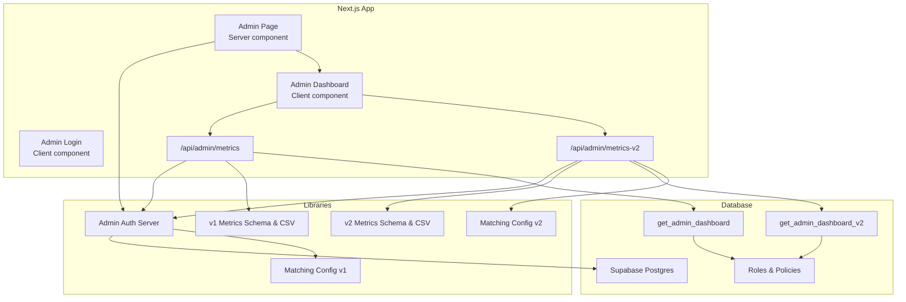
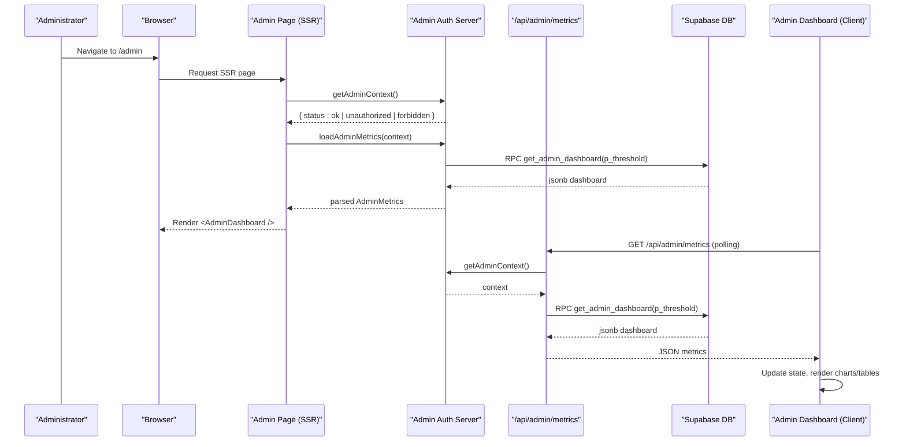
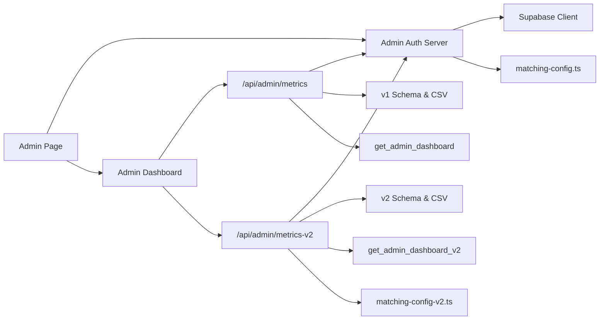

# Admin Dashboard System

<cite>
**Referenced Files in This Document**
- [admin/page.tsx](file://src/app/admin/page.tsx)
- [components/admin-dashboard.tsx](file://src/components/admin-dashboard.tsx)
- [lib/admin-dashboard.ts](file://src/lib/admin-dashboard.ts)
- [lib/admin-dashboard-v2.ts](file://src/lib/admin-dashboard-v2.ts)
- [lib/admin-auth.server.ts](file://src/lib/admin-auth.server.ts)
- [app/api/admin/metrics/route.ts](file://src/app/api/admin/metrics/route.ts)
- [app/api/admin/metrics-v2/route.ts](file://src/app/api/admin/metrics-v2/route.ts)
- [components/admin-login.tsx](file://src/components/admin-login.tsx)
- [lib/matching-config.ts](file://src/lib/matching-config.ts)
- [lib/matching-config-v2.ts](file://src/lib/matching-config-v2.ts)
- [supabase/migrations/202610220002_admin_analytics.sql](file://supabase/migrations/202610220002_admin_analytics.sql)
- [package.json](file://package.json)
</cite>

## Table of Contents
1. [Introduction](#introduction)
2. [Project Structure](#project-structure)
3. [Core Components](#core-components)
4. [Architecture Overview](#architecture-overview)
5. [Detailed Component Analysis](#detailed-component-analysis)
6. [Dependency Analysis](#dependency-analysis)
7. [Performance Considerations](#performance-considerations)
8. [Troubleshooting Guide](#troubleshooting-guide)
9. [Conclusion](#conclusion)

## Introduction
This document describes the Admin Dashboard System for ZooMatch. It provides a secure, privacy-preserving observatory for administrators to monitor aggregate matching outcomes, MBTI distribution, and taxonomy rankings without exposing personal identifiers or raw answers. The system supports two data tracks:
- v1: single similarity threshold dashboard
- v2: dual-track (romance and amistad) dashboard with additional color taxonomy

The implementation uses Next.js App Router pages, server-side authentication against Supabase, Zod-based payload validation, and database functions that enforce role checks and threshold constraints.

## Project Structure
The admin feature is organized around:
- Server-rendered admin page entry point
- Client-side dashboard UI with polling and CSV export
- API routes for metrics retrieval
- Shared libraries for metrics schema, CSV generation, and configuration
- Database migrations defining roles, security policies, and aggregation functions

**Diagram sources**
- [admin/page.tsx:15-21](file://src/app/admin/page.tsx#L15-L21)
- [components/admin-dashboard.tsx:48-116](file://src/components/admin-dashboard.tsx#L48-L116)
- [app/api/admin/metrics/route.ts:9-37](file://src/app/api/admin/metrics/route.ts#L9-L37)
- [app/api/admin/metrics-v2/route.ts:33-72](file://src/app/api/admin/metrics-v2/route.ts#L33-L72)
- [lib/admin-auth.server.ts:5-36](file://src/lib/admin-auth.server.ts#L5-L36)
- [lib/admin-dashboard.ts:1-62](file://src/lib/admin-dashboard.ts#L1-L62)
- [lib/admin-dashboard-v2.ts:16-117](file://src/lib/admin-dashboard-v2.ts#L16-L117)
- [lib/matching-config.ts:1-17](file://src/lib/matching-config.ts#L1-L17)
- [lib/matching-config-v2.ts:1-68](file://src/lib/matching-config-v2.ts#L1-L68)
- [supabase/migrations/202610220002_admin_analytics.sql:22-132](file://supabase/migrations/202610220002_admin_analytics.sql#L22-L132)

**Section sources**
- [admin/page.tsx:1-22](file://src/app/admin/page.tsx#L1-L22)
- [components/admin-dashboard.tsx:1-293](file://src/components/admin-dashboard.tsx#L1-L293)
- [app/api/admin/metrics/route.ts:1-38](file://src/app/api/admin/metrics/route.ts#L1-L38)
- [app/api/admin/metrics-v2/route.ts:1-73](file://src/app/api/admin/metrics-v2/route.ts#L1-L73)
- [lib/admin-auth.server.ts:1-37](file://src/lib/admin-auth.server.ts#L1-L37)
- [lib/admin-dashboard.ts:1-62](file://src/lib/admin-dashboard.ts#L1-L62)
- [lib/admin-dashboard-v2.ts:1-117](file://src/lib/admin-dashboard-v2.ts#L1-L117)
- [lib/matching-config.ts:1-17](file://src/lib/matching-config.ts#L1-L17)
- [lib/matching-config-v2.ts:1-68](file://src/lib/matching-config-v2.ts#L1-L68)
- [supabase/migrations/202610220002_admin_analytics.sql:1-132](file://supabase/migrations/202610220002_admin_analytics.sql#L1-L132)

## Core Components
- Admin Page (server): authenticates the admin context, loads initial metrics, and renders the client dashboard with the active threshold.
- Admin Dashboard (client): polls metrics, displays aggregates, charts, tables, and exports CSV; handles logout and error states.
- Admin Login (client): submits credentials to the admin login endpoint and redirects on success.
- Admin Auth Server: validates user identity and admin role via Supabase, then calls the appropriate database function to fetch metrics.
- Metrics API Routes: protect GET endpoints with rate limiting and return validated metrics or standard error responses.
- Metrics Schemas and CSV Exporters: validate payloads and generate safe CSV outputs for both v1 and v2 dashboards.
- Matching Configuration: load thresholds from JSON with safe fallbacks.
- Database Migrations: define roles, RLS policies, and aggregation functions enforcing admin-only access and threshold validation.

**Section sources**
- [admin/page.tsx:15-21](file://src/app/admin/page.tsx#L15-L21)
- [components/admin-dashboard.tsx:48-116](file://src/components/admin-dashboard.tsx#L48-L116)
- [components/admin-login.tsx:6-45](file://src/components/admin-login.tsx#L6-L45)
- [lib/admin-auth.server.ts:5-36](file://src/lib/admin-auth.server.ts#L5-L36)
- [app/api/admin/metrics/route.ts:9-37](file://src/app/api/admin/metrics/route.ts#L9-L37)
- [app/api/admin/metrics-v2/route.ts:33-72](file://src/app/api/admin/metrics-v2/route.ts#L33-L72)
- [lib/admin-dashboard.ts:10-62](file://src/lib/admin-dashboard.ts#L10-L62)
- [lib/admin-dashboard-v2.ts:26-117](file://src/lib/admin-dashboard-v2.ts#L26-L117)
- [lib/matching-config.ts:7-17](file://src/lib/matching-config.ts#L7-L17)
- [lib/matching-config-v2.ts:15-68](file://src/lib/matching-config-v2.ts#L15-L68)
- [supabase/migrations/202610220002_admin_analytics.sql:22-132](file://supabase/migrations/202610220002_admin_analytics.sql#L22-L132)

## Architecture Overview
The admin flow enforces double authorization:
- Server-side: Next.js verifies Supabase auth and admin role before calling DB functions.
- Database-side: PL/pgSQL functions reject non-admin users and invalid thresholds.

**Diagram sources**
- [admin/page.tsx:15-21](file://src/app/admin/page.tsx#L15-L21)
- [lib/admin-auth.server.ts:5-36](file://src/lib/admin-auth.server.ts#L5-L36)
- [app/api/admin/metrics/route.ts:9-37](file://src/app/api/admin/metrics/route.ts#L9-L37)
- [supabase/migrations/202610220002_admin_analytics.sql:37-132](file://supabase/migrations/202610220002_admin_analytics.sql#L37-L132)

## Detailed Component Analysis

### Admin Page (Server Entry Point)
Responsibilities:
- Build metadata and force dynamic rendering
- Resolve admin context; redirect to login if not authorized
- Load initial metrics and pass them to the client dashboard along with the active threshold

Key behaviors:
- Uses `getAdminContext` to ensure only admins can proceed
- Calls `loadAdminMetrics` to fetch aggregated data
- Passes `threshold` derived from matching config to the dashboard

**Section sources**
- [admin/page.tsx:1-22](file://src/app/admin/page.tsx#L1-L22)
- [lib/matching-config.ts:11-17](file://src/lib/matching-config.ts#L11-L17)

### Admin Dashboard (Client UI)
Responsibilities:
- Display total profiles, matched users, MBTI distribution chart, top animals chart, and accessible tables
- Poll metrics every 60 seconds when visible
- Export CSV with BOM and CRLF line endings
- Handle logout and navigation to login on 401/403

State and UX:
- Status transitions: idle, refreshing, error
- Empty habitat message when no profiles exist
- Accessibility labels and live regions for status updates

Data handling:
- Parses server response using `parseAdminMetrics`
- Generates CSV via `adminMetricsToCsv`

Logout behavior:
- POST to `/api/admin/logout`, then navigate back to login and refresh

**Section sources**
- [components/admin-dashboard.tsx:48-116](file://src/components/admin-dashboard.tsx#L48-L116)
- [components/admin-dashboard.tsx:118-293](file://src/components/admin-dashboard.tsx#L118-L293)
- [lib/admin-dashboard.ts:37-62](file://src/lib/admin-dashboard.ts#L37-L62)

### Admin Login (Client UI)
Responsibilities:
- Submit email/password to `/api/admin/login`
- Show errors for network failures or non-OK responses
- Redirect to `/admin` on success

Security note:
- No shared password; session is validated server-side

**Section sources**
- [components/admin-login.tsx:6-45](file://src/components/admin-login.tsx#L6-L45)

### Admin Auth Server
Responsibilities:
- Create Supabase client and verify authenticated user
- Check admin role in `user_roles` table
- Provide typed context for downstream logic
- Load v1 metrics by calling `get_admin_dashboard` RPC with configured threshold

Error mapping:
- Returns structured statuses: unavailable, unauthorized, forbidden, ok

**Section sources**
- [lib/admin-auth.server.ts:5-36](file://src/lib/admin-auth.server.ts#L5-L36)

### Metrics API Route (v1)
Responsibilities:
- Enforce method restrictions and preflight handling
- Apply rate limiting via `withApiSecurity`
- Map auth statuses to HTTP codes
- Call `loadAdminMetrics` and return JSON or error

Rate limiting:
- 30 requests per 60-second window

**Section sources**
- [app/api/admin/metrics/route.ts:1-38](file://src/app/api/admin/metrics/route.ts#L1-L38)

### Metrics API Route (v2)
Responsibilities:
- Normalize empty aggregates returned by SQL aggregations
- Load v2 metrics via `get_admin_dashboard_v2` RPC with romance and amistad thresholds
- Validate payload with v2 schema and return JSON or error

Normalization:
- Ensures arrays and objects are present even when SQL returns NULL

**Section sources**
- [app/api/admin/metrics-v2/route.ts:16-42](file://src/app/api/admin/metrics-v2/route.ts#L16-L42)
- [app/api/admin/metrics-v2/route.ts:44-72](file://src/app/api/admin/metrics-v2/route.ts#L44-L72)

### v1 Metrics Schema and CSV Exporter
Responsibilities:
- Define strict schema for AdminMetrics including all 16 MBTI codes
- Validate incoming payloads and return null on failure
- Generate safe CSV with BOM, CRLF rows, and formula injection protection

Complexity:
- O(n) over MBTI distribution and top animals for CSV serialization

**Section sources**
- [lib/admin-dashboard.ts:3-62](file://src/lib/admin-dashboard.ts#L3-L62)

### v2 Metrics Schema and CSV Exporter
Responsibilities:
- Define schema for dual-track metrics (romance/amistad), top animals/colors, and MBTI distribution
- Validate RPC payloads and normalize aggregates
- Generate CSV with sections and neutralize spreadsheet formula injection
- Provide helper to compute track coverage percentage

Complexity:
- O(n) over top lists and MBTI codes for CSV serialization

**Section sources**
- [lib/admin-dashboard-v2.ts:16-117](file://src/lib/admin-dashboard-v2.ts#L16-L117)

### Matching Configuration
v1:
- Loads minimum similarity threshold from JSON with safe fallback

v2:
- Loads romance and amistad thresholds from JSON with safe fallbacks
- Validates version, tracks, dimensions, hard filters, weights, and calibration settings

**Section sources**
- [lib/matching-config.ts:1-17](file://src/lib/matching-config.ts#L1-L17)
- [lib/matching-config-v2.ts:15-68](file://src/lib/matching-config-v2.ts#L15-L68)

### Database Migrations
Key elements:
- `user_roles` table with RLS policy allowing authenticated users to read their own role
- `private.is_admin` function used inside aggregation functions
- `public.get_admin_dashboard` function:
  - Requires admin role
  - Validates threshold range
  - Computes total profiles, matched users above threshold, MBTI distribution across all 16 types, and top 5 animals
  - Returns JSONB dashboard object

Security:
- Revokes public execution and grants to authenticated only
- Uses security definer to enforce policy at DB level

**Section sources**
- [supabase/migrations/202610220002_admin_analytics.sql:1-132](file://supabase/migrations/202610220002_admin_analytics.sql#L1-L132)

## Dependency Analysis
The following diagram shows how components depend on each other and where external services are integrated.

**Diagram sources**
- [admin/page.tsx:15-21](file://src/app/admin/page.tsx#L15-L21)
- [components/admin-dashboard.tsx:48-116](file://src/components/admin-dashboard.tsx#L48-L116)
- [app/api/admin/metrics/route.ts:9-37](file://src/app/api/admin/metrics/route.ts#L9-L37)
- [app/api/admin/metrics-v2/route.ts:33-72](file://src/app/api/admin/metrics-v2/route.ts#L33-L72)
- [lib/admin-auth.server.ts:5-36](file://src/lib/admin-auth.server.ts#L5-L36)
- [lib/admin-dashboard.ts:10-62](file://src/lib/admin-dashboard.ts#L10-L62)
- [lib/admin-dashboard-v2.ts:26-117](file://src/lib/admin-dashboard-v2.ts#L26-L117)
- [lib/matching-config.ts:11-17](file://src/lib/matching-config.ts#L11-L17)
- [lib/matching-config-v2.ts:40-68](file://src/lib/matching-config-v2.ts#L40-L68)
- [supabase/migrations/202610220002_admin_analytics.sql:37-132](file://supabase/migrations/202610220002_admin_analytics.sql#L37-L132)

**Section sources**
- [admin/page.tsx:15-21](file://src/app/admin/page.tsx#L15-L21)
- [components/admin-dashboard.tsx:48-116](file://src/components/admin-dashboard.tsx#L48-L116)
- [app/api/admin/metrics/route.ts:9-37](file://src/app/api/admin/metrics/route.ts#L9-L37)
- [app/api/admin/metrics-v2/route.ts:33-72](file://src/app/api/admin/metrics-v2/route.ts#L33-L72)
- [lib/admin-auth.server.ts:5-36](file://src/lib/admin-auth.server.ts#L5-L36)
- [lib/admin-dashboard.ts:10-62](file://src/lib/admin-dashboard.ts#L10-L62)
- [lib/admin-dashboard-v2.ts:26-117](file://src/lib/admin-dashboard-v2.ts#L26-L117)
- [lib/matching-config.ts:11-17](file://src/lib/matching-config.ts#L11-L17)
- [lib/matching-config-v2.ts:40-68](file://src/lib/matching-config-v2.ts#L40-L68)
- [supabase/migrations/202610220002_admin_analytics.sql:37-132](file://supabase/migrations/202610220002_admin_analytics.sql#L37-L132)

## Performance Considerations
- Client polling interval is set to 60 seconds and only triggers when the tab is visible, reducing unnecessary network traffic.
- API routes use rate limiting (30 requests per minute) to mitigate abuse.
- Database aggregation functions compute totals and distributions server-side, minimizing client processing.
- CSV export is performed client-side using in-memory Blob creation; it is efficient for small aggregate datasets.
- Threshold validation occurs both in application code and in the database function to prevent invalid computations.

[No sources needed since this section provides general guidance]

## Troubleshooting Guide
Common issues and resolutions:
- Unauthorized or Forbidden:
  - Ensure the user is authenticated and has the admin role in `user_roles`.
  - Verify Supabase auth is initialized and cookies are present.
- Service Unavailable:
  - Check Supabase connectivity and RPC permissions.
  - Confirm the aggregation functions exist and are granted to authenticated users.
- Invalid Threshold:
  - Validate matching configuration JSON; fallback thresholds will be applied if invalid.
  - For v2, ensure romance and amistad thresholds are within allowed ranges.
- Empty Data:
  - If no profiles exist, the dashboard shows zero counts and an empty habitat notice.
  - Top lists may be empty until questionnaires are submitted.
- CSV Export Issues:
  - Ensure browser allows file downloads.
  - CSV includes BOM and CRLF; some tools may require UTF-8 encoding.

**Section sources**
- [app/api/admin/metrics/route.ts:9-37](file://src/app/api/admin/metrics/route.ts#L9-L37)
- [app/api/admin/metrics-v2/route.ts:44-72](file://src/app/api/admin/metrics-v2/route.ts#L44-L72)
- [lib/matching-config.ts:11-17](file://src/lib/matching-config.ts#L11-L17)
- [lib/matching-config-v2.ts:40-68](file://src/lib/matching-config-v2.ts#L40-L68)
- [components/admin-dashboard.tsx:118-293](file://src/components/admin-dashboard.tsx#L118-L293)

## Conclusion
The Admin Dashboard System delivers a secure, privacy-first observatory for ZooMatch administrators. It combines robust server-side authentication, database-enforced policies, and strict payload validation to expose only aggregate insights. The dual-track v2 dashboard extends monitoring capabilities while maintaining the same security guarantees. With configurable thresholds, rate-limited APIs, and safe CSV export, the system balances usability, performance, and data protection.

[No sources needed since this section summarizes without analyzing specific files]