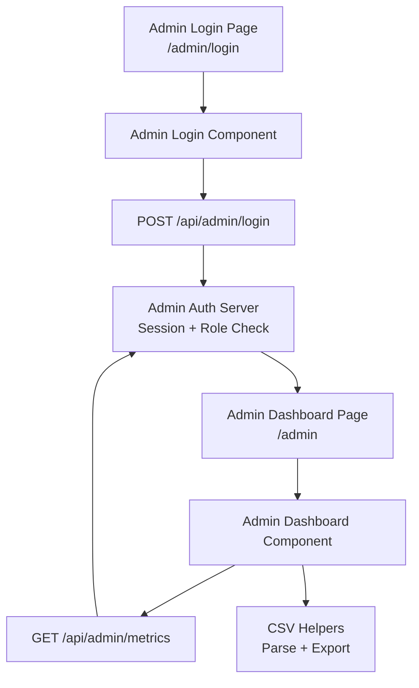
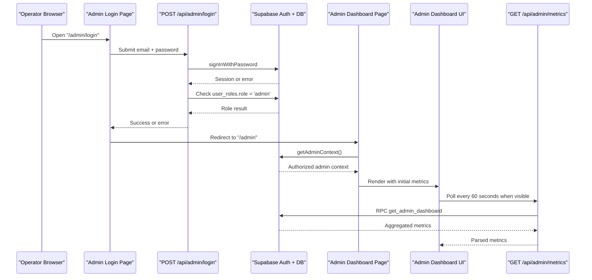
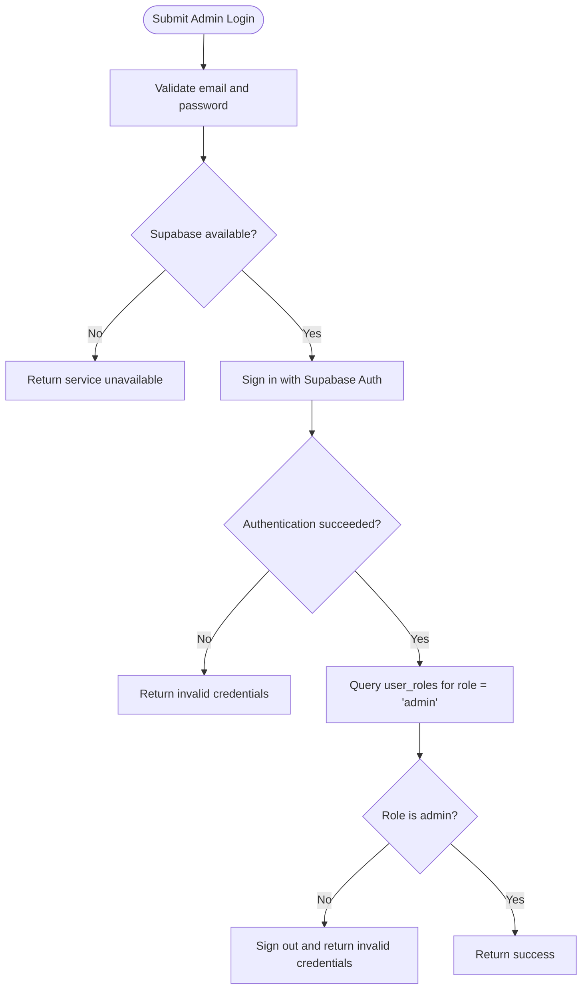
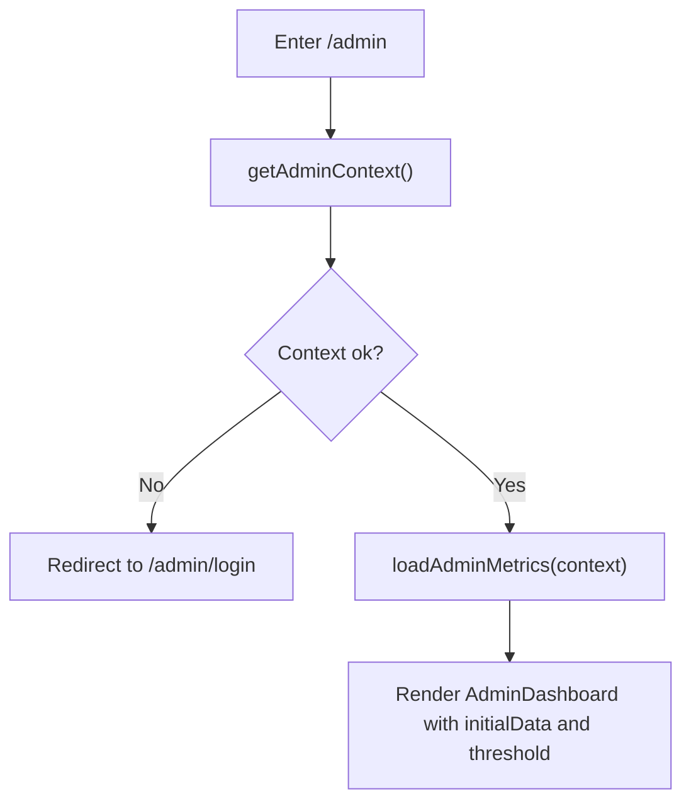
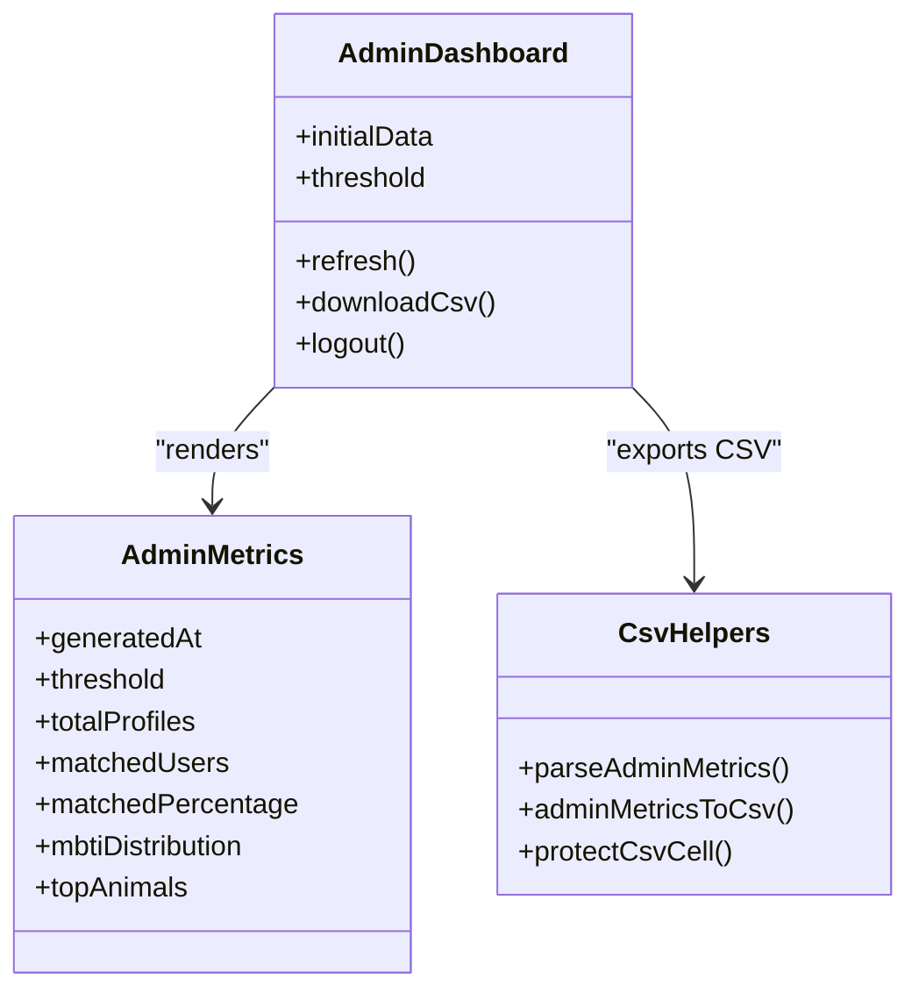
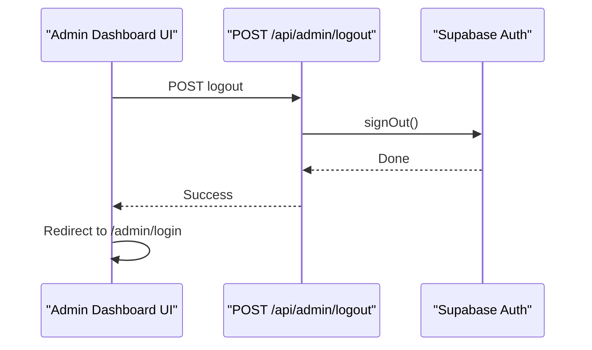
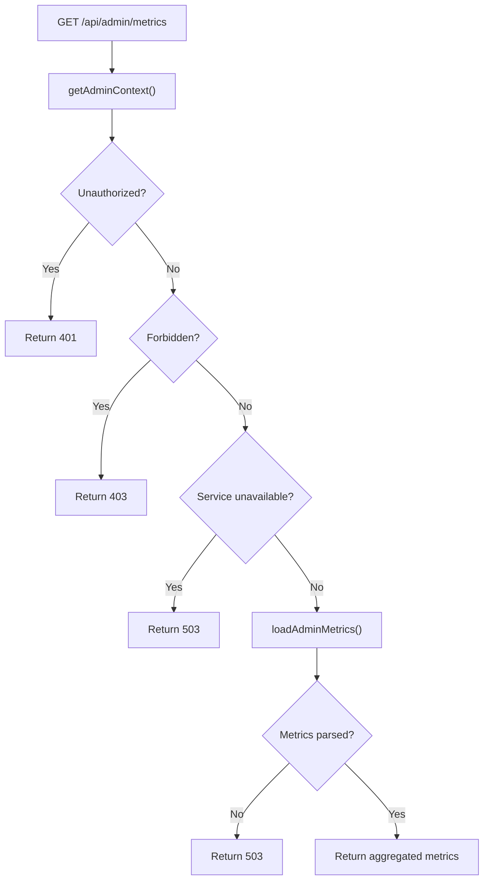
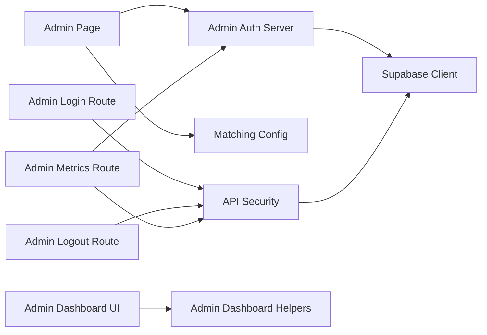

# Administrator Operational Manual

<cite>
**Referenced Files in This Document**
- [MANUAL_ADMINISTRADOR.md](file://MANUAL_ADMINISTRADOR.md)
- [README.md](file://README.md)
- [CONTEXTO_PROYECTO.md](file://CONTEXTO_PROYECTO.md)
- [src/app/admin/page.tsx](file://src/app/admin/page.tsx)
- [src/app/admin/login/page.tsx](file://src/app/admin/login/page.tsx)
- [src/components/admin-dashboard.tsx](file://src/components/admin-dashboard.tsx)
- [src/components/admin-login.tsx](file://src/components/admin-login.tsx)
- [src/lib/admin-auth.server.ts](file://src/lib/admin-auth.server.ts)
- [src/lib/admin-dashboard.ts](file://src/lib/admin-dashboard.ts)
- [src/app/api/admin/login/route.ts](file://src/app/api/admin/login/route.ts)
- [src/app/api/admin/logout/route.ts](file://src/app/api/admin/logout/route.ts)
- [src/app/api/admin/metrics/route.ts](file://src/app/api/admin/metrics/route.ts)
</cite>

## Table of Contents
1. [Introduction](#introduction)
2. [Project Structure](#project-structure)
3. [Core Components](#core-components)
4. [Architecture Overview](#architecture-overview)
5. [Detailed Component Analysis](#detailed-component-analysis)
6. [Dependency Analysis](#dependency-analysis)
7. [Performance Considerations](#performance-considerations)
8. [Troubleshooting Guide](#troubleshooting-guide)
9. [Conclusion](#conclusion)

## Introduction
This document is the **Administrator Operational Manual** for ZooMatch. It explains how an operator uses the system, what the administrator panel can and cannot do, how to access it, and which operational files must be managed outside the interface. The manual is grounded in the actual behavior of the application: the admin area is a read-only observatory that shows aggregated metrics, while student registration, questionnaires, matches, notifications, catalogs, thresholds, and user roles are operated through data files, database migrations, or Supabase administration tools.

ZooMatch is a mobile-first matching platform for UNAM ENES students. Students register with their university ID (matrícula), answer an anonymous questionnaire, and receive results presented as an anonymous alias plus an animal avatar and color palette. The administrator observes aggregate statistics such as total profiles, percentage of users with at least one match above the active threshold, MBTI distribution, and top animals.

**Section sources**
- [MANUAL_ADMINISTRADOR.md:24-107](file://MANUAL_ADMINISTRADOR.md#L24-L107)
- [README.md:36-67](file://README.md#L36-L67)
- [CONTEXTO_PROYECTO.md:8-43](file://CONTEXTO_PROYECTO.md#L8-L43)

## Project Structure
The administrator experience spans three layers:

| Layer | Responsibility | Key files |
|---|---|---|
| **Pages** | Server-side routing, authentication context, initial metrics loading | `src/app/admin/page.tsx`, `src/app/admin/login/page.tsx` |
| **Client components** | Admin login form and dashboard UI | `src/components/admin-login.tsx`, `src/components/admin-dashboard.tsx` |
| **Server logic and API routes** | Admin session validation, role check, metrics RPC call, CSV export helpers | `src/lib/admin-auth.server.ts`, `src/lib/admin-dashboard.ts`, `src/app/api/admin/login/route.ts`, `src/app/api/admin/logout/route.ts`, `src/app/api/admin/metrics/route.ts` |

**Diagram sources**
- [src/app/admin/login/page.tsx:10-11](file://src/app/admin/login/page.tsx#L10-L11)
- [src/components/admin-login.tsx:11-44](file://src/components/admin-login.tsx#L11-L44)
- [src/app/api/admin/login/route.ts:15-43](file://src/app/api/admin/login/route.ts#L15-L43)
- [src/lib/admin-auth.server.ts:5-25](file://src/lib/admin-auth.server.ts#L5-L25)
- [src/app/admin/page.tsx:15-20](file://src/app/admin/page.tsx#L15-L20)
- [src/components/admin-dashboard.tsx:48-116](file://src/components/admin-dashboard.tsx#L48-L116)
- [src/app/api/admin/metrics/route.ts:9-26](file://src/app/api/admin/metrics/route.ts#L9-L26)
- [src/lib/admin-dashboard.ts:37-60](file://src/lib/admin-dashboard.ts#L37-L60)

**Section sources**
- [src/app/admin/page.tsx:1-21](file://src/app/admin/page.tsx#L1-L21)
- [src/app/admin/login/page.tsx:1-12](file://src/app/admin/login/page.tsx#L1-L12)
- [src/components/admin-dashboard.tsx:1-293](file://src/components/admin-dashboard.tsx#L1-L293)
- [src/components/admin-login.tsx:1-137](file://src/components/admin-login.tsx#L1-L137)
- [src/lib/admin-auth.server.ts:1-37](file://src/lib/admin-auth.server.ts#L1-L37)
- [src/lib/admin-dashboard.ts:1-62](file://src/lib/admin-dashboard.ts#L1-L62)
- [src/app/api/admin/login/route.ts:1-55](file://src/app/api/admin/login/route.ts#L1-L55)
- [src/app/api/admin/logout/route.ts:1-27](file://src/app/api/admin/logout/route.ts#L1-L27)
- [src/app/api/admin/metrics/route.ts:1-38](file://src/app/api/admin/metrics/route.ts#L1-L38)

## Core Components
The administrator workflow has two main entry points:

1. **Admin login:** `/admin/login` renders the login page, which calls `POST /api/admin/login`.
2. **Admin dashboard:** `/admin` renders the observatory dashboard, which polls `GET /api/admin/metrics`.

Both flows enforce **two layers of authorization**:
- A valid Supabase Auth session.
- An explicit administrative role (`role = 'admin'`) in the `user_roles` table.

The dashboard is **read-only**. It does not let operators create, edit, delete, search, or filter student records, matches, notifications, catalogs, questionnaires, thresholds, or admin roles. Those items are managed through data files, SQL migrations, seeds, or Supabase administration.

**Section sources**
- [MANUAL_ADMINISTRADOR.md:44-82](file://MANUAL_ADMINISTRADOR.md#L44-L82)
- [MANUAL_ADMINISTRADOR.md:135-191](file://MANUAL_ADMINISTRADOR.md#L135-L191)
- [MANUAL_ADMINISTRADOR.md:201-206](file://MANUAL_ADMINISTRADOR.md#L201-L206)
- [src/lib/admin-auth.server.ts:5-25](file://src/lib/admin-auth.server.ts#L5-L25)
- [src/app/api/admin/login/route.ts:26-43](file://src/app/api/admin/login/route.ts#L26-L43)

## Architecture Overview
The admin architecture separates server-side security checks from client-side visualization.

**Diagram sources**
- [src/app/admin/login/page.tsx:10-11](file://src/app/admin/login/page.tsx#L10-L11)
- [src/components/admin-login.tsx:11-44](file://src/components/admin-login.tsx#L11-L44)
- [src/app/api/admin/login/route.ts:15-43](file://src/app/api/admin/login/route.ts#L15-L43)
- [src/app/admin/page.tsx:15-20](file://src/app/admin/page.tsx#L15-L20)
- [src/lib/admin-auth.server.ts:5-35](file://src/lib/admin-auth.server.ts#L5-L35)
- [src/components/admin-dashboard.tsx:59-99](file://src/components/admin-dashboard.tsx#L59-L99)
- [src/app/api/admin/metrics/route.ts:9-26](file://src/app/api/admin/metrics/route.ts#L9-L26)

## Detailed Component Analysis

### Admin Login Flow
The admin login flow protects the dashboard by validating credentials and then checking the administrative role.

**Diagram sources**
- [src/components/admin-login.tsx:11-44](file://src/components/admin-login.tsx#L11-L44)
- [src/app/api/admin/login/route.ts:8-43](file://src/app/api/admin/login/route.ts#L8-L43)

Key behaviors:
- The login endpoint validates the request body with Zod.
- If Supabase is unavailable, it returns a service-unavailable response.
- Authentication failure and missing administrative role both return the same generic “invalid credentials” response to avoid leaking whether the problem is the password or the role.
- The rate limit is configured for this route.

**Section sources**
- [src/components/admin-login.tsx:11-44](file://src/components/admin-login.tsx#L11-L44)
- [src/app/api/admin/login/route.ts:8-53](file://src/app/api/admin/login/route.ts#L8-L53)

### Admin Dashboard Page
The server-side admin page performs two operations before rendering the UI:
1. Calls `getAdminContext()` to verify the current user has a valid session and the administrative role.
2. Calls `loadAdminMetrics(context)` to fetch aggregated metrics via the `get_admin_dashboard` RPC.

If the context is not authorized, the page redirects to `/admin/login`.

**Diagram sources**
- [src/app/admin/page.tsx:15-20](file://src/app/admin/page.tsx#L15-L20)
- [src/lib/admin-auth.server.ts:5-35](file://src/lib/admin-auth.server.ts#L5-L35)

**Section sources**
- [src/app/admin/page.tsx:1-21](file://src/app/admin/page.tsx#L1-L21)
- [src/lib/admin-auth.server.ts:1-37](file://src/lib/admin-auth.server.ts#L1-L37)

### Admin Dashboard UI
The dashboard component is a client-side React component that:
- Displays total profiles, percentage of users with at least one match above the active threshold, MBTI distribution, and top five animals.
- Refreshes metrics automatically every 60 seconds when the tab is visible.
- Exports aggregated data to a protected CSV file.
- Logs out the administrator by calling `/api/admin/logout`.

**Diagram sources**
- [src/components/admin-dashboard.tsx:23-116](file://src/components/admin-dashboard.tsx#L23-L116)
- [src/lib/admin-dashboard.ts:10-60](file://src/lib/admin-dashboard.ts#L10-L60)

Important UI and operational details:
- The status bar shows the last reading time and the active threshold.
- When there are no profiles, the dashboard shows a placeholder state instead of crashing.
- The CSV includes summary rows, MBTI distribution, and top animals; it escapes values to prevent spreadsheet formula injection.
- The dashboard never exposes individual student identities, hashes, vectors, or answers.

**Section sources**
- [src/components/admin-dashboard.tsx:48-293](file://src/components/admin-dashboard.tsx#L48-L293)
- [src/lib/admin-dashboard.ts:10-60](file://src/lib/admin-dashboard.ts#L10-L60)
- [MANUAL_ADMINISTRADOR.md:163-191](file://MANUAL_ADMINISTRADOR.md#L163-L191)

### Admin Logout
The logout route signs out the Supabase session and returns a success response. The dashboard calls it before redirecting back to the login page.

**Diagram sources**
- [src/components/admin-dashboard.tsx:112-116](file://src/components/admin-dashboard.tsx#L112-L116)
- [src/app/api/admin/logout/route.ts:8-15](file://src/app/api/admin/logout/route.ts#L8-L15)

**Section sources**
- [src/app/api/admin/logout/route.ts:1-27](file://src/app/api/admin/logout/route.ts#L1-L27)

### Admin Metrics API
The metrics endpoint enforces the same double authorization as the dashboard page and then calls the database RPC to retrieve aggregated data.

**Diagram sources**
- [src/app/api/admin/metrics/route.ts:9-26](file://src/app/api/admin/metrics/route.ts#L9-L26)
- [src/lib/admin-auth.server.ts:28-35](file://src/lib/admin-auth.server.ts#L28-L35)

**Section sources**
- [src/app/api/admin/metrics/route.ts:1-38](file://src/app/api/admin/metrics/route.ts#L1-L38)
- [src/lib/admin-auth.server.ts:28-35](file://src/lib/admin-auth.server.ts#L28-L35)

## Dependency Analysis
The admin subsystem depends on several shared modules:

| Module | Purpose | Used By |
|---|---|---|
| `src/lib/admin-auth.server.ts` | Validates admin session and role; loads metrics via RPC | Admin page, metrics route |
| `src/lib/admin-dashboard.ts` | Defines metric schema, parses metrics, exports CSV | Dashboard UI |
| `src/lib/security/api.server.ts` | CORS, rate limiting, and hard headers for all API routes | Admin login, logout, metrics routes |
| `src/lib/supabase/server.ts` | Creates Supabase clients used by server-side logic | Admin auth, login, logout, metrics routes |
| `src/lib/matching-config.ts` | Provides the active matching threshold used by admin metrics | Admin page, admin auth server |

**Diagram sources**
- [src/app/admin/page.tsx:5-6](file://src/app/admin/page.tsx#L5-L6)
- [src/lib/admin-auth.server.ts:1-3](file://src/lib/admin-auth.server.ts#L1-L3)
- [src/app/api/admin/login/route.ts:4-6](file://src/app/api/admin/login/route.ts#L4-L6)
- [src/app/api/admin/logout/route.ts:3-4](file://src/app/api/admin/logout/route.ts#L3-L4)
- [src/app/api/admin/metrics/route.ts:3-4](file://src/app/api/admin/metrics/route.ts#L3-L4)
- [src/components/admin-dashboard.tsx:16-21](file://src/components/admin-dashboard.tsx#L16-L21)

**Section sources**
- [src/app/admin/page.tsx:1-21](file://src/app/admin/page.tsx#L1-L21)
- [src/lib/admin-auth.server.ts:1-37](file://src/lib/admin-auth.server.ts#L1-L37)
- [src/lib/admin-dashboard.ts:1-62](file://src/lib/admin-dashboard.ts#L1-L62)
- [src/app/api/admin/login/route.ts:1-55](file://src/app/api/admin/login/route.ts#L1-L55)
- [src/app/api/admin/logout/route.ts:1-27](file://src/app/api/admin/logout/route.ts#L1-L27)
- [src/app/api/admin/metrics/route.ts:1-38](file://src/app/api/admin/metrics/route.ts#L1-L38)

## Performance Considerations
From an operational perspective, the admin dashboard is designed to be lightweight and safe under repeated polling:

- **Polling interval:** The dashboard refreshes only when the tab is visible, every 60 seconds.
- **Abort timeout:** Each metrics request uses a 10-second timeout signal.
- **In-flight guard:** Duplicate simultaneous refreshes are prevented by an in-flight flag.
- **Mount guard:** State updates are ignored if the component unmounts.
- **Rate limits:** All admin API routes are wrapped with security middleware that applies rate limiting.
- **Aggregated data only:** The dashboard reads precomputed aggregates from a database RPC rather than raw rows, reducing exposure and query complexity.

These characteristics make the dashboard suitable for continuous monitoring without overwhelming the backend.

**Section sources**
- [src/components/admin-dashboard.tsx:59-99](file://src/components/admin-dashboard.tsx#L59-L99)
- [src/app/api/admin/login/route.ts:48-53](file://src/app/api/admin/login/route.ts#L48-L53)
- [src/app/api/admin/logout/route.ts:20-25](file://src/app/api/admin/logout/route.ts#L20-L25)
- [src/app/api/admin/metrics/route.ts:31-36](file://src/app/api/admin/metrics/route.ts#L31-L36)

## Troubleshooting Guide

### Cannot Access the Admin Panel
**Symptoms:**
- Redirected to `/admin/login`.
- Message: “No se pudo verificar el acceso administrativo.”
- Message: “El servicio de acceso no está disponible en este momento.”

**Likely causes:**
- No valid Supabase session.
- Missing administrative role.
- Incorrect email or password.
- Supabase service unavailable.

**Operational steps:**
1. Confirm you are using the institutional email assigned to the administrator account.
2. Confirm the password is correct.
3. Verify the account was promoted to administrator using `supabase/promote_admin.sql`.
4. If the service is unavailable, check Supabase configuration and environment variables.

**Section sources**
- [MANUAL_ADMINISTRADOR.md:63-82](file://MANUAL_ADMINISTRADOR.md#L63-L82)
- [MANUAL_ADMINISTRADOR.md:498-507](file://MANUAL_ADMINISTRADOR.md#L498-L507)
- [MANUAL_ADMINISTRADOR.md:537-564](file://MANUAL_ADMINISTRADOR.md#L537-L564)
- [src/app/api/admin/login/route.ts:15-43](file://src/app/api/admin/login/route.ts#L15-L43)
- [src/components/admin-login.tsx:19-44](file://src/components/admin-login.tsx#L19-L44)

### Too Many Login Attempts
**Symptom:** “Demasiados intentos. Espera antes de volver a intentar.”

**Cause:** The admin login route enforces a rate limit of 5 attempts per 15 minutes.

**Resolution:** Wait for the window to expire and retry. Do not repeatedly submit the form.

**Section sources**
- [MANUAL_ADMINISTRADOR.md:75-77](file://MANUAL_ADMINISTRADOR.md#L75-L77)
- [MANUAL_ADMINISTRADOR.md:509-513](file://MANUAL_ADMINISTRADOR.md#L509-L513)
- [src/app/api/admin/login/route.ts:48-53](file://src/app/api/admin/login/route.ts#L48-L53)

### Dashboard Shows Interruption or Empty Data
**Symptoms:**
- Status bar shows interruption message.
- Total profiles is zero.
- Top animals section shows no species assigned.

**Causes:**
- Metrics RPC failed or returned invalid data.
- No student profiles have been created yet.
- No animal assignments exist yet.

**Resolution:**
- Refresh manually using the “Refrescar” button.
- Wait for student registrations and questionnaire submissions.
- Verify that catalogs and seeds were applied correctly.

**Section sources**
- [MANUAL_ADMINISTRADOR.md:181-191](file://MANUAL_ADMINISTRADOR.md#L181-L191)
- [src/components/admin-dashboard.tsx:59-87](file://src/components/admin-dashboard.tsx#L59-L87)
- [src/components/admin-dashboard.tsx:213-249](file://src/components/admin-dashboard.tsx#L213-L249)

### CSV Export Fails or Is Not Available
**Symptom:** “Exportar CSV” button is disabled.

**Cause:** No metrics are currently loaded.

**Resolution:** Refresh the dashboard until metrics load successfully, then export.

**Section sources**
- [src/components/admin-dashboard.tsx:101-110](file://src/components/admin-dashboard.tsx#L101-L110)
- [src/lib/admin-dashboard.ts:50-60](file://src/lib/admin-dashboard.ts#L50-L60)

### Logging Out Does Not Work
**Symptom:** After clicking “Cerrar sesión,” the operator remains logged in or sees an error.

**Resolution:**
- Try again; the logout route ignores network errors gracefully.
- Clear browser cookies/session if needed.
- Confirm Supabase Auth is available.

**Section sources**
- [src/components/admin-dashboard.tsx:112-116](file://src/components/admin-dashboard.tsx#L112-L116)
- [src/app/api/admin/logout/route.ts:8-15](file://src/app/api/admin/logout/route.ts#L8-L15)

## Conclusion
The ZooMatch administrator panel is intentionally narrow: it exists to observe aggregated system health and engagement, not to manage individual users or content. Operators should treat it as a monitoring surface backed by secure RPCs, while day-to-day configuration belongs in data files, database migrations, seeds, and Supabase administration.

For operators, the most important rules are:
- Use `/admin/login` with an institutional email and password.
- Confirm the account has the administrative role.
- Treat the dashboard as read-only.
- Manage catalogs, thresholds, questionnaires, and roles outside the interface.
- Watch for rate-limit messages and service-unavailable states during setup or outages.

**Section sources**
- [MANUAL_ADMINISTRADOR.md:201-206](file://MANUAL_ADMINISTRADOR.md#L201-L206)
- [MANUAL_ADMINISTRADOR.md:375-453](file://MANUAL_ADMINISTRADOR.md#L375-L453)
- [README.md:60-67](file://README.md#L60-L67)
- [CONTEXTO_PROYECTO.md:183-192](file://CONTEXTO_PROYECTO.md#L183-L192)