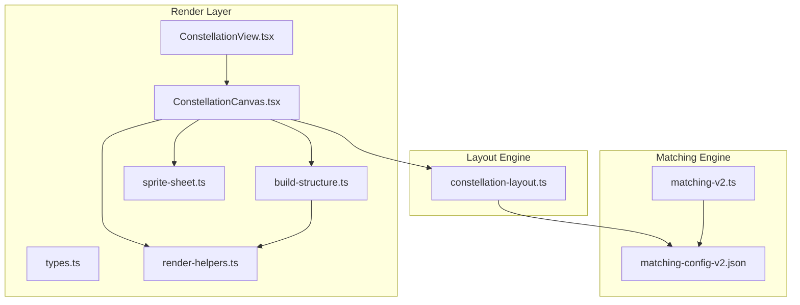
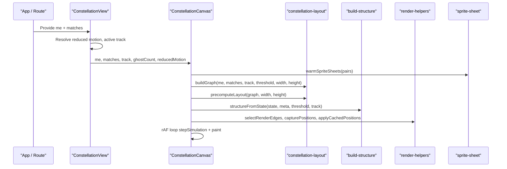
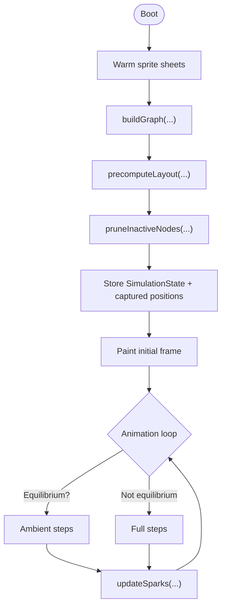
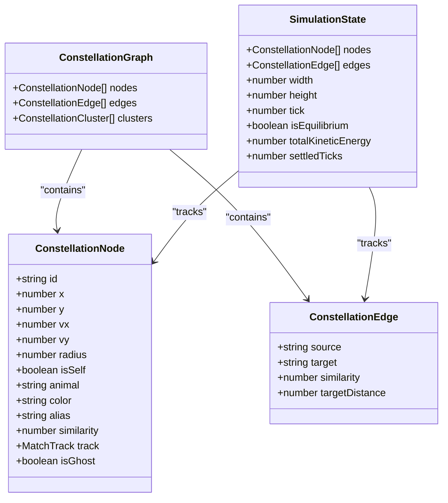
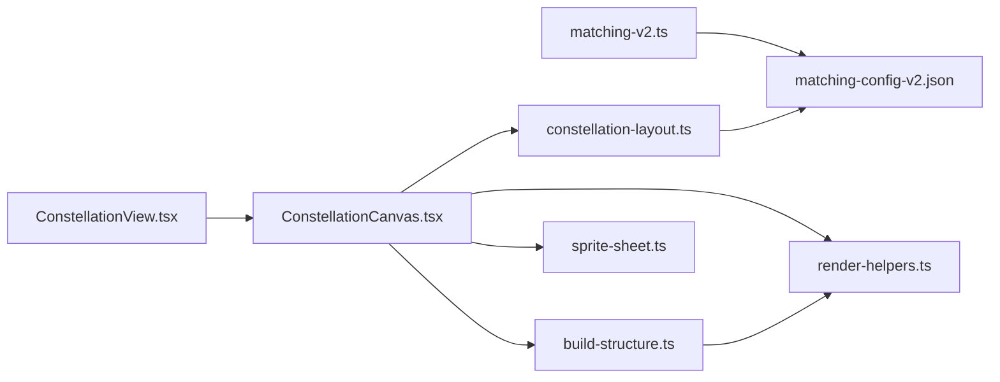

# Constellation Visualization System

<cite>
**Referenced Files in This Document**
- [index.ts](file://src/components/constellation/index.ts)
- [types.ts](file://src/components/constellation/types.ts)
- [build-structure.ts](file://src/components/constellation/build-structure.ts)
- [render-helpers.ts](file://src/components/constellation/render-helpers.ts)
- [ConstellationView.tsx](file://src/components/constellation/ConstellationView.tsx)
- [ConstellationCanvas.tsx](file://src/components/constellation/ConstellationCanvas.tsx)
- [sprite-sheet.ts](file://src/components/constellation/sprite-sheet.ts)
- [constellation-layout.ts](file://src/lib/constellation-layout.ts)
- [matching-v2.ts](file://src/lib/matching-v2.ts)
- [matching-config-v2.json](file://data/matching-config-v2.json)
</cite>

## Table of Contents
1. [Introduction](#introduction)
2. [Project Structure](#project-structure)
3. [Core Components](#core-components)
4. [Architecture Overview](#architecture-overview)
5. [Detailed Component Analysis](#detailed-component-analysis)
6. [Dependency Analysis](#dependency-analysis)
7. [Performance Considerations](#performance-considerations)
8. [Troubleshooting Guide](#troubleshooting-guide)
9. [Conclusion](#conclusion)

## Introduction
The Constellation Visualization System is a React-based interactive visualization that turns dual-track matching results into an animated, draggable constellation of pixel-art animal sprites. It separates three concerns:
- Matching engine: computes romance and friendship similarity vectors and badges.
- Layout engine: builds a deterministic physics simulation with spring forces, collision repulsion, center gravity, equilibrium detection, and ambient drift.
- Render layer: converts the simulation state into an SVG sky with optimized sprite sheets, connection lines, join sparks, accessibility labels, and reduced-motion support.

Phase C integrates by mapping API results to `me` and `matches`, then rendering `ConstellationView`. The render layer never touches Supabase or the matching engine directly; it consumes pure data contracts.

## Project Structure
The constellation feature lives primarily under `src/components/constellation`, with supporting logic in `src/lib` and configuration in `data`.

**Diagram sources**
- [ConstellationView.tsx:1-134](file://src/components/constellation/ConstellationView.tsx#L1-L134)
- [ConstellationCanvas.tsx:1-800](file://src/components/constellation/ConstellationCanvas.tsx#L1-L800)
- [types.ts:1-325](file://src/components/constellation/types.ts#L1-L325)
- [build-structure.ts:1-215](file://src/components/constellation/build-structure.ts#L1-L215)
- [render-helpers.ts:1-446](file://src/components/constellation/render-helpers.ts#L1-L446)
- [sprite-sheet.ts:1-133](file://src/components/constellation/sprite-sheet.ts#L1-L133)
- [constellation-layout.ts:1-800](file://src/lib/constellation-layout.ts#L1-L800)
- [matching-v2.ts:1-580](file://src/lib/matching-v2.ts#L1-L580)
- [matching-config-v2.json:1-77](file://data/matching-config-v2.json#L1-L77)

**Section sources**
- [index.ts:1-72](file://src/components/constellation/index.ts#L1-L72)
- [types.ts:1-325](file://src/components/constellation/types.ts#L1-L325)

## Core Components
- `ConstellationView`: Composed entry point for Phase C. Owns active track, selected node, and reduced motion preference. Renders toggle, canvas, and detail sheet.
- `ConstellationCanvas`: Interactive SVG sky. Builds graph, precomputes layout, runs animation loop, handles drag/tap/select, paints nodes and edges imperatively, and manages join sparks.
- `build-structure`: Pure adapter from simulation state to React render structure (`ConstellationStructure`). Computes aria labels, adjacency, edge styling, and thresholds.
- `render-helpers`: Side-effect-free helpers for thresholds, formatting, geometry, edge selection, position caching, and data-keying.
- `sprite-sheet`: Rasterizes pixel sprites into memoized inline SVG sprite sheets, reducing DOM cost per node.
- `constellation-layout`: Deterministic physics engine: graph construction, cluster detection, simulation stepping, dragging, release impulses, and track switching.
- `matching-v2`: Dual-track scoring, hard filters, weighted cosine similarity, badge generation, and match computation.

**Section sources**
- [ConstellationView.tsx:1-134](file://src/components/constellation/ConstellationView.tsx#L1-L134)
- [ConstellationCanvas.tsx:1-800](file://src/components/constellation/ConstellationCanvas.tsx#L1-L800)
- [build-structure.ts:1-215](file://src/components/constellation/build-structure.ts#L1-L215)
- [render-helpers.ts:1-446](file://src/components/constellation/render-helpers.ts#L1-L446)
- [sprite-sheet.ts:1-133](file://src/components/constellation/sprite-sheet.ts#L1-L133)
- [constellation-layout.ts:1-800](file://src/lib/constellation-layout.ts#L1-L800)
- [matching-v2.ts:1-580](file://src/lib/matching-v2.ts#L1-L580)

## Architecture Overview
The system flows from matching results through a render contract into a physics-driven SVG visualization.

**Diagram sources**
- [ConstellationView.tsx:34-134](file://src/components/constellation/ConstellationView.tsx#L34-L134)
- [ConstellationCanvas.tsx:346-417](file://src/components/constellation/ConstellationCanvas.tsx#L346-L417)
- [constellation-layout.ts:335-403](file://src/lib/constellation-layout.ts#L335-L403)
- [build-structure.ts:141-215](file://src/components/constellation/build-structure.ts#L141-L215)
- [render-helpers.ts:351-377](file://src/components/constellation/render-helpers.ts#L351-L377)
- [sprite-sheet.ts:130-133](file://src/components/constellation/sprite-sheet.ts#L130-L133)

## Detailed Component Analysis

### ConstellationView
`ConstellationView` composes the experience:
- Tracks active `MatchTrack` and selected node id.
- Computes visible counts per track using `matchesForTrack` and `getTrackThreshold`.
- Delegates rendering to `TrackToggle`, `ConstellationCanvas`, and `NodeDetailSheet`.
- Ensures only matches valid under the active track can open the detail sheet.

Key responsibilities:
- State coordination (track, selection, reduced motion).
- Accessibility wiring (panel role, aria-labelledby).
- Default copy via `CONSTELLATION_COPY`.

**Section sources**
- [ConstellationView.tsx:1-134](file://src/components/constellation/ConstellationView.tsx#L1-L134)
- [types.ts:84-113](file://src/components/constellation/types.ts#L84-L113)

### ConstellationCanvas
`ConstellationCanvas` is the performance-critical interactive sky:
- Uses SVG for accessibility and crisp pixel sprites.
- Defers expensive work behind double `requestAnimationFrame` so placeholder text paints first.
- Warming sprite sheets before layout prevents catalog initialization from blocking paint.
- Precomputes ~2000 ticks to reach equilibrium quickly.
- Animation loop:
  - Full rate while dragging or not at equilibrium.
  - Ambient mode after equilibrium (steps every N frames).
  - Stops when tab hidden; resumes on visibility change.
- Imperative painting: updates `transform` and line coordinates directly without re-rendering.
- Dragging: pointer events map to viewBox units; drag start sets velocity to zero; release applies small impulse.
- Join sparks: heart-shaped pixel bursts when two connected nodes approach within target distance.
- Track switching: preserves positions, prunes inactive nodes, reapplies cached positions, rebuilds structure.

**Diagram sources**
- [ConstellationCanvas.tsx:346-417](file://src/components/constellation/ConstellationCanvas.tsx#L346-L417)
- [ConstellationCanvas.tsx:470-529](file://src/components/constellation/ConstellationCanvas.tsx#L470-L529)
- [render-helpers.ts:351-377](file://src/components/constellation/render-helpers.ts#L351-L377)

**Section sources**
- [ConstellationCanvas.tsx:1-800](file://src/components/constellation/ConstellationCanvas.tsx#L1-L800)

### build-structure
Pure adapter between simulation state and React render tree:
- Converts `me` and `matches` into engine inputs (`SelfIdentity`, `MatchInput[]`).
- Builds `NodeMeta` index including self and real matches.
- Generates ghost metadata for decorative stars.
- Produces `ConstellationStructure` with:
  - Nodes: radius, display size, opacity, aria label, initial position.
  - Edges: key, source/target, similarity, stroke width/opacity, color, target distance, endpoints.
  - Adjacency list built from painted edges.
  - Threshold, self id, and viewBox dimensions.

Complexity:
- Node iteration O(N), edge processing O(E).
- Memory proportional to number of nodes and edges.

**Section sources**
- [build-structure.ts:1-215](file://src/components/constellation/build-structure.ts#L1-L215)

### render-helpers
Side-effect-free utilities:
- Tunables: sprite size factor, hit padding, join distance factor, spark lifetime, idle frame interval, ambient divider, max steps per frame, resize debounce, badge limits, max rendered edges, ghost ids.
- Geometry: heart rects run-length encoding, rounding, normalization, distance.
- Formatting: affinity percent, track noun, aria labels, connections label, badge slicing.
- Graph/state: edge key, active node ids, prune inactive nodes, position cache, adjacency builder, edge selector.
- Data key: structural fingerprint to avoid rebuilding layout on fresh arrays.

Edge selection prioritizes self spokes and strongest match↔match links up to cap, ensuring deterministic order for stable React keys.

**Section sources**
- [render-helpers.ts:1-446](file://src/components/constellation/render-helpers.ts#L1-L446)

### sprite-sheet
Optimizes pixel sprite rendering:
- Builds one inline SVG sprite sheet per (animalId, colorId) containing three frames side-by-side.
- Memoizes data URLs in a bounded cache.
- Warms sheets during canvas boot to avoid catalog initialization latency.
- Reduces DOM elements per node from potentially hundreds of rects to three elements (group, image, hit circle).

**Section sources**
- [sprite-sheet.ts:1-133](file://src/components/constellation/sprite-sheet.ts#L1-L133)

### constellation-layout
Deterministic physics engine:
- Types: nodes, edges, graph, clusters, params, state, distance config, self identity, match input.
- Threshold helper reads from `matching-config-v2.json`.
- Graph construction:
  - Self node at viewport center.
  - Match nodes seeded on orbits based on id hash.
  - Ghost nodes placed decoratively around periphery.
  - Edges for self↔match (real similarity) and match↔match (estimated product similarity).
- Cluster detection: maximal cliques of mutually connected nodes.
- Simulation:
  - Spring forces along edges.
  - Collision repulsion among real nodes.
  - Center gravity.
  - Damping and velocity cap.
  - Position integration and bounds clamping.
  - Equilibrium detection after consecutive low-energy ticks.
  - Post-equilibrium floating drift applied position-only.
- Interaction:
  - Drag node sets position and zeroes velocity.
  - Release node applies small deterministic impulse.
  - Switch track recalculates edges and metadata while preserving positions.

**Diagram sources**
- [constellation-layout.ts:29-109](file://src/lib/constellation-layout.ts#L29-L109)
- [constellation-layout.ts:52-86](file://src/lib/constellation-layout.ts#L52-L86)

**Section sources**
- [constellation-layout.ts:1-800](file://src/lib/constellation-layout.ts#L1-L800)

### matching-v2
Dual-track matching core:
- Scores quiz submissions into normalized dimension scores and MBTI code.
- Applies hard filters for romance (orientation, gender, relationship type).
- Computes weighted cosine similarity per track using configured dimensions and category weights.
- Generates compatibility badges per track.
- Finds dual matches across romance and amistad tracks.

Configuration:
- Reads thresholds, dimensions, hard filters, and weights from `matching-config-v2.json`.

**Section sources**
- [matching-v2.ts:1-580](file://src/lib/matching-v2.ts#L1-L580)
- [matching-config-v2.json:1-77](file://data/matching-config-v2.json#L1-L77)

## Dependency Analysis
The render layer depends on the layout engine and helpers but not on Supabase or the matching engine. The layout engine reads thresholds from configuration. The matching engine reads configuration and questionnaire data.

**Diagram sources**
- [matching-v2.ts:31-38](file://src/lib/matching-v2.ts#L31-L38)
- [constellation-layout.ts:21-22](file://src/lib/constellation-layout.ts#L21-L22)
- [ConstellationCanvas.tsx:60-107](file://src/components/constellation/ConstellationCanvas.tsx#L60-L107)
- [build-structure.ts:13-42](file://src/components/constellation/build-structure.ts#L13-L42)
- [ConstellationView.tsx:22-32](file://src/components/constellation/ConstellationView.tsx#L22-L32)

**Section sources**
- [index.ts:1-72](file://src/components/constellation/index.ts#L1-L72)
- [types.ts:1-325](file://src/components/constellation/types.ts#L1-L325)

## Performance Considerations
- Sprite optimization: Each node uses a single `<image>` referencing a memoized sprite sheet instead of many `<rect>` elements.
- Edge capping: Only up to `MAX_RENDERED_EDGES` are painted; physics still considers all edges.
- Animation loop:
  - Full rate while dragging or settling.
  - Ambient mode reduces steps after equilibrium.
  - Stops when tab hidden.
- Boot deferral: Double `requestAnimationFrame` ensures placeholder paints before heavy work.
- Resize debounce: Prevents repeated full rebuilds during window drags.
- Imperative painting: Direct DOM attribute writes avoid React reconciliation overhead.
- Position caching: Track switches preserve positions for smooth transitions.

[No sources needed since this section provides general guidance]

## Troubleshooting Guide
Common issues and resolutions:
- Empty constellation view:
  - Check that matches exceed track thresholds.
  - Verify `matching-config-v2.json` thresholds and dimensions.
- No connection lines:
  - Ensure edges exist above threshold and are not pruned.
  - Confirm `selectRenderEdges` includes self spokes and top pairs.
- Stuck layout:
  - Inspect equilibrium detection and kinetic energy.
  - Validate simulation parameters and damping.
- Poor mobile performance:
  - Reduce `ghostCount` and `maxRenderedEdges`.
  - Enable reduced motion.
  - Ensure sprite sheets are warmed before layout.
- Incorrect aria labels:
  - Verify `matchAriaLabel` and `selfAriaLabel` usage.
  - Confirm track noun and similarity formatting.

**Section sources**
- [render-helpers.ts:193-242](file://src/components/constellation/render-helpers.ts#L193-L242)
- [constellation-layout.ts:149-155](file://src/lib/constellation-layout.ts#L149-L155)
- [matching-config-v2.json:1-77](file://data/matching-config-v2.json#L1-L77)

## Conclusion
The Constellation Visualization System cleanly separates matching, layout, and rendering. Its deterministic physics engine produces consistent layouts, while the SVG-based render layer delivers accessible, performant visuals with optimized sprite sheets and careful animation management. Integration is straightforward: supply `me` and `matches`, choose an initial track, and let the system handle the rest.

[No sources needed since this section summarizes without analyzing specific files]