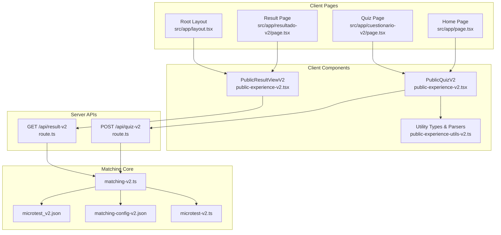
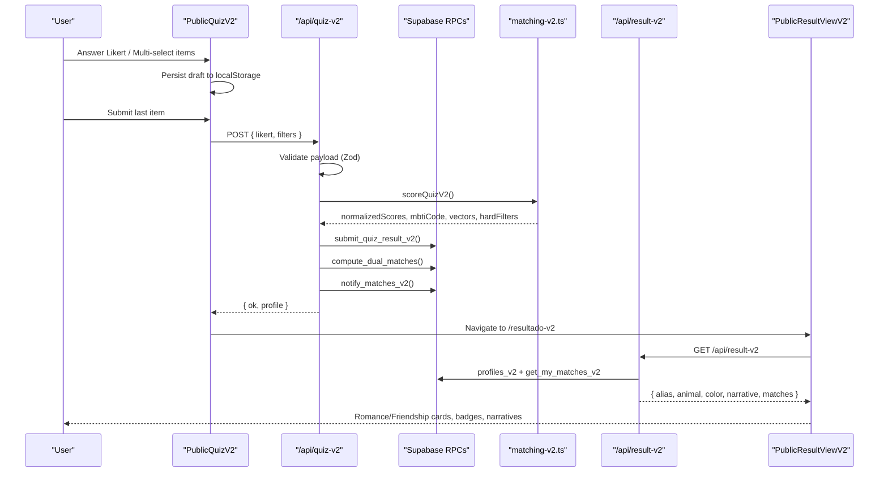
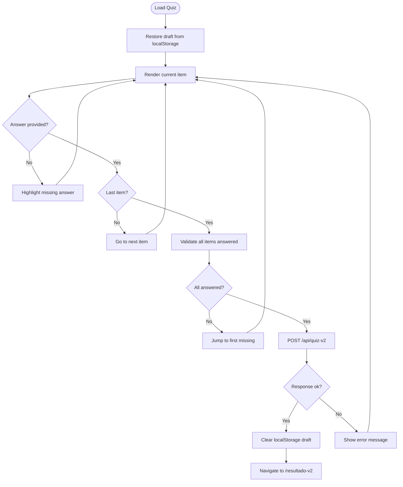
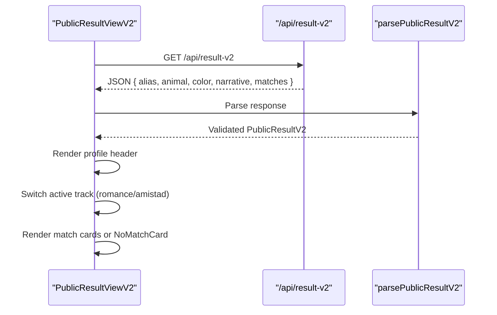
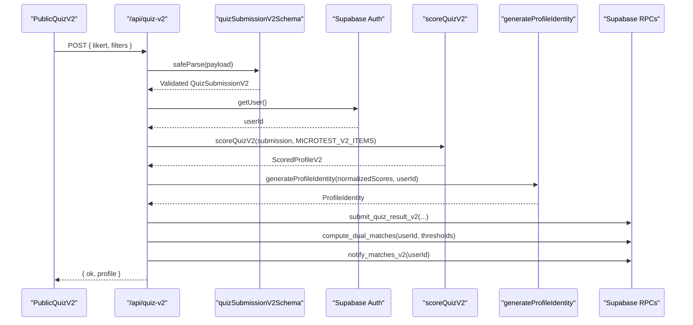
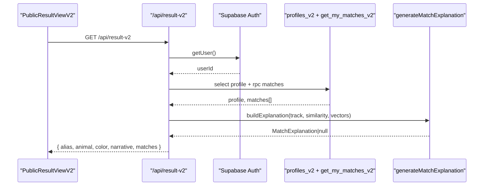
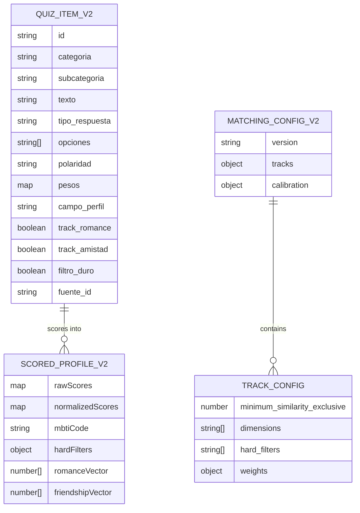
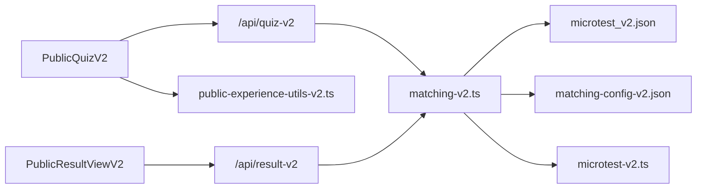

# Interactive Quiz Interface v2

<cite>
**Referenced Files in This Document**
- [package.json](file://package.json)
- [CONTEXTO_PROYECTO.md](file://CONTEXTO_PROYECTO.md)
- [src/app/page.tsx](file://src/app/page.tsx)
- [src/app/layout.tsx](file://src/app/layout.tsx)
- [src/app/cuestionario-v2/page.tsx](file://src/app/cuestionario-v2/page.tsx)
- [src/app/resultado-v2/page.tsx](file://src/app/resultado-v2/page.tsx)
- [src/components/public-experience-v2.tsx](file://src/components/public-experience-v2.tsx)
- [src/components/public-experience-utils-v2.ts](file://src/components/public-experience-utils-v2.ts)
- [src/app/api/quiz-v2/route.ts](file://src/app/api/quiz-v2/route.ts)
- [src/app/api/result-v2/route.ts](file://src/app/api/result-v2/route.ts)
- [src/lib/matching-v2.ts](file://src/lib/matching-v2.ts)
- [data/microtest_v2.json](file://data/microtest_v2.json)
- [data/matching-config-v2.json](file://data/matching-config-v2.json)
- [src/types/microtest-v2.ts](file://src/types/microtest-v2.ts)
</cite>

## Table of Contents
1. [Introduction](#introduction)
2. [Project Structure](#project-structure)
3. [Core Components](#core-components)
4. [Architecture Overview](#architecture-overview)
5. [Detailed Component Analysis](#detailed-component-analysis)
6. [Dependency Analysis](#dependency-analysis)
7. [Performance Considerations](#performance-considerations)
8. [Troubleshooting Guide](#troubleshooting-guide)
9. [Conclusion](#conclusion)

## Introduction
Interactive Quiz Interface v2 is the user-facing experience for ZooMatch’s multidimensional psychometric questionnaire and dual-track matching system. It guides users through 60 Likert and multi-selection items, persists their draft locally, submits validated answers to a secure API, computes scores and matches server-side, and renders an animated result page with romance and friendship tracks, badges, and affective narratives.

At a high level:
- The client renders a step-by-step quiz with progress tracking and local draft persistence.
- The server validates payloads, scores dimensions, derives MBTI codes, stores vectors, computes matches, and returns structured results.
- Matching uses weighted cosine similarity across personality, cultural affinity, intimacy, values, and identity categories, with hard filters only for romance.
- Results are presented as animal + color identities with badges explaining top compatible dimensions.

This document focuses on how the interactive interface works end-to-end, including data flow, validation, scoring, matching, and UI states.

**Section sources**
- [CONTEXTO_PROYECTO.md:8-34](file://CONTEXTO_PROYECTO.md#L8-L34)
- [CONTEXTO_PROYECTO.md:130-153](file://CONTEXTO_PROYECTO.md#L130-L153)

## Project Structure
The v2 quiz experience spans Next.js App Router pages, client components, API routes, pure matching logic, JSON configuration, and TypeScript types.



**Diagram sources**
- [src/app/page.tsx:1-6](file://src/app/page.tsx#L1-L6)
- [src/app/layout.tsx:1-20](file://src/app/layout.tsx#L1-L20)
- [src/app/cuestionario-v2/page.tsx:1-9](file://src/app/cuestionario-v2/page.tsx#L1-L9)
- [src/app/resultado-v2/page.tsx:1-9](file://src/app/resultado-v2/page.tsx#L1-L9)
- [src/components/public-experience-v2.tsx:105-404](file://src/components/public-experience-v2.tsx#L105-L404)
- [src/components/public-experience-v2.tsx:500-755](file://src/components/public-experience-v2.tsx#L500-L755)
- [src/components/public-experience-utils-v2.ts:1-231](file://src/components/public-experience-utils-v2.ts#L1-L231)
- [src/app/api/quiz-v2/route.ts:1-129](file://src/app/api/quiz-v2/route.ts#L1-L129)
- [src/app/api/result-v2/route.ts:1-232](file://src/app/api/result-v2/route.ts#L1-L232)
- [src/lib/matching-v2.ts:1-580](file://src/lib/matching-v2.ts#L1-L580)
- [data/microtest_v2.json:1-67](file://data/microtest_v2.json#L1-L67)
- [data/matching-config-v2.json:1-77](file://data/matching-config-v2.json#L1-L77)
- [src/types/microtest-v2.ts:1-303](file://src/types/microtest-v2.ts#L1-L303)

**Section sources**
- [package.json:1-40](file://package.json#L1-L40)
- [CONTEXTO_PROYECTO.md:57-87](file://CONTEXTO_PROYECTO.md#L57-L87)

## Core Components
The interactive interface consists of:
- `PublicQuizV2`: Renders the 60-item questionnaire, manages draft state, validates completion, and submits answers.
- `PublicResultViewV2`: Loads profile and matches, animates analysis, and displays romance/friendship results with badges and narratives.
- `/api/quiz-v2`: Validates submission, scores the quiz, generates profile identity, persists data via Supabase RPCs, computes matches, and sends notifications.
- `/api/result-v2`: Fetches authenticated user profile and matches, builds explanations, and returns structured result data.
- `matching-v2.ts`: Pure mathematical core that scores dimensions, applies hard filters, computes weighted cosine similarity, and generates badges.
- `public-experience-utils-v2.ts`: Client-side utilities for draft parsing, result parsing, category labels, and no-match messaging.
- `microtest_v2.json` and `matching-config-v2.json`: Canonical question definitions and matching thresholds/weights.
- `microtest-v2.ts`: Strongly typed domain model for dimensions, tracks, submissions, and results.

Key responsibilities:
- Draft persistence: LocalStorage key `zoomatch:quiz-draft:v2`.
- Validation: Zod-based payload validation; Likert values 1–5; required multi-selection options.
- Scoring: Reverse-scoring negative items, normalization to `[0,1]`, neutral score for missing dimensions.
- Matching: Romance (26 dimensions, hard filters, threshold > 0.80), Friendship (16 dimensions, no hard filters, threshold > 0.75).
- Badges: Top 5 romance, top 3 friendship by affinity `1 - |a - b|`.

**Section sources**
- [src/components/public-experience-v2.tsx:105-404](file://src/components/public-experience-v2.tsx#L105-L404)
- [src/components/public-experience-v2.tsx:500-755](file://src/components/public-experience-v2.tsx#L500-L755)
- [src/app/api/quiz-v2/route.ts:16-118](file://src/app/api/quiz-v2/route.ts#L16-L118)
- [src/app/api/result-v2/route.ts:110-221](file://src/app/api/result-v2/route.ts#L110-L221)
- [src/lib/matching-v2.ts:220-281](file://src/lib/matching-v2.ts#L220-L281)
- [src/lib/matching-v2.ts:416-448](file://src/lib/matching-v2.ts#L416-L448)
- [src/lib/matching-v2.ts:461-488](file://src/lib/matching-v2.ts#L461-L488)
- [src/lib/matching-v2.ts:517-579](file://src/lib/matching-v2.ts#L517-L579)
- [src/components/public-experience-utils-v2.ts:1-231](file://src/components/public-experience-utils-v2.ts#L1-L231)
- [data/microtest_v2.json:1-67](file://data/microtest_v2.json#L1-L67)
- [data/matching-config-v2.json:1-77](file://data/matching-config-v2.json#L1-L77)
- [src/types/microtest-v2.ts:1-303](file://src/types/microtest-v2.ts#L1-L303)

## Architecture Overview
The v2 quiz flow connects client UI, API security, Supabase RPCs, and deterministic matching math.



**Diagram sources**
- [src/components/public-experience-v2.tsx:185-237](file://src/components/public-experience-v2.tsx#L185-L237)
- [src/app/api/quiz-v2/route.ts:16-118](file://src/app/api/quiz-v2/route.ts#L16-L118)
- [src/lib/matching-v2.ts:220-281](file://src/lib/matching-v2.ts#L220-L281)
- [src/app/api/result-v2/route.ts:110-221](file://src/app/api/result-v2/route.ts#L110-L221)
- [src/components/public-experience-v2.tsx:500-550](file://src/components/public-experience-v2.tsx#L500-L550)

## Detailed Component Analysis

### PublicQuizV2: Questionnaire Flow
`PublicQuizV2` drives the interactive quiz:
- Loads items from `microtest_v2.json`.
- Maintains draft state (`likert` and `filters`) and persists it under `zoomatch:quiz-draft:v2`.
- Shows current category label, counter, and animated progress bar.
- Supports Likert radio buttons and multi-select checkboxes.
- Validates all items answered before submission; jumps to first unanswered item if incomplete.
- Submits to `/api/quiz-v2` with structured payload and navigates to `/resultado-v2` on success.
- Handles session errors and generic failures gracefully.



**Diagram sources**
- [src/components/public-experience-v2.tsx:105-237](file://src/components/public-experience-v2.tsx#L105-L237)
- [src/components/public-experience-utils-v2.ts:113-143](file://src/components/public-experience-utils-v2.ts#L113-L143)

**Section sources**
- [src/components/public-experience-v2.tsx:105-237](file://src/components/public-experience-v2.tsx#L105-L237)
- [src/components/public-experience-utils-v2.ts:1-231](file://src/components/public-experience-utils-v2.ts#L1-L231)

### PublicResultViewV2: Results and Tracks
`PublicResultViewV2` loads the user’s profile and matches:
- Fetches `/api/result-v2` with a minimum analysis delay and maximum timeout.
- Parses response using `parsePublicResultV2`.
- Displays profile header (alias, animal, color, narrative, MBTI code).
- Provides track tabs for romance and friendship.
- Renders match cards with chemistry rings, badges, and narratives.
- Shows a friendly no-match message when no connections exist.



**Diagram sources**
- [src/components/public-experience-v2.tsx:500-755](file://src/components/public-experience-v2.tsx#L500-L755)
- [src/components/public-experience-utils-v2.ts:186-231](file://src/components/public-experience-utils-v2.ts#L186-L231)

**Section sources**
- [src/components/public-experience-v2.tsx:500-755](file://src/components/public-experience-v2.tsx#L500-L755)
- [src/components/public-experience-utils-v2.ts:186-231](file://src/components/public-experience-utils-v2.ts#L186-L231)

### API: Quiz Submission
`/api/quiz-v2` orchestrates submission:
- Validates payload with `quizSubmissionV2Schema`.
- Authenticates user via Supabase Auth.
- Scores quiz using `scoreQuizV2`.
- Generates profile identity (animal + color + alias + narrative).
- Persists answers and vectors via `submit_quiz_result_v2`.
- Computes dual matches using configured thresholds.
- Sends match notifications and optional welcome notification for first-time submissions.



**Diagram sources**
- [src/app/api/quiz-v2/route.ts:16-118](file://src/app/api/quiz-v2/route.ts#L16-L118)
- [src/lib/matching-v2.ts:220-281](file://src/lib/matching-v2.ts#L220-L281)

**Section sources**
- [src/app/api/quiz-v2/route.ts:1-129](file://src/app/api/quiz-v2/route.ts#L1-L129)

### API: Result Retrieval
`/api/result-v2` fetches and enriches results:
- Authenticates user and retrieves profile plus matches.
- Parses match rows with Zod schema.
- Builds affective explanations using `generateMatchExplanation`.
- Returns structured result with romance and friendship arrays.



**Diagram sources**
- [src/app/api/result-v2/route.ts:110-221](file://src/app/api/result-v2/route.ts#L110-L221)

**Section sources**
- [src/app/api/result-v2/route.ts:1-232](file://src/app/api/result-v2/route.ts#L1-L232)

### Matching Engine: Scoring, Filters, Similarity, Badges
`matching-v2.ts` implements the deterministic core:
- `scoreQuizV2`: Normalizes Likert responses, reverse-scores negative items, derives MBTI code, extracts hard filters, builds romance/friendship vectors.
- Hard filters: Orientation compatibility (with wildcards), gender identity (permissive), relationship type compatibility.
- `weightedTrackSimilarity`: Groups dimensions by category, computes cosine per category, combines with weights.
- `generateBadges`: Computes affinity per dimension, sorts by affinity, returns top N badges.
- `findDualMatches`: Applies hard filters for romance, compares thresholds, generates narratives.

```mermaid
classDiagram
class MatchingEngine {
+scoreQuizV2(answers, items) ScoredProfileV2
+cosineSimilarity(a, b) number
+weightedTrackSimilarity(a, b, dimensions, weights) number
+generateBadges(a, b, dimensions, track, limit) CompatibilityBadge[]
+findDualMatches(user, pool, config) DualMatchResult[]
+checkHardFilters(a, b) boolean
}
class ScoredProfileV2 {
+rawScores : DimensionScoresV2
+normalizedScores : DimensionScoresV2
+mbtiCode : string
+hardFilters : HardFilters
+romanceVector : number[]
+friendshipVector : number[]
}
class MatchingConfigV2 {
+version : string
+tracks : { romance : TrackConfig, amistad : TrackConfig }
+calibration : Calibration
}
class TrackConfig {
+minimum_similarity_exclusive : number
+dimensions : string[]
+hard_filters : HardFilterField[]
+weights : CategoryWeights
}
MatchingEngine --> ScoredProfileV2 : "produces"
MatchingEngine --> MatchingConfigV2 : "uses"
MatchingConfigV2 --> TrackConfig : "contains"
```

**Diagram sources**
- [src/lib/matching-v2.ts:220-281](file://src/lib/matching-v2.ts#L220-L281)
- [src/lib/matching-v2.ts:368-448](file://src/lib/matching-v2.ts#L368-L448)
- [src/lib/matching-v2.ts:461-488](file://src/lib/matching-v2.ts#L461-L488)
- [src/lib/matching-v2.ts:517-579](file://src/lib/matching-v2.ts#L517-L579)
- [src/types/microtest-v2.ts:126-160](file://src/types/microtest-v2.ts#L126-L160)
- [src/types/microtest-v2.ts:248-278](file://src/types/microtest-v2.ts#L248-L278)

**Section sources**
- [src/lib/matching-v2.ts:1-580](file://src/lib/matching-v2.ts#L1-L580)
- [src/types/microtest-v2.ts:1-303](file://src/types/microtest-v2.ts#L1-L303)

### Data Models and Configuration
- `microtest_v2.json`: Defines 60 items across 6 categories, Likert scale, dimensions, track assignments, and sources/licenses.
- `matching-config-v2.json`: Defines thresholds, dimensions per track, hard filters, and category weights.
- `microtest-v2.ts`: Strongly typed domain model for dimensions, tracks, submissions, scored profiles, and matching results.



**Diagram sources**
- [data/microtest_v2.json:1-67](file://data/microtest_v2.json#L1-L67)
- [data/matching-config-v2.json:1-77](file://data/matching-config-v2.json#L1-L77)
- [src/types/microtest-v2.ts:107-160](file://src/types/microtest-v2.ts#L107-L160)
- [src/types/microtest-v2.ts:248-278](file://src/types/microtest-v2.ts#L248-L278)

**Section sources**
- [data/microtest_v2.json:1-200](file://data/microtest_v2.json#L1-L200)
- [data/matching-config-v2.json:1-77](file://data/matching-config-v2.json#L1-L77)
- [src/types/microtest-v2.ts:1-303](file://src/types/microtest-v2.ts#L1-L303)

## Dependency Analysis
The interactive quiz interface depends on:
- Client components for rendering and state management.
- API routes for secure submission and result retrieval.
- Matching library for pure mathematical operations.
- JSON fixtures for canonical question definitions and configuration.
- TypeScript types for strong contracts across layers.



**Diagram sources**
- [src/components/public-experience-v2.tsx:105-404](file://src/components/public-experience-v2.tsx#L105-L404)
- [src/components/public-experience-v2.tsx:500-755](file://src/components/public-experience-v2.tsx#L500-L755)
- [src/app/api/quiz-v2/route.ts:1-129](file://src/app/api/quiz-v2/route.ts#L1-L129)
- [src/app/api/result-v2/route.ts:1-232](file://src/app/api/result-v2/route.ts#L1-L232)
- [src/lib/matching-v2.ts:1-580](file://src/lib/matching-v2.ts#L1-L580)
- [data/microtest_v2.json:1-67](file://data/microtest_v2.json#L1-L67)
- [data/matching-config-v2.json:1-77](file://data/matching-config-v2.json#L1-L77)
- [src/types/microtest-v2.ts:1-303](file://src/types/microtest-v2.ts#L1-L303)
- [src/components/public-experience-utils-v2.ts:1-231](file://src/components/public-experience-utils-v2.ts#L1-L231)

**Section sources**
- [src/components/public-experience-v2.tsx:105-755](file://src/components/public-experience-v2.tsx#L105-L755)
- [src/app/api/quiz-v2/route.ts:1-129](file://src/app/api/quiz-v2/route.ts#L1-L129)
- [src/app/api/result-v2/route.ts:1-232](file://src/app/api/result-v2/route.ts#L1-L232)
- [src/lib/matching-v2.ts:1-580](file://src/lib/matching-v2.ts#L1-L580)
- [data/microtest_v2.json:1-67](file://data/microtest_v2.json#L1-L67)
- [data/matching-config-v2.json:1-77](file://data/matching-config-v2.json#L1-L77)
- [src/types/microtest-v2.ts:1-303](file://src/types/microtest-v2.ts#L1-L303)
- [src/components/public-experience-utils-v2.ts:1-231](file://src/components/public-experience-utils-v2.ts#L1-L231)

## Performance Considerations
- Client-side draft persistence avoids re-typing and improves UX.
- Minimum analysis delay and maximum timeout balance perceived performance with network reliability.
- Weighted cosine similarity groups dimensions by category to prevent large categories from dominating small ones.
- Server-side RPCs offload heavy computation to PostgreSQL functions where possible.
- Rate limiting protects endpoints without blocking legitimate traffic.

[No sources needed since this section provides general guidance]

## Troubleshooting Guide
Common issues and resolutions:
- Session expired during quiz submission: Redirect to home and retry login.
- Generic submission error: Draft remains in localStorage; advise retry.
- Result loading failure: Retry button available; check network and session.
- No matches found: Friendly message displayed; matches may appear later as more users join.
- Invalid payload: Ensure all Likert values are 1–5 and all multi-selection items have at least one option selected.

**Section sources**
- [src/components/public-experience-v2.tsx:353-370](file://src/components/public-experience-v2.tsx#L353-L370)
- [src/components/public-experience-v2.tsx:592-632](file://src/components/public-experience-v2.tsx#L592-L632)
- [src/app/api/quiz-v2/route.ts:17-20](file://src/app/api/quiz-v2/route.ts#L17-L20)
- [src/app/api/result-v2/route.ts:140-143](file://src/app/api/result-v2/route.ts#L140-L143)

## Conclusion
Interactive Quiz Interface v2 delivers a polished, mobile-first experience for ZooMatch’s multidimensional psychometric assessment. It combines robust client-side state management, secure API orchestration, deterministic matching mathematics, and engaging visual feedback. The dual-track design supports both romantic and friendship compatibility, while hard filters ensure respectful and aligned pairings. With clear validation, graceful error handling, and rich result presentation, the interface balances technical rigor with approachable storytelling.

[No sources needed since this section summarizes without analyzing specific files]