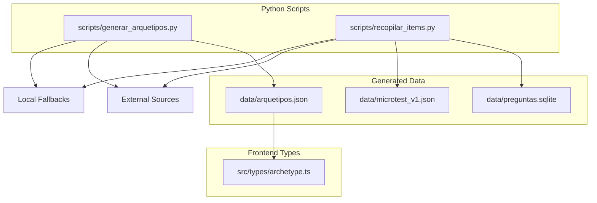
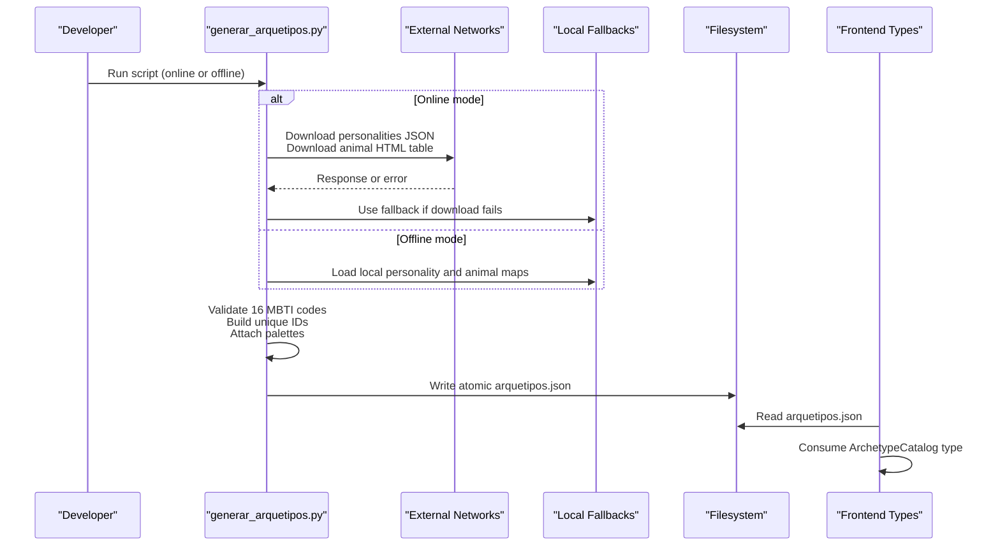
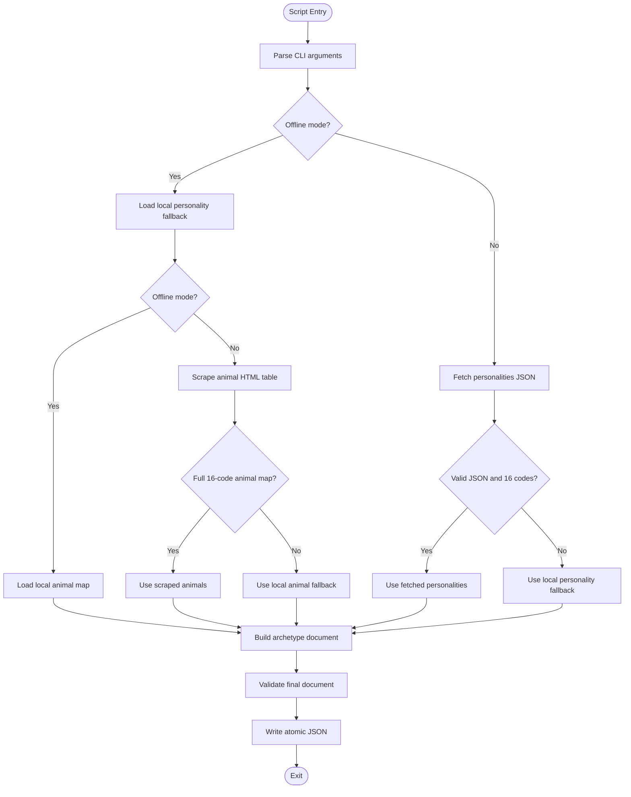
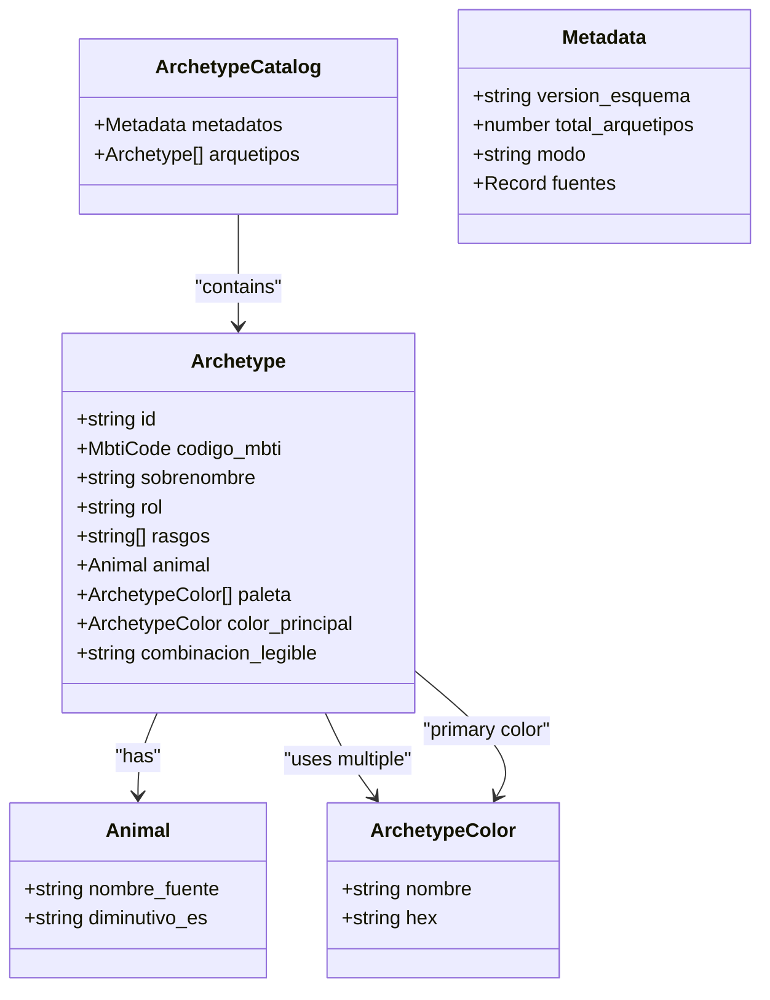
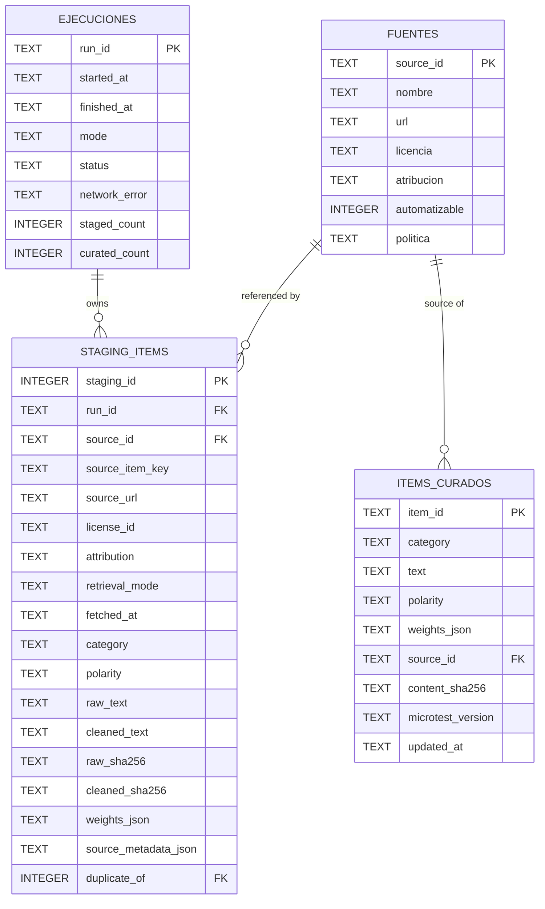
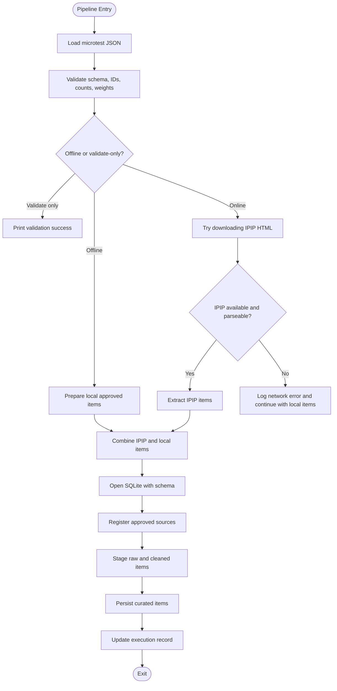
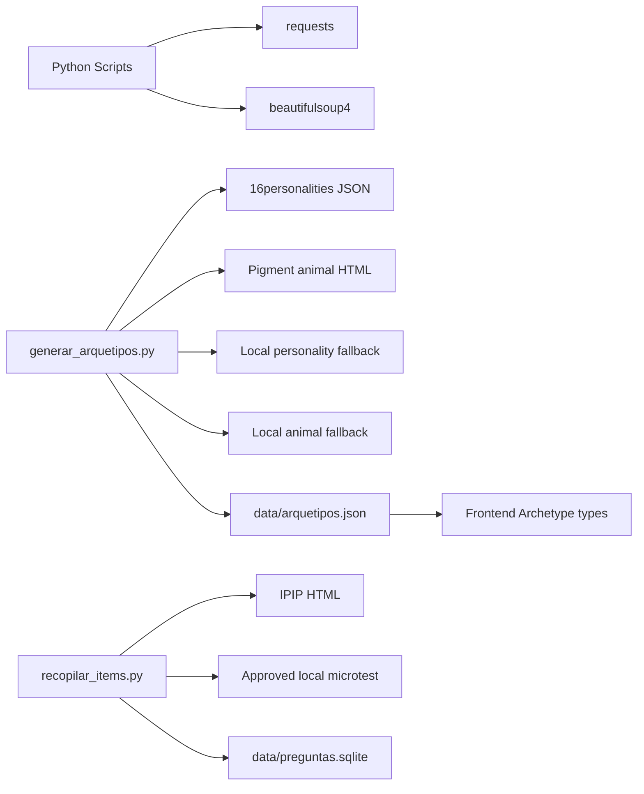

# Data Pipeline & Generation

<cite>
**Referenced Files in This Document**
- [generar_arquetipos.py](file://scripts/generar_arquetipos.py)
- [recopilar_items.py](file://scripts/recopilar_items.py)
- [arquetipos.json](file://data/arquetipos.json)
- [archetype.ts](file://src/types/archetype.ts)
- [requirements.txt](file://requirements.txt)
</cite>

## Table of Contents
1. [Introduction](#introduction)
2. [Project Structure](#project-structure)
3. [Core Components](#core-components)
4. [Architecture Overview](#architecture-overview)
5. [Detailed Component Analysis](#detailed-component-analysis)
6. [Dependency Analysis](#dependency-analysis)
7. [Performance Considerations](#performance-considerations)
8. [Troubleshooting Guide](#troubleshooting-guide)
9. [Conclusion](#conclusion)

## Introduction
This document explains the Python-based data pipeline behind ZooMatch’s archetype and psychometric item generation. It covers:
- How archetype data is generated from external sources, validated, and written to JSON for frontend consumption.
- How psychometric items are collected, cleaned, staged, and persisted with full traceability.
- Fallback systems that keep the pipeline resilient when network access or remote sources fail.
- Error handling, validation contracts, and instructions for running and maintaining the scripts.

The pipeline produces two main outputs:
- `data/arquetipos.json`: a curated catalog of 16 MBTI archetypes with animals, Spanish nicknames, and color palettes.
- `data/preguntas.sqlite`: a SQLite database containing staging records, curated items, execution logs, and source metadata.

## Project Structure
At a high level, the repository separates frontend code under `src/` from Python data tools under `scripts/`. The generated data lives under `data/`, and dependencies are declared in `requirements.txt`.

**Diagram sources**
- [generar_arquetipos.py:20-27](file://scripts/generar_arquetipos.py#L20-L27)
- [recopilar_items.py:38-65](file://scripts/recopilar_items.py#L38-L65)
- [archetype.ts:1-47](file://src/types/archetype.ts#L1-L47)

**Section sources**
- [requirements.txt:1-3](file://requirements.txt#L1-L3)
- [archetype.ts:1-47](file://src/types/archetype.ts#L1-L47)

## Core Components
ZooMatch’s data pipeline has two primary Python scripts:

| Script | Purpose | Main Inputs | Main Outputs | Key Behaviors |
|---|---|---|---|---|
| `scripts/generar_arquetipos.py` | Generates the 16 MBTI archetype catalog | Optional HTTP requests to personality and animal sources; local fallbacks | `data/arquetipos.json` | Validates 16 codes, builds IDs, attaches curated palettes, writes atomic JSON |
| `scripts/recopilar_items.py` | Collects and validates psychometric items | Local microtest JSON; optional IPIP scraping | `data/preguntas.sqlite` | Stages raw and cleaned items, persists curated items, tracks runs and licenses |

Both scripts:
- Use `requests` with retry logic and custom headers.
- Parse HTML with BeautifulSoup.
- Enforce strict validation contracts before writing output.
- Provide offline modes that rely on approved local fallbacks.

**Section sources**
- [generar_arquetipos.py:91-112](file://scripts/generar_arquetipos.py#L91-L112)
- [recopilar_items.py:123-151](file://scripts/recopilar_items.py#L123-L151)

## Architecture Overview
The overall data flow connects external sources, local fallbacks, validation layers, and final artifacts consumed by the frontend.

**Diagram sources**
- [generar_arquetipos.py:153-168](file://scripts/generar_arquetipos.py#L153-L168)
- [generar_arquetipos.py:201-211](file://scripts/generar_arquetipos.py#L201-L211)
- [generar_arquetipos.py:248-315](file://scripts/generar_arquetipos.py#L248-L315)
- [generar_arquetipos.py:360-383](file://scripts/generar_arquetipos.py#L360-L383)
- [archetype.ts:24-47](file://src/types/archetype.ts#L24-L47)

## Detailed Component Analysis

### Archetype Generator: `scripts/generar_arquetipos.py`
This script generates the canonical archetype catalog used by the frontend.

#### Responsibilities
- Create an HTTP session with retries and safe headers.
- Fetch personality data from a JSON endpoint.
- Scrape an HTML table mapping MBTI codes to animals.
- Validate that exactly 16 MBTI codes are present and well-formed.
- Build stable, unique IDs from Spanish animal nicknames and palette colors.
- Attach curated color palettes and a readable combination string.
- Write `data/arquetipos.json` atomically using a temporary file and rename.

#### Data Flow

**Diagram sources**
- [generar_arquetipos.py:386-423](file://scripts/generar_arquetipos.py#L386-L423)
- [generar_arquetipos.py:153-168](file://scripts/generar_arquetipos.py#L153-L168)
- [generar_arquetipos.py:201-211](file://scripts/generar_arquetipos.py#L201-L211)
- [generar_arquetipos.py:248-315](file://scripts/generar_arquetipos.py#L248-L315)
- [generar_arquetipos.py:318-357](file://scripts/generar_arquetipos.py#L318-L357)
- [generar_arquetipos.py:360-383](file://scripts/generar_arquetipos.py#L360-L383)

#### Validation Rules
- Exactly 16 personality entries must exist.
- Personality codes must match the expected MBTI set.
- Each personality must have a nickname, role, and four traits.
- Animal mapping must cover all 16 MBTI codes.
- Final document must contain exactly 16 archetypes with unique IDs, valid hex colors, and consistent palette references.

#### Output Contract
The generated JSON matches the frontend’s TypeScript contract:

**Diagram sources**
- [archetype.ts:1-47](file://src/types/archetype.ts#L1-L47)
- [arquetipos.json:1-28](file://data/arquetipos.json#L1-L28)
- [arquetipos.json:29-592](file://data/arquetipos.json#L29-L592)

#### Running the Archetype Generator
- Default behavior: attempt online fetches; fall back locally on errors.
- Offline behavior: skip network entirely and use local fallbacks.
- Output path defaults to `data/arquetipos.json`.

Example commands:
- Generate with default settings: `python scripts/generar_arquetipos.py`
- Force offline mode: `python scripts/generar_arquetipos.py --offline`
- Write to a custom path: `python scripts/generar_arquetipos.py -o data/custom_arquetipos.json`

**Section sources**
- [generar_arquetipos.py:91-112](file://scripts/generar_arquetipos.py#L91-L112)
- [generar_arquetipos.py:137-168](file://scripts/generar_arquetipos.py#L137-L168)
- [generar_arquetipos.py:175-211](file://scripts/generar_arquetipos.py#L175-L211)
- [generar_arquetipos.py:219-245](file://scripts/generar_arquetipos.py#L219-L245)
- [generar_arquetipos.py:248-315](file://scripts/generar_arquetipos.py#L248-L315)
- [generar_arquetipos.py:318-383](file://scripts/generar_arquetipos.py#L318-L383)
- [generar_arquetipos.py:386-423](file://scripts/generar_arquetipos.py#L386-L423)

### Psychometric Item Pipeline: `scripts/recopilar_items.py`
This script manages psychometric items with explicit licensing, cleaning, staging, and persistence.

#### Responsibilities
- Load and validate a canonical microtest JSON with 24 items across four categories.
- Optionally scrape IPIP items from a public-domain source.
- Clean and hash raw text for deduplication.
- Stage raw and cleaned items into SQLite with full provenance.
- Persist curated items with content hashes and timestamps.
- Track execution runs, modes, and network errors.

#### Data Model

**Diagram sources**
- [recopilar_items.py:336-391](file://scripts/recopilar_items.py#L336-L391)

#### Processing Logic

**Diagram sources**
- [recopilar_items.py:229-318](file://scripts/recopilar_items.py#L229-L318)
- [recopilar_items.py:320-333](file://scripts/recopilar_items.py#L320-L333)
- [recopilar_items.py:394-402](file://scripts/recopilar_items.py#L394-L402)
- [recopilar_items.py:405-425](file://scripts/recopilar_items.py#L405-L425)
- [recopilar_items.py:428-471](file://scripts/recopilar_items.py#L428-L471)
- [recopilar_items.py:474-502](file://scripts/recopilar_items.py#L474-L502)
- [recopilar_items.py:505-559](file://scripts/recopilar_items.py#L505-L559)

#### Running the Item Pipeline
- Validate without network or database writes: `python scripts/recopilar_items.py --solo-validar`
- Run offline using only approved local fallbacks: `python scripts/recopilar_items.py --offline`
- Default run attempts IPIP scraping and persists results: `python scripts/recopilar_items.py`
- Custom paths: `python scripts/recopilar_items.py --microtest data/microtest_v1.json --db data/preguntas.sqlite`

**Section sources**
- [recopilar_items.py:1-15](file://scripts/recopilar_items.py#L1-L15)
- [recopilar_items.py:67-108](file://scripts/recopilar_items.py#L67-L108)
- [recopilar_items.py:154-168](file://scripts/recopilar_items.py#L154-L168)
- [recopilar_items.py:184-226](file://scripts/recopilar_items.py#L184-L226)
- [recopilar_items.py:229-318](file://scripts/recopilar_items.py#L229-L318)
- [recopilar_items.py:336-391](file://scripts/recopilar_items.py#L336-L391)
- [recopilar_items.py:505-559](file://scripts/recopilar_items.py#L505-L559)
- [recopilar_items.py:562-618](file://scripts/recopilar_items.py#L562-L618)

## Dependency Analysis
The pipeline depends on external libraries and external web sources, while also providing robust local fallbacks.

**Diagram sources**
- [requirements.txt:1-3](file://requirements.txt#L1-L3)
- [generar_arquetipos.py:20-27](file://scripts/generar_arquetipos.py#L20-L27)
- [recopilar_items.py:63-65](file://scripts/recopilar_items.py#L63-L65)
- [archetype.ts:1-47](file://src/types/archetype.ts#L1-L47)

**Section sources**
- [requirements.txt:1-3](file://requirements.txt#L1-L3)
- [generar_arquetipos.py:15-18](file://scripts/generar_arquetipos.py#L15-L18)
- [recopilar_items.py:33-36](file://scripts/recopilar_items.py#L33-L36)

## Performance Considerations
- Network resilience: Both scripts configure retry strategies with exponential backoff and status-based retries.
- Safe parsing: HTML parsing uses a conservative parser and validates structure before accepting data.
- Atomic writes: Archetype JSON is written via a temporary file and atomic rename to prevent partial artifacts.
- Database durability: SQLite uses WAL mode and busy timeouts to improve concurrency and crash safety.
- Deduplication: Items are hashed after cleaning to avoid duplicates in staging and curated tables.

[No sources needed since this section provides general guidance]

## Troubleshooting Guide
Common issues and how the pipeline handles them:

| Symptom | Likely Cause | Pipeline Behavior | Resolution |
|---|---|---|---|
| Missing or incomplete archetype JSON | Network failure or unexpected response format | Falls back to local personality and animal maps; logs warnings | Run with `--offline` to bypass network; verify external URLs remain reachable |
| Validation error about 16 codes | External source changed structure or returned wrong fields | Raises validation error and exits with non-zero status | Inspect source changes; update fallbacks or fix extraction logic |
| Microtest validation fails | Schema mismatch, wrong item count, invalid weights, or disallowed source | Stops processing and prints detailed validation message | Fix `data/microtest_v1.json` to match the required contract |
| SQLite write errors | Permission issues or disk problems | Marks execution as failed and raises error | Check file permissions and disk space; ensure `data/` is writable |
| IPIP scraping returns too few items | HTML structure changed or site blocks requests | Logs network error and continues with local approved items | Run offline or investigate site availability and scraping rules |

**Section sources**
- [generar_arquetipos.py:115-134](file://scripts/generar_arquetipos.py#L115-L134)
- [generar_arquetipos.py:137-168](file://scripts/generar_arquetipos.py#L137-L168)
- [generar_arquetipos.py:318-357](file://scripts/generar_arquetipos.py#L318-L357)
- [recopilar_items.py:154-168](file://scripts/recopilar_items.py#L154-L168)
- [recopilar_items.py:229-318](file://scripts/recopilar_items.py#L229-L318)
- [recopilar_items.py:505-559](file://scripts/recopilar_items.py#L505-L559)

## Conclusion
ZooMatch’s data pipeline is designed for reliability, transparency, and frontend compatibility. The archetype generator ensures a stable, validated JSON artifact consumed by the frontend’s TypeScript types. The item pipeline enforces licensing policy, cleans and stages data, and persists curated items with full provenance. Both scripts provide offline modes and robust fallbacks so that development, testing, and production runs remain predictable even when external sources change or become unavailable.

[No sources needed since this section summarizes without analyzing specific files]