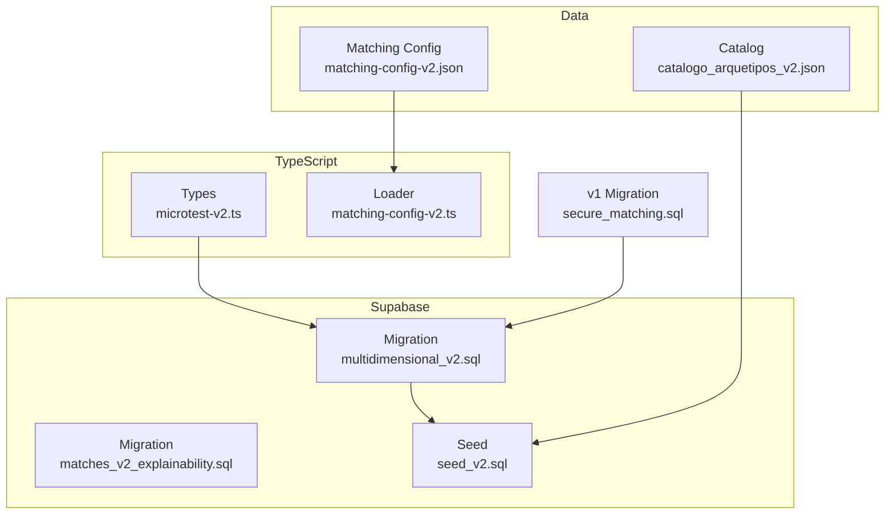
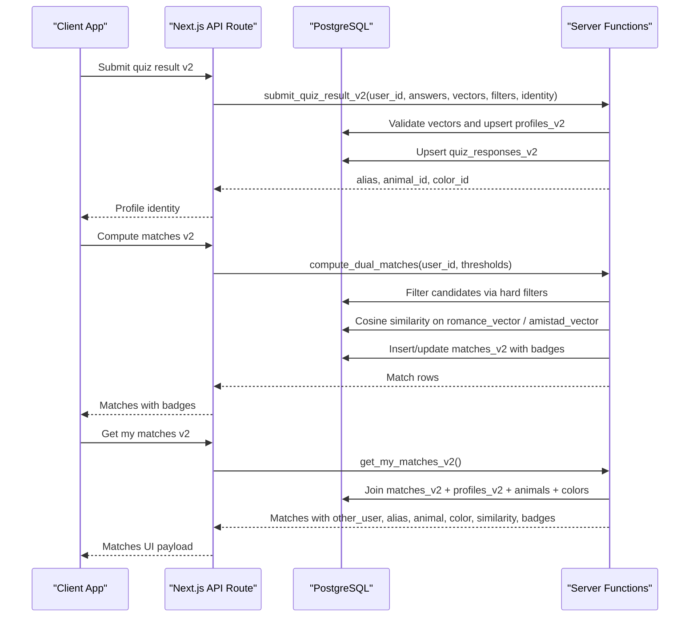
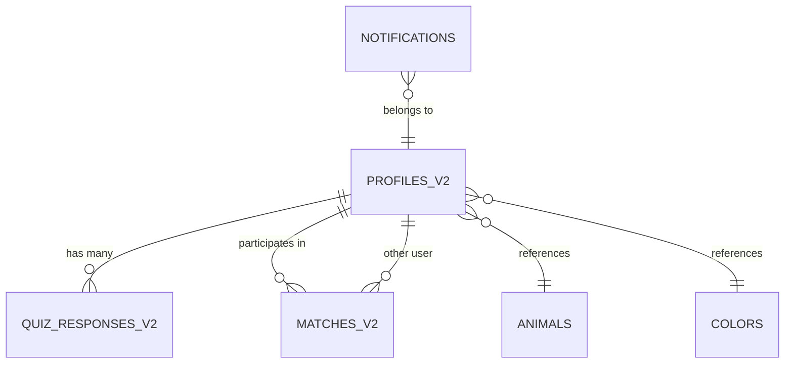

# Database Schema v2

<cite>
**Referenced Files in This Document**
- [202610230001_multidimensional_v2.sql](file://supabase/migrations/202610230001_multidimensional_v2.sql)
- [202610240001_matches_v2_explainability.sql](file://supabase/migrations/202610240001_matches_v2_explainability.sql)
- [seed_v2.sql](file://supabase/seed_v2.sql)
- [matching-config-v2.json](file://data/matching-config-v2.json)
- [catalogo_arquetipos_v2.json](file://data/catalogo_arquetipos_v2.json)
- [microtest-v2.ts](file://src/types/microtest-v2.ts)
- [matching-config-v2.ts](file://src/lib/matching-config-v2.ts)
- [202610220001_secure_matching.sql](file://supabase/migrations/202610220001_secure_matching.sql)
</cite>

## Table of Contents
1. [Introduction](#introduction)
2. [Project Structure](#project-structure)
3. [Core Components](#core-components)
4. [Architecture Overview](#architecture-overview)
5. [Detailed Component Analysis](#detailed-component-analysis)
6. [Dependency Analysis](#dependency-analysis)
7. [Performance Considerations](#performance-considerations)
8. [Troubleshooting Guide](#troubleshooting-guide)
9. [Conclusion](#conclusion)

## Introduction
This document describes the ZooMatch v2 database schema and its supporting data model. The v2 schema introduces a multidimensional, dual-track matching system that separates romance and friendship compatibility into distinct vector spaces while preserving privacy through hard filters and row-level security. It is additive to the existing v1 schema, allowing both versions to coexist during validation.

The schema includes:
- Catalog tables for animals and colors used as user identity metaphors.
- A structured quiz item catalog with categories, response types, polarity, weights, and track flags.
- Profiles storing normalized dimension scores, MBTI codes, hard filter arrays, and two matching vectors.
- Quiz responses per item.
- Dual-track matches with similarity scores and explainability badges.
- Notifications for match results and onboarding.
- Security policies, indexes, and server-side functions for safe submission, matching computation, notifications, and admin analytics.

## Project Structure
The v2 database design spans migrations, seed data, TypeScript type definitions, and runtime configuration:

**Diagram sources**
- [202610230001_multidimensional_v2.sql:1-20](file://supabase/migrations/202610230001_multidimensional_v2.sql#L1-L20)
- [202610240001_matches_v2_explainability.sql:1-14](file://supabase/migrations/202610240001_matches_v2_explainability.sql#L1-L14)
- [seed_v2.sql:1-12](file://supabase/seed_v2.sql#L1-L12)
- [matching-config-v2.json:1-10](file://data/matching-config-v2.json#L1-L10)
- [catalogo_arquetipos_v2.json:1-9](file://data/catalogo_arquetipos_v2.json#L1-L9)
- [microtest-v2.ts:1-10](file://src/types/microtest-v2.ts#L1-L10)
- [matching-config-v2.ts:1-13](file://src/lib/matching-config-v2.ts#L1-L13)
- [202610220001_secure_matching.sql:1-10](file://supabase/migrations/202610220001_secure_matching.sql#L1-L10)

**Section sources**
- [202610230001_multidimensional_v2.sql:1-20](file://supabase/migrations/202610230001_multidimensional_v2.sql#L1-L20)
- [seed_v2.sql:1-12](file://supabase/seed_v2.sql#L1-L12)
- [matching-config-v2.json:1-10](file://data/matching-config-v2.json#L1-L10)
- [catalogo_arquetipos_v2.json:1-9](file://data/catalogo_arquetipos_v2.json#L1-L9)
- [microtest-v2.ts:1-10](file://src/types/microtest-v2.ts#L1-L10)
- [matching-config-v2.ts:1-13](file://src/lib/matching-config-v2.ts#L1-L13)
- [202610220001_secure_matching.sql:1-10](file://supabase/migrations/202610220001_secure_matching.sql#L1-L10)

## Core Components
The v2 schema centers around these entities:

- Animals and Colors catalogs: referenceable identity metaphors with metadata and personality affinity hints.
- Quiz items v2: structured questionnaire entries with categories, response schemas, polarity, weights, and track flags.
- Profiles v2: per-user normalized scores, hard filters, MBTI code, and dual vectors (romance and friendship).
- Quiz responses v2: per-item answers stored by user.
- Matches v2: dual-track pairwise matches with similarity and badges.
- Notifications: user-targeted messages about matches and onboarding.

Key constraints and behaviors:
- Vector lengths are enforced at the database level: romance vector must be 26 dimensions; friendship vector must be 16 dimensions when present.
- Hard filters are stored as text arrays with GIN indexing for fast overlap checks.
- Row-level security restricts access to sensitive data; public read is allowed only for catalogs and quiz items.
- Server-side RPCs enforce service-role authorization and validate inputs before mutating state.

**Section sources**
- [202610230001_multidimensional_v2.sql:18-121](file://supabase/migrations/202610230001_multidimensional_v2.sql#L18-L121)
- [202610230001_multidimensional_v2.sql:123-141](file://supabase/migrations/202610230001_multidimensional_v2.sql#L123-L141)
- [202610230001_multidimensional_v2.sql:157-202](file://supabase/migrations/202610230001_multidimensional_v2.sql#L157-L202)
- [microtest-v2.ts:162-246](file://src/types/microtest-v2.ts#L162-L246)

## Architecture Overview
The v2 architecture combines typed frontend logic, validated configuration, and secure backend functions:

**Diagram sources**
- [202610230001_multidimensional_v2.sql:209-280](file://supabase/migrations/202610230001_multidimensional_v2.sql#L209-L280)
- [202610230001_multidimensional_v2.sql:284-400](file://supabase/migrations/202610230001_multidimensional_v2.sql#L284-L400)
- [202610230001_multidimensional_v2.sql:456-491](file://supabase/migrations/202610230001_multidimensional_v2.sql#L456-L491)
- [202610240001_matches_v2_explainability.sql:17-56](file://supabase/migrations/202610240001_matches_v2_explainability.sql#L17-L56)

## Detailed Component Analysis

### Catalog Tables: animals and colors
Purpose:
- Provide curated identity metaphors for users.
- Store category, source name, Spanish diminutive, and optional personality affinity hints.
- Colors include hex values, texture, and temperature attributes.

Constraints and integrity:
- Animals have a unique Spanish diminutive and a restricted fauna category enum.
- Colors enforce valid hex format and restricted texture/temperature enums.

Indexes:
- Animal and color references are indexed on profiles for admin queries.

Usage:
- Profiles link to an animal and a color to express identity visually.

**Section sources**
- [202610230001_multidimensional_v2.sql:20-34](file://supabase/migrations/202610230001_multidimensional_v2.sql#L20-L34)
- [202610230001_multidimensional_v2.sql:138-141](file://supabase/migrations/202610230001_multidimensional_v2.sql#L138-L141)
- [seed_v2.sql:15-83](file://supabase/seed_v2.sql#L15-L83)
- [seed_v2.sql:85-147](file://supabase/seed_v2.sql#L85-L147)

### Quiz Items v2
Purpose:
- Define the multidimensional questionnaire structure.
- Support Likert-5 and multiple-choice responses.
- Tag each item with category, polarity, weights, track flags, and optional hard filter mapping.

Schema highlights:
- Category enum includes Big Five, MBTI, identity filters, cultural affinity, intimacy/affect, and relational values.
- Response type determines whether likert_value or selected_options is populated.
- Track flags allow items to contribute to romance, friendship, or both tracks.
- Hard filter items map to profile fields like sexual orientation, gender identity, and relationship type sought.

Validation:
- Polarity is constrained to positive/negative or null.
- Weights are JSONB objects mapping dimensions to numeric influence.

Seeding:
- Seed file populates 60 items across categories with consistent IDs and metadata.

**Section sources**
- [202610230001_multidimensional_v2.sql:38-52](file://supabase/migrations/202610230001_multidimensional_v2.sql#L38-L52)
- [seed_v2.sql:149-230](file://supabase/seed_v2.sql#L149-L230)
- [microtest-v2.ts:107-124](file://src/types/microtest-v2.ts#L107-L124)

### Profiles v2
Purpose:
- Store normalized dimension scores, hard filters, MBTI code, and dual matching vectors.
- Link to identity metaphors (animal, color), narrative, and alias.

Key fields:
- Hard filters: arrays for sexual orientation, gender identity, and relationship type sought.
- Romance vector: 26 dimensions including personality, identity soft, cultural, intimacy, and values.
- Friendship vector: 16 dimensions excluding intimacy and identity soft.
- Dimension scores: full JSONB object for explainability and analysis.
- MBTI code: validated four-letter code.

Constraints:
- Vector length constraints ensure romance vector is 26 and friendship vector is 16 when non-empty.
- Matricula hash is a unique 64-character hex string.

Timestamps:
- Trigger updates updated_at automatically.

Security:
- RLS allows own data read or admin access.

**Section sources**
- [202610230001_multidimensional_v2.sql:56-80](file://supabase/migrations/202610230001_multidimensional_v2.sql#L56-L80)
- [202610230001_multidimensional_v2.sql:142-155](file://supabase/migrations/202610230001_multidimensional_v2.sql#L142-L155)
- [202610230001_multidimensional_v2.sql:173-177](file://supabase/migrations/202610230001_multidimensional_v2.sql#L173-L177)
- [microtest-v2.ts:126-142](file://src/types/microtest-v2.ts#L126-L142)
- [microtest-v2.ts:211-246](file://src/types/microtest-v2.ts#L211-L246)

### Quiz Responses v2
Purpose:
- Persist per-item answers for auditability and potential re-scoring.

Schema highlights:
- Primary key is composite (user_id, item_id).
- Enforces mutual exclusivity between likert_value and selected_options based on response type.

Security:
- RLS allows only the owning user to read their responses.

**Section sources**
- [202610230001_multidimensional_v2.sql:84-95](file://supabase/migrations/202610230001_multidimensional_v2.sql#L84-L95)
- [202610230001_multidimensional_v2.sql:179-181](file://supabase/migrations/202610230001_multidimensional_v2.sql#L179-L181)

### Matches v2
Purpose:
- Store pairwise compatibility results for romance and friendship tracks.

Schema highlights:
- Track enum distinguishes romance vs friendship.
- Similarity is constrained to (0, 1].
- Badges store top dimension affinities for explainability.
- Ordered pair constraint ensures canonical ordering (user_a < user_b).

Indexing:
- Indexes support lookups by second user and similarity ranking per track.

Security:
- RLS allows participants or admins to read matches involving them.

**Section sources**
- [202610230001_multidimensional_v2.sql:99-108](file://supabase/migrations/202610230001_multidimensional_v2.sql#L99-L108)
- [202610230001_multidimensional_v2.sql:130-133](file://supabase/migrations/202610230001_multidimensional_v2.sql#L130-L133)
- [202610230001_multidimensional_v2.sql:183-187](file://supabase/migrations/202610230001_multidimensional_v2.sql#L183-L187)

### Notifications
Purpose:
- Deliver personalized messages about match outcomes and onboarding.

Schema highlights:
- Type enum includes romance match, friendship match, no match, and welcome.
- Metadata supports machine-readable context (e.g., match counts).
- Partial index optimizes unread retrieval.

Security:
- RLS restricts reads and updates to the owning user.

**Section sources**
- [202610230001_multidimensional_v2.sql:112-121](file://supabase/migrations/202610230001_multidimensional_v2.sql#L112-L121)
- [202610230001_multidimensional_v2.sql:134-136](file://supabase/migrations/202610230001_multidimensional_v2.sql#L134-L136)
- [202610230001_multidimensional_v2.sql:189-193](file://supabase/migrations/202610230001_multidimensional_v2.sql#L189-L193)

### Server-Side Functions and Security
Key RPCs:
- submit_quiz_result_v2: Validates service role, validates vector lengths, upserts profiles and responses, returns identity metadata.
- compute_dual_matches: Validates thresholds, deletes prior matches, computes romance matches with hard filters and cosine similarity, computes friendship matches without hard filters, inserts badges, and returns results.
- get_my_matches_v2: Returns matches joined with profile identities and catalog metadata; later extended to include other_user UUID for explainability.
- notify_matches_v2: Generates notifications based on match counts per track.
- get_admin_dashboard_v2: Aggregates metrics for admin analytics.

Security posture:
- All write paths require service_role JWT.
- Read paths use RLS policies tailored to data sensitivity.
- Direct DML is revoked from anon/authenticated roles; mutations occur via SECURITY DEFINER functions.

Cosine similarity reuse:
- Reuses private.cosine_similarity from v1 migration for efficient vector comparison.

Badge generation:
- private.dimension_badges_v2 computes top dimension affinities per track and returns JSONB badges.

**Section sources**
- [202610230001_multidimensional_v2.sql:204-282](file://supabase/migrations/202610230001_multidimensional_v2.sql#L204-L282)
- [202610230001_multidimensional_v2.sql:284-400](file://supabase/migrations/202610230001_multidimensional_v2.sql#L284-L400)
- [202610230001_multidimensional_v2.sql:402-454](file://supabase/migrations/202610230001_multidimensional_v2.sql#L402-L454)
- [202610230001_multidimensional_v2.sql:456-491](file://supabase/migrations/202610230001_multidimensional_v2.sql#L456-L491)
- [202610230001_multidimensional_v2.sql:493-579](file://supabase/migrations/202610230001_multidimensional_v2.sql#L493-L579)
- [202610230001_multidimensional_v2.sql:581-688](file://supabase/migrations/202610230001_multidimensional_v2.sql#L581-L688)
- [202610240001_matches_v2_explainability.sql:17-56](file://supabase/migrations/202610240001_matches_v2_explainability.sql#L17-L56)
- [202610220001_secure_matching.sql:304-326](file://supabase/migrations/202610220001_secure_matching.sql#L304-L326)

### Matching Configuration and Types
Configuration:
- matching-config-v2.json defines track-specific minimum similarity thresholds, dimension lists, hard filters, and category weights.
- Loader validates config at runtime and applies safe fallback thresholds if invalid.

Types:
- microtest-v2.ts defines all dimension enums, response structures, score shapes, and vector dimension arrays.
- ROMANCE_VECTOR_DIMENSIONS and FRIENDSHIP_VECTOR_DIMENSIONS specify ordered dimensions for vector construction.

Integration:
- Frontend uses these types and configuration to build vectors and interpret results.

**Section sources**
- [matching-config-v2.json:1-77](file://data/matching-config-v2.json#L1-L77)
- [matching-config-v2.ts:1-68](file://src/lib/matching-config-v2.ts#L1-L68)
- [microtest-v2.ts:1-82](file://src/types/microtest-v2.ts#L1-L82)
- [microtest-v2.ts:162-246](file://src/types/microtest-v2.ts#L162-L246)

## Dependency Analysis
Relationships between components:

**Diagram sources**
- [202610230001_multidimensional_v2.sql:56-121](file://supabase/migrations/202610230001_multidimensional_v2.sql#L56-L121)

Coupling and cohesion:
- Profiles v2 is central, linking to catalog tables and participating in matches and notifications.
- Quiz responses depend on quiz items v2 but do not directly affect matching computations except through profile scoring.
- Matches v2 depends on profiles v2 vectors and catalog metadata for display.

External dependencies:
- Reuses v1 cosine similarity function and admin helper.
- Relies on Supabase auth.uid() and JWT role claims for authorization.

Potential circular dependencies:
- None detected; relationships are directional and enforced by foreign keys and policies.

**Section sources**
- [202610230001_multidimensional_v2.sql:56-121](file://supabase/migrations/202610230001_multidimensional_v2.sql#L56-L121)
- [202610220001_secure_matching.sql:88-100](file://supabase/migrations/202610220001_secure_matching.sql#L88-L100)
- [202610220001_secure_matching.sql:304-326](file://supabase/migrations/202610220001_secure_matching.sql#L304-L326)

## Performance Considerations
- GIN indexes on hard filter arrays accelerate overlap checks during romance candidate filtering.
- Partial index on notifications optimizes unread retrieval.
- Vector length constraints prevent expensive runtime validation failures.
- Cosine similarity is computed in SQL using a reusable function, reducing application overhead.
- Thresholds are validated server-side to avoid unnecessary computations.

Recommendations:
- Monitor query plans for romance candidate filtering under high user counts.
- Consider partitioning matches by track if scale grows significantly.
- Keep threshold calibration aligned with target coverage defined in matching-config-v2.json.

[No sources needed since this section provides general guidance]

## Troubleshooting Guide
Common issues and resolutions:
- Unauthorized errors: Ensure service_role JWT when calling submit_quiz_result_v2 or compute_dual_matches.
- Invalid vector length: Romance vector must be exactly 26 dimensions; friendship vector must be exactly 16 dimensions.
- Invalid thresholds: Romance and friendship thresholds must be within [0.5, 1.0).
- Missing profile: compute_dual_matches requires a completed profile; ensure quiz_completed_at is set.
- Notification duplicates: notify_matches_v2 deletes old unread notifications before inserting new ones.

Debugging steps:
- Verify RLS policies allow expected reads/writes for authenticated users.
- Check that catalog references (animal_id, color_id) exist in animals/colors tables.
- Inspect badges JSONB to confirm dimension affinity computation.

**Section sources**
- [202610230001_multidimensional_v2.sql:224-236](file://supabase/migrations/202610230001_multidimensional_v2.sql#L224-L236)
- [202610230001_multidimensional_v2.sql:300-305](file://supabase/migrations/202610230001_multidimensional_v2.sql#L300-L305)
- [202610230001_multidimensional_v2.sql:307-310](file://supabase/migrations/202610230001_multidimensional_v2.sql#L307-L310)
- [202610230001_multidimensional_v2.sql:519-521](file://supabase/migrations/202610230001_multidimensional_v2.sql#L519-L521)

## Conclusion
The ZooMatch v2 database schema introduces a robust, multidimensional, dual-track matching system with strong security, clear separation of concerns, and explainability. By combining typed configuration, structured questionnaires, and server-side functions, it enables precise romance and friendship compatibility calculations while maintaining privacy through hard filters and row-level security. The additive design preserves v1 functionality during transition, and the comprehensive indexing and validation strategies support scalable performance.

[No sources needed since this section summarizes without analyzing specific files]