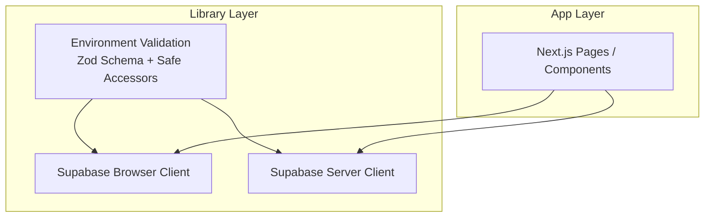
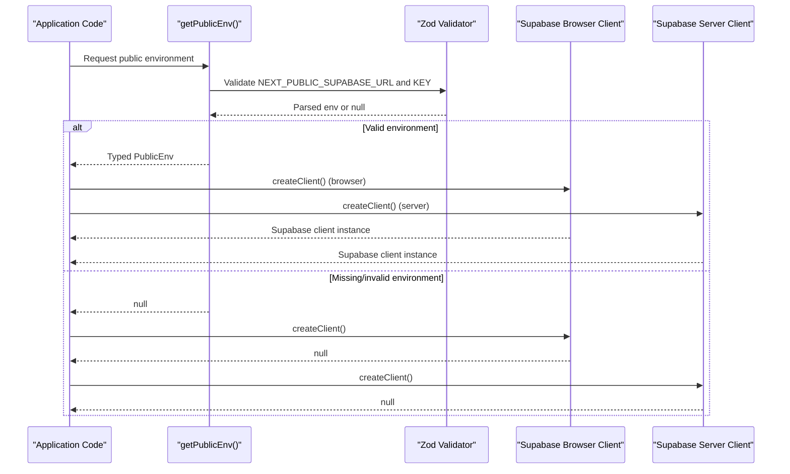
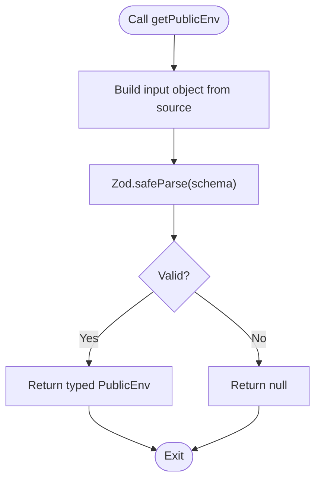
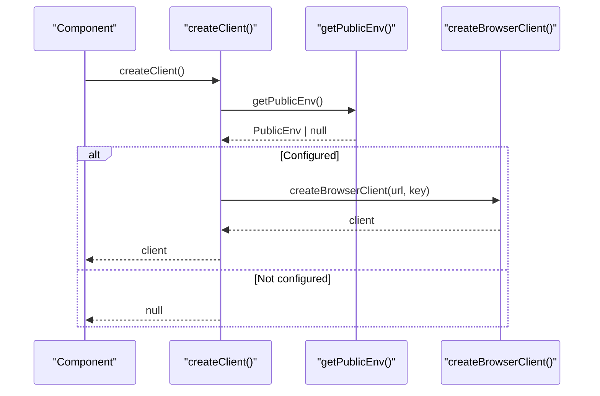
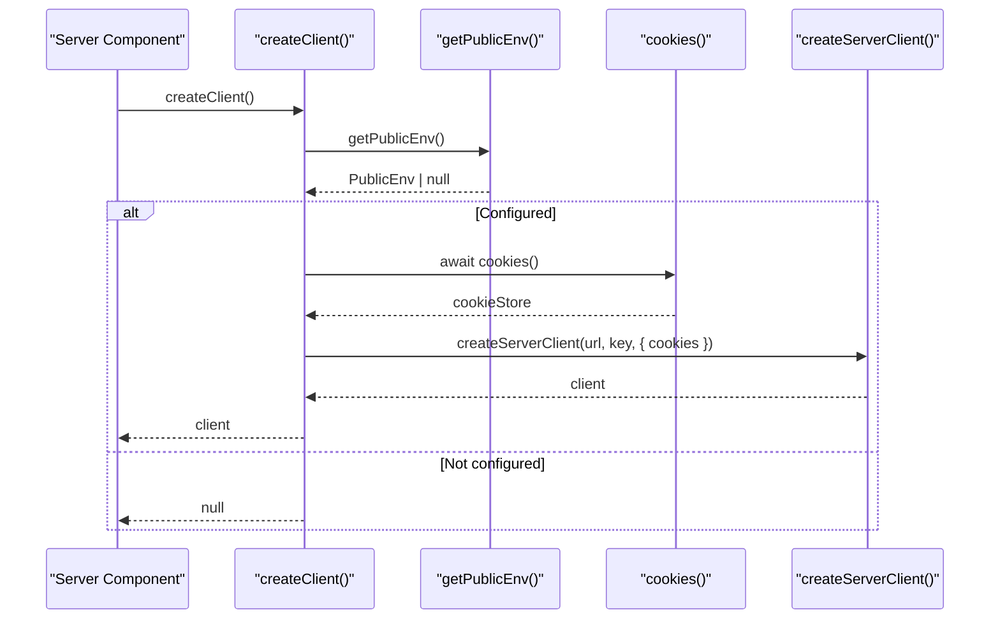
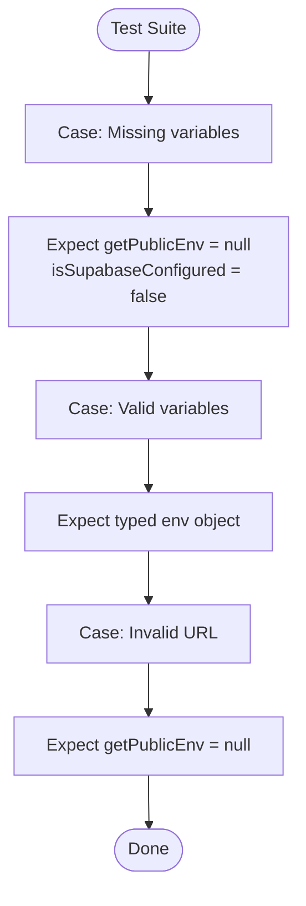
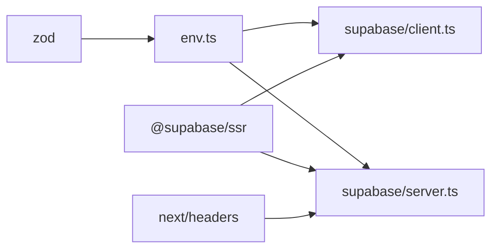

# Environment Configuration

<cite>
**Referenced Files in This Document**   
- [env.ts](file://src/lib/env.ts)
- [env.test.ts](file://src/lib/env.test.ts)
- [client.ts](file://src/lib/supabase/client.ts)
- [server.ts](file://src/lib/supabase/server.ts)
- [package.json](file://package.json)
- [next.config.ts](file://next.config.ts)
</cite>

## Table of Contents
1. [Introduction](#introduction)
2. [Project Structure](#project-structure)
3. [Core Components](#core-components)
4. [Architecture Overview](#architecture-overview)
5. [Detailed Component Analysis](#detailed-component-analysis)
6. [Dependency Analysis](#dependency-analysis)
7. [Performance Considerations](#performance-considerations)
8. [Troubleshooting Guide](#troubleshooting-guide)
9. [Conclusion](#conclusion)
10. [Appendices](#appendices)

## Introduction
This document explains how ZooMatch configures and validates environment variables, initializes the Supabase client for both browser and server environments, and secures environment usage. It covers the Zod-based validation schema, required variables, validation rules, error handling patterns, testing strategies, and best practices for managing different deployment environments.

## Project Structure
Environment configuration is centralized under the library layer and consumed by Supabase client modules:

- Validation and type inference live in a single module that exposes safe accessors.
- Supabase clients are created conditionally based on validated environment values.
- Tests assert behavior when environment variables are missing or malformed.

**Diagram sources**
- [env.ts:1-26](file://src/lib/env.ts#L1-L26)
- [client.ts:1-25](file://src/lib/supabase/client.ts#L1-L25)
- [server.ts:1-34](file://src/lib/supabase/server.ts#L1-L34)

**Section sources**
- [env.ts:1-26](file://src/lib/env.ts#L1-L26)
- [client.ts:1-25](file://src/lib/supabase/client.ts#L1-L25)
- [server.ts:1-34](file://src/lib/supabase/server.ts#L1-L34)

## Core Components
- Environment validation module defines a Zod schema for public-only variables and provides safe parsing utilities.
- Supabase browser client creates a client only when environment is valid; otherwise returns null to prevent runtime errors.
- Supabase server client integrates with Next.js cookies and also returns null if environment is invalid.

Key responsibilities:
- Validate and type-check environment variables at runtime.
- Provide boolean checks for configuration readiness.
- Initialize Supabase clients safely across client and server boundaries.

**Section sources**
- [env.ts:1-26](file://src/lib/env.ts#L1-L26)
- [client.ts:1-25](file://src/lib/supabase/client.ts#L1-L25)
- [server.ts:1-34](file://src/lib/supabase/server.ts#L1-L34)

## Architecture Overview
The environment system uses a strict, opt-in pattern: components request a typed environment object; if validation fails, they receive null and can gracefully degrade or fail fast.

**Diagram sources**
- [env.ts:10-26](file://src/lib/env.ts#L10-L26)
- [client.ts:9-25](file://src/lib/supabase/client.ts#L9-L25)
- [server.ts:6-34](file://src/lib/supabase/server.ts#L6-L34)

## Detailed Component Analysis

### Environment Validation Module
This module defines the public environment schema using Zod and exports safe accessors:

- Schema requirements:
  - NEXT_PUBLIC_SUPABASE_URL must be a valid URL string.
  - NEXT_PUBLIC_SUPABASE_PUBLISHABLE_KEY must be a non-empty string.
- Exposed functions:
  - getPublicEnv(source): Parses and validates environment from an optional source (defaults to process.env). Returns typed PublicEnv or null.
  - isSupabaseConfigured(source): Convenience check returning true when the environment is valid.

Validation behavior:
- Uses safeParse to avoid throwing on invalid inputs.
- Returns null when any required field is missing or invalid.
- Provides TypeScript types inferred from the schema.

Security considerations:
- Only NEXT_PUBLIC_* variables are exposed to the browser.
- No secrets are included in the public schema.

**Diagram sources**
- [env.ts:3-20](file://src/lib/env.ts#L3-L20)

**Section sources**
- [env.ts:1-26](file://src/lib/env.ts#L1-L26)

### Supabase Browser Client
The browser client ensures a Supabase client is created only when the environment is configured:

- Uses "use client" directive to run in the browser.
- Caches the client instance to avoid repeated initialization.
- Calls getPublicEnv(); if null, returns null instead of creating a broken client.
- On success, constructs the browser client with the validated URL and publishable key.

Error handling:
- Fails closed: no client is returned if environment is invalid.
- Prevents runtime crashes due to missing configuration.

**Diagram sources**
- [client.ts:1-25](file://src/lib/supabase/client.ts#L1-L25)
- [env.ts:10-20](file://src/lib/env.ts#L10-L20)

**Section sources**
- [client.ts:1-25](file://src/lib/supabase/client.ts#L1-L25)

### Supabase Server Client
The server client integrates with Next.js cookies and also requires a valid environment:

- Reads cookies via Next.js headers API.
- Validates environment first; returns null if missing.
- Creates a server-side Supabase client with cookie helpers.
- Wraps cookie writes in try/catch to handle cases where Server Components cannot write cookies directly.

Error handling:
- Gracefully handles cookie write limitations in Server Components.
- Fails closed when environment is not configured.

**Diagram sources**
- [server.ts:1-34](file://src/lib/supabase/server.ts#L1-L34)
- [env.ts:10-20](file://src/lib/env.ts#L10-L20)

**Section sources**
- [server.ts:1-34](file://src/lib/supabase/server.ts#L1-L34)

### Testing Strategy for Environment-Dependent Code
Tests verify that:
- The environment parser returns null when credentials are absent.
- A valid configuration yields a typed environment object.
- Malformed URLs are rejected.

Recommended test patterns:
- Mock process.env or pass a custom source object to getPublicEnv/isSupabaseConfigured.
- Assert null returns when required fields are missing.
- Assert successful parsing when all fields are present and valid.
- Include negative tests for invalid URL formats.

**Diagram sources**
- [env.test.ts:1-29](file://src/lib/env.test.ts#L1-L29)

**Section sources**
- [env.test.ts:1-29](file://src/lib/env.test.ts#L1-L29)

## Dependency Analysis
The environment module depends on Zod for validation and is consumed by Supabase client modules. The Supabase clients depend on @supabase/ssr and Next.js APIs.

**Diagram sources**
- [env.ts:1-26](file://src/lib/env.ts#L1-L26)
- [client.ts:1-25](file://src/lib/supabase/client.ts#L1-L25)
- [server.ts:1-34](file://src/lib/supabase/server.ts#L1-L34)

**Section sources**
- [package.json:17-26](file://package.json#L17-L26)
- [env.ts:1-26](file://src/lib/env.ts#L1-L26)
- [client.ts:1-25](file://src/lib/supabase/client.ts#L1-L25)
- [server.ts:1-34](file://src/lib/supabase/server.ts#L1-L34)

## Performance Considerations
- Environment validation is lightweight and runs once per call site; caching is handled at the Supabase client level for browser instances.
- Avoid repeatedly calling getPublicEnv in tight loops; cache the result locally if needed.
- Keep the public schema minimal to reduce validation overhead.

[No sources needed since this section provides general guidance]

## Troubleshooting Guide
Common issues and resolutions:
- Missing environment variables:
  - Symptom: Supabase client creation returns null.
  - Resolution: Ensure NEXT_PUBLIC_SUPABASE_URL and NEXT_PUBLIC_SUPABASE_PUBLISHABLE_KEY are set.
- Invalid URL format:
  - Symptom: Environment validation fails and returns null.
  - Resolution: Use a properly formatted HTTPS URL for Supabase.
- Cookie write errors in Server Components:
  - Symptom: Attempting to set cookies in Server Components throws.
  - Resolution: Handle cookie writes in middleware or defer to client-side updates; the server client already wraps writes in try/catch.

Operational checks:
- Use isSupabaseConfigured to gate features that require Supabase.
- In tests, pass a mock environment object to validate behavior without real credentials.

**Section sources**
- [env.ts:10-26](file://src/lib/env.ts#L10-L26)
- [client.ts:9-25](file://src/lib/supabase/client.ts#L9-L25)
- [server.ts:6-34](file://src/lib/supabase/server.ts#L6-L34)

## Conclusion
ZooMatch’s environment configuration relies on a strict Zod-based validation layer that guarantees type safety and prevents runtime failures when configuration is missing or malformed. Both browser and server Supabase clients adopt a fail-closed approach, returning null when environment variables are invalid. This design simplifies error handling, supports robust testing, and keeps sensitive data out of the browser bundle.

[No sources needed since this section summarizes without analyzing specific files]

## Appendices

### Required Environment Variables
- NEXT_PUBLIC_SUPABASE_URL
  - Type: string
  - Constraint: Must be a valid URL
  - Purpose: Supabase project endpoint
- NEXT_PUBLIC_SUPABASE_PUBLISHABLE_KEY
  - Type: string
  - Constraint: Non-empty
  - Purpose: Browser-safe key for Supabase authentication

**Section sources**
- [env.ts:3-6](file://src/lib/env.ts#L3-L6)

### Example Setup Scenarios
- Local development:
  - Set NEXT_PUBLIC_SUPABASE_URL to your local Supabase instance URL.
  - Set NEXT_PUBLIC_SUPABASE_PUBLISHABLE_KEY to the project’s publishable key.
- Production:
  - Configure the same variables through your hosting platform’s environment management.
  - Ensure only NEXT_PUBLIC_* variables are exposed to the client.

[No sources needed since this section provides general guidance]

### Best Practices for Managing Deployment Environments
- Separate environment files per environment (e.g., .env.local, .env.production) and never commit secrets.
- Use CI/CD pipelines to inject environment variables securely.
- Validate environment variables early in the application lifecycle and fail fast on misconfiguration.
- Prefer feature flags over branching logic based on environment names.
- Keep the public schema minimal and review it regularly to avoid accidental secret exposure.

[No sources needed since this section provides general guidance]