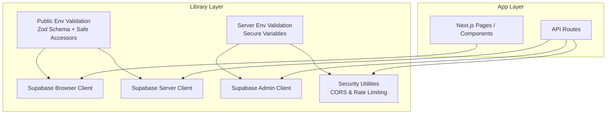
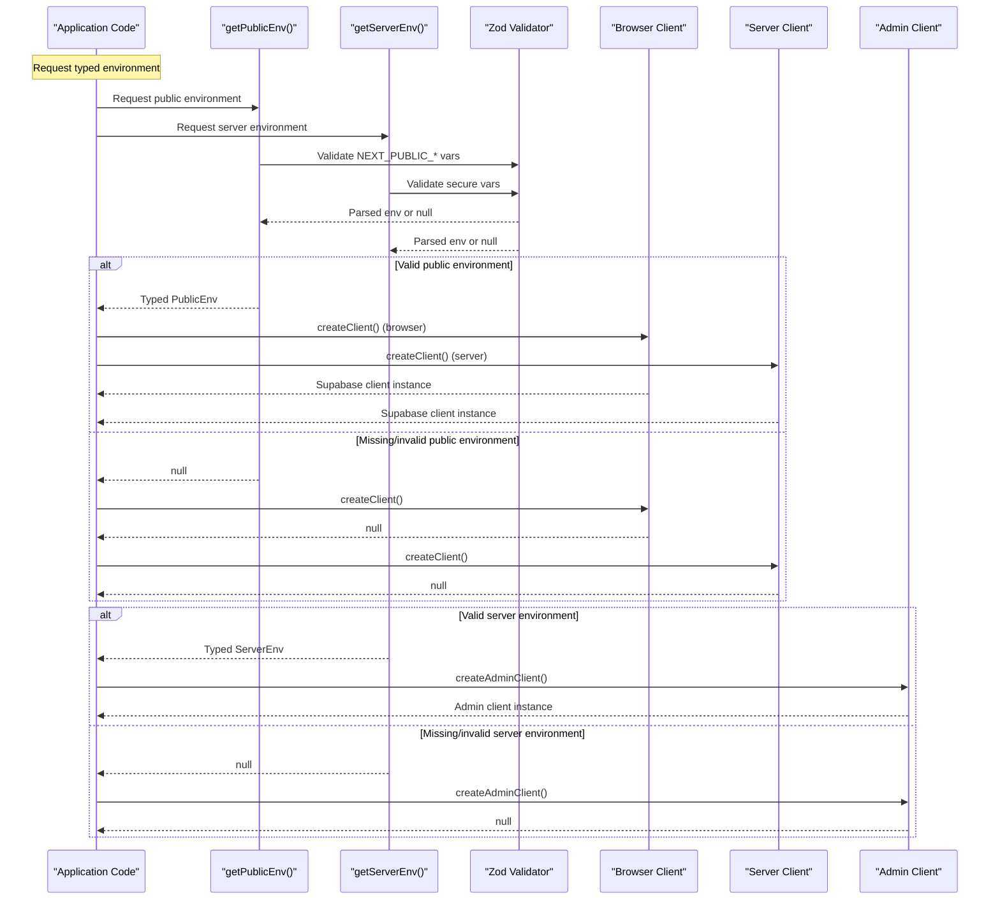
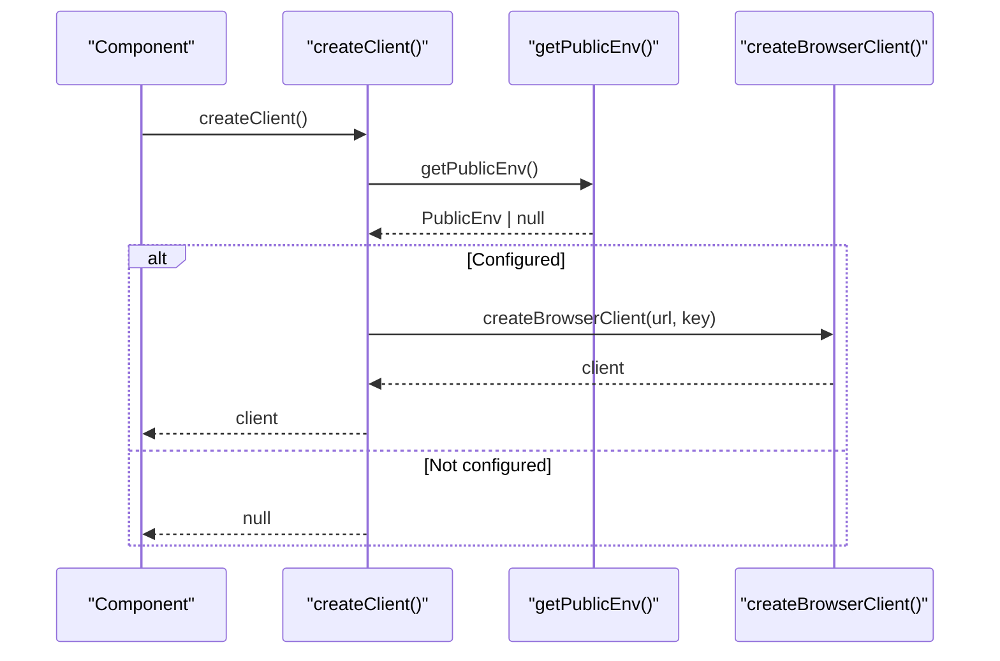
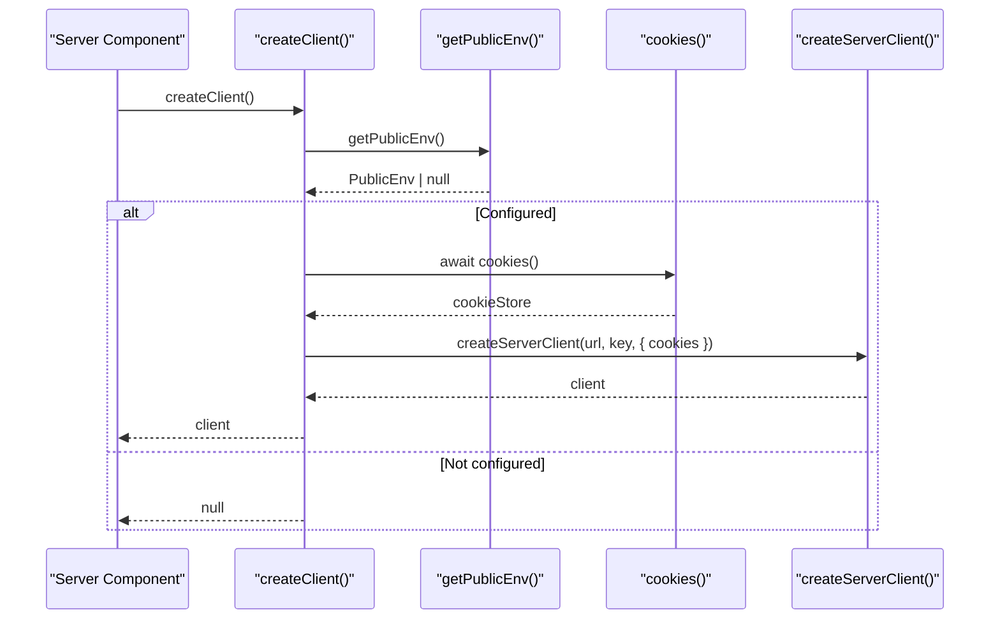
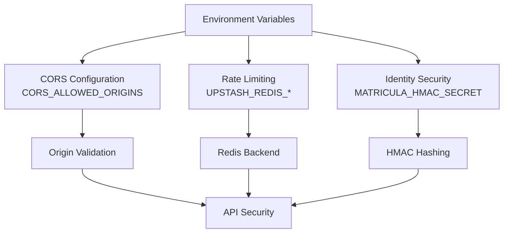
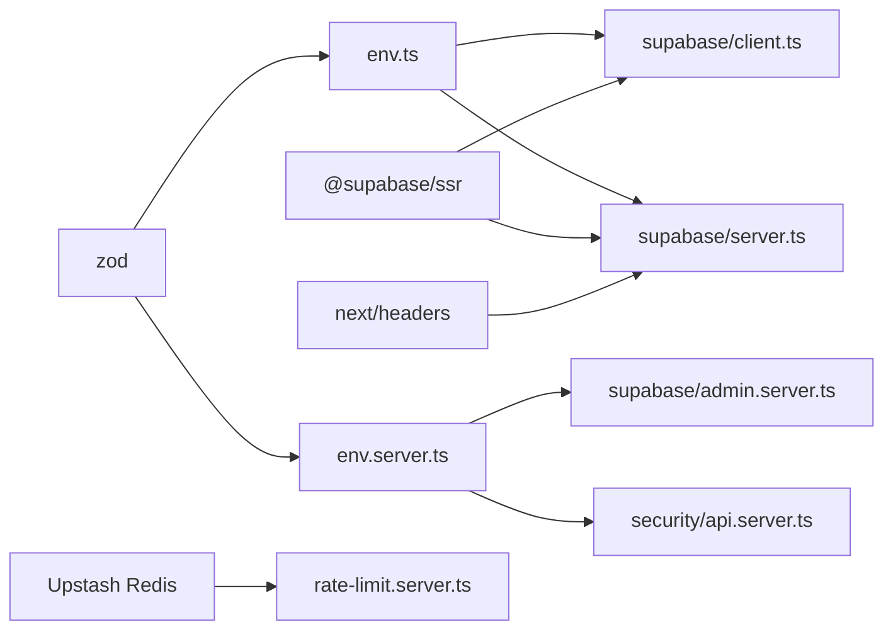

# Environment Configuration

<cite>
**Referenced Files in This Document**   
- [env.ts](file://src/lib/env.ts)
- [env.server.ts](file://src/lib/env.server.ts)
- [env.test.ts](file://src/lib/env.test.ts)
- [client.ts](file://src/lib/supabase/client.ts)
- [server.ts](file://src/lib/supabase/server.ts)
- [admin.server.ts](file://src/lib/supabase/admin.server.ts)
- [api.server.ts](file://src/lib/security/api.server.ts)
- [origin.ts](file://src/lib/security/origin.ts)
- [rate-limit.server.ts](file://src/lib/security/rate-limit.server.ts)
- [availability\route.ts](file://src/app\api\availability\route.ts)
- [notifications\route.ts](file://src/app\api\notifications\route.ts)
- [metrics-v2\route.ts](file://src/app\api\admin\metrics-v2\route.ts)
- [package.json](file://package.json)
</cite>

## Update Summary
**Changes Made**
- Added comprehensive documentation for server-side environment configuration with new security variables
- Updated Supabase client architecture to include admin client for service role operations
- Enhanced security configuration section with CORS and rate limiting environment variables
- Added v2 API endpoints integration with environment validation
- Expanded testing strategies to cover both public and server environment configurations

## Table of Contents
1. [Introduction](#introduction)
2. [Project Structure](#project-structure)
3. [Core Components](#core-components)
4. [Architecture Overview](#architecture-overview)
5. [Detailed Component Analysis](#detailed-component-analysis)
6. [Security Configuration](#security-configuration)
7. [Dependency Analysis](#dependency-analysis)
8. [Performance Considerations](#performance-considerations)
9. [Troubleshooting Guide](#troubleshooting-guide)
10. [Conclusion](#conclusion)
11. [Appendices](#appendices)

## Introduction
This document explains how ZooMatch configures and validates environment variables, initializes the Supabase client for both browser and server environments, and secures environment usage. The system now supports v2 features including enhanced security settings, admin operations, and advanced API endpoints. It covers the Zod-based validation schema, required variables, validation rules, error handling patterns, testing strategies, and best practices for managing different deployment environments.

## Project Structure
Environment configuration is centralized under the library layer with separate modules for public and server-side validation:

- Public environment validation for browser-safe variables
- Server environment validation for sensitive operational secrets
- Supabase clients created conditionally based on validated environment values
- Security utilities integrated with environment-dependent features

**Diagram sources**
- [env.ts:1-24](file://src/lib/env.ts#L1-L24)
- [env.server.ts:1-22](file://src/lib/env.server.ts#L1-L22)
- [client.ts:1-25](file://src/lib/supabase/client.ts#L1-L25)
- [server.ts:1-34](file://src/lib/supabase/server.ts#L1-L34)
- [admin.server.ts:1-23](file://src/lib/supabase/admin.server.ts#L1-L23)

**Section sources**
- [env.ts:1-24](file://src/lib/env.ts#L1-L24)
- [env.server.ts:1-22](file://src/lib/env.server.ts#L1-L22)
- [client.ts:1-25](file://src/lib/supabase/client.ts#L1-L25)
- [server.ts:1-34](file://src/lib/supabase/server.ts#L1-L34)
- [admin.server.ts:1-23](file://src/lib/supabase/admin.server.ts#L1-L23)

## Core Components
The environment system now includes three main components:

### Public Environment Module
- Defines Zod schema for browser-safe variables only
- Provides safe parsing utilities for client-side code
- Exposes boolean checks for configuration readiness

### Server Environment Module  
- Validates sensitive server-side variables including service role keys and HMAC secrets
- Supports v2 security requirements with minimum length constraints
- Integrates with admin operations and security utilities

### Supabase Client Architecture
- **Browser Client**: Creates client only when public environment is valid
- **Server Client**: Integrates with Next.js cookies and requires valid public environment
- **Admin Client**: Uses service role key for privileged operations, requires full server environment

Key responsibilities:
- Validate and type-check environment variables at runtime
- Provide fail-closed behavior for missing or invalid configurations
- Support both v1 and v2 feature sets through environment-driven initialization

**Section sources**
- [env.ts:1-24](file://src/lib/env.ts#L1-L24)
- [env.server.ts:1-22](file://src/lib/env.server.ts#L1-L22)
- [client.ts:1-25](file://src/lib/supabase/client.ts#L1-L25)
- [server.ts:1-34](file://src/lib/supabase/server.ts#L1-L34)
- [admin.server.ts:1-23](file://src/lib/supabase/admin.server.ts#L1-L23)

## Architecture Overview
The environment system uses a strict, opt-in pattern with separate validation layers for different security contexts:

**Diagram sources**
- [env.ts:10-24](file://src/lib/env.ts#L10-L24)
- [env.server.ts:13-22](file://src/lib/env.server.ts#L13-L22)
- [client.ts:9-25](file://src/lib/supabase/client.ts#L9-L25)
- [server.ts:6-34](file://src/lib/supabase/server.ts#L6-L34)
- [admin.server.ts:5-23](file://src/lib/supabase/admin.server.ts#L5-L23)

## Detailed Component Analysis

### Public Environment Validation Module
This module defines the public environment schema using Zod and exports safe accessors:

- Schema requirements:
  - NEXT_PUBLIC_SUPABASE_URL must be a valid URL string
  - NEXT_PUBLIC_SUPABASE_PUBLISHABLE_KEY must be a non-empty string
- Exposed functions:
  - getPublicEnv(source): Parses and validates environment from an optional source (defaults to process.env). Returns typed PublicEnv or null
  - isSupabaseConfigured(source): Convenience check returning true when the environment is valid

Validation behavior:
- Uses safeParse to avoid throwing on invalid inputs
- Returns null when any required field is missing or invalid
- Provides TypeScript types inferred from the schema

Security considerations:
- Only NEXT_PUBLIC_* variables are exposed to the browser
- No secrets are included in the public schema

**Diagram sources**
- [env.ts:3-20](file://src/lib/env.ts#L3-L20)

**Section sources**
- [env.ts:1-24](file://src/lib/env.ts#L1-L24)

### Server Environment Validation Module
New module for server-side environment validation with enhanced security requirements:

- Schema requirements:
  - NEXT_PUBLIC_SUPABASE_URL must be a valid URL string
  - SUPABASE_SERVICE_ROLE_KEY must be a string with minimum 32 characters
  - MATRICULA_HMAC_SECRET must be a string with minimum 32 characters
- Exposed function:
  - getServerEnv(source): Parses and validates server environment, returns typed ServerEnv or null

Security enhancements:
- Enforces minimum length requirements for cryptographic secrets
- Separates sensitive server-only variables from public ones
- Supports v2 security model with HMAC-based identity verification

**Section sources**
- [env.server.ts:1-22](file://src/lib/env.server.ts#L1-L22)

### Supabase Browser Client
The browser client ensures a Supabase client is created only when the environment is configured:

- Uses "use client" directive to run in the browser
- Caches the client instance to avoid repeated initialization
- Calls getPublicEnv(); if null, returns null instead of creating a broken client
- On success, constructs the browser client with the validated URL and publishable key

Error handling:
- Fails closed: no client is returned if environment is invalid
- Prevents runtime crashes due to missing configuration

**Diagram sources**
- [client.ts:1-25](file://src/lib/supabase/client.ts#L1-L25)
- [env.ts:10-20](file://src/lib/env.ts#L10-L20)

**Section sources**
- [client.ts:1-25](file://src/lib/supabase/client.ts#L1-L25)

### Supabase Server Client
The server client integrates with Next.js cookies and also requires a valid environment:

- Reads cookies via Next.js headers API
- Validates environment first; returns null if missing
- Creates a server-side Supabase client with cookie helpers
- Wraps cookie writes in try/catch to handle cases where Server Components cannot write cookies directly

Error handling:
- Gracefully handles cookie write limitations in Server Components
- Fails closed when environment is not configured

**Diagram sources**
- [server.ts:1-34](file://src/lib/supabase/server.ts#L1-L34)
- [env.ts:10-20](file://src/lib/env.ts#L10-L20)

**Section sources**
- [server.ts:1-34](file://src/lib/supabase/server.ts#L1-L34)

### Supabase Admin Client
New admin client for privileged operations using service role key:

- Uses getServerEnv() to validate server-side environment
- Creates Supabase client with service role authentication
- Disables automatic token refresh and session persistence for security
- Returns null if server environment is not properly configured

Security features:
- Requires SUPABASE_SERVICE_ROLE_KEY for administrative operations
- Disables client-side session management
- Suitable for server-only operations like data migration and bulk updates

**Section sources**
- [admin.server.ts:1-23](file://src/lib/supabase/admin.server.ts#L1-L23)

### Testing Strategy for Environment-Dependent Code
Tests verify that:
- The environment parser returns null when credentials are absent
- A valid configuration yields a typed environment object
- Malformed URLs are rejected

Recommended test patterns:
- Mock process.env or pass a custom source object to getPublicEnv/isSupabaseConfigured
- Assert null returns when required fields are missing
- Assert successful parsing when all fields are present and valid
- Include negative tests for invalid URL formats

**Diagram sources**
- [env.test.ts:1-29](file://src/lib/env.test.ts#L1-L29)

**Section sources**
- [env.test.ts:1-29](file://src/lib/env.test.ts#L1-L29)

## Security Configuration
The environment system now includes comprehensive security configuration for v2 features:

### CORS Configuration
- CORS_ALLOWED_ORIGINS: Comma-separated list of allowed origins
- Supports both HTTP and HTTPS protocols
- Automatically normalizes and validates origin URLs
- Filters out malicious or malformed entries

### Rate Limiting Configuration
- UPSTASH_REDIS_REST_URL: Redis endpoint for distributed rate limiting
- UPSTASH_REDIS_REST_TOKEN: Authentication token for Redis service
- Graceful degradation when Redis is unavailable
- Development mode bypasses rate limiting for easier testing

### Identity Security
- MATRICULA_HMAC_SECRET: Cryptographic secret for deterministic matricula hashing
- Minimum 32-character requirement for security
- Used for privacy-preserving student identification

**Diagram sources**
- [api.server.ts:13-23](file://src/lib/security/api.server.ts#L13-L23)
- [rate-limit.server.ts:76-86](file://src/lib/security/rate-limit.server.ts#L76-L86)
- [origin.ts:1-45](file://src/lib/security/origin.ts#L1-L45)

**Section sources**
- [api.server.ts:1-117](file://src/lib/security/api.server.ts#L1-L117)
- [origin.ts:1-45](file://src/lib/security/origin.ts#L1-L45)
- [rate-limit.server.ts:1-86](file://src/lib/security/rate-limit.server.ts#L1-L86)

## Dependency Analysis
The environment module depends on Zod for validation and is consumed by Supabase client modules. The Supabase clients depend on @supabase/ssr and Next.js APIs. Security utilities integrate with environment-dependent features.

**Diagram sources**
- [env.ts:1-24](file://src/lib/env.ts#L1-L24)
- [env.server.ts:1-22](file://src/lib/env.server.ts#L1-L22)
- [client.ts:1-25](file://src/lib/supabase/client.ts#L1-L25)
- [server.ts:1-34](file://src/lib/supabase/server.ts#L1-L34)
- [admin.server.ts:1-23](file://src/lib/supabase/admin.server.ts#L1-L23)
- [api.server.ts:1-117](file://src/lib/security/api.server.ts#L1-L117)
- [rate-limit.server.ts:1-86](file://src/lib/security/rate-limit.server.ts#L1-L86)

**Section sources**
- [package.json:17-26](file://package.json#L17-L26)
- [env.ts:1-24](file://src/lib/env.ts#L1-L24)
- [env.server.ts:1-22](file://src/lib/env.server.ts#L1-L22)
- [client.ts:1-25](file://src/lib/supabase/client.ts#L1-L25)
- [server.ts:1-34](file://src/lib/supabase/server.ts#L1-L34)
- [admin.server.ts:1-23](file://src/lib/supabase/admin.server.ts#L1-L23)

## Performance Considerations
- Environment validation is lightweight and runs once per call site; caching is handled at the Supabase client level for browser instances
- Avoid repeatedly calling getPublicEnv/getServerEnv in tight loops; cache the result locally if needed
- Keep the public schema minimal to reduce validation overhead
- Server environment validation adds minimal overhead but provides essential security guarantees
- Redis-based rate limiting gracefully degrades when unavailable without impacting core functionality

## Troubleshooting Guide
Common issues and resolutions:
- Missing environment variables:
  - Symptom: Supabase client creation returns null
  - Resolution: Ensure NEXT_PUBLIC_SUPABASE_URL and NEXT_PUBLIC_SUPABASE_PUBLISHABLE_KEY are set
- Server environment misconfiguration:
  - Symptom: Admin operations fail or security features don't work
  - Resolution: Verify SUPABASE_SERVICE_ROLE_KEY and MATRICULA_HMAC_SECRET are set with minimum 32 characters
- Invalid URL format:
  - Symptom: Environment validation fails and returns null
  - Resolution: Use a properly formatted HTTPS URL for Supabase
- Cookie write errors in Server Components:
  - Symptom: Attempting to set cookies in Server Components throws
  - Resolution: Handle cookie writes in middleware or defer to client-side updates; the server client already wraps writes in try/catch
- CORS policy violations:
  - Symptom: Cross-origin requests blocked
  - Resolution: Configure CORS_ALLOWED_ORIGINS with proper domain allowlist
- Rate limiting issues:
  - Symptom: Requests throttled unexpectedly
  - Resolution: Check UPSTASH_REDIS_* configuration and Redis connectivity

Operational checks:
- Use isSupabaseConfigured to gate features that require Supabase
- In tests, pass a mock environment object to validate behavior without real credentials
- Monitor environment validation failures in development vs production modes

**Section sources**
- [env.ts:10-24](file://src/lib/env.ts#L10-L24)
- [env.server.ts:13-22](file://src/lib/env.server.ts#L13-L22)
- [client.ts:9-25](file://src/lib/supabase/client.ts#L9-L25)
- [server.ts:6-34](file://src/lib/supabase/server.ts#L6-L34)
- [admin.server.ts:5-23](file://src/lib/supabase/admin.server.ts#L5-L23)

## Conclusion
ZooMatch's environment configuration relies on a strict Zod-based validation layer that guarantees type safety and prevents runtime failures when configuration is missing or malformed. The system now supports both public and server-side environment validation, enabling v2 features including enhanced security, admin operations, and advanced API endpoints. Both browser and server Supabase clients adopt a fail-closed approach, returning null when environment variables are invalid. This design simplifies error handling, supports robust testing, and keeps sensitive data out of the browser bundle while providing comprehensive security configuration for modern deployment scenarios.

## Appendices

### Required Environment Variables

#### Public Variables (Browser-Safe)
- NEXT_PUBLIC_SUPABASE_URL
  - Type: string
  - Constraint: Must be a valid URL
  - Purpose: Supabase project endpoint
- NEXT_PUBLIC_SUPABASE_PUBLISHABLE_KEY
  - Type: string
  - Constraint: Non-empty
  - Purpose: Browser-safe key for Supabase authentication

#### Server Variables (Sensitive)
- SUPABASE_SERVICE_ROLE_KEY
  - Type: string
  - Constraint: Minimum 32 characters
  - Purpose: Service role key for administrative operations
- MATRICULA_HMAC_SECRET
  - Type: string
  - Constraint: Minimum 32 characters
  - Purpose: HMAC secret for deterministic matricula hashing

#### Security Variables (Optional)
- CORS_ALLOWED_ORIGINS
  - Type: string (comma-separated)
  - Constraint: Valid HTTP/HTTPS URLs
  - Purpose: Allowlist for cross-origin requests
- UPSTASH_REDIS_REST_URL
  - Type: string
  - Constraint: Valid Redis endpoint URL
  - Purpose: Distributed rate limiting backend
- UPSTASH_REDIS_REST_TOKEN
  - Type: string
  - Constraint: Valid authentication token
  - Purpose: Redis authentication for rate limiting

**Section sources**
- [env.ts:3-6](file://src/lib/env.ts#L3-L6)
- [env.server.ts:3-7](file://src/lib/env.server.ts#L3-L7)
- [api.server.ts:13-15](file://src/lib/security/api.server.ts#L13-L15)
- [rate-limit.server.ts:76-82](file://src/lib/security/rate-limit.server.ts#L76-L82)

### Example Setup Scenarios

#### Local Development
- Set NEXT_PUBLIC_SUPABASE_URL to your local Supabase instance URL
- Set NEXT_PUBLIC_SUPABASE_PUBLISHABLE_KEY to the project's publishable key
- Set SUPABASE_SERVICE_ROLE_KEY and MATRICULA_HMAC_SECRET with secure random strings (minimum 32 chars)
- Optionally configure CORS_ALLOWED_ORIGINS for local development domains

#### Production Deployment
- Configure all required variables through your hosting platform's environment management
- Ensure only NEXT_PUBLIC_* variables are exposed to the client
- Set up Redis for distributed rate limiting in high-traffic scenarios
- Configure proper CORS policies for your production domains

### Best Practices for Managing Deployment Environments
- Separate environment files per environment (e.g., .env.local, .env.production) and never commit secrets
- Use CI/CD pipelines to inject environment variables securely
- Validate environment variables early in the application lifecycle and fail fast on misconfiguration
- Prefer feature flags over branching logic based on environment names
- Keep the public schema minimal and review it regularly to avoid accidental secret exposure
- Use minimum length constraints for cryptographic secrets to ensure adequate security
- Implement graceful degradation for optional security features like rate limiting
- Regularly rotate service role keys and HMAC secrets following security best practices