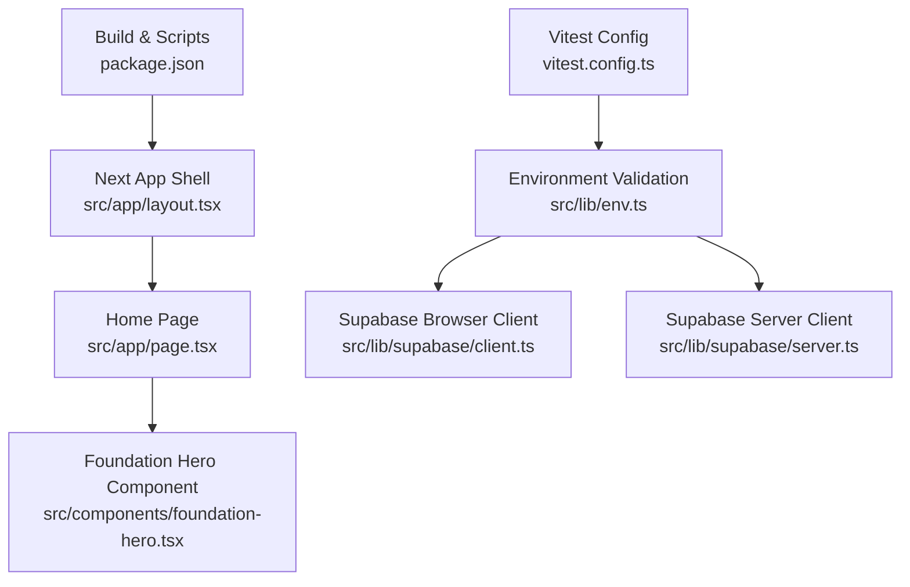
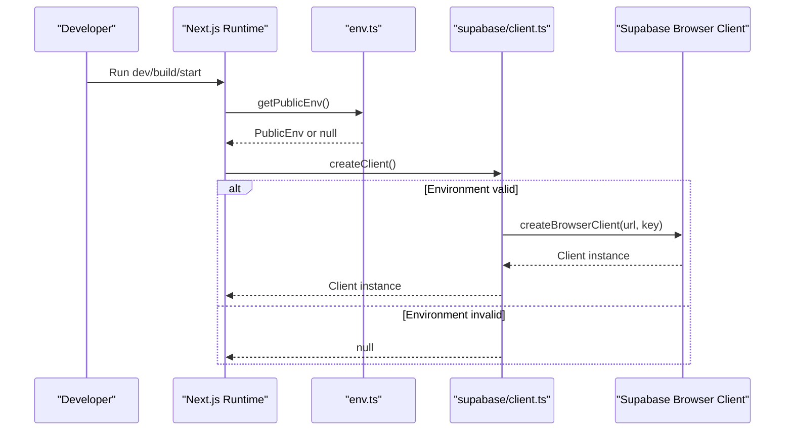
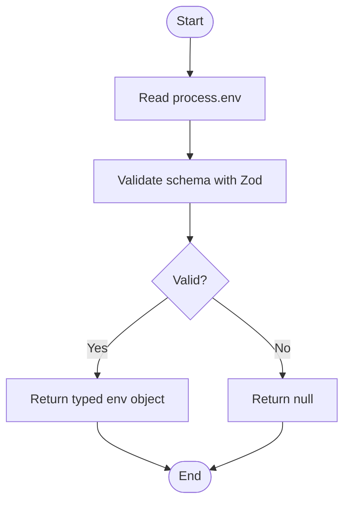
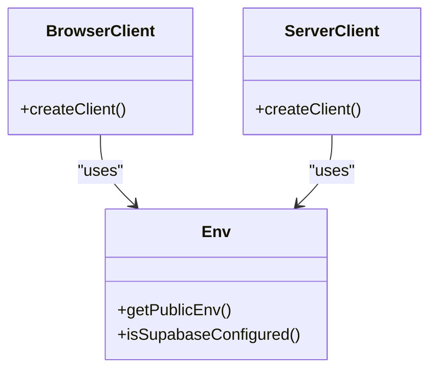
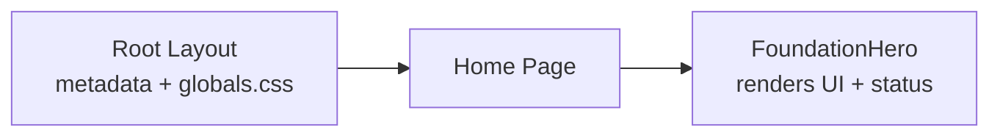
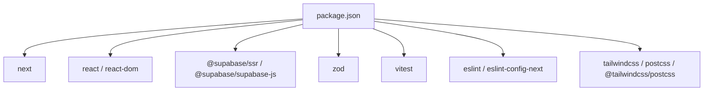

# Getting Started

<cite>
**Referenced Files in This Document**
- [package.json](file://package.json)
- [next.config.ts](file://next.config.ts)
- [vitest.config.ts](file://vitest.config.ts)
- [src/lib/env.ts](file://src/lib/env.ts)
- [src/lib/supabase/client.ts](file://src/lib/supabase/client.ts)
- [src/lib/supabase/server.ts](file://src/lib/supabase/server.ts)
- [src/app/layout.tsx](file://src/app/layout.tsx)
- [src/app/page.tsx](file://src/app/page.tsx)
- [src/components/foundation-hero.tsx](file://src/components/foundation-hero.tsx)
</cite>

## Table of Contents
1. [Introduction](#introduction)
2. [Project Structure](#project-structure)
3. [Core Components](#core-components)
4. [Architecture Overview](#architecture-overview)
5. [Detailed Component Analysis](#detailed-component-analysis)
6. [Dependency Analysis](#dependency-analysis)
7. [Performance Considerations](#performance-considerations)
8. [Troubleshooting Guide](#troubleshooting-guide)
9. [Conclusion](#conclusion)

## Introduction
ZooMatch is a Next.js application that presents a playful personality-to-animal and color mapping experience. It integrates with Supabase for data services and validates environment configuration at runtime to ensure a smooth setup. This guide helps you install dependencies, configure environment variables (including Supabase), run the development server, build for production, and verify your installation.

## Project Structure
At a high level:
- The app shell and metadata are defined in the app directory.
- Environment validation and Supabase client creation live under lib.
- UI components render the landing page and foundation hero section.
- Build and test tooling are configured via Next.js, TypeScript, ESLint, PostCSS/Tailwind, and Vitest.

**Diagram sources**
- [src/app/layout.tsx:1-17](file://src/app/layout.tsx#L1-L17)
- [src/app/page.tsx:1-10](file://src/app/page.tsx#L1-L10)
- [src/components/foundation-hero.tsx:1-117](file://src/components/foundation-hero.tsx#L1-L117)
- [src/lib/env.ts:1-26](file://src/lib/env.ts#L1-L26)
- [src/lib/supabase/client.ts:1-25](file://src/lib/supabase/client.ts#L1-L25)
- [src/lib/supabase/server.ts:1-34](file://src/lib/supabase/server.ts#L1-L34)
- [package.json:1-40](file://package.json#L1-L40)
- [vitest.config.ts:1-15](file://vitest.config.ts#L1-L15)

**Section sources**
- [package.json:1-40](file://package.json#L1-L40)
- [next.config.ts:1-8](file://next.config.ts#L1-L8)
- [vitest.config.ts:1-15](file://vitest.config.ts#L1-L15)
- [src/app/layout.tsx:1-17](file://src/app/layout.tsx#L1-L17)
- [src/app/page.tsx:1-10](file://src/app/page.tsx#L1-L10)
- [src/components/foundation-hero.tsx:1-117](file://src/components/foundation-hero.tsx#L1-L117)
- [src/lib/env.ts:1-26](file://src/lib/env.ts#L1-L26)
- [src/lib/supabase/client.ts:1-25](file://src/lib/supabase/client.ts#L1-L25)
- [src/lib/supabase/server.ts:1-34](file://src/lib/supabase/server.ts#L1-L34)

## Core Components
- Environment validation: Validates required public environment variables using Zod and exposes helpers to check if Supabase is configured.
- Supabase clients: Provides browser and server-side client factories that read validated environment variables and initialize Supabase SDKs.
- App shell and home page: Sets site metadata and renders the FoundationHero component, passing whether Supabase is configured.
- FoundationHero: Renders the landing UI and indicates configuration status visually.

Key responsibilities:
- Validate and expose public environment variables.
- Create Supabase clients only when environment is valid.
- Render a responsive landing page with accessibility-friendly animations.

**Section sources**
- [src/lib/env.ts:1-26](file://src/lib/env.ts#L1-L26)
- [src/lib/supabase/client.ts:1-25](file://src/lib/supabase/client.ts#L1-L25)
- [src/lib/supabase/server.ts:1-34](file://src/lib/supabase/server.ts#L1-L34)
- [src/app/layout.tsx:1-17](file://src/app/layout.tsx#L1-L17)
- [src/app/page.tsx:1-10](file://src/app/page.tsx#L1-L10)
- [src/components/foundation-hero.tsx:1-117](file://src/components/foundation-hero.tsx#L1-L117)

## Architecture Overview
The runtime flow ensures safe initialization of Supabase clients based on environment configuration.

**Diagram sources**
- [src/lib/env.ts:10-26](file://src/lib/env.ts#L10-L26)
- [src/lib/supabase/client.ts:9-25](file://src/lib/supabase/client.ts#L9-L25)

## Detailed Component Analysis

### Environment Configuration and Validation
- Required public environment variables:
  - NEXT_PUBLIC_SUPABASE_URL: Must be a valid URL.
  - NEXT_PUBLIC_SUPABASE_PUBLISHABLE_KEY: Must be present and non-empty.
- Helpers:
  - getPublicEnv(): Parses and validates environment variables; returns typed object or null.
  - isSupabaseConfigured(): Convenience check returning true when both variables are valid.

**Diagram sources**
- [src/lib/env.ts:1-26](file://src/lib/env.ts#L1-L26)

**Section sources**
- [src/lib/env.ts:1-26](file://src/lib/env.ts#L1-L26)

### Supabase Client Initialization
- Browser client:
  - Reads validated environment variables.
  - Returns null if environment is missing/invalid.
  - Otherwise creates and caches a browser client instance.
- Server client:
  - Reads validated environment variables.
  - Creates a server client with cookie handling compatible with Next.js.

**Diagram sources**
- [src/lib/env.ts:1-26](file://src/lib/env.ts#L1-L26)
- [src/lib/supabase/client.ts:1-25](file://src/lib/supabase/client.ts#L1-L25)
- [src/lib/supabase/server.ts:1-34](file://src/lib/supabase/server.ts#L1-L34)

**Section sources**
- [src/lib/supabase/client.ts:1-25](file://src/lib/supabase/client.ts#L1-L25)
- [src/lib/supabase/server.ts:1-34](file://src/lib/supabase/server.ts#L1-L34)

### Application Shell and Home Page
- Root layout sets site metadata and global styles.
- Home page imports the FoundationHero component and passes a boolean indicating whether Supabase is configured.

**Diagram sources**
- [src/app/layout.tsx:1-17](file://src/app/layout.tsx#L1-L17)
- [src/app/page.tsx:1-10](file://src/app/page.tsx#L1-L10)
- [src/components/foundation-hero.tsx:1-117](file://src/components/foundation-hero.tsx#L1-L117)

**Section sources**
- [src/app/layout.tsx:1-17](file://src/app/layout.tsx#L1-L17)
- [src/app/page.tsx:1-10](file://src/app/page.tsx#L1-L10)
- [src/components/foundation-hero.tsx:1-117](file://src/components/foundation-hero.tsx#L1-L117)

## Dependency Analysis
- Node.js engine requirement: >=22.12.0.
- Core runtime dependencies include Next.js, React, Supabase SDKs, and Zod for validation.
- Development tooling includes ESLint, Tailwind CSS, PostCSS, TypeScript, Vite, and Vitest.

**Diagram sources**
- [package.json:1-40](file://package.json#L1-L40)

**Section sources**
- [package.json:1-40](file://package.json#L1-L40)

## Performance Considerations
- Animations use framer-motion with reduced motion support for accessibility.
- Supabase clients are created lazily and cached in the browser to avoid redundant initialization.
- Keep environment validation minimal and centralized to reduce overhead during startup.

[No sources needed since this section provides general guidance]

## Troubleshooting Guide

Common issues and resolutions:
- Node.js version mismatch:
  - Symptom: Installation or script execution fails due to unsupported Node.js version.
  - Resolution: Install Node.js >=22.12.0 and ensure your terminal uses it.
- Missing or invalid environment variables:
  - Symptom: Supabase client returns null; UI shows foundation ready but no data features.
  - Resolution: Set NEXT_PUBLIC_SUPABASE_URL and NEXT_PUBLIC_SUPABASE_PUBLISHABLE_KEY. Ensure the URL is valid and the key is non-empty.
- Supabase project not configured:
  - Symptom: API calls fail after client creation.
  - Resolution: Create a Supabase project, copy the project URL and anon/public key into your environment variables.
- Tests not running:
  - Symptom: npm run test fails or finds no tests.
  - Resolution: Ensure vitest is installed and tests exist under src/**/*.test.ts. Verify vitest.config.ts alias resolution.

Verification steps:
- Confirm environment variables:
  - Use the provided helper to check configuration: isSupabaseConfigured().
- Run the development server:
  - Execute npm run dev and open http://localhost:3000.
- Validate UI indicators:
  - The FoundationHero component displays a status indicator reflecting whether Supabase is configured.
- Run tests:
  - Execute npm run test to validate environment parsing logic.

**Section sources**
- [package.json:1-40](file://package.json#L1-L40)
- [src/lib/env.ts:1-26](file://src/lib/env.ts#L1-L26)
- [src/lib/supabase/client.ts:1-25](file://src/lib/supabase/client.ts#L1-L25)
- [src/components/foundation-hero.tsx:1-117](file://src/components/foundation-hero.tsx#L1-L117)
- [vitest.config.ts:1-15](file://vitest.config.ts#L1-L15)

## Conclusion
You now have everything needed to set up ZooMatch locally, configure Supabase credentials, run the development server, build for production, and verify your installation. If you encounter issues, consult the troubleshooting guide and ensure your environment variables and Node.js version meet the requirements.