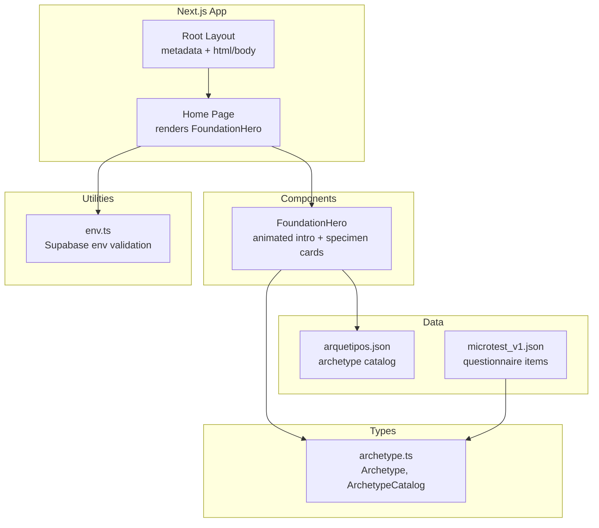
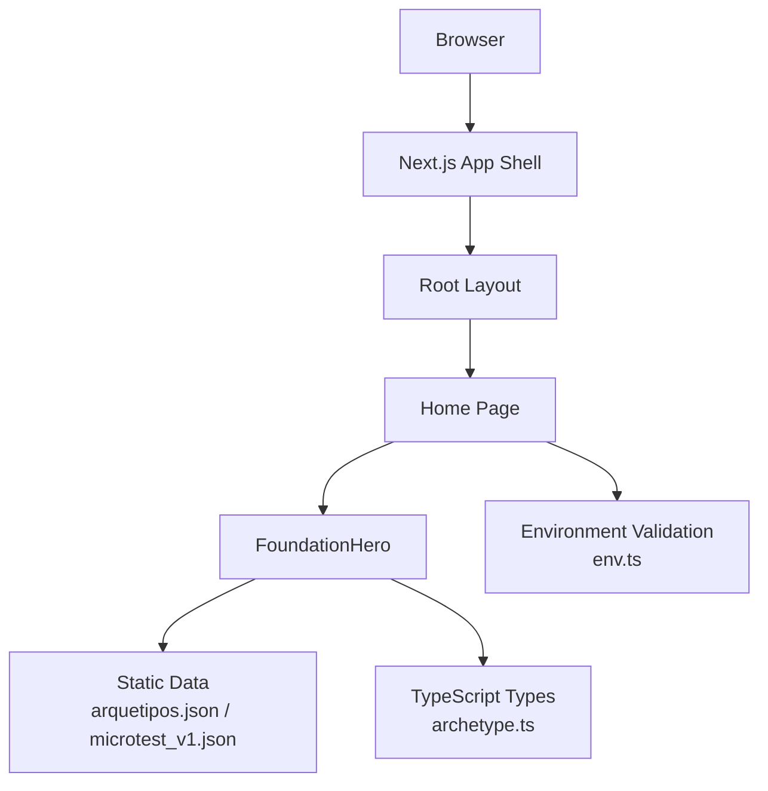
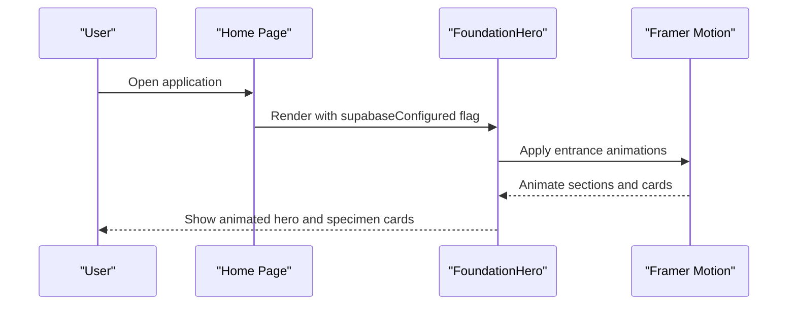
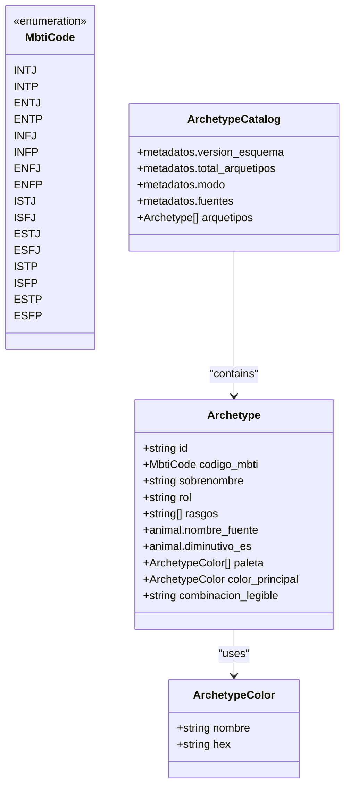
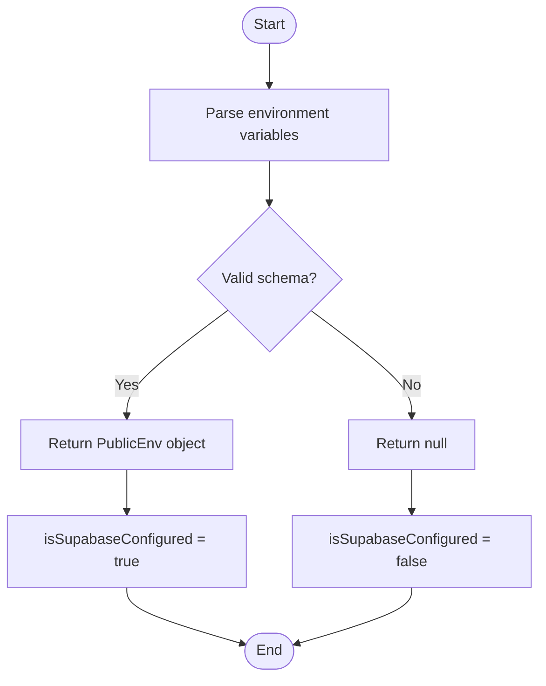
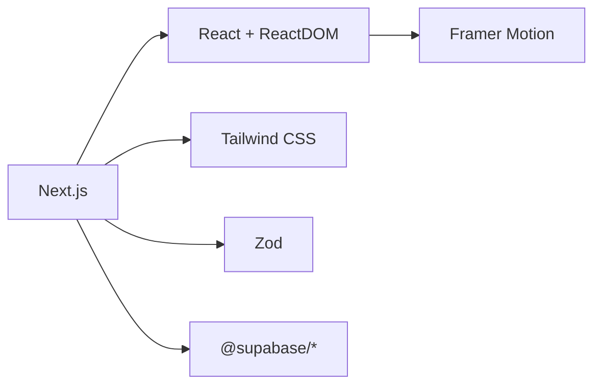

# Project Overview

<cite>
**Referenced Files in This Document**
- [package.json](file://package.json)
- [next.config.ts](file://next.config.ts)
- [src/app/layout.tsx](file://src/app/layout.tsx)
- [src/app/page.tsx](file://src/app/page.tsx)
- [src/components/foundation-hero.tsx](file://src/components/foundation-hero.tsx)
- [src/lib/env.ts](file://src/lib/env.ts)
- [src/types/archetype.ts](file://src/types/archetype.ts)
- [data/arquetipos.json](file://data/arquetipos.json)
- [data/microtest_v1.json](file://data/microtest_v1.json)
</cite>

## Table of Contents
1. [Introduction](#introduction)
2. [Project Structure](#project-structure)
3. [Core Components](#core-components)
4. [Architecture Overview](#architecture-overview)
5. [Detailed Component Analysis](#detailed-component-analysis)
6. [Dependency Analysis](#dependency-analysis)
7. [Performance Considerations](#performance-considerations)
8. [Troubleshooting Guide](#troubleshooting-guide)
9. [Conclusion](#conclusion)

## Introduction
ZooMatch is a creative personality assessment tool that maps MBTI personality types to animal archetypes and curated color palettes. The application presents a playful, field-note-inspired experience where users explore how their personality aligns with an animal instinct and a visual language. It combines static archetype data with animated UI interactions and responsive design to make personality exploration engaging and accessible.

At its core, ZooMatch:
- Maps each MBTI type to an archetype with an associated animal and color palette.
- Renders archetype information as static, curated data for immediate discovery.
- Provides an animated foundation hero section that introduces the concept and highlights selected specimens.
- Supports optional Supabase configuration through environment validation.

Target audience and use cases:
- Individuals curious about their personality style in a fun, visual format.
- Educators or facilitators using personality concepts for workshops or team-building activities.
- Designers and developers exploring archetype-driven UI patterns and color systems.
- Anyone seeking a lighthearted way to understand personality differences through animals and colors.

Conceptual overview for beginners:
Think of ZooMatch as a field guide to your personality. Each MBTI type is represented by an animal archetype and a signature color palette. You can browse these archetypes, see how they are described, and observe how different personalities express themselves through distinct visual languages.

Technical overview for experienced developers:
The project is a Next.js application using React, TypeScript, Tailwind CSS, and Framer Motion for animations. Archetype data is stored statically in JSON and typed via TypeScript interfaces. The app validates public environment variables with Zod and conditionally renders UI based on Supabase configuration.

## Project Structure
ZooMatch follows a clean, feature-oriented structure:
- Data layer: Static JSON files define archetype catalogs and microtest items.
- Types: TypeScript interfaces model archetype structures and metadata.
- Components: A foundation hero component provides the main landing experience with animations.
- App shell: Next.js layout and page components set up metadata and render the foundation hero.
- Environment utilities: Validation helpers ensure required environment variables are present.

**Diagram sources**
- [src/app/layout.tsx:6-16](file://src/app/layout.tsx#L6-L16)
- [src/app/page.tsx:1-10](file://src/app/page.tsx#L1-L10)
- [src/components/foundation-hero.tsx:15-117](file://src/components/foundation-hero.tsx#L15-L117)
- [data/arquetipos.json:1-592](file://data/arquetipos.json#L1-L592)
- [data/microtest_v1.json:1-273](file://data/microtest_v1.json#L1-L273)
- [src/types/archetype.ts:1-47](file://src/types/archetype.ts#L1-L47)
- [src/lib/env.ts:1-26](file://src/lib/env.ts#L1-L26)

**Section sources**
- [src/app/layout.tsx:1-17](file://src/app/layout.tsx#L1-L17)
- [src/app/page.tsx:1-10](file://src/app/page.tsx#L1-L10)
- [src/components/foundation-hero.tsx:1-117](file://src/components/foundation-hero.tsx#L1-L117)
- [data/arquetipos.json:1-592](file://data/arquetipos.json#L1-L592)
- [data/microtest_v1.json:1-273](file://data/microtest_v1.json#L1-L273)
- [src/types/archetype.ts:1-47](file://src/types/archetype.ts#L1-L47)
- [src/lib/env.ts:1-26](file://src/lib/env.ts#L1-L26)

## Core Components
This section outlines the primary building blocks of ZooMatch and their responsibilities.

- Root Layout: Sets global metadata and HTML structure.
- Home Page: Renders the FoundationHero component and passes Supabase configuration status.
- FoundationHero: Animated introduction showcasing personality mapped to animal archetypes and color swatches; includes responsive grid and motion transitions.
- Archetype Types: Strongly typed models for archetype data and catalog metadata.
- Environment Utilities: Validates public environment variables for Supabase integration.

Key features:
- Animated UI interactions: Smooth entrance animations and staggered reveals using Framer Motion.
- Responsive design: Fluid typography and adaptive grids across screen sizes.
- Static archetype data rendering: Archetypes and palettes are defined in JSON and consumed by the UI.

Practical examples:
- Browsing archetypes: Users see a curated list of MBTI-to-animal mappings with color swatches and descriptive labels.
- Observing animations: The hero section animates text and specimen cards into view, respecting reduced motion preferences.
- Checking configuration: The header shows a status indicator reflecting whether Supabase is configured.

**Section sources**
- [src/app/layout.tsx:6-16](file://src/app/layout.tsx#L6-L16)
- [src/app/page.tsx:1-10](file://src/app/page.tsx#L1-L10)
- [src/components/foundation-hero.tsx:15-117](file://src/components/foundation-hero.tsx#L15-L117)
- [src/types/archetype.ts:1-47](file://src/types/archetype.ts#L1-L47)
- [src/lib/env.ts:1-26](file://src/lib/env.ts#L1-L26)

## Architecture Overview
ZooMatch’s architecture centers around a Next.js app shell that renders a single-page experience focused on archetype discovery. The data layer is static JSON, while the UI layer uses React components with Framer Motion for animations. Environment validation ensures optional Supabase integration.

**Diagram sources**
- [src/app/layout.tsx:11-16](file://src/app/layout.tsx#L11-L16)
- [src/app/page.tsx:4-9](file://src/app/page.tsx#L4-L9)
- [src/components/foundation-hero.tsx:15-117](file://src/components/foundation-hero.tsx#L15-L117)
- [data/arquetipos.json:1-592](file://data/arquetipos.json#L1-L592)
- [data/microtest_v1.json:1-273](file://data/microtest_v1.json#L1-L273)
- [src/types/archetype.ts:1-47](file://src/types/archetype.ts#L1-L47)
- [src/lib/env.ts:1-26](file://src/lib/env.ts#L1-L26)

## Detailed Component Analysis

### FoundationHero Component
The FoundationHero component serves as the entry point for the user experience. It introduces the concept of mapping personality to animal archetypes and color palettes, and showcases selected specimens with animated cards.

Responsibilities:
- Present a compelling headline and description aligned with the “field note” theme.
- Render a responsive grid containing introductory content and specimen cards.
- Animate elements using Framer Motion while respecting accessibility preferences (reduced motion).
- Display a status indicator based on Supabase configuration.

Key implementation details:
- Uses motion props for entrance animations and staggered delays for specimen cards.
- Applies responsive classes for mobile, tablet, and desktop layouts.
- Integrates color swatches and MBTI codes to illustrate personality-animal mappings.

**Diagram sources**
- [src/app/page.tsx:4-9](file://src/app/page.tsx#L4-L9)
- [src/components/foundation-hero.tsx:15-117](file://src/components/foundation-hero.tsx#L15-L117)

**Section sources**
- [src/components/foundation-hero.tsx:1-117](file://src/components/foundation-hero.tsx#L1-L117)

### Archetype Data Model
The archetype data model defines the structure of personality-animal mappings and color palettes. It ensures type safety and consistency across the application.

Core types:
- MbtiCode: Enumerated MBTI codes covering all 16 types.
- ArchetypeColor: Represents a named color with a hex value.
- Archetype: Captures MBTI code, nickname, role, traits, animal mapping, palette, primary color, and a readable combination label.
- ArchetypeCatalog: Wraps metadata and the array of archetypes.

Usage:
- Static JSON files conform to these types, enabling reliable rendering and future extensibility.
- The FoundationHero component references archetype-related concepts such as MBTI codes, animal names, and color swatches.

**Diagram sources**
- [src/types/archetype.ts:1-47](file://src/types/archetype.ts#L1-L47)

**Section sources**
- [src/types/archetype.ts:1-47](file://src/types/archetype.ts#L1-L47)
- [data/arquetipos.json:1-592](file://data/arquetipos.json#L1-L592)

### Microtest Items Model
The microtest data model defines questionnaire items used for educational and entertainment purposes. It includes metadata, Likert scale definitions, dimensions, sources, and weighted items.

Highlights:
- Metadata specifies version, language, total items, categories, scoring method, and traceability notes.
- Dimensions cover Big Five, MBTI, relationships, and gender-related constructs.
- Sources document licensing and attribution, including original ZooMatch items and external references.
- Items include polarity and weights per dimension for scoring.

Use cases:
- Educational assessments and interactive quizzes.
- Extending ZooMatch with additional personality insights beyond archetype browsing.

**Section sources**
- [data/microtest_v1.json:1-273](file://data/microtest_v1.json#L1-L273)

### Environment Validation
The environment utility validates public environment variables required for Supabase integration. It returns null if configuration is missing, allowing the UI to adapt accordingly.

Behavior:
- getPublicEnv parses and validates environment variables using Zod.
- isSupabaseConfigured returns a boolean indicating whether Supabase is properly configured.
- The FoundationHero component receives this flag to display a status indicator.

**Diagram sources**
- [src/lib/env.ts:1-26](file://src/lib/env.ts#L1-L26)

**Section sources**
- [src/lib/env.ts:1-26](file://src/lib/env.ts#L1-L26)
- [src/components/foundation-hero.tsx:15-32](file://src/components/foundation-hero.tsx#L15-L32)

## Dependency Analysis
ZooMatch relies on a modern stack optimized for developer experience and runtime performance:
- Next.js for routing, server-side capabilities, and build-time optimizations.
- React and ReactDOM for component-based UI.
- Framer Motion for smooth animations and motion primitives.
- Tailwind CSS for utility-first styling and responsive design.
- Zod for runtime validation of environment variables.
- Supabase client libraries for optional backend integration.

**Diagram sources**
- [package.json:17-25](file://package.json#L17-L25)
- [package.json:27-38](file://package.json#L27-L38)

**Section sources**
- [package.json:1-40](file://package.json#L1-L40)
- [next.config.ts:1-8](file://next.config.ts#L1-L8)

## Performance Considerations
- Static data rendering: Archetype catalogs and microtest items are loaded from local JSON files, minimizing network overhead and ensuring fast initial load times.
- Animation efficiency: Framer Motion animations respect reduced motion preferences, improving accessibility and reducing unnecessary reflows.
- Build-time optimizations: Next.js strict mode and typed routes improve reliability and developer productivity without impacting runtime performance.
- Styling strategy: Tailwind CSS enables efficient, utility-first styles that minimize CSS bloat and support responsive layouts.

[No sources needed since this section provides general guidance]

## Troubleshooting Guide
Common issues and resolutions:
- Missing Supabase configuration: If Supabase environment variables are not set, the status indicator will reflect that the foundation is ready but not connected. Ensure NEXT_PUBLIC_SUPABASE_URL and NEXT_PUBLIC_SUPABASE_PUBLISHABLE_KEY are defined.
- Animation glitches: On devices with reduced motion enabled, animations are disabled automatically. Verify that motion settings are respected by checking browser accessibility preferences.
- Type errors: Ensure archetype data conforms to the Archetype and ArchetypeCatalog types. Mismatches in JSON structure may cause runtime issues during rendering.

**Section sources**
- [src/lib/env.ts:10-26](file://src/lib/env.ts#L10-L26)
- [src/components/foundation-hero.tsx:15-32](file://src/components/foundation-hero.tsx#L15-L32)

## Conclusion
ZooMatch offers a creative and accessible way to explore personality through animal archetypes and color palettes. Its architecture combines static data modeling, animated UI interactions, and responsive design to deliver an engaging experience. Whether you are a beginner discovering your personality-animal mapping or a developer extending the archetype system, ZooMatch provides a solid foundation for both conceptual understanding and technical implementation.

[No sources needed since this section summarizes without analyzing specific files]