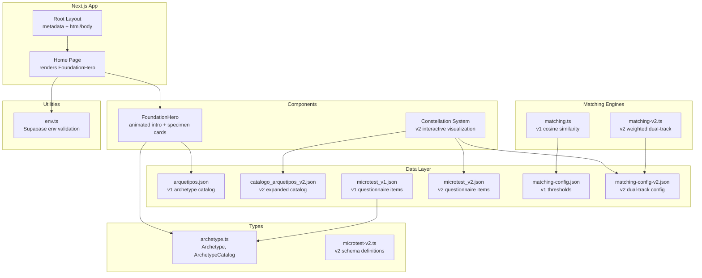
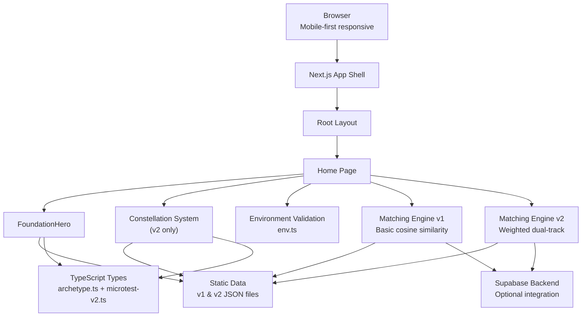
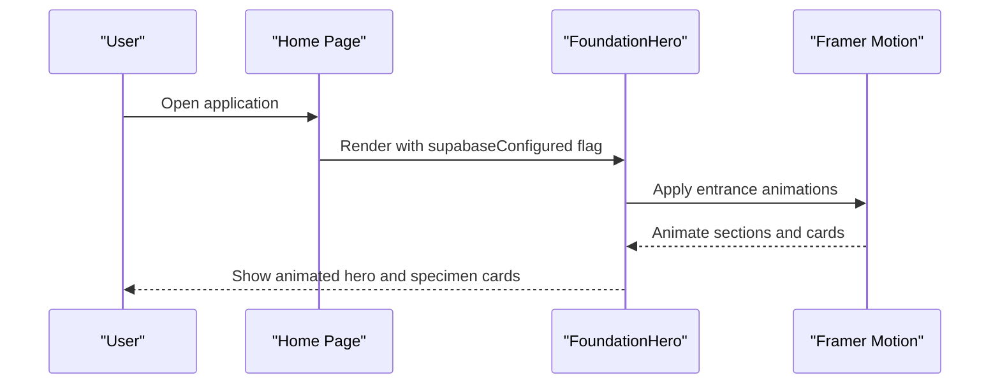
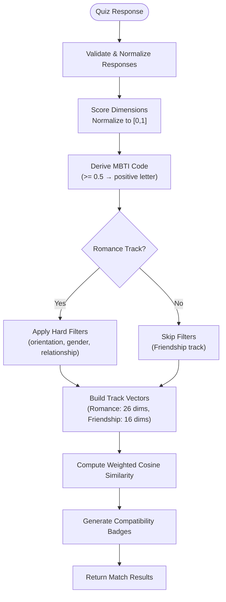
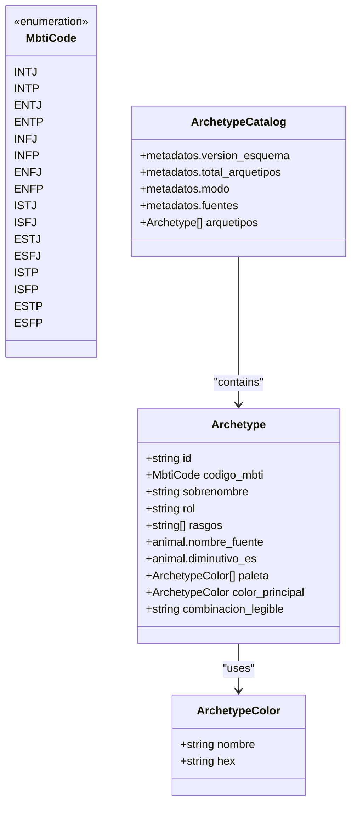
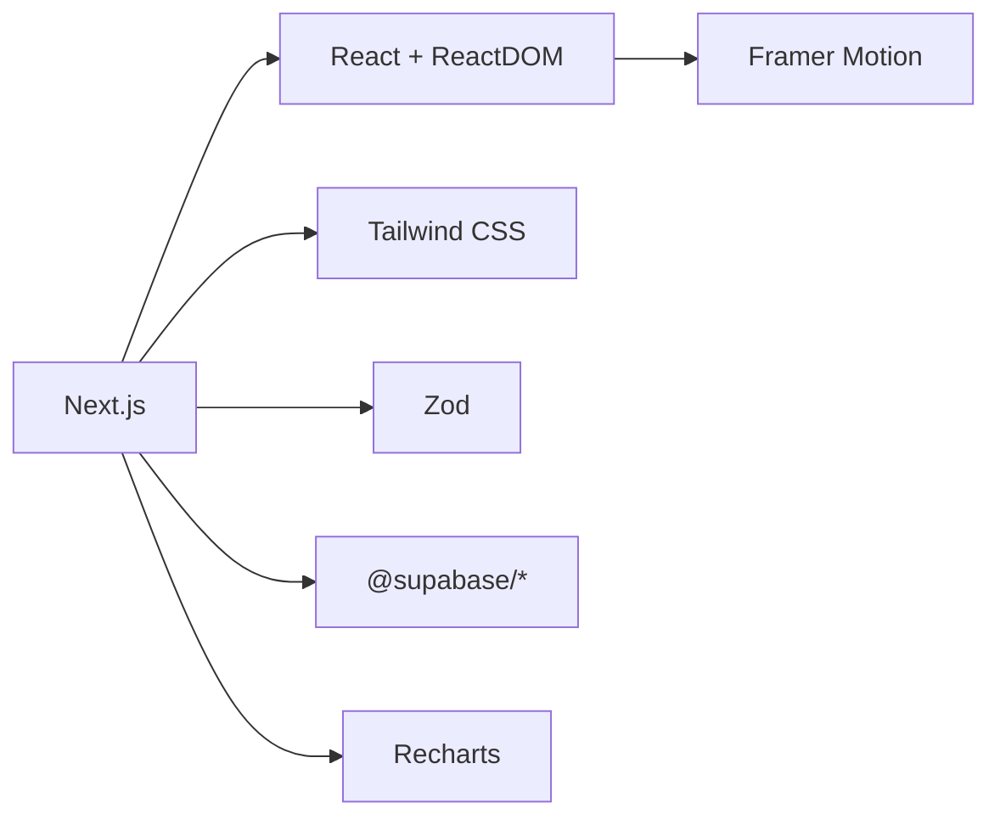

# Project Overview

<cite>
**Referenced Files in This Document**
- [README.md](file://README.md)
- [CONTEXTO_PROYECTO.md](file://CONTEXTO_PROYECTO.md)
- [package.json](file://package.json)
- [next.config.ts](file://next.config.ts)
- [src/app/layout.tsx](file://src/app/layout.tsx)
- [src/app/page.tsx](file://src/app/page.tsx)
- [src/components/foundation-hero.tsx](file://src/components/foundation-hero.tsx)
- [src/lib/env.ts](file://src/lib/env.ts)
- [src/types/archetype.ts](file://src/types/archetype.ts)
- [data/arquetipos.json](file://data/arquetipos.json)
- [data/microtest_v1.json](file://data/microtest_v1.json)
- [data/matching-config-v2.json](file://data/matching-config-v2.json)
- [src/lib/matching-v2.ts](file://src/lib/matching-v2.ts)
</cite>

## Update Summary
**Changes Made**
- Enhanced with comprehensive project overview from new README.md
- Added dual-version architecture documentation (v1 vs v2)
- Integrated key design principles including privacy by design and deterministic core logic
- Updated mobile-first web application description
- Expanded technical architecture details for both versions
- Added constellation visualization system documentation

## Table of Contents
1. [Introduction](#introduction)
2. [Project Structure](#project-structure)
3. [Core Components](#core-components)
4. [Architecture Overview](#architecture-overview)
5. [Detailed Component Analysis](#detailed-component-analysis)
6. [Dependency Analysis](#dependency-analysis)
7. [Performance Considerations](#performance-considerations)
8. [Troubleshooting Guide](#troubleshooting-guide)
9. [Conclusion](#conclusion)

## Introduction
ENES ZooMatch is a creative personality assessment tool that maps MBTI personality types to animal archetypes and curated color palettes. As a **mobile-first web application** designed for UNAM students, it provides an engaging platform where users explore how their personality aligns with animal instincts and visual languages through interactive constellations and animated UI interactions.

The application combines static archetype data with sophisticated matching algorithms, offering both a playful field-note-inspired experience and a robust psychometric assessment tool. It supports two coexisting versions: v1 for basic personality-animal mappings and v2 for advanced dual-track matching (romance + friendship) with constellation visualization.

At its core, ZooMatch:
- Maps each MBTI type to an archetype with an associated animal and color palette.
- Provides dual-version architecture supporting both simple exploration and complex matching scenarios.
- Renders archetype information as static, curated data for immediate discovery.
- Offers animated foundation hero sections and interactive constellation visualizations.
- Implements privacy-by-design principles with deterministic core logic.
- Supports optional Supabase configuration through environment validation.

Target audience and use cases:
- UNAM students seeking personality compatibility through gamified animal archetypes.
- Individuals curious about their personality style in a fun, visual format.
- Educators or facilitators using personality concepts for workshops or team-building activities.
- Designers and developers exploring archetype-driven UI patterns and color systems.
- Anyone seeking a lighthearted way to understand personality differences through animals and colors.

Conceptual overview for beginners:
Think of ZooMatch as a field guide to your personality. Each MBTI type is represented by an animal archetype and a signature color palette. You can browse these archetypes, see how they are described, observe how different personalities express themselves through distinct visual languages, and discover compatible matches through interactive constellations.

Technical overview for experienced developers:
The project is a Next.js application using React, TypeScript, Tailwind CSS, and Framer Motion for animations. It implements a dual-version architecture with v1 focusing on basic archetype exploration and v2 providing advanced matching capabilities with constellation visualization. Archetype data is stored statically in JSON and typed via TypeScript interfaces. The app validates public environment variables with Zod and conditionally renders UI based on Supabase configuration.

## Project Structure
ZooMatch follows a clean, feature-oriented structure with dual-version support:
- Data layer: Static JSON files define archetype catalogs, microtest items, and matching configurations for both v1 and v2.
- Types: TypeScript interfaces model archetype structures, microtest schemas, and metadata.
- Components: Foundation hero component provides the main landing experience with animations; constellation components handle v2 visualization.
- App shell: Next.js layout and page components set up metadata and render version-specific experiences.
- Environment utilities: Validation helpers ensure required environment variables are present.
- Matching engines: Separate implementations for v1 (basic cosine similarity) and v2 (weighted dual-track matching).

**Diagram sources**
- [src/app/layout.tsx:6-16](file://src/app/layout.tsx#L6-L16)
- [src/app/page.tsx:1-10](file://src/app/page.tsx#L1-L10)
- [src/components/foundation-hero.tsx:15-117](file://src/components/foundation-hero.tsx#L15-L117)
- [data/arquetipos.json:1-592](file://data/arquetipos.json#L1-L592)
- [data/catalogo_arquetipos_v2.json:1-1000](file://data/catalogo_arquetipos_v2.json#L1-L1000)
- [data/microtest_v1.json:1-273](file://data/microtest_v1.json#L1-L273)
- [data/microtest_v2.json:1-500](file://data/microtest_v2.json#L1-L500)
- [data/matching-config-v2.json:1-77](file://data/matching-config-v2.json#L1-L77)
- [src/types/archetype.ts:1-47](file://src/types/archetype.ts#L1-L47)
- [src/lib/env.ts:1-26](file://src/lib/env.ts#L1-L26)

**Section sources**
- [src/app/layout.tsx:1-17](file://src/app/layout.tsx#L1-L17)
- [src/app/page.tsx:1-10](file://src/app/page.tsx#L1-L10)
- [src/components/foundation-hero.tsx:1-117](file://src/components/foundation-hero.tsx#L1-L117)
- [data/arquetipos.json:1-592](file://data/arquetipos.json#L1-L592)
- [data/microtest_v1.json:1-273](file://data/microtest_v1.json#L1-L273)
- [data/matching-config-v2.json:1-77](file://data/matching-config-v2.json#L1-L77)
- [src/types/archetype.ts:1-47](file://src/types/archetype.ts#L1-L47)
- [src/lib/env.ts:1-26](file://src/lib/env.ts#L1-L26)

## Core Components
This section outlines the primary building blocks of ZooMatch and their responsibilities across both versions.

- Root Layout: Sets global metadata and HTML structure with Spanish locale support.
- Home Page: Renders the FoundationHero component and passes Supabase configuration status.
- FoundationHero: Animated introduction showcasing personality mapped to animal archetypes and color swatches; includes responsive grid and motion transitions.
- Constellation System: Interactive visualization for v2 showing matches as animated pixel sprites with physics-based positioning.
- Archetype Types: Strongly typed models for archetype data and catalog metadata.
- Environment Utilities: Validates public environment variables for Supabase integration.
- Matching Engines: Dual implementation supporting both v1 (basic) and v2 (advanced) matching algorithms.

Key features:
- **Dual-version architecture**: Seamless coexistence of v1 (basic archetype exploration) and v2 (advanced matching with constellation visualization).
- **Privacy by design**: HMAC-SHA-256 hashing for user identification, aggregated admin metrics, and secure API endpoints.
- **Deterministic core logic**: All matching, scoring, calibration, and sprite generation functions are pure and side-effect free.
- **Mobile-first responsive design**: Fluid typography and adaptive grids across screen sizes optimized for mobile devices.
- **Static archetype data rendering**: Archetypes and palettes are defined in JSON and consumed by the UI.
- **Interactive constellation visualization**: Physics-based positioning of animated pixel sprites representing personality matches.

Practical examples:
- Browsing archetypes: Users see a curated list of MBTI-to-animal mappings with color swatches and descriptive labels.
- Observing animations: The hero section animates text and specimen cards into view, respecting reduced motion preferences.
- Exploring constellations: V2 users interact with animated constellations showing compatible matches as draggable pixel sprites.
- Checking configuration: The header shows a status indicator reflecting whether Supabase is configured.

**Section sources**
- [src/app/layout.tsx:6-16](file://src/app/layout.tsx#L6-L16)
- [src/app/page.tsx:1-10](file://src/app/page.tsx#L1-L10)
- [src/components/foundation-hero.tsx:15-117](file://src/components/foundation-hero.tsx#L15-L117)
- [src/lib/matching-v2.ts:1-200](file://src/lib/matching-v2.ts#L1-L200)
- [src/types/archetype.ts:1-47](file://src/types/archetype.ts#L1-L47)
- [src/lib/env.ts:1-26](file://src/lib/env.ts#L1-L26)

## Architecture Overview
ZooMatch's architecture centers around a Next.js app shell that renders dual-version experiences focused on archetype discovery and personality matching. The data layer is static JSON, while the UI layer uses React components with Framer Motion for animations. Environment validation ensures optional Supabase integration.

**Diagram sources**
- [src/app/layout.tsx:11-16](file://src/app/layout.tsx#L11-L16)
- [src/app/page.tsx:4-9](file://src/app/page.tsx#L4-L9)
- [src/components/foundation-hero.tsx:15-117](file://src/components/foundation-hero.tsx#L15-L117)
- [data/arquetipos.json:1-592](file://data/arquetipos.json#L1-L592)
- [data/microtest_v1.json:1-273](file://data/microtest_v1.json#L1-L273)
- [data/microtest_v2.json:1-500](file://data/microtest_v2.json#L1-L500)
- [data/matching-config-v2.json:1-77](file://data/matching-config-v2.json#L1-L77)
- [src/types/archetype.ts:1-47](file://src/types/archetype.ts#L1-L47)
- [src/lib/env.ts:1-26](file://src/lib/env.ts#L1-L26)
- [src/lib/matching-v2.ts:1-200](file://src/lib/matching-v2.ts#L1-L200)

## Detailed Component Analysis

### FoundationHero Component
The FoundationHero component serves as the entry point for the user experience. It introduces the concept of mapping personality to animal archetypes and color palettes, and showcases selected specimens with animated cards.

Responsibilities:
- Present a compelling headline and description aligned with the "field note" theme.
- Render a responsive grid containing introductory content and specimen cards.
- Animate elements using Framer Motion while respecting accessibility preferences (reduced motion).
- Display a status indicator based on Supabase configuration.

Key implementation details:
- Uses motion props for entrance animations and staggered delays for specimen cards.
- Applies responsive classes for mobile, tablet, and desktop layouts.
- Integrates color swatches and MBTI codes to illustrate personality-animal mappings.

**Diagram sources**
- [src/app/page.tsx:4-9](file://src/app/page.tsx#L4-L9)
- [src/components/foundation-hero.tsx:15-117](file://src/components/foundation-hero.tsx#L15-L117)

**Section sources**
- [src/components/foundation-hero.tsx:1-117](file://src/components/foundation-hero.tsx#L1-L117)

### Dual-Version Architecture
ZooMatch implements a sophisticated dual-version architecture allowing both v1 and v2 to coexist seamlessly:

**Version 1 (v1)**:
- Single track focus (romance/affinity)
- 24 items with 17 dimensions (13 matching + 4 MBTI), Likert scale 1-4
- Basic cosine similarity matching with threshold > 0.9920196533203125
- 16 MBTI archetypes with animal mappings
- Simple list-based match results

**Version 2 (v2)**:
- Dual track approach (romance + friendship)
- 60 items with 30 dimensions, Likert scale 1-5
- Weighted cosine similarity with category-based filtering
- Hard filters for romance track (orientation, gender identity, relationship type)
- 61 animals × 55 colors/textures catalog
- Interactive constellation visualization with physics-based positioning

Key architectural decisions:
- Additive migrations preserving v1 functionality
- Separate configuration files (`matching-config.json` vs `matching-config-v2.json`)
- Distinct route paths (`/cuestionario` vs `/cuestionario-v2`)
- Shared core libraries with version-specific implementations

**Section sources**
- [README.md:71-97](file://README.md#L71-L97)
- [CONTEXTO_PROYECTO.md:16-33](file://CONTEXTO_PROYECTO.md#L16-L33)
- [data/matching-config-v2.json:1-77](file://data/matching-config-v2.json#L1-L77)

### Matching Engine v2
The v2 matching engine represents the core mathematical logic for the advanced dual-track matching system. It processes completed questionnaires into scored profiles, applies hard filters, and computes weighted cosine similarity across two independent tracks.

Core responsibilities:
- Score quiz responses into normalized dimension scores
- Derive MBTI codes from dimension thresholds
- Apply hard filters for romance track compatibility
- Compute weighted similarity scores per category
- Generate compatibility badges with human-readable labels
- Maintain deterministic, side-effect-free operations

Implementation highlights:
- Pure mathematical functions with no external dependencies
- Category-based weighting system (personalidad 0.25, intimidad 0.25, valores 0.25, cultural 0.20, identidad 0.05 for romance)
- Threshold-based matching (romance > 0.80, amistad > 0.75)
- Comprehensive badge system with emoji icons and Spanish labels

**Diagram sources**
- [src/lib/matching-v2.ts:1-200](file://src/lib/matching-v2.ts#L1-L200)

**Section sources**
- [src/lib/matching-v2.ts:1-200](file://src/lib/matching-v2.ts#L1-L200)

### Archetype Data Model
The archetype data model defines the structure of personality-animal mappings and color palettes. It ensures type safety and consistency across the application.

Core types:
- MbtiCode: Enumerated MBTI codes covering all 16 types.
- ArchetypeColor: Represents a named color with a hex value.
- Archetype: Captures MBTI code, nickname, role, traits, animal mapping, palette, primary color, and a readable combination label.
- ArchetypeCatalog: Wraps metadata and the array of archetypes.

Usage:
- Static JSON files conform to these types, enabling reliable rendering and future extensibility.
- The FoundationHero component references archetype-related concepts such as MBTI codes, animal names, and color swatches.

**Diagram sources**
- [src/types/archetype.ts:1-47](file://src/types/archetype.ts#L1-L47)

**Section sources**
- [src/types/archetype.ts:1-47](file://src/types/archetype.ts#L1-L47)
- [data/arquetipos.json:1-592](file://data/arquetipos.json#L1-L592)

### Microtest Items Model
The microtest data model defines questionnaire items used for educational and entertainment purposes. It includes metadata, Likert scale definitions, dimensions, sources, and weighted items.

Highlights:
- Metadata specifies version, language, total items, categories, scoring method, and traceability notes.
- Dimensions cover Big Five, MBTI, relationships, and gender-related constructs.
- Sources document licensing and attribution, including original ZooMatch items and external references.
- Items include polarity and weights per dimension for scoring.

Use cases:
- Educational assessments and interactive quizzes.
- Extending ZooMatch with additional personality insights beyond archetype browsing.

**Section sources**
- [data/microtest_v1.json:1-273](file://data/microtest_v1.json#L1-L273)

### Environment Validation
The environment utility validates public environment variables required for Supabase integration. It returns null if configuration is missing, allowing the UI to adapt accordingly.

Behavior:
- getPublicEnv parses and validates environment variables using Zod.
- isSupabaseConfigured returns a boolean indicating whether Supabase is properly configured.
- The FoundationHero component receives this flag to display a status indicator.

**Diagram sources**
- [src/lib/env.ts:1-26](file://src/lib/env.ts#L1-L26)

**Section sources**
- [src/lib/env.ts:1-26](file://src/lib/env.ts#L1-L26)
- [src/components/foundation-hero.tsx:15-32](file://src/components/foundation-hero.tsx#L15-L32)

## Dependency Analysis
ZooMatch relies on a modern stack optimized for developer experience and runtime performance, supporting both mobile-first design and advanced matching capabilities:
- Next.js for routing, server-side capabilities, and build-time optimizations.
- React and ReactDOM for component-based UI.
- Framer Motion for smooth animations and motion primitives.
- Tailwind CSS for utility-first styling and responsive design.
- Zod for runtime validation of environment variables.
- Supabase client libraries for optional backend integration.
- Recharts for admin dashboard visualizations.

**Diagram sources**
- [package.json:17-25](file://package.json#L17-L25)
- [package.json:27-38](file://package.json#L27-L38)

**Section sources**
- [package.json:1-40](file://package.json#L1-L40)
- [next.config.ts:1-8](file://next.config.ts#L1-L8)

## Performance Considerations
- **Static data rendering**: Archetype catalogs and microtest items are loaded from local JSON files, minimizing network overhead and ensuring fast initial load times.
- **Animation efficiency**: Framer Motion animations respect reduced motion preferences, improving accessibility and reducing unnecessary reflows.
- **Build-time optimizations**: Next.js strict mode and typed routes improve reliability and developer productivity without impacting runtime performance.
- **Styling strategy**: Tailwind CSS enables efficient, utility-first styles that minimize CSS bloat and support responsive layouts.
- **Dual-version optimization**: Both v1 and v2 share common assets while maintaining separate matching logic for optimal performance.
- **Constellation rendering**: Physics-based positioning calculations are optimized for smooth animation and minimal re-rendering.

## Troubleshooting Guide
Common issues and resolutions:
- **Missing Supabase configuration**: If Supabase environment variables are not set, the status indicator will reflect that the foundation is ready but not connected. Ensure NEXT_PUBLIC_SUPABASE_URL and NEXT_PUBLIC_SUPABASE_PUBLISHABLE_KEY are defined.
- **Animation glitches**: On devices with reduced motion enabled, animations are disabled automatically. Verify that motion settings are respected by checking browser accessibility preferences.
- **Type errors**: Ensure archetype data conforms to the Archetype and ArchetypeCatalog types. Mismatches in JSON structure may cause runtime issues during rendering.
- **Version conflicts**: When working with dual-version architecture, ensure you're using the correct configuration files (`matching-config.json` for v1, `matching-config-v2.json` for v2).
- **Mobile responsiveness**: Test on various device sizes to ensure proper responsive behavior, especially for constellation visualization components.

**Section sources**
- [src/lib/env.ts:10-26](file://src/lib/env.ts#L10-L26)
- [src/components/foundation-hero.tsx:15-32](file://src/components/foundation-hero.tsx#L15-L32)

## Conclusion
ENES ZooMatch offers a creative and accessible way to explore personality through animal archetypes and color palettes, enhanced with sophisticated dual-version architecture and interactive constellation visualization. Its architecture combines static data modeling, animated UI interactions, responsive design, and advanced matching algorithms to deliver an engaging experience. Whether you are a beginner discovering your personality-animal mapping or a developer extending the archetype system with v2 capabilities, ZooMatch provides a solid foundation for both conceptual understanding and technical implementation.

The project's commitment to privacy by design, deterministic core logic, and mobile-first development ensures both ethical considerations and broad accessibility. The dual-version approach allows for gradual evolution while maintaining backward compatibility, making it suitable for both educational purposes and advanced personality assessment scenarios.