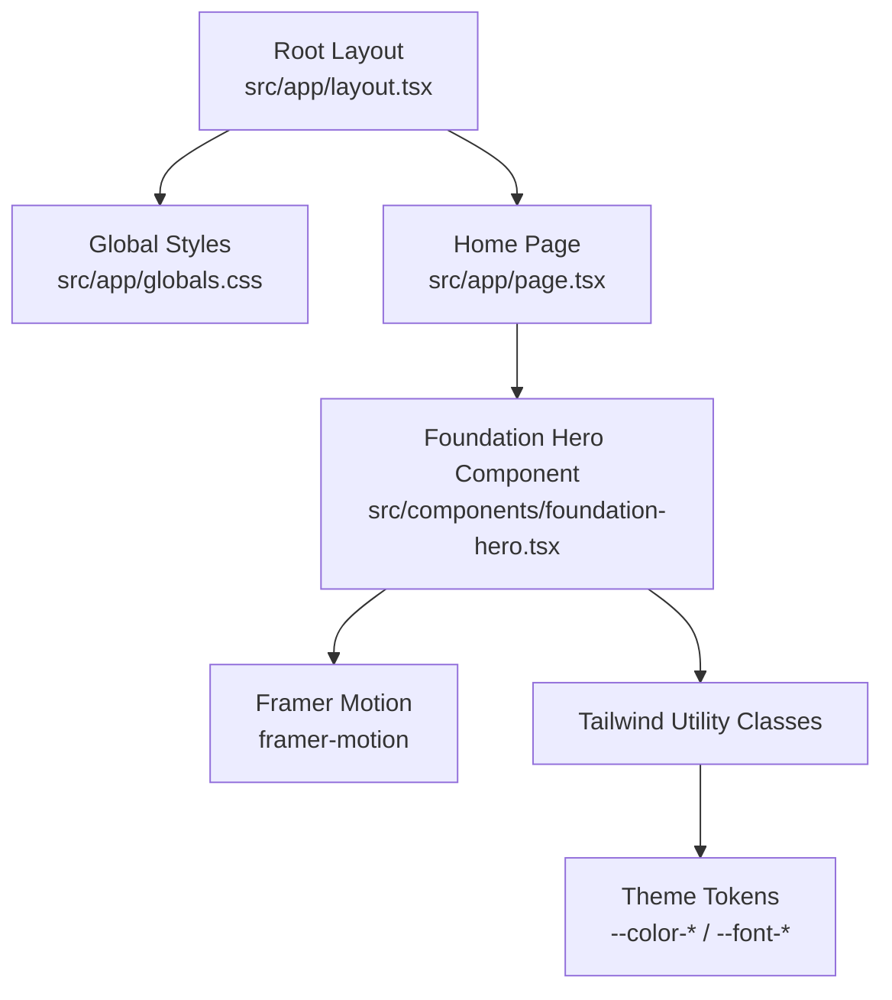
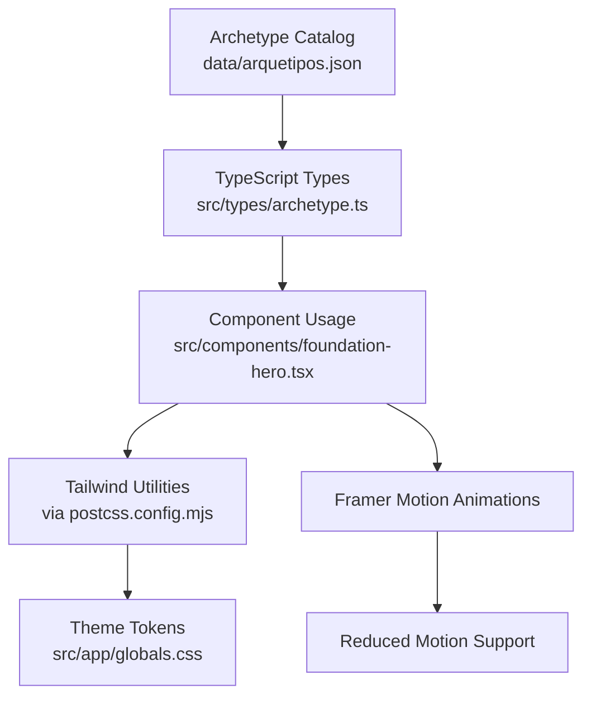
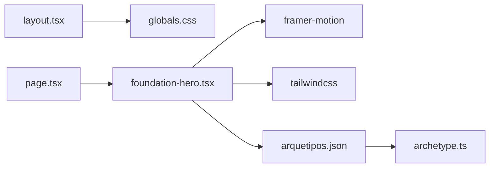

# Styling & Design System

<cite>
**Referenced Files in This Document**
- [globals.css](file://src/app/globals.css)
- [layout.tsx](file://src/app/layout.tsx)
- [page.tsx](file://src/app/page.tsx)
- [foundation-hero.tsx](file://src/components/foundation-hero.tsx)
- [archetype.ts](file://src/types/archetype.ts)
- [arquetipos.json](file://data/arquetipos.json)
- [postcss.config.mjs](file://postcss.config.mjs)
- [package.json](file://package.json)
</cite>

## Table of Contents
1. [Introduction](#introduction)
2. [Project Structure](#project-structure)
3. [Core Components](#core-components)
4. [Architecture Overview](#architecture-overview)
5. [Detailed Component Analysis](#detailed-component-analysis)
6. [Dependency Analysis](#dependency-analysis)
7. [Performance Considerations](#performance-considerations)
8. [Troubleshooting Guide](#troubleshooting-guide)
9. [Conclusion](#conclusion)

## Introduction
This document explains the styling and design system for ZooMatch. It covers:
- Tailwind CSS configuration via PostCSS and global theme tokens
- Global styles, typography, color palette, and background treatments
- Responsive design patterns used across components
- The archetype-derived color system and how it maps to UI tokens
- Animation guidelines using Framer Motion with accessibility support
- Cross-browser compatibility notes and performance optimizations for animations and transitions

The goal is to help designers and developers consistently apply colors, typography, spacing, motion, and responsive rules while keeping performance and accessibility in mind.

## Project Structure
ZooMatch uses a Next.js App Router layout that imports global styles once at the root. Tailwind CSS v4 is configured through PostCSS, and all theme tokens are declared in a single global stylesheet.

**Diagram sources**
- [layout.tsx:4-16](file://src/app/layout.tsx#L4-L16)
- [page.tsx:1-10](file://src/app/page.tsx#L1-L10)
- [foundation-hero.tsx:1-117](file://src/components/foundation-hero.tsx#L1-L117)
- [globals.css:1-12](file://src/app/globals.css#L1-L12)

**Section sources**
- [layout.tsx:4-16](file://src/app/layout.tsx#L4-L16)
- [page.tsx:1-10](file://src/app/page.tsx#L1-L10)
- [globals.css:1-12](file://src/app/globals.css#L1-L12)

## Core Components
- Global theme tokens define the color palette and fonts.
- Base HTML/body styles establish defaults like background, scroll behavior, and minimum viewport constraints.
- A grain overlay adds subtle texture.
- Specimen card styles provide hover effects and a shimmer animation.
- Reduced-motion preferences disable or minimize animations.

Key responsibilities:
- Color and font tokens: centralize brand colors and typefaces.
- Base styles: ensure consistent baseline behavior across browsers.
- Accessibility: honor reduced-motion preferences.
- Visual polish: selection color, smooth scrolling, and subtle gradients.

**Section sources**
- [globals.css:3-12](file://src/app/globals.css#L3-L12)
- [globals.css:14-38](file://src/app/globals.css#L14-L38)
- [globals.css:40-53](file://src/app/globals.css#L40-L53)
- [globals.css:55-80](file://src/app/globals.css#L55-L80)
- [globals.css:82-95](file://src/app/globals.css#L82-L95)

## Architecture Overview
The design system flows from data-driven archetypes into UI tokens and component styles:

**Diagram sources**
- [arquetipos.json:102-133](file://data/arquetipos.json#L102-L133)
- [archetype.ts:1-47](file://src/types/archetype.ts#L1-L47)
- [foundation-hero.tsx:1-117](file://src/components/foundation-hero.tsx#L1-L117)
- [postcss.config.mjs:1-7](file://postcss.config.mjs#L1-L7)
- [globals.css:3-12](file://src/app/globals.css#L3-L12)

## Detailed Component Analysis

### Global Styles and Theme Tokens
- Tailwind import and theme block declare custom colors and fonts.
- Root variables set default light mode, background, text color, and font family.
- Base resets include border-box sizing and smooth scrolling.
- Body background uses layered radial gradients with theme colors.
- Selection color uses the clay accent.
- Grain overlay provides a subtle noise texture.
- Specimen card styles implement hover transforms and a shimmer effect.
- Reduced-motion media query disables smooth scrolling and minimizes transition/animation durations.

Design tokens summary:
- Colors: paper, ink, moss, leaf, clay
- Fonts: display (serif), sans (sans-serif), mono (monospace)

Responsive considerations:
- Minimum width and height constraints on body ensure usability on small screens.
- Smooth scrolling is disabled when users prefer reduced motion.

Accessibility:
- Reduced-motion preference respected globally.
- Grain overlay is decorative and hidden from assistive technology.

**Section sources**
- [globals.css:1-12](file://src/app/globals.css#L1-L12)
- [globals.css:14-38](file://src/app/globals.css#L14-L38)
- [globals.css:40-53](file://src/app/globals.css#L40-L53)
- [globals.css:55-80](file://src/app/globals.css#L55-L80)
- [globals.css:82-95](file://src/app/globals.css#L82-L95)

### Foundation Hero Component
The hero demonstrates:
- Tailwind utility classes for layout, spacing, typography, and color application
- Framer Motion for entrance animations and staggered reveals
- Respect for reduced motion via useReducedMotion
- Semantic structure with accessible labels and aria attributes where appropriate

Responsiveness:
- Uses responsive breakpoints for padding and grid layout
- Scales typography with clamp() for fluid headings
- Adapts grid columns on larger screens

Animation guidelines:
- Initial states hide elements off-screen or transparent
- Animate to visible states with easing curves
- Staggered delays for list items
- Reduced motion path disables motion entirely

Cross-browser notes:
- Uses standard CSS properties supported by modern browsers
- Avoids experimental features; relies on widely supported Tailwind utilities

Performance:
- Animations are GPU-friendly transforms and opacity changes
- No heavy layout thrashing in animations
- Reduced motion path avoids unnecessary work

**Section sources**
- [foundation-hero.tsx:1-117](file://src/components/foundation-hero.tsx#L1-L117)

### Archetype Color System
The archetype catalog defines per-archetype palettes and primary colors. These values inform UI accents and swatches.

Data model:
- Each archetype includes a palette array with named colors and hex codes
- A primary color is selected from the palette
- A readable combination string links animal and color names

Integration points:
- TypeScript types enforce the shape of archetype data
- Components can consume archetype data to render swatches and labels
- Static examples in the hero demonstrate color usage

Token mapping guidance:
- Use archetype primary colors as semantic accents (e.g., status indicators, highlights)
- Use secondary palette colors for backgrounds, borders, and subtle emphasis
- Maintain contrast ratios against paper and ink for readability

**Section sources**
- [arquetipos.json:102-133](file://data/arquetipos.json#L102-L133)
- [arquetipos.json:209-239](file://data/arquetipos.json#L209-L239)
- [arquetipos.json:241-270](file://data/arquetipos.json#L241-L270)
- [arquetipos.json:450-484](file://data/arquetipos.json#L450-L484)
- [arquetipos.json:485-519](file://data/arquetipos.json#L485-L519)
- [arquetipos.json:520-554](file://data/arquetipos.json#L520-L554)
- [arquetipos.json:555-589](file://data/arquetipos.json#L555-L589)
- [archetype.ts:1-47](file://src/types/archetype.ts#L1-L47)

### Tailwind CSS Configuration
Tailwind is integrated via PostCSS with the official Tailwind PostCSS plugin. There is no separate tailwind.config file; theme customization occurs in the global stylesheet’s @theme block.

Configuration highlights:
- PostCSS plugin enables Tailwind processing
- Theme tokens are defined in globals.css under @theme
- Colors and fonts are exposed as CSS variables consumed by Tailwind utilities

**Section sources**
- [postcss.config.mjs:1-7](file://postcss.config.mjs#L1-L7)
- [globals.css:1-12](file://src/app/globals.css#L1-L12)

### Responsive Design Patterns
Observed patterns:
- Fluid typography using clamp() for large headings
- Responsive padding and grid layouts via Tailwind utilities
- Breakpoint-aware column switching for content sections
- Minimum viewport constraints to prevent layout breakage on small devices

Recommended practices:
- Prefer utility-first responsive classes for spacing and layout
- Use clamp() for scalable typography
- Keep interactive targets comfortably sized on touch devices
- Test at common breakpoints: mobile, tablet, desktop

**Section sources**
- [foundation-hero.tsx:19-66](file://src/components/foundation-hero.tsx#L19-L66)
- [foundation-hero.tsx:69-112](file://src/components/foundation-hero.tsx#L69-L112)
- [globals.css:30-38](file://src/app/globals.css#L30-L38)

### Animation Guidelines Using Framer Motion
Guidelines:
- Always check user motion preferences with useReducedMotion
- Provide fallback static states when motion is reduced
- Use transform and opacity for performant animations
- Apply easing curves for natural motion
- Stagger list item animations for visual hierarchy

Implementation references:
- Entrance animations for hero sections
- Staggered reveal for specimen cards
- Reduced motion disabling animations entirely

**Section sources**
- [foundation-hero.tsx:3-17](file://src/components/foundation-hero.tsx#L3-L17)
- [foundation-hero.tsx:35-40](file://src/components/foundation-hero.tsx#L35-L40)
- [foundation-hero.tsx:69-74](file://src/components/foundation-hero.tsx#L69-L74)
- [foundation-hero.tsx:84-105](file://src/components/foundation-hero.tsx#L84-L105)

### Accessibility Compliance
- Reduced motion preferences are honored globally and per-component
- Decorative elements use aria-hidden appropriately
- Semantic HTML structure supports screen readers
- Color choices should maintain sufficient contrast against backgrounds

Recommendations:
- Add explicit focus styles for interactive elements
- Ensure color contrast meets WCAG AA for text and important UI
- Validate dynamic color combinations derived from archetypes for contrast

**Section sources**
- [globals.css:82-95](file://src/app/globals.css#L82-L95)
- [foundation-hero.tsx:21-21](file://src/components/foundation-hero.tsx#L21-L21)
- [foundation-hero.tsx:26-31](file://src/components/foundation-hero.tsx#L26-L31)

### Custom Styles and Design Tokens
Custom styles:
- Grain overlay class for background texture
- Specimen card hover and shimmer effects
- Selection color customization

Design tokens:
- Colors: paper, ink, moss, leaf, clay
- Fonts: display, sans, mono

Usage examples:
- Backgrounds and surfaces using paper and moss
- Text and borders using ink and its opacity variants
- Accent highlights using leaf and clay

**Section sources**
- [globals.css:40-53](file://src/app/globals.css#L40-L53)
- [globals.css:55-80](file://src/app/globals.css#L55-L80)
- [globals.css:3-12](file://src/app/globals.css#L3-L12)

### Breakpoint Usage
Observed breakpoint usage:
- Small screens: compact padding and single-column layouts
- Medium screens: increased padding and two-column grids
- Large screens: side-by-side panels and expanded spacing

Best practices:
- Start with mobile-first utilities
- Scale spacing and typography progressively
- Ensure content remains readable and navigable at all sizes

**Section sources**
- [foundation-hero.tsx:19-66](file://src/components/foundation-hero.tsx#L19-L66)
- [foundation-hero.tsx:69-112](file://src/components/foundation-hero.tsx#L69-L112)

### Cross-Browser Compatibility
- Uses standard CSS properties and Tailwind utilities with broad browser support
- Avoids experimental features in favor of stable APIs
- Respects prefers-reduced-motion for accessibility across browsers

Recommendations:
- Test on latest Chrome, Firefox, Safari, and Edge
- Verify smooth scrolling behavior and reduced-motion handling
- Confirm gradient and blend-mode rendering consistency

**Section sources**
- [globals.css:26-28](file://src/app/globals.css#L26-L28)
- [globals.css:34-38](file://src/app/globals.css#L34-L38)
- [globals.css:45-53](file://src/app/globals.css#L45-L53)
- [globals.css:82-95](file://src/app/globals.css#L82-L95)

### Performance Optimization for Animations and Transitions
Optimizations applied:
- Animations rely on transform and opacity for GPU acceleration
- Transition durations are moderate to avoid jank
- Reduced motion path eliminates unnecessary work for sensitive users

Further recommendations:
- Batch DOM reads/writes to avoid layout thrashing
- Defer non-critical animations until after initial paint
- Monitor animation performance in DevTools and reduce complexity if needed

**Section sources**
- [foundation-hero.tsx:35-40](file://src/components/foundation-hero.tsx#L35-L40)
- [foundation-hero.tsx:69-74](file://src/components/foundation-hero.tsx#L69-L74)
- [foundation-hero.tsx:84-105](file://src/components/foundation-hero.tsx#L84-L105)
- [globals.css:82-95](file://src/app/globals.css#L82-L95)

## Dependency Analysis
Styling dependencies:
- Next.js layout imports global styles once
- Tailwind CSS processes utilities via PostCSS
- Framer Motion provides motion primitives
- Archetype data drives color and label content

**Diagram sources**
- [layout.tsx:4-16](file://src/app/layout.tsx#L4-L16)
- [page.tsx:1-10](file://src/app/page.tsx#L1-L10)
- [foundation-hero.tsx:1-117](file://src/components/foundation-hero.tsx#L1-L117)
- [arquetipos.json:102-133](file://data/arquetipos.json#L102-L133)
- [archetype.ts:1-47](file://src/types/archetype.ts#L1-L47)

**Section sources**
- [layout.tsx:4-16](file://src/app/layout.tsx#L4-L16)
- [page.tsx:1-10](file://src/app/page.tsx#L1-L10)
- [foundation-hero.tsx:1-117](file://src/components/foundation-hero.tsx#L1-L117)
- [arquetipos.json:102-133](file://data/arquetipos.json#L102-L133)
- [archetype.ts:1-47](file://src/types/archetype.ts#L1-L47)

## Performance Considerations
- Prefer utility-first styling to keep CSS minimal and scoped
- Use transform and opacity for animations to leverage GPU acceleration
- Honor reduced motion to improve UX for sensitive users
- Avoid heavy filters or complex blend modes on large areas unless necessary
- Monitor bundle size and runtime overhead of motion libraries

[No sources needed since this section provides general guidance]

## Troubleshooting Guide
Common issues and resolutions:
- Colors not applying: verify theme token names match Tailwind utility prefixes
- Animations not respecting preferences: ensure useReducedMotion is used and fallback states are provided
- Layout breaks on small screens: confirm minimum width/height constraints and responsive utilities
- Contrast problems: validate archetype-derived color combinations against backgrounds

Checklist:
- Confirm globals.css is imported in the root layout
- Validate PostCSS plugin is enabled
- Test reduced motion behavior across browsers
- Inspect computed styles for token resolution

**Section sources**
- [layout.tsx:4-16](file://src/app/layout.tsx#L4-L16)
- [postcss.config.mjs:1-7](file://postcss.config.mjs#L1-L7)
- [foundation-hero.tsx:3-17](file://src/components/foundation-hero.tsx#L3-L17)
- [globals.css:82-95](file://src/app/globals.css#L82-L95)

## Conclusion
ZooMatch’s design system centers on a clear set of theme tokens, utility-first styling with Tailwind, and thoughtful motion powered by Framer Motion. The archetype-driven color system provides rich, data-backed accents while maintaining accessibility and performance. By following the guidelines here—token usage, responsive patterns, animation best practices, and cross-browser checks—you can extend the system consistently and confidently.

[No sources needed since this section summarizes without analyzing specific files]