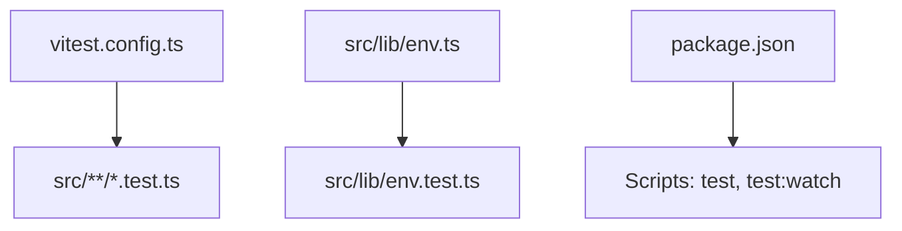
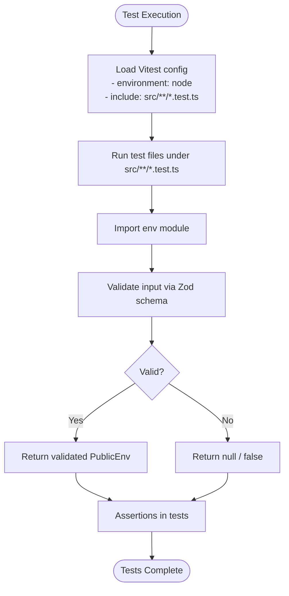
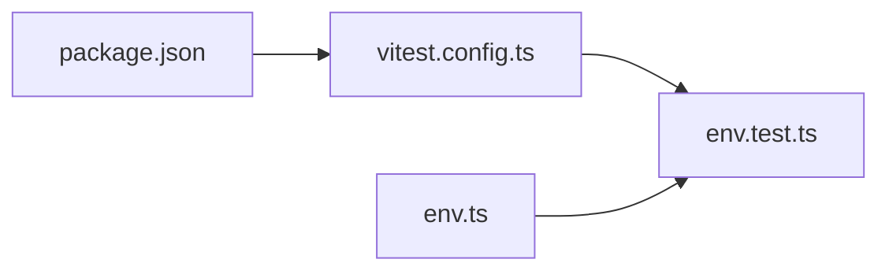

# Testing Strategy

<cite>
**Referenced Files in This Document**
- [vitest.config.ts](file://vitest.config.ts)
- [env.test.ts](file://src/lib/env.test.ts)
- [env.ts](file://src/lib/env.ts)
- [package.json](file://package.json)
</cite>

## Table of Contents
1. [Introduction](#introduction)
2. [Project Structure](#project-structure)
3. [Core Components](#core-components)
4. [Architecture Overview](#architecture-overview)
5. [Detailed Component Analysis](#detailed-component-analysis)
6. [Dependency Analysis](#dependency-analysis)
7. [Performance Considerations](#performance-considerations)
8. [Troubleshooting Guide](#troubleshooting-guide)
9. [Conclusion](#conclusion)
10. [Appendices](#appendices)

## Introduction
This document explains the testing strategy for ZooMatch, focusing on Vitest setup, unit testing strategies for environment configuration, and patterns used across the application. It covers test file organization, mocking strategies, coverage expectations, examples for components, utilities, and environment-dependent code, as well as continuous integration considerations and best practices.

## Project Structure
The repository uses a minimal structure with tests colocated near the code they validate:
- Test runner configuration is defined at the project root.
- Tests live under src and follow the pattern *.test.ts.
- Environment validation logic resides in src/lib/env.ts, with corresponding tests in src/lib/env.test.ts.

**Diagram sources**
- [vitest.config.ts:5-14](file://vitest.config.ts#L5-L14)
- [env.test.ts:1-29](file://src/lib/env.test.ts#L1-L29)
- [package.json:8-16](file://package.json#L8-L16)

**Section sources**
- [vitest.config.ts:1-15](file://vitest.config.ts#L1-L15)
- [package.json:8-16](file://package.json#L8-L16)

## Core Components
- Vitest configuration:
  - Uses Node environment for tests.
  - Includes only files matching src/**/*.test.ts.
  - Provides an @ alias pointing to src for cleaner imports.
- Environment module:
  - Validates public Supabase configuration using Zod.
  - Exposes functions to retrieve validated public env or check if Supabase is configured.
- Test suite:
  - Verifies behavior when credentials are missing, valid, and malformed.

Key responsibilities:
- Validation: Ensure only safe, well-formed public environment variables are accepted.
- Safety: Return null or false when configuration is invalid or absent.
- Testability: Functions accept an explicit source object, enabling deterministic tests without relying on global process.env.

**Section sources**
- [vitest.config.ts:5-14](file://vitest.config.ts#L5-L14)
- [env.ts:1-26](file://src/lib/env.ts#L1-L26)
- [env.test.ts:1-29](file://src/lib/env.test.ts#L1-L29)

## Architecture Overview
The testing architecture centers around Vitest running against TypeScript modules. The environment module is designed to be pure and testable by accepting an explicit environment source, which allows tests to inject controlled inputs.

**Diagram sources**
- [vitest.config.ts:5-14](file://vitest.config.ts#L5-L14)
- [env.ts:3-25](file://src/lib/env.ts#L3-L25)
- [env.test.ts:5-28](file://src/lib/env.test.ts#L5-L28)

## Detailed Component Analysis

### Vitest Configuration
- Environment: Node-based execution suitable for utility and environment validation tests.
- Include pattern: Restricts test discovery to src/**/*.test.ts.
- Alias: Defines @ as src, simplifying imports in both production and test code.

Best practices demonstrated:
- Centralized configuration for consistent test discovery.
- Explicit environment selection to avoid browser-specific globals during tests.

**Section sources**
- [vitest.config.ts:1-15](file://vitest.config.ts#L1-L15)

### Environment Module (src/lib/env.ts)
Responsibilities:
- Define a strict schema for public Supabase configuration.
- Provide getPublicEnv to parse and validate environment values from a given source.
- Provide isSupabaseConfigured to quickly determine if required keys exist and are valid.

Design highlights:
- Pure functions that accept an explicit environment source, making them easy to test without side effects.
- Safe parsing with Zod ensures type safety and robust validation.

Complexity:
- Time complexity: O(1) per call since it validates a fixed set of fields.
- Space complexity: O(1) auxiliary space beyond the parsed result.

Error handling:
- Returns null when validation fails, allowing callers to handle absence gracefully.

Optimization opportunities:
- Memoization could be considered if called repeatedly with the same source, but typically not needed due to low overhead.

**Section sources**
- [env.ts:1-26](file://src/lib/env.ts#L1-L26)

### Environment Tests (src/lib/env.test.ts)
Coverage areas:
- Absent credentials: Ensures safe defaults (null/false).
- Valid configuration: Confirms identity mapping and positive detection.
- Malformed URLs: Ensures rejection of invalid URLs.

Testing patterns:
- describe/it blocks organize scenarios clearly.
- Direct function calls with injected environment objects demonstrate dependency injection for determinism.
- Assertions verify both return values and boolean flags.

Mocking strategy:
- No external mocks are required because functions accept an explicit source parameter. This eliminates the need to mock process.env and makes tests more reliable.

**Section sources**
- [env.test.ts:1-29](file://src/lib/env.test.ts#L1-L29)

### Example Patterns for Writing Tests

#### Utilities
- Use pure functions with explicit parameters to avoid global state.
- Validate inputs with schemas (e.g., Zod) and assert on success/failure paths.
- Prefer small, focused tests per scenario.

#### Components
- For UI components, consider rendering in a JSDOM-like environment if needed; otherwise, keep component tests minimal and focus on props and interactions.
- Mock external dependencies (e.g., analytics, network clients) to isolate component behavior.

#### Environment-Dependent Code
- Inject environment sources into functions rather than reading global variables directly.
- Write tests for both present and absent configurations.
- Validate URL formats and required key presence.

[No sources needed since this section provides general guidance]

## Dependency Analysis
The test suite depends on:
- Vitest runtime and configuration.
- Zod for schema validation within the environment module.
- The environment module itself for assertions.

**Diagram sources**
- [vitest.config.ts:5-14](file://vitest.config.ts#L5-L14)
- [env.test.ts:1-29](file://src/lib/env.test.ts#L1-L29)
- [env.ts:1-26](file://src/lib/env.ts#L1-L26)
- [package.json:8-16](file://package.json#L8-L16)

**Section sources**
- [vitest.config.ts:1-15](file://vitest.config.ts#L1-L15)
- [env.ts:1-26](file://src/lib/env.ts#L1-L26)
- [env.test.ts:1-29](file://src/lib/env.test.ts#L1-L29)
- [package.json:8-16](file://package.json#L8-L16)

## Performance Considerations
- Keep tests fast and deterministic by avoiding I/O and heavy computations.
- Reuse small helper functions for common assertions where appropriate.
- Avoid unnecessary re-instantiation of expensive objects inside tests.
- Use targeted includes to run only relevant tests during development.

[No sources needed since this section provides general guidance]

## Troubleshooting Guide
Common issues and resolutions:
- Tests not discovered:
  - Ensure test files match the include pattern src/**/*.test.ts.
  - Verify vitest.config.ts include setting.
- Unexpected environment values:
  - Pass an explicit environment source to functions instead of relying on process.env.
- Schema validation failures:
  - Confirm that all required keys are present and correctly typed.
  - Check URL format compliance for Supabase endpoints.

**Section sources**
- [vitest.config.ts:11-14](file://vitest.config.ts#L11-L14)
- [env.ts:10-25](file://src/lib/env.ts#L10-L25)
- [env.test.ts:5-28](file://src/lib/env.test.ts#L5-L28)

## Conclusion
ZooMatch’s testing approach emphasizes deterministic, schema-driven validation of environment configuration through Vitest. By injecting environment sources into pure functions, tests remain isolated, readable, and robust. The current test suite covers critical scenarios for environment validation, and the structure supports scaling to additional modules and components with consistent patterns.

[No sources needed since this section summarizes without analyzing specific files]

## Appendices

### Running Tests
- Execute tests once: npm run test
- Run tests in watch mode: npm run test:watch

**Section sources**
- [package.json:8-16](file://package.json#L8-L16)

### Coverage Requirements
- Current setup does not enforce coverage thresholds.
- Recommended next steps:
  - Add a coverage reporter in vitest.config.ts.
  - Set minimum thresholds for statements, branches, functions, and lines.
  - Integrate coverage checks into CI pipelines.

[No sources needed since this section provides general guidance]

### Continuous Integration Considerations
- Install dependencies and run tests as part of CI jobs.
- Cache node_modules to speed up builds.
- Fail the pipeline if tests fail or coverage falls below thresholds.
- Consider parallelizing test suites for large projects.

[No sources needed since this section provides general guidance]