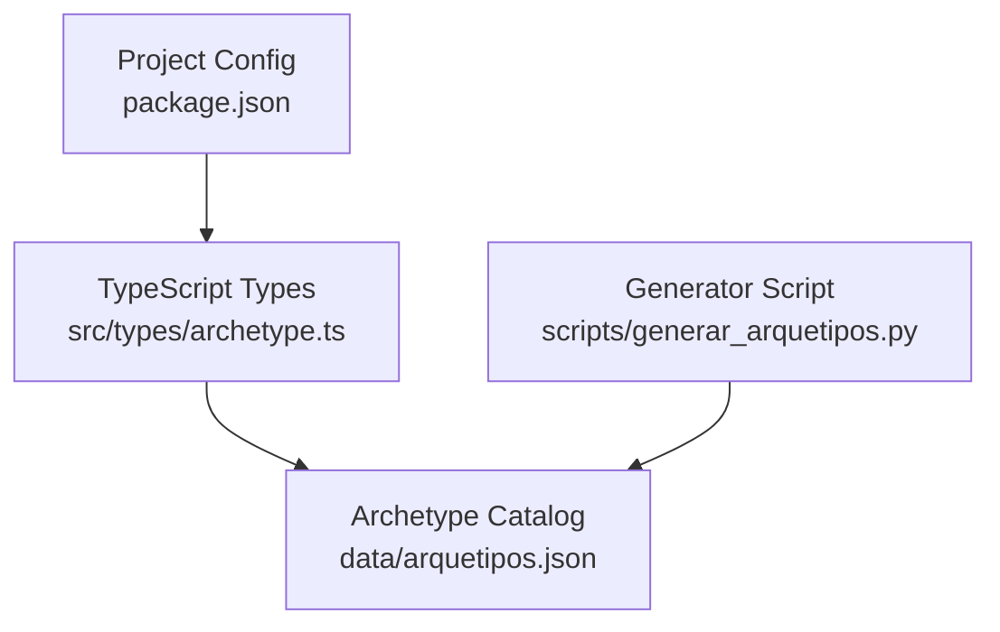
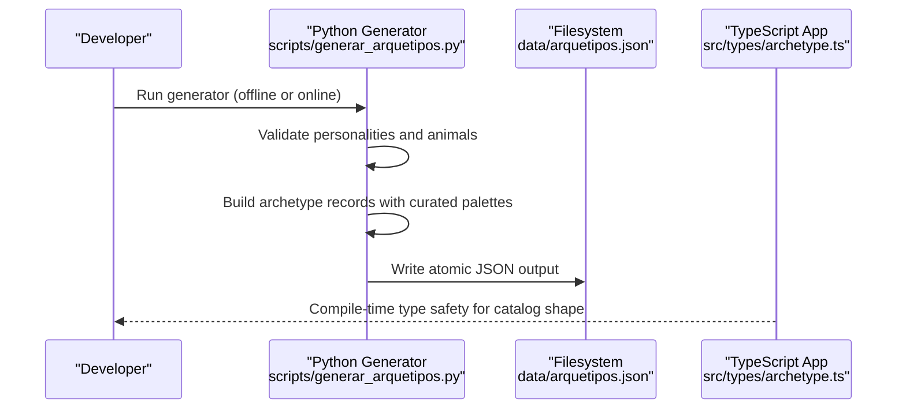
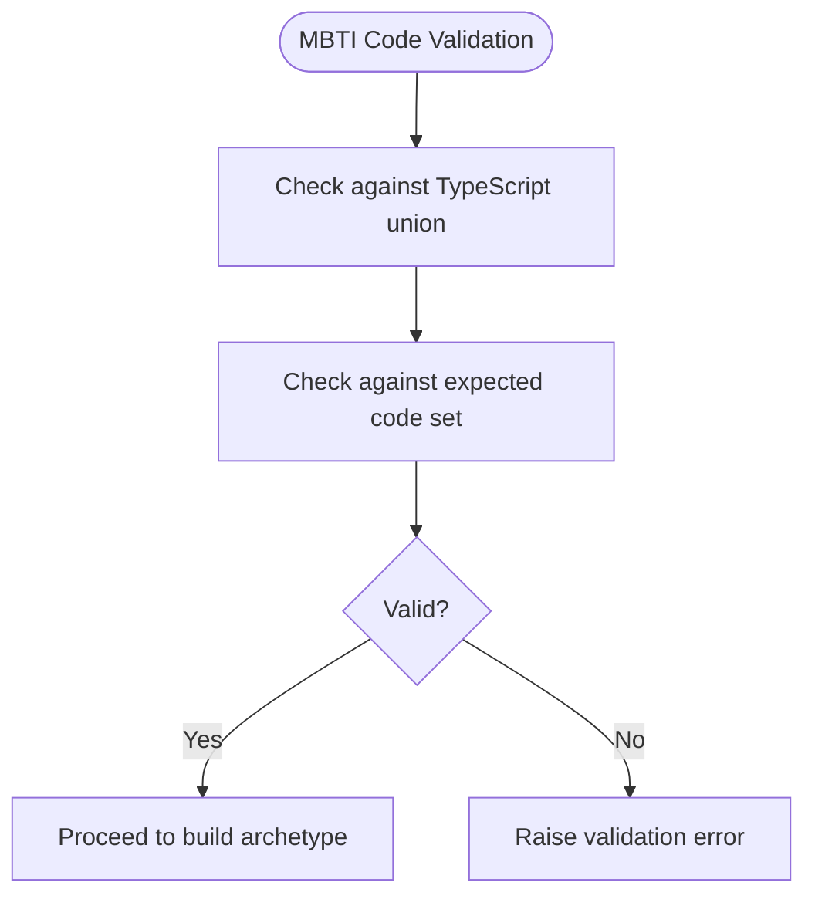
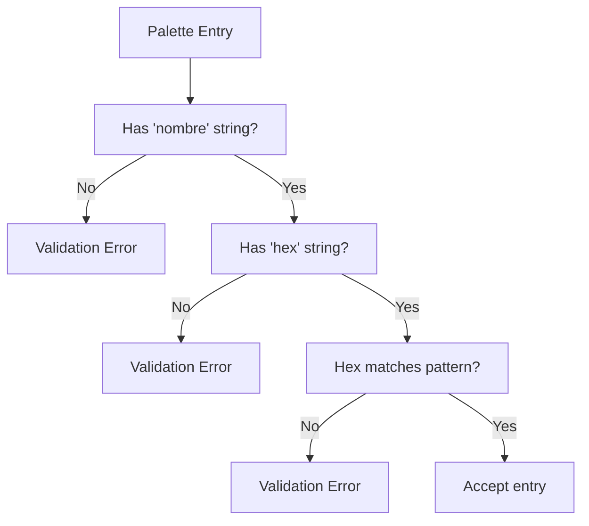
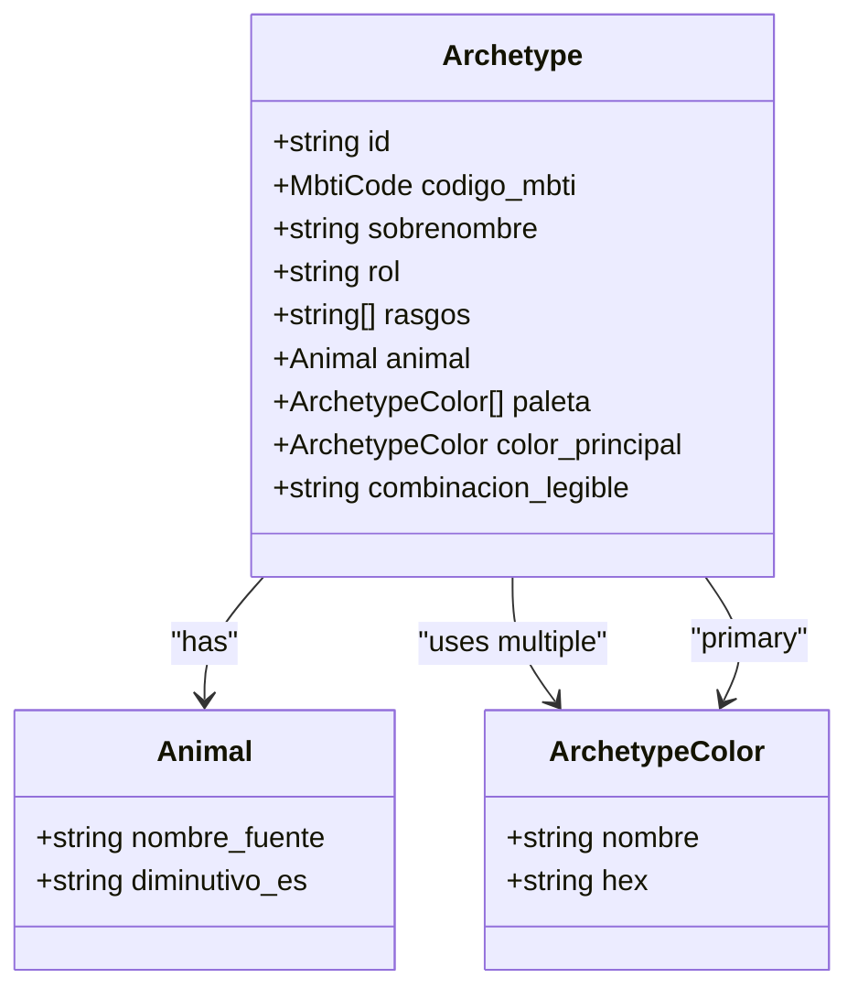
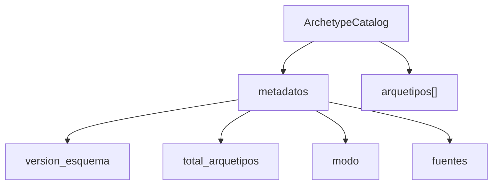
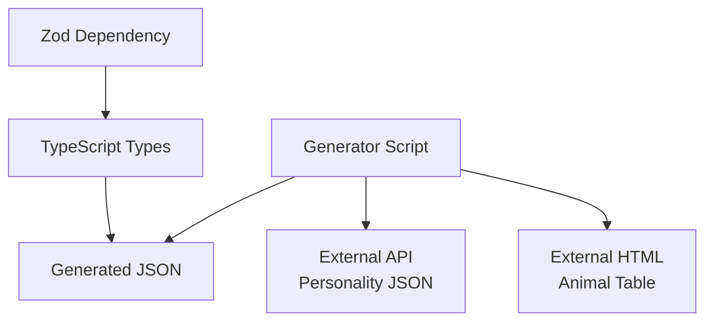

# Type System & Data Models

<cite>
**Referenced Files in This Document**
- [archetype.ts](file://src/types/archetype.ts)
- [arquetipos.json](file://data/arquetipos.json)
- [generar_arquetipos.py](file://scripts/generar_arquetipos.py)
- [package.json](file://package.json)
</cite>

## Table of Contents
1. [Introduction](#introduction)
2. [Project Structure](#project-structure)
3. [Core Components](#core-components)
4. [Architecture Overview](#architecture-overview)
5. [Detailed Component Analysis](#detailed-component-analysis)
6. [Dependency Analysis](#dependency-analysis)
7. [Performance Considerations](#performance-considerations)
8. [Troubleshooting Guide](#troubleshooting-guide)
9. [Conclusion](#conclusion)

## Introduction
This document explains the ZooMatch type system and data models that define personality-animal mappings, MBTI code types, and color palettes. It focuses on how TypeScript interfaces model the JSON data used by the application, how the Python generator enforces validation rules, and how these pieces together ensure data consistency across the pipeline from data generation to runtime usage.

## Project Structure
The relevant parts for this documentation are:
- TypeScript type definitions in `src/types/archetype.ts`
- Generated archetype dataset in `data/arquetipos.json`
- Python script that generates and validates the dataset in `scripts/generar_arquetipos.py`
- Project configuration including Zod dependency in `package.json`



**Diagram sources**
- [archetype.ts:1-47](file://src/types/archetype.ts#L1-L47)
- [arquetipos.json:1-592](file://data/arquetipos.json#L1-L592)
- [generar_arquetipos.py:248-315](file://scripts/generar_arquetipos.py#L248-L315)
- [package.json:17-26](file://package.json#L17-L26)

**Section sources**
- [archetype.ts:1-47](file://src/types/archetype.ts#L1-L47)
- [arquetipos.json:1-592](file://data/arquetipos.json#L1-L592)
- [generar_arquetipos.py:248-315](file://scripts/generar_arquetipos.py#L248-L315)
- [package.json:17-26](file://package.json#L17-L26)

## Core Components
This section documents the core data model components defined in the TypeScript types and their corresponding structures in the JSON catalog.

### MBTI Code Type Union
- Purpose: Restricts MBTI codes to the canonical 16-letter combinations.
- Usage: Enforced at compile time in TypeScript; mirrored by explicit validation in the Python generator.

**Section sources**
- [archetype.ts:1-17](file://src/types/archetype.ts#L1-L17)
- [generar_arquetipos.py:22-27](file://scripts/generar_arquetipos.py#L22-L27)

### ArchetypeColor Palette Entry
- Purpose: Represents a named color with a hex value.
- Constraints: Hex values must be valid six-digit hexadecimal strings.

**Section sources**
- [archetype.ts:19-22](file://src/types/archetype.ts#L19-L22)
- [generar_arquetipos.py:345-350](file://scripts/generar_arquetipos.py#L345-L350)

### Archetype Entity
- Purpose: Encapsulates a single personality-animal-color mapping.
- Key fields:
  - Identifier and MBTI code
  - Nickname and role (personality category)
  - Trait list
  - Animal mapping with source name and Spanish diminutive
  - Color palette array and primary color
  - Human-readable combination string

Validation rules embedded in the type system and generator:
- Exactly one primary color per archetype, which must exist within its palette.
- All colors must include a name and a valid hex code.
- The human-readable combination must be unique across archetypes.

**Section sources**
- [archetype.ts:24-37](file://src/types/archetype.ts#L24-L37)
- [generar_arquetipos.py:318-357](file://scripts/generar_arquetipos.py#L318-L357)

### ArchetypeCatalog Root
- Purpose: Container for metadata and the full list of archetypes.
- Metadata includes schema version, total count, mode, and source provenance.

**Section sources**
- [archetype.ts:39-47](file://src/types/archetype.ts#L39-L47)
- [arquetipos.json:1-28](file://data/arquetipos.json#L1-L28)

## Architecture Overview
The data flow connects the Python generator to the generated JSON file, which is then consumed by the TypeScript application according to the type definitions.



**Diagram sources**
- [generar_arquetipos.py:402-423](file://scripts/generar_arquetipos.py#L402-L423)
- [arquetipos.json:1-592](file://data/arquetipos.json#L1-L592)
- [archetype.ts:1-47](file://src/types/archetype.ts#L1-L47)

## Detailed Component Analysis

### MBTI Code Type Unions
- The union type enumerates all 16 MBTI codes, ensuring only valid codes are accepted in TypeScript.
- The Python generator defines an expected set of codes and validates both input and output against it.



**Diagram sources**
- [archetype.ts:1-17](file://src/types/archetype.ts#L1-L17)
- [generar_arquetipos.py:22-27](file://scripts/generar_arquetipos.py#L22-L27)

**Section sources**
- [archetype.ts:1-17](file://src/types/archetype.ts#L1-L17)
- [generar_arquetipos.py:137-150](file://scripts/generar_arquetipos.py#L137-L150)

### ArchetypeColor Palette Structures
- Each palette entry has a name and a hex code.
- The generator enforces hex format using a regular expression and ensures each palette contains at least one color.
- The primary color must be present in the palette.



**Diagram sources**
- [archetype.ts:19-22](file://src/types/archetype.ts#L19-L22)
- [generar_arquetipos.py:345-350](file://scripts/generar_arquetipos.py#L345-L350)

**Section sources**
- [archetype.ts:19-22](file://src/types/archetype.ts#L19-L22)
- [generar_arquetipos.py:341-350](file://scripts/generar_arquetipos.py#L341-L350)

### Archetype Data Structure
- Each archetype links:
  - Personality traits and role
  - MBTI code
  - Animal mapping (source name and Spanish diminutive)
  - Curated color palette and primary color
  - Human-readable combination string



**Diagram sources**
- [archetype.ts:24-37](file://src/types/archetype.ts#L24-L37)

**Section sources**
- [archetype.ts:24-37](file://src/types/archetype.ts#L24-L37)
- [arquetipos.json:29-589](file://data/arquetipos.json#L29-L589)

### ArchetypeCatalog Root
- The root object contains metadata and the archetype list.
- Metadata documents schema version, total count, operating mode, and source provenance.



**Diagram sources**
- [archetype.ts:39-47](file://src/types/archetype.ts#L39-L47)
- [arquetipos.json:1-28](file://data/arquetipos.json#L1-L28)

**Section sources**
- [archetype.ts:39-47](file://src/types/archetype.ts#L39-L47)
- [arquetipos.json:1-28](file://data/arquetipos.json#L1-L28)

### Relationship Between TypeScript Interfaces and JSON Data
- The TypeScript interfaces describe the exact shape of the JSON catalog.
- The Python generator constructs objects that match these shapes and validates them before writing to disk.
- At runtime, TypeScript provides compile-time guarantees that any consumed JSON adheres to the interface contract.

```mermaid
graph LR
TS["TypeScript Interface<br/>ArchetypeCatalog"] < --> JSON["JSON Schema Shape<br/>arquetipos.json"]
PY["Generator Builder<br/>construir_documento()"] --> JSON
PY["Validator<br/>validar_documento()"] --> JSON
```

**Diagram sources**
- [archetype.ts:39-47](file://src/types/archetype.ts#L39-L47)
- [arquetipos.json:1-592](file://data/arquetipos.json#L1-L592)
- [generar_arquetipos.py:248-315](file://scripts/generar_arquetipos.py#L248-L315)
- [generar_arquetipos.py:318-357](file://scripts/generar_arquetipos.py#L318-L357)

**Section sources**
- [archetype.ts:39-47](file://src/types/archetype.ts#L39-L47)
- [arquetipos.json:1-592](file://data/arquetipos.json#L1-L592)
- [generar_arquetipos.py:248-315](file://scripts/generar_arquetipos.py#L248-L315)
- [generar_arquetipos.py:318-357](file://scripts/generar_arquetipos.py#L318-L357)

## Dependency Analysis
- The TypeScript types define the contract for the JSON structure.
- The Python generator depends on external sources (personality data and HTML table) but falls back to local datasets when offline or when network requests fail.
- The project uses Zod as a runtime validation library dependency, indicating potential use of runtime checks alongside TypeScript’s compile-time checks.



**Diagram sources**
- [archetype.ts:1-47](file://src/types/archetype.ts#L1-L47)
- [arquetipos.json:1-592](file://data/arquetipos.json#L1-L592)
- [generar_arquetipos.py:20-21](file://scripts/generar_arquetipos.py#L20-L21)
- [package.json:17-26](file://package.json#L17-L26)

**Section sources**
- [archetype.ts:1-47](file://src/types/archetype.ts#L1-L47)
- [arquetipos.json:1-592](file://data/arquetipos.json#L1-L592)
- [generar_arquetipos.py:20-21](file://scripts/generar_arquetipos.py#L20-L21)
- [package.json:17-26](file://package.json#L17-L26)

## Performance Considerations
- The generator writes JSON atomically to avoid partial files during failures.
- Network requests use retries and timeouts to reduce transient failures.
- Local fallbacks minimize dependency on external services, improving reliability and reducing latency.

[No sources needed since this section provides general guidance]

## Troubleshooting Guide
Common validation errors and their causes:
- Invalid or missing MBTI code: Ensure the code exists in the expected set.
- Duplicate IDs or combinations: The generator enforces uniqueness for identifiers and readable combinations.
- Invalid hex color: Hex codes must match the required pattern.
- Missing or invalid palette/primary color: Primary color must be present in the palette.
- Incomplete animal mapping: Both source name and Spanish diminutive must be provided.

Operational tips:
- Use the offline flag to bypass network calls and rely on local fallbacks.
- Inspect the metadata in the generated JSON to understand data provenance and mode.

**Section sources**
- [generar_arquetipos.py:137-150](file://scripts/generar_arquetipos.py#L137-L150)
- [generar_arquetipos.py:318-357](file://scripts/generar_arquetipos.py#L318-L357)
- [generar_arquetipos.py:402-423](file://scripts/generar_arquetipos.py#L402-L423)

## Conclusion
The ZooMatch type system combines TypeScript interfaces with a robust Python generator to enforce strict data contracts. MBTI codes are constrained via unions and sets, color palettes are validated for format and presence, and archetype records are checked for completeness and uniqueness. Together, these mechanisms ensure consistent, reliable data flowing from generation to consumption.

[No sources needed since this section summarizes without analyzing specific files]