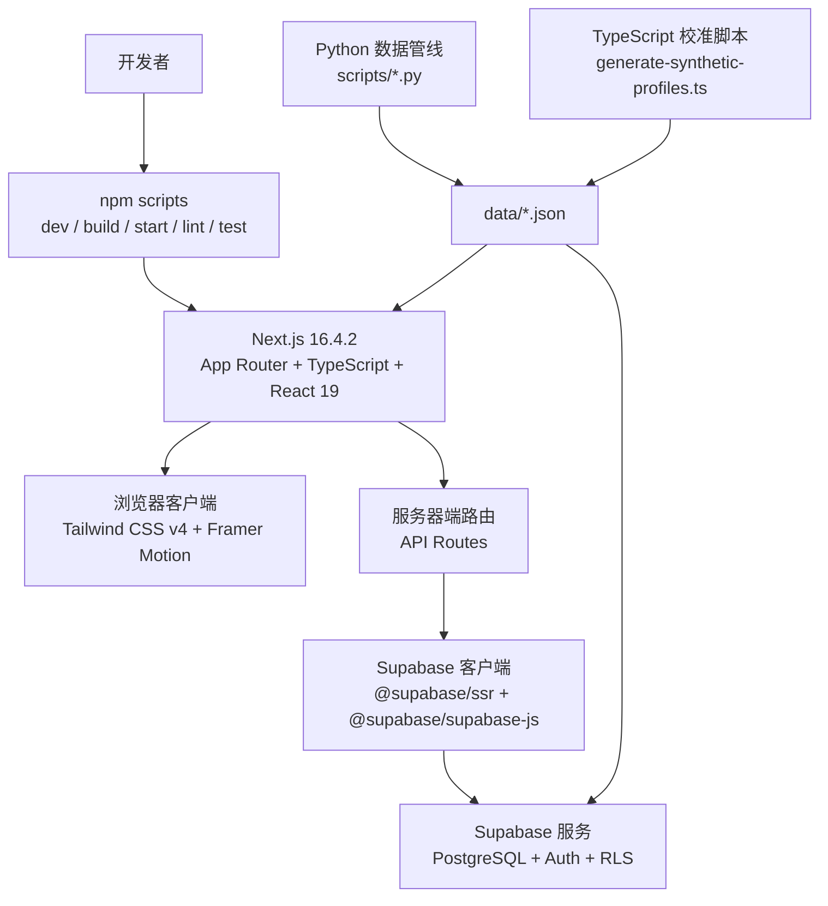
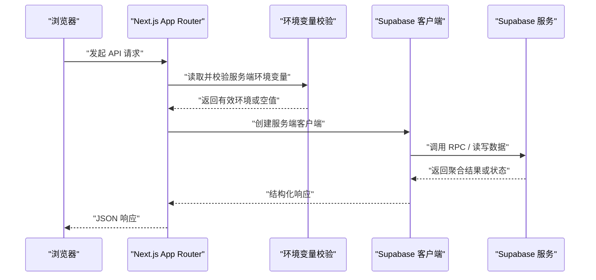
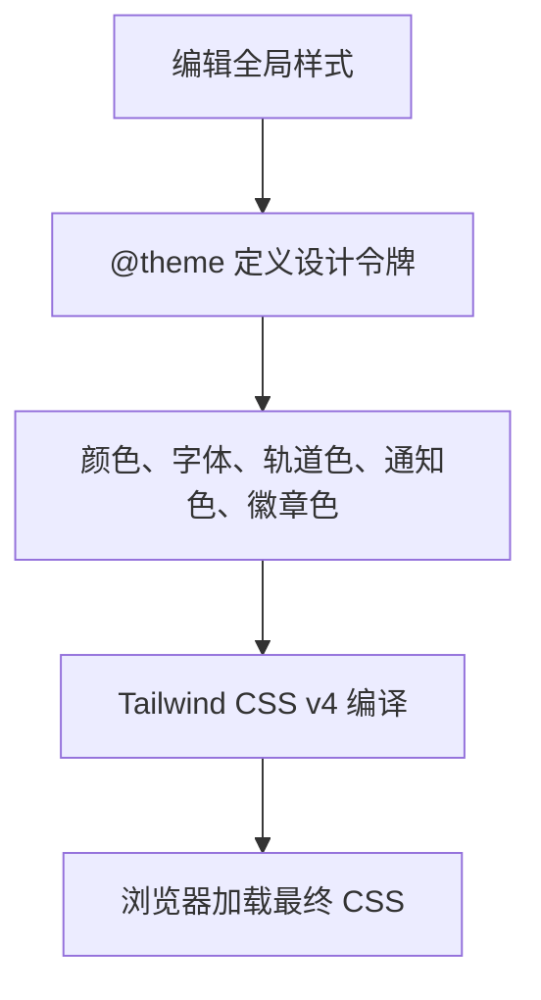
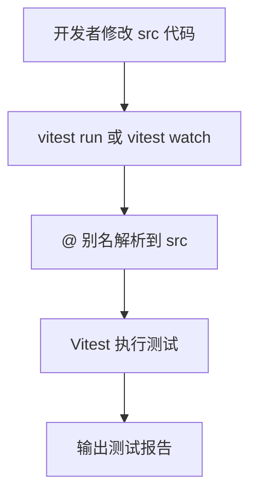
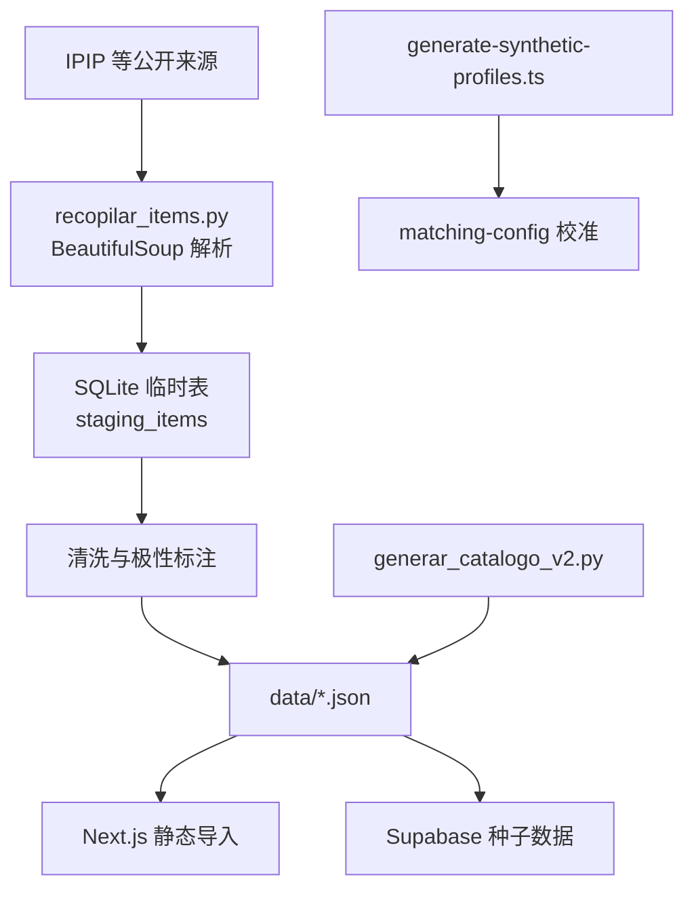
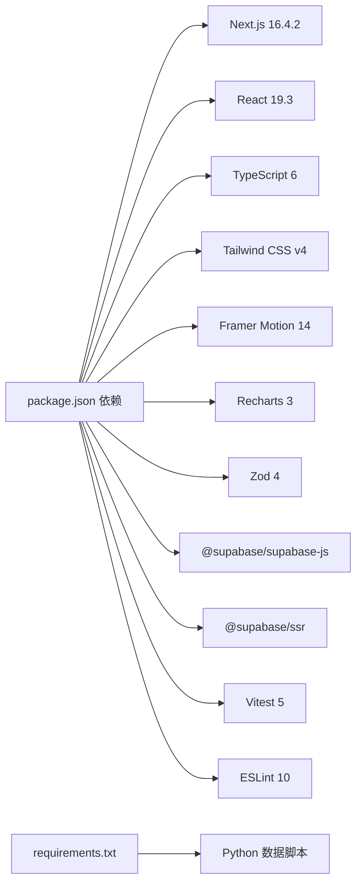
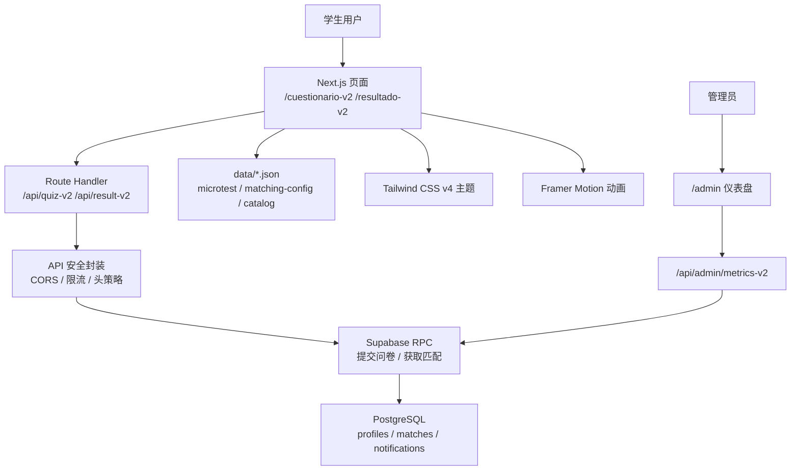

# 技术栈与工具链

<cite>
**本文引用的文件**   
- [package.json](file://package.json)
- [README.md](file://README.md)
- [CONTEXTO_PROYECTO.md](file://CONTEXTO_PROYECTO.md)
- [next.config.ts](file://next.config.ts)
- [postcss.config.mjs](file://postcss.config.mjs)
- [src/app/globals.css](file://src/app/globals.css)
- [requirements.txt](file://requirements.txt)
- [eslint.config.mjs](file://eslint.config.mjs)
- [vitest.config.ts](file://vitest.config.ts)
- [src/lib/supabase/client.ts](file://src/lib/supabase/client.ts)
- [src/lib/supabase/server.ts](file://src/lib/supabase/server.ts)
- [src/lib/env.server.ts](file://src/lib/env.server.ts)
- [scripts/recopilar_items.py](file://scripts/recopilar_items.py)
- [scripts/generar_catalogo_v2.py](file://scripts/generar_catalogo_v2.py)
</cite>

## 目录
1. [简介](#简介)
2. [项目结构与技术边界](#项目结构与技术边界)
3. [前端技术选型](#前端技术选型)
4. [后端与服务层](#后端与服务层)
5. [样式系统与主题令牌](#样式系统与主题令牌)
6. [动画与可视化库](#动画与可视化库)
7. [开发工具链](#开发工具链)
8. [数据处理与 Python 脚本](#数据处理与-python-脚本)
9. [版本兼容性与依赖管理策略](#版本兼容性与依赖管理策略)
10. [架构总览图](#架构总览图)
11. [常见问题与排错](#常见问题与排错)
12. [结论](#结论)

## 简介
ENES ZooMatch 是一个面向 UNAM ENES 学生的移动端优先 Web 应用，用于根据心理测量学微测问卷匹配性格、价值观与文化偏好相近的用户。项目同时维护 v1 与 v2 两套功能路径：v1 是单轨道匹配，v2 引入浪漫与友谊双轨道、更丰富的维度、带权重的余弦相似度、硬性筛选以及像素精灵构成的交互式星座结果展示。

该文档聚焦“技术栈与工具链”，从 Next.js App Router 前端、Supabase 后端、Tailwind CSS v4 主题系统、Framer Motion 动画、Vitest + ESLint 开发工具链，到 Python 数据管线和 npm 构建脚本进行系统化说明，帮助读者理解各技术选型的目的、职责、依赖关系和部署形态。

**章节来源**
- [README.md:1-120](file://README.md#L1-L120)
- [CONTEXTO_PROYECTO.md:1-120](file://CONTEXTO_PROYECTO.md#L1-L120)

## 项目结构与技术边界
仓库采用分层组织方式：
- `data/`：静态 JSON 数据源，承载问卷条目、匹配配置、原型动物与颜色目录等，被视为业务事实来源。
- `scripts/`：独立于运行时的数据生产脚本，包含 Python 爬虫与校验脚本、TypeScript 合成数据生成器。
- `src/`：Next.js 应用源码，分为页面路由 `app/`、组件 `components/`、领域逻辑 `lib/`、类型定义 `types/`。
- `supabase/`：数据库迁移、种子数据和管理员权限提升脚本。
- 根级配置文件：`package.json`、`next.config.ts`、`postcss.config.mjs`、`eslint.config.mjs`、`vitest.config.ts`、`requirements.txt`。

**图示来源**
- [package.json:1-40](file://package.json#L1-L40)
- [next.config.ts:1-39](file://next.config.ts#L1-L39)
- [postcss.config.mjs:1-7](file://postcss.config.mjs#L1-L7)
- [src/lib/supabase/client.ts:1-25](file://src/lib/supabase/client.ts#L1-L25)
- [src/lib/supabase/server.ts:1-34](file://src/lib/supabase/server.ts#L1-L34)
- [scripts/recopilar_items.py:1-120](file://scripts/recopilar_items.py#L1-L120)
- [scripts/generar_catalogo_v2.py:1-120](file://scripts/generar_catalogo_v2.py#L1-L120)

**章节来源**
- [README.md:120-220](file://README.md#L120-L220)
- [CONTEXTO_PROYECTO.md:120-220](file://CONTEXTO_PROYECTO.md#L120-L220)

## 前端技术选型
### Next.js 16.4.2 App Router
Next.js 在本项目中承担全栈框架角色：
- 提供 App Router 路由、服务端组件与 Route Handlers。
- 通过 `typedRoutes` 强化路由类型安全。
- 启用 `reactStrictMode` 辅助发现潜在渲染问题。
- 统一注入内容安全策略、跨源策略和安全响应头。

关键配置体现在 `next.config.ts`，其中定义了严格的内容安全策略、连接白名单、HSTS、禁止嵌入帧等安全头部，并将 Supabase 域名加入允许的连接目标。

**章节来源**
- [package.json:1-40](file://package.json#L1-L40)
- [next.config.ts:1-39](file://next.config.ts#L1-L39)
- [CONTEXTO_PROYECTO.md:200-335](file://CONTEXTO_PROYECTO.md#L200-L335)

### React 19
React 19 作为 UI 运行时，配合 Next.js 提供现代组件模型。包定义中 React 与 React DOM 均使用 `^19.3.1`，并通过 `@types/react` 与 `@types/react-dom` 提供类型支持。React 的版本与 Next.js 的生态绑定由包管理器锁定。

**章节来源**
- [package.json:1-40](file://package.json#L1-L40)

### TypeScript
项目使用 TypeScript 6，主要用途包括：
- 为 React 组件、Next.js 路由、Supabase 客户端、匹配引擎和数据模型提供强类型约束。
- 与 Vitest 测试一起保证纯函数（如匹配、评分、星座布局、像素精灵）可被稳定断言。
- 在根配置中启用类型检查脚本，便于本地验证类型正确性。

**章节来源**
- [package.json:1-40](file://package.json#L1-L40)
- [README.md:200-260](file://README.md#L200-L260)

## 后端与服务层
### Supabase（PostgreSQL + Auth + RLS）
Supabase 在本项目中承担三类职责：
- **认证**：用户注册与登录基于 Supabase Auth，并使用虚拟邮箱格式避免真实邮箱暴露。
- **数据存储**：PostgreSQL 存储用户画像、匹配结果、通知和管理指标。
- **行级安全与聚合接口**：通过 SQL 迁移中的 RPC 和 `SECURITY DEFINER` 暴露聚合指标，不直接返回原始哈希或答案。

客户端侧通过 `@supabase/ssr` 分别创建浏览器客户端和服务端客户端：
- 浏览器客户端从公开环境变量构造，并在未就绪时返回空值，避免崩溃。
- 服务端客户端读取 Cookie Store，并容错处理 Server Components 无法写 Cookie 的情况。

服务端环境变量通过 Zod 校验，要求 Supabase URL、服务角色密钥和 HMAC 密钥满足最小长度与格式要求；若缺失则返回空对象，调用方需做降级处理。

**图示来源**
- [src/lib/env.server.ts:1-21](file://src/lib/env.server.ts#L1-L21)
- [src/lib/supabase/server.ts:1-34](file://src/lib/supabase/server.ts#L1-L34)
- [src/lib/supabase/client.ts:1-25](file://src/lib/supabase/client.ts#L1-L25)

**章节来源**
- [src/lib/env.server.ts:1-21](file://src/lib/env.server.ts#L1-L21)
- [src/lib/supabase/server.ts:1-34](file://src/lib/supabase/server.ts#L1-L34)
- [src/lib/supabase/client.ts:1-25](file://src/lib/supabase/client.ts#L1-L25)
- [README.md:200-260](file://README.md#L200-L260)

## 样式系统与主题令牌
项目使用 Tailwind CSS v4，通过 PostCSS 插件 `@tailwindcss/postcss` 集成。主题令牌集中在 `src/app/globals.css` 的 `@theme` 块中，定义基础色彩、字体族、浪漫与友谊双轨道色彩、通知高亮、徽章背景与边框等设计语义。

这种设计使主题变更集中在单一位置，而不是分散在组件内联样式中；同时保持 Tailwind 的原子化类名能力，适合快速迭代 UI。

**图示来源**
- [postcss.config.mjs:1-7](file://postcss.config.mjs#L1-L7)
- [src/app/globals.css:1-60](file://src/app/globals.css#L1-L60)

**章节来源**
- [postcss.config.mjs:1-7](file://postcss.config.mjs#L1-L7)
- [src/app/globals.css:1-60](file://src/app/globals.css#L1-L60)
- [README.md:200-260](file://README.md#L200-L260)

## 动画与可视化库
### Framer Motion
Framer Motion 提供声明式动画能力，适用于页面过渡、组件入场、交互反馈和星座可视化的微动效。它在包依赖中以 `^14.6.0` 声明，并与 React 19 共同构成前端交互层。

### Recharts
Recharts 用于管理后台仪表板的图表展示，例如 MBTI 分布、匹配比例和热门动物图标统计。它作为运行时依赖与 Next.js 服务端渲染共存。

**章节来源**
- [package.json:1-40](file://package.json#L1-L40)
- [README.md:200-260](file://README.md#L200-L260)

## 开发工具链
### Vitest 测试框架
测试使用 Vitest 5，运行在 Node 环境，仅扫描 `src/**/*.test.ts`，并通过别名 `@` 指向 `./src`，方便在测试中引用模块。核心匹配逻辑、星座布局、像素精灵、环境校验等纯函数都可通过单元测试覆盖。

**图示来源**
- [vitest.config.ts:1-15](file://vitest.config.ts#L1-L15)

**章节来源**
- [vitest.config.ts:1-15](file://vitest.config.ts#L1-L15)
- [README.md:260-340](file://README.md#L260-L340)

### ESLint 代码规范
ESLint 10 结合 Next.js 官方规则集，启用核心网页性能规则和 TypeScript 规则，忽略 `.next`、`coverage` 和自动生成的类型声明文件。这有助于在开发阶段尽早发现性能相关问题和类型不一致。

**章节来源**
- [eslint.config.mjs:1-9](file://eslint.config.mjs#L1-L9)
- [package.json:1-40](file://package.json#L1-L40)

### npm scripts 构建系统
根级 `package.json` 定义了常用命令：
- `dev`：启动开发服务器。
- `build`：构建生产产物。
- `start`：启动生产服务器。
- `lint`：执行 ESLint。
- `typecheck`：执行 TypeScript 类型检查。
- `test`：运行 Vitest。
- `test:watch`：开启测试监听模式。

项目明确说明没有 CI 和 Docker，所有流程通过 npm scripts 驱动。

**章节来源**
- [package.json:1-40](file://package.json#L1-L40)
- [README.md:260-340](file://README.md#L260-L340)

## 数据处理与 Python 脚本
Python 在本项目中不参与运行时服务，而是负责数据准备与质量控制：
- `scripts/recopilar_items.py`：从 IPIP 等公开来源抓取心理测量题目，使用 BeautifulSoup 解析 HTML，将数据清洗、去重、极性标注后写入 SQLite 中间表，再导出为受控的 `data/` JSON。
- `scripts/generar_arquetipos.py`：生成 v1 的原型动物与颜色目录。
- `scripts/generar_catalogo_v2.py`：生成 v2 的 61 种动物与 55 种颜色纹理目录，并进行完整性校验。
- `scripts/generate-synthetic-profiles.ts`：生成固定种子的合成用户档案，用于匹配阈值校准。

依赖通过 `requirements.txt` 管理，限制 `requests` 与 `beautifulsoup4` 的主版本范围，避免上游破坏性升级影响数据管线。

**图示来源**
- [scripts/recopilar_items.py:1-120](file://scripts/recopilar_items.py#L1-L120)
- [scripts/generar_catalogo_v2.py:1-120](file://scripts/generar_catalogo_v2.py#L1-L120)
- [requirements.txt:1-2](file://requirements.txt#L1-L2)
- [README.md:200-340](file://README.md#L200-L340)

**章节来源**
- [scripts/recopilar_items.py:1-120](file://scripts/recopilar_items.py#L1-L120)
- [scripts/generar_catalogo_v2.py:1-120](file://scripts/generar_catalogo_v2.py#L1-L120)
- [requirements.txt:1-2](file://requirements.txt#L1-L2)
- [CONTEXTO_PROYECTO.md:200-335](file://CONTEXTO_PROYECTO.md#L200-L335)

## 版本兼容性与依赖管理策略
### Node.js 与包管理器
- 项目要求 Node.js 不低于 `22.12.0`。
- 使用 npm 作为包管理器，依赖版本以 `^` 主范围锁定，兼顾小幅更新与稳定性。
- `package-lock.json` 用于锁定实际安装树。

### 前端运行时
- Next.js `^16.4.2`。
- React 与 React DOM `^19.3.1`。
- TypeScript `^6.0.3`。
- Tailwind CSS v4 通过 `@tailwindcss/postcss` 接入。
- Framer Motion `^14.6.0`。
- Recharts `^3.10.1`。
- Zod `^4.6.7` 用于环境变量、API 负载与配置校验。

### 后端与数据库
- `@supabase/supabase-js` 与 `@supabase/ssr` 提供浏览器与服务端客户端。
- Supabase 作为 PostgreSQL、Auth 和 RLS 的统一后端。
- 数据模型和匹配逻辑部分下沉到 SQL 迁移中的 RPC，减少 Node 层复杂计算。

### 开发与测试
- Vitest `^5.0.5`，配合 Vite `^8.3.5`。
- ESLint `^10.13.0`，使用 Next.js 官方规则集。
- PostCSS `^8.5.31`。

### Python 工具链
- `requests>=2.32,<3`。
- `beautifulsoup4>=4.12,<5`。
- 脚本与运行时分离，不在应用启动路径中加载。

**图示来源**
- [package.json:1-40](file://package.json#L1-L40)
- [requirements.txt:1-2](file://requirements.txt#L1-L2)

**章节来源**
- [package.json:1-40](file://package.json#L1-L40)
- [requirements.txt:1-2](file://requirements.txt#L1-L2)
- [README.md:200-340](file://README.md#L200-L340)

## 架构总览图
以下图展示从用户访问到 Supabase 服务、再到数据管道与前端渲染的整体链路。

**图示来源**
- [next.config.ts:1-39](file://next.config.ts#L1-L39)
- [src/lib/supabase/server.ts:1-34](file://src/lib/supabase/server.ts#L1-L34)
- [src/app/globals.css:1-60](file://src/app/globals.css#L1-L60)
- [package.json:1-40](file://package.json#L1-L40)

## 常见问题与排错
### Supabase 客户端为空
浏览器客户端在未获得公开环境变量时会返回空值。排查要点：
- 确认已设置 `NEXT_PUBLIC_SUPABASE_URL` 与 `NEXT_PUBLIC_SUPABASE_PUBLISHABLE_KEY`。
- 检查环境变量是否在前端可访问范围内。
- 在调用处对空客户端做降级处理，避免直接访问导致错误。

**章节来源**
- [src/lib/supabase/client.ts:1-25](file://src/lib/supabase/client.ts#L1-L25)

### 服务端环境变量校验失败
服务端环境变量必须通过 Zod 校验。排查要点：
- 确认存在 `SUPABASE_SERVICE_ROLE_KEY` 与 `MATRICULA_HMAC_SECRET`。
- 确保密钥长度至少满足最小要求。
- 如果校验失败，应记录日志并返回安全降级响应。

**章节来源**
- [src/lib/env.server.ts:1-21](file://src/lib/env.server.ts#L1-L21)

### Tailwind 主题未生效
排查要点：
- 确认 PostCSS 配置启用了 `@tailwindcss/postcss`。
- 确认 `src/app/globals.css` 使用了 `@import "tailwindcss"` 与 `@theme`。
- 清理构建缓存后重新构建。

**章节来源**
- [postcss.config.mjs:1-7](file://postcss.config.mjs#L1-L7)
- [src/app/globals.css:1-60](file://src/app/globals.css#L1-L60)

### Python 脚本依赖冲突
排查要点：
- 使用独立的 Python 环境安装 `requirements.txt`。
- 不要混用不同主版本的 `requests` 或 `beautifulsoup4`。
- 离线模式优先使用本地已批准题库，避免网络不稳定。

**章节来源**
- [requirements.txt:1-2](file://requirements.txt#L1-L2)
- [scripts/recopilar_items.py:1-120](file://scripts/recopilar_items.py#L1-L120)

## 结论
ENES ZooMatch 的技术栈围绕 Next.js 全栈能力展开，前端使用 React 19 与 TypeScript 提供类型安全的现代化界面，Tailwind CSS v4 通过主题令牌集中管理视觉语言，Framer Motion 与 Recharts 增强交互与数据分析体验。后端选择 Supabase，将认证、数据库与安全策略统一抽象，同时将重量级匹配逻辑下沉至 SQL RPC，提高一致性和可测试性。开发工具链以 Vitest 和 ESLint 为主，构建流程完全由 npm scripts 驱动；Python 脚本专注于数据收集、清洗与目录生成，与应用运行时解耦。整体依赖管理采用主范围版本控制与锁文件，既保留小幅更新的灵活性，也维持工程稳定性。