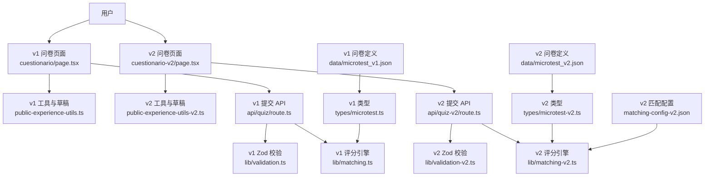
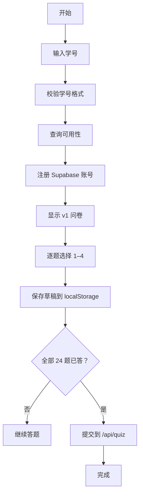
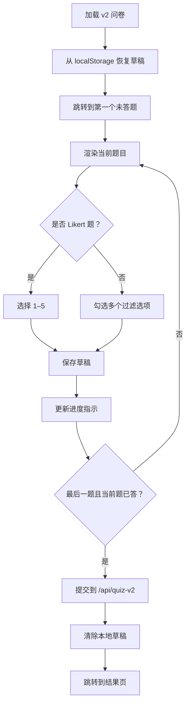
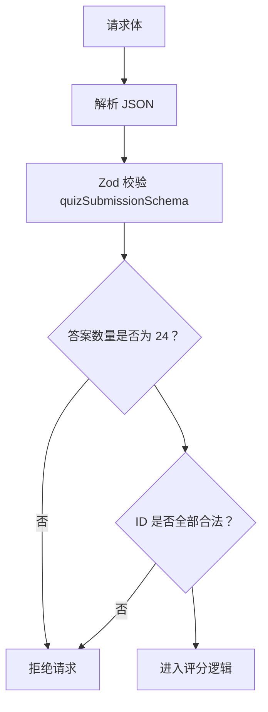
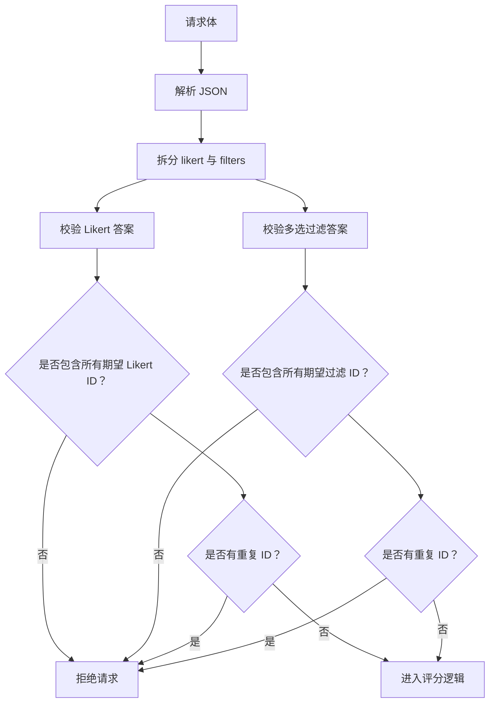
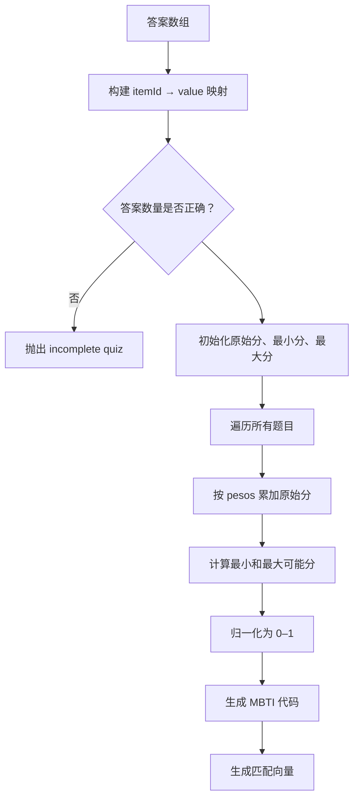
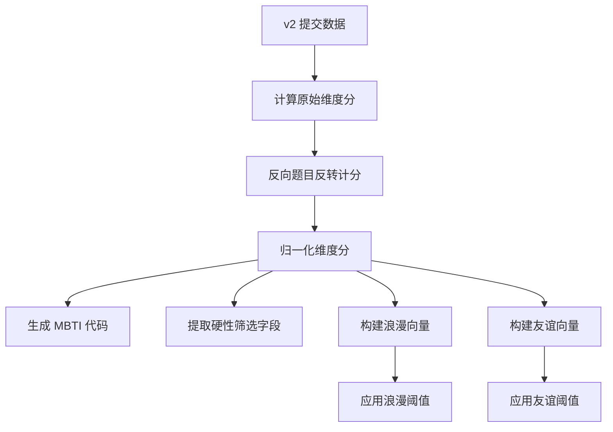
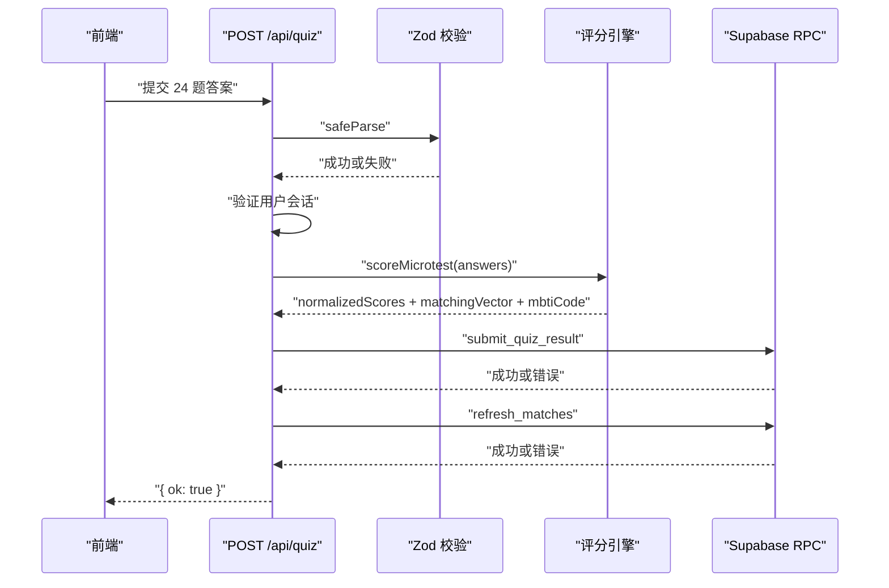
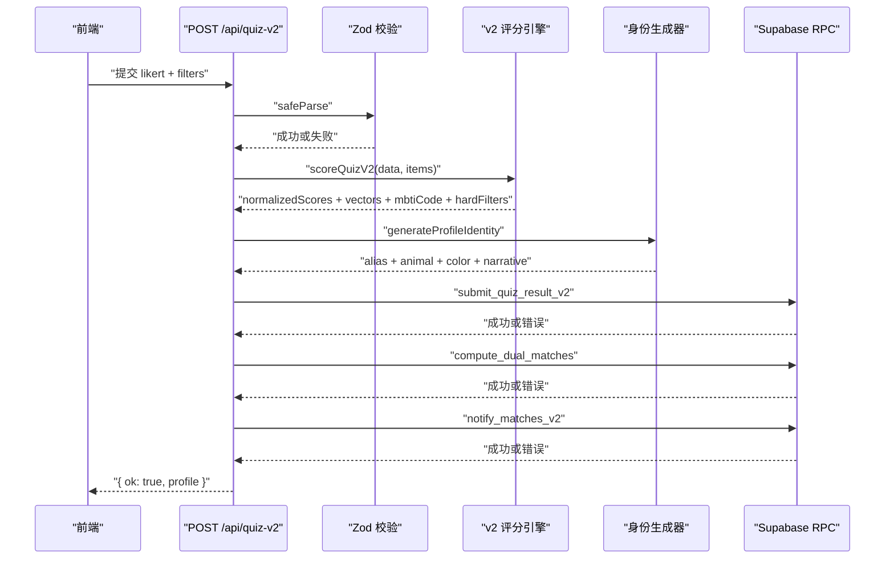
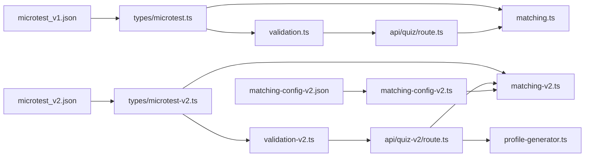

# 心理测量系统

<cite>
**本文引用的文件**   
- [README.md](file://README.md)
- [data/microtest_v1.json](file://data/microtest_v1.json)
- [data/microtest_v2.json](file://data/microtest_v2.json)
- [data/matching-config.json](file://data/matching-config.json)
- [data/matching-config-v2.json](file://data/matching-config-v2.json)
- [src/types/microtest.ts](file://src/types/microtest.ts)
- [src/types/microtest-v2.ts](file://src/types/microtest-v2.ts)
- [src/lib/validation.ts](file://src/lib/validation.ts)
- [src/lib/validation-v2.ts](file://src/lib/validation-v2.ts)
- [src/lib/matching.ts](file://src/lib/matching.ts)
- [src/lib/matching-v2.ts](file://src/lib/matching-v2.ts)
- [src/lib/matching-config.ts](file://src/lib/matching-config.ts)
- [src/lib/matching-config-v2.ts](file://src/lib/matching-config-v2.ts)
- [src/app/api/quiz/route.ts](file://src/app/api/quiz/route.ts)
- [src/app/api/quiz-v2/route.ts](file://src/app/api/quiz-v2/route.ts)
- [src/app/api/result/route.ts](file://src/app/api/result/route.ts)
- [src/app/api/result-v2/route.ts](file://src/app/api/result-v2/route.ts)
- [src/app/cuestionario/page.tsx](file://src/app/cuestionario/page.tsx)
- [src/app/cuestionario-v2/page.tsx](file://src/app/cuestionario-v2/page.tsx)
- [src/components/public-experience.tsx](file://src/components/public-experience.tsx)
- [src/components/public-experience-v2.tsx](file://src/components/public-experience-v2.tsx)
- [src/components/public-experience-utils.ts](file://src/components/public-experience-utils.ts)
- [src/components/public-experience-utils-v2.ts](file://src/components/public-experience-utils-v2.ts)
</cite>

## 目录

1. [引言](#引言)
2. [项目结构与定位](#项目结构与定位)
3. [v1 与 v2 问卷系统的差异](#v1-与-v2-问卷系统的差异)
4. [理论基础：BigFive、MBTI 与 Likert 量表](#理论基础-bigfive-mbti-与-likert-量表)
5. [数据模型与字段映射](#数据模型与字段映射)
6. [答案收集流程与本地存储策略](#答案收集流程与本地存储策略)
7. [Zod 运行时验证机制](#zod-运行时验证机制)
8. [维度计算与匹配逻辑](#维度计算与匹配逻辑)
9. [API 路由与后端集成](#api-路由与后端集成)
10. [用户体验优化](#用户体验优化)
11. [依赖关系分析](#依赖关系分析)
12. [性能与可维护性特征](#性能与可维护性特征)
13. [故障排查指南](#故障排查指南)
14. [结论](#结论)

## 引言

ENES ZooMatch 是一个面向 UNAM ENES 学生的匿名心理测量与匹配平台。用户通过注册学号进入问卷，系统根据回答计算多维人格、MBTI、文化亲和、亲密偏好和关系价值观，并生成“动物 + 颜色”的匿名身份以及可交互的匹配结果。

从心理测量角度看，项目同时维护两个版本：

- **v1**：24 题、17 个维度，基于 BigFive、MBTI、关系与性别主题，使用 1–4 的 Likert 量表。
- **v2**：60 题、30 个维度，支持“浪漫 + 友谊”双轨道匹配，使用 1–5 的 Likert 量表，并引入硬性筛选字段。

本文件聚焦心理测量系统本身，不展开像素精灵、星座动画或完整部署流程；这些内容在仓库 README 中另有说明。

**章节来源**
- [README.md:1-120](file://README.md#L1-L120)

## 项目结构与定位

心理测量系统横跨四层：

| 层次 | 职责 | 主要文件 |
|---|---|---|
| 问卷定义层 | 题目、维度、类别、Likert 刻度、权重配置 | `data/microtest_v1.json`、`data/microtest_v2.json`、`data/matching-config-v2.json` |
| 类型与校验层 | TypeScript 类型、Zod schema、合法答案集合 | `src/types/*`、`src/lib/validation*.ts` |
| 计算引擎层 | 原始分、标准化分、MBTI 代码、匹配向量、双轨道匹配 | `src/lib/matching*.ts` |
| 前端与 API 层 | 页面渲染、草稿保存、提交、结果展示 | `src/app/**/page.tsx`、`src/app/api/**/route.ts`、`src/components/public-experience*.tsx` |

**图表来源**
- [src/app/cuestionario/page.tsx:1-11](file://src/app/cuestionario/page.tsx#L1-L11)
- [src/app/cuestionario-v2/page.tsx:1-8](file://src/app/cuestionario-v2/page.tsx#L1-L8)
- [src/components/public-experience.tsx:1-120](file://src/components/public-experience.tsx#L1-L120)
- [src/components/public-experience-v2.tsx:1-120](file://src/components/public-experience-v2.tsx#L1-L120)
- [src/app/api/quiz/route.ts:1-71](file://src/app/api/quiz/route.ts#L1-L71)
- [src/app/api/quiz-v2/route.ts:1-128](file://src/app/api/quiz-v2/route.ts#L1-L128)
- [src/lib/validation.ts:1-62](file://src/lib/validation.ts#L1-L62)
- [src/lib/validation-v2.ts:1-71](file://src/lib/validation-v2.ts#L1-L71)
- [src/lib/matching.ts:1-115](file://src/lib/matching.ts#L1-L115)
- [src/lib/matching-v2.ts:1-120](file://src/lib/matching-v2.ts#L1-L120)

**章节来源**
- [README.md:1-120](file://README.md#L1-L120)
- [src/app/cuestionario/page.tsx:1-11](file://src/app/cuestionario/page.tsx#L1-L11)
- [src/app/cuestionario-v2/page.tsx:1-8](file://src/app/cuestionario-v2/page.tsx#L1-L8)

## v1 与 v2 问卷系统的差异

### 规模与结构对比

| 维度 | v1 | v2 |
|---|---|---|
| 题目数量 | 24 | 60 |
| 维度数量 | 17 | 30 |
| Likert 刻度 | 1–4 | 1–5 |
| 分类方式 | BigFive、MBTI、Relaciones、Genero | personalidad_bigfive、personalidad_mbti、identidad_filtros、afinidad_cultural、intimidad_afecto、valores_relacionales |
| 匹配轨道 | 单轨道 | 浪漫轨道与友谊轨道 |
| 硬性筛选 | 无 | 性取向、性别认同、关系类型 |
| 题目类型 | 仅 Likert | Likert 与多选过滤项 |
| 结果展示 | 列表式匹配 | 星座可视化、亲和徽章、叙事解释 |

v1 的元数据明确标注这是教育性和娱乐性的微测试，不构成心理学诊断；BigFive 条目改编自 IPIP，其他条目为 ZooMatch 原创。v2 则强调“双轨道匹配”，并将 MBTI、BigFive、文化亲和、亲密偏好与关系价值观整合进同一套 30 维体系。

**章节来源**
- [data/microtest_v1.json:1-120](file://data/microtest_v1.json#L1-L120)
- [data/microtest_v2.json:1-120](file://data/microtest_v2.json#L1-L120)
- [README.md:60-120](file://README.md#L60-L120)

### 改进点总结

1. **更细粒度的心理测量维度**：v2 将原本集中在“关系”和“性别”的条目扩展为文化亲和、亲密语言、关系价值等独立类别。
2. **双轨道匹配**：v2 明确区分浪漫与友谊场景，友谊轨道不包含亲密维度，也不应用硬性筛选。
3. **更完整的 Likert 体验**：v2 加入中性选项，减少强制两端选择的压力。
4. **过滤型问题**：v2 将部分题目从计分维度改为硬性筛选，用于直接排除不兼容用户。
5. **可配置匹配阈值**：v2 通过 `matching-config-v2.json` 暴露每个轨道的最低相似度阈值、维度列表、硬性筛选字段和类别权重。

**章节来源**
- [data/microtest_v2.json:1-80](file://data/microtest_v2.json#L1-L80)
- [data/matching-config-v2.json:1-76](file://data/matching-config-v2.json#L1-L76)

## 理论基础：BigFive、MBTI 与 Likert 量表

### BigFive 在五因素模型中的应用

v1 使用五个 BigFive 相关维度：

- bigfive_apertura
- bigfive_responsabilidad
- bigfive_extraversion
- bigfive_amabilidad
- bigfive_neuroticismo

v2 将其规范化为：

- personalidad_apertura
- personalidad_responsabilidad
- personalidad_extraversion
- personalidad_amabilidad
- personalidad_estabilidad_emocional

v2 把神经质转换为“情绪稳定性”，更符合正向描述倾向，便于与其余维度一起进行归一化。

### MBTI 的四元划分

v1 和 v2 都保留 MBTI 四个核心二分维度：

- mbti_extraversion：外向 / 内向
- mbti_intuicion：直觉 / 实感
- mbti_pensamiento：思维 / 情感
- mbti_juicio：判断 / 感知

MBTI 代码由归一化后的维度分数决定：当某维度分数大于等于 0.5 时取正字母，否则取反字母。例如外向维度为正时输出 E，否则输出 I。

### Likert 量表设计

v1 使用四点 Likert 量表：

| 值 | 标签含义 |
|---|---|
| 1 | 完全不同意 |
| 2 | 不同意 |
| 3 | 同意 |
| 4 | 完全同意 |

v2 使用五点 Likert 量表：

| 值 | 标签含义 |
|---|---|
| 1 | 完全不同意 |
| 2 | 不同意 |
| 3 | 中立 |
| 4 | 同意 |
| 5 | 完全同意 |

v2 的中立选项更适合平衡量表，而 v1 的 1–4 设计更接近强制方向选择，适合快速微测试。

**章节来源**
- [data/microtest_v1.json:10-40](file://data/microtest_v1.json#L10-L40)
- [data/microtest_v2.json:10-40](file://data/microtest_v2.json#L10-L40)
- [src/lib/matching.ts:20-40](file://src/lib/matching.ts#L20-L40)
- [src/lib/matching-v2.ts:1-60](file://src/lib/matching-v2.ts#L1-L60)

## 数据模型与字段映射

### v1 题目模型

v1 的题目来自 `data/microtest_v1.json`，核心字段包括：

| 字段 | 含义 |
|---|---|
| id | 题目唯一标识，如 BF01、MB01、RE01 |
| categoria | 题目类别：BigFive、MBTI、Relaciones、Genero |
| texto | 题目文本 |
| polaridad | 正向或反向计分 |
| pesos | 各维度的权重，通常为 1、-1 或 0 |
| fuente_id | 数据来源，如 IPIP、ZooMatch 原创 |

TypeScript 类型从 JSON 推导：

- `MicrotestItem` 对应 JSON 中的 item。
- `Dimension` 是 `pesos` 对象的所有键。
- `LikertValue` 是 1、2、3、4。
- `MatchingDimension` 排除 MBTI 维度，用于匹配向量。
- `QUIZ_ITEM_IDS` 由所有 item.id 生成。

**章节来源**
- [data/microtest_v1.json:120-273](file://data/microtest_v1.json#L120-L273)
- [src/types/microtest.ts:1-21](file://src/types/microtest.ts#L1-L21)

### v2 题目模型

v2 的题目来自 `data/microtest_v2.json`，新增以下关键字段：

| 字段 | 含义 |
|---|---|
| subcategoria | 子类别，如 apertura、responsabilidad、extraversion 等 |
| tipo_respuesta | likert_5 或 seleccion_multiple |
| opciones | 多选题目的选项数组 |
| track_romance | 是否参与浪漫轨道 |
| track_amistad | 是否参与友谊轨道 |
| filtro_duro | 是否为硬性筛选字段 |
| campo_perfil | 硬筛选对应的个人资料字段名 |

v2 的类型定义将维度拆分为：

- BigFive 维度
- MBTI 维度
- 身份软维度
- 文化亲和维度
- 亲密维度
- 关系价值维度

此外还定义了：

- `QuizSubmissionV2`：包含 Likert 答案和多选过滤答案。
- `ScoredProfileV2`：原始分、归一化分、MBTI 代码、硬性筛选、浪漫向量、友谊向量。
- `DualMatchResult`：轨道、对方用户、相似度、亲和徽章、叙事。

**章节来源**
- [data/microtest_v2.json:120-300](file://data/microtest_v2.json#L120-L300)
- [src/types/microtest-v2.ts:1-200](file://src/types/microtest-v2.ts#L1-L200)

### 维度映射总览

| 理论来源 | v1 维度命名 | v2 维度命名 | 用途 |
|---|---|---|---|
| BigFive | bigfive_* | personalidad_* | 人格五因素 |
| MBTI | mbti_* | mbti_* | 类型编码与轨道通用维度 |
| 关系 | relaciones_* | valores_* | 沟通、信任、冲突管理、共情 |
| 性别与社会价值 | genero_* | valores_* | 平等、多样性、责任分担 |
| 文化亲和 | 未独立维度 | cultural_* | 音乐、视觉审美、创意爱好、校园生活、幽默 |
| 亲密偏好 | 未独立维度 | intimidad_* | 五种爱的语言扩展 |
| 身份与排他性 | 未独立维度 | identidad_* | 浪漫轨道专用 |

**章节来源**
- [data/microtest_v1.json:10-40](file://data/microtest_v1.json#L10-L40)
- [data/microtest_v2.json:20-80](file://data/microtest_v2.json#L20-L80)
- [src/types/microtest-v2.ts:1-120](file://src/types/microtest-v2.ts#L1-L120)

## 答案收集流程与本地存储策略

### v1 答案收集流程

v1 的公共问卷入口是 `/cuestionario`，实际组件是 `PublicQuiz`。其关键行为如下：

1. 用户输入学号。
2. 前端对学号进行 NFKC 标准化、大写、去除空格和下划线，并校验长度与字符集。
3. 调用 `/api/availability` 检查学号可用性。
4. 可用后调用 `/api/register` 注册账号。
5. 跳转至 `/cuestionario`。
6. 按 `microtestData.items` 顺序逐题显示。
7. 每题只允许一个 1–4 的 Likert 值。
8. 草稿保存到 `localStorage`，键为 `zoomatch:quiz-draft:v1`。
9. 提交前校验所有 24 题都已作答。
10. 提交到 `/api/quiz`。

**图表来源**
- [src/app/cuestionario/page.tsx:1-11](file://src/app/cuestionario/page.tsx#L1-L11)
- [src/components/public-experience.tsx:1-120](file://src/components/public-experience.tsx#L1-L120)
- [src/components/public-experience-utils.ts:1-80](file://src/components/public-experience-utils.ts#L1-L80)

### v2 答案收集流程

v2 的入口是 `/cuestionario-v2`，组件为 `PublicQuizV2`。它处理两类题目：

- `likert_5`：单选 1–5。
- `seleccion_multiple`：多选过滤项。

关键流程：

1. 加载 `microtest_v2.json` 中的所有题目。
2. 从 `localStorage` 恢复草稿，键为 `zoomatch:quiz-draft:v2`。
3. 跳转到第一个未回答题目。
4. 每次修改草稿后立即写入 `localStorage`。
5. 进度条基于已回答题目数除以总题数。
6. 最后一题且当前题已回答时才允许提交。
7. 提交前再次检查所有题目是否已回答。
8. 将 Likert 答案和多选答案分别构造后提交到 `/api/quiz-v2`。
9. 成功后清除本地草稿并跳转到 `/resultado-v2`。

**图表来源**
- [src/app/cuestionario-v2/page.tsx:1-8](file://src/app/cuestionario-v2/page.tsx#L1-L8)
- [src/components/public-experience-v2.tsx:1-200](file://src/components/public-experience-v2.tsx#L1-L200)
- [src/components/public-experience-utils-v2.ts:1-120](file://src/components/public-experience-utils-v2.ts#L1-L120)

### 本地存储策略

| 版本 | 存储键 | 数据结构 | 解析策略 |
|---|---|---|---|
| v1 | `zoomatch:quiz-draft:v1` | `Record<itemId, 1|2|3|4>` | 白名单过滤合法 itemId 和合法 Likert 值 |
| v2 | `zoomatch:quiz-draft:v2` | `{ likert: Record<itemId, 1..5>, filters: Record<itemId, string[]> }` | 分别校验 Likert 值和字符串数组 |

解析函数都会：

- 读取 `localStorage`。
- 尝试 JSON 解析。
- 拒绝非对象或数组。
- 丢弃非法字段和非法值。
- 返回空草稿而不是抛出错误。

这保证了旧数据、损坏数据和未来扩展不会导致页面崩溃。

**章节来源**
- [src/components/public-experience-utils.ts:1-80](file://src/components/public-experience-utils.ts#L1-L80)
- [src/components/public-experience-utils-v2.ts:1-120](file://src/components/public-experience-utils-v2.ts#L1-L120)
- [src/components/public-experience-v2.tsx:120-220](file://src/components/public-experience-v2.tsx#L120-L220)

## Zod 运行时验证机制

### v1 验证规则

v1 的 `quizSubmissionSchema` 要求：

- `answers` 是数组。
- 每项包含 `itemId` 和 `value`。
- `value` 必须是 1、2、3、4 之一。
- `answers` 长度必须等于 `QUIZ_ITEM_IDS.length`，即 24。
- 自定义校验确保提交的 ID 集合与期望 ID 集合一致，且不包含未知 ID。

服务端还提供一个 `parseJsonBody`，用于安全读取请求体：解析失败时返回 `null`，避免 JSON 语法错误直接抛到路由上层。

**图表来源**
- [src/lib/validation.ts:1-62](file://src/lib/validation.ts#L1-L62)
- [src/types/microtest.ts:1-21](file://src/types/microtest.ts#L1-L21)

### v2 验证规则

v2 的验证更复杂，因为需要同时处理 Likert 和多选过滤项：

1. 从 `microtest_v2.json` 提取所有 `likert_5` 题目 ID，得到 `LIKERT_ITEM_IDS`。
2. 提取所有 `seleccion_multiple` 题目 ID，得到 `FILTER_ITEM_IDS`。
3. `likertAnswerSchema` 校验单项 Likert 答案。
4. `filterAnswerSchema` 校验多选过滤答案。
5. `quizSubmissionV2Schema` 要求：
   - `likert` 数组长度等于 Likert 题目数量。
   - `filters` 数组长度等于过滤题目数量。
   - 每个 Likert 值必须是 1–5 的整数。
   - 每个过滤选项至少选择一个字符串。
   - 自定义校验检查是否缺少预期 ID、是否存在重复 ID。

**图表来源**
- [src/lib/validation-v2.ts:1-71](file://src/lib/validation-v2.ts#L1-L71)
- [data/microtest_v2.json:1-60](file://data/microtest_v2.json#L1-L60)

**章节来源**
- [src/lib/validation.ts:1-62](file://src/lib/validation.ts#L1-L62)
- [src/lib/validation-v2.ts:1-71](file://src/lib/validation-v2.ts#L1-L71)

## 维度计算与匹配逻辑

### v1 评分流程

v1 的核心评分函数是 `scoreMicrotest`。其步骤如下：

1. 将所有答案放入 Map，键为 `itemId`，值为 Likert 值。
2. 检查答案数量是否与题目数量一致。
3. 初始化每个维度的原始分、最小可能分和最大可能分。
4. 遍历每个题目：
   - 根据 `pesos` 将 `answer × weight` 累加到对应维度。
   - 根据权重正负计算该维度可能的最小和最大总分。
5. 归一化每个维度：
   - 如果范围为零，归一化分数为 0.5。
   - 否则用 `(raw - min) / (max - min)` 映射到 0–1。
6. 生成 MBTI 代码：对 MBTI 四个维度分别判断是否 ≥ 0.5。
7. 生成匹配向量：仅包含非 MBTI 维度。

**图表来源**
- [src/lib/matching.ts:1-115](file://src/lib/matching.ts#L1-L115)

### v2 评分流程

v2 的 `scoreQuizV2` 更复杂，因为它要同时产出：

- 原始维度分。
- 归一化维度分。
- MBTI 代码。
- 硬性筛选结果。
- 浪漫向量。
- 友谊向量。

关键逻辑包括：

- Likert 反转支点：对于负向权重题目，使用 `MIN + MAX - value`，即 `6 - value`。
- 中性分数：没有贡献题目的维度使用 0.5。
- 轨道维度分离：
  - 浪漫轨道：包含 BigFive、MBTI、身份、文化、亲密、价值维度。
  - 友谊轨道：包含 BigFive、MBTI、文化、价值维度，不包含亲密和身份。
- 硬性筛选：性取向、性别认同、关系类型。
- 匹配阈值：从 `matching-config-v2.json` 读取 romance 和 amistad 的阈值。
- 类别权重：避免某些类别因维度数量多而主导匹配结果。

**图表来源**
- [src/lib/matching-v2.ts:1-120](file://src/lib/matching-v2.ts#L1-L120)
- [data/matching-config-v2.json:1-76](file://data/matching-config-v2.json#L1-L76)

### 余弦相似度和亲和度

v1 使用标准余弦相似度比较两个用户的匹配向量。v2 在此基础上结合轨道维度、类别权重和硬性筛选。

亲和度徽章使用公式：

> 亲和度 = 1 − |用户A维度分 − 用户B维度分|

v1 默认返回最多三个亲和维度；v2 为浪漫轨道返回最多五个徽章，友谊轨道返回最多三个徽章。

**章节来源**
- [src/lib/matching.ts:40-115](file://src/lib/matching.ts#L40-L115)
- [src/lib/matching-v2.ts:120-250](file://src/lib/matching-v2.ts#L120-L250)

## API 路由与后端集成

### v1 提交路由

`/api/quiz` 的处理流程：

1. 解析并校验请求体。
2. 创建 Supabase 客户端和管理员客户端。
3. 验证用户会话。
4. 调用 `scoreMicrotest` 计算评分。
5. 调用数据库 RPC `submit_quiz_result` 保存答案、标准化分、匹配向量和 MBTI 代码。
6. 调用 `refresh_matches` 刷新匹配。
7. 返回成功响应。

错误路径会返回 400 或 503。

**图表来源**
- [src/app/api/quiz/route.ts:1-71](file://src/app/api/quiz/route.ts#L1-L71)
- [src/lib/matching.ts:1-60](file://src/lib/matching.ts#L1-L60)
- [src/lib/validation.ts:1-62](file://src/lib/validation.ts#L1-L62)

### v2 提交路由

`/api/quiz-v2` 的流程类似，但增加更多步骤：

1. 校验 v2 提交数据。
2. 验证用户会话。
3. 调用 `scoreQuizV2` 计算评分。
4. 生成用户身份标识：动物、颜色、叙事、别名。
5. 检查是否是首次提交。
6. 合并 Likert 和多选答案为单一 JSON 数组。
7. 调用 `submit_quiz_result_v2`。
8. 调用 `compute_dual_matches`。
9. 调用 `notify_matches_v2`。
10. 首次提交时插入欢迎通知。
11. 返回 profile 信息。

**图表来源**
- [src/app/api/quiz-v2/route.ts:1-128](file://src/app/api/quiz-v2/route.ts#L1-L128)
- [src/lib/matching-v2.ts:1-120](file://src/lib/matching-v2.ts#L1-L120)
- [src/lib/validation-v2.ts:1-71](file://src/lib/validation-v2.ts#L1-L71)

### 结果查询路由

v1 的 `/api/result` 获取用户档案和匹配列表，并对匹配数据进行二次 Zod 校验。

v2 的 `/api/result-v2` 更丰富：

- 查询自身档案。
- 查询匹配列表。
- 解析匹配行。
- 根据轨道选择 romance_vector 或 amistad_vector。
- 生成可解释性说明。
- 返回昵称、动物、颜色、叙事、MBTI 代码、亲和徽章和解释。

**章节来源**
- [src/app/api/quiz/route.ts:1-71](file://src/app/api/quiz/route.ts#L1-L71)
- [src/app/api/quiz-v2/route.ts:1-128](file://src/app/api/quiz-v2/route.ts#L1-L128)
- [src/app/api/result/route.ts:1-70](file://src/app/api/result/route.ts#L1-L70)
- [src/app/api/result-v2/route.ts:1-200](file://src/app/api/result-v2/route.ts#L1-L200)

## 用户体验优化

### 进度指示

v1 通过已答题目数和总题数计算进度；v2 同样使用进度条，但进度计算区分 Likert 题和多选题：

- Likert 题：只要 `draft.likert[itemId]` 存在即视为已答。
- 多选题：只要 `draft.filters[itemId]` 非空即视为已答。

v2 的进度条使用 Framer Motion 平滑动画，并尊重 `prefers-reduced-motion`。

**章节来源**
- [src/components/public-experience-v2.tsx:120-200](file://src/components/public-experience-v2.tsx#L120-L200)

### 草稿保存与恢复

两者都实现了离线草稿能力：

- v1 使用 `zoomatch:quiz-draft:v1`。
- v2 使用 `zoomatch:quiz-draft:v2`。
- 解析函数容忍脏数据。
- 提交成功后删除草稿。
- v2 在恢复草稿后自动跳转到第一个未答题目。

**章节来源**
- [src/components/public-experience-utils.ts:1-80](file://src/components/public-experience-utils.ts#L1-L80)
- [src/components/public-experience-utils-v2.ts:1-120](file://src/components/public-experience-utils-v2.ts#L1-L120)
- [src/components/public-experience-v2.tsx:120-200](file://src/components/public-experience-v2.tsx#L120-L200)

### 错误提示

前端错误状态包括：

- 会话错误：401 未登录。
- 通用错误：网络错误或服务器错误。
- 草稿解析失败：返回空草稿而不崩溃。
- 结果解析失败：返回降级数据或错误消息。

v2 还提供更明确的分类标签、亲和徽章和“无匹配”文案，降低用户对零匹配结果的焦虑。

**章节来源**
- [src/components/public-experience.tsx:1-120](file://src/components/public-experience.tsx#L1-L120)
- [src/components/public-experience-v2.tsx:1-200](file://src/components/public-experience-v2.tsx#L1-L200)
- [src/components/public-experience-utils-v2.ts:1-60](file://src/components/public-experience-utils-v2.ts#L1-L60)

## 依赖关系分析

### 模块依赖图

**图表来源**
- [src/types/microtest.ts:1-21](file://src/types/microtest.ts#L1-L21)
- [src/types/microtest-v2.ts:1-200](file://src/types/microtest-v2.ts#L1-L200)
- [src/lib/validation.ts:1-62](file://src/lib/validation.ts#L1-L62)
- [src/lib/validation-v2.ts:1-71](file://src/lib/validation-v2.ts#L1-L71)
- [src/lib/matching.ts:1-115](file://src/lib/matching.ts#L1-L115)
- [src/lib/matching-v2.ts:1-120](file://src/lib/matching-v2.ts#L1-L120)
- [src/lib/matching-config-v2.ts:1-67](file://src/lib/matching-config-v2.ts#L1-L67)

### 耦合与内聚

- 高内聚：`matching.ts` 与 `matching-v2.ts` 各自封装完整评分逻辑。
- 低耦合：问卷定义集中在 JSON，类型层只负责约束，计算层不直接操作 UI。
- 解耦风险：v2 的计算逻辑依赖 `microtest_v2.json` 的结构，因此 JSON 变更需要同步类型和校验。
- 外部依赖：Supabase RPC 承担持久化和批量匹配计算，前端只做轻量验证和展示。

**章节来源**
- [src/lib/matching.ts:1-115](file://src/lib/matching.ts#L1-L115)
- [src/lib/matching-v2.ts:1-120](file://src/lib/matching-v2.ts#L1-L120)
- [src/lib/matching-config-v2.ts:1-67](file://src/lib/matching-config-v2.ts#L1-L67)

## 性能与可维护性特征

### 时间复杂度

| 操作 | 复杂度 | 说明 |
|---|---|---|
| v1 评分 | O(n × d) | n 为题目数，d 为维度数；v1 中 d=17 |
| v2 评分 | O(n × d) | v2 中 n=60，d=30，但仍为线性扫描 |
| 余弦相似度 | O(d) | 比较两个维度向量 |
| 亲和度排序 | O(d log d) | 对维度亲和度排序并截取 top-k |
| 草稿解析 | O(k) | k 为本地存储条目数，通常很小 |

### 空间复杂度

- 答案 Map：O(n)。
- 维度分数对象：O(d)。
- 本地草稿：O(n)。
- 匹配向量：O(d)。

### 可维护性

- 问卷定义与代码分离：新增题目只需修改 JSON。
- Zod 校验驱动契约：前端、后端和测试共享合法答案语义。
- 可配置阈值：v2 的匹配阈值、维度列表和类别权重集中在配置文件中。
- 纯函数评分：v1 和 v2 的核心评分逻辑都是确定性函数，便于单元测试。

**章节来源**
- [src/lib/matching.ts:40-115](file://src/lib/matching.ts#L40-L115)
- [src/lib/matching-v2.ts:120-250](file://src/lib/matching-v2.ts#L120-L250)
- [data/matching-config-v2.json:1-76](file://data/matching-config-v2.json#L1-L76)

## 故障排查指南

### 常见问题与定位

| 现象 | 可能原因 | 排查位置 |
|---|---|---|
| 提交返回 400 | Zod 校验失败，缺少题目、重复 ID 或非法 Likert 值 | `src/lib/validation.ts`、`src/lib/validation-v2.ts` |
| 提交返回 401 | 用户未登录或会话无效 | `src/app/api/quiz/route.ts`、`src/app/api/quiz-v2/route.ts` |
| 提交返回 503 | Supabase 客户端不可用或 RPC 失败 | API 路由中的客户端初始化与 RPC 调用 |
| 草稿丢失 | 浏览器清理了 `localStorage` | `src/components/public-experience-utils.ts`、`src/components/public-experience-utils-v2.ts` |
| 结果不可用 | 用户尚未完成问卷或 RPC 返回异常 | `src/app/api/result/route.ts`、`src/app/api/result-v2/route.ts` |
| v2 匹配结果为空 | 低于 romance/amistad 阈值或被硬性筛选排除 | `src/lib/matching-config-v2.ts`、`data/matching-config-v2.json` |

### 调试建议

1. 检查浏览器 `localStorage` 中是否存在正确的草稿键。
2. 检查 Network 面板中 `/api/quiz` 或 `/api/quiz-v2` 的请求体是否符合 Zod schema。
3. 检查 `microtest_v1.json` 或 `microtest_v2.json` 的 `total_items` 是否与前端预期一致。
4. 检查 `matching-config-v2.json` 中的阈值是否合理。
5. 检查 Supabase RPC 是否成功执行 `submit_quiz_result`、`submit_quiz_result_v2`、`compute_dual_matches` 或 `get_my_matches_v2`。

**章节来源**
- [src/lib/validation.ts:1-62](file://src/lib/validation.ts#L1-L62)
- [src/lib/validation-v2.ts:1-71](file://src/lib/validation-v2.ts#L1-L71)
- [src/app/api/quiz/route.ts:1-71](file://src/app/api/quiz/route.ts#L1-L71)
- [src/app/api/quiz-v2/route.ts:1-128](file://src/app/api/quiz-v2/route.ts#L1-L128)
- [src/app/api/result/route.ts:1-70](file://src/app/api/result/route.ts#L1-L70)
- [src/app/api/result-v2/route.ts:1-200](file://src/app/api/result-v2/route.ts#L1-L200)

## 结论

ENES ZooMatch 的心理测量系统以 JSON 驱动的问卷定义为基础，结合 TypeScript 类型和 Zod 运行时校验，构建了从前端答案收集、本地草稿保存，到后端评分、匹配、结果展示的一体化流程。

v1 提供轻量、快速的 24 题微测试，适合教育和娱乐场景；v2 则在保留 BigFive 和 MBTI 核心的基础上，扩展到 30 个维度、双轨道匹配、硬性筛选和更丰富的结果解释。两者的共同优点是：

- 数据结构清晰，字段映射可追踪。
- 答案收集流程稳定，支持草稿恢复。
- 验证机制严格，前后端共享合法答案语义。
- 评分逻辑纯函数化，便于测试和维护。
- 用户体验注重进度、草稿和错误提示。

未来若需扩展心理测量能力，应优先维护 `data/microtest_v2.json`、`src/types/microtest-v2.ts`、`src/lib/validation-v2.ts` 和 `src/lib/matching-v2.ts` 的一致性，并通过 Zod 和单元测试保证改动不会破坏现有契约。