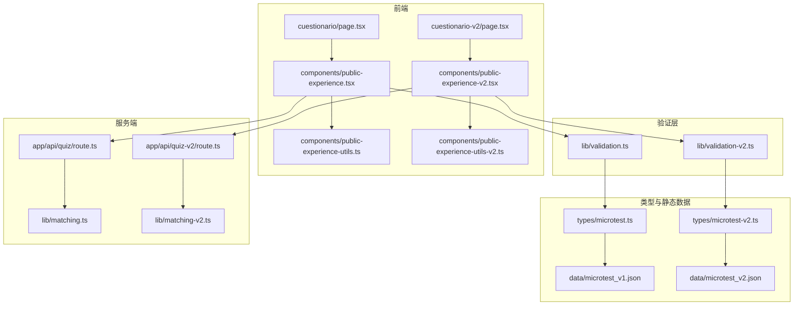
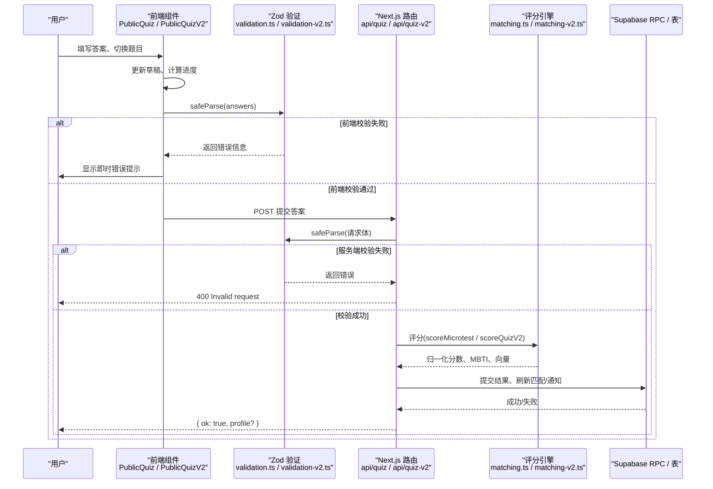
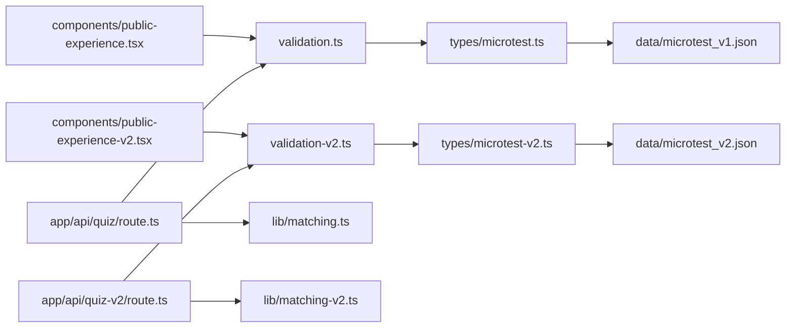

# 答案处理与验证

<cite>
**本文引用的文件**   
- [validation.ts](file://src/lib/validation.ts)
- [validation-v2.ts](file://src/lib/validation-v2.ts)
- [microtest.ts](file://src/types/microtest.ts)
- [microtest-v2.ts](file://src/types/microtest-v2.ts)
- [public-experience-utils.ts](file://src/components/public-experience-utils.ts)
- [public-experience-utils-v2.ts](file://src/components/public-experience-utils-v2.ts)
- [public-experience.tsx](file://src/components/public-experience.tsx)
- [public-experience-v2.tsx](file://src/components/public-experience-v2.tsx)
- [cuestionario/page.tsx](file://src/app/cuestionario/page.tsx)
- [cuestionario-v2/page.tsx](file://src/app/cuestionario-v2/page.tsx)
- [api/quiz/route.ts](file://src/app/api/quiz/route.ts)
- [api/quiz-v2/route.ts](file://src/app/api/quiz-v2/route.ts)
- [matching.ts](file://src/lib/matching.ts)
- [matching-v2.ts](file://src/lib/matching-v2.ts)
- [microtest_v1.json](file://data/microtest_v1.json)
- [microtest_v2.json](file://data/microtest_v2.json)
</cite>

## 目录
1. [引言](#引言)
2. [项目结构](#项目结构)
3. [核心组件](#核心组件)
4. [架构总览](#架构总览)
5. [详细组件分析](#详细组件分析)
6. [依赖关系分析](#依赖关系分析)
7. [性能考虑](#性能考虑)
8. [故障排查指南](#故障排查指南)
9. [结论](#结论)
10. [附录](#附录)

## 引言
本文件聚焦 ENES ZooMatch 心理测量系统的答案处理与验证机制，覆盖 v1 与 v2 两条问卷路径。文档重点包括：
- Zod 运行时验证：答案格式、数值范围、必填字段、去重与完整性校验。
- 本地存储策略：草稿自动保存、数据持久化、跨会话恢复。
- 答案收集流程：前端表单处理、实时验证反馈、错误提示机制。
- 进度指示系统：完成百分比、章节导航、跳过功能。
- 用户体验优化：键盘快捷键、移动端适配、无障碍访问。
- 代码示例位置：Zod schema 定义、验证函数调用、错误处理逻辑。
- 数据完整性与用户体验最佳实践。

## 项目结构
答案处理与验证涉及“前端页面 → 前端状态与工具 → Zod 验证 → 服务端路由 → 评分引擎 → 数据库”的完整链路。

图示来源
- [cuestionario/page.tsx:1-11](file://src/app/cuestionario/page.tsx#L1-L11)
- [cuestionario-v2/page.tsx:1-8](file://src/app/cuestionario-v2/page.tsx#L1-L8)
- [public-experience.tsx:1-200](file://src/components/public-experience.tsx#L1-L200)
- [public-experience-v2.tsx:1-200](file://src/components/public-experience-v2.tsx#L1-L200)
- [public-experience-utils.ts:1-171](file://src/components/public-experience-utils.ts#L1-L171)
- [public-experience-utils-v2.ts:1-200](file://src/components/public-experience-utils-v2.ts#L1-L200)
- [microtest.ts:1-21](file://src/types/microtest.ts#L1-L21)
- [microtest-v2.ts:1-200](file://src/types/microtest-v2.ts#L1-L200)
- [validation.ts:1-62](file://src/lib/validation.ts#L1-L62)
- [validation-v2.ts:1-71](file://src/lib/validation-v2.ts#L1-L71)
- [api/quiz/route.ts:1-71](file://src/app/api/quiz/route.ts#L1-L71)
- [api/quiz-v2/route.ts:1-128](file://src/app/api/quiz-v2/route.ts#L1-L128)
- [matching.ts:1-115](file://src/lib/matching.ts#L1-L115)
- [matching-v2.ts:1-200](file://src/lib/matching-v2.ts#L1-L200)
- [microtest_v1.json:1-80](file://data/microtest_v1.json#L1-L80)
- [microtest_v2.json:1-120](file://data/microtest_v2.json#L1-L120)

节来源
- [cuestionario/page.tsx:1-11](file://src/app/cuestionario/page.tsx#L1-L11)
- [cuestionario-v2/page.tsx:1-8](file://src/app/cuestionario-v2/page.tsx#L1-L8)
- [public-experience.tsx:1-200](file://src/components/public-experience.tsx#L1-L200)
- [public-experience-v2.tsx:1-200](file://src/components/public-experience-v2.tsx#L1-L200)
- [public-experience-utils.ts:1-171](file://src/components/public-experience-utils.ts#L1-L171)
- [public-experience-utils-v2.ts:1-200](file://src/components/public-experience-utils-v2.ts#L1-L200)
- [microtest.ts:1-21](file://src/types/microtest.ts#L1-L21)
- [microtest-v2.ts:1-200](file://src/types/microtest-v2.ts#L1-L200)
- [validation.ts:1-62](file://src/lib/validation.ts#L1-L62)
- [validation-v2.ts:1-71](file://src/lib/validation-v2.ts#L1-L71)
- [api/quiz/route.ts:1-71](file://src/app/api/quiz/route.ts#L1-L71)
- [api/quiz-v2/route.ts:1-128](file://src/app/api/quiz-v2/route.ts#L1-L128)
- [matching.ts:1-115](file://src/lib/matching.ts#L1-L115)
- [matching-v2.ts:1-200](file://src/lib/matching-v2.ts#L1-L200)
- [microtest_v1.json:1-80](file://data/microtest_v1.json#L1-L80)
- [microtest_v2.json:1-120](file://data/microtest_v2.json#L1-L120)

## 核心组件
- Zod 验证层：v1 使用单一 Likert 数组；v2 分离 Likert 与多选过滤器，并基于 JSON 动态导出期望 ID。
- 前端状态与草稿：v1 使用键值映射记录已答项；v2 以 likert/filters 双对象结构管理，支持自动持久化与跨会话恢复。
- 服务端路由：接收请求、运行 Zod 校验、身份认证、评分、落库与匹配计算。
- 评分引擎：将答案映射到维度分数、生成 MBTI 代码、计算向量相似度。

节来源
- [validation.ts:1-62](file://src/lib/validation.ts#L1-L62)
- [validation-v2.ts:1-71](file://src/lib/validation-v2.ts#L1-L71)
- [public-experience-utils.ts:1-171](file://src/components/public-experience-utils.ts#L1-L171)
- [public-experience-utils-v2.ts:1-200](file://src/components/public-experience-utils-v2.ts#L1-L200)
- [api/quiz/route.ts:1-71](file://src/app/api/quiz/route.ts#L1-L71)
- [api/quiz-v2/route.ts:1-128](file://src/app/api/quiz-v2/route.ts#L1-L128)
- [matching.ts:1-115](file://src/lib/matching.ts#L1-L115)
- [matching-v2.ts:1-200](file://src/lib/matching-v2.ts#L1-L200)

## 架构总览
下图展示从用户输入到结果返回的关键步骤，包含两次 Zod 校验（前端与服务端）和评分落库流程。

图示来源
- [public-experience.tsx:1-200](file://src/components/public-experience.tsx#L1-L200)
- [public-experience-v2.tsx:1-200](file://src/components/public-experience-v2.tsx#L1-L200)
- [validation.ts:1-62](file://src/lib/validation.ts#L1-L62)
- [validation-v2.ts:1-71](file://src/lib/validation-v2.ts#L1-L71)
- [api/quiz/route.ts:1-71](file://src/app/api/quiz/route.ts#L1-L71)
- [api/quiz-v2/route.ts:1-128](file://src/app/api/quiz-v2/route.ts#L1-L128)
- [matching.ts:1-115](file://src/lib/matching.ts#L1-L115)
- [matching-v2.ts:1-200](file://src/lib/matching-v2.ts#L1-L200)

## 详细组件分析

### Zod 运行时验证机制
- v1 验证要点
  - 学号规范化与正则校验：标准化后仅允许字母数字组合，长度约束在 schema 中统一表达。
  - Likert 值域：严格限制为 1–4。
  - 答案集合完整性：要求答案数量等于题库条目数，并通过自定义校验检查是否包含所有预期 itemId，且无重复。
  - 请求体解析：对非法 JSON 安全降级为空对象，避免抛出异常阻断路由。

- v2 验证要点
  - 动态 ID 列表：从 `data/microtest_v2.json` 中提取 Likert 与多选过滤器的 itemId 列表，保证前端与后端契约一致。
  - Likert 答案：value 必须为 1–5 的整数。
  - 多选过滤器：selected 为非空字符串数组。
  - 双重完整性校验：分别校验 Likert 与 filters 是否包含全部预期 ID、是否存在重复；缺失或重复都会触发 custom 错误。
  - 通知 ID 校验：uuid 数组，最小 1、最大 50。

代码示例位置
- v1 schema 与请求体解析：[validation.ts:1-62](file://src/lib/validation.ts#L1-L62)
- v2 schema 与动态 ID 提取：[validation-v2.ts:1-71](file://src/lib/validation-v2.ts#L1-L71)
- v1 题库 ID 来源：[microtest.ts:1-21](file://src/types/microtest.ts#L1-L21)
- v2 题库结构定义：[microtest-v2.ts:1-200](file://src/types/microtest-v2.ts#L1-L200)

节来源
- [validation.ts:1-62](file://src/lib/validation.ts#L1-L62)
- [validation-v2.ts:1-71](file://src/lib/validation-v2.ts#L1-L71)
- [microtest.ts:1-21](file://src/types/microtest.ts#L1-L21)
- [microtest-v2.ts:1-200](file://src/types/microtest-v2.ts#L1-L200)

### 本地存储策略：草稿、持久化与跨会话恢复
- v1 草稿模型
  - 结构：以 itemId 为键、Likert 值为值的映射。
  - 解析器：只保留允许的 itemId 与合法 Likert 值，忽略非法内容。
  - 初始定位：根据第一个未答题目定位起始页。
  - 存储键：固定 localStorage key。

- v2 草稿模型
  - 结构：分为 likert 与 filters 两个对象，前者为 itemId→1–5，后者为 itemId→string[]。
  - 解析器：逐项校验类型与值域，容错性强，损坏数据会回退为空草稿。
  - 自动持久化：draft 变化时写入 localStorage。
  - 跨会话恢复：首次渲染延迟读取 localStorage，跳转到首个未答题目并保持 SSR 稳定。

代码示例位置
- v1 草稿解析与辅助方法：[public-experience-utils.ts:1-171](file://src/components/public-experience-utils.ts#L1-L171)
- v2 草稿解析与常量：[public-experience-utils-v2.ts:1-200](file://src/components/public-experience-utils-v2.ts#L1-L200)

节来源
- [public-experience-utils.ts:1-171](file://src/components/public-experience-utils.ts#L1-L171)
- [public-experience-utils-v2.ts:1-200](file://src/components/public-experience-utils-v2.ts#L1-L200)

### 答案收集流程：表单处理、实时验证与错误提示
- v1 表单流程
  - 注册阶段先校验学号可用性，再跳转至问卷页。
  - 问卷页按题库顺序逐题展示，选择 Likert 值后立即更新草稿。
  - 提交前进行 Zod 校验；若失败则显示“Invalid quiz answers”。
  - 成功后调用 `/api/quiz`，返回 `{ ok: true }`。

- v2 表单流程
  - 加载题库 JSON，动态构建当前题目与选项。
  - 实时更新 answeredCount 与 progress，计算当前题目的完成状态。
  - 提供 Likert 按钮与多选切换；每次交互清除错误状态。
  - 最后一步才发起提交；服务端返回 profile 元数据用于后续展示。

代码示例位置
- v1 页面入口与组件：[cuestionario/page.tsx:1-11](file://src/app/cuestionario/page.tsx#L1-L11)、[public-experience.tsx:1-200](file://src/components/public-experience.tsx#L1-L200)
- v2 页面入口与组件：[cuestionario-v2/page.tsx:1-8](file://src/app/cuestionario-v2/page.tsx#L1-L8)、[public-experience-v2.tsx:1-200](file://src/components/public-experience-v2.tsx#L1-L200)

节来源
- [cuestionario/page.tsx:1-11](file://src/app/cuestionario/page.tsx#L1-L11)
- [cuestionario-v2/page.tsx:1-8](file://src/app/cuestionario-v2/page.tsx#L1-L8)
- [public-experience.tsx:1-200](file://src/components/public-experience.tsx#L1-L200)
- [public-experience-v2.tsx:1-200](file://src/components/public-experience-v2.tsx#L1-L200)

### 进度指示系统：完成百分比、章节导航与跳过
- 完成百分比
  - v1：基于已答题目数量与题库总数计算，并对结果做 0–1 区间钳制后转为百分比字符串。
  - v2：遍历所有题目，按题型累加已答数量，除以总题数得到进度百分比。

- 章节导航与跳过
  - v1：根据草稿查找第一个未答题目作为默认起始索引；未完全作答时可直接跳到该题。
  - v2：初始化时扫描草稿，定位首个缺失回答的题目并设置 index；每步可前进或后退。

代码示例位置
- v1 百分比与初始索引：[public-experience-utils.ts:1-171](file://src/components/public-experience-utils.ts#L1-L171)
- v2 进度计算与初始定位：[public-experience-v2.tsx:1-200](file://src/components/public-experience-v2.tsx#L1-L200)

节来源
- [public-experience-utils.ts:1-171](file://src/components/public-experience-utils.ts#L1-L171)
- [public-experience-v2.tsx:1-200](file://src/components/public-experience-v2.tsx#L1-L200)

### 服务端处理与错误处理
- v1 路由
  - 解析请求体并执行 Zod 校验。
  - 鉴权：获取当前用户；未登录返回 401。
  - 评分：调用 scoreMicrotest，捕获异常返回 400。
  - 落库：RPC 提交结果并刷新匹配；任一失败返回 503。
  - 防刷：withApiSecurity 限流。

- v2 路由
  - 同样进行 Zod 校验与鉴权。
  - 评分：scoreQuizV2 返回多轨道向量、MBTI 与硬过滤条件。
  - 生成用户档案标识：动物、颜色、叙事、别名等。
  - 首次提交检测：查询 profiles_v2 判断是否为首次提交，随后插入欢迎通知。
  - 落库与匹配：提交结果、计算 dual matches、发送通知。
  - 响应：返回 ok 与 profile 元数据。

代码示例位置
- v1 路由实现：[api/quiz/route.ts:1-71](file://src/app/api/quiz/route.ts#L1-L71)
- v2 路由实现：[api/quiz-v2/route.ts:1-128](file://src/app/api/quiz-v2/route.ts#L1-L128)

节来源
- [api/quiz/route.ts:1-71](file://src/app/api/quiz/route.ts#L1-L71)
- [api/quiz-v2/route.ts:1-128](file://src/app/api/quiz-v2/route.ts#L1-L128)

### 评分引擎与数据完整性
- v1 评分
  - 依据题库权重计算原始分数，再进行归一化到 0–1。
  - 根据 MBTI 维度阈值推导 MBTI 代码。
  - 抽取匹配维度构建向量，供余弦相似度计算。

- v2 评分
  - 支持双轨道 romance 与 amistad，维度不同、硬过滤条件不同。
  - 反向计分项通过枢轴值转换。
  - 输出 normalizedScores、MBTI 代码、hardFilters 以及两个轨道向量。

代码示例位置
- v1 评分逻辑：[matching.ts:1-115](file://src/lib/matching.ts#L1-L115)
- v2 评分逻辑与配置：[matching-v2.ts:1-200](file://src/lib/matching-v2.ts#L1-L200)

节来源
- [matching.ts:1-115](file://src/lib/matching.ts#L1-L115)
- [matching-v2.ts:1-200](file://src/lib/matching-v2.ts#L1-L200)

### 用户交互优化：键盘、移动端与无障碍
- 减少动效：使用 useReducedMotion 控制动画播放，满足运动敏感用户。
- 焦点管理：题目切换时将焦点移动到标题元素，提升键盘导航体验。
- 可访问性：关键图标区域标记 aria-hidden，状态区域使用 role="status"，确保屏幕阅读器可读。
- 移动端适配：布局采用响应式栅格与 clamp 字号，适配小屏设备。

代码示例位置
- v2 组件中的动效与焦点控制：[public-experience-v2.tsx:1-200](file://src/components/public-experience-v2.tsx#L1-L200)

节来源
- [public-experience-v2.tsx:1-200](file://src/components/public-experience-v2.tsx#L1-L200)

## 依赖关系分析
Zod 验证依赖题库类型与静态数据；前端组件依赖工具函数与题库 JSON；服务端路由依赖验证层、评分引擎与 Supabase 客户端。

图示来源
- [validation.ts:1-62](file://src/lib/validation.ts#L1-L62)
- [validation-v2.ts:1-71](file://src/lib/validation-v2.ts#L1-L71)
- [microtest.ts:1-21](file://src/types/microtest.ts#L1-L21)
- [microtest-v2.ts:1-200](file://src/types/microtest-v2.ts#L1-L200)
- [microtest_v1.json:1-80](file://data/microtest_v1.json#L1-L80)
- [microtest_v2.json:1-120](file://data/microtest_v2.json#L1-L120)
- [public-experience.tsx:1-200](file://src/components/public-experience.tsx#L1-L200)
- [public-experience-v2.tsx:1-200](file://src/components/public-experience-v2.tsx#L1-L200)
- [api/quiz/route.ts:1-71](file://src/app/api/quiz/route.ts#L1-L71)
- [api/quiz-v2/route.ts:1-128](file://src/app/api/quiz-v2/route.ts#L1-L128)
- [matching.ts:1-115](file://src/lib/matching.ts#L1-L115)
- [matching-v2.ts:1-200](file://src/lib/matching-v2.ts#L1-L200)

节来源
- [validation.ts:1-62](file://src/lib/validation.ts#L1-L62)
- [validation-v2.ts:1-71](file://src/lib/validation-v2.ts#L1-L71)
- [microtest.ts:1-21](file://src/types/microtest.ts#L1-L21)
- [microtest-v2.ts:1-200](file://src/types/microtest-v2.ts#L1-L200)
- [microtest_v1.json:1-80](file://data/microtest_v1.json#L1-L80)
- [microtest_v2.json:1-120](file://data/microtest_v2.json#L1-L120)
- [public-experience.tsx:1-200](file://src/components/public-experience.tsx#L1-L200)
- [public-experience-v2.tsx:1-200](file://src/components/public-experience-v2.tsx#L1-L200)
- [api/quiz/route.ts:1-71](file://src/app/api/quiz/route.ts#L1-L71)
- [api/quiz-v2/route.ts:1-128](file://src/app/api/quiz-v2/route.ts#L1-L128)
- [matching.ts:1-115](file://src/lib/matching.ts#L1-L115)
- [matching-v2.ts:1-200](file://src/lib/matching-v2.ts#L1-L200)

## 性能考虑
- 前端
  - 草稿持久化仅在 loaded 状态下写入 localStorage，避免初次渲染抖动。
  - 进度计算使用 useMemo 缓存，减少重渲染开销。
  - 异步请求使用 AbortController 取消过时请求，避免竞态。

- 服务端
  - 路由使用 withApiSecurity 限流，防止滥用。
  - 评分引擎为纯函数，无副作用，便于复用与测试。
  - 批量落库与匹配计算尽量合并 RPC 调用，降低网络往返。

[本节为通用指导，不直接分析具体文件]

## 故障排查指南
- 常见错误码
  - 400 Invalid request：Zod 校验失败或评分抛错。检查答案数量、itemId 是否在题库中、Likert 值域是否正确。
  - 401 Unauthorized：未登录或会话无效。确认认证流程与 session 状态。
  - 503 Service unavailable：Supabase 客户端不可用或 RPC 失败。检查环境变量与数据库迁移。

- 定位建议
  - 检查 Zod 校验结果：safeParse 返回 success=false 时，查看 issues 消息。
  - 核对题库一致性：v2 的 LIKERT_ITEM_IDS/FILTER_ITEM_IDS 是否与 microtest_v2.json 一致。
  - 检查本地草稿：localStorage 中对应 key 的内容是否符合解析器期望。

- 快速修复
  - 清理损坏的草稿后重新作答。
  - 确认题库版本与 schema 版本同步更新。
  - 在服务端日志中捕获 RPC 错误，定位数据库侧问题。

节来源
- [validation.ts:1-62](file://src/lib/validation.ts#L1-L62)
- [validation-v2.ts:1-71](file://src/lib/validation-v2.ts#L1-L71)
- [api/quiz/route.ts:1-71](file://src/app/api/quiz/route.ts#L1-L71)
- [api/quiz-v2/route.ts:1-128](file://src/app/api/quiz-v2/route.ts#L1-L128)
- [public-experience-utils.ts:1-171](file://src/components/public-experience-utils.ts#L1-L171)
- [public-experience-utils-v2.ts:1-200](file://src/components/public-experience-utils-v2.ts#L1-L200)

## 结论
ZooMatch 的答案处理与验证机制通过 Zod 在前端与服务端形成双重保障，结合稳定的本地草稿机制与清晰的进度反馈，既保证了数据完整性，也提升了用户体验。v2 进一步引入双轨道匹配、硬过滤与更丰富的类型系统，使问卷契约与评分引擎紧密对齐。推荐在实践中坚持以下原则：
- 始终使用 Zod safeParse 进行输入校验，避免异常中断。
- 题库与 schema 保持同版本，避免前后端不一致。
- 草稿持久化要健壮，容错解析损坏数据。
- 服务端落库与匹配计算需幂等与重试保护。
- 用户体验上优先可访问性与减少动效，兼顾键盘与移动设备。

[本节为总结性内容，不直接分析具体文件]

## 附录
- 题库与维度说明
  - v1 题库结构与 Likert 量表：[microtest_v1.json:1-80](file://data/microtest_v1.json#L1-L80)
  - v2 题库结构与双轨道维度：[microtest_v2.json:1-120](file://data/microtest_v2.json#L1-L120)

- 代码示例路径
  - v1 Zod schema 定义：[validation.ts:1-62](file://src/lib/validation.ts#L1-L62)
  - v2 Zod schema 定义：[validation-v2.ts:1-71](file://src/lib/validation-v2.ts#L1-L71)
  - v1 评分入口：[api/quiz/route.ts:1-71](file://src/app/api/quiz/route.ts#L1-L71)
  - v2 评分入口：[api/quiz-v2/route.ts:1-128](file://src/app/api/quiz-v2/route.ts#L1-L128)
  - v1 草稿解析：[public-experience-utils.ts:1-171](file://src/components/public-experience-utils.ts#L1-L171)
  - v2 草稿解析：[public-experience-utils-v2.ts:1-200](file://src/components/public-experience-utils-v2.ts#L1-L200)

[本节为补充信息，不直接分析具体文件]