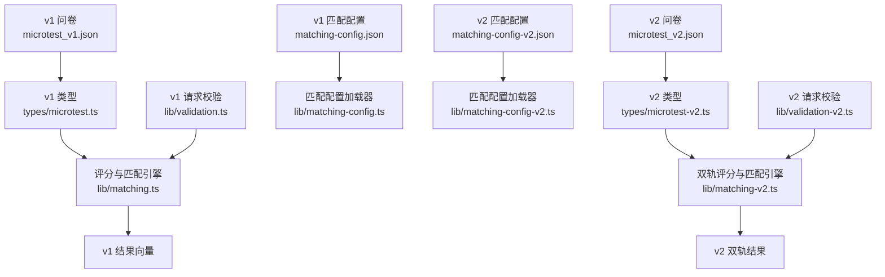
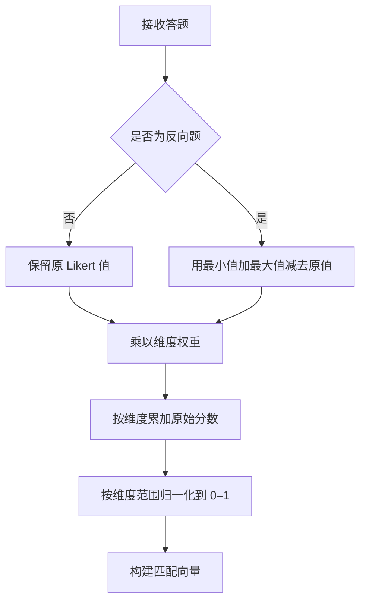
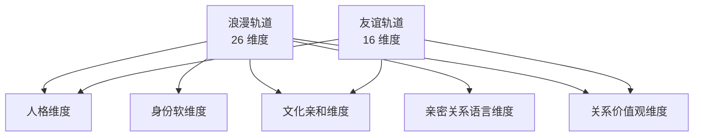
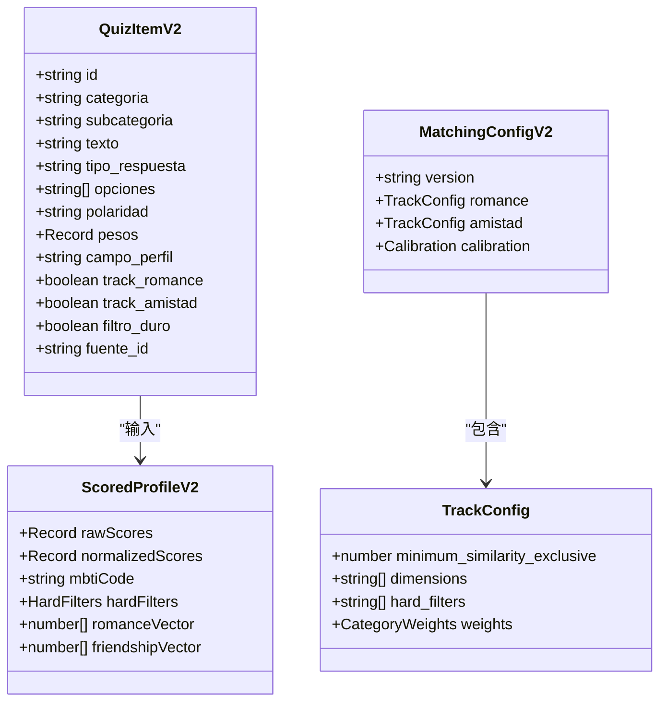
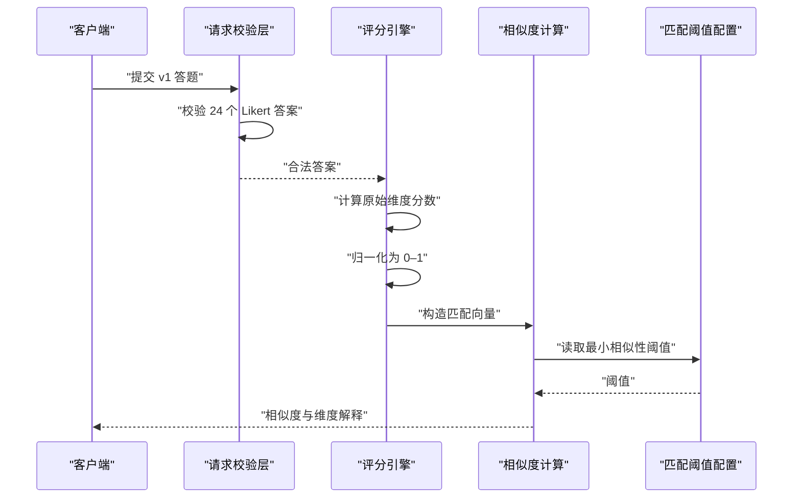
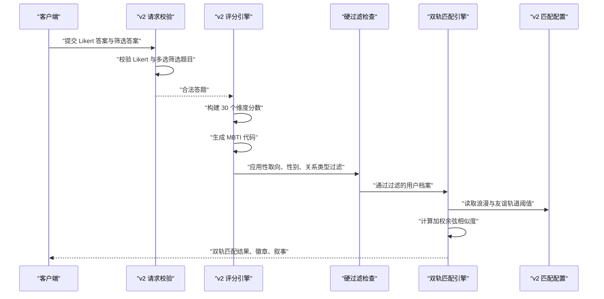

# 问卷设计与结构

<cite>
**本文引用的文件**   
- [data/microtest_v1.json](file://data/microtest_v1.json)
- [data/microtest_v2.json](file://data/microtest_v2.json)
- [data/matching-config.json](file://data/matching-config.json)
- [data/matching-config-v2.json](file://data/matching-config-v2.json)
- [src/types/microtest.ts](file://src/types/microtest.ts)
- [src/types/microtest-v2.ts](file://src/types/microtest-v2.ts)
- [src/lib/validation.ts](file://src/lib/validation.ts)
- [src/lib/validation-v2.ts](file://src/lib/validation-v2.ts)
- [src/lib/matching.ts](file://src/lib/matching.ts)
- [src/lib/matching-v2.ts](file://src/lib/matching-v2.ts)
- [src/lib/matching-config.ts](file://src/lib/matching-config.ts)
- [src/lib/matching-config-v2.ts](file://src/lib/matching-config-v2.ts)
</cite>

## 目录

1. [引言](#引言)
2. [项目结构与定位](#项目结构与定位)
3. [v1 与 v2 问卷架构对比](#v1-与-v2-问卷架构对比)
4. [心理测量维度设计](#心理测量维度设计)
5. [Likert 量表与计分规则](#likert-量表与计分规则)
6. [题目分类、权重与维度映射](#题目分类权重与维度映射)
7. [JSON 配置文件字段说明](#json-配置文件字段说明)
8. [TypeScript 类型定义与扩展指南](#typescript-类型定义与扩展指南)
9. [评分、匹配与结果生成流程](#评分匹配与结果生成流程)
10. [性能与可扩展性分析](#性能与可扩展性分析)
11. [排错与验证指南](#排错与验证指南)
12. [结论](#结论)

## 引言

ENES ZooMatch 是一个面向 ENES 学生的双轨心理测量与匹配系统。它通过问卷采集用户的人格特质、MBTI 倾向、文化亲和力、亲密关系偏好和关系价值观，并据此计算“浪漫”和“友谊”两条轨道的相似性。

本文聚焦问卷设计与结构，目标是帮助读者理解：

- v1（24 题、17 维度）和 v2（60 题、30 维度）在数据结构、维度体系、计分方式、匹配策略上的差异。
- BigFive 五大人格特质如何体现在题目中。
- MBTI 四组指标如何在题目中映射为连续维度。
- Likert 量表从 v1 的 1–4 级升级到 v2 的 1–5 级的动机和实现。
- 如何通过 JSON 配置和 TypeScript 类型扩展新题目和新维度。
- 题目文本、选项、所属维度、极性、权重、硬过滤字段等字段的含义。

本说明不直接复制题库原文内容；如需查看具体题目，请参考引用中的 JSON 数据文件和类型定义文件。

**章节来源**
- [data/microtest_v1.json:1-20](file://data/microtest_v1.json#L1-L20)
- [data/microtest_v2.json:1-25](file://data/microtest_v2.json#L1-L25)

## 项目结构与定位

ZooMatch 的问卷相关代码分布在三个层次：

| 层次 | 主要职责 | 关键文件 |
|---|---|---|
| 静态问卷定义 | 定义题目、维度、类别、Likert 选项、来源和元信息 | `data/microtest_v1.json`、`data/microtest_v2.json` |
| 类型与配置校验 | 提供强类型定义、运行时 Zod 校验和匹配阈值保护 | `src/types/*`、`src/lib/validation*.ts`、`src/lib/matching-config*.ts` |
| 评分与匹配引擎 | 将答题转换为维度分数、构建向量、计算相似性和匹配结果 | `src/lib/matching.ts`、`src/lib/matching-v2.ts` |

**图表来源**
- [data/microtest_v1.json:1-20](file://data/microtest_v1.json#L1-L20)
- [data/microtest_v2.json:1-25](file://data/microtest_v2.json#L1-L25)
- [src/types/microtest.ts:1-21](file://src/types/microtest.ts#L1-L21)
- [src/types/microtest-v2.ts:1-60](file://src/types/microtest-v2.ts#L1-L60)
- [src/lib/validation.ts:1-62](file://src/lib/validation.ts#L1-L62)
- [src/lib/validation-v2.ts:1-71](file://src/lib/validation-v2.ts#L1-L71)
- [src/lib/matching.ts:1-40](file://src/lib/matching.ts#L1-L40)
- [src/lib/matching-v2.ts:1-80](file://src/lib/matching-v2.ts#L1-L80)
- [src/lib/matching-config.ts:1-16](file://src/lib/matching-config.ts#L1-L16)
- [src/lib/matching-config-v2.ts:1-67](file://src/lib/matching-config-v2.ts#L1-L67)

**章节来源**
- [data/microtest_v1.json:1-20](file://data/microtest_v1.json#L1-L20)
- [data/microtest_v2.json:1-25](file://data/microtest_v2.json#L1-L25)
- [src/types/microtest.ts:1-21](file://src/types/microtest.ts#L1-L21)
- [src/types/microtest-v2.ts:1-60](file://src/types/microtest-v2.ts#L1-L60)
- [src/lib/matching.ts:1-40](file://src/lib/matching.ts#L1-L40)
- [src/lib/matching-v2.ts:1-80](file://src/lib/matching-v2.ts#L1-L80)

## v1 与 v2 问卷架构对比

### 核心差异总览

| 维度 | v1 | v2 |
|---|---|---|
| 题目数量 | 24 题 | 60 题 |
| 维度数量 | 17 个评分维度 | 30 个评分维度 |
| Likert 等级 | 1–4 级 | 1–5 级 |
| 主要类别 | BigFive、MBTI、Relaciones、Genero | personalidad_bigfive、personalidad_mbti、identidad_filtros、afinidad_cultural、intimidad_afecto、valores_relacionales |
| 轨道支持 | 单一匹配向量 | 浪漫轨道与友谊轨道双轨匹配 |
| 硬过滤 | 无独立硬过滤字段 | 性取向、性别认同、关系类型 |
| 题型 | 全部为 Likert | Likert + 多选筛选 |
| 类别权重 | 无显式类别权重 | 按类别加权余弦相似度 |
| 解释能力 | 维度亲和度列表 | 徽章、叙事、双轨比较 |

### v1 的设计特征

v1 是教育性与娱乐性更强的轻量版测试。它的元数据明确说明：

- 共 24 题。
- 每类 6 题。
- 类别包括 BigFive、MBTI、Relaciones、Genero。
- 评分方式是 Likert 值乘以题目向量权重后按维度求和。
- BigFive 题目来源于 IPIP 的公开样本，其他题目由 ZooMatch 原创。

v1 的 17 个维度中，前 5 个对应 BigFive，接着 4 个对应 MBTI，其余是关系维度和性别价值观维度。

**章节来源**
- [data/microtest_v1.json:1-20](file://data/microtest_v1.json#L1-L20)
- [data/microtest_v1.json:20-45](file://data/microtest_v1.json#L20-L45)
- [data/microtest_v1.json:45-90](file://data/microtest_v1.json#L45-L90)

### v2 的设计特征

v2 是为“浪漫”和“友谊”两种关系场景设计的多维匹配系统。它的元数据强调：

- 共 60 题。
- 分为 6 个类别，每个类别有明确的题目数量规划。
- 总共 30 个评分维度。
- 同时支持 romance 和 amistad 两条轨道。
- 引入身份筛选、文化亲和、亲密关系语言、关系价值观等新维度。

v2 不仅增加题目数量，更重要的是把原本扁平的维度组织成可加权、可分轨道的结构。例如，亲密关系语言只参与浪漫轨道，而文化亲和和价值观同时参与两条轨道。

**章节来源**
- [data/microtest_v2.json:1-25](file://data/microtest_v2.json#L1-L25)
- [data/microtest_v2.json:25-65](file://data/microtest_v2.json#L25-L65)

## 心理测量维度设计

### BigFive 人格特质

BigFive 在本系统中不是直接输出“外向型/内向型”等标签，而是先映射为连续维度，再根据阈值或匹配结果推导 MBTI 字母。

| BigFive 维度 | v1 维度名 | v2 维度名 | 设计意图 |
|---|---|---|---|
| 开放性 | bigfive_apertura | personalidad_apertura | 探索抽象概念、创意、好奇心 |
| 尽责性 | bigfive_responsabilidad | personalidad_responsabilidad | 计划性、责任感、守约 |
| 外向性 | bigfive_extraversion | personalidad_extraversion | 社交能量、群体活动偏好 |
| 宜人性 | bigfive_amabilidad | personalidad_amabilidad | 同理心、合作、关心他人 |
| 神经质 | bigfive_neuroticismo | personalidad_estabilidad_emocional | v2 改为情绪稳定性，正向表述更清晰 |

在 v2 中，“神经质”被重新表述为“情绪稳定性”，更符合积极心理测量和面向学生群体的表达习惯。

**章节来源**
- [data/microtest_v1.json:20-45](file://data/microtest_v1.json#L20-L45)
- [data/microtest_v2.json:25-65](file://data/microtest_v2.json#L25-L65)
- [src/types/microtest-v2.ts:12-30](file://src/types/microtest-v2.ts#L12-L30)

### MBTI 类型指标

v1 和 v2 都使用四个 MBTI 维度：

| MBTI 指标 | v1 维度名 | v2 维度名 | 题目示例思路 |
|---|---|---|---|
| 外向性 vs 内向性 | mbti_extraversion | mbti_extraversion | 通过社交互动获得能量还是独处恢复能量 |
| 直觉 vs 实感 | mbti_intuicion | mbti_intuicion | 关注抽象可能性还是具体事实 |
| 思维 vs 情感 | mbti_pensamiento | mbti_pensamiento | 决策时优先逻辑还是感受 |
| 判断 vs 感知 | mbti_juicio | mbti_juicio | 偏好计划结构还是灵活开放 |

MBTI 类型代码是在维度分数归一化后生成的：

- v1 使用 4 个 MBTI 维度是否大于等于 0.5。
- v2 同样使用 0.5 作为正方向字母阈值。

因此，MBTI 在本系统中更接近“倾向得分”而非严格诊断分类。

**章节来源**
- [data/microtest_v1.json:60-90](file://data/microtest_v1.json#L60-L90)
- [data/microtest_v2.json:200-260](file://data/microtest_v2.json#L200-L260)
- [src/lib/matching.ts:24-40](file://src/lib/matching.ts#L24-L40)
- [src/lib/matching-v2.ts:150-190](file://src/lib/matching-v2.ts#L150-L190)
- [src/types/microtest-v2.ts:18-30](file://src/types/microtest-v2.ts#L18-L30)

### 关系、性别与文化维度

v1 的关系维度包括沟通、信任、同理心、冲突管理；性别维度包括平等、角色灵活性、多样性尊重、共同责任。

v2 将这些思想进一步细化，并扩展出：

- 身份软维度：排他性、情感沟通。
- 文化亲和维度：音乐、视觉审美、创造性爱好、大学生活、幽默。
- 亲密关系语言维度：肯定言语、优质时间、礼物细节、身体接触、服务行为、情感开放、欲望沟通、界限尊重。
- 关系价值观维度：同理心、信任、冲突管理、性别平等、共同责任、多样性尊重。

这种变化使 v2 更适合校园情境下的长期关系匹配，而不只是人格侧写。

**章节来源**
- [data/microtest_v1.json:140-200](file://data/microtest_v1.json#L140-L200)
- [data/microtest_v1.json:201-273](file://data/microtest_v1.json#L201-L273)
- [data/microtest_v2.json:260-400](file://data/microtest_v2.json#L260-L400)
- [data/microtest_v2.json:400-600](file://data/microtest_v2.json#L400-L600)
- [src/types/microtest-v2.ts:32-80](file://src/types/microtest-v2.ts#L32-L80)

## Likert 量表与计分规则

### v1：1–4 级 Likert

v1 的 Likert 量表如下：

| 数值 | 标签 |
|---|---|
| 1 | 完全不同意 |
| 2 | 不同意 |
| 3 | 同意 |
| 4 | 完全同意 |

v1 的评分逻辑是：

1. 收集 24 个题目的答案。
2. 对每个题目，用 Likert 值乘以该题目在各维度上的权重。
3. 累加得到原始维度分数。
4. 根据每个维度的最小可能值和最大可能值归一化到 0–1。
5. 排除 MBTI 维度后形成匹配向量。

v1 的正向题权重为正，反向题权重为负，因此同一维度内可能存在正向和反向题目，用于降低作答偏差。

**章节来源**
- [data/microtest_v1.json:10-20](file://data/microtest_v1.json#L10-L20)
- [src/lib/validation.ts:24-62](file://src/lib/validation.ts#L24-L62)
- [src/lib/matching.ts:40-115](file://src/lib/matching.ts#L40-L115)

### v2：1–5 级 Likert

v2 的 Likert 量表升级为：

| 数值 | 标签 |
|---|---|
| 1 | 完全不同意 |
| 2 | 不同意 |
| 3 | 中立 |
| 4 | 同意 |
| 5 | 完全同意 |

升级理由：

- 5 级量表比 4 级量表多一个中性点，更适合测量态度分布。
- 对于反向题，v2 使用反转枢轴：`最小值 + 最大值 - 实际值`，即 `6 - 实际值`。
- 更多区分度有助于提高匹配精度，尤其是当两个用户在 1–4 级上只能给出相同选择时。
- v2 的评分范围更大，有利于归一化后的维度区分。

v2 还支持非 Likert 的多选筛选题目，这些题目不参与 Likert 计分，而是映射到硬过滤字段。

**章节来源**
- [data/microtest_v2.json:15-25](file://data/microtest_v2.json#L15-L25)
- [src/lib/validation-v2.ts:1-71](file://src/lib/validation-v2.ts#L1-L71)
- [src/lib/matching-v2.ts:80-120](file://src/lib/matching-v2.ts#L80-L120)

### 反向题处理

v1 通过权重 `-1` 表示反向题；v2 通过 `polaridad: "negativa"` 配合反转枢轴处理。

这意味着：

- 正向题：越大越代表该维度高。
- 反向题：越小越代表该维度高。
- 归一化后，两个用户的维度分数都在 0–1 区间，便于余弦相似度比较。

**图表来源**
- [src/lib/matching.ts:40-115](file://src/lib/matching.ts#L40-L115)
- [src/lib/matching-v2.ts:120-200](file://src/lib/matching-v2.ts#L120-L200)

**章节来源**
- [src/lib/matching.ts:40-115](file://src/lib/matching.ts#L40-L115)
- [src/lib/matching-v2.ts:120-200](file://src/lib/matching-v2.ts#L120-L200)

## 题目分类、权重与维度映射

### v1 题目分类

v1 的题目按类别分组：

| 类别 | 典型 ID 前缀 | 维度映射重点 |
|---|---|---|
| BigFive | BF | 开放、尽责、外向、宜人、神经质 |
| MBTI | MB | 外向、直觉、思维、判断 |
| Relaciones | RE | 沟通、信任、同理心、冲突管理 |
| Genero | GE | 平等、角色灵活性、多样性尊重、共同责任 |

每个题目的 `pesos` 是一个稀疏权重对象：只有与题目相关的维度是非零值，其他维度为 0。这使得一个题目可以精确投射到一个或多个维度。

**章节来源**
- [data/microtest_v1.json:45-200](file://data/microtest_v1.json#L45-L200)
- [data/microtest_v1.json:201-273](file://data/microtest_v1.json#L201-L273)

### v2 题目分类

v2 的分类更细，且新增“子类别”：

| 类别 | 子类别示例 | 主要维度 |
|---|---|---|
| personalidad_bigfive | apertura、responsabilidad、extraversion、amabilidad、estabilidad_emocional | 五大人格 |
| personalidad_mbti | extraversion、intuicion、pensamiento、juicio | MBTI 四维度 |
| identidad_filtros | orientacion、identidad_genero、tipo_relacion、exclusividad、comunicacion_afectiva | 硬过滤 + 软维度 |
| afinidad_cultural | musica、estetica、hobbies_creativos、vida_universitaria、humor | 文化亲和 |
| intimidad_afecto | palabras_afirmacion、tiempo_calidad、regalos_detalle、contacto_fisico、actos_servicio、apertura_emocional、comunicacion_deseos、limites_respeto | 亲密关系语言 |
| valores_relacionales | empatia、confianza、gestion_conflicto、igualdad_genero、corresponsabilidad、respeto_diversidad | 关系价值观 |

v2 还引入了 `track_romance` 和 `track_amistad`，决定题目参与哪条轨道。

**章节来源**
- [data/microtest_v2.json:1-25](file://data/microtest_v2.json#L1-L25)
- [data/microtest_v2.json:200-400](file://data/microtest_v2.json#L200-L400)
- [src/types/microtest-v2.ts:1-40](file://src/types/microtest-v2.ts#L1-L40)

### 维度映射与轨道策略

v2 的浪漫轨道包含 26 个维度，友谊轨道包含 16 个维度。区别主要在：

- 浪漫轨道包含身份软维度和亲密关系语言维度。
- 友谊轨道不包含身份软维度和亲密关系语言维度。
- 两条轨道都包含 BigFive、MBTI、文化亲和、关系价值观。

**图表来源**
- [data/microtest_v2.json:25-65](file://data/microtest_v2.json#L25-L65)
- [src/types/microtest-v2.ts:201-260](file://src/types/microtest-v2.ts#L201-L260)

**章节来源**
- [data/microtest_v2.json:25-65](file://data/microtest_v2.json#L25-L65)
- [src/types/microtest-v2.ts:201-260](file://src/types/microtest-v2.ts#L201-L260)

## JSON 配置文件字段说明

### microtest_v1.json 关键字段

| 字段 | 含义 |
|---|---|
| metadatos.version | 问卷版本 |
| metadatos.idioma | 语言区域 |
| metadatos.total_items | 题目总数 |
| metadatos.categorias | 题目类别 |
| metadatos.puntuacion | 计分策略说明 |
| metadatos.trazabilidad | 题目来源与版权说明 |
| escala_likert | Likert 选项数组 |
| dimensiones | 所有评分维度 |
| fuentes | 题目来源、许可和归属 |
| items.id | 题目唯一标识 |
| items.categoria | 题目类别 |
| items.texto | 题目文本 |
| items.polaridad | 正向、反向或空 |
| items.pesos | 各维度权重 |
| items.fuente_id | 来源标识 |

**章节来源**
- [data/microtest_v1.json:1-20](file://data/microtest_v1.json#L1-L20)
- [data/microtest_v1.json:20-45](file://data/microtest_v1.json#L20-L45)
- [data/microtest_v1.json:45-90](file://data/microtest_v1.json#L45-L90)

### microtest_v2.json 关键字段

| 字段 | 含义 |
|---|---|
| metadatos.total_items | 题目总数 |
| metadatos.categorias | 六大类别 |
| metadatos.items_por_categoria | 每类题目数量 |
| metadatos.total_dimensiones | 评分维度总数 |
| escala_likert | 1–5 级选项 |
| dimensiones | 全部 30 个评分维度 |
| dimensiones_por_track | 浪漫和友谊轨道分别包含哪些维度 |
| items.tipo_respuesta | likert_5 或 seleccion_multiple |
| items.opciones | 多选筛选题目的选项 |
| items.campo_perfil | 映射到硬过滤字段 |
| items.track_romance | 是否参与浪漫轨道 |
| items.track_amistad | 是否参与友谊轨道 |
| items.filtro_duro | 是否为硬过滤题目 |

**章节来源**
- [data/microtest_v2.json:1-25](file://data/microtest_v2.json#L1-L25)
- [data/microtest_v2.json:25-65](file://data/microtest_v2.json#L25-L65)
- [data/microtest_v2.json:260-340](file://data/microtest_v2.json#L260-L340)

### matching-config.json 与 matching-config-v2.json

v1 的匹配配置非常简单，只包含一个最小相似性阈值。

v2 的配置更复杂，支持：

| 配置项 | 含义 |
|---|---|
| version | 配置版本 |
| tracks.romance.minimum_similarity_exclusive | 浪漫轨道最小相似性阈值 |
| tracks.amistad.minimum_similarity_exclusive | 友谊轨道最小相似性阈值 |
| tracks.*.dimensions | 该轨道使用的评分维度 |
| tracks.*.hard_filters | 该轨道的硬过滤字段 |
| tracks.*.weights | 类别权重 |
| calibration.method | 校准方法 |
| calibration.target_coverage | 目标覆盖率 |
| calibration.max_users | 最大用户数 |

v2 的浪漫轨道默认类别权重偏向人格、亲密关系语言和关系价值观；友谊轨道则更强调人格和文化亲和。

**章节来源**
- [data/matching-config.json:1-3](file://data/matching-config.json#L1-L3)
- [data/matching-config-v2.json:1-76](file://data/matching-config-v2.json#L1-L76)

## TypeScript 类型定义与扩展指南

### v1 类型结构

v1 的类型从 JSON 中派生：

- `MicrotestItem` 来自 `microtestData.items[number]`。
- `Dimension` 是所有权重的键。
- `MbtiDimension` 是带 `mbti_` 前缀的维度。
- `MatchingDimension` 是除 MBTI 外的维度。
- `QuizItemId` 是题目 ID。
- `LikertValue` 是 1、2、3、4。
- `DIMENSIONS`、`MBTI_DIMENSIONS`、`MATCHING_DIMENSIONS` 从 JSON 维度列表导出。

扩展 v1 的新题目需要：

1. 在 `data/microtest_v1.json` 的 `items` 中添加题目。
2. 如果新增维度，加入 `dimensiones`。
3. 确保后端校验 schema 仍接受新的题目 ID。
4. 更新匹配向量时确认新维度是否进入 `MATCHING_DIMENSIONS`。

**章节来源**
- [src/types/microtest.ts:1-21](file://src/types/microtest.ts#L1-L21)
- [src/lib/validation.ts:24-62](file://src/lib/validation.ts#L24-L62)

### v2 类型结构

v2 的类型更结构化，把维度按语义分组：

| 类型 | 作用 |
|---|---|
| CategoryV2 | 题目六大类别 |
| BigFiveDimension | 五大人格维度 |
| MbtiDimension | MBTI 四维度 |
| IdentityDimension | 身份软维度 |
| CulturalDimension | 文化亲和维度 |
| IntimacyDimension | 亲密关系语言维度 |
| ValuesDimension | 关系价值观维度 |
| DimensionV2 | 所有评分维度联合类型 |
| QuizItemV2 | 单题结构 |
| ScoredProfileV2 | 评分档案 |
| DualMatchResult | 双轨匹配结果 |

v2 还提供维度常量数组，例如：

- `BIG_FIVE_DIMENSIONS`
- `MBTI_DIMENSIONS_V2`
- `IDENTITY_DIMENSIONS`
- `CULTURAL_DIMENSIONS`
- `INTIMACY_DIMENSIONS`
- `VALUES_DIMENSIONS`
- `ROMANCE_VECTOR_DIMENSIONS`
- `FRIENDSHIP_VECTOR_DIMENSIONS`
- `ALL_DIMENSIONS_V2`

扩展 v2 的新题目建议遵循以下流程：

1. 确定题目属于哪个类别。
2. 如果是 Likert 题，设置 `tipo_respuesta: "likert_5"`。
3. 如果是筛选题，设置 `tipo_respuesta: "seleccion_multiple"`，并填写 `opciones` 和 `campo_perfil`。
4. 设置 `pesos`，指向一个或多个维度。
5. 设置 `track_romance` 和 `track_amistad`。
6. 如属于硬过滤字段，设置 `filtro_duro: true`。
7. 如需让新维度参与向量，将其加入对应维度常量数组。
8. 如需影响匹配权重，更新 `matching-config-v2.json` 的类别权重。

**图表来源**
- [src/types/microtest-v2.ts:80-160](file://src/types/microtest-v2.ts#L80-L160)
- [src/types/microtest-v2.ts:201-302](file://src/types/microtest-v2.ts#L201-L302)
- [data/matching-config-v2.json:1-76](file://data/matching-config-v2.json#L1-L76)

**章节来源**
- [src/types/microtest-v2.ts:1-60](file://src/types/microtest-v2.ts#L1-L60)
- [src/types/microtest-v2.ts:80-160](file://src/types/microtest-v2.ts#L80-L160)
- [src/types/microtest-v2.ts:201-302](file://src/types/microtest-v2.ts#L201-L302)

## 评分、匹配与结果生成流程

### v1 评分与匹配流程

**图表来源**
- [src/lib/validation.ts:24-62](file://src/lib/validation.ts#L24-L62)
- [src/lib/matching.ts:40-115](file://src/lib/matching.ts#L40-L115)
- [src/lib/matching-config.ts:1-16](file://src/lib/matching-config.ts#L1-L16)

**章节来源**
- [src/lib/validation.ts:24-62](file://src/lib/validation.ts#L24-L62)
- [src/lib/matching.ts:40-115](file://src/lib/matching.ts#L40-L115)
- [src/lib/matching-config.ts:1-16](file://src/lib/matching-config.ts#L1-L16)

### v2 双轨评分与匹配流程

**图表来源**
- [src/lib/validation-v2.ts:1-71](file://src/lib/validation-v2.ts#L1-L71)
- [src/lib/matching-v2.ts:1-120](file://src/lib/matching-v2.ts#L1-L120)
- [src/lib/matching-config-v2.ts:1-67](file://src/lib/matching-config-v2.ts#L1-L67)

**章节来源**
- [src/lib/validation-v2.ts:1-71](file://src/lib/validation-v2.ts#L1-L71)
- [src/lib/matching-v2.ts:1-120](file://src/lib/matching-v2.ts#L1-L120)
- [src/lib/matching-config-v2.ts:1-67](file://src/lib/matching-config-v2.ts#L1-L67)

## 性能与可扩展性分析

### 复杂度特征

- v1 评分遍历 24 题 × 17 维度，时间复杂度约为 O(题目数 × 维度数)。
- v2 评分遍历 60 题 × 30 维度，但大多数权重为零，实际计算主要由非零权重驱动。
- 匹配过程使用余弦相似度，时间复杂度与向量长度线性相关。
- v2 的双轨匹配分别计算浪漫轨道和友谊轨道，但共享评分阶段。

### 可扩展性优势

- JSON 配置集中管理题目、维度、轨道和权重，业务逻辑与题库分离。
- TypeScript 类型从 JSON 派生或集中声明，减少类型与数据不一致风险。
- Zod 校验在运行时拦截非法题目 ID、非法 Likert 值、缺失或重复答案。
- v2 的类别权重允许在不修改算法的情况下调整匹配策略。

### 潜在优化空间

- 对大规模用户匹配可考虑预计算维度向量缓存。
- 若未来继续增加维度，应评估向量长度对余弦相似度计算的影响。
- 若新增 MBTI 或 BigFive 维度，需要同步更新 MBTI 字母推导逻辑。
- 若新增轨道，需要在类型、维度常量、匹配配置和前端展示中同步扩展。

**章节来源**
- [src/lib/matching.ts:40-115](file://src/lib/matching.ts#L40-L115)
- [src/lib/matching-v2.ts:120-200](file://src/lib/matching-v2.ts#L120-L200)
- [src/types/microtest-v2.ts:201-302](file://src/types/microtest-v2.ts#L201-L302)

## 排错与验证指南

### v1 常见问题

| 问题 | 原因 | 处理方式 |
|---|---|---|
| 答题不完整 | 未提交 24 个题目 | 校验层会拒绝缺少题目 ID 的请求 |
| 题目 ID 无效 | 使用了不在题库中的 ID | 校验层基于 `QUIZ_ITEM_IDS` 进行白名单校验 |
| Likert 值非法 | 使用了非 1–4 的值 | Zod schema 只允许 1、2、3、4 |
| 匹配结果为 0 | 向量为零或维度未贡献 | 检查题目权重和反向题极性 |

**章节来源**
- [src/lib/validation.ts:24-62](file://src/lib/validation.ts#L24-L62)
- [src/lib/matching.ts:40-115](file://src/lib/matching.ts#L40-L115)

### v2 常见问题

| 问题 | 原因 | 处理方式 |
|---|---|---|
| Likert 题目缺失 | 未提交所有 `likert_5` 题目 | 校验层检查 `LIKERT_ITEM_IDS` |
| Likert 题目重复 | 同一题目出现多次 | 校验层检测重复 ID |
| 筛选题目缺失 | 未提交所有 `seleccion_multiple` 题目 | 校验层检查 `FILTER_ITEM_IDS` |
| 筛选题目重复 | 同一筛选题目出现多次 | 校验层检测重复 ID |
| 浪漫轨道匹配失败 | 硬过滤不兼容 | 检查性取向、性别认同、关系类型兼容性 |
| 匹配阈值异常 | 配置文件无效 | 加载器回退到安全默认值 |

**章节来源**
- [src/lib/validation-v2.ts:1-71](file://src/lib/validation-v2.ts#L1-L71)
- [src/lib/matching-v2.ts:120-200](file://src/lib/matching-v2.ts#L120-L200)
- [src/lib/matching-config-v2.ts:1-67](file://src/lib/matching-config-v2.ts#L1-L67)

## 结论

ENES ZooMatch 的问卷设计经历了从轻量教育测试到多维双轨匹配的演进：

- v1 适合快速了解 BigFive、MBTI、关系态度和性别价值观的基本倾向，结构简单、易于维护。
- v2 更适合真实校园关系匹配，通过 60 题、30 维度、双轨道、硬过滤和类别权重，提供更精细的相似性判断。
- Likert 从 1–4 升级到 1–5，提高了区分度，也更符合态度量表的常见实践。
- JSON 配置和 TypeScript 类型共同构成问卷契约，既保证运行时安全，又方便扩展新题目和新维度。
- 未来的扩展应优先考虑：维度语义一致性、轨道覆盖完整性、类别权重合理性，以及硬过滤关系的透明度。