# 核心功能特性

<cite>
**本文引用的文件**   
- [README.md](file://README.md)
- [CONTEXTO_PROYECTO.md](file://CONTEXTO_PROYECTO.md)
- [MANUAL_ADMINISTRADOR.md](file://MANUAL_ADMINISTRADOR.md)
- [package.json](file://package.json)
- [src/app/api/register/route.ts](file://src/app/api/register/route.ts)
- [src/app/api/login/route.ts](file://src/app/api/login/route.ts)
- [src/lib/identity.server.ts](file://src/lib/identity.server.ts)
- [src/app/api/quiz/route.ts](file://src/app/api/quiz/route.ts)
- [src/app/api/quiz-v2/route.ts](file://src/app/api/quiz-v2/route.ts)
- [src/lib/matching.ts](file://src/lib/matching.ts)
- [src/lib/matching-v2.ts](file://src/lib/matching-v2.ts)
- [src/app/api/result/route.ts](file://src/app/api/result/route.ts)
- [src/app/api/result-v2/route.ts](file://src/app/api/result-v2/route.ts)
- [src/components/constellation/index.ts](file://src/components/constellation/index.ts)
- [src/components/constellation/ConstellationView.tsx](file://src/components/constellation/ConstellationView.tsx)
- [src/components/constellation/build-structure.ts](file://src/components/constellation/build-structure.ts)
- [src/lib/constellation-layout.ts](file://src/lib/constellation-layout.ts)
- [src/lib/pixel-sprites.ts](file://src/lib/pixel-sprites.ts)
- [src/components/admin-dashboard.tsx](file://src/components/admin-dashboard.tsx)
- [src/app/api/admin/metrics/route.ts](file://src/app/api/admin/metrics/route.ts)
</cite>

## 目录

1. [引言](#引言)
2. [项目结构与定位](#项目结构与定位)
3. [五大核心功能模块总览](#五大核心功能模块总览)
4. [系统架构与数据流](#系统架构与数据流)
5. [用户管理系统：注册、认证与隐私保护](#用户管理系统注册认证与隐私保护)
6. [心理测量系统：v1 与 v2 问卷及答案处理](#心理测量系统v1-与-v2-问卷及答案处理)
7. [匹配引擎：双轨道算法与余弦相似度](#匹配引擎双轨道算法与余弦相似度)
8. [可视化系统：星座图、精灵动画与游戏化体验](#可视化系统星座图精灵动画与游戏化体验)
9. [管理仪表板：统计数据与实时监控](#管理仪表板统计数据与实时监控)
10. [功能依赖与集成模式](#功能依赖与集成模式)
11. [性能与可测试性特征](#性能与可测试性特征)
12. [故障排查指南](#故障排查指南)
13. [结论](#结论)

## 引言

ENES ZooMatch 是一个面向 UNAM ENES 学生的移动端优先 Web 平台，目标是让匿名学生通过心理测量问卷发现彼此在性格、价值观、亲密表达和文化偏好上的契合点。其典型产品流程是：用 UNAM 学号注册 → 回答匿名微测试 → 运行匹配引擎 → 看到由动物头像、颜色主题和交互式像素精灵组成的“匹配结果”。

项目强调五个设计原则：隐私优先、纯函数匹配内核、数据即配置、优雅降级和安全到每个接口边界。当前仓库同时维护 v1 和 v2 两套版本：v1 是单轨道 romance/afinidad 模型，v2 引入 romance 与 amistad 双轨道、更细的维度分类、按类别加权余弦相似度以及硬过滤条件。

**章节来源**
- [README.md:1-120](file://README.md#L1-L120)
- [CONTEXTO_PROYECTO.md:1-80](file://CONTEXTO_PROYECTO.md#L1-L80)

## 项目结构与定位

从代码组织看，ZooMatch 采用 Next.js App Router 分层结构：

| 层级 | 职责 | 主要路径 |
|---|---|---|
| 页面层 | 用户界面入口 | `src/app/{page,login,cuestionario,resultado,admin}` |
| API 层 | 受保护的 Next.js Route Handlers | `src/app/api/**/route.ts` |
| 组件层 | 客户端交互与可视化 | `src/components/**` |
| 领域逻辑层 | 匹配、验证、解释、布局、精灵生成 | `src/lib/**` |
| 类型层 | 领域契约 | `src/types/**` |
| 数据层 | JSON 配置与脚本 | `data/`、`scripts/` |
| 数据库层 | Supabase SQL 迁移与种子 | `supabase/**` |
| 运行时配置 | Node、Next、Tailwind、Vitest | 根级配置文件 |

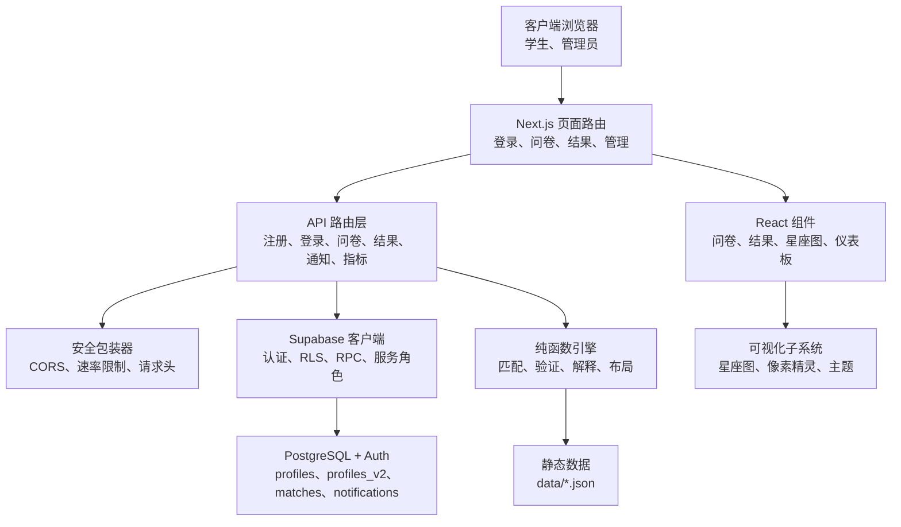

**图表来源**
- [README.md:120-220](file://README.md#L120-L220)
- [CONTEXTO_PROYECTO.md:80-200](file://CONTEXTO_PROYECTO.md#L80-L200)
- [package.json:1-40](file://package.json#L1-L40)

**章节来源**
- [README.md:120-220](file://README.md#L120-L220)
- [CONTEXTO_PROYECTO.md:80-200](file://CONTEXTO_PROYECTO.md#L80-L200)
- [package.json:1-40](file://package.json#L1-L40)

## 五大核心功能模块总览

| 模块 | 主要职责 | 关键入口 | 输出 |
|---|---|---|---|
| 用户管理系统 | 学号注册、会话重开、身份哈希、可用性检查 | `/api/register`、`/api/login`、`/api/availability` | 匿名用户、虚拟邮箱、会话、角色 |
| 心理测量系统 | v1/v2 问卷校验、Likert 评分、MBTI 推导、向量构建 | `/api/quiz`、`/api/quiz-v2` | 标准化维度分数、匹配向量、MBTI 代码 |
| 匹配引擎 | 余弦相似度、双轨道 romance/amistad、类别权重、硬过滤 | `matching.ts`、`matching-v2.ts`、SQL RPC | 匹配对、相似度、亲和徽章 |
| 可视化系统 | 星座图物理布局、像素精灵、动物头像、颜色主题 | `ConstellationView`、`pixel-sprites.ts` | 可拖拽星座、动画精灵、亲和说明 |
| 管理仪表板 | 聚合统计、MBTI 分布、Top 动物、CSV 导出 | `/admin`、`/api/admin/metrics*` | 匿名汇总指标，不含个人数据 |

这些模块不是独立存在：用户系统提供匿名身份；测量系统把答案变成数学向量；匹配引擎计算兼容性；可视化系统把结果变成情感化体验；管理仪表板读取聚合结果而不暴露原始数据。

**章节来源**
- [README.md:120-220](file://README.md#L120-L220)
- [CONTEXTO_PROYECTO.md:80-200](file://CONTEXTO_PROYECTO.md#L80-L200)

## 系统架构与数据流

ZooMatch 的整体数据流可以理解为一条从“匿名学号”到“情感化星座”的流水线：

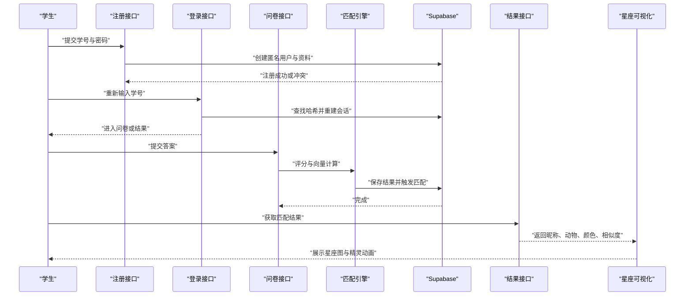

**图表来源**
- [src/app/api/register/route.ts:1-73](file://src/app/api/register/route.ts#L1-L73)
- [src/app/api/login/route.ts:1-110](file://src/app/api/login/route.ts#L1-L110)
- [src/app/api/quiz-v2/route.ts:1-128](file://src/app/api/quiz-v2/route.ts#L1-L128)
- [src/app/api/result-v2/route.ts:1-200](file://src/app/api/result-v2/route.ts#L1-L200)

这个流程的关键约束是：学号从不以明文形式进入业务结果；所有敏感字段都通过 HMAC 哈希或匿名别名流转；匹配结果只暴露 animal、color、alias、similarity 等展示字段。

**章节来源**
- [src/app/api/register/route.ts:1-73](file://src/app/api/register/route.ts#L1-L73)
- [src/app/api/login/route.ts:1-110](file://src/app/api/login/route.ts#L1-L110)
- [src/app/api/quiz-v2/route.ts:1-128](file://src/app/api/quiz-v2/route.ts#L1-L128)
- [src/app/api/result-v2/route.ts:1-200](file://src/app/api/result-v2/route.ts#L1-L200)

## 用户管理系统：注册、认证与隐私保护

### 注册流程

注册接口接收学号和密码后执行以下动作：

1. 使用服务器环境变量中的 HMAC 密钥对规范化后的学号做 SHA-256 哈希。
2. 基于哈希构造虚拟邮箱，格式为哈希值加上 `accounts.zoomatch.invalid`。
3. 通过 Supabase 管理员客户端创建认证用户。
4. 在 `profiles` 表中插入匿名资料行，包含用户 ID、学号哈希和管理员角色。
5. 尝试用虚拟邮箱和密码建立会话。
6. 如果任何一步失败，回滚已创建的账户并返回错误状态码。

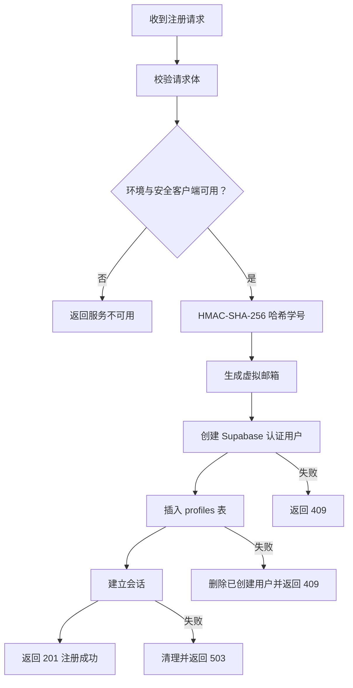

**图表来源**
- [src/app/api/register/route.ts:1-73](file://src/app/api/register/route.ts#L1-L73)
- [src/lib/identity.server.ts:1-9](file://src/lib/identity.server.ts#L1-L9)

### 隐私保护机制

| 设计点 | 实现方式 | 目的 |
|---|---|---|
| 学号不暴露 | HMAC-SHA-256 确定性哈希 | 防止枚举和逆向 |
| 虚拟邮箱 | `${hash}@accounts.zoomatch.invalid` | 隔离真实邮箱 |
| 重复注册一致响应 | 新用户与重复用户返回相同语义结果 | 防止通过响应差异枚举学号 |
| 唯一索引去重 | 数据库层面对哈希建唯一索引 | O(1) 级别去重 |
| 会话重建无密码 | 通过 magic link token hash 重建 SSR 会话 | 学生无需记忆密码 |

登录接口会先查 `profiles` 表确认学号哈希是否存在；若存在则通过管理员权限生成魔法链接，再用会话客户端验证 token hash，最后根据 `profiles_v2.quiz_completed_at` 判断应跳转到 v2 问卷还是 v2 结果页。

**章节来源**
- [src/app/api/register/route.ts:1-73](file://src/app/api/register/route.ts#L1-L73)
- [src/app/api/login/route.ts:1-110](file://src/app/api/login/route.ts#L1-L110)
- [src/lib/identity.server.ts:1-9](file://src/lib/identity.server.ts#L1-L9)
- [MANUAL_ADMINISTRADOR.md:1-120](file://MANUAL_ADMINISTRADOR.md#L1-L120)

## 心理测量系统：v1 与 v2 问卷及答案处理

### v1 问卷流程

v1 是项目的初始版本：

- 24 个条目。
- 17 个维度（13 个 matching 维度 + 4 个 MBTI 维度）。
- Likert 1–4 量表。
- 单轨道 romance/afinidad。
- 标准化向量后调用 SQL RPC `submit_quiz_result`，再调用 `refresh_matches`。

v1 评分过程包括：

1. 将答案映射为 item→值。
2. 累加每个维度的原始分数。
3. 计算每个维度的最小值和最大值范围。
4. 将原始分数归一化到 `[0,1]`。
5. 根据 MBTI 维度阈值推导 E/I、N/S、T/J、P 四个字母。
6. 提取 matching 维度构成匹配向量。

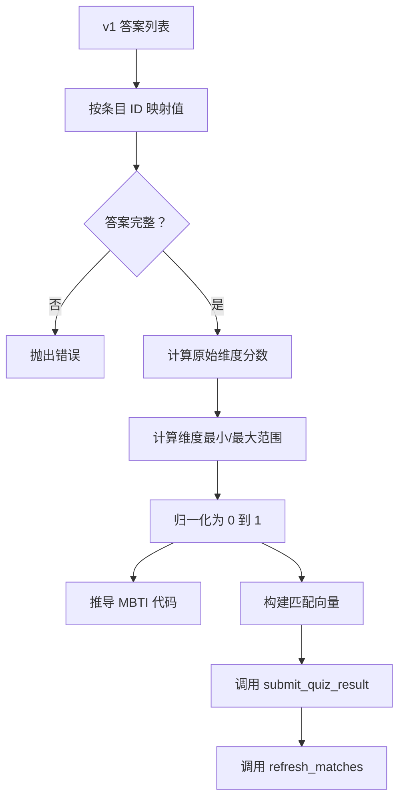

**图表来源**
- [src/lib/matching.ts:1-115](file://src/lib/matching.ts#L1-L115)
- [src/app/api/quiz/route.ts:1-71](file://src/app/api/quiz/route.ts#L1-L71)

### v2 问卷流程

v2 是更复杂的心理测量核心：

- 60 个条目。
- 30 个维度，分为 BigFive、MBTI、Identidad、Cultural、Intimidad、Valores。
- Likert 1–5 量表。
- 双轨道 romance 与 amistad。
- 支持硬过滤和类别权重。

v2 答案处理的核心步骤是：

1. 使用 Zod 校验 Likert 答案和多选过滤器。
2. 负权条目按 `6 - valor` 反转得分。
3. 每个维度归一化到 `[0,1]`。
4. 推导 MBTI 代码。
5. 提取 romance 所需的三个硬过滤字段。
6. 构建 romance 向量（26 个维度）和 amistad 向量（16 个维度）。
7. 生成 profile identity：animal、color、narrative、alias。
8. 调用 `submit_quiz_result_v2`、`compute_dual_matches`、`notify_matches_v2`。
9. 首次提交时插入欢迎通知。

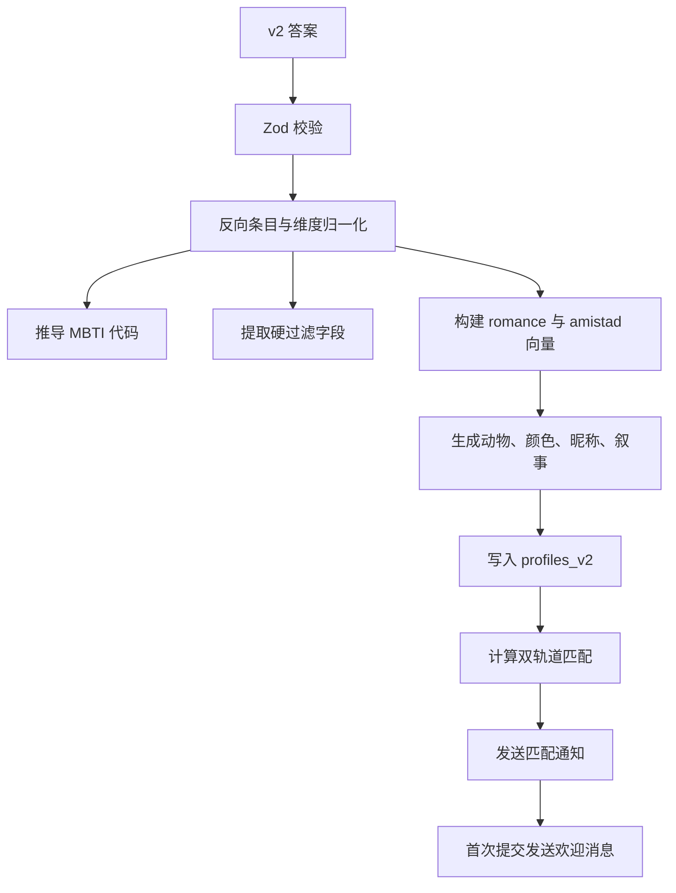

**图表来源**
- [src/app/api/quiz-v2/route.ts:1-128](file://src/app/api/quiz-v2/route.ts#L1-L128)
- [src/lib/matching-v2.ts:1-200](file://src/lib/matching-v2.ts#L1-L200)

**章节来源**
- [src/app/api/quiz/route.ts:1-71](file://src/app/api/quiz/route.ts#L1-L71)
- [src/lib/matching.ts:1-115](file://src/lib/matching.ts#L1-L115)
- [src/app/api/quiz-v2/route.ts:1-128](file://src/app/api/quiz-v2/route.ts#L1-L128)
- [src/lib/matching-v2.ts:1-200](file://src/lib/matching-v2.ts#L1-L200)

## 匹配引擎：双轨道算法与余弦相似度

### v1 匹配引擎

v1 使用归一化向量直接计算余弦相似度。核心函数接收两个长度相同的数字数组，分别计算点积、两个向量的模长，然后返回 `dot / (||a|| × ||b||)`。当分母为零时返回零。

此外，v1 还构建“维度亲和度”，用于解释哪些维度最接近：

- 对每个 matching 维度计算 `1 - |a - b|`。
- 按亲和度降序排序。
- 截取前若干维度作为简要解释。

### v2 双轨道匹配引擎

v2 引擎是仓库中最重要的纯函数模块之一，它把数学、配置和数据模型解耦：

| 概念 | v1 | v2 |
|---|---|---|
| 轨道数 | 1 | 2：romance、amistad |
| 维度数量 | 17 | 30 |
| 匹配方式 | 整体余弦相似度 | 按类别加权余弦相似度 |
| 过滤 | 无显式硬过滤 | romance 轨道有 orientation/gender/relationship 硬过滤 |
| 输出 | 单一匹配向量 | romance 向量 + friendship 向量 |
| 解释 | 维度亲和列表 | 亲和徽章 + explainability 叙事 |

#### 双轨道数据结构

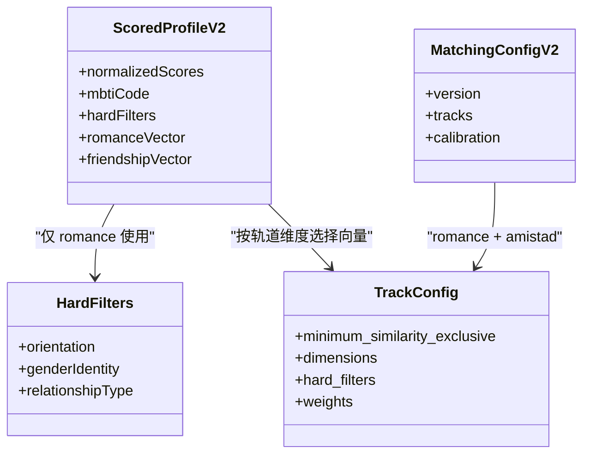

**图表来源**
- [src/lib/matching-v2.ts:1-200](file://src/lib/matching-v2.ts#L1-L200)

#### 类别加权余弦相似度

v2 romance 轨道的类别权重设计目的是避免大类别掩盖小类别：

| 类别 | romance 权重 |
|---|---|
| personalidad | 0.25 |
| intimidad_afecto | 0.25 |
| valores_relacionales | 0.25 |
| afinidad_cultural | 0.20 |
| identidad | 0.05 |

amistad 轨道不使用 intimacy 类权重，而是侧重 personality、cultural 和 values。

#### 硬过滤规则

只有 romance 轨道应用硬过滤：

| 过滤字段 | 兼容规则 |
|---|---|
| 性取向 | 支持通配符 `todxs`、`prefiero no decir`，其他方向按对称表匹配 |
| 性别认同 | `prefiero no decir` 通配 |
| 关系类型 | monogamia、no_monogamia_etica、poliamor、anarquia_relacional、sin_definir、solo_amistad |

#### 亲和徽章

v2 为 romance 展示前 5 个亲和维度，为 amistad 展示前 3 个。亲和值使用 `1 - |a - b|`，并为每个维度提供西班牙语标签和图标。

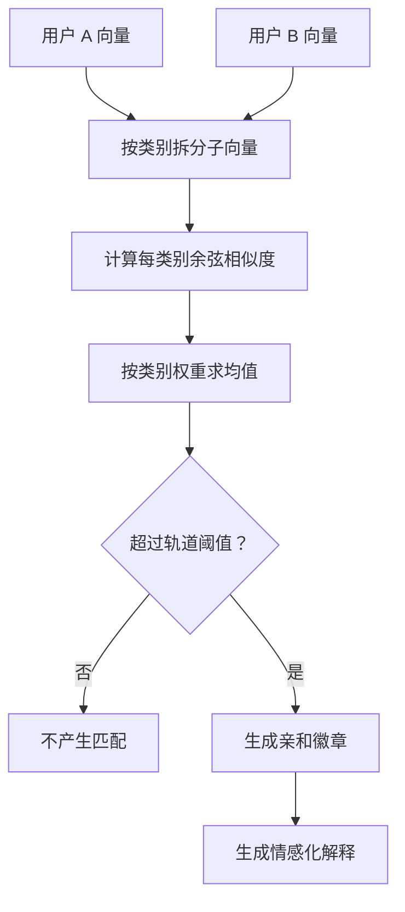

**图表来源**
- [src/lib/matching-v2.ts:1-200](file://src/lib/matching-v2.ts#L1-L200)

**章节来源**
- [src/lib/matching.ts:1-115](file://src/lib/matching.ts#L1-L115)
- [src/lib/matching-v2.ts:1-200](file://src/lib/matching-v2.ts#L1-L200)
- [README.md:60-120](file://README.md#L60-L120)

## 可视化系统：星座图、精灵动画与游戏化体验

### 星座图架构

星座图是 ZooMatch 最具辨识度的用户体验增强特性。它不是一个简单列表，而是一个带物理引擎的节点网络：

- 用户节点位于中心。
- 匹配节点围绕用户分布。
- 边表示匹配关系。
- 节点大小和透明度随相似度变化。
- 节点可拖拽。
- 支持 `prefers-reduced-motion`。
- 支持无障碍标签。

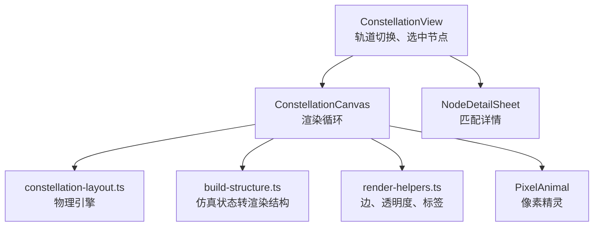

**图表来源**
- [src/components/constellation/ConstellationView.tsx:1-133](file://src/components/constellation/ConstellationView.tsx#L1-L133)
- [src/components/constellation/build-structure.ts:1-200](file://src/components/constellation/build-structure.ts#L1-L200)
- [src/lib/constellation-layout.ts:1-200](file://src/lib/constellation-layout.ts#L1-L200)

### 物理引擎与确定性布局

星座图布局引擎是纯函数，没有 DOM、没有副作用、没有随机数。它的确定性体现在：

- 初始位置由节点 ID 的 FNV-1a 哈希驱动。
- 伪随机数使用 mulberry32  seeded RNG。
- 弹簧力、碰撞斥力、中心引力、速度阻尼共同作用。
- 系统达到动能低于阈值且连续多帧稳定后才标记为平衡。
- “漂浮漂移”仅在系统平衡后添加正弦偏移，不会阻止收敛。

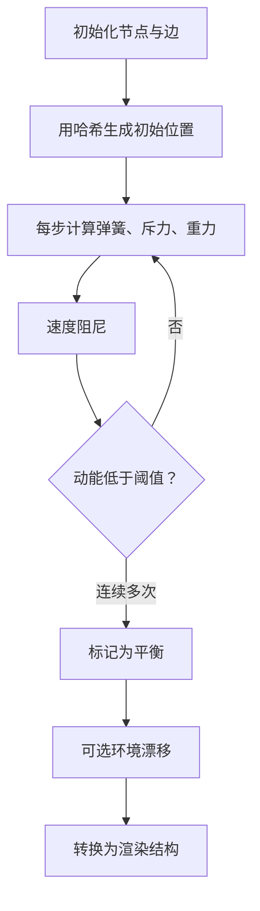

**图表来源**
- [src/lib/constellation-layout.ts:1-200](file://src/lib/constellation-layout.ts#L1-L200)
- [src/components/constellation/build-structure.ts:1-200](file://src/components/constellation/build-structure.ts#L1-L200)

### 像素精灵与动物头像

像素精灵系统是游戏化体验的基础：

- 每个动物被渲染为 12×12 像素网格。
- 动物来自 `catalogo_arquetipos_v2.json`（61 个）和 v1 `arquetipos.json`（16 个）。
- 每种动物属于一个形态家族，如 felino、canino、ave、roedor、reptil、acuatico 等。
- 精灵有三种动画帧：idle_1、idle_2、happy。
- 生成过程完全确定：同一 animalId、colorId、frame 永远输出相同网格。
- 精灵由形状模板、哈希变体、区分性保证、纹理描边、帧叠加、镜像、尾巴和调色板映射组成。

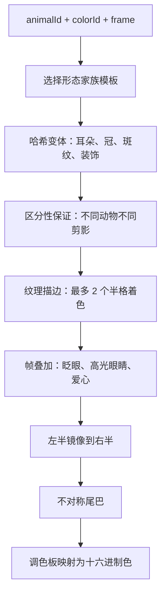

**图表来源**
- [src/lib/pixel-sprites.ts:1-80](file://src/lib/pixel-sprites.ts#L1-L80)

### 游戏化设计元素

ZooMatch 的游戏化不只是视觉装饰，而是贯穿整个产品体验：

| 元素 | 作用 |
|---|---|
| 动物头像 | 替代真实姓名，降低社交压力 |
| 颜色主题 | 强化个性识别 |
| 精灵动画 | 让匹配结果看起来像“活着的栖息地” |
| 星座图 | 把抽象相似度变成空间关系 |
| 亲和徽章 | 用 emoji 和自然语言解释化学感 |
| 情感化文案 | 使用包容性 es-MX 语言 |
| 昵称与叙事 | 让结果更像故事而不是报告 |

**章节来源**
- [src/components/constellation/index.ts:1-71](file://src/components/constellation/index.ts#L1-L71)
- [src/components/constellation/ConstellationView.tsx:1-133](file://src/components/constellation/ConstellationView.tsx#L1-L133)
- [src/components/constellation/build-structure.ts:1-200](file://src/components/constellation/build-structure.ts#L1-L200)
- [src/lib/constellation-layout.ts:1-200](file://src/lib/constellation-layout.ts#L1-L200)
- [src/lib/pixel-sprites.ts:1-80](file://src/lib/pixel-sprites.ts#L1-L80)
- [README.md:120-220](file://README.md#L120-L220)

## 管理仪表板：统计数据与实时监控

### 访问控制

管理面板受到双重保护：

1. Next.js 代理中间件拦截 `/admin/*`，要求 Supabase Auth 会话。
2. 会话用户必须在 `user_roles` 中具有 `role='admin'`。
3. 非管理员被重定向到 `/admin/login`。
4. 管理接口本身也受 `withApiSecurity` 包裹。

### 指标接口

`/api/admin/metrics` 的职责是：

1. 验证管理员上下文。
2. 加载聚合指标。
3. 返回匿名汇总数据。
4. 未授权返回 401。
5. 禁止访问返回 403。
6. 服务不可用返回 503。

仪表板前端每 60 秒轮询一次指标，并在页面可见时静默刷新。它还提供 CSV 导出和手动刷新按钮。

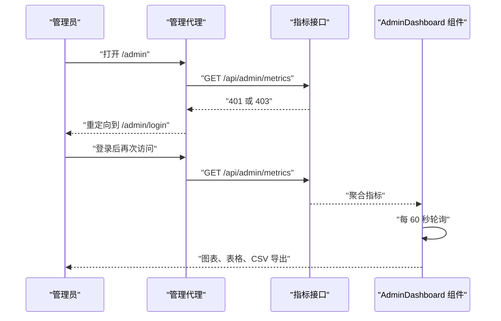

**图表来源**
- [src/app/api/admin/metrics/route.ts:1-37](file://src/app/api/admin/metrics/route.ts#L1-L37)
- [src/components/admin-dashboard.tsx:1-120](file://src/components/admin-dashboard.tsx#L1-L120)

### 隐私保障

管理仪表板只显示聚合数据，包括：

- 总档案数。
- 至少有一个匹配的用户数和百分比。
- 16 种 MBTI 类型分布。
- Top 5 动物。
- 可导出的 CSV。

它不显示学号、哈希、向量、答案或原始个人资料。文档明确指出面板底部会提示“仅聚合 · 无标识符 · 无向量 · 无答案”。

**章节来源**
- [src/app/api/admin/metrics/route.ts:1-37](file://src/app/api/admin/metrics/route.ts#L1-L37)
- [src/components/admin-dashboard.tsx:1-120](file://src/components/admin-dashboard.tsx#L1-L120)
- [MANUAL_ADMINISTRADOR.md:1-200](file://MANUAL_ADMINISTRADOR.md#L1-L200)

## 功能依赖与集成模式

### 模块依赖关系

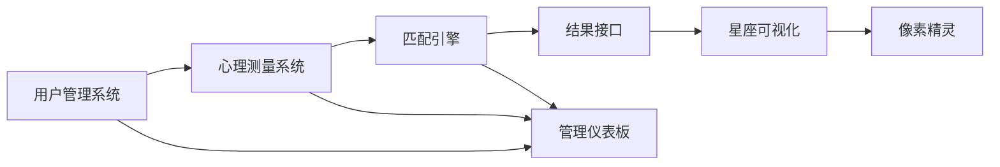

**图表来源**
- [src/app/api/register/route.ts:1-73](file://src/app/api/register/route.ts#L1-L73)
- [src/app/api/quiz-v2/route.ts:1-128](file://src/app/api/quiz-v2/route.ts#L1-L128)
- [src/app/api/result-v2/route.ts:1-200](file://src/app/api/result-v2/route.ts#L1-L200)
- [src/lib/pixel-sprites.ts:1-80](file://src/lib/pixel-sprites.ts#L1-L80)
- [src/components/admin-dashboard.tsx:1-120](file://src/components/admin-dashboard.tsx#L1-L120)

### 集成要点

| 集成点 | 行为 |
|---|---|
| 注册 → 会话 | 注册成功后立即尝试登录，失败则回滚 |
| 登录 → 路由决策 | 根据 `profiles_v2.quiz_completed_at` 决定进入问卷或结果 |
| 问卷 → SQL RPC | 服务端使用服务角色调用 Supabase RPC 存储结果 |
| 结果 → 解释 | v2 结果接口拼接 explainability 叙事和徽章 |
| 结果 → 星座图 | 前端将匹配数据映射为 ConstellationView 所需结构 |
| 管理 → 聚合 | 管理指标来自安全定义函数，不暴露原始数据 |

### 错误与降级策略

ZooMatch 的错误处理遵循 fail-open 与 graceful degradation：

- 环境变量缺失时返回 503。
- Supabase 客户端缺失时返回 503。
- 解析失败返回 400。
- 未认证返回 401。
- 结果缺失时返回 404。
- 匹配解释生成失败时返回 null，UI 继续降级展示。
- 星座图尊重 `prefers-reduced-motion`。
- 所有 API 都经过 CORS、速率限制和安全头包装。

**章节来源**
- [src/app/api/register/route.ts:1-73](file://src/app/api/register/route.ts#L1-L73)
- [src/app/api/login/route.ts:1-110](file://src/app/api/login/route.ts#L1-L110)
- [src/app/api/quiz-v2/route.ts:1-128](file://src/app/api/quiz-v2/route.ts#L1-L128)
- [src/app/api/result-v2/route.ts:1-200](file://src/app/api/result-v2/route.ts#L1-L200)

## 性能与可测试性特征

### 纯函数核心

ZooMatch 的核心引擎设计强调可测试性：

- 匹配函数不读写外部状态。
- 不依赖 `Math.random`。
- 输入相同则输出相同。
- 所有引擎可通过 Vitest 单元测试。
- 星座图布局与渲染结构分离，便于在无 DOM 环境中测试。

### 运行时栈

| 技术 | 用途 |
|---|---|
| Next.js ^16.4.2 | App Router、Route Handlers |
| TypeScript ^6 | 类型安全 |
| React ^19.3 | 组件 UI |
| Tailwind CSS v4 | 主题与设计令牌 |
| Framer Motion ^14 | 动画 |
| Recharts ^3 | 管理图表 |
| Zod ^4 | 环境与请求校验 |
| Supabase | PostgreSQL、Auth、RLS、RPC |
| Vitest ^5 | 单元测试 |

**章节来源**
- [package.json:1-40](file://package.json#L1-L40)
- [README.md:180-220](file://README.md#L180-L220)
- [CONTEXTO_PROYECTO.md:80-140](file://CONTEXTO_PROYECTO.md#L80-L140)

## 故障排查指南

### 常见问题与定位

| 现象 | 可能原因 | 排查方向 |
|---|---|---|
| 注册返回 409 | 用户已存在或资料插入失败 | 检查 Supabase Auth 与 profiles 表 |
| 注册返回 503 | 环境变量或客户端缺失 | 检查 Supabase URL、密钥、HMAC 密钥 |
| 登录返回 404 | 学号哈希不存在 | 确认是否已完成注册 |
| 登录返回 503 | 会话重建失败 | 检查 Supabase Auth 和 service role |
| 问卷提交返回 400 | 答案格式无效 | 检查 Zod 校验和 microtest 结构 |
| 问卷提交返回 503 | RPC 失败 | 检查 Supabase RPC 是否部署 |
| 结果返回 404 | v2 问卷未完成 | 检查 `profiles_v2.quiz_completed_at` |
| 结果返回 503 | 匹配数据或解释生成失败 | 检查向量长度、RPC 返回值 |
| 管理面板 401/403 | 非管理员或未登录 | 检查会话与 `user_roles` |
| 星座图无动画 | 减少动态偏好或设备性能 | 检查 reduced motion 和硬件能力 |

### 调试建议

1. **优先检查环境变量**：Supabase URL、Service Role Key、MATRICULA_HMAC_SECRET。
2. **确认 Supabase 迁移顺序**：migrations → seed → seed_v2。
3. **确认 RPC 已部署**：`submit_quiz_result`、`refresh_matches`、`submit_quiz_result_v2`、`compute_dual_matches`、`get_my_matches_v2`、`get_admin_dashboard_v2`。
4. **检查数据一致性**：v1 使用 `profiles`，v2 使用 `profiles_v2`。
5. **查看日志时的隐私注意**：不要记录学号、哈希、向量或答案。
6. **管理面板问题**：确认第一个管理员已通过 `promote_admin.sql` 提升。

**章节来源**
- [src/app/api/register/route.ts:1-73](file://src/app/api/register/route.ts#L1-L73)
- [src/app/api/login/route.ts:1-110](file://src/app/api/login/route.ts#L1-L110)
- [src/app/api/quiz/route.ts:1-71](file://src/app/api/quiz/route.ts#L1-L71)
- [src/app/api/quiz-v2/route.ts:1-128](file://src/app/api/quiz-v2/route.ts#L1-L128)
- [src/app/api/result/route.ts:1-70](file://src/app/api/result/route.ts#L1-L70)
- [src/app/api/result-v2/route.ts:1-200](file://src/app/api/result-v2/route.ts#L1-L200)
- [MANUAL_ADMINISTRADOR.md:1-200](file://MANUAL_ADMINISTRADOR.md#L1-L200)

## 结论

ENES ZooMatch 的核心价值不在于简单的“匹配算法”，而在于把心理学测量、隐私保护、游戏化设计和可解释结果组合成一个连贯产品。其架构优势在于：

- 用户身份完全匿名，学号永不暴露。
- 匹配逻辑是纯函数，易于测试、复现和校准。
- v1 与 v2 共存，演进不破坏既有数据。
- 星座图和像素精灵把冷数据变成温暖体验。
- 管理面板只提供聚合视角，符合隐私优先原则。
- 所有 API 都有安全包装、速率限制和明确错误语义。

未来扩展时，应继续保持以下原则：不要把新逻辑写进 UI，不把原始敏感数据暴露给前端，不引入随机性污染纯引擎，不跳过 Zod 校验，不在管理面板中泄露个体数据。ZooMatch 已经是一个成熟的多模块平台原型，下一步的重点应是数据质量、解释可读性和用户体验一致性。