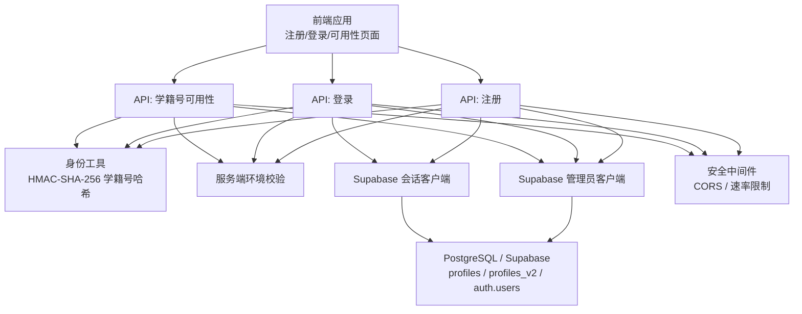
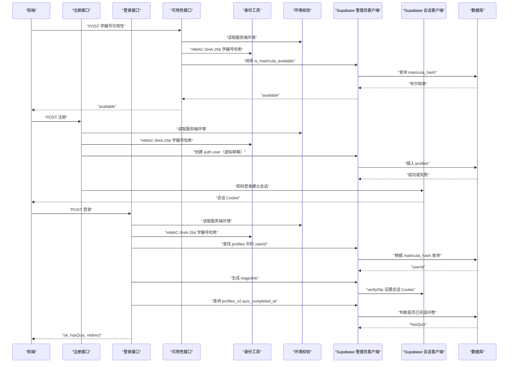
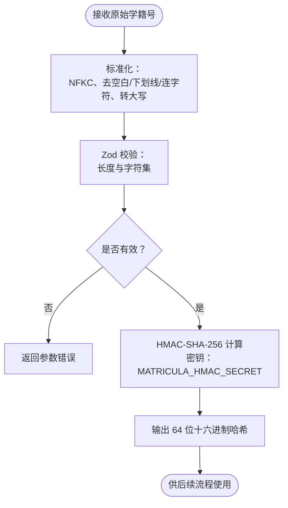
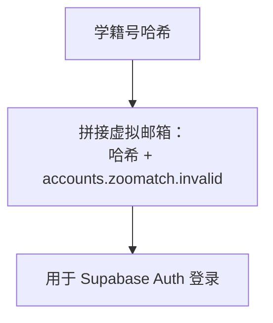
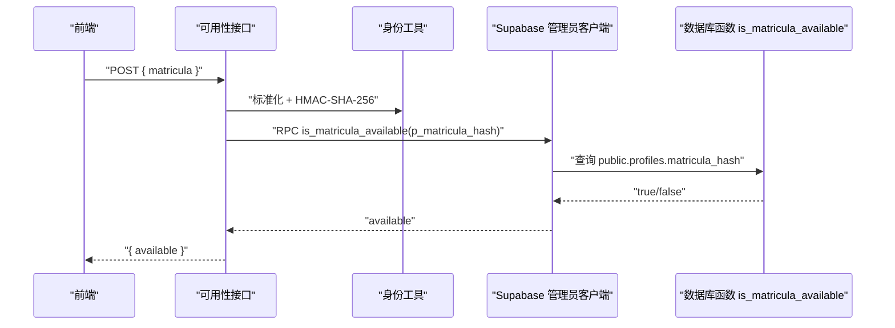
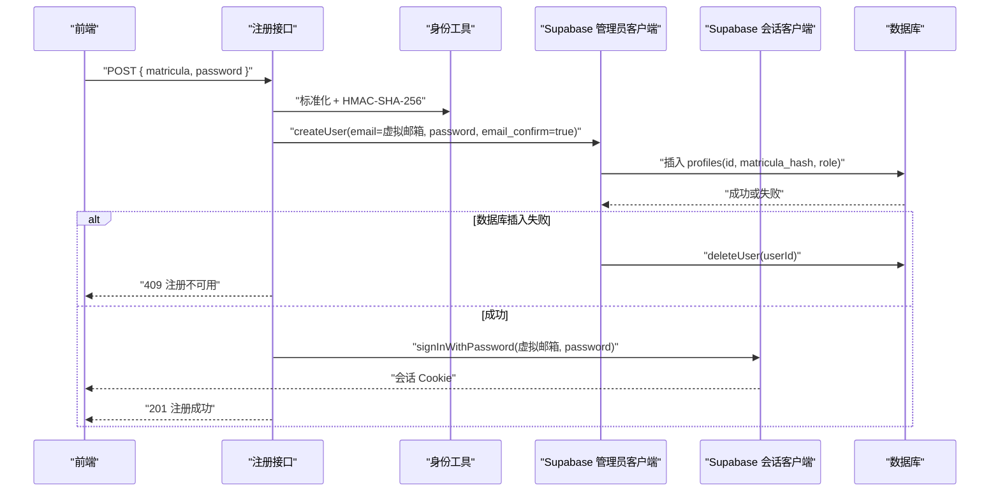
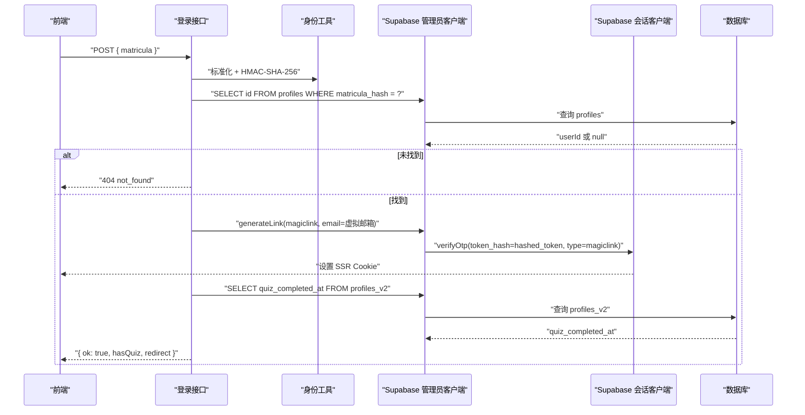
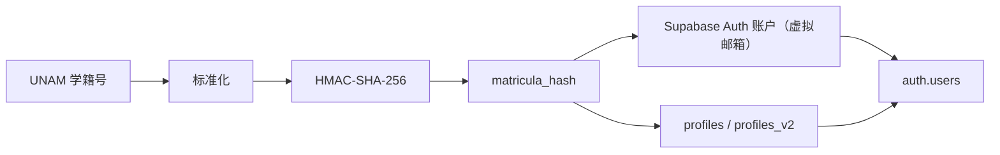
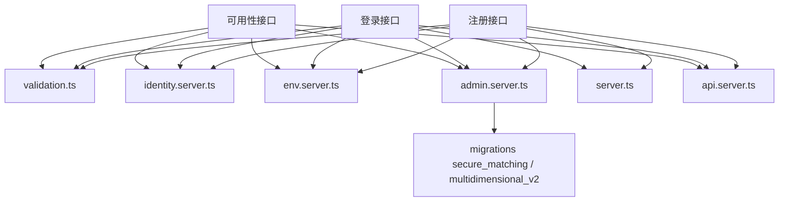

# 用户管理系统

<cite>
**本文引用的文件**   
- [src/app/api/register/route.ts](file://src/app/api/register/route.ts)
- [src/app/api/login/route.ts](file://src/app/api/login/route.ts)
- [src/app/api/availability/route.ts](file://src/app/api/availability/route.ts)
- [src/lib/identity.server.ts](file://src/lib/identity.server.ts)
- [src/lib/validation.ts](file://src/lib/validation.ts)
- [src/lib/env.server.ts](file://src/lib/env.server.ts)
- [src/lib/supabase/admin.server.ts](file://src/lib/supabase/admin.server.ts)
- [src/lib/supabase/server.ts](file://src/lib/supabase/server.ts)
- [src/lib/security/api.server.ts](file://src/lib/security/api.server.ts)
- [src/lib/security/rate-limit.server.ts](file://src/lib/security/rate-limit.server.ts)
- [supabase/migrations/202610220001_secure_matching.sql](file://supabase/migrations/202610220001_secure_matching.sql)
- [supabase/migrations/202610230001_multidimensional_v2.sql](file://supabase/migrations/202610230001_multidimensional_v2.sql)
</cite>

## 目录
1. [引言](#引言)
2. [项目结构与用户管理边界](#项目结构与用户管理边界)
3. [核心组件与职责](#核心组件与职责)
4. [架构总览](#架构总览)
5. [详细组件分析](#详细组件分析)
6. [依赖关系分析](#依赖关系分析)
7. [性能与可用性特征](#性能与可用性特征)
8. [安全与隐私设计](#安全与隐私设计)
9. [故障排查指南](#故障排查指南)
10. [结论](#结论)

## 引言
本文件系统性地说明 ENES ZooMatch 平台的用户管理体系，重点覆盖以下目标：
- 基于 UNAM 学籍号的匿名注册流程。
- 使用 HMAC-SHA-256 对学籍号进行哈希的隐私保护机制。
- 与 Supabase Auth 的集成方式，包括管理员账户创建、会话建立和登录重定向。
- 学籍号可用性检查逻辑、虚拟邮箱生成策略。
- 完整的用户数据流：学籍号 → HMAC 哈希 → Supabase Auth → 数据库存储。
- 注册、登录、可用性验证的实现路径与安全考虑因素。

该文档面向开发者、产品工程师和安全审计人员，同时尽量以非技术语言解释关键概念。

## 项目结构与用户管理边界
用户管理相关的代码集中在 Next.js API Routes、身份工具、Supabase 客户端封装、安全中间件以及数据库迁移中。其组织方式遵循“按功能域 + 分层”的原则：
- API 层：`src/app/api/*` 提供注册、登录、可用性校验等接口。
- 身份层：`src/lib/identity.server.ts` 负责学籍号标准化与 HMAC 哈希。
- 配置层：`src/lib/env.server.ts` 通过 Zod 校验服务端环境变量。
- Supabase 层：`src/lib/supabase/*` 提供客户端与服务端访问能力。
- 安全层：`src/lib/security/*` 提供跨域、速率限制和请求头加固。
- 数据层：`supabase/migrations/*` 定义用户表、角色、行级安全策略及 RPC。

**图表来源**
- [src/app/api/register/route.ts:1-73](file://src/app/api/register/route.ts#L1-L73)
- [src/app/api/login/route.ts:1-110](file://src/app/api/login/route.ts#L1-L110)
- [src/app/api/availability/route.ts:1-46](file://src/app/api/availability/route.ts#L1-L46)
- [src/lib/identity.server.ts:1-9](file://src/lib/identity.server.ts#L1-L9)
- [src/lib/env.server.ts:1-21](file://src/lib/env.server.ts#L1-L21)
- [src/lib/supabase/admin.server.ts:1-22](file://src/lib/supabase/admin.server.ts#L1-L22)
- [src/lib/supabase/server.ts:1-34](file://src/lib/supabase/server.ts#L1-L34)
- [src/lib/security/api.server.ts:1-117](file://src/lib/security/api.server.ts#L1-L117)

**章节来源**
- [src/app/api/register/route.ts:1-73](file://src/app/api/register/route.ts#L1-L73)
- [src/app/api/login/route.ts:1-110](file://src/app/api/login/route.ts#L1-L110)
- [src/app/api/availability/route.ts:1-46](file://src/app/api/availability/route.ts#L1-L46)

## 核心组件与职责
- 学籍号标准化与哈希
  - 标准化：去除空白、下划线、连字符，转为大写，并做 Unicode 归一化。
  - 哈希：使用 HMAC-SHA-256，密钥来自服务端环境变量 `MATRICULA_HMAC_SECRET`。
- 虚拟邮箱生成
  - 将学籍号哈希拼接固定域名后缀，形成仅供内部使用的登录邮箱。
- Supabase 管理员客户端
  - 使用服务角色密钥创建 Supabase 客户端，禁用自动刷新、URL 解析与持久化会话。
- Supabase 会话客户端
  - 在服务器端读写 Cookie，用于设置 SSR 会话。
- 安全中间件
  - CORS 白名单、响应头加固、速率限制决策。
- 可用性检查
  - 调用数据库函数 `is_matricula_available`，基于已存在的 `matricula_hash` 判断是否可用。
- 数据库模型
  - v1：`public.profiles` 存储用户主键、学籍号哈希、角色、别名等。
  - v2：`public.profiles_v2` 存储多匹配维度、硬过滤字段、完成时间戳等。

**章节来源**
- [src/lib/validation.ts:1-62](file://src/lib/validation.ts#L1-L62)
- [src/lib/identity.server.ts:1-9](file://src/lib/identity.server.ts#L1-L9)
- [src/lib/supabase/admin.server.ts:1-22](file://src/lib/supabase/admin.server.ts#L1-L22)
- [src/lib/supabase/server.ts:1-34](file://src/lib/supabase/server.ts#L1-L34)
- [src/lib/security/api.server.ts:1-117](file://src/lib/security/api.server.ts#L1-L117)
- [supabase/migrations/202610220001_secure_matching.sql:1-200](file://supabase/migrations/202610220001_secure_matching.sql#L1-L200)
- [supabase/migrations/202610230001_multidimensional_v2.sql:1-200](file://supabase/migrations/202610230001_multidimensional_v2.sql#L1-L200)

## 架构总览
用户管理的整体架构由四个层次构成：
- 接口层：Next.js API Routes 暴露注册、登录、可用性接口。
- 业务层：学籍号标准化、哈希、虚拟邮箱生成、路由决策。
- 平台层：Supabase Auth 与 PostgreSQL 数据存储。
- 安全层：CORS、速率限制、敏感配置校验、Cookie 处理。

**图表来源**
- [src/app/api/availability/route.ts:1-46](file://src/app/api/availability/route.ts#L1-L46)
- [src/app/api/register/route.ts:1-73](file://src/app/api/register/route.ts#L1-L73)
- [src/app/api/login/route.ts:1-110](file://src/app/api/login/route.ts#L1-L110)
- [src/lib/identity.server.ts:1-9](file://src/lib/identity.server.ts#L1-L9)
- [src/lib/env.server.ts:1-21](file://src/lib/env.server.ts#L1-L21)
- [src/lib/supabase/admin.server.ts:1-22](file://src/lib/supabase/admin.server.ts#L1-L22)
- [src/lib/supabase/server.ts:1-34](file://src/lib/supabase/server.ts#L1-L34)
- [supabase/migrations/202610220001_secure_matching.sql:1-200](file://supabase/migrations/202610220001_secure_matching.sql#L1-L200)
- [supabase/migrations/202610230001_multidimensional_v2.sql:1-200](file://supabase/migrations/202610230001_multidimensional_v2.sql#L1-L200)

## 详细组件分析

### 学籍号标准化与 HMAC-SHA-256 哈希
学籍号在进入系统前会被标准化，确保不同输入形式映射到同一规范化值；随后使用 HMAC-SHA-256 生成固定长度十六进制哈希。该哈希作为用户的匿名标识，避免在日志、数据库或网络传输中直接出现原始学籍号。

关键点：
- 标准化规则：Unicode NFKC 归一化、去空白/下划线/连字符、转大写。
- 正则约束：长度为 4 至 32 位，仅允许大写字母与数字。
- HMAC 密钥：来自 `MATRICULA_HMAC_SECRET`，要求至少 32 字符。
- 输出格式：64 位十六进制字符串，符合数据库列约束。

**图表来源**
- [src/lib/validation.ts:1-62](file://src/lib/validation.ts#L1-L62)
- [src/lib/identity.server.ts:1-9](file://src/lib/identity.server.ts#L1-L9)
- [src/lib/env.server.ts:1-21](file://src/lib/env.server.ts#L1-L21)

**章节来源**
- [src/lib/validation.ts:1-62](file://src/lib/validation.ts#L1-L62)
- [src/lib/identity.server.ts:1-9](file://src/lib/identity.server.ts#L1-L9)
- [src/lib/env.server.ts:1-21](file://src/lib/env.server.ts#L1-L21)

### 虚拟邮箱生成策略
系统将学籍号哈希与固定域名组合，生成仅供内部使用的登录邮箱。该邮箱不会对外暴露真实学籍号，也不作为用户可编辑的公开身份。

要点：
- 格式：`{matriculaHash}@accounts.zoomatch.invalid`。
- 用途：用于 Supabase Auth 账户创建与登录。
- 安全性：域名无效且不可解析，避免外部邮件投递风险。

**图表来源**
- [src/lib/identity.server.ts:1-9](file://src/lib/identity.server.ts#L1-L9)

**章节来源**
- [src/lib/identity.server.ts:1-9](file://src/lib/identity.server.ts#L1-L9)

### 学籍号可用性检查
可用性检查接口不保存任何敏感信息，仅在校验通过后返回布尔值。它调用数据库函数 `is_matricula_available`，后者基于 `matricula_hash` 的唯一性约束判断是否存在重复学籍号。

流程：
1. 校验请求体包含有效的 `matricula`。
2. 标准化并 HMAC 哈希学籍号。
3. 调用数据库函数检查是否可用。
4. 返回 `{ available: boolean }`。

**图表来源**
- [src/app/api/availability/route.ts:1-46](file://src/app/api/availability/route.ts#L1-L46)
- [src/lib/validation.ts:1-62](file://src/lib/validation.ts#L1-L62)
- [src/lib/identity.server.ts:1-9](file://src/lib/identity.server.ts#L1-L9)
- [supabase/migrations/202610220001_secure_matching.sql:1-200](file://supabase/migrations/202610220001_secure_matching.sql#L1-L200)

**章节来源**
- [src/app/api/availability/route.ts:1-46](file://src/app/api/availability/route.ts#L1-L46)
- [supabase/migrations/202610220001_secure_matching.sql:1-200](file://supabase/migrations/202610220001_secure_matching.sql#L1-L200)

### 匿名注册流程
注册流程的目标是为匿名用户创建 Supabase Auth 账户，并在数据库中写入匿名化的个人档案，随后立即建立会话。

核心步骤：
1. 校验请求体包含 `matricula` 与 `password`。
2. 标准化并哈希学籍号。
3. 生成虚拟邮箱。
4. 通过管理员客户端创建 Supabase 用户，邮箱为虚拟邮箱，密码为用户提供的密码，并标记邮箱已确认。
5. 向 `public.profiles` 插入记录，包含用户主键、学籍号哈希与角色。
6. 若数据库插入失败，回滚删除已创建的 Auth 用户。
7. 尝试使用密码登录建立会话；失败时同样回滚删除用户。
8. 成功后返回 201 状态码，并设置缓存控制响应头。

**图表来源**
- [src/app/api/register/route.ts:1-73](file://src/app/api/register/route.ts#L1-L73)
- [src/lib/validation.ts:1-62](file://src/lib/validation.ts#L1-L62)
- [src/lib/identity.server.ts:1-9](file://src/lib/identity.server.ts#L1-L9)
- [src/lib/supabase/admin.server.ts:1-22](file://src/lib/supabase/admin.server.ts#L1-L22)
- [src/lib/supabase/server.ts:1-34](file://src/lib/supabase/server.ts#L1-L34)
- [supabase/migrations/202610220001_secure_matching.sql:1-200](file://supabase/migrations/202610220001_secure_matching.sql#L1-L200)

**章节来源**
- [src/app/api/register/route.ts:1-73](file://src/app/api/register/route.ts#L1-L73)
- [supabase/migrations/202610220001_secure_matching.sql:1-200](file://supabase/migrations/202610220001_secure_matching.sql#L1-L200)

### 登录流程与会话机制
登录接口不直接使用原始密码，而是通过学籍号哈希定位已有账户，然后使用 Supabase 管理员客户端生成魔法链接，并通过会话客户端验证 OTP，从而设置 SSR Cookie。

主要流程：
1. 校验请求体包含 `matricula`。
2. 标准化并哈希学籍号。
3. 在 `profiles` 表中查找对应 `userId`。
4. 生成魔法链接，提取哈希令牌。
5. 使用会话客户端 `verifyOtp` 验证令牌，设置 Cookie。
6. 查询 `profiles_v2.quiz_completed_at` 决定跳转地址。
7. 返回 `ok`、`hasQuiz`、`redirect`。

**图表来源**
- [src/app/api/login/route.ts:1-110](file://src/app/api/login/route.ts#L1-L110)
- [src/lib/validation.ts:1-62](file://src/lib/validation.ts#L1-L62)
- [src/lib/identity.server.ts:1-9](file://src/lib/identity.server.ts#L1-L9)
- [src/lib/supabase/admin.server.ts:1-22](file://src/lib/supabase/admin.server.ts#L1-L22)
- [src/lib/supabase/server.ts:1-34](file://src/lib/supabase/server.ts#L1-L34)
- [supabase/migrations/202610230001_multidimensional_v2.sql:1-200](file://supabase/migrations/202610230001_multidimensional_v2.sql#L1-L200)

**章节来源**
- [src/app/api/login/route.ts:1-110](file://src/app/api/login/route.ts#L1-L110)
- [supabase/migrations/202610230001_multidimensional_v2.sql:1-200](file://supabase/migrations/202610230001_multidimensional_v2.sql#L1-L200)

### 用户数据流：学籍号 → HMAC 哈希 → Supabase Auth → 数据库存储
用户数据流的隐私保护体现在多个环节：
- 学籍号在到达后端后立即被标准化并哈希，不再以明文形式继续流转。
- 虚拟邮箱不包含真实身份信息，仅用于内部认证。
- 数据库存储的是 `matricula_hash`，并通过唯一性约束防止重复。
- Supabase Auth 账户与数据库用户主键关联，但原始学籍号不会被持久化。

**图表来源**
- [src/lib/validation.ts:1-62](file://src/lib/validation.ts#L1-L62)
- [src/lib/identity.server.ts:1-9](file://src/lib/identity.server.ts#L1-L9)
- [src/app/api/register/route.ts:1-73](file://src/app/api/register/route.ts#L1-L73)
- [src/app/api/login/route.ts:1-110](file://src/app/api/login/route.ts#L1-L110)
- [supabase/migrations/202610220001_secure_matching.sql:1-200](file://supabase/migrations/202610220001_secure_matching.sql#L1-L200)
- [supabase/migrations/202610230001_multidimensional_v2.sql:1-200](file://supabase/migrations/202610230001_multidimensional_v2.sql#L1-L200)

**章节来源**
- [src/app/api/register/route.ts:1-73](file://src/app/api/register/route.ts#L1-L73)
- [src/app/api/login/route.ts:1-110](file://src/app/api/login/route.ts#L1-L110)
- [supabase/migrations/202610220001_secure_matching.sql:1-200](file://supabase/migrations/202610220001_secure_matching.sql#L1-L200)
- [supabase/migrations/202610230001_multidimensional_v2.sql:1-200](file://supabase/migrations/202610230001_multidimensional_v2.sql#L1-L200)

## 依赖关系分析
用户管理模块的依赖关系如下：
- API Routes 依赖身份工具、环境校验、Supabase 客户端与安全中间件。
- 身份工具依赖 Node.js 原生加密模块。
- Supabase 客户端依赖公共环境变量与服务角色密钥。
- 数据库层依赖迁移脚本定义的表结构、函数与行级安全策略。

**图表来源**
- [src/app/api/register/route.ts:1-73](file://src/app/api/register/route.ts#L1-L73)
- [src/app/api/login/route.ts:1-110](file://src/app/api/login/route.ts#L1-L110)
- [src/app/api/availability/route.ts:1-46](file://src/app/api/availability/route.ts#L1-L46)
- [src/lib/validation.ts:1-62](file://src/lib/validation.ts#L1-L62)
- [src/lib/identity.server.ts:1-9](file://src/lib/identity.server.ts#L1-L9)
- [src/lib/env.server.ts:1-21](file://src/lib/env.server.ts#L1-L21)
- [src/lib/supabase/admin.server.ts:1-22](file://src/lib/supabase/admin.server.ts#L1-L22)
- [src/lib/supabase/server.ts:1-34](file://src/lib/supabase/server.ts#L1-L34)
- [src/lib/security/api.server.ts:1-117](file://src/lib/security/api.server.ts#L1-L117)
- [supabase/migrations/202610220001_secure_matching.sql:1-200](file://supabase/migrations/202610220001_secure_matching.sql#L1-L200)
- [supabase/migrations/202610230001_multidimensional_v2.sql:1-200](file://supabase/migrations/202610230001_multidimensional_v2.sql#L1-L200)

**章节来源**
- [src/app/api/register/route.ts:1-73](file://src/app/api/register/route.ts#L1-L73)
- [src/app/api/login/route.ts:1-110](file://src/app/api/login/route.ts#L1-L110)
- [src/app/api/availability/route.ts:1-46](file://src/app/api/availability/route.ts#L1-L46)

## 性能与可用性特征
- 速率限制
  - 注册接口：每 600 秒最多 5 次请求。
  - 登录接口：每 60 秒最多 10 次请求。
  - 可用性接口：每 60 秒最多 30 次请求。
- 限流实现
  - 使用 Upstash Redis REST API，基于 Lua 脚本原子递增计数与过期时间。
  - 当 Redis 不可用时，开发环境放行，生产环境返回 503 并建议重试。
- 响应头
  - 统一设置 `Cache-Control: no-store`，避免敏感响应被缓存。
  - 设置 `X-Content-Type-Options: nosniff` 防止 MIME 嗅探。
  - 速率限制相关头包括 `X-RateLimit-Limit`、`X-RateLimit-Remaining`、`X-RateLimit-Reset`、`Retry-After`。
- 超时控制
  - 限流请求超时时间为 2.5 秒，避免长时间阻塞用户请求。

优化建议：
- 在高并发场景下，可考虑对可用性检查增加本地短时缓存，但需保证一致性策略。
- 对于登录流程，可评估是否需要更细粒度的验证码或二次确认，以降低暴力尝试风险。

**章节来源**
- [src/lib/security/api.server.ts:1-117](file://src/lib/security/api.server.ts#L1-L117)
- [src/lib/security/rate-limit.server.ts:1-116](file://src/lib/security/rate-limit.server.ts#L1-L116)

## 安全与隐私设计
本系统的隐私与安全设计围绕以下几个关键点展开：

- 敏感信息最小化
  - 原始 UNAM 学籍号仅在入口处短暂存在，随后立即被标准化并哈希。
  - 哈希结果作为匿名标识，不携带可逆个人信息。
- 密钥管理
  - `MATRICULA_HMAC_SECRET` 必须至少 32 字符，并通过环境变量注入，不应硬编码。
  - `SUPABASE_SERVICE_ROLE_KEY` 用于管理员操作，应严格限制访问范围。
- 虚拟邮箱隔离
  - 虚拟邮箱域名无效，无法收到真实邮件，降低泄露风险。
- 数据库约束与策略
  - `matricula_hash` 具有唯一性约束与正则校验。
  - 行级安全策略限制用户对他人数据的访问。
  - 管理员角色与参与者角色分离。
- 会话安全
  - 会话 Cookie 由服务器端设置，前端不直接持有敏感令牌。
  - 登录流程通过魔法链接验证，避免直接传递密码。
- 输入校验
  - 所有请求体均通过 Zod 校验，非法输入直接拒绝。
- 输出防护
  - 所有响应设置 `Cache-Control: no-store` 与 `X-Content-Type-Options: nosniff`。
  - CORS 白名单控制允许的源。

注意事项：
- 如果 `MATRICULA_HMAC_SECRET` 泄露，攻击者可枚举学籍号哈希并尝试撞库；因此密钥轮换与监控至关重要。
- 虚拟邮箱虽不可解析，但仍应确保不被外部误认为合法收件人地址。

**章节来源**
- [src/lib/env.server.ts:1-21](file://src/lib/env.server.ts#L1-L21)
- [src/lib/identity.server.ts:1-9](file://src/lib/identity.server.ts#L1-L9)
- [src/lib/validation.ts:1-62](file://src/lib/validation.ts#L1-L62)
- [src/lib/security/api.server.ts:1-117](file://src/lib/security/api.server.ts#L1-L117)
- [supabase/migrations/202610220001_secure_matching.sql:1-200](file://supabase/migrations/202610220001_secure_matching.sql#L1-L200)

## 故障排查指南
常见问题与处理方法：

- 环境变量缺失
  - 现象：接口返回 503 服务不可用。
  - 排查：检查 `NEXT_PUBLIC_SUPABASE_URL`、`SUPABASE_SERVICE_ROLE_KEY`、`MATRICULA_HMAC_SECRET` 是否已正确配置。
- 学籍号格式错误
  - 现象：接口返回 400 参数无效。
  - 排查：确认学籍号仅包含大写字母与数字，长度在 4 至 32 之间，并已去除空白、下划线与连字符。
- 学籍号已被注册
  - 现象：可用性检查返回 `available: false`。
  - 排查：确认数据库中已存在相同 `matricula_hash`，考虑更换学籍号或联系管理员。
- 注册失败
  - 现象：返回 409 注册不可用。
  - 排查：检查 Supabase 管理员客户端是否能创建用户，以及 `profiles` 表插入是否成功；若失败，系统会回滚删除已创建的用户。
- 登录失败
  - 现象：返回 503 服务不可用或 404 未找到。
  - 排查：检查 `profiles` 中是否存在对应学籍号哈希，魔法链接生成与 OTP 验证是否成功；同时确认 `profiles_v2` 查询是否正常。
- 速率限制触发
  - 现象：返回 429 过多请求。
  - 排查：检查频率是否符合接口限制；若 Redis 不可用，生产环境可能返回 503。

**章节来源**
- [src/app/api/register/route.ts:1-73](file://src/app/api/register/route.ts#L1-L73)
- [src/app/api/login/route.ts:1-110](file://src/app/api/login/route.ts#L1-L110)
- [src/app/api/availability/route.ts:1-46](file://src/app/api/availability/route.ts#L1-L46)
- [src/lib/security/rate-limit.server.ts:1-116](file://src/lib/security/rate-limit.server.ts#L1-L116)

## 结论
ENES ZooMatch 的用户管理系统以匿名化为核心原则，通过学籍号标准化与 HMAC-SHA-256 哈希，将敏感身份信息从后续流程中剥离。结合 Supabase Auth 与 PostgreSQL 的行级安全策略，系统在保障隐私的同时提供了可靠的注册、登录与可用性检查能力。安全中间件与速率限制进一步增强了系统的鲁棒性。

在实践中，建议重点关注密钥管理与速率限制策略调优，并持续监控异常行为，以确保用户隐私与系统可用性得到长期保障。