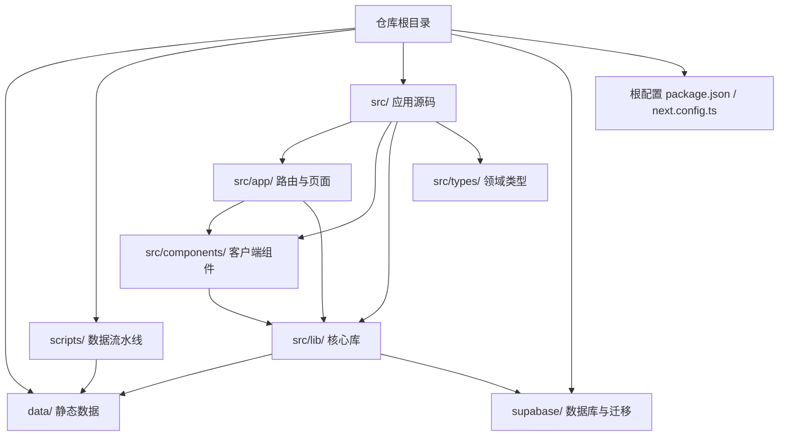
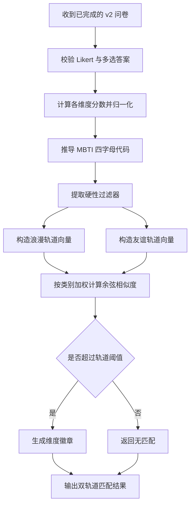
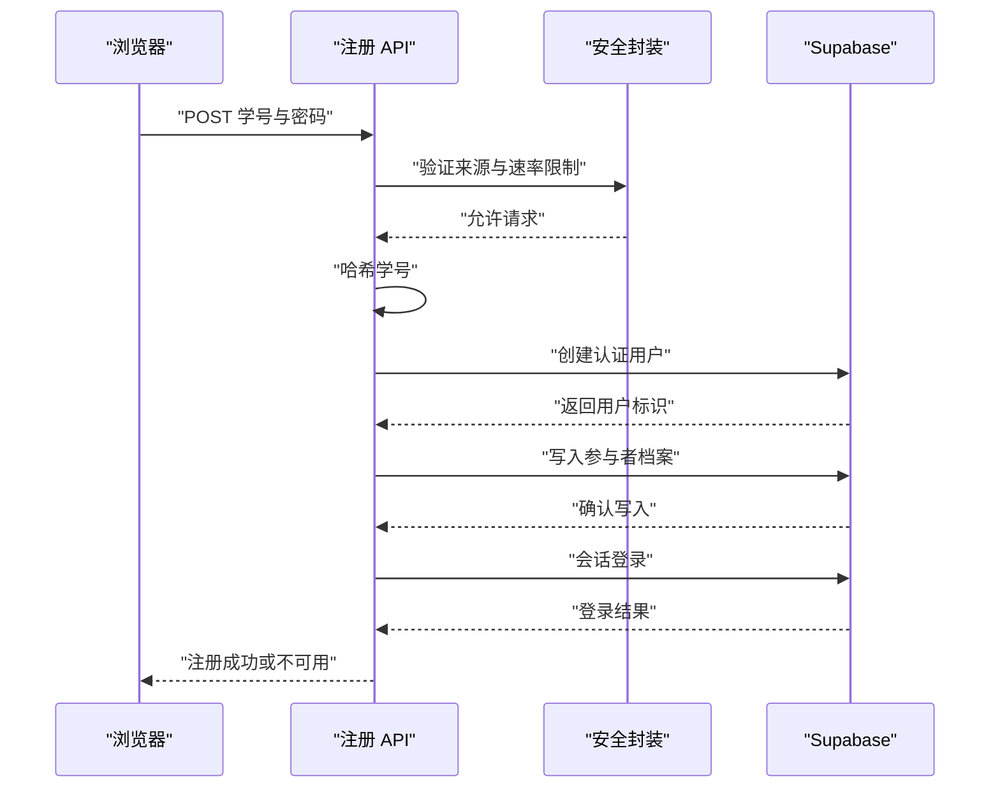
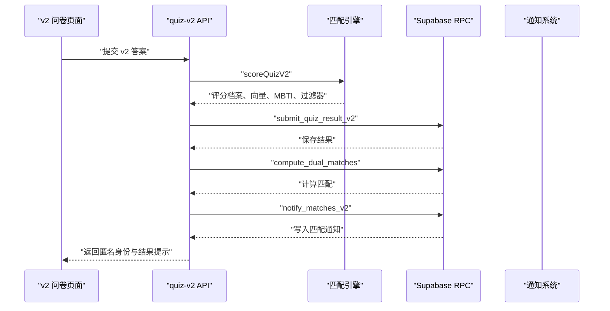
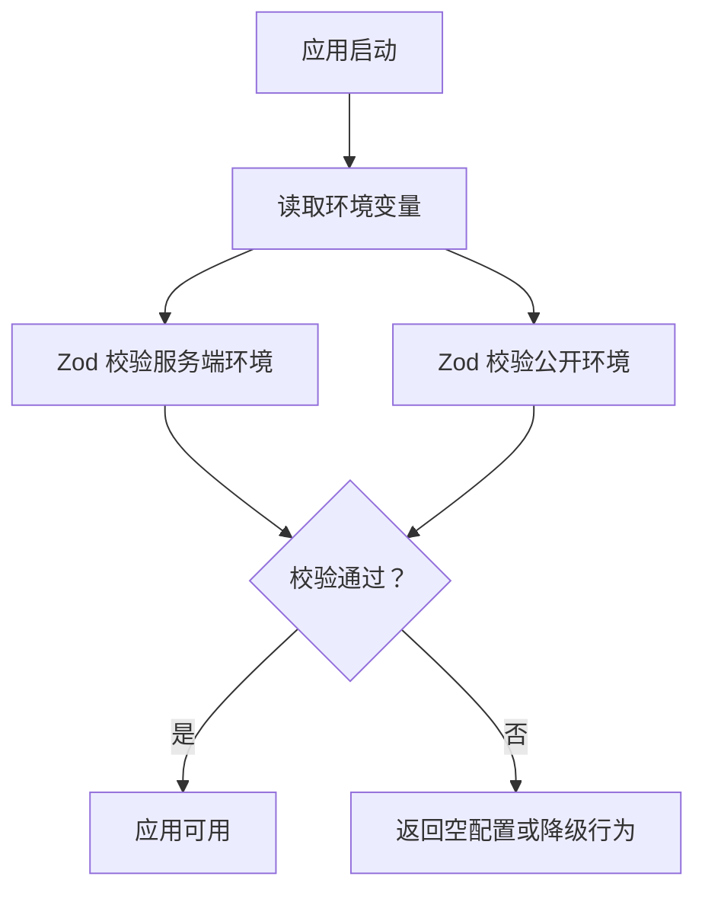
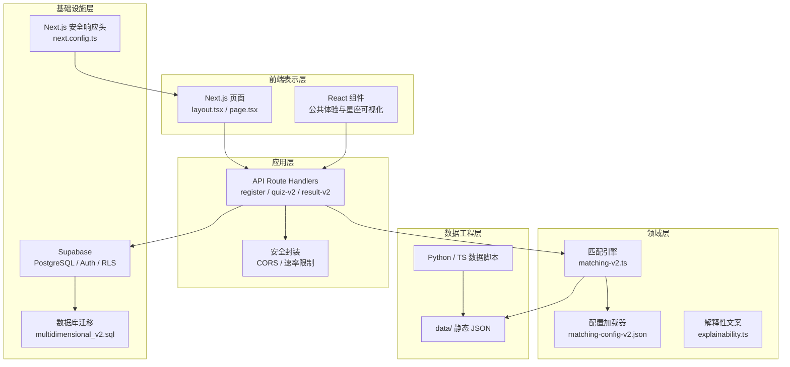
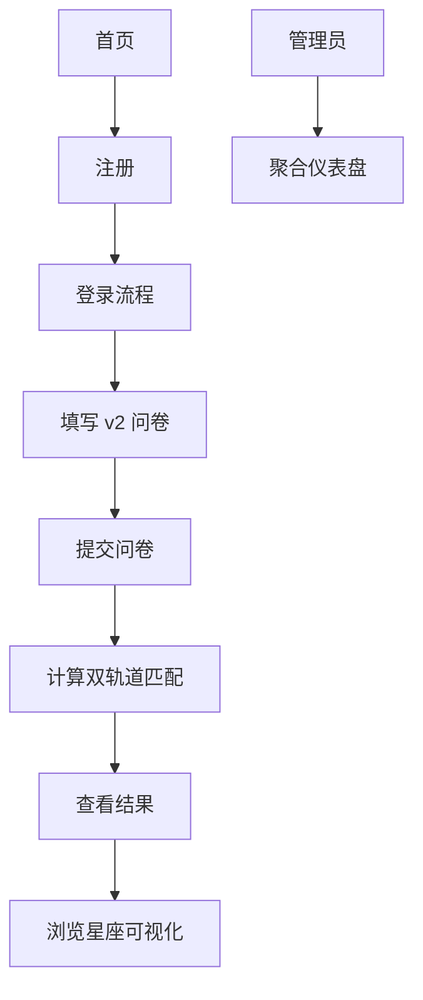
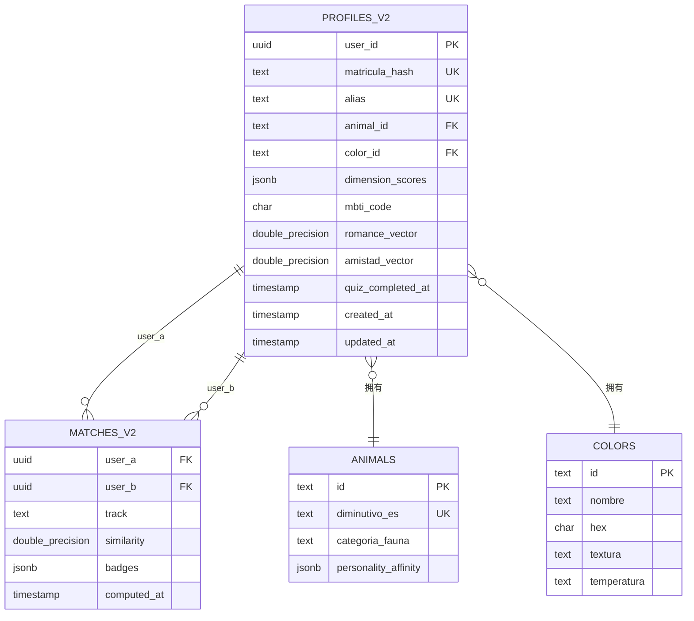
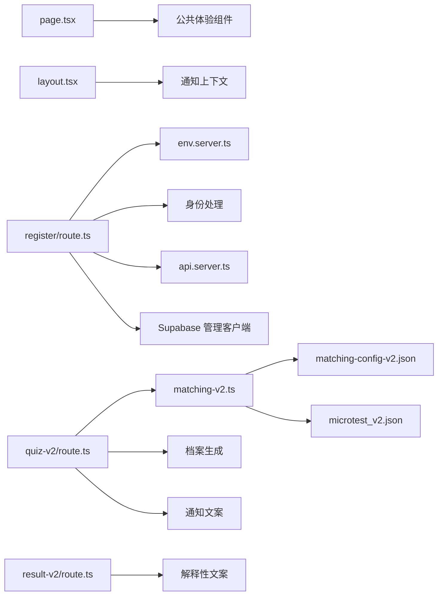

# 项目概览

<cite>
**本文引用的文件**   
- [README.md](file://README.md)
- [CONTEXTO_PROYECTO.md](file://CONTEXTO_PROYECTO.md)
- [MANUAL_ADMINISTRADOR.md](file://MANUAL_ADMINISTRADOR.md)
- [package.json](file://package.json)
- [requirements.txt](file://requirements.txt)
- [next.config.ts](file://next.config.ts)
- [src/app/layout.tsx](file://src/app/layout.tsx)
- [src/app/page.tsx](file://src/app/page.tsx)
- [src/lib/env.server.ts](file://src/lib/env.server.ts)
- [src/lib/env.ts](file://src/lib/env.ts)
- [src/lib/security/api.server.ts](file://src/lib/security/api.server.ts)
- [src/app/api/register/route.ts](file://src/app/api/register/route.ts)
- [src/app/api/quiz-v2/route.ts](file://src/app/api/quiz-v2/route.ts)
- [src/app/api/result-v2/route.ts](file://src/app/api/result-v2/route.ts)
- [src/lib/matching-v2.ts](file://src/lib/matching-v2.ts)
- [supabase/migrations/202610230001_multidimensional_v2.sql](file://supabase/migrations/202610230001_multidimensional_v2.sql)
- [data/catalogo_arquetipos_v2.json](file://data/catalogo_arquetipos_v2.json)
- [data/matching-config-v2.json](file://data/matching-config-v2.json)
</cite>

## 目录

1. [引言](#引言)
2. [项目结构](#项目结构)
3. [核心组件](#核心组件)
4. [架构总览](#架构总览)
5. [关键流程与处理逻辑](#关键流程与处理逻辑)
6. [依赖关系分析](#依赖关系分析)
7. [性能与可扩展性](#性能与可扩展性)
8. [故障排查指南](#故障排查指南)
9. [结论](#结论)
10. [术语表](#术语表)

## 引言

ENES ZooMatch 是一个面向墨西哥国立自治大学 ENES 学生的匿名心理测量匹配平台。它的业务目标不是提供临床心理学诊断，而是用游戏化的方式帮助学生发现与自己性格、价值观、文化偏好和情感表达方式相近的人。学生通过 UNAM 学号注册，回答一个匿名微测试，系统随后计算匹配结果，并以“动物昵称 + 颜色”的虚拟身份和交互式星座图展示浪漫关系或友谊维度的亲和度。

项目的核心价值主张可以概括为三点：

- **隐私优先：** 学号从不以明文形式暴露；服务器端使用确定性 HMAC-SHA-256 哈希，注册响应对首次用户和重复用户保持一致，避免枚举攻击。
- **配置驱动：** 匹配阈值、维度权重、问卷条目、分类目录都放在 `data/` 下的 JSON 文件中；调整匹配策略通常不需要修改核心代码。
- **可解释的游戏化体验：** 匹配结果不只是数字，而是带有西班牙语拉美本地化叙事、徽章、像素精灵和可拖拽星座图的可视化体验。

项目同时维护 v1 和 v2 两套能力：v1 是单轨道匹配，v2 引入双轨道（浪漫关系与友谊）、更丰富的维度、按类别加权的余弦相似度以及硬过滤机制。两者共享 Supabase 后端和安全边界，但数据模型、路由和前端页面逐步分离。

从技术角度看，ZooMatch 选择 Next.js App Router 作为全栈框架，React 19 构建用户界面，TypeScript 提供类型安全，Supabase 承载认证、数据库和行级安全，Tailwind CSS v4 管理样式设计令牌，Framer Motion 负责动画，Vitest 承担纯函数测试，Python 脚本则用于采集和生成心理测量相关的数据资产。

**章节来源**  
- [README.md:1-200](file://README.md#L1-L200)  
- [CONTEXTO_PROYECTO.md:1-120](file://CONTEXTO_PROYECTO.md#L1-L120)  
- [MANUAL_ADMINISTRADOR.md:1-120](file://MANUAL_ADMINISTRADOR.md#L1-L120)

## 项目结构

仓库采用分层组织方式：

- `data/`：唯一事实来源的心理测量数据，包括 v1/v2 问卷、匹配配置、合成校准数据和动物/颜色目录。
- `scripts/`：脱离运行时应用的 Python 与 TypeScript 数据流水线，负责采集 IPIP 题目、生成 arquetipo 目录、生成合成档案并校准阈值。
- `src/`：Next.js 应用主体。
  - `src/app/`：App Router 路由，包含公开页面、API 路由、管理员面板和开发调试页面。
  - `src/components/`：客户端 UI 组件，尤其是星座可视化子系统。
  - `src/lib/`：服务端与客户端共享的核心库，包括环境校验、安全封装、匹配引擎、配置文件加载器、解释性文案、像素精灵和通知文案。
  - `src/types/`：领域类型定义，如 archetype、microtest、microtest-v2。
- `supabase/`：数据库迁移、种子数据和管理员提升脚本。
- 根目录的配置文件定义 Node 版本、npm 脚本、Tailwind、PostCSS、TypeScript、ESLint 和 Vitest。

该图是概念性结构示意，不直接映射到单个源文件的实现细节，因此不提供图表来源。

**章节来源**  
- [README.md:120-200](file://README.md#L120-L200)  
- [CONTEXTO_PROYECTO.md:60-160](file://CONTEXTO_PROYECTO.md#L60-L160)

## 核心组件

### 双轨道匹配引擎

ZooMatch v2 的核心是 `src/lib/matching-v2.ts`。它把完成后的 v2 问卷转化为评分档案，然后分别计算两个轨道的亲和度：

- **浪漫轨道：** 使用 26 个维度，包括大五人格、身份、文化、亲密关系和价值观维度，并应用硬性过滤器，例如性取向兼容性、性别认同和关系类型。
- **友谊轨道：** 使用 16 个维度，主要覆盖大五人格、文化亲和与关系价值观，不应用硬性过滤器。

引擎的关键特征包括：

- 所有导出函数都是确定性的纯函数，没有随机数副作用，便于 Vitest 测试。
- Likert 值范围为 1–5；负向题项通过反转向量得分参与计算。
- MBTI 四字母代码由归一化维度分数按阈值推导。
- 每个维度都有对应的徽章元数据，用于在结果中展示“最契合”的维度标签。
- 权重来自 `data/matching-config-v2.json`，防止维度数量多的分类淹没维度数量少的分类。

**图表来源**  
- [src/lib/matching-v2.ts:1-200](file://src/lib/matching-v2.ts#L1-L200)  
- [data/matching-config-v2.json:1-76](file://data/matching-config-v2.json#L1-L76)

**章节来源**  
- [src/lib/matching-v2.ts:1-200](file://src/lib/matching-v2.ts#L1-L200)  
- [CONTEXTO_PROYECTO.md:120-200](file://CONTEXTO_PROYECTO.md#L120-L200)

### 注册与匿名身份

注册流程围绕 `src/app/api/register/route.ts` 展开。其设计目标是让 UNAM 学号成为登录凭证，但不在数据库中保存明文学号：

1. 客户端提交学号和密码。
2. 服务器使用 `MATRICULA_HMAC_SECRET` 生成确定性 HMAC-SHA-256 哈希。
3. 创建 Supabase Auth 用户，邮箱格式为基于哈希的虚拟邮箱。
4. 插入 `profiles` 或 `profiles_v2` 记录，角色标记为参与者。
5. 尝试自动登录；失败时回滚用户记录并返回统一错误。
6. 整个 API 被 `withApiSecurity` 包裹，启用 CORS 白名单和速率限制。

**图表来源**  
- [src/app/api/register/route.ts:1-73](file://src/app/api/register/route.ts#L1-L73)  
- [src/lib/security/api.server.ts:1-117](file://src/lib/security/api.server.ts#L1-L117)

**章节来源**  
- [src/app/api/register/route.ts:1-73](file://src/app/api/register/route.ts#L1-L73)  
- [CONTEXTO_PROYECTO.md:160-240](file://CONTEXTO_PROYECTO.md#L160-L240)

### v2 问卷提交流程

v2 问卷入口是 `src/app/api/quiz-v2/route.ts`。它负责将前端提交的 Likert 答案和过滤器转换为服务器端可处理的负载，调用 Supabase RPC 存储结果，触发匹配计算，并写入通知。

**图表来源**  
- [src/app/api/quiz-v2/route.ts:1-128](file://src/app/api/quiz-v2/route.ts#L1-L128)  
- [src/lib/matching-v2.ts:1-200](file://src/lib/matching-v2.ts#L1-L200)

**章节来源**  
- [src/app/api/quiz-v2/route.ts:1-128](file://src/app/api/quiz-v2/route.ts#L1-L128)  
- [CONTEXTO_PROYECTO.md:200-335](file://CONTEXTO_PROYECTO.md#L200-L335)

### 结果读取与解释性文案

`src/app/api/result-v2/route.ts` 负责读取当前用户的 v2 档案和匹配列表，并生成可解释的匹配叙事。它会：

- 查询 `profiles_v2` 获取当前用户的别名、叙事、MBTI、维度分数和双轨道向量。
- 调用 `get_my_matches_v2` 获取其他用户的匹配信息。
- 在服务端补齐匹配对象的动物、颜色和颜色十六进制值。
- 使用 `generateMatchExplanation` 生成浪漫或友谊维度的情感化解释。
- 对缺失或格式错误的向量数据做降级处理，而不是抛出异常。

**章节来源**  
- [src/app/api/result-v2/route.ts:1-200](file://src/app/api/result-v2/route.ts#L1-L200)

### 环境变量与配置校验

项目使用 Zod 对运行环境进行严格校验：

- 服务端环境变量包括 Supabase URL、服务角色密钥和学号 HMAC 密钥。
- 公开环境变量包括 Supabase URL 和可发布密钥。
- 如果环境变量缺失或格式错误，系统应优雅降级，而不是崩溃。

**图表来源**  
- [src/lib/env.server.ts:1-21](file://src/lib/env.server.ts#L1-L21)  
- [src/lib/env.ts:1-24](file://src/lib/env.ts#L1-L24)

**章节来源**  
- [src/lib/env.server.ts:1-21](file://src/lib/env.server.ts#L1-L21)  
- [src/lib/env.ts:1-24](file://src/lib/env.ts#L1-L24)

### 安全与访问控制

安全策略分为两层：

1. **HTTP 层：** `next.config.ts` 设置内容安全策略、HSTS、X-Frame-Options、权限策略等全局响应头。
2. **API 层：** 所有 Route Handler 使用 `withApiSecurity` 包裹，提供来源白名单、CORS 预检、速率限制和统一响应头。

管理员面板还额外受到 `/admin/*` 代理中间件保护，要求 Supabase 会话和管理员角色。

**章节来源**  
- [next.config.ts:1-39](file://next.config.ts#L1-L39)  
- [src/lib/security/api.server.ts:1-117](file://src/lib/security/api.server.ts#L1-L117)  
- [MANUAL_ADMINISTRADOR.md:120-220](file://MANUAL_ADMINISTRADOR.md#L120-L220)

## 架构总览

ZooMatch 的整体架构遵循分层模式：

- **表示层：** Next.js App Router 页面、React 组件和 Tailwind CSS 主题。
- **应用层：** API Route Handlers 编排业务流程，协调验证、认证、数据存储和通知。
- **领域层：** 匹配引擎、解释性文案、配置文件加载器和像素精灵生成器。
- **基础设施层：** Supabase 数据库、认证、RPC、行级安全和安全响应头。
- **数据工程层：** Python 和 TypeScript 脚本，生成和维护 `data/` 中的静态数据。

**图表来源**  
- [src/app/layout.tsx:1-20](file://src/app/layout.tsx#L1-L20)  
- [src/app/page.tsx:1-5](file://src/app/page.tsx#L1-L5)  
- [src/app/api/quiz-v2/route.ts:1-128](file://src/app/api/quiz-v2/route.ts#L1-L128)  
- [src/lib/matching-v2.ts:1-200](file://src/lib/matching-v2.ts#L1-L200)  
- [next.config.ts:1-39](file://next.config.ts#L1-L39)  
- [supabase/migrations/202610230001_multidimensional_v2.sql:1-200](file://supabase/migrations/202610230001_multidimensional_v2.sql#L1-L200)

## 关键流程与处理逻辑

### 端到端产品流程

ZooMatch 的用户主流程如下：

1. 新用户进入首页 `src/app/page.tsx`，默认渲染公共注册入口。
2. 输入 UNAM 学号，系统进行匿名注册。
3. 如果是首次提交，进入 v2 问卷；如果已有结果，进入结果页。
4. 提交问卷后，服务器端计算评分、双轨道匹配、徽章和通知。
5. 用户查看结果页，看到匿名别名、动物、颜色、叙事和星座图。
6. 管理员通过独立路径观察聚合指标，但不会看到个人敏感数据。

该图为概念流程图，不直接映射单一源文件实现，因此不提供图表来源。

**章节来源**  
- [src/app/page.tsx:1-5](file://src/app/page.tsx#L1-L5)  
- [src/app/layout.tsx:1-20](file://src/app/layout.tsx#L1-L20)  
- [MANUAL_ADMINISTRADOR.md:1-120](file://MANUAL_ADMINISTRADOR.md#L1-L120)

### 配置驱动的双轨道阈值

`data/matching-config-v2.json` 定义了 v2 的两个轨道及其阈值：

- 浪漫轨道阈值大于 0.80，使用 26 个维度，并应用三个硬性过滤器。
- 友谊轨道阈值大于 0.75，使用 16 个维度，不应用硬性过滤器。
- 校准参数说明方法、目标覆盖率和最大用户规模。
- 权重字段明确不同分类对最终相似度的贡献比例。

这种设计使运营人员可以通过编辑 JSON 调整匹配敏感度，而不必重新部署匹配逻辑。

**章节来源**  
- [data/matching-config-v2.json:1-76](file://data/matching-config-v2.json#L1-L76)  
- [src/lib/matching-v2.ts:1-200](file://src/lib/matching-v2.ts#L1-L200)

### 数据库与行级安全

`supabase/migrations/202610230001_multidimensional_v2.sql` 是 v2 的多维双轨数据模型。它新增但不破坏 v1 表，体现项目“增量式演进”的原则。主要内容包括：

- `animals` 和 `colors` 目录表。
- `quiz_items_v2` 问卷条目表，支持 Likert 和多选类型、极性、权重和轨道标记。
- `profiles_v2` 用户档案表，包含哈希学号、别名、动物、颜色、双轨道向量、维度分数和 MBTI 代码。
- `quiz_responses_v2` 问卷应答表。
- `matches_v2` 匹配表，按轨道区分并记录徽章。
- `notifications` 通知表。
- GIN 索引加速数组重叠查询。
- 行级安全策略限制普通用户只能访问自己的数据，管理员可通过辅助函数读取更多聚合视图。

**图表来源**  
- [supabase/migrations/202610230001_multidimensional_v2.sql:1-200](file://supabase/migrations/202610230001_multidimensional_v2.sql#L1-L200)

**章节来源**  
- [supabase/migrations/202610230001_multidimensional_v2.sql:1-200](file://supabase/migrations/202610230001_multidimensional_v2.sql#L1-L200)

## 依赖关系分析

### 技术栈依赖

| 层级 | 技术 | 用途 |
|---|---|---|
| 运行时 | Node.js ≥ 22.12.0 | Next.js 服务端执行环境 |
| 前端框架 | Next.js ^16.4.2 | App Router、路由、服务器组件能力 |
| UI 库 | React ^19.3.1 | 组件化界面 |
| 类型系统 | TypeScript ^6 | 类型安全与静态检查 |
| 样式系统 | Tailwind CSS v4 | 设计令牌与原子样式 |
| 动画库 | Framer Motion ^14 | 过渡与动效 |
| 图表库 | Recharts ^3 | 管理员仪表盘图形 |
| 验证库 | Zod ^4 | 环境变量、API 负载和配置校验 |
| 后端服务 | Supabase | PostgreSQL、认证、RLS、RPC |
| 测试工具 | Vitest ^5 | 纯函数单元测试 |
| 数据脚本 | Python requests + BeautifulSoup | 采集与清洗心理测量题目 |

**章节来源**  
- [package.json:1-40](file://package.json#L1-L40)  
- [requirements.txt:1-2](file://requirements.txt#L1-L2)

### 模块耦合关系

该图描述实际模块之间的依赖方向，有助于理解哪些改动会影响哪些路径。

**图表来源**  
- [src/app/page.tsx:1-5](file://src/app/page.tsx#L1-L5)  
- [src/app/layout.tsx:1-20](file://src/app/layout.tsx#L1-L20)  
- [src/app/api/register/route.ts:1-73](file://src/app/api/register/route.ts#L1-L73)  
- [src/app/api/quiz-v2/route.ts:1-128](file://src/app/api/quiz-v2/route.ts#L1-L128)  
- [src/app/api/result-v2/route.ts:1-200](file://src/app/api/result-v2/route.ts#L1-L200)  
- [src/lib/matching-v2.ts:1-200](file://src/lib/matching-v2.ts#L1-L200)

**章节来源**  
- [src/app/api/register/route.ts:1-73](file://src/app/api/register/route.ts#L1-L73)  
- [src/app/api/quiz-v2/route.ts:1-128](file://src/app/api/quiz-v2/route.ts#L1-L128)  
- [src/app/api/result-v2/route.ts:1-200](file://src/app/api/result-v2/route.ts#L1-L200)  
- [src/lib/matching-v2.ts:1-200](file://src/lib/matching-v2.ts#L1-L200)

## 性能与可扩展性

### 时间复杂度与计算特性

- 匹配引擎的核心数学运算主要是向量点积、范数和余弦相似度，时间复杂度与维度长度线性相关；v2 浪漫轨道为 26 维，友谊轨道为 16 维，属于低维固定规模计算。
- 数据库侧的匹配比较通过 SQL RPC 完成，适合利用 PostgreSQL 的数组操作和索引。
- 行级安全策略会限制每条记录的可见范围，避免一次性扫描全表敏感数据。
- 管理员仪表盘的指标通过聚合 RPC 返回，减少原始数据暴露和客户端解析成本。

### 可扩展性建议

- 当维度增加时，应保持 `matching-config-v2.json` 与类型定义同步更新，避免运行时维度长度不一致。
- 如需扩展轨道，应先在数据库迁移中声明新轨道维度，再更新匹配引擎和前端展示逻辑。
- 像素精灵和星座可视化目前强调确定性，新增动物或颜色时应保证 ID 稳定、渲染逻辑可复用。
- 若未来引入实时匹配广播，可在通知系统基础上扩展 WebSocket 通道，但仍需保持隐私边界。

[本节为通用性能讨论，不直接分析具体代码片段]

## 故障排查指南

### 环境变量缺失

症状：应用无法连接 Supabase，或 API 返回服务不可用。

排查步骤：

1. 检查 `NEXT_PUBLIC_SUPABASE_URL` 和 `NEXT_PUBLIC_SUPABASE_PUBLISHABLE_KEY` 是否存在。
2. 检查服务端密钥 `SUPABASE_SERVICE_ROLE_KEY` 和 `MATRICULA_HMAC_SECRET` 是否符合最小长度要求。
3. 确认环境变量经过 Zod 校验；失败时应返回空配置并降级。

**章节来源**  
- [src/lib/env.server.ts:1-21](file://src/lib/env.server.ts#L1-L21)  
- [src/lib/env.ts:1-24](file://src/lib/env.ts#L1-L24)

### 注册失败或冲突

症状：注册返回 409 或 503。

可能原因：

- Supabase 认证服务不可用。
- 学号哈希已存在，但插入档案失败。
- 会话登录失败后回滚用户记录。

排查重点：

- 确认 Supabase 项目可用。
- 检查 `profiles` 或 `profiles_v2` 写入权限。
- 确认 HMAC 密钥一致，避免同一学号在不同环境产生不同哈希。

**章节来源**  
- [src/app/api/register/route.ts:1-73](file://src/app/api/register/route.ts#L1-L73)

### 问卷提交失败

症状：提交 v2 问卷返回无效请求或服务不可用。

可能原因：

- Likert 值不在 1–5 范围内。
- 必填维度缺失或多选答案重复。
- Supabase RPC `submit_quiz_result_v2`、`compute_dual_matches` 或 `notify_matches_v2` 失败。

排查重点：

- 使用 `src/lib/validation-v2.ts` 的校验规则核对前端表单。
- 检查 Supabase 迁移是否已应用 v2 表结构。
- 确认管理员 RPC 和行级安全策略未阻止服务角色写入。

**章节来源**  
- [src/app/api/quiz-v2/route.ts:1-128](file://src/app/api/quiz-v2/route.ts#L1-L128)  
- [supabase/migrations/202610230001_multidimensional_v2.sql:1-200](file://supabase/migrations/202610230001_multidimensional_v2.sql#L1-L200)

### 结果页缺少匹配或解释

症状：结果页显示无匹配，或匹配解释为空。

可能原因：

- 用户未完成问卷。
- 相似度未超过轨道阈值。
- 匹配对象或当前用户的向量数据缺失或长度不正确。
- 解释性文案生成失败时主动降级为 null。

排查重点：

- 确认 `profiles_v2` 中有完成的问卷记录。
- 检查 `matches_v2` 中是否有对应轨道的记录。
- 确认浪漫轨道为 26 维，友谊轨道为 16 维。

**章节来源**  
- [src/app/api/result-v2/route.ts:1-200](file://src/app/api/result-v2/route.ts#L1-L200)

### 管理员无法访问

症状：进入 `/admin/login` 后无法打开仪表盘。

可能原因：

- 未正确提升第一个管理员。
- 用户没有管理员角色。
- Supabase 会话失效。
- 代理中间件重定向到登录页。

排查重点：

- 使用 `supabase/promote_admin.sql` 手动提升管理员。
- 确认 Supabase 认证用户存在且角色正确。
- 检查网络请求是否被安全头或速率限制拦截。

**章节来源**  
- [MANUAL_ADMINISTRADOR.md:120-220](file://MANUAL_ADMINISTRADOR.md#L120-L220)

## 结论

ENES ZooMatch 是一个以隐私为核心、以数据为驱动、以用户体验为中心的心理测量匹配平台。它通过 Next.js + Supabase 的全栈方案，把抽象的心理测量维度转化为可感知的游戏化表达：动物昵称、颜色、像素精灵和星座图。v2 的双轨道设计让浪漫关系和友谊不再被同一个阈值和同一组维度强制捆绑，从而更贴近真实社交场景。

从架构角度看，项目体现了以下成熟实践：

- 分层清晰：页面、API、领域逻辑、数据库和数据工程脚本职责分离。
- 安全内建：从 HTTP 响应头到 API 速率限制，再到数据库行级安全，隐私贯穿每一层。
- 配置驱动：匹配阈值、权重和题库集中在 `data/`，降低业务变更带来的代码风险。
- 可测试核心：纯函数匹配引擎和确定性渲染逻辑便于单元测试。
- 渐进演进：v1 与 v2 共存，数据库迁移增量添加，降低升级风险。

对于后续迭代，建议继续强化类型契约、保持数据与代码一致性，并在扩展轨道、维度和可视化能力时坚持“先数据、后逻辑、再展示”的顺序。

[本节为总结性内容，不直接分析具体文件]

## 术语表

| 术语 | 含义 |
|---|---|
| zoo match | 本项目对外名称，指代 ENES ZooMatch 匿名心理测量匹配平台。 |
| 双轨道匹配 | v2 匹配系统的核心设计，同时计算浪漫关系轨道和友谊轨道的亲和度。 |
| 浪漫轨道 | 使用更多维度并应用硬性过滤器的匹配轨道，关注恋爱倾向、亲密需求和关系价值观。 |
| 友谊轨道 | 不应用硬性过滤器的匹配轨道，侧重人格、文化和关系价值观的兼容。 |
| 硬过滤器 | 仅应用于浪漫轨道的关系条件，例如性取向、性别认同和关系类型。 |
| 常量轨道阈值 | 来自 `matching-config-v2.json` 的最低相似度门槛，浪漫轨道为 0.80，友谊轨道为 0.75。 |
| 余弦相似度 | 匹配引擎使用的数值相似度量方式，结合类别权重计算最终亲和度。 |
| 徽章 | 根据维度亲和度生成的匹配亮点标签，例如“同频好奇心”“共享幽默感”。 |
| 解释性文案 | 将冷数学结果翻译为西班牙语拉美本地化情感语言的系统。 |
| 档案 | 用户在系统中的匿名身份，包含别名、动物、颜色、叙事和 MBTI 代码。 |
| 动物昵称 | 从 `catalogo_arquetipos_v2.json` 中选择的动物标识，例如“ajolotito”。 |
| 颜色 | 与动物搭配的颜色，包含名称、十六进制值和纹理属性。 |
| 星座可视化 | 将匹配结果绘制为像素精灵构成的可交互星空图。 |
| 像素精灵 | 由代码生成的 12×12 像素图像，具有确定性帧动画。 |
| 学号哈希 | 使用 HMAC-SHA-256 对 UNAM 学号生成的不可逆标识符。 |
| 行级安全 | Supabase 数据库策略，限制用户只能访问自己的数据或聚合数据。 |
| RPC | Supabase 远程过程调用，用于在数据库层执行匹配、统计和通知逻辑。 |
| 解释性仪表盘 | 管理员看到的聚合统计面板，不包含个人敏感信息。 |
| 配置驱动 | 业务规则主要通过 JSON 配置而非代码变更进行调整的设计原则。 |
| 隐私优先 | 系统设计的首要原则，确保学号、答案和向量不向无关方暴露。 |
| 游戏化体验 | 通过动物、颜色、叙事和动画提升用户参与感和情感共鸣的产品设计。 |

**章节来源**  
- [data/catalogo_arquetipos_v2.json:1-40](file://data/catalogo_arquetipos_v2.json#L1-L40)  
- [data/matching-config-v2.json:1-76](file://data/matching-config-v2.json#L1-L76)  
- [README.md:1-200](file://README.md#L1-L200)