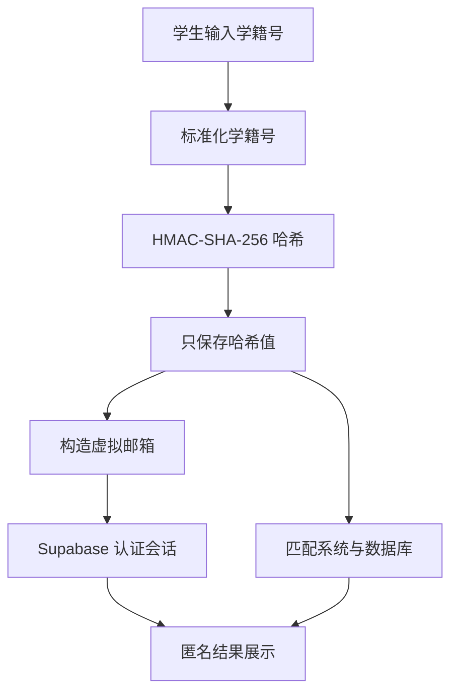
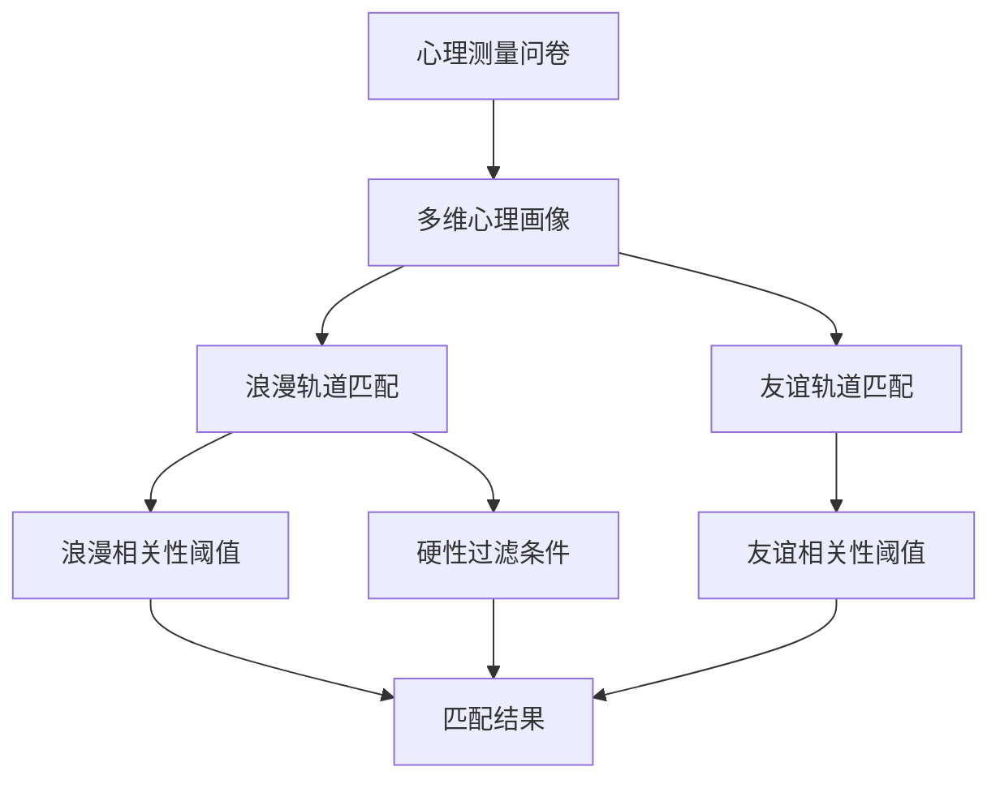
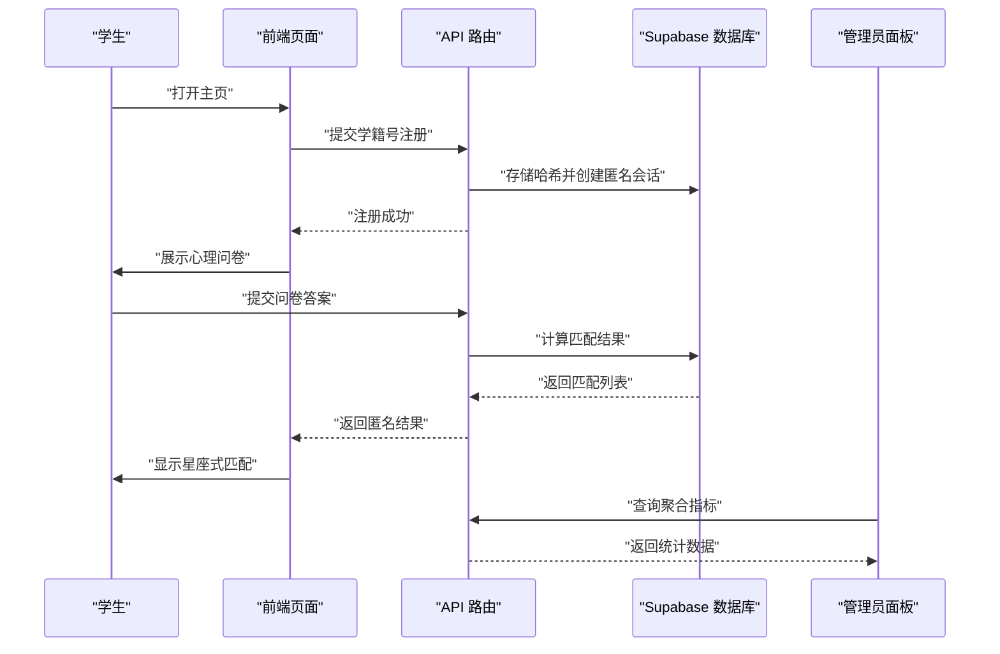
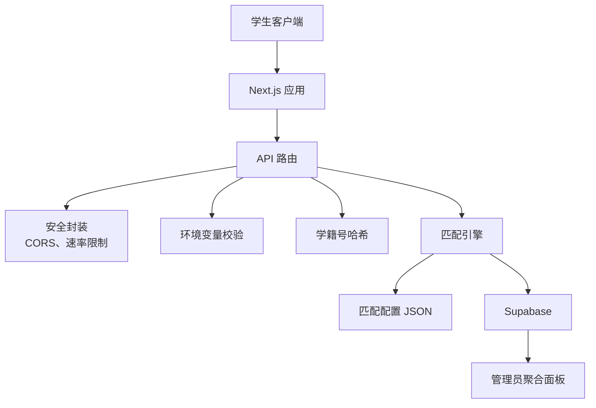

# 项目背景与业务价值

<cite>
**本文引用的文件**   
- [README.md](file://README.md)
- [CONTEXTO_PROYECTO.md](file://CONTEXTO_PROYECTO.md)
- [MANUAL_ADMINISTRADOR.md](file://MANUAL_ADMINISTRADOR.md)
- [package.json](file://package.json)
- [src/lib/env.server.ts](file://src/lib/env.server.ts)
- [src/lib/identity.server.ts](file://src/lib/identity.server.ts)
- [data/matching-config-v2.json](file://data/matching-config-v2.json)
- [src/lib/matching-config-v2.ts](file://src/lib/matching-config-v2.ts)
- [src/app/api/register/route.ts](file://src/app/api/register/route.ts)
- [supabase/migrations/202610240001_matches_v2_explainability.sql](file://supabase/migrations/202610240001_matches_v2_explainability.sql)
</cite>

## 目录
1. [引言](#引言)
2. [服务对象与校园场景](#服务对象与校园场景)
3. [为什么需要匿名性格匹配服务](#为什么需要匿名性格匹配服务)
4. [核心价值主张](#核心价值主张)
5. [隐私优先设计与敏感信息保护](#隐私优先设计与敏感信息保护)
6. [双轨道匹配系统的业务意义](#双轨道匹配系统的业务意义)
7. [用户故事与使用场景](#用户故事与使用场景)
8. [可量化业务指标](#可量化业务指标)
9. [技术实现如何支撑业务目标](#技术实现如何支撑业务目标)
10. [风险与治理视角](#风险与治理视角)
11. [结论](#结论)

## 引言
ENES ZooMatch 是一个面向 UNAM ENES 学生的心理测量匹配平台。它的产品目标是：让在校学生通过一个简短、匿名、可重复的心理测试，发现与自己性格、价值观、文化兴趣和亲密关系偏好相近的人，并以“动物形象 + 颜色 + 星座式可视化”的方式呈现结果，降低社交压力、提升校园社交的趣味性和可探索性。

从业务角度看，ZooMatch 不是传统意义上的交友软件，也不是临床心理学诊断工具；它是一个教育型、娱乐型、隐私优先的校园社交实验平台。它把“科学心理测量”和“低门槛校园社交”连接起来，同时用严格的隐私设计保护学生身份。

**章节来源**
- [README.md:1-60](file://README.md#L1-L60)
- [CONTEXTO_PROYECTO.md:1-40](file://CONTEXTO_PROYECTO.md#L1-L40)

## 服务对象与校园场景
UNAM ENES 的学生群体具有以下典型特征，这些特征直接解释了为什么传统的面对面社交或通用社交平台难以完全满足他们的需求：

- **校园规模大、课程密集**：学生在课堂、实验室、社团和食堂之间流动，但缺乏一个结构化、低风险的“先了解再接触”的入口。
- **对隐私敏感**：学籍号、个人档案、情感倾向等数据在校园环境中如果被泄露，可能带来现实中的社交风险。
- **对非正式社交有需求**：学生既希望认识潜在伴侣，也希望找到志同道合的朋友、学习伙伴或兴趣同好。
- **对学术严肃性与生活轻松感并存的环境有期待**：平台不应像纯约会软件那样功利化，也不应像纯学术系统那样冷硬。

ZooMatch 的产品形态正是围绕这些特征设计的：

| 校园需求 | ZooMatch 的业务回应 |
|---|---|
| 学生害怕因真实姓名暴露而尴尬 | 使用学籍号注册，但只保存哈希值，不展示原始学号 |
| 学生想以“安全距离”开始社交 | 先用性格画像和昵称参与，不强制公开个人信息 |
| 学生既有恋爱需求也有交友需求 | v2 引入浪漫关系与友谊两条匹配轨道 |
| 学生希望体验有趣但不轻浮 | 用像素动物、星座可视化和叙事文案做情感化表达 |
| 学校需要可审计但不暴露个人隐私的数据 | 管理员面板只提供聚合统计，不返回个体记录 |

**章节来源**
- [README.md:1-60](file://README.md#L1-L60)
- [MANUAL_ADMINISTRADOR.md:1-60](file://MANUAL_ADMINISTRADOR.md#L1-L60)

## 为什么需要匿名性格匹配服务
在普通社交场景中，学生通常基于外貌、即时聊天、地理位置或已有社交网络建立联系。但在校园环境中，这种模式存在几个问题：

1. **第一印象偏差**：外貌、声音、衣着可能掩盖性格、价值观和文化偏好的差异。
2. **社交压力过大**：直接表达好感在课堂、社团或宿舍圈中可能造成尴尬。
3. **隐私边界模糊**：校园内熟人网络较密，个人信息一旦扩散，影响范围远超互联网上的陌生人社交。
4. **社交类型单一**：多数平台默认以恋爱为导向，忽略了友谊、兴趣社群和学习协作的价值。

ZooMatch 通过以下方式缓解这些问题：

- **匿名注册**：学生用学籍号注册，但系统内部只保留 HMAC-SHA-256 哈希值。
- **心理测量前置**：先用 Big Five、MBTI、亲密关系偏好、文化兴趣和价值维度构建稳定画像，而不是仅靠即时互动。
- **去身份化的结果展示**：匹配结果以昵称、动物形象和颜色呈现，避免一上来就暴露真实身份。
- **双轨道匹配**：同时支持浪漫关系和友谊，让不同社交目标的学生都能获得价值。

**章节来源**
- [README.md:1-60](file://README.md#L1-L60)
- [CONTEXTO_PROYECTO.md:40-120](file://CONTEXTO_PROYECTO.md#L40-L120)

## 核心价值主张
ZooMatch 的核心价值可以概括为一句话：

> 用科学心理测量帮助 UNAM ENES 学生在校园中建立更安全、更有趣、更有意义的社交连接。

这个主张包含三个层次：

### 1. 科学性
- 使用心理测量维度（如 Big Five、MBTI、亲密关系偏好、文化兴趣、价值观）。
- 通过加权余弦相似度和类别权重计算匹配度，避免某些维度数量过多导致其他维度被淹没。
- 阈值经过合成数据和二分法校准，而不是随意设定。

### 2. 安全性
- 学籍号只在服务器端进行 HMAC-SHA-256 哈希处理。
- 注册接口返回结果对新用户和重复用户保持一致，防止枚举学籍号。
- 管理员面板只暴露聚合指标，不暴露原始响应、向量或哈希。

### 3. 可连接性
- 用动物形象和颜色降低初次接触的紧张感。
- 用星座可视化让学生“看见”自己的社交生态。
- 用解释性文案帮助学生理解“为什么我们可能合得来”，而不是只看到一个冷冰冰的数字。

**章节来源**
- [README.md:1-120](file://README.md#L1-L120)
- [CONTEXTO_PROYECTO.md:1-80](file://CONTEXTO_PROYECTO.md#L1-L80)

## 隐私优先设计与敏感信息保护
ZooMatch 的隐私设计不是附加功能，而是产品的基础。其关键设计包括：

### 学籍号保护机制
- 学生注册时提供学籍号。
- 服务端将学籍号标准化后使用 HMAC-SHA-256 生成确定性哈希。
- 系统中存储的是哈希值，而不是明文学籍号。
- 登录邮箱由哈希构造为虚拟邮箱形式，用于 Supabase Auth 会话管理。

**图表来源**
- [src/lib/identity.server.ts:1-9](file://src/lib/identity.server.ts#L1-L9)
- [src/app/api/register/route.ts:1-73](file://src/app/api/register/route.ts#L1-L73)

### 为什么选择 HMAC-SHA-256
HMAC-SHA-256 在该业务场景中有以下优势：

| 特性 | 业务意义 |
|---|---|
| 确定性 | 同一学籍号总是生成相同哈希，便于去重和恢复会话 |
| 单向性 | 无法从哈希反推原始学籍号 |
| 密钥依赖 | 没有 `MATRICULA_HMAC_SECRET` 就无法复现或破解哈希映射 |
| 抗碰撞 | 降低不同学籍号产生相同哈希的风险 |
| 防枚举 | 注册接口对新用户和老用户返回一致结果，减少学籍号探测 |

### 环境变量与密钥治理
- 服务端环境配置要求 `MATRICULA_HMAC_SECRET` 至少 32 个字符。
- 如果环境变量缺失或校验失败，系统不会继续执行敏感操作，而是降级或返回不可用状态。
- 这体现了“配置即契约”的设计：密钥长度不足或配置错误不会静默运行，而是触发安全回退。

**章节来源**
- [src/lib/env.server.ts:1-21](file://src/lib/env.server.ts#L1-L21)
- [src/lib/identity.server.ts:1-9](file://src/lib/identity.server.ts#L1-L9)
- [src/app/api/register/route.ts:1-73](file://src/app/api/register/route.ts#L1-L73)

## 双轨道匹配系统的业务意义
ZooMatch v2 明确区分“浪漫关系”和“友谊”两个匹配轨道，这不是单纯的技术分层，而是重要的业务决策。

### 浪漫轨道
- 关注性格、亲密关系偏好、价值观、文化兴趣和身份认同。
- 使用更严格的相关性阈值。
- 应用硬性过滤条件，例如性取向、性别身份和关系类型。
- 适合希望寻找潜在恋爱对象或长期伴侣的用户。

### 友谊轨道
- 更强调性格开放性、责任感、外向性、亲和力、情绪稳定性、文化兴趣和关系价值观。
- 不应用浪漫轨道中的硬性过滤条件。
- 阈值相对宽松，鼓励更多连接机会。
- 适合希望结识朋友、兴趣同好或校园伙伴的用户。

**图表来源**
- [data/matching-config-v2.json:1-76](file://data/matching-config-v2.json#L1-L76)
- [src/lib/matching-config-v2.ts:1-67](file://src/lib/matching-config-v2.ts#L1-L67)

### 双轨道带来的业务价值
1. **覆盖更广的用户意图**：不是所有学生都只想找恋爱对象；友谊同样重要。
2. **降低误配风险**：通过硬性过滤条件避免明显不适配的浪漫匹配。
3. **提高平台活跃度**：即使没有浪漫匹配，学生仍可能获得友谊匹配，减少“无结果”挫败感。
4. **增强解释性**：不同轨道对应不同维度组合，使“我们为什么合得来”的故事更清晰。

**章节来源**
- [data/matching-config-v2.json:1-76](file://data/matching-config-v2.json#L1-L76)
- [src/lib/matching-config-v2.ts:1-67](file://src/lib/matching-config-v2.ts#L1-L67)
- [CONTEXTO_PROYECTO.md:80-160](file://CONTEXTO_PROYECTO.md#L80-L160)

## 用户故事与使用场景
### 用户故事一：新生寻找校园归属
- **角色**：刚进入 ENES 的新生。
- **目标**：认识和自己兴趣、价值观相近的同学。
- **痛点**：班级人数多，不知道从哪里开始社交。
- **ZooMatch 路径**：注册 → 回答心理问卷 → 看到星座式匹配结果 → 以动物形象和昵称开启对话。
- **成功标志**：加入兴趣小组、找到学习伙伴或朋友圈子。

### 用户故事二：内向学生尝试低风险社交
- **角色**：性格内向、害怕直接表白或被拒绝的学生。
- **目标**：在不暴露真实身份的情况下探索潜在浪漫关系。
- **痛点**：传统约会平台太直接，课堂社交压力大。
- **ZooMatch 路径**：注册 → 完成匿名问卷 → 看到浪漫轨道匹配 → 逐步了解对方画像。
- **成功标志**：愿意从线上交流过渡到线下见面。

### 用户故事三：管理员观察平台健康度
- **角色**：平台运营或研究人员。
- **目标**：了解平台参与度、匹配分布和活跃趋势。
- **痛点**：不能查看学生隐私，只能看宏观数据。
- **ZooMatch 路径**：登录管理面板 → 查看聚合指标 → 导出 CSV。
- **成功标志**：获得可用统计，而不触碰个体隐私。

### 使用场景流程图

**图表来源**
- [README.md:60-120](file://README.md#L60-L120)
- [MANUAL_ADMINISTRADOR.md:60-140](file://MANUAL_ADMINISTRADOR.md#L60-L140)

## 可量化业务指标
ZooMatch 的业务价值可以通过以下几类指标衡量：

| 指标类别 | 具体指标 | 业务含义 |
|---|---|---|
| 参与度 | 注册人数、完成问卷人数 | 反映学生对平台的信任和使用意愿 |
| 匹配质量 | 超过阈值的匹配比例 | 反映心理测量和阈值设定的合理性 |
| 轨道分布 | 浪漫轨道与友谊轨道的比例 | 反映学生社交意图结构 |
| 多样性 | MBTI 类型分布、动物形象分布 | 反映样本多样性和平台代表性 |
| 留存 | 重复登录人数 | 反映学生是否持续回到平台 |
| 隐私合规 | 是否出现明文学籍号泄露 | 是红线指标，必须为零 |
| 可解释性 | 匹配解释文案覆盖率 | 反映学生是否能理解匹配原因 |

其中，平台已经内置了一些可用于监控的关键概念：

- “具有至少一个匹配的用户百分比”是管理员面板的重要指标。
- 阈值来自配置文件，并通过安全回退机制保证系统不会在配置异常时崩溃。
- 管理员面板只显示聚合数据，这是隐私合规的关键约束。

**章节来源**
- [MANUAL_ADMINISTRADOR.md:120-220](file://MANUAL_ADMINISTRADOR.md#L120-L220)
- [src/lib/matching-config-v2.ts:35-67](file://src/lib/matching-config-v2.ts#L35-L67)
- [README.md:100-160](file://README.md#L100-L160)

## 技术实现如何支撑业务目标
ZooMatch 的技术选择并不是为了炫技，而是服务于业务目标：

### 1. Next.js 与 TypeScript
- 提供前后端统一类型能力，降低业务逻辑出错概率。
- App Router 将页面、API 和管理员路由清晰分离。
- Node 版本要求确保运行时稳定性和性能。

### 2. Supabase
- 统一管理数据库、认证和行级安全策略。
- 将重型匹配逻辑下沉到 SQL RPC，减少应用层负担。
- 管理员面板通过安全定义函数获取聚合数据，避免直接暴露原始表。

### 3. 配置驱动的心理测量引擎
- 问卷项、权重、阈值、轨道和校准参数集中在 JSON 文件中。
- 运行时通过 Zod 验证配置，失败时使用安全默认值。
- 这意味着调整匹配行为不一定需要重新部署核心代码。

### 4. 可解释性输出
- 匹配结果不仅给出相似度分数，还生成情感化、本地化的解释文案。
- 这帮助学生理解“我为什么和这个人合得来”，提升社交动机。

**图表来源**
- [package.json:1-40](file://package.json#L1-L40)
- [src/lib/env.server.ts:1-21](file://src/lib/env.server.ts#L1-L21)
- [src/lib/matching-config-v2.ts:1-67](file://src/lib/matching-config-v2.ts#L1-L67)
- [supabase/migrations/202610240001_matches_v2_explainability.sql:1-58](file://supabase/migrations/202610240001_matches_v2_explainability.sql#L1-L58)

**章节来源**
- [package.json:1-40](file://package.json#L1-L40)
- [README.md:120-200](file://README.md#L120-L200)
- [CONTEXTO_PROYECTO.md:80-200](file://CONTEXTO_PROYECTO.md#L80-L200)

## 风险与治理视角
从业务治理角度，ZooMatch 面临的主要风险包括：

| 风险 | 影响 | 控制措施 |
|---|---|---|
| 学籍号泄露 | 学生隐私受损，可能引发法律和学校治理问题 | 仅保存 HMAC 哈希，不暴露明文 |
| 枚举攻击 | 外部程序探测哪些学籍号已注册 | 注册接口返回一致结果，结合速率限制 |
| 配置错误 | 匹配阈值异常导致大量误配或零匹配 | Zod 校验 + 安全默认阈值 |
| 管理员越权 | 有人看到学生个体隐私 | 代理中间件 + 角色检查 + 聚合 RPC |
| 过度依赖算法 | 学生误以为匹配结果是“命中注定” | 平台说明其为教育和娱乐用途，非临床诊断 |

此外，v2 的匹配结果扩展了可解释性字段，使系统能返回匹配对象的标识以便前端进一步构建解释文案。这说明系统设计上已经在“隐私保护”和“用户体验”之间寻找平衡：既要保护学生身份，又要让匹配结果有意义。

**章节来源**
- [src/app/api/register/route.ts:1-73](file://src/app/api/register/route.ts#L1-L73)
- [src/lib/env.server.ts:1-21](file://src/lib/env.server.ts#L1-L21)
- [supabase/migrations/202610240001_matches_v2_explainability.sql:1-58](file://supabase/migrations/202610240001_matches_v2_explainability.sql#L1-L58)
- [MANUAL_ADMINISTRADOR.md:1-120](file://MANUAL_ADMINISTRADOR.md#L1-L120)

## 结论
ENES ZooMatch 的业务价值不在于做一个更大的交友平台，而在于解决 UNAM ENES 校园中一个真实而微妙的问题：学生如何在尊重隐私的前提下，借助科学方法建立有意义的社交连接。

它的答案是：

- 用心理测量代替盲目匹配。
- 用匿名哈希代替真实身份暴露。
- 用双轨道匹配覆盖浪漫与友谊两类社交需求。
- 用游戏化视觉和解释性文案降低社交门槛。
- 用聚合数据治理保障平台和学校的可审计性。

对于校园管理者来说，ZooMatch 是一个可控、可观测、可演进的社会实验；对于学生来说，它是一个更轻松、更安全、更有趣的认识彼此的方式。未来若要进一步量化价值，重点应放在“匹配后的实际社交行为”“用户留存”“隐私合规事件为零”以及“双轨道使用结构的平衡”上。