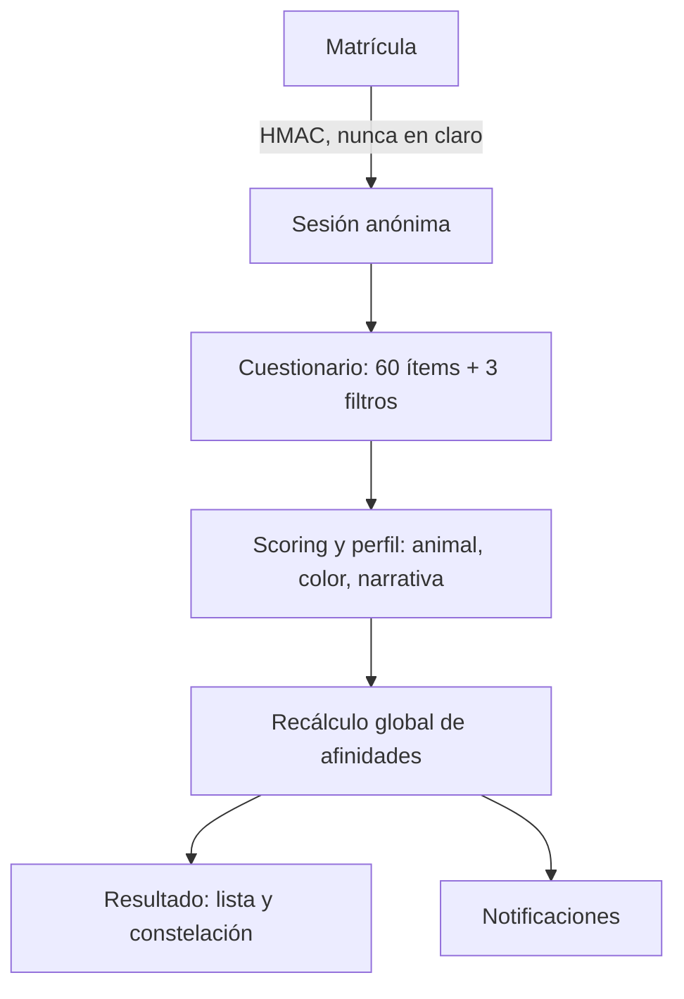

# 🐾 ENES ZooMatch

Web app *mobile-first* para estudiantes de la ENES (UNAM) que conecta personas de forma
**anónima** a partir de un cuestionario psicométrico. Cada persona recibe una identidad de
**animalito + color** en pixel art y ve a sus afinidades como una **constelación**: los
nodos compatibles se acercan y se unen. Hay dos pistas independientes, **romance** y
**amistad**.

> Es un proyecto estadístico, no una medida del valor de nadie: las afinidades son
> estimaciones reproducibles, todavía sin validar con datos reales de relaciones.

---

## Flujo



## Arquitectura

Hexagonal ligera, organizada por capas. Las reglas se aplican con ESLint
(`no-restricted-imports`); el detalle y el porqué están en
[`docs/ARQUITECTURA.md`](./docs/ARQUITECTURA.md) y [`docs/DECISIONES.md`](./docs/DECISIONES.md).

| Capa | Carpeta | Qué contiene | Puede importar |
|---|---|---|---|
| Configuración | `src/config/` | Única carga de `data/*.json`, validada con Zod y congelada | `types` |
| Dominio | `src/domain/` | Funciones puras: `psychometrics`, `matching`, `explainability`, `identity`, `avatars`, `constellation`, `messages`, `shared` | `config`, `types` |
| Contratos | `src/contracts/` | DTOs que viajan por la API (servidor ↔ cliente) | `domain` (tipos) |
| Aplicación | `src/application/` | Casos de uso, puertos, errores `AppError`, validación de entrada | `domain`, `contracts`, `config` |
| Infraestructura | `src/infrastructure/` | Supabase (repositorios), seguridad, entorno, HTTP, raíz de composición | todo lo anterior |
| UI | `src/ui/` | Componentes por feature: `quiz`, `result`, `constellation`, `admin`, `entry`, `shared` | `contracts`, `domain` de presentación, `config` |
| App | `src/app/` | Páginas y rutas API delgadas: Zod → caso de uso → DTO | todo |

Reglas clave:

- El dominio no hace I/O ni usa `Date.now` o `Math.random`. Reloj, HMAC y semillas se
  inyectan (`Clock`, `Hmac`, `mulberry32`).
- Los errores esperados son `Result<T, E>`; las rutas los traducen a HTTP en un solo lugar
  (`infrastructure/http/responses.ts`), con mensaje es-MX y un `code` estable.
- El navegador nunca recibe vectores, respuestas, hashes ni ids de otras personas.

## Datos y matching

- `data/microtest.json`: ítems y escala Likert.
- `data/matching-config.json`: umbrales, pesos, dimensiones y cupos por pista.
- `data/arquetipos.json`: 103 animales × 55 colores.
- `data/enneagram*.json`: prototipos del Eneagrama.

Para cambiar umbrales o pesos se edita el JSON, no el código; `npm run data:validate` lo
comprueba. El modelo y su calibración se describen en [`docs/SCORING.md`](./docs/SCORING.md).

## Base de datos

Una sola migración, [`supabase/migrations/00000000000000_base.sql`](./supabase/migrations/00000000000000_base.sql),
más [`supabase/seed.sql`](./supabase/seed.sql) para el catálogo.

- Las tablas de participantes (`profiles`, `quiz_responses`, `matches`, `notifications`) no
  tienen permisos para `anon` ni `authenticated`. El servidor las lee con el *service role*
  después de verificar la sesión.
- Las RPCs de servicio validan el rol con un chequeo seguro ante `NULL`. Todas fijan
  `search_path = ''`.
- `replace_matches` publica el conjunto de matches de forma atómica y rechaza resultados
  calculados sobre una versión vieja del grupo de perfiles.

## Desarrollo

Requisitos: Node ≥ 22.12, y Docker + Supabase CLI para la base local.

```bash
npm install
supabase start
npm run db:reset        # migración base + semilla
npm run dev             # http://localhost:3000
```

| Script | Qué hace |
|---|---|
| `npm run check` | lint + typecheck + tests (lo que debe estar en verde antes de cada commit) |
| `npm run lint` / `typecheck` / `test` | por separado |
| `npm run data:validate` | valida `data/*.json`, el catálogo y el contrato SQL ↔ TypeScript |
| `npm run db:reset` | reinicia la base local con la migración base y la semilla |
| `npm run db:apply` | aplica migración + semilla a un proyecto Supabase remoto vacío vía Management API (`SUPABASE_ACCESS_TOKEN` en `.env.local`); `-- --status` cuenta filas |
| `npm run build` | build de producción |

Las variables de entorno están en [`.env.example`](./.env.example) y se validan con Zod en
`src/infrastructure/env/`. El despliegue (Supabase remoto, Vercel, Upstash) está en
[`DESPLIEGUE.md`](./DESPLIEGUE.md); la operación del panel, en
[`MANUAL_ADMINISTRADOR.md`](./MANUAL_ADMINISTRADOR.md).

Rutas de desarrollo (devuelven 404 en producción): `/dev/sprites` y `/dev/constellation`.

## Privacidad y seguridad

- La matrícula solo existe como HMAC-SHA-256 con un secreto del servidor. `/api/enter`
  responde igual para cuentas nuevas y existentes.
- Las métricas de admin son solo agregados, calculados por una RPC `SECURITY DEFINER`.
- Todas las rutas API pasan por `withApiSecurity`: origen permitido, rate limit (Upstash) y
  cabeceras `no-store`. CSP y HSTS se definen en `next.config.ts`.
- `supabase/purge_event.sql` borra a todas las personas participantes al cerrar el evento y
  conserva las cuentas de administración.

## Documentación

| Documento | Para qué |
|---|---|
| [`docs/ARQUITECTURA.md`](./docs/ARQUITECTURA.md) | Auditoría, capas y plan de unificación |
| [`docs/DECISIONES.md`](./docs/DECISIONES.md) | ADRs cortos: qué se decidió y por qué |
| [`docs/SCORING.md`](./docs/SCORING.md) | Modelo de scoring y matching actual |
| [`docs/AUDIT.md`](./docs/AUDIT.md) | Auditoría previa a la unificación (histórica) |
| [`docs/CONTEXTO_PROYECTO.md`](./docs/CONTEXTO_PROYECTO.md) | Contexto extenso previo a la unificación (histórico; las rutas `src/lib/*` ya no existen) |
| [`DESPLIEGUE.md`](./DESPLIEGUE.md) · [`MANUAL_ADMINISTRADOR.md`](./MANUAL_ADMINISTRADOR.md) | Operación |

`.qoder/` y `.kiro/` son artefactos de herramientas externas y no describen la estructura
actual.

## Convenciones

- Código en inglés; textos para personas en es-MX inclusivo.
- Sin `any`, sin `@ts-ignore`. TypeScript con `strict`, `noUncheckedIndexedAccess` y
  `exactOptionalPropertyTypes`.
- Commits pequeños en modo imperativo; `npm run check` en verde en cada uno.
- `NO_MATCH_MESSAGE` está fijado por tests: no se cambia sin una decisión explícita.
