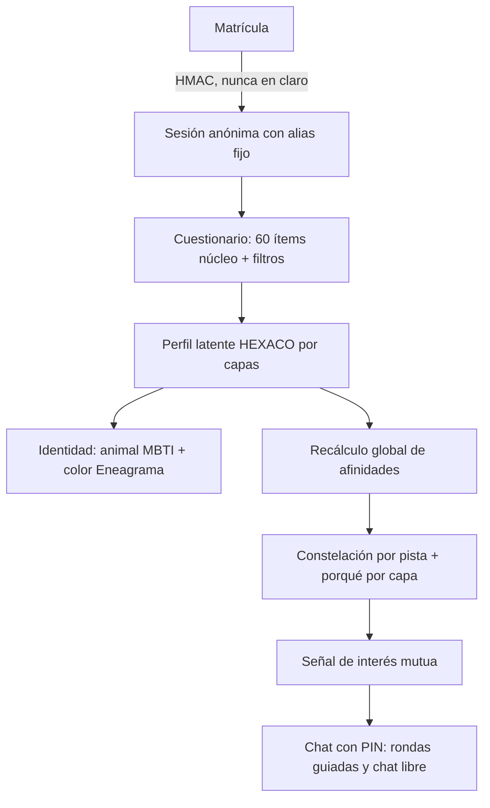

# ENES ZooMatch

Web app *mobile-first* para estudiantes de la ENES (UNAM). Conecta personas de forma
**anónima** a partir de un cuestionario psicométrico: cada quien recibe una identidad de
**animalito + color** en pixel art y ve sus afinidades como una **constelación**, donde las
estrellas compatibles se acercan y se unen. Hay dos pistas independientes, **romance** y
**amistad**, y un **chat con consentimiento mutuo** que empieza con preguntas guiadas.

**En producción:** <https://zooenes.vercel.app> · entra con tu matrícula / número de cuenta
UNAM.

> **Lo que no prometemos.** Las afinidades son estimaciones reproducibles calibradas con
> datos **sintéticos**; todavía no hay datos reales de resultados relacionales, así que **no
> hay validez predictiva demostrada**. La literatura indica que la personalidad por sí sola
> predice poco la calidad de una relación. ZooMatch sirve para conocer gente, no mide el valor
> de nadie (`docs/EVIDENCIA.md`, `docs/VALIDACION.md`).

---

## Qué hace



| Función | Qué es | Más detalle |
|---|---|---|
| **Modelo por capas** | Capa 0, filtros duros (orientación, identidad, tipo de relación). Capa 1, **HEXACO** como núcleo. Capa 2, Big Five como puente. Capa 3, valores, estilo relacional, apego y estilo de vida. Capa 4, **MBTI + Eneagrama** para la identidad visual, con peso mínimo en el puntaje | `docs/DECISION_MODELO_RASGOS.md`, `docs/MATCHING.md`, `docs/SCORING.md` |
| **Cuestionario** | 60 ítems núcleo y módulos opcionales para afinar (facetas HEXACO, Big Five, valores, relacional, MBTI, Eneagrama, subtipo, intereses y estilo de vida; 173 ítems en total) | `docs/TEST.md`, `docs/MEDICION.md` |
| **Constelación** | Física propia en SVG: tu estrella al centro, porcentaje de afinidad sobre cada sprite y brillo dorado desde el 95 %. Arrastrar, zoom y guía rápida en móvil | `docs/FISICA.md`, `docs/DISENO.md` |
| **Explicabilidad** | «Lo que más conecta», «tensión sana» y confianza, derivados de las contribuciones **reales** del puntaje | `docs/MATCHING.md` §4 |
| **Perfil** | El tuyo completo (HEXACO en hexágono, ejes MBTI, Eneagrama con ala). De otras personas, solo bandas de lo que **eligieron** compartir | `docs/PANTALLAS.md`, ADR-030 |
| **Chat** | Señal ❤️/🤗 (romance/amistad) que solo abre chat si es **mutua**; «ahora no» silencioso; 3 tarjetas de preguntas elegidas según su afinidad; respuestas **selladas** que se revelan juntas; chat libre tras 3 rondas; 300 grafemas; emojis; pausar, bloquear y reportar en un toque | `docs/CHAT.md` §10–14 |
| **Candado de PIN** | 4 dígitos por persona para abrir tus chats. Es un candado, **no cifrado** | `docs/CHAT.md` §1–9 |

## Stack

Next 16 (App Router) · React 19 · TypeScript estricto · Tailwind v4 · Supabase (Postgres + Auth)
· Zod 4 · Vitest. Python para los análisis psicométricos sin conexión (`scripts/psychometrics`).
Despliegue en Vercel.

## Arquitectura

Hexagonal ligera por capas. Las fronteras se imponen con ESLint (`no-restricted-imports`); el
detalle está en [`docs/ARQUITECTURA.md`](./docs/ARQUITECTURA.md).

| Capa | Carpeta | Qué contiene |
|---|---|---|
| Configuración | `src/config/` | Única carga de `data/*.json`, validada con Zod y congelada |
| Dominio | `src/domain/` | Funciones puras: `psychometrics`, `matching`, `explainability`, `avatars`, `constellation`, `chat`, `shared` |
| Contratos | `src/contracts/` | DTOs servidor ↔ cliente |
| Aplicación | `src/application/` | Casos de uso, puertos, `AppError`, validación |
| Infraestructura | `src/infrastructure/` | Supabase, seguridad (`withApiSecurity`), entorno, HTTP, raíz de composición |
| UI | `src/ui/` | Componentes por funcionalidad (`quiz`, `result`, `constellation`, `profile`, `chat`, `admin`, `kit`) |
| App | `src/app/` | Páginas y rutas API delgadas: Zod → caso de uso → DTO |

Reglas:

- El dominio no hace I/O y no usa `Date.now` ni `Math.random`: el reloj y las semillas se
  inyectan.
- No hay números mágicos: parámetros y textos de modelo viven en `data/*.json`, etiquetados como
  `prior_literatura`, `estimado_sintetico` o `supuesto_diseno`, con un hash en
  `docs/TRAZABILIDAD.md`.
- El navegador nunca recibe vectores, θ, respuestas, hashes ni ids de otras personas.

## Base de datos

`supabase/migrations/` contiene la base (`00000000000000_base.sql`) y migraciones
**incrementales idempotentes**, cada una replicada en la base:

| Migración | Qué agrega |
|---|---|
| `20261102000000_chat_pin.sql` | Candado de PIN y eventos de seguridad |
| `20261103000000_shared_layers.sql` | Capas que cada persona comparte |
| `20261104000000_conversations.sql` | Señales y conversaciones |
| `20261105000000_alias_collision.sql` | Alias sin colisiones |
| `20261106000000_chat_safety.sql` | Rondas guiadas, edad, bloqueos, reportes y retención |

- Las tablas de participantes tienen RLS **sin políticas** para clientes; el servidor las lee
  con `service_role` tras verificar la sesión.
- Todas las RPC son `SECURITY DEFINER`, usan `search_path = ''` y validan el rol.
- Todo cae en cascada al borrar la cuenta.
- `schema.test.ts` verifica que la base y las incrementales coincidan.

## Desarrollo

Requisitos: Node 24; Docker y la CLI de Supabase para la base local; Python 3 solo para los
análisis psicométricos.

```bash
npm install
supabase start
npm run db:reset        # migración base + semilla
npm run dev             # http://localhost:3000
```

| Script | Qué hace |
|---|---|
| `npm run check` | Secretos + lint + typecheck + tests (debe quedar en verde antes de cada commit) |
| `npm run build` | Build de producción |
| `npm run secrets:check` | Busca claves en archivos rastreados y logs; `npm run hooks:install` activa el hook de pre-commit |
| `npm run data:schemas` | Valida `data/*.json`, el contrato SQL ↔ TS y la trazabilidad |
| `npm run data:validate` | `data:schemas` más la validación sintética preregistrada → `docs/VALIDACION_RESULTADOS.md` |
| `npm run data:matching` | Recalibra los umbrales con una nula por permutación → `docs/MATCHING_RESULTADOS.md` |
| `npm run data:literature` | Crawler de literatura (Firecrawl + APIs abiertas). Por defecto es *dry-run*; con `-- --run` gasta créditos (`docs/LITERATURA.md`) |
| `npm run data:psychometrics` | Banco y análisis psicométricos (Python) |
| `npm run db:apply` | Aplica la base y la semilla a un Supabase remoto vacío; `-- --migration <archivo>` aplica una incremental |
| `node scripts/qa/qa-api.mjs` | QA de API de punta a punta contra `BASE` (solo matrículas falsas, que borra al terminar) |

**Variables de entorno.** Los nombres están en [`.env.example`](./.env.example) y se validan con
Zod. Nunca se commitean valores.

| Variable | Dónde |
|---|---|
| `NEXT_PUBLIC_SUPABASE_URL`, `NEXT_PUBLIC_SUPABASE_PUBLISHABLE_KEY` | App (públicas) |
| `SUPABASE_SERVICE_ROLE_KEY`, `MATRICULA_HMAC_SECRET`, `CHAT_PIN_PEPPER` | Solo servidor |
| `UPSTASH_REDIS_REST_URL`, `UPSTASH_REDIS_REST_TOKEN` | Rate limit distribuido (sin ellas queda en *fail-open*) |
| `CORS_ALLOWED_ORIGINS` | Opcional |
| `FIRECRAWL_API_KEY`, `SUPABASE_ACCESS_TOKEN`, `VERCEL_TOKEN` | Solo scripts locales, nunca en Vercel |

Rutas de desarrollo (404 en producción): `/dev/ui`, `/dev/tipografia`, `/dev/sprites`,
`/dev/avatars`, `/dev/constellation`, `/dev/physics`.

## Privacidad y seguridad

- **Matrícula:** solo se guarda como HMAC-SHA-256 con un secreto del servidor. La matrícula es
  la credencial, y el riesgo aceptado se documenta en ADR-026.
- **Lo que ven las demás personas:** alias autogenerado y fijo, animal y color. Todo lo demás es
  opcional, se muestra en bandas y se puede retirar. Los filtros duros y los temas sensibles
  nunca se muestran.
- **Chat:**
  - consentimiento mutuo, sin «visto» y notificaciones sin contenido;
  - enlaces bloqueados y filtro de lenguaje en el servidor;
  - bloqueo silencioso y reportes con una instantánea mínima;
  - mensajes guardados 30 días.
  - **No se pueden impedir capturas de pantalla**, y quien opera el servidor puede leer los
    mensajes.
- **API:** todas las rutas pasan por `withApiSecurity` (origen, rate limit, `no-store`). CSP y
  HSTS se definen en `next.config.ts`.
- **Admin** (`/admin`, matrícula + PIN administrativo): agregados con k-anonimato, lista de
  personas sin matrícula ni respuestas, reportes y control de cuentas (borrar, reiniciar test,
  pausar, restablecer PIN de chats). Todo queda auditado (ADR-036).

Detalle en [`docs/PRIVACIDAD.md`](./docs/PRIVACIDAD.md).

## Documentación

| Documento | Para qué |
|---|---|
| [`docs/ESTADO_ACTUAL.md`](./docs/ESTADO_ACTUAL.md) | Estado del proyecto, fases y pendientes (empieza aquí) |
| [`docs/ARQUITECTURA.md`](./docs/ARQUITECTURA.md) · [`docs/DECISIONES.md`](./docs/DECISIONES.md) | Capas y ADRs (ADR-001 … ADR-036) |
| [`docs/DECISION_MODELO_RASGOS.md`](./docs/DECISION_MODELO_RASGOS.md) · [`docs/CAPAS_EVIDENCIA.md`](./docs/CAPAS_EVIDENCIA.md) | HEXACO como núcleo y evidencia por capa |
| [`docs/MATCHING.md`](./docs/MATCHING.md) · [`docs/SCORING.md`](./docs/SCORING.md) · [`docs/MEDICION.md`](./docs/MEDICION.md) | Modelo de afinidad, scoring y medición |
| [`docs/EVIDENCIA.md`](./docs/EVIDENCIA.md) · [`docs/LITERATURA.md`](./docs/LITERATURA.md) · [`docs/META_ANALISIS.md`](./docs/META_ANALISIS.md) | Matriz de evidencia y pipeline de literatura |
| [`docs/VALIDACION.md`](./docs/VALIDACION.md) · [`docs/PREREGISTRO.md`](./docs/PREREGISTRO.md) | Validación sintética preregistrada |
| [`docs/CHAT.md`](./docs/CHAT.md) | Candado de PIN y chat (flujo, banco de preguntas, seguridad) |
| [`docs/DISENO.md`](./docs/DISENO.md) · [`docs/AVATARES.md`](./docs/AVATARES.md) · [`docs/AUDITORIA_VISUAL.md`](./docs/AUDITORIA_VISUAL.md) · [`docs/GUIA_DE_TONO.md`](./docs/GUIA_DE_TONO.md) | Sistema de diseño pixel + dorado, avatares, contraste y tono |
| [`docs/PRIVACIDAD.md`](./docs/PRIVACIDAD.md) · [`docs/QA.md`](./docs/QA.md) | Privacidad y QA |
| [`DESPLIEGUE.md`](./DESPLIEGUE.md) · [`MANUAL_ADMINISTRADOR.md`](./MANUAL_ADMINISTRADOR.md) | Operación |

## Estado y límites

- **Hecho:**
  - modelo HEXACO por capas;
  - constelación con física, porcentajes y dorado;
  - perfil de afinidades con privacidad por capas;
  - guía móvil;
  - candado de PIN;
  - chat con señales, rondas guiadas y seguridad;
  - QA de API en producción (85/85).
- **Pendiente:**
  - activar Upstash para un rate limit distribuido;
  - pruebas en dos teléfonos con TalkBack o VoiceOver;
  - pantalla de moderación de reportes (hoy se revisan con SQL);
  - verificar a mano las referencias marcadas `[VERIFICAR]` en `docs/EVIDENCIA.md`;
  - validar con datos reales de resultados.

## Convenciones

- Código en inglés; textos para personas en es-MX. La «x» inclusiva solo va en copy de marca,
  nunca en lo que leen los lectores de pantalla.
- Sin `any` ni `@ts-ignore`. TypeScript `strict` con `noUncheckedIndexedAccess` y
  `exactOptionalPropertyTypes`.
- Funciones de menos de 40 líneas y archivos de menos de 300.
- CSS pixel: sin radios, sin `blur`, sin degradados.
- Commits pequeños en imperativo, con `npm run check` en verde.
