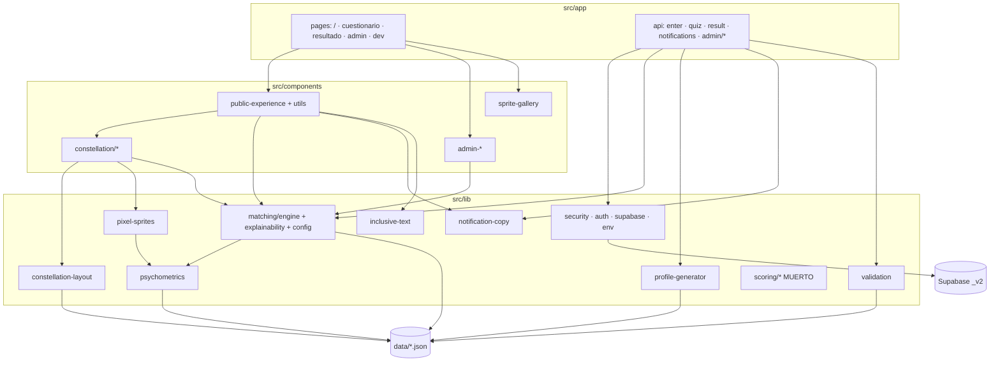
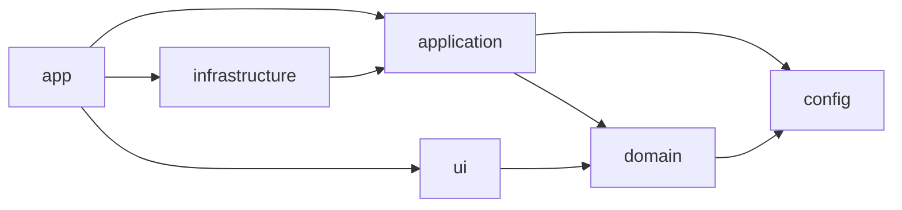

# ARQUITECTURA — ZooMatch (auditoría y plan de unificación)

> Estado: **plan ejecutado (2026-10-31)**. Las secciones 1–6 son la auditoría y el plan
> originales, hechos sobre el commit `95717f9`. La sección 7 describe el resultado y en qué
> se desvió del plan. Las decisiones con su porqué están en [`DECISIONES.md`](./DECISIONES.md).

---

## 1. Fotografía actual

| Área | Tamaño | Notas |
|---|---|---|
| `src/` | ~27.7 k líneas, 30 archivos de test, 547 tests en verde | `strict: true`, 0 `any`, 0 `@ts-ignore`, 0 `eslint-disable` |
| `src/lib/` | 14 módulos planos + 6 carpetas | dominio, servidor y utilidades mezclados en el mismo nivel |
| `data/` | 6 JSON + `external/` | fuente de verdad psicométrica, importada estáticamente |
| `supabase/migrations/` | 8 migraciones | dos esquemas conviven (v1 y `_v2`) |
| Documentos raíz | 7 `.md` (2.3 k líneas) | `CONTEXTO_PROYECTO.md`, `AUDIT.md`, `SCORING.md`, … con solapamiento |

Archivos que exceden el límite propuesto de 300 líneas (sin tests):
`pixel-sprites.ts` 2425 · `matching/explainability.ts` 1579 · `constellation-layout.ts` 1205 ·
`public-experience.tsx` 1111 · `matching/engine.ts` 1014 · `ConstellationCanvas.tsx` 933 ·
`sprite-gallery.tsx` 754 · `profile-generator.ts` 714 · `NodeDetailSheet.tsx` 657 ·
`psychometrics.ts` 468 · `render-helpers.ts` 453.

### 1.1 Mapa de dependencias (real)



Violaciones de capa detectadas:

1. **UI → dominio de matching**: `components/constellation/types.ts`, `NodeDetailSheet.tsx`,
   `public-experience*.tsx` importan `@/lib/matching/explainability` (la UI arma
   explicaciones, en vez de recibir un DTO ya explicado).
2. **UI → JSON crudo**: `public-experience.tsx` importa `data/microtest.json`;
   `adapt-result.ts`, `sprite-gallery.tsx`, `dev/constellation/synthetic.ts` importan
   `data/arquetipos.json`.
3. **Componentes → componentes de utilidad con lógica de dominio**:
   `components/public-experience-utils.ts` contiene copy, parsers y badges.
4. **Rutas API gordas**: `api/quiz/route.ts` (172 l.) y `api/result/route.ts` (285 l.)
   orquestan Supabase, scoring, identidad y notificaciones inline.
5. **`auth/admin-auth.server.ts`** importa `@/lib/matching` (infraestructura → dominio está
   bien) pero también define el DTO del dashboard — mezcla.

### 1.2 Inventario de versión (todo lo que lleva sufijo o lógica v1/v2)

**Base de datos — dos esquemas conviviendo:**

| Objeto v1 (`202610220001/2`) | ¿Lo usa el código? | Objeto v2 (`202610230001` +) | ¿Lo usa el código? |
|---|---|---|---|
| `archetypes` | No | `animals`, `colors` | Sí (seed) |
| `profiles` | No | `profiles_v2` | **Sí** (quiz, result, auth, recompute) |
| `quiz_items` / `quiz_responses` | No | `quiz_items_v2` / `quiz_responses_v2` | Solo seed / submit |
| `score_vectors` | No | (vectores en `profiles_v2`) | Sí |
| `matches` | No | `matches_v2` | Sí |
| RPC `submit_quiz_result` | No | `submit_quiz_result_v2` | Sí |
| RPC `get_my_matches` | No | `get_my_matches_v2` | Sí |
| RPC `refresh_matches`, `private.cosine_similarity`, `assign_archetype_and_alias`, `dimension_justification` | No | `replace_matches_v2`, `notify_matches_v2` | Sí |
| RPC `get_admin_dashboard` | No | `get_admin_dashboard_v2` | Sí |
| `is_matricula_available` | No | — | — |
| — | — | `compute_dual_matches`, `private.dimension_badges_v2` | **No** (matching se calcula en TS) |
| `user_roles`, `private.is_admin`, `app_role` | Sí | (compartidos) | Sí |
| — | — | `notifications`, `get_my_notifications`, `mark_notifications_read` | Sí |

Conclusión: **todo el esquema v1 es huérfano** y del v2 sobran `compute_dual_matches` y
`dimension_badges_v2` (el matching vive en TypeScript desde `202610250001`).

**Código TypeScript con sufijo** (solo nombres físicos de BD; no hay tipos ni archivos v2):
`api/quiz/route.ts`, `api/result/route.ts`, `auth/admin-auth.server.ts`,
`auth/matricula-session.server.ts`, `matching/recompute.server.ts` → `profiles_v2` (11),
`notify_matches_v2` (3), `submit_quiz_result_v2`, `replace_matches_v2`,
`get_my_matches_v2`, `get_admin_dashboard_v2`.

**Archivos/rutas/configs con versión**: ninguno. Las rutas públicas ya son `/cuestionario`,
`/resultado`, `/api/{enter,quiz,result,notifications,admin/*}`; los `data/*.json` ya no
llevan sufijo. Los campos `"version": "x.y"` dentro de los JSON son metadatos de
contenido (legítimos, se conservan). No hay feature flags de versión.

**Copy desactualizado**: `foundation-hero.tsx` dice "sixteen carefully curated archetypes"
(el catálogo tiene 103) y está en inglés.

### 1.3 Código muerto

| Elemento | Evidencia | Acción |
|---|---|---|
| `src/lib/scoring/*` (9 módulos, 1 778 líneas + 8 tests) | Ningún archivo fuera de la carpeta lo importa | **Eliminar**; rescatar a `domain/matching` lo que el Prompt 2 reutilice (p. ej. `rank`, calibración Big Five) |
| `findDualMatches`, `generateBadges`, `capCandidateGraphByCoverage` (export) | Solo `engine.ts`/`index.ts`/tests | Eliminar `findDualMatches`; los demás pasan a privados o se reemplazan en Prompt 2 |
| `explainability.ts::generatePersonalitySummary`, `cognitiveComplementarity` | Sin uso externo | Revisar en Prompt 2 |
| `profile-generator.ts::generateAlias` | Sin uso externo; el alias se arma en `generateProfileIdentity` | Reemplazado por `domain/identity` (HMAC, Prompt 2 F5) |
| `lib/supabase/client.ts`, `lib/admin/index.ts`, `lib/validation/index.ts` | Nadie los importa | Eliminar |
| `foundation-hero.tsx` | Nadie lo importa | Eliminar |
| `getMaxMatches`, `badgeForDimension`, `formatPercentage`, `LIKERT_LABELS` | Sin uso externo | Eliminar o mover a test |
| `tsconfig.tsbuildinfo` en raíz | Artefacto de build | `.gitignore` |

### 1.4 Deuda de tipado

`tsc --noUncheckedIndexedAccess --exactOptionalPropertyTypes` hoy produce **301 errores**,
concentrados en `pixel-sprites.ts` (98) y `constellation-layout.ts` (85), ambos con
acceso a matrices por índice. Es trabajo mecánico pero no trivial; se hará al mover cada
archivo a su capa (ver §4, paso 6).

---

## 2. Conservar · fusionar · eliminar

| Se conserva (es el producto) | Se fusiona | Se elimina |
|---|---|---|
| Filtros duros + elegibilidad mutua (romance) | `profile-generator` + alias → `domain/identity` y `domain/avatars` | Esquema SQL v1 completo |
| Ponderación por categoría, centrado contra μ, compuerta cuantil | `notification-copy` + copy de `public-experience-utils` → `domain/messages` | `compute_dual_matches`, `dimension_badges_v2` |
| Badges y explicabilidad determinista | `psychometrics.ts` → `domain/psychometrics` | `src/lib/scoring/*` |
| Notificaciones afectivas | `constellation-layout.ts` → `domain/constellation` | `findDualMatches`, exports sin uso (§1.3) |
| Seguridad: HMAC de matrícula, RLS, `withApiSecurity`, rate limit, origin check | `pixel-sprites.ts` → `domain/avatars` (partido por responsabilidad) | `foundation-hero.tsx`, `supabase/client.ts` |
| Constelación, sprites 16×16, modo inclusivo | Docs: `AUDIT.md` + `SCORING.md` + `CONTEXTO_PROYECTO.md` → `docs/` | Sufijos `_v2` en tablas/RPCs |

---

## 3. Estructura propuesta (hexagonal ligera, feature-first)

```
src/
├── domain/                  # PURO: sin React, sin Supabase, sin fetch, sin Date/Math.random
│   ├── shared/              # brands (UserId, Alias, Similarity, Likert), Result<T,E>, hash/PRNG
│   ├── psychometrics/       # scoring de ítems, Big Five, MBTI (ejes), Eneagrama (vector + ala), incertidumbre
│   ├── matching/            # filtros duros, compatibilidad por categoría, agregación, calibración, grupos
│   ├── explainability/      # contribuciones → explicación, tensión sana, confianza
│   ├── identity/            # alias anónimo (HMAC inyectado como puerto)
│   ├── avatars/             # AvatarSpec, plantillas, ops, paleta, frames
│   ├── constellation/       # grafo, distancia, física, empaquetamiento
│   ├── messages/            # selección de copy + reglas de número/género
│   └── badges/
├── application/             # casos de uso; dependen de dominio + PUERTOS (interfaces)
│   ├── ports.ts             # ProfileRepository, MatchRepository, NotificationRepository, Clock, Hmac
│   ├── enter.ts · submit-quiz.ts · recompute-matches.ts · get-result.ts
│   ├── notifications.ts · admin-metrics.ts
│   └── dto.ts               # DTOs de salida (lo único que ve la UI)
├── infrastructure/          # adaptadores
│   ├── supabase/            # clientes + repositorios que implementan los puertos
│   ├── security/            # withApiSecurity, origin, rate limit
│   ├── env/                 # env.ts / env.server.ts
│   └── logging.ts           # logger estructurado sin PII
├── config/                  # carga ÚNICA de data/*.json → Zod → objetos congelados
├── app/                     # Next.js: páginas + route handlers delgados (Zod → caso de uso → DTO)
└── ui/                      # componentes por feature
    ├── quiz/ · result/ · constellation/ · admin/ · entry/ · shared/
```

**Reglas de dependencia** (forzadas con ESLint `no-restricted-imports`, ver §5):



- `domain/**` no importa `react`, `next/*`, `@supabase/*`, `infrastructure/**`,
  `application/**`, `ui/**`, ni `data/*.json` directamente (solo vía `config/`).
- `ui/**` no importa `@supabase/*`, `infrastructure/**` ni `application/**` (recibe DTOs
  por props / fetch a la API). Puede importar **funciones puras de presentación** de
  `domain/avatars` y `domain/constellation` (render de sprites y física corren en cliente).
- `application/**` no importa `@supabase/*` (solo puertos).
- Solo `app/api/**` y `app/**/page.tsx` server instancian adaptadores de infraestructura.

**Patrón de errores elegido: `Result<T, E>`** discriminado (`{ ok: true, value } |
{ ok: false, error }`) en dominio y aplicación, con `E` como unión de códigos tipados
(`"quiz.incomplete" | "match.recompute_conflict" | …`). Las rutas mapean código → HTTP +
mensaje es-MX en un único `errorToResponse`. Excepciones solo para fallos de programación.
Razón: errores esperados explícitos en el tipo, sin `try/catch` disperso, y tests triviales.

**Efectos inyectables**: `Clock` (`now(): Date`), `Hmac` (`sign(input): string`), y semillas
explícitas para cualquier PRNG. Hoy el dominio ya es determinista (no hay `Date.now` ni
`Math.random` en `src/lib` fuera de `*.server.ts`), así que es formalizarlo.

---

## 4. Plan de migración

### 4.1 Base de datos — decisión requerida

`supabase/purge_event.sql` y `DESPLIEGUE.md` indican que el proyecto opera **por evento**
y purga participantes al cierre. Dos opciones:

| Opción | Qué hace | Cuándo |
|---|---|---|
| **A. Migración base consolidada + reset** (recomendada) | Reemplaza las 8 migraciones por `00000000000000_base.sql` con el esquema único sin sufijos (`profiles`, `quiz_items`, `quiz_responses`, `matches`, `notifications`, `animals`, `colors`, `user_roles` + RPCs `submit_quiz_result`, `replace_matches`, `get_my_matches`, `notify_matches`, `get_admin_dashboard`, …). `npm run db:reset` = `supabase db reset` + seed. | No hay datos reales que conservar (desarrollo o evento ya purgado) |
| **B. Migración de renombrado** | Agrega `202611010001_unify_schema.sql`: `DROP` de objetos v1 huérfanos, `ALTER TABLE … RENAME` de `_v2` → sin sufijo, recrear RPCs sin sufijo y borrar las `_v2`. Conserva filas. | Hay un proyecto Supabase con participantes que deben sobrevivir |

Ambas son destructivas para el esquema v1 (vacío en uso). **No ejecutaré ninguna sin tu
confirmación.** Nota: en este equipo no hay CLI de Supabase ni Docker, así que solo puedo
escribir y revisar el SQL; aplicarlo/probarlo queda de tu lado (o en CI si la agregamos).

### 4.2 Orden de refactor (commits atómicos, suite verde en cada paso)

1. **Higiene**: borrar código muerto (§1.3), `tsconfig.tsbuildinfo` a `.gitignore`.
2. **`config/`**: un loader con Zod por cada `data/*.json`, congelado; reemplazar los 9
   imports directos de JSON.
3. **`domain/shared`**: brands + `Result` + hash/PRNG (hoy duplicados en `pixel-sprites` y
   `constellation-layout`).
4. **Mover dominio** (`git mv` para conservar historia): psychometrics, matching,
   explainability, identity, avatars, constellation, messages — partiendo archivos > 300 l.
5. **`application/` + puertos + repos Supabase**; adelgazar `api/quiz` y `api/result`.
6. **`ui/`** por feature; la UI deja de importar `matching/explainability` y JSON.
7. **SQL** según opción A o B; renombrar llamadas `.from/.rpc` en un solo commit.
8. **Calidad**: `tsconfig` estricto (resolver los 301 errores por módulo), reglas de capas en
   ESLint, scripts npm, docs.

El orden 4 → 8 encaja con los Prompts 2 y 3: el Prompt 2 reescribe `domain/psychometrics`,
`matching`, `explainability`, `identity`, `messages`, `badges`; el Prompt 3 reescribe
`domain/avatars` y `domain/constellation`. Por eso en el paso 4 **muevo sin reescribir** esos
módulos: reescribirlos dos veces sería trabajo perdido.

---

## 5. Herramientas y calidad (Fase 3, resumen)

- `tsconfig`: añadir `noUncheckedIndexedAccess`, `exactOptionalPropertyTypes`,
  `noImplicitOverride`, `noFallthroughCasesInSwitch`.
- Capas con **`no-restricted-imports` nativo de ESLint** por `files` (sin dependencias
  nuevas). `eslint-plugin-boundaries` aporta mensajes más claros pero no lo justifica para
  6 reglas.
- Vitest: `include` añade `src/**/*.test.tsx` (para tests de componentes del Prompt 3 haría
  falta `@testing-library/react` + `jsdom`: se justificará entonces).
- Scripts: `check` = `lint && typecheck && test`; `data:schemas` = carga de `config/` en
  Node; `data:validate` = esquemas + validación sintética preregistrada (`scripts/validation/`); `db:reset` = `supabase db reset` (requiere CLI).
- Docs: `README.md` como entrada; `docs/ARQUITECTURA.md`, `docs/DECISIONES.md` (ADR);
  `AUDIT.md`, `SCORING.md`, `CONTEXTO_PROYECTO.md` se consolidan en `docs/`.

## 6. Riesgos

| Riesgo | Mitigación |
|---|---|
| Renombrar tablas rompe un despliegue vivo | Opción B, o A solo con base vacía; renombre de `.from/.rpc` en un único commit |
| Mover 27 k líneas rompe imports | `git mv` + `tsc` + suite completa en cada commit |
| `noUncheckedIndexedAccess` introduce `!` por todos lados | Preferir helpers tipados (`at()` con `Result`, grids como `Uint8Array`) |
| Tests que fijan literales (`NO_MATCH_MESSAGE`) | Se conservan textualmente; el Prompt 2 decide si cambian |
| Sin CLI de Supabase aquí | SQL revisado estáticamente; validación real en tu entorno |

---

## 7. Resultado

El árbol final, con una línea por responsabilidad:

```
src/
├── config/            load.ts (Zod + deepFreeze) · quiz · matching · catalog · enneagram
├── domain/
│   ├── shared/        brand.ts · result.ts · hash.ts · random.ts · ports.ts (Clock, Hmac)
│   ├── psychometrics/ · matching/ · explainability/ · identity/
│   └── avatars/ · constellation/ · messages/
├── contracts/         result.ts (DTOs de la API) · admin-metrics.ts (Zod)
├── application/       submit-quiz · get-result · recompute-matches · notifications ·
│                      admin-metrics · ports · errors · validation/ · testing/in-memory
├── infrastructure/    composition.server · supabase/repositories · http/responses ·
│                      auth/ · security/ · env/
├── ui/                quiz/ · result/ · constellation/ · admin/ · entry/ · shared/ · dev/
└── app/               páginas + rutas API de 25–50 líneas
```

Desviaciones respecto al plan:

| Plan | Qué se hizo | Por qué |
|---|---|---|
| `dto.ts` en `application/` | DTOs en `src/contracts/`, que `application/dto.ts` reexporta | El cliente necesita los mismos tipos y no debe importar `application` |
| Partir archivos > 300 líneas en el paso 4 | Se movieron sin reescribir | El Prompt 2 reescribe matching y explicabilidad, y el Prompt 3 reescribe avatares y constelación; partirlos ahora sería trabajo perdido |
| `get_my_matches` con la sesión del usuario | `get_user_matches(p_user_id)` solo para el *service role* | Las tablas de participantes quedan invisibles para los clientes; no se exponen ids de otras personas |
| Verificar el grupo de perfiles por conteo | Contador `pool_state.revision` mantenido por trigger | El conteo no detectaba reenvíos (ADR-006) |
| `data:schemas` (antes `data:validate`) cargando `config/` desde Node | Corre con Vitest los tests de `config`, del catálogo y del contrato SQL | Node no resuelve el alias `@/` ni los imports de JSON sin el *bundler* |
| `ui/` con `public-experience` | Se partió en `quiz/public-quiz`, `result/result-view` y `shared/chrome` | Era un archivo de 1 100 líneas con tres responsabilidades |

Verificación en cada commit: `npm run check` (lint + typecheck + tests) y `next build`.

### 7.1 «Tu carta» (`/perfil`, `GET /api/profile`)

Los resultados propios, consultables en cualquier momento (ADR-019):

```
data/self-reading.json → config/self-reading.ts (Zod)
  → domain/psychometrics/self-reading.ts (Φ(θ), banda, confianza, virtudes)
  → application/get-profile.ts (+ identity-readout: MBTI, Eneagrama)
  → app/api/profile/route.ts (withApiSecurity, solo la persona dueña)
  → ui/profile/* (parser defensivo + lámina 06)
```

El DTO `contracts/profile.ts` no lleva θ, SE, vectores, respuestas ni filtros.
Enlazada desde el resultado, Ajustes y la revelación.
