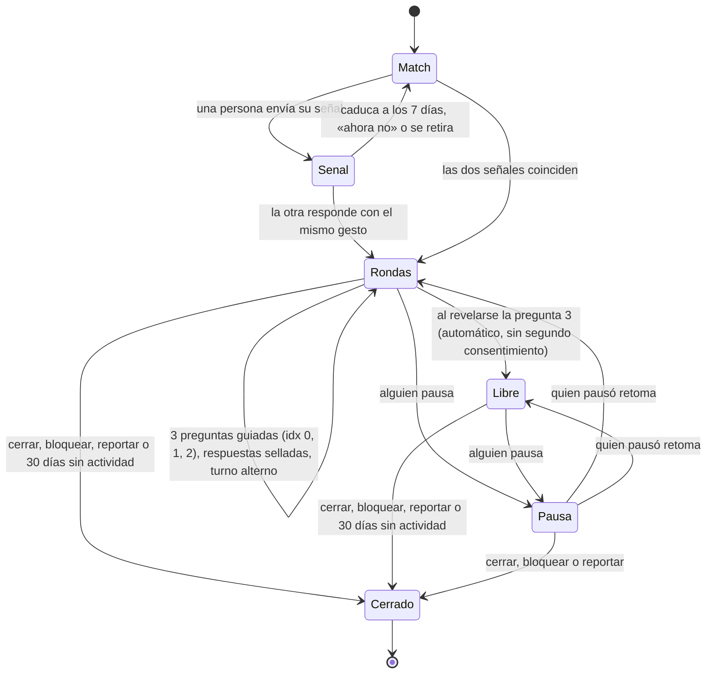

# Chat entre matches

> **Estado (2026-11-06):** candado de PIN (ADR-029, §1–9) y chat entre matches con señales,
> rondas guiadas y seguridad (ADR-032, ADR-035, §10–14) implementados.

## 1. Candado de PIN: qué es y qué no es

- **Es** un candado personal de 4 dígitos para la sección de chats. Protege contra quien tenga
  acceso físico al dispositivo o a una sesión abierta (computadora compartida, celular prestado).
- **No es cifrado.** Los mensajes se guardan igual con o sin PIN, y el PIN no deriva ninguna
  clave. El cifrado de extremo a extremo, si se quiere algún día, es un diseño aparte.
- **Un PIN por persona**, no por conversación: se crea una vez y abre todos tus chats. Nunca se
  comparte entre dos personas.
- Copy de referencia: «Un PIN simple para que tus chats queden entre tú y tu match. No cifra
  los mensajes: es un candado para quien tome tu dispositivo». Es la promesa honesta del candado
  y **tiene que seguir visible**, pero no en la bandeja: vive en `/ajustes#chats` completa, y en
  el formulario donde nace el PIN sale en una línea («El candado es para quien tome tu
  dispositivo; no cifra los mensajes», `CHAT_COPY.lockNote`). `screens.test.ts` revisa que la
  pantalla de chats ya no la imprima y que el formulario sí.

### 1.1 Límite honesto frente a la entrada solo con matrícula

Desde ADR-026 la matrícula es la única credencial de la cuenta. Por eso:

| Situación | ¿Protege el PIN? |
|---|---|
| Alguien toma tu dispositivo con la sesión abierta | **Sí**: necesita el PIN y no conoce tu matrícula para restablecerlo |
| Alguien conoce tu matrícula y entra desde otro dispositivo | **Solo si restablecer el PIN no basta con la matrícula** (ver §5 y la pregunta 2) |
| Se filtra la base de datos | Sí, mientras no se filtre también el *pepper* del servidor (§7) |
| Quien opera el servidor | **No**: puede leer los mensajes; el PIN no es cifrado |

## 2. Cuándo se crea

Al entrar a `/chats` (desde el resultado, desde Ajustes o desde «Abrir el chat» en el detalle de
un match). Sin PIN se pide crearlo; con PIN y candado cerrado se pide el PIN; abierto, se ve la
lista de conversaciones.

1. Se abre la primera conversación (aceptación mutua, §10.1).
2. Antes de mostrar **cualquier** mensaje aparece «Crea tu PIN»: dos pasos (escribir y
   confirmar) y dos líneas sobre qué protege y qué no.
3. Si el PIN es trivial (§6.2): «Elige uno que solo tú recuerdes» y se vuelve al primer paso.
4. Al confirmarlo, el candado queda abierto (§3) y se entra al chat.

Si la persona cierra la pantalla sin crear el PIN, el chat queda cerrado. La conversación sigue
existiendo y la otra persona no se entera.

## 3. Sesión de candado y cuándo se pide el PIN

- Abrir el candado emite una **sesión de candado**: una cookie `httpOnly`, `Secure`,
  `SameSite=Strict`, con ruta `/api/chat`, firmada con HMAC y ligada al usuario y a su sesión
  de cuenta. El servidor la exige para leer o escribir mensajes. Sin ella, las rutas de chat
  responden `chat.locked` y no devuelven datos.
- **Bloqueo automático** (`data/chat-config.json`):

  | Parámetro | Valor | Motivo |
  |---|---|---|
  | `lock.idleMinutes` | 10 | Cada petición de chat renueva la ventana; 10 min sin actividad cierran el candado |
  | `lock.maxMinutes` | 120 | Tope absoluto aunque haya actividad |
  | `lock.onHidden` | `true` | Al ocultar la pestaña, `pagehide` envía `POST /api/chat/lock` con `sendBeacon` (es un esfuerzo razonable, no una garantía) |

  Una cookie `httpOnly` no puede morir al cerrar una pestaña: por eso el cierre al ocultarla
  es de mejor esfuerzo, y la expiración por inactividad es la garantía real.
- **Salir** de la cuenta o entrar con otra matrícula borra la sesión de candado.
- **Bloqueo rápido:** un botón de candado en el chat la cierra al instante.
- **Notificaciones:** se pueden tocar y llevan a la **pantalla de PIN** y luego a la
  conversación; nunca muestran el texto de un mensaje ni el alias de quien escribe, solo «Tienes
  novedades en tus chats». Así una notificación no abre el chat saltándose el candado.

## 4. Intentos fallidos

| Fallos seguidos | Espera |
|---|---|
| 5 | 1 min |
| 5 más | 5 min |
| 5 más | 15 min |
| 5 más, y cada 5 después | 60 min |

- Los valores viven en `data/chat-config.json` (`attempts.perStep`, `attempts.waitMinutes`).
- Un acierto reinicia el contador y el escalón.
- El contador es **por cuenta** (en `chat_pins`). Además, la guardia existente por dirección
  de red (`access_guard_hit`, nuevo tipo `chat_pin_address`) frena que se ataque desde una misma
  IP a muchas cuentas.
- Mensajes: «Ese PIN no es. Te quedan N intentos antes de una pausa.» y, en la pausa, «Tómate un
  respiro: puedes intentar de nuevo en 4:59», con una cuenta regresiva y el enlace «Olvidé mi
  PIN». No hay más detalle, ni distinción entre «no existe» y «no coincide».
- En Ajustes → Chats: «Intentos fallidos recientes: 3 (ayer, 21:40)», sin IP ni dispositivo.
- **Costo para quien adivina:** con 5 intentos por hora, recorrer los 10 000 PIN tomaría unas
  2 000 h, y la persona ve los fallos en Ajustes. **Decidido:** tras 4 pausas de 60 min
  (`attempts.resetOnlyAfterMaxPauses`), el PIN solo se puede restablecer (§5), así que un
  atacante en línea tiene como máximo 40 intentos.
- Cada intento se cobra (con *compare-and-swap* sobre `chat_pins.revision`) **antes** de
  comparar el hash: varias peticiones en paralelo no ganan intentos extra. Un acierto devuelve
  el intento cobrado y reinicia contador, escalón y pausas largas.

## 5. Olvidé mi PIN y cambio de PIN

- **Cambiar** (Ajustes → Chats): se pide el PIN actual y luego el nuevo dos veces. No toca
  mensajes.
- **Olvidé mi PIN (decidido):** reautenticación y PIN nuevo; **los mensajes se conservan**
  (hoy no existen; completar el restablecimiento solo reescribe la fila de `chat_pins`). Como la
  única credencial es la matrícula (§1.1):
  1. Volver a escribir la matrícula (no basta la sesión abierta). Debe cumplirse
     `HMAC(matrícula) === profiles.matricula_hash` de la cuenta en sesión; si no, se responde el
     error genérico `chat.recovery_invalid`.
  2. **Periodo de espera** de `recovery.waitHours` = 24 h. Durante ese tiempo los
     chats siguen cerrados, y al entrar se ve el aviso «Alguien pidió restablecer tu PIN. Si no
     fuiste tú, cancélalo con tu PIN actual».
  3. Al terminar la espera se crea el PIN nuevo. Todo queda en «actividad de seguridad
     reciente».

  Sin la espera, quien conoce tu matrícula restablece el PIN en un minuto y el candado no lo
  detiene. La espera no lo impide del todo, pero te da un día para notarlo.

## 6. Reglas del PIN

1. Exactamente 4 dígitos ASCII (`pin.length` en config); nada se «corrige».
2. Se rechazan:
   - las 10 repeticiones (`0000` … `9999`);
   - las 14 secuencias de paso ±1 (`0123` … `6789`, `9876` … `3210`);
   - una lista corta en config de PIN muy comunes (`1212`, `2580` —la columna central del
     teclado—, `1004`, `2000`, `6969`, `1122`).
3. Los años (`19xx`/`20xx`, 200 PIN) **no** se rechazan (decidido): son fáciles de adivinar
   para quien te conoce, pero quitarlos achica el espacio sin mucho beneficio frente a un
   desconocido.

## 7. Almacenamiento

- Tabla `public.chat_pins` (`supabase/migrations/20261102000000_chat_pin.sql`, idempotente,
  replicada en la base): `user_id`, `pin_hash`, `salt`, `kdf_params`, `created_at`,
  `changed_at`, `failed_attempts`, `pause_step`, `long_pauses`, `locked_until`,
  `recent_failures`, `last_failed_at`, `recovery_requested_at` y `revision`. Tiene RLS **sin
  políticas** y `REVOKE ALL` a `anon`/`authenticated`: solo el servidor la lee con
  `service_role` (`src/infrastructure/chat/pin-repository.ts`). El hash y la sal nunca llegan a
  un DTO.
- KDF: **`scrypt` de `node:crypto`**, ya usado en ADR-023, así que no suma dependencias. La
  entrada es `HMAC-SHA256(CHAT_PIN_PEPPER, userId ‖ pin)` y la comparación usa
  `timingSafeEqual`.
- **Por qué el *pepper* es la defensa principal:** con solo 10 000 PIN, si se filtra la tabla
  ni el KDF más lento detiene un ataque fuera de línea (10 000 × 100 ms ≈ 17 min). El *pepper*
  vive solo en la variable de entorno de Vercel, no en la base. El KDF lento es una segunda
  capa.
- `public.chat_security_events` guarda `created`, `changed`, `paused`, `recovery_requested`,
  `recovery_cancelled` y `recovery_completed`, con su fecha, sin el PIN, IP, dispositivo ni
  contenido. **Decisión:** tampoco tiene políticas; la propia persona los ve por
  `GET /api/chat/activity` y nadie más. Los fallos se guardan como agregado en `chat_pins`
  (`recent_failures`, `last_failed_at`, ventana de `attempts.recentFailureDays` = 7 días), no
  como un evento por intento.
- Ambas tablas caen en cascada desde `profiles`, que cae desde `auth.users`: **borrar mis datos
  elimina el PIN y sus eventos**. Restablecer el PIN no toca los mensajes.
- Sin `CHAT_PIN_PEPPER` (mínimo 32 caracteres; `openssl rand -hex 32`), las rutas de PIN
  responden `service.unavailable` y nada más se rompe.

## 8. Decisiones tomadas (antes preguntas abiertas)

1. **PIN obligatorio.**
2. **Recuperación:** matrícula + espera de 24 h, cancelable con el PIN actual.
3. **Orden de trabajo:** el PIN se construyó primero como módulo independiente, con la sesión
   de candado y `requireChatLock` listos para que el chat los exija.
4. **Años:** no se rechazan.

## 9. Rutas y contrato

Todas usan `withApiSecurity`, cuerpos `strictObject` y respuestas `no-store`. Errores con
`{ error, code }` y, cuando aplica, `retryAfter` (también en la cabecera `Retry-After`) o
`attemptsLeft`.

| Ruta | Cuerpo | Respuesta |
|---|---|---|
| `GET /api/chat/status` | — | `{ hasPin, unlocked, resetOnly, recentFailures, pausedUntil?, retryAfter?, recovery?: { readyAt, ready } }` |
| `POST /api/chat/pin` | `{ pin, confirm }` | `{ ok }` + cookie de candado |
| `PUT /api/chat/pin` | `{ current, pin, confirm }` | `{ ok }` + cookie nueva |
| `POST /api/chat/unlock` | `{ pin }` | `{ ok }` + cookie |
| `POST /api/chat/lock` | sin cuerpo (`sendBeacon`) | `{ ok }`, borra la cookie |
| `POST /api/chat/recovery` | `{ matricula }` | `{ readyAt }`, borra la cookie |
| `DELETE /api/chat/recovery` | `{ pin }` (actual) | `{ ok }` |
| `POST /api/chat/recovery/complete` | `{ pin, confirm }` | `{ ok }` + cookie |
| `GET /api/chat/activity` | — | `{ events: [{ kind, at }], recentFailures, lastFailedAt }` |
| `GET /api/chat/inbox` | — | `InboxDto` (§10.4) solo con candado abierto |

Códigos: `chat.locked` (423), `chat.pin_missing`/`chat.pin_exists` (409), `chat.pin_invalid`
(403, genérico), `chat.pin_weak`/`chat.pin_mismatch` (422), `chat.pin_paused` (429),
`chat.reset_required` y `chat.recovery_pending` (423), `chat.recovery_none` y
`chat.recovery_not_ready` (409), `chat.recovery_invalid` (403, genérico).

**Regla:** toda ruta que lea o escriba mensajes empieza con
`requireChatLock(request)` (`src/infrastructure/chat/chat-route.server.ts`) y responder con
`open.value.renew(response)`. El guard exige sesión, cookie válida del mismo usuario, que no
haya restablecimiento pendiente y que no esté en modo «solo restablecer». Si falla, borra la
cookie.

## 10. Chat entre matches: flujo y estados (ADR-032, ADR-035)

### 10.0 Principios

1. **Consentimiento propio y mutuo:** el chat solo existe si **ambas** personas lo aceptaron. La
   regla vive en la base (`express_chat_interest`), no en la UI.
2. **Anonimato:** dentro del chat solo hay alias y sprite. Ni las notificaciones identifican a
   nadie.
3. **Sin presión:** nunca hay «visto» ni avisos de que alguien no respondió, y no se mete prisa.
   Retirarse siempre es fácil y no pide explicación. Lo que sí se permite es decir **de quién es
   el turno** («Su turno») y **cuánto hay sin leer** («Sin leer · 3»): nombran un hecho, nunca
   cuánto tiempo lleva esperando nadie, y no hay un reloj junto a ninguno de los dos.
4. **Estructura que protege:** las preguntas guiadas bajan la ansiedad y limitan el abuso; al
   chat libre se llega después, no se da por hecho.



### 10.1 Señal de interés

- En el detalle de un match hay un botón claro por pista: «Abrir un chat de romance» (icono
  pixel de corazón) o «Abrir un chat de amistad» (icono de abrazo). Debajo dice: «Solo se abre si
  ambas personas lo aceptan». Se usan los iconos pixel porque el sistema de diseño no admite
  emojis en las pantallas, y cumplen el papel de ❤️ y 🤗.
- La señal solo puede ir a un **match vigente de esa pista**. El cliente envía el *handle*
  opaco y el servidor lo resuelve contra los matches actuales; si no lo es, responde
  `chat.match_gone`.
- **Quien recibe la señal** la ve en el detalle de ese match y en la bandeja de chats como una
  invitación: «Alguien con quien conectas quiere abrir un chat». Solo muestra el alias y el
  sprite que ya conocía. Tiene tres opciones:
  - responder **con el mismo gesto**, y el chat se abre;
  - **«Ahora no»**: la invitación se oculta para quien la recibió, y quien la envió **nunca**
    recibe aviso de rechazo;
  - ignorarla: la señal caduca sola a los `signals.expireDays` = **7 días**.
- **Señales simultáneas:** si las dos personas envían la señal, el chat se abre directamente. Un
  `pg_advisory_xact_lock` por pareja garantiza que se abra una sola conversación.
- **Tope:** cada persona puede tener `signals.maxOpen` = **5** señales abiertas a la vez
  (`chat.too_many_signals`).
- **Cooldown:** después de cerrar una conversación, esa pareja no puede volver a enviarse
  señales durante `signals.cooldownDays` = **14 días** (`chat.cooldown`). Un bloqueo es
  permanente y se ve igual que un match que ya no está (`chat.match_gone`), nunca como «te
  bloquearon».
- **Pista dual:** si el match existe en romance **y** en amistad, cada pista tiene su propia
  señal y su propia conversación.

### 10.2 Edad (ADR-035, decidido)

La matrícula no garantiza la mayoría de edad. Por eso **romance pide que cada persona declare
tener 18 años o más** (`profiles.adult_confirmed_at`), una sola vez y solo cuando intenta un
chat de romance:

- Sin esa declaración, la persona **no puede enviar** señales de romance
  (`chat.adult_required`). Amistad queda abierta sin restricciones.
- Para abrir una conversación de romance, las **dos** personas deben haberlo declarado. Si quien
  recibe no lo hizo, la señal queda esperando sin que nadie lo vea. Así nunca se revela la edad
  de otra persona.
- Hay un motivo de reporte «Creo que es menor de edad».
- Límite honesto: es una autodeclaración. No verifica la edad; deja una regla clara y una vía
  para reportar.

### 10.3 Qué ve cada lado y qué se notifica

| Estado | Quien envió | Quien recibió | Notificación |
|---|---|---|---|
| Señal enviada | «Tu señal está enviada…», con opción de retirarla | Invitación amable con alias y sprite | Aviso sin contenido a quien la recibe |
| «Ahora no» | Sigue viendo «enviada» hasta que caduca | La invitación desaparece | Ninguna |
| Caducada | El botón vuelve a estar disponible | Nada | Ninguna |
| Chat abierto | Línea dorada en la constelación y «Ir a tus chats» | Lo mismo | Aviso sin contenido a la otra persona |
| Ronda: falta tu respuesta | «Te toca» en la bandeja | — | Aviso sin contenido |
| Ronda: falta la otra respuesta | «Su respuesta se mostrará cuando las dos personas respondan» | — | Ninguna; jamás se avisa que alguien no respondió |
| Propuesta de chat libre | «Esperando a que la otra persona también quiera, a su ritmo» | «Te toca» y el botón para aceptar | Aviso sin contenido |
| Pausa | Quien pausó ve «Pausaste…» y puede retomar | «La conversación está en pausa por ahora» | Ninguna |
| Silencio | Quien silenció deja de recibir avisos de esa conversación | — | — |
| Cerrar, bloquear o reportar | Desaparece para las dos personas | «Esta conversación ya no está disponible» | Ninguna, y sin motivo |

La única notificación del chat es `CHAT_NOTICE`: «Tienes novedades en tus chats / Abre tus chats
con tu PIN para verlas». Como máximo hay una sin leer por persona. Al tocarla se abre la pantalla
del PIN.

### 10.4 Rondas guiadas con respuestas selladas

1. Los turnos de preguntar se **alternan**. Quién empieza se decide por un *hash* del id de la
   conversación, así que no siempre es la misma persona.
2. A quien le toca se le ofrecen **3 tarjetas** (§11.2), una de las cuales puede salir de lo que
   ambos contestaron en los quizzes. Puede elegir una, pedir «Otras tres»
   o, **solo en chat libre**, escribir su propia pregunta (máximo 200 grafemas).
3. **Las dos personas responden** (máximo 300 grafemas, se aceptan emojis) o tocan **«Pasar»**
   sin dar explicaciones. Mientras tanto, las respuestas quedan **selladas**: el servidor no
   envía la respuesta ajena.
4. Las respuestas se **revelan a la vez** cuando las dos contestaron, o cuando pasan
   `rounds.revealHours` = **48 h**. En ese caso se muestra «Si la otra persona aún no responde,
   las respuestas se muestran solas en un par de días, a su ritmo».
5. Después se puede **reaccionar** a la respuesta ajena con uno de los emojis de
   `conversation.reactions`, y se ofrece la pregunta opcional «¿Te gustó esta ronda?». Esa
   respuesta solo suma a un contador diario agregado (`chat_feedback_daily`, sin ids), nunca al
   modelo de afinidad.
6. La conversación tiene **exactamente 3 rondas de preguntas guiadas** (`idx` 0, 1 y 2;
   `rounds.minForFree` = **3**, `rounds.maxRounds` = **3**). Al revelarse la pregunta 3, la
   conversación pasa **automáticamente** a **chat libre** (sin pedir otro consentimiento mutuo:
   el consentimiento ya se dio al abrir el chat). No se permiten más rondas de preguntas después
   de la 3 (`idx >= 3` rechazado en servidor y base). En chat libre, ambas personas pueden
   enviar mensajes de hasta **300 grafemas** (medidos con `Intl.Segmenter`, normalizados a NFC,
   sin recortar), y las 3 preguntas y respuestas quedan arriba como contexto colapsable.

### 10.5 Riesgos y mitigaciones

| Riesgo | Mitigación |
|---|---|
| Presión o insistencia | Tope de 5 señales abiertas, caducidad de 7 días, «ahora no» silencioso, cooldown de 14 días, ningún «visto» |
| Acoso | Menú de seguridad a un toque (pausar, bloquear, reportar, cerrar); el bloqueo borra todo de inmediato |
| Desanonimizar | Aviso amable ante teléfonos, correos y @usuario; enlaces bloqueados; las notificaciones no muestran el alias |
| Spam | 8 mensajes por minuto, 300 al día, rechazo de repeticiones, rate limit por ruta |
| Lenguaje ofensivo | Filtro suave es-MX (§12.4): bloquea con una explicación amable y sin mostrar la lista |
| Menores en romance | Autodeclaración de 18+ en ambos lados y motivo de reporte específico (§10.2) |
| Capturas de pantalla | **No se pueden impedir.** Se dice con honestidad en Privacidad y en la guía |
| Quien opera el servidor | Puede leer los mensajes: el PIN no cifra (§1). La retención de 30 días limita la exposición |

## 11. Banco de preguntas guiadas

### 11.1 Estructura y linter

`data/chat-prompts.json` (`chat-prompts-1`, `etiqueta: supuesto_diseno`), validado con Zod en
`src/config/chat-prompts.ts`. Cada pregunta tiene `id` (`p###` para ambas pistas, `a###` amistad,
`r###` romance), `track`, `nivel` (1 ligera, 2 media, 3 profunda), `categoria` (humor,
curiosidad, estilo_de_vida, valores, comunicacion, gustos, suenos, campus), `texto` (≤ 200
caracteres), `dimensiones_relacionadas` (capas del modelo de `matching-config.json`),
`sensible: false` y `variantes` cortas. **No es un instrumento:** nunca alimenta el modelo.

El linter (`src/config/chat-prompts.test.ts`) exige:

- 80–120 preguntas y al menos 15 por nivel y pista;
- una sola pregunta por texto, sin duplicados y con lectura ligera (≤ 26 palabras, palabras de ≤ 16 letras);
- ningún tema prohibido: sexualidad, dinero, salud, religión, política, trauma, apariencia
  física o datos identificables;
- lenguaje neutro en género y sin palabras de destino o presión.

**Banco actual: 96 preguntas.**

| Nivel | Ambas pistas | Solo amistad | Solo romance | Total |
|---|---|---|---|---|
| 1 | 20 | 10 | 10 | 40 |
| 2 | 16 | 8 | 8 | 32 |
| 3 | 12 | 6 | 6 | 24 |

| Categoría | humor | gustos | estilo_de_vida | campus | curiosidad | valores | comunicacion | suenos |
|---|---|---|---|---|---|---|---|---|
| Preguntas | 11 | 15 | 14 | 6 | 12 | 14 | 13 | 11 |

Ejemplos por nivel (el banco completo está en el JSON):

| Nivel | Ejemplos |
|---|---|
| 1 | «¿Qué canción te regresa a un momento exacto de tu vida?» · «¿Qué rutina pequeña te hace sentir en casa?» · «¿Qué plan entre clases te salva el día?» |
| 2 | «¿Cómo sería para ti una primera cita sin nervios?» (romance) · «¿Qué gesto te hace sentir que alguien de verdad te escucha?» (romance) · «¿Cuál ha sido el malentendido más divertido que te ha pasado?» |
| 3 | «¿Qué proyecto personal te emociona aunque nadie lo sepa todavía?» y preguntas de valores y sueños con un poco más de profundidad |

### 11.2 Selección determinista

`selectPrompts` (`src/domain/chat/prompt-selection.ts`) es una función pura:

1. **Nivel por ronda:** `rounds.levelFromRound` = `[0, 1, 2]`, es decir, nivel 1 en la pregunta 1
   (`idx = 0`), nivel 2 en la pregunta 2 (`idx = 1`) y nivel 3 en la pregunta 3 (`idx = 2`). Si un
   nivel se agota, se completa con los vecinos.
2. **Filtros:** solo preguntas de la pista o de «ambos», y nunca una ya usada en la conversación.
3. **Puntaje:** promedio, sobre las capas en las que se apoya la pregunta, de la **contribución
   real** de cada capa al `pairScore` de la pareja (`application/chat/prompts.ts`), con un piso de
   0.05. Se multiplica por un *jitter* de hasta 35 % con semilla `fnv1a32(id:ronda)`.
4. **Variedad:** elección voraz con categorías distintas.
5. **«Otras tres»:** pasa a la siguiente página del ranking y vuelve al principio al llegar al
   final.
6. **Una de las tres puede venir de los quizzes** (ADR-063). Si le toca abrir ronda a quien
   comparte coincidencias con su par, la **primera** tarjeta es una pregunta derivada de un ítem
   que ambos contestaron igual, y las otras dos salen del banco:
   `rounds.coincidences` = **1** dentro de `rounds.suggestions` = **3**. Si no hay nada
   compartible, la oferta es exactamente la del banco: el mecanismo degrada a cero, nunca a error.
   `rounds.coincidences` también puede escribirse en **0** para apagar la tarjeta desde config, sin
   desplegar; el esquema del config lo permite y exige que nunca exceda a `suggestions`.

La mezcla la hace `mixCards` (`src/domain/chat/question-cards.ts`, función pura) sobre la lista
que ya produjo `selectPrompts`, con tres reglas:

- **Dedupe por `foldText`** (mayúsculas y acentos da igual): se cae una coincidencia si su texto
  ya está en el banco de la misma tanda o si la pareja ya la respondió en una ronda anterior;
  el hueco lo rellena el banco, así que la oferta siempre mide 3 mientras el banco alcance.
- **`refresh` también pagina las coincidencias**: «Otras tres» recorre el pozo de a 1 y vuelve al
  principio, igual que en el banco.
- La tarjeta sale con `origin: "bank" | "coincidence"`. Las de banco se piden por `promptId`;
  las de coincidencia se piden por texto (`customText`), y el servidor **no** guarda lo que llegó:
  re-mide el texto contra el pozo gateado de la pareja y persiste su propia cadena canónica. Por
  eso la regla «en las rondas guiadas nadie escribe preguntas» sigue en pie: quien manda la
  pregunta en minúsculas obtiene la versión acentuada original, y quien manda una pregunta que no
  está en ese pozo recibe `chat.conflict` (medido en `src/application/chat/conversation.test.ts`).

Lo que cruza desde la capa de quizzes es **solo el texto de la pregunta**, jamás el valor
contestado. El candado no se reimplementa: `src/infrastructure/chat/coincidence-questions.ts`
pregunta por la tabla de visibilidad para saber *con cuáles* quizzes llamar a la misma RPC
`quiz_coincidencias` que usa el panel «Gustos en común», y esa función exige que **ambas** personas
estén en `compartir_coincidencias_con_matches`, que el match siga vigente y descarta
`no` / `prefiero_no_decir`. Los cuatro `picante_*` nunca entran al pozo: el banco rompehielos se
valida con `sensible: false` (`src/config/chat-prompts.ts`) y una ronda guiada no puede volverse
la puerta de atrás del +18. Quedan **14** quizzes elegibles, es decir los 14 no-18+, con techo de
3 preguntas por quiz y **118** textos distintos en todo el cruce de opciones; la pregunta más
larga que puede generarse mide **55** caracteres, dentro de los 200 de `customQuestionChars`, así
que ninguna tarjeta puede quedar inpregunable.

El banco nunca sale del servidor; el cliente solo recibe las 3 tarjetas.

### 11.3 Ejemplo completo: señal → aceptación → 3 rondas → chat libre

Se generó con los casos de uso reales y el fake en memoria; las tarjetas son las que el selector
eligió:

1. Zorro Calmo (A), que declaró 18+, envía la señal de romance → `{"state":"sent"}`.
2. Nutria Serena (B) ve en el detalle del match `{"state":"invited"}`: «Alguien con quien
   conectas quiere abrir un chat».
3. B responde con el mismo gesto → `state: open`. Las dos personas reciben solo «Tienes
   novedades en tus chats».
4. **Ronda 1** (elige A). Tarjetas: «¿Cuál es la idea más absurda y divertida que se te ocurrió
   últimamente?» (p007, humor) · «¿Qué artista descubriste hace poco y no dejas de escuchar?»
   (p018, gustos) · «¿Cuál es tu rincón favorito del campus para respirar un rato?» (p004,
   campus). A responde y B sigue viendo `theirs: null, revealed: false`. Cuando B responde, las
   dos respuestas se revelan juntas.
5. **Ronda 2** (elige B). Tarjetas: «¿Cómo sería para ti una primera cita sin nervios?» (r001) ·
   «¿Qué plan entre clases te salva el día?» (p010) · «¿Qué rutina pequeña te hace sentir en
   casa?» (p003).
6. **Ronda 3** (elige A). Tarjetas: «¿Qué gesto te hace sentir que alguien de verdad te
   escucha?» (r015) · «¿Cuál ha sido el malentendido más divertido que te ha pasado?» (p034) ·
   «¿Qué proyecto personal te emociona aunque nadie lo sepa todavía?» (p028).
7. Al revelarse la **Ronda 3**, la conversación pasa **automáticamente** a `stage: free` (con las
   3 preguntas colapsables arriba como contexto). Escribe «¿Te late un café en las islas el jueves? ☕» (≤ 300 grafemas).
9. A intenta mandar `www.ejemplo.com` → `chat.link_blocked`: «Por ahora los enlaces no se pueden
   enviar. Así cuidamos el anonimato de las dos personas».

## 12. Servidor, datos y seguridad

### 12.1 Esquema (`20261106000000_chat_safety.sql`, replicada en la base)

| Tabla o columna | Para qué |
|---|---|
| `profiles.adult_confirmed_at` | Autodeclaración de 18+ (§10.2) |
| `chat_interests.declined_at` | «Ahora no» silencioso |
| `conversations.paused_by`, `muted_a/b` | Pausa compartida y silencio individual |
| `conversation_rounds` | Una pregunta por ronda (`prompt_id` **o** `custom_text`), con quién pregunta, `feedback_a/b` |
| `conversation_answers.passed` | «Pasar»; FK `(conversation_id, round)` hacia la ronda |
| `conversation_messages.client_key` | Entrega idempotente (índice único por autor) |
| `conversation_reactions` | Una reacción por persona y ronda |
| `chat_feedback_daily` | «¿Te gustó?» como conteo diario por pista, sin ids |
| `chat_blocks` | Bloqueos (permanentes) |
| `chat_closures` | Fecha del último cierre de la pareja y pista (cooldown) |
| `chat_reports`, `chat_report_audit` | Reporte con instantánea mínima, y auditoría de quién lo revisó |

Todas las tablas tienen RLS sin políticas, `REVOKE` a `anon`/`authenticated`, `GRANT` solo a
`service_role` y `ON DELETE CASCADE` desde `profiles`. Las RPC (`express_chat_interest`,
`leave_conversation`, `block_chat_user`, `report_conversation`, `record_round_feedback`,
`purge_chat`) son `SECURITY DEFINER`, usan `search_path = ''` y llaman a
`private.assert_service_role()`.

Al aplicarla en producción había **1** conversación de romance con **1** respuesta. La migración
la convirtió en una ronda con la pregunta fija original como `custom_text` (bloque `BACKFILL`, que
solo existe en la incremental). Mientras se despliega el código nuevo, una función puente de 3
argumentos (`express_chat_interest(UUID, UUID, TEXT)`) mantiene compatible la versión anterior.

### 12.2 Reglas que solo decide el servidor

- La señal exige un match vigente, ningún bloqueo, 18+ en romance, sin cooldown y por debajo del
  tope. El chat se abre solo con las dos señales vivas (≤ 7 días) **y** 18+ en ambos lados si es
  romance.
- Leer o escribir exige candado abierto (`requireChatLock`) y ser participante (`findFor`
  filtra por `user_a`/`user_b`). Un id ajeno da el mismo `chat.not_found` que uno inexistente.
- Turnos, respuestas selladas, revelado, chat libre y pausa se derivan en
  `domain/chat/conversation.ts`, y las inserciones únicas de la base rompen cualquier carrera.

### 12.3 Texto: 300 grafemas

- `cleanChatText` (`domain/chat/text.ts`), compartido por cliente y servidor: normaliza a NFC;
  quita caracteres de control, de ancho cero (salvo ZWJ, necesario en los emojis) y overrides
  bidi; colapsa líneas en blanco; rechaza el texto vacío o hecho solo de invisibles. Si el texto
  se pasa del límite, **no lo recorta: lo rechaza**.
- El conteo usa grafemas con `Intl.Segmenter`: 👨‍👩‍👧‍👦, 🇲🇽, 👍🏿 o «é» combinada cuentan 1. El
  composer muestra «X/300» (dorado al 90 %, rojo al pasarse) y lo lee como «X de 300
  caracteres».
- La base aplica un CHECK con margen de `char_length ≤ límite × 8` (2400 / 1600) como red de
  seguridad; la regla exacta vive en la API.
- Los mensajes se muestran siempre como texto (React escapa todo; no hay
  `dangerouslySetInnerHTML`).

### 12.4 Anonimato y moderación

- `guardChatText` (`domain/chat/guard.ts`):
  - **enlaces:** bloqueados (`chat.link_blocked`);
  - **lenguaje ofensivo:** bloqueado (`chat.offensive`) con la lista versionada en
    `data/chat-moderation.json`, comparada por palabra completa, sin acentos y con una lista de
    falsos positivos revisados (computadora, disputa, zorro…);
  - **teléfono, correo, @usuario o «mi insta»:** el composer muestra «Puedes compartir tus datos
    más adelante, con calma; por ahora cuida tu anonimato» y la persona puede enviarlo de todos
    modos.
- La lista ofensiva **no viaja al navegador**: el cliente solo carga los nombres de redes
  (`data/chat-contact.json`). Se verificó buscando en `.next/static`.
- **Propuesta (no implementada):** un paso de intercambio de contacto con consentimiento mutuo,
  en el que ambas personas pulsan «compartir mi contacto» y el servidor revela los dos a la vez.
  Queda pendiente de aprobación.

### 12.5 Anti-abuso, bloqueo, reporte y retención

| Medida | Valor (`chat-config.json`) |
|---|---|
| Mensajes por minuto y por día | 8 y 300 (`chat.slow_down`) |
| Repetición | 3 mensajes idénticos seguidos (`chat.repeated`) |
| Rate limit por ruta | `withApiSecurity` (p. ej. 30/min mensajes, 5/min reportes) |
| Retención de mensajes | 30 días (`purge_chat`, purga oportunista al abrir una conversación) |
| Cierre por inactividad | 30 días sin actividad |
| Instantánea de reporte | Últimos 20 mensajes o respuestas, etiquetados como «reporta» o «reportada», sin ids |

- **Bloquear** es inmediato y silencioso: borra todas las conversaciones y señales de la pareja
  en las dos pistas e impide nuevas señales.
- **Reportar** guarda la instantánea mínima en `chat_reports` (visible solo para moderación con
  `service_role` y auditada en `chat_report_audit`) y bloquea. La otra persona nunca se entera.
- **Borrar mis mensajes** elimina tus mensajes y el texto de tus respuestas; lo de la otra
  persona se queda.
- Eliminar la cuenta borra todo en cascada.

### 12.6 Emojis

Se usan **emojis del sistema** y no un set pixel propio: cubren banderas, tonos de piel y
secuencias ZWJ sin coste de mantenimiento. Para que se vean parecidos en todas las plataformas,
el selector usa la pila de fuentes «Apple Color Emoji / Segoe UI Emoji / Noto Color Emoji».

El selector (`ui/chat/emoji-picker.tsx`) es propio y ligero, sin dependencias:

- catálogo de 46 emojis con nombre y palabras clave en español (`data/chat-emoji.json`);
- búsqueda sin acentos y lista de recientes en `localStorage` (8);
- cada emoji es un botón de 44 px cuyo nombre se lee en voz alta («risa con lágrimas»).

Las pantallas no llevan emojis literales; el catálogo vive en `data/`.

### 12.7 Entrega

Se usa **polling con *backoff*** en lugar de Supabase Realtime. Las tablas del chat no tienen
políticas RLS para clientes, que es lo que hace seguras las lecturas, y Realtime exigiría
abrirlas.

- `useBackoffPoll` empieza en 8 s, se duplica hasta 60 s mientras no hay cambios y se reinicia
  al volver a la pestaña o recuperar la red. Las pestañas ocultas no consultan.
- Cada mensaje lleva una `clientKey` (UUID), así que un reintento tras perder la red no lo
  duplica.
- Estados de envío: «Enviando…», el mensaje confirmado, o «No se envió. Toca para reintentar».
  Nunca hay «visto».
- Paginación: 50 mensajes por página y «Ver mensajes anteriores» (`?before=<iso>`).

### 12.8 Rutas

| Ruta | Candado | Cuerpo | Respuesta |
|---|---|---|---|
| `GET /api/interest` | No | — | `{ states: { "track:handle": sent \| invited \| open }, adult }` |
| `POST /api/interest` | No | `{ match, track }` | `{ state: "sent" }` o `{ state: "open", conversation }` |
| `DELETE /api/interest` | No | `{ match, track }` | `{ ok }` |
| `POST /api/interest/decline` | No | `{ match, track }` | `{ ok }` (silencioso) |
| `POST /api/interest/adult` | No | `{}` | `{ ok }` |
| `GET /api/chat/inbox` | Sí | — | `{ conversations, invitations }` |
| `GET /api/chat/conversations/{id}` | Sí | `?refresh&before` | `ConversationDto` |
| `POST …/ask` | Sí | `{ promptId }` o `{ customText }` | `ConversationDto` |
| `POST …/answer` | Sí | `{ round, body }` o `{ round, pass: true }` | `ConversationDto` |
| `POST …/react` | Sí | `{ round, emoji \| null }` | `ConversationDto` |
| `POST …/feedback` | Sí | `{ round, liked }` | `ConversationDto` |
| `POST …/free` | Sí | `{ ready }` | `ConversationDto` |
| `POST …/messages` | Sí | `{ body, clientKey }` | `ConversationDto` |
| `POST …/pause` y `…/mute` | Sí | `{ on }` | `ConversationDto` |
| `POST …/mine` | Sí | `{}` | `ConversationDto` |
| `POST …/block` | Sí | `{}` | `{ ok }` |
| `POST …/report` | Sí | `{ reason }` | `{ ok }` |
| `DELETE /api/chat/conversations/{id}` | Sí | — | `{ ok }` (cerrar) |

Códigos nuevos: `chat.adult_required` (403), `chat.cooldown` (409), `chat.too_many_signals`
(429), `chat.link_blocked`, `chat.offensive` y `chat.repeated` (422), y `chat.slow_down` (429).

## 13. Pantallas

### 13.1 Detalle del match

```
┌ Nutria Serena · 87 % ───────────────────────┐
│ …lo que más conecta…                         │
│ [♥ Abrir un chat de romance]                 │
│ Solo se abre si ambas personas lo aceptan.   │
└──────────────────────────────────────────────┘
```

- **Sin 18+:** se muestra una tarjeta «Los chats de romance son para mayores de 18», con el
  botón «Tengo 18 años o más».
- **Señal enviada:** «Tu señal está enviada…», con opción de retirarla.
- **Invitación recibida:** «Alguien con quien conectas quiere abrir un chat», con los botones
  «Responder con el mismo gesto» y «Ahora no».

### 13.2 Chats

- **Cabecera de la pantalla:** título «Chats» y tres iconos — engrane (ajustes del candado),
  volver al cielo y salir. No hay párrafo de introducción: el espacio lo ocupa la bandeja.
- **Bandeja:** primero las invitaciones (tarjetas con borde del color de la pista); después
  «Tus conversaciones», con dos recuentos junto al título que solo aparecen si son mayores que
  cero: «Sin leer · N» (estrella pixel) y «Te toca · N». Cada fila es un botón de dos líneas de
  texto —sprite, alias, y debajo `Romance · 2 rondas listas` con las marcas en línea «Nuevo»,
  «Te toca» o «Su turno»— y sube de fondo cuando tiene algo sin leer. Quién tiene el turno sale
  del `myTurn` y `stage` que manda el servidor (`turnOf`), no se inventa nada: en `free` y
  `paused` no hay turno que nombrar y la fila queda sin marca.
- **Conversación:**
  1. barra con «Volver», «Opciones de seguridad» y «Cerrar el candado»;
  2. cabecera con el sprite de 48 px y la pista;
  3. la guía de primera vez (4 líneas, se puede saltar);
  4. **«Gustos en común»**, plegado por defecto: una línea con el número de coincidencias y, al
     abrirlo, las frases en lenguaje natural y las preguntas para romper el hielo que salen de los
     quizzes que ambas partes compartieron. Nunca respuestas crudas, nunca un «no», nunca Picante
     (`docs/QUIZZES.md` §13.8 y §13.9). Viaja el id de la conversación, no el de la otra persona:
     el contrato de este archivo no reparte `user_id` al cliente;
  5. las rondas en tarjetas de marco: pregunta, «Tu respuesta» (o composer con «Pasar») y «Su
     respuesta» (sellada, revelada con reacciones, o «Prefirió pasar esta pregunta»);
  6. **«Te toca elegir la pregunta»**, con 3 tarjetas que llevan el icono de su categoría,
     «Otras tres» y, en chat libre, «O escribe tu propia pregunta». La tarjeta nacida de una
     coincidencia (§11.2) se ve igual que las del banco: el icono sale de su categoría y no hay
     marca de «esto lo sacamos de tus quizzes». El campo `origin` existe en el DTO solo para
     decidir cómo se pide; si algún día se quiere diferenciar, ahí está.
  7. la invitación al chat libre;
  8. el chat libre: burbujas en la fuente de lectura con el sprite como avatar, «Tú» marcado
     también con texto, `role="log"` y `aria-live="polite"`.
- **Composer:** textarea, «Agregar emoji», contador «X/300» con dígitos tabulares y «Enviar».
  Atajo Ctrl/⌘ + Enter.
- **Menú de seguridad** (hoja inferior en móvil): Silenciar avisos · Pausar · Borrar mis
  mensajes · Bloquear · Reportar (con 6 motivos) · Cerrar conversación. Cada paso destructivo
  pide una confirmación sin culpa: «Mejor no» o «Sí, continuar».

### 13.3 Constelación

- **Chat abierto:** el *spoke* hacia ese match se vuelve una línea **dorada sólida**, con un
  destello escalonado de 0,9 s al aparecer. Sin destello con `prefers-reduced-motion` o con un
  tema de alto contraste («reducir brillos»).
- **Invitación pendiente:** un pequeño globo de diálogo pixel dorado sobre la estrella, **sin
  número**. Su nombre accesible añade «Tiene una invitación de chat para ti».

### 13.4 Accesibilidad

- Objetivos táctiles de ≥ 44 px, foco visible y diálogos nativos (`<dialog>`, con trampa de foco
  y Escape).
- Los avisos se anuncian por `aria-live="polite"` y los emojis tienen nombre en español.
- El contador se lee en palabras y no se anuncia en cada tecla.
- La «x» inclusiva solo aparece en copy de marca, nunca en los motivos de reporte ni en la
  seguridad; un test lo comprueba.

## 14. Pruebas

| Archivo | Qué cubre |
|---|---|
| `domain/chat/text.test.ts` | Grafemas (ZWJ, banderas, tonos, combinados), NFC, invisibles, 300 exactos, margen de la base |
| `domain/chat/guard.test.ts` | Enlaces, teléfono, correo, @usuario, falsos positivos, acentos y ñ |
| `domain/chat/conversation.test.ts` | Turnos, sellado, revelado a 48 h, «Pasar», reacciones, chat libre tras 3 rondas, pausa |
| `domain/chat/prompt-selection.test.ts` | Determinismo, niveles, sin repetir, variedad, peso por capa, «otras tres» |
| `domain/chat/question-cards.test.ts` | Mezcla banco + coincidencia: tope de 3, dedupe acento-insensible, gemelo del banco, página por `refresh` y vuelta al principio, determinismo |
| `domain/chat/signals.test.ts` | Caducidad, 18+ solo de quien envía, tope, cooldown, bloqueo |
| `config/chat-prompts.test.ts` | Linter del banco |
| `application/chat/conversation.test.ts` | Invitación, «ahora no» silencioso, señales simultáneas, 18+, sellado, revelado, preguntas propias, privacidad de los DTO; la tarjeta de coincidencia abre ronda, no se repite tras contestarla y rechaza una pregunta escrita a mano |
| `application/chat/chat-safety.test.ts` | Idempotencia, enlaces, lenguaje ofensivo, límites por grafemas y por minuto, repeticiones, borrar lo mío, reacciones, opinión agregada, pausa, silencio, cerrar con cooldown, bloquear, reportar |
| `app/api/chat/chat-routes.test.ts` | Candado: nada se lee ni escribe sin él; tarjetas, ids ajenos, cuerpos estrictos; la coincidencia viaja con `origin` y solo se acepta su texto |
| `infrastructure/chat/coincidence-questions.test.ts` | El pozo respeta el candado: Picante y `resultado_personal` nunca entran en el alcance, nada se pregunta si una sola parte comparte, solo sale texto y no valor, y una lectura ilegible degrada a vacío |
| `infrastructure/supabase/schema.test.ts` | Migración idempotente, base igual a la incremental, RLS, cascada, RPC protegidas, límites de texto |
| `ui/chat/chat-parse.test.ts`, `ui/screens.test.ts` | Parsers defensivos; copy sin presión, sin emojis y sin «x» en lo que leen los lectores de pantalla |
