# Esquema de la base de datos

> Generado por `npm run db:schema` el 2026-11-10T03:53:46.476Z desde el catálogo vivo,
> en **solo lectura**. Contiene metadatos de esquema y conteos agregados:
> ninguna fila de persona, mensaje, respuesta, matrícula, hash ni PIN.
> No editar a mano: vuelve a generarlo después de cada migración.

## Resumen

| Objeto | Cantidad |
|---|---|
| Tablas | 30 |
| Tablas con RLS activo | 28 de 30 |
| Tablas con alguna política RLS | 4 |
| Vistas | 0 |
| Funciones / procedimientos | 45 |
| Funciones SECURITY DEFINER | 36 |
| Triggers | 12 |
| Políticas RLS | 4 |
| Índices | 54 |
| Extensiones | 5 |
| Publicaciones Realtime | 1 |
| Trabajos Cron | no disponible (pg_cron no instalado) |
| Buckets de Storage | 0 |

**Modelo de acceso.** PostgREST solo expone el esquema `public`; las funciones
de `private` son invisibles para la API REST y solo las llaman otras funciones
o el servidor. Casi todas las tablas tienen RLS activo **sin políticas**: eso
niega todo acceso directo a `anon` y `authenticated`, y el paso obligado es una
RPC `SECURITY DEFINER` o el servidor con `service_role`. Las cuatro políticas
que existen son de lectura pública deliberada (catálogos y rol propio).

## Diagrama entidad-relación

```mermaid
erDiagram
  private_access_guard {
    text kind PK
    text subject PK
  }
  private_pool_state {
    boolean singleton PK
  }
  public_admin_audit {
    uuid id PK
    uuid admin_id FK
  }
  public_admin_counters {
    text key PK
    uuid updated_by FK
  }
  public_admin_credentials {
    uuid user_id PK
  }
  public_animals {
    text id PK
  }
  public_chat_blocks {
    uuid blocker PK
    uuid blocked PK
  }
  public_chat_closures {
    uuid user_a PK
    uuid user_b PK
    text track PK
  }
  public_chat_feedback_daily {
    date day PK
    text track PK
  }
  public_chat_interests {
    uuid from_user PK
    uuid to_user PK
    text track PK
  }
  public_chat_pins {
    uuid user_id PK
  }
  public_chat_report_audit {
    uuid id PK
    uuid report_id FK
    uuid admin_id FK
  }
  public_chat_reports {
    uuid id PK
    uuid reporter FK
    uuid reported FK
  }
  public_chat_security_events {
    uuid id PK
    uuid user_id FK
  }
  public_colors {
    text id PK
  }
  public_conversation_answers {
    uuid conversation_id PK
    uuid author PK
    smallint round PK
  }
  public_conversation_messages {
    uuid id PK
    uuid conversation_id FK
    uuid author FK
  }
  public_conversation_reactions {
    uuid conversation_id PK
    smallint idx PK
    uuid author PK
  }
  public_conversation_rounds {
    uuid conversation_id PK
    smallint idx PK
    uuid asker FK
  }
  public_conversations {
    uuid id PK
    uuid user_a FK
    uuid user_b FK
  }
  public_matches {
    uuid user_a PK
    uuid user_b PK
    text track PK
  }
  public_notifications {
    uuid id PK
    uuid user_id FK
  }
  public_profiles {
    uuid user_id PK
    text animal_id FK
    text color_id FK
  }
  public_quiz_answers {
    uuid persona_id PK
    text quiz_id PK
    text item_id PK
  }
  public_quiz_attempts {
    uuid persona_id PK
    text quiz_id PK
  }
  public_quiz_items {
    text id PK
  }
  public_quiz_picante_consent {
    uuid persona_id PK
  }
  public_quiz_responses {
    uuid user_id PK
    text item_id PK
  }
  public_quiz_sharing {
    uuid persona_id PK
    text quiz_id PK
  }
  public_user_roles {
    uuid user_id PK
  }
  public_profiles ||--o{ public_admin_credentials : "user_id"
  public_profiles ||--o{ public_chat_blocks : "blocked"
  public_profiles ||--o{ public_chat_blocks : "blocker"
  public_profiles ||--o{ public_chat_closures : "user_a"
  public_profiles ||--o{ public_chat_closures : "user_b"
  public_profiles ||--o{ public_chat_interests : "from_user"
  public_profiles ||--o{ public_chat_interests : "to_user"
  public_profiles ||--o{ public_chat_pins : "user_id"
  public_chat_reports ||--o{ public_chat_report_audit : "report_id"
  public_profiles ||--o{ public_chat_reports : "reported"
  public_profiles ||--o{ public_chat_reports : "reporter"
  public_profiles ||--o{ public_chat_security_events : "user_id"
  public_profiles ||--o{ public_conversation_answers : "author"
  public_conversations ||--o{ public_conversation_answers : "conversation_id"
  public_conversation_rounds ||--o{ public_conversation_answers : "conversation_id, round"
  public_profiles ||--o{ public_conversation_messages : "author"
  public_conversations ||--o{ public_conversation_messages : "conversation_id"
  public_profiles ||--o{ public_conversation_reactions : "author"
  public_conversations ||--o{ public_conversation_reactions : "conversation_id"
  public_profiles ||--o{ public_conversation_rounds : "asker"
  public_conversations ||--o{ public_conversation_rounds : "conversation_id"
  public_profiles ||--o{ public_conversations : "user_a"
  public_profiles ||--o{ public_conversations : "user_b"
  public_profiles ||--o{ public_matches : "user_a"
  public_profiles ||--o{ public_matches : "user_b"
  public_profiles ||--o{ public_notifications : "user_id"
  public_animals ||--o{ public_profiles : "animal_id"
  public_colors ||--o{ public_profiles : "color_id"
  public_profiles ||--o{ public_quiz_answers : "persona_id"
  public_profiles ||--o{ public_quiz_attempts : "persona_id"
  public_profiles ||--o{ public_quiz_picante_consent : "persona_id"
  public_quiz_items ||--o{ public_quiz_responses : "item_id"
  public_profiles ||--o{ public_quiz_responses : "user_id"
  public_profiles ||--o{ public_quiz_sharing : "persona_id"
```



## Tablas

| Tabla | Propósito | RLS | Filas | Propietario |
|---|---|---|---|---|
| `private.access_guard` | Ventanas y bloqueos del guard de entrada por dirección de red (ADR-023/026). | inactivo | 194 | postgres |
| `private.pool_state` | Singleton con la revisión del pool; guard de versión de replace_matches. | inactivo | 1 | postgres |
| `public.admin_audit` | Bitácora de acciones de la consola con actor real; nunca se escribe con service_role. | activo | 35 | postgres |
| `public.admin_counters` | Contadores agregados del observatorio (clave, valor, quién y cuándo). | activo | 2 | postgres |
| `public.admin_credentials` | Credencial de la consola de administración: hash con pepper y revisión. | activo | 1 | postgres |
| `public.animals` | Catálogo de arquetipos: nombre fuente, diminutivo en español, categoría de fauna y afinidad. | activo | 103 | postgres |
| `public.chat_blocks` | Bloqueos entre personas; retiran la conversación de ambas bandejas. | activo | 0 | postgres |
| `public.chat_closures` | Cierres de conversación por par y track. | activo | 2 | postgres |
| `public.chat_feedback_daily` | Feedback agregado por día y track; sin texto libre. | activo | 14 | postgres |
| `public.chat_interests` | Señales de interés de chat (from_user, to_user, track); apertura mutua. | activo | 170 | postgres |
| `public.chat_pins` | PIN de 4 dígitos hasheado con pepper; candado del dispositivo, no cifra los mensajes. | activo | 111 | postgres |
| `public.chat_report_audit` | Bitácora de revisión de reportes. | activo | 0 | postgres |
| `public.chat_reports` | Reportes de seguridad de una conversación. | activo | 0 | postgres |
| `public.chat_security_events` | Eventos de seguridad del chat (intentos de PIN, bloqueos). | activo | 118 | postgres |
| `public.colors` | Catálogo de colores de la identidad: nombre, hex, textura y temperatura. | activo | 28 | postgres |
| `public.conversation_answers` | Respuestas selladas de cada ronda guiada, por autor. | activo | 922 | postgres |
| `public.conversation_messages` | Mensajes del chat libre con client_key para idempotencia. | activo | 2427 | postgres |
| `public.conversation_reactions` | Reacciones a mensajes o rondas, por autor y objetivo. | activo | 268 | postgres |
| `public.conversation_rounds` | Las tres rondas guiadas de una conversación. | activo | 504 | postgres |
| `public.conversations` | Conversaciones abiertas; referencian perfiles, nunca matches. | activo | 191 | postgres |
| `public.matches` | Pares publicados por track con su similitud; se reemplazan en bloque bajo advisory lock. | activo | 1056 | postgres |
| `public.notifications` | Avisos de la persona; el tipo está restringido por un CHECK. | activo | 1916 | postgres |
| `public.profiles` | Persona: identidad fija, estado del quiz, pausa y baja lógica. | activo | 238 | postgres |
| `public.quiz_answers` | Respuestas por quiz e ítem (persona_id, quiz_id, item_id, valor). | activo | 3001 | postgres |
| `public.quiz_attempts` | Intentos por quiz con revisión y fecha de completado. | activo | 375 | postgres |
| `public.quiz_items` | Banco de ítems servido al cliente; lectura pública. | activo | 197 | postgres |
| `public.quiz_picante_consent` | Consentimiento +18: mayoría de edad, fecha y track de romance activo. | activo | 47 | postgres |
| `public.quiz_responses` | Respuestas Likert del microtest núcleo. | activo | 20023 | postgres |
| `public.quiz_sharing` | Nivel de visibilidad opt-in de cada quiz (capas compartidas). | activo | 0 | postgres |
| `public.user_roles` | Roles por usuario (administración); lectura del propio rol. | activo | 1 | postgres |

### Columnas

#### private.access_guard

| Columna | Tipo | Nulo | Default |
|---|---|---|---|
| `kind` | `text` | no | — |
| `subject` | `text` | no | — |
| `window_started_at` | `timestamp with time zone` | no | `now()` |
| `hits` | `integer` | no | `0` |
| `locked_until` | `timestamp with time zone` | sí | — |

#### private.pool_state

| Columna | Tipo | Nulo | Default |
|---|---|---|---|
| `singleton` | `boolean` | no | `true` |
| `revision` | `bigint` | no | `0` |

#### public.admin_audit

| Columna | Tipo | Nulo | Default |
|---|---|---|---|
| `id` | `uuid` | no | `gen_random_uuid()` |
| `admin_id` | `uuid` | sí | — |
| `admin_alias` | `text` | sí | — |
| `action` | `text` | no | — |
| `target_user` | `uuid` | sí | — |
| `target_alias` | `text` | sí | — |
| `detail` | `jsonb` | no | `'{}'::jsonb` |
| `created_at` | `timestamp with time zone` | no | `now()` |

#### public.admin_counters

| Columna | Tipo | Nulo | Default |
|---|---|---|---|
| `key` | `text` | no | — |
| `value` | `integer` | no | `0` |
| `updated_at` | `timestamp with time zone` | no | `now()` |
| `updated_by` | `uuid` | sí | — |

#### public.admin_credentials

| Columna | Tipo | Nulo | Default |
|---|---|---|---|
| `user_id` | `uuid` | no | — |
| `pin_hash` | `text` | no | — |
| `salt` | `text` | no | — |
| `kdf_params` | `jsonb` | no | — |
| `failed_attempts` | `integer` | no | `0` |
| `pause_step` | `integer` | no | `0` |
| `locked_until` | `timestamp with time zone` | sí | — |
| `created_at` | `timestamp with time zone` | no | `now()` |
| `changed_at` | `timestamp with time zone` | no | `now()` |
| `revision` | `bigint` | no | `0` |

#### public.animals

| Columna | Tipo | Nulo | Default |
|---|---|---|---|
| `id` | `text` | no | — |
| `nombre_fuente` | `text` | no | — |
| `diminutivo_es` | `text` | no | — |
| `categoria_fauna` | `text` | no | — |
| `personality_affinity` | `jsonb` | no | `'{}'::jsonb` |

#### public.chat_blocks

| Columna | Tipo | Nulo | Default |
|---|---|---|---|
| `blocker` | `uuid` | no | — |
| `blocked` | `uuid` | no | — |
| `created_at` | `timestamp with time zone` | no | `now()` |

#### public.chat_closures

| Columna | Tipo | Nulo | Default |
|---|---|---|---|
| `user_a` | `uuid` | no | — |
| `user_b` | `uuid` | no | — |
| `track` | `text` | no | — |
| `closed_at` | `timestamp with time zone` | no | `now()` |

#### public.chat_feedback_daily

| Columna | Tipo | Nulo | Default |
|---|---|---|---|
| `day` | `date` | no | — |
| `track` | `text` | no | — |
| `liked` | `integer` | no | `0` |
| `not_liked` | `integer` | no | `0` |

#### public.chat_interests

| Columna | Tipo | Nulo | Default |
|---|---|---|---|
| `from_user` | `uuid` | no | — |
| `to_user` | `uuid` | no | — |
| `track` | `text` | no | — |
| `created_at` | `timestamp with time zone` | no | `now()` |
| `declined_at` | `timestamp with time zone` | sí | — |

#### public.chat_pins

| Columna | Tipo | Nulo | Default |
|---|---|---|---|
| `user_id` | `uuid` | no | — |
| `pin_hash` | `text` | no | — |
| `salt` | `text` | no | — |
| `kdf_params` | `jsonb` | no | — |
| `created_at` | `timestamp with time zone` | no | `now()` |
| `changed_at` | `timestamp with time zone` | no | `now()` |
| `failed_attempts` | `integer` | no | `0` |
| `pause_step` | `integer` | no | `0` |
| `long_pauses` | `integer` | no | `0` |
| `locked_until` | `timestamp with time zone` | sí | — |
| `recent_failures` | `integer` | no | `0` |
| `last_failed_at` | `timestamp with time zone` | sí | — |
| `recovery_requested_at` | `timestamp with time zone` | sí | — |
| `revision` | `bigint` | no | `0` |

#### public.chat_report_audit

| Columna | Tipo | Nulo | Default |
|---|---|---|---|
| `id` | `uuid` | no | `gen_random_uuid()` |
| `report_id` | `uuid` | no | — |
| `admin_id` | `uuid` | no | — |
| `action` | `text` | no | — |
| `created_at` | `timestamp with time zone` | no | `now()` |

#### public.chat_reports

| Columna | Tipo | Nulo | Default |
|---|---|---|---|
| `id` | `uuid` | no | `gen_random_uuid()` |
| `reporter` | `uuid` | no | — |
| `reported` | `uuid` | no | — |
| `track` | `text` | no | — |
| `reason` | `text` | no | — |
| `snapshot` | `jsonb` | no | `'[]'::jsonb` |
| `status` | `text` | no | `'abierto'::text` |
| `created_at` | `timestamp with time zone` | no | `now()` |
| `reviewed_at` | `timestamp with time zone` | sí | — |

#### public.chat_security_events

| Columna | Tipo | Nulo | Default |
|---|---|---|---|
| `id` | `uuid` | no | `gen_random_uuid()` |
| `user_id` | `uuid` | no | — |
| `kind` | `text` | no | — |
| `created_at` | `timestamp with time zone` | no | `now()` |

#### public.colors

| Columna | Tipo | Nulo | Default |
|---|---|---|---|
| `id` | `text` | no | — |
| `nombre` | `text` | no | — |
| `hex` | `character` | no | — |
| `textura` | `text` | no | — |
| `temperatura` | `text` | no | — |

#### public.conversation_answers

| Columna | Tipo | Nulo | Default |
|---|---|---|---|
| `conversation_id` | `uuid` | no | — |
| `author` | `uuid` | no | — |
| `round` | `smallint` | no | — |
| `body` | `text` | no | — |
| `created_at` | `timestamp with time zone` | no | `now()` |
| `passed` | `boolean` | no | `false` |

#### public.conversation_messages

| Columna | Tipo | Nulo | Default |
|---|---|---|---|
| `id` | `uuid` | no | `gen_random_uuid()` |
| `conversation_id` | `uuid` | no | — |
| `author` | `uuid` | no | — |
| `body` | `text` | no | — |
| `created_at` | `timestamp with time zone` | no | `now()` |
| `client_key` | `uuid` | sí | — |

#### public.conversation_reactions

| Columna | Tipo | Nulo | Default |
|---|---|---|---|
| `conversation_id` | `uuid` | no | — |
| `idx` | `smallint` | no | — |
| `author` | `uuid` | no | — |
| `emoji` | `text` | no | — |
| `created_at` | `timestamp with time zone` | no | `now()` |

#### public.conversation_rounds

| Columna | Tipo | Nulo | Default |
|---|---|---|---|
| `conversation_id` | `uuid` | no | — |
| `idx` | `smallint` | no | — |
| `asker` | `uuid` | no | — |
| `prompt_id` | `text` | sí | — |
| `custom_text` | `text` | sí | — |
| `feedback_a` | `boolean` | no | `false` |
| `feedback_b` | `boolean` | no | `false` |
| `created_at` | `timestamp with time zone` | no | `now()` |

#### public.conversations

| Columna | Tipo | Nulo | Default |
|---|---|---|---|
| `id` | `uuid` | no | `gen_random_uuid()` |
| `track` | `text` | no | — |
| `user_a` | `uuid` | no | — |
| `user_b` | `uuid` | no | — |
| `free_ready_a` | `boolean` | no | `false` |
| `free_ready_b` | `boolean` | no | `false` |
| `seen_a` | `timestamp with time zone` | sí | — |
| `seen_b` | `timestamp with time zone` | sí | — |
| `last_actor` | `uuid` | sí | — |
| `created_at` | `timestamp with time zone` | no | `now()` |
| `updated_at` | `timestamp with time zone` | no | `now()` |
| `paused_by` | `uuid` | sí | — |
| `muted_a` | `boolean` | no | `false` |
| `muted_b` | `boolean` | no | `false` |

#### public.matches

| Columna | Tipo | Nulo | Default |
|---|---|---|---|
| `user_a` | `uuid` | no | — |
| `user_b` | `uuid` | no | — |
| `track` | `text` | no | — |
| `similarity` | `double precision` | no | — |
| `badges` | `jsonb` | no | `'[]'::jsonb` |
| `computed_at` | `timestamp with time zone` | no | `now()` |

#### public.notifications

| Columna | Tipo | Nulo | Default |
|---|---|---|---|
| `id` | `uuid` | no | `gen_random_uuid()` |
| `user_id` | `uuid` | no | — |
| `type` | `text` | no | — |
| `title` | `text` | no | — |
| `body` | `text` | no | — |
| `metadata` | `jsonb` | no | `'{}'::jsonb` |
| `read` | `boolean` | no | `false` |
| `created_at` | `timestamp with time zone` | no | `now()` |

#### public.profiles

| Columna | Tipo | Nulo | Default |
|---|---|---|---|
| `user_id` | `uuid` | no | — |
| `matricula_hash` | `text` | no | — |
| `animal_id` | `text` | sí | — |
| `color_id` | `text` | sí | — |
| `avatar_mark` | `text` | sí | — |
| `show_avatar_detail` | `boolean` | no | `false` |
| `narrative` | `text` | sí | — |
| `orientacion_sexual` | `ARRAY` | no | `'{}'::text[]` |
| `identidad_genero` | `ARRAY` | no | `'{}'::text[]` |
| `tipo_relacion_busca` | `ARRAY` | no | `'{}'::text[]` |
| `romance_vector` | `ARRAY` | no | `'{}'::double precision[]` |
| `amistad_vector` | `ARRAY` | no | `'{}'::double precision[]` |
| `dimension_scores` | `jsonb` | no | `'{}'::jsonb` |
| `latent_profile` | `jsonb` | no | `'{}'::jsonb` |
| `mbti_code` | `character` | sí | — |
| `inclusive_mode` | `text` | no | `'neutro_universal'::text` |
| `quiz_completed_at` | `timestamp with time zone` | sí | — |
| `paused_at` | `timestamp with time zone` | sí | — |
| `created_at` | `timestamp with time zone` | no | `now()` |
| `updated_at` | `timestamp with time zone` | no | `now()` |
| `completed_modules` | `ARRAY` | no | `'{}'::text[]` |
| `shared_layers` | `ARRAY` | no | `'{}'::text[]` |
| `adult_confirmed_at` | `timestamp with time zone` | sí | — |
| `eliminado_en` | `timestamp with time zone` | sí | — |
| `color_asignado_en` | `timestamp with time zone` | sí | — |
| `estado_identidad` | `text` | no | `'huevo'::text` |
| `alias_animal` | `text` | sí | — |
| `alias_color` | `text` | sí | — |
| `alias_sufijo` | `text` | sí | — |
| `alias_completo` | `text` | sí | — |
| `enneagram_code` | `text` | sí | — |
| `eclosionado_en` | `timestamp with time zone` | sí | — |
| `revelacion_vista` | `boolean` | no | `false` |
| `params_version` | `text` | sí | — |
| `scored_at` | `timestamp with time zone` | sí | — |

#### public.quiz_answers

| Columna | Tipo | Nulo | Default |
|---|---|---|---|
| `persona_id` | `uuid` | no | — |
| `quiz_id` | `text` | no | — |
| `item_id` | `text` | no | — |
| `valor` | `text` | no | — |

#### public.quiz_attempts

| Columna | Tipo | Nulo | Default |
|---|---|---|---|
| `persona_id` | `uuid` | no | — |
| `quiz_id` | `text` | no | — |
| `revision` | `text` | no | — |
| `completado_en` | `timestamp with time zone` | no | `now()` |

#### public.quiz_items

| Columna | Tipo | Nulo | Default |
|---|---|---|---|
| `id` | `text` | no | — |
| `categoria` | `text` | no | — |
| `subcategoria` | `text` | sí | — |
| `prompt` | `text` | no | — |
| `tipo_respuesta` | `text` | no | — |
| `opciones` | `jsonb` | sí | — |
| `polarity` | `text` | sí | — |
| `weights` | `jsonb` | no | `'{}'::jsonb` |
| `track_romance` | `boolean` | no | `true` |
| `track_amistad` | `boolean` | no | `true` |
| `filtro_duro` | `boolean` | no | `false` |
| `campo_perfil` | `text` | sí | — |
| `source_id` | `text` | sí | — |

#### public.quiz_picante_consent

| Columna | Tipo | Nulo | Default |
|---|---|---|---|
| `persona_id` | `uuid` | no | — |
| `mayor_de_edad` | `boolean` | no | — |
| `consentimiento_en` | `timestamp with time zone` | no | `now()` |
| `track_romance_activo` | `boolean` | no | `false` |

#### public.quiz_responses

| Columna | Tipo | Nulo | Default |
|---|---|---|---|
| `user_id` | `uuid` | no | — |
| `item_id` | `text` | no | — |
| `likert_value` | `smallint` | sí | — |
| `selected_options` | `ARRAY` | sí | — |
| `answered_at` | `timestamp with time zone` | no | `now()` |

#### public.quiz_sharing

| Columna | Tipo | Nulo | Default |
|---|---|---|---|
| `persona_id` | `uuid` | no | — |
| `quiz_id` | `text` | no | — |
| `nivel_visibilidad` | `text` | no | `'privado'::text` |
| `actualizado_en` | `timestamp with time zone` | no | `now()` |

#### public.user_roles

| Columna | Tipo | Nulo | Default |
|---|---|---|---|
| `user_id` | `uuid` | no | — |
| `role` | `USER-DEFINED` | no | — |
| `created_at` | `timestamp with time zone` | no | `now()` |

### Llaves foráneas

| Tabla | Constraint | Referencia | Definición |
|---|---|---|---|
| `public.admin_audit` | `admin_audit_admin_id_fkey` | `users` | `FOREIGN KEY (admin_id) REFERENCES auth.users(id) ON DELETE SET NULL` |
| `public.admin_counters` | `admin_counters_updated_by_fkey` | `users` | `FOREIGN KEY (updated_by) REFERENCES auth.users(id) ON DELETE SET NULL` |
| `public.admin_credentials` | `admin_credentials_user_id_fkey` | `profiles` | `FOREIGN KEY (user_id) REFERENCES profiles(user_id) ON DELETE CASCADE` |
| `public.chat_blocks` | `chat_blocks_blocked_fkey` | `profiles` | `FOREIGN KEY (blocked) REFERENCES profiles(user_id) ON DELETE CASCADE` |
| `public.chat_blocks` | `chat_blocks_blocker_fkey` | `profiles` | `FOREIGN KEY (blocker) REFERENCES profiles(user_id) ON DELETE CASCADE` |
| `public.chat_closures` | `chat_closures_user_a_fkey` | `profiles` | `FOREIGN KEY (user_a) REFERENCES profiles(user_id) ON DELETE CASCADE` |
| `public.chat_closures` | `chat_closures_user_b_fkey` | `profiles` | `FOREIGN KEY (user_b) REFERENCES profiles(user_id) ON DELETE CASCADE` |
| `public.chat_interests` | `chat_interests_from_user_fkey` | `profiles` | `FOREIGN KEY (from_user) REFERENCES profiles(user_id) ON DELETE CASCADE` |
| `public.chat_interests` | `chat_interests_to_user_fkey` | `profiles` | `FOREIGN KEY (to_user) REFERENCES profiles(user_id) ON DELETE CASCADE` |
| `public.chat_pins` | `chat_pins_user_id_fkey` | `profiles` | `FOREIGN KEY (user_id) REFERENCES profiles(user_id) ON DELETE CASCADE` |
| `public.chat_report_audit` | `chat_report_audit_admin_id_fkey` | `users` | `FOREIGN KEY (admin_id) REFERENCES auth.users(id) ON DELETE CASCADE` |
| `public.chat_report_audit` | `chat_report_audit_report_id_fkey` | `chat_reports` | `FOREIGN KEY (report_id) REFERENCES chat_reports(id) ON DELETE CASCADE` |
| `public.chat_reports` | `chat_reports_reported_fkey` | `profiles` | `FOREIGN KEY (reported) REFERENCES profiles(user_id) ON DELETE CASCADE` |
| `public.chat_reports` | `chat_reports_reporter_fkey` | `profiles` | `FOREIGN KEY (reporter) REFERENCES profiles(user_id) ON DELETE CASCADE` |
| `public.chat_security_events` | `chat_security_events_user_id_fkey` | `profiles` | `FOREIGN KEY (user_id) REFERENCES profiles(user_id) ON DELETE CASCADE` |
| `public.conversation_answers` | `conversation_answers_author_fkey` | `profiles` | `FOREIGN KEY (author) REFERENCES profiles(user_id) ON DELETE CASCADE` |
| `public.conversation_answers` | `conversation_answers_conversation_id_fkey` | `conversations` | `FOREIGN KEY (conversation_id) REFERENCES conversations(id) ON DELETE CASCADE` |
| `public.conversation_answers` | `conversation_answers_round_fkey` | `conversation_rounds` | `FOREIGN KEY (conversation_id, round) REFERENCES conversation_rounds(conversation_id, idx) ON DELETE CASCADE` |
| `public.conversation_messages` | `conversation_messages_author_fkey` | `profiles` | `FOREIGN KEY (author) REFERENCES profiles(user_id) ON DELETE CASCADE` |
| `public.conversation_messages` | `conversation_messages_conversation_id_fkey` | `conversations` | `FOREIGN KEY (conversation_id) REFERENCES conversations(id) ON DELETE CASCADE` |
| `public.conversation_reactions` | `conversation_reactions_author_fkey` | `profiles` | `FOREIGN KEY (author) REFERENCES profiles(user_id) ON DELETE CASCADE` |
| `public.conversation_reactions` | `conversation_reactions_conversation_id_fkey` | `conversations` | `FOREIGN KEY (conversation_id) REFERENCES conversations(id) ON DELETE CASCADE` |
| `public.conversation_rounds` | `conversation_rounds_asker_fkey` | `profiles` | `FOREIGN KEY (asker) REFERENCES profiles(user_id) ON DELETE CASCADE` |
| `public.conversation_rounds` | `conversation_rounds_conversation_id_fkey` | `conversations` | `FOREIGN KEY (conversation_id) REFERENCES conversations(id) ON DELETE CASCADE` |
| `public.conversations` | `conversations_user_a_fkey` | `profiles` | `FOREIGN KEY (user_a) REFERENCES profiles(user_id) ON DELETE CASCADE` |
| `public.conversations` | `conversations_user_b_fkey` | `profiles` | `FOREIGN KEY (user_b) REFERENCES profiles(user_id) ON DELETE CASCADE` |
| `public.matches` | `matches_user_a_fkey` | `profiles` | `FOREIGN KEY (user_a) REFERENCES profiles(user_id) ON DELETE CASCADE` |
| `public.matches` | `matches_user_b_fkey` | `profiles` | `FOREIGN KEY (user_b) REFERENCES profiles(user_id) ON DELETE CASCADE` |
| `public.notifications` | `notifications_user_id_fkey` | `profiles` | `FOREIGN KEY (user_id) REFERENCES profiles(user_id) ON DELETE CASCADE` |
| `public.profiles` | `profiles_animal_id_fkey` | `animals` | `FOREIGN KEY (animal_id) REFERENCES animals(id)` |
| `public.profiles` | `profiles_color_id_fkey` | `colors` | `FOREIGN KEY (color_id) REFERENCES colors(id)` |
| `public.profiles` | `profiles_user_id_fkey` | `users` | `FOREIGN KEY (user_id) REFERENCES auth.users(id) ON DELETE CASCADE` |
| `public.quiz_answers` | `quiz_answers_persona_id_fkey` | `profiles` | `FOREIGN KEY (persona_id) REFERENCES profiles(user_id) ON DELETE CASCADE` |
| `public.quiz_attempts` | `quiz_attempts_persona_id_fkey` | `profiles` | `FOREIGN KEY (persona_id) REFERENCES profiles(user_id) ON DELETE CASCADE` |
| `public.quiz_picante_consent` | `quiz_picante_consent_persona_id_fkey` | `profiles` | `FOREIGN KEY (persona_id) REFERENCES profiles(user_id) ON DELETE CASCADE` |
| `public.quiz_responses` | `quiz_responses_item_id_fkey` | `quiz_items` | `FOREIGN KEY (item_id) REFERENCES quiz_items(id)` |
| `public.quiz_responses` | `quiz_responses_user_id_fkey` | `profiles` | `FOREIGN KEY (user_id) REFERENCES profiles(user_id) ON DELETE CASCADE` |
| `public.quiz_sharing` | `quiz_sharing_persona_id_fkey` | `profiles` | `FOREIGN KEY (persona_id) REFERENCES profiles(user_id) ON DELETE CASCADE` |
| `public.user_roles` | `user_roles_user_id_fkey` | `users` | `FOREIGN KEY (user_id) REFERENCES auth.users(id) ON DELETE CASCADE` |

**Conservación de conversaciones:** ninguna FK apunta a `public.matches`.
`conversations` y `chat_interests` referencian `public.profiles`, así que el
`DELETE` en bloque de `replace_matches` no puede cascadear hacia una
conversación abierta. Es una garantía estructural, no una convención.

### Checks

| Tabla | Constraint | Definición |
|---|---|---|
| `private.access_guard` | `access_guard_hits_check` | `CHECK ((hits >= 0))` |
| `private.access_guard` | `access_guard_kind_check` | `CHECK ((kind = ANY (ARRAY['address_attempt'::text, 'chat_pin_address'::text, 'admin_address'::text])))` |
| `private.access_guard` | `access_guard_subject_check` | `CHECK ((subject ~ '^[0-9a-f]{64}$'::text))` |
| `private.pool_state` | `pool_state_singleton_check` | `CHECK (singleton)` |
| `public.admin_audit` | `admin_audit_action_check` | `CHECK ((action = ANY (ARRAY['login'::text, 'login_failed'::text, 'logout'::text, 'delete_user'::text, 'reset_quiz'::text, 'pause_user'::text, 'resume_user'::text, 'reset_chat_pin'::text, 'recompute'::text, 'report_revisado'::text, 'report_cerrado'::text, 'counter_update'::text])))` |
| `public.admin_audit` | `admin_audit_detail_check` | `CHECK ((jsonb_typeof(detail) = 'object'::text))` |
| `public.admin_counters` | `admin_counters_key_check` | `CHECK ((key ~ '^[a-z][a-z0-9_]{1,31}$'::text))` |
| `public.admin_counters` | `admin_counters_value_check` | `CHECK ((value >= 0))` |
| `public.admin_credentials` | `admin_credentials_failed_attempts_check` | `CHECK ((failed_attempts >= 0))` |
| `public.admin_credentials` | `admin_credentials_kdf_params_check` | `CHECK ((jsonb_typeof(kdf_params) = 'object'::text))` |
| `public.admin_credentials` | `admin_credentials_pause_step_check` | `CHECK ((pause_step >= 0))` |
| `public.admin_credentials` | `admin_credentials_pin_hash_check` | `CHECK (((char_length(pin_hash) >= 16) AND (char_length(pin_hash) <= 128)))` |
| `public.admin_credentials` | `admin_credentials_salt_check` | `CHECK (((char_length(salt) >= 8) AND (char_length(salt) <= 64)))` |
| `public.animals` | `animals_categoria_fauna_check` | `CHECK ((categoria_fauna = ANY (ARRAY['anfibio'::text, 'mamifero'::text, 'ave'::text, 'pez'::text, 'insecto'::text, 'reptil'::text, 'crustaceo'::text, 'molusco'::text, 'equinodermo'::text, 'cnidario'::text])))` |
| `public.chat_blocks` | `chat_blocks_not_self` | `CHECK ((blocker <> blocked))` |
| `public.chat_closures` | `chat_closures_ordered_pair` | `CHECK ((user_a < user_b))` |
| `public.chat_closures` | `chat_closures_track_check` | `CHECK ((track = ANY (ARRAY['romance'::text, 'amistad'::text])))` |
| `public.chat_feedback_daily` | `chat_feedback_daily_liked_check` | `CHECK ((liked >= 0))` |
| `public.chat_feedback_daily` | `chat_feedback_daily_not_liked_check` | `CHECK ((not_liked >= 0))` |
| `public.chat_feedback_daily` | `chat_feedback_daily_track_check` | `CHECK ((track = ANY (ARRAY['romance'::text, 'amistad'::text])))` |
| `public.chat_interests` | `chat_interests_not_self` | `CHECK ((from_user <> to_user))` |
| `public.chat_interests` | `chat_interests_track_check` | `CHECK ((track = ANY (ARRAY['romance'::text, 'amistad'::text])))` |
| `public.chat_pins` | `chat_pins_failed_attempts_check` | `CHECK ((failed_attempts >= 0))` |
| `public.chat_pins` | `chat_pins_kdf_params_check` | `CHECK ((jsonb_typeof(kdf_params) = 'object'::text))` |
| `public.chat_pins` | `chat_pins_long_pauses_check` | `CHECK ((long_pauses >= 0))` |
| `public.chat_pins` | `chat_pins_pause_step_check` | `CHECK ((pause_step >= 0))` |
| `public.chat_pins` | `chat_pins_pin_hash_check` | `CHECK (((char_length(pin_hash) >= 16) AND (char_length(pin_hash) <= 128)))` |
| `public.chat_pins` | `chat_pins_recent_failures_check` | `CHECK ((recent_failures >= 0))` |
| `public.chat_pins` | `chat_pins_salt_check` | `CHECK (((char_length(salt) >= 8) AND (char_length(salt) <= 64)))` |
| `public.chat_report_audit` | `chat_report_audit_action_check` | `CHECK ((action = ANY (ARRAY['viewed'::text, 'revisado'::text, 'cerrado'::text])))` |
| `public.chat_reports` | `chat_reports_reason_check` | `CHECK ((reason = ANY (ARRAY['acoso'::text, 'ofensivo'::text, 'datos_personales'::text, 'spam'::text, 'menor_de_edad'::text, 'otro'::text])))` |
| `public.chat_reports` | `chat_reports_snapshot_check` | `CHECK ((jsonb_typeof(snapshot) = 'array'::text))` |
| `public.chat_reports` | `chat_reports_status_check` | `CHECK ((status = ANY (ARRAY['abierto'::text, 'revisado'::text, 'cerrado'::text])))` |
| `public.chat_reports` | `chat_reports_track_check` | `CHECK ((track = ANY (ARRAY['romance'::text, 'amistad'::text])))` |
| `public.chat_security_events` | `chat_security_events_kind_check` | `CHECK ((kind = ANY (ARRAY['created'::text, 'changed'::text, 'paused'::text, 'recovery_requested'::text, 'recovery_cancelled'::text, 'recovery_completed'::text])))` |
| `public.colors` | `colors_hex_check` | `CHECK ((hex ~ '^#[0-9A-Fa-f]{6}$'::text))` |
| `public.colors` | `colors_temperatura_check` | `CHECK ((temperatura = ANY (ARRAY['frio'::text, 'calido'::text, 'neutro'::text])))` |
| `public.colors` | `colors_textura_check` | `CHECK ((textura = ANY (ARRAY['cristalina'::text, 'mate'::text, 'sedosa'::text, 'metalica'::text, 'terrosa'::text, 'acuosa'::text, 'luminosa'::text, 'aterciopelada'::text])))` |
| `public.conversation_answers` | `conversation_answers_body_check` | `CHECK (((passed AND (body = ''::text)) OR ((NOT passed) AND ((char_length(body) >= 1) AND (char_length(body) <= 2400)))))` |
| `public.conversation_answers` | `conversation_answers_round_check` | `CHECK (((round >= 0) AND (round <= 59)))` |
| `public.conversation_answers` | `conversation_answers_three_questions_check` | `CHECK (((round >= 0) AND (round <= 2))) NOT VALID` |
| `public.conversation_messages` | `conversation_messages_body_check` | `CHECK (((char_length(body) >= 1) AND (char_length(body) <= 2400)))` |
| `public.conversation_reactions` | `conversation_reactions_emoji_check` | `CHECK (((char_length(emoji) >= 1) AND (char_length(emoji) <= 16)))` |
| `public.conversation_reactions` | `conversation_reactions_idx_check` | `CHECK (((idx >= 0) AND (idx <= 59)))` |
| `public.conversation_reactions` | `conversation_reactions_three_questions_check` | `CHECK (((idx >= 0) AND (idx <= 2))) NOT VALID` |
| `public.conversation_rounds` | `conversation_rounds_custom_text_check` | `CHECK (((custom_text IS NULL) OR ((char_length(custom_text) >= 1) AND (char_length(custom_text) <= 1600))))` |
| `public.conversation_rounds` | `conversation_rounds_idx_check` | `CHECK (((idx >= 0) AND (idx <= 59)))` |
| `public.conversation_rounds` | `conversation_rounds_one_question` | `CHECK (((prompt_id IS NULL) <> (custom_text IS NULL)))` |
| `public.conversation_rounds` | `conversation_rounds_prompt_id_check` | `CHECK (((prompt_id IS NULL) OR (prompt_id ~ '^[par][0-9]{3}$'::text)))` |
| `public.conversation_rounds` | `conversation_rounds_three_questions_check` | `CHECK (((idx >= 0) AND (idx <= 2))) NOT VALID` |
| `public.conversations` | `conversations_ordered_pair` | `CHECK ((user_a < user_b))` |
| `public.conversations` | `conversations_track_check` | `CHECK ((track = ANY (ARRAY['romance'::text, 'amistad'::text])))` |
| `public.matches` | `matches_badges_check` | `CHECK ((jsonb_typeof(badges) = 'array'::text))` |
| `public.matches` | `matches_ordered_pair` | `CHECK ((user_a < user_b))` |
| `public.matches` | `matches_similarity_check` | `CHECK (((similarity > (0)::double precision) AND (similarity <= (1)::double precision)))` |
| `public.matches` | `matches_track_check` | `CHECK ((track = ANY (ARRAY['romance'::text, 'amistad'::text])))` |
| `public.notifications` | `notifications_type_check` | `CHECK ((type = ANY (ARRAY['match_romance'::text, 'match_amistad'::text, 'no_match'::text, 'welcome'::text, 'chat'::text, 'identity'::text])))` |
| `public.profiles` | `profiles_alias_completo_format` | `CHECK (((eliminado_en IS NOT NULL) OR (estado_identidad = 'huevo'::text) OR (((char_length(alias_completo) >= 8) AND (char_length(alias_completo) <= 64)) AND (alias_completo ~ '^[a-záéíóúüñ]+( [a-záéíóúüñ]+)* · [BCDFGHJKLMNPQRSTVWXYZ]{4}$'::text) AND (alias_completo = ((((alias_animal \|\| ' '::text) \|\| alias_color) \|\| ' · '::text) \|\| alias_sufijo)) AND (alias_sufijo ~ '^[BCDFGHJKLMNPQRSTVWXYZ]{4}$'::text) AND (alias_animal ~ '^[a-záéíóúüñ]+( [a-záéíóúüñ]+)*$'::text) AND (alias_color ~ '^[a-záéíóúüñ]+( [a-záéíóúüñ]+)*$'::text))))` |
| `public.profiles` | `profiles_amistad_vector_shape` | `CHECK (((amistad_vector = '{}'::double precision[]) OR ((array_ndims(amistad_vector) = 1) AND (cardinality(amistad_vector) = 16))))` |
| `public.profiles` | `profiles_avatar_mark_check` | `CHECK (((avatar_mark IS NULL) OR (avatar_mark = ANY (ARRAY['sp'::text, 'so'::text, 'sx'::text]))))` |
| `public.profiles` | `profiles_completed_modules_check` | `CHECK ((completed_modules <@ ARRAY['hexaco_facetas'::text, 'puente_big_five'::text, 'valores'::text, 'actitudes'::text, 'intereses'::text, 'estilo_vida'::text, 'relacional'::text, 'mbti'::text, 'eneagrama'::text, 'subtipo'::text]))` |
| `public.profiles` | `profiles_completed_vectors` | `CHECK (((quiz_completed_at IS NULL) OR ((cardinality(romance_vector) = 26) AND (cardinality(amistad_vector) = 16))))` |
| `public.profiles` | `profiles_enneagram_code_format` | `CHECK (((enneagram_code IS NULL) OR (enneagram_code ~ '^[1-9](w[1-9])?$'::text)))` |
| `public.profiles` | `profiles_estado_identidad_check` | `CHECK ((estado_identidad = ANY (ARRAY['huevo'::text, 'eclosionado'::text])))` |
| `public.profiles` | `profiles_identity_shape` | `CHECK (((eliminado_en IS NOT NULL) OR CASE estado_identidad     WHEN 'huevo'::text THEN ((animal_id IS NULL) AND (color_id IS NULL) AND (alias_completo IS NULL) AND (alias_animal IS NULL) AND (alias_color IS NULL) AND (alias_sufijo IS NULL) AND (enneagram_code IS NULL) AND (eclosionado_en IS NULL))     ELSE ((animal_id IS NOT NULL) AND (color_id IS NOT NULL) AND (alias_completo IS NOT NULL) AND (alias_animal IS NOT NULL) AND (alias_color IS NOT NULL) AND (alias_sufijo IS NOT NULL) AND (eclosionado_en IS NOT NULL)) END))` |
| `public.profiles` | `profiles_inclusive_mode_check` | `CHECK ((inclusive_mode = ANY (ARRAY['femenino'::text, 'masculino'::text, 'neutro_e'::text, 'neutro_universal'::text])))` |
| `public.profiles` | `profiles_latent_profile_check` | `CHECK ((jsonb_typeof(latent_profile) = 'object'::text))` |
| `public.profiles` | `profiles_matricula_hash_check` | `CHECK ((matricula_hash ~ '^[0-9a-f]{64}$'::text))` |
| `public.profiles` | `profiles_mbti_code_check` | `CHECK (((mbti_code IS NULL) OR (mbti_code ~ '^[IE][NS][TF][JP]$'::text)))` |
| `public.profiles` | `profiles_romance_vector_shape` | `CHECK (((romance_vector = '{}'::double precision[]) OR ((array_ndims(romance_vector) = 1) AND (cardinality(romance_vector) = 26))))` |
| `public.profiles` | `profiles_shared_layers_known` | `CHECK ((shared_layers <@ ARRAY['hexaco'::text, 'big_five'::text, 'mbti'::text, 'eneagrama'::text, 'valores'::text, 'relacional'::text, 'afecto'::text, 'estilo'::text]))` |
| `public.quiz_items` | `quiz_items_campo_perfil_check` | `CHECK (((campo_perfil IS NULL) OR (campo_perfil = ANY (ARRAY['orientacion_sexual'::text, 'identidad_genero'::text, 'tipo_relacion_busca'::text]))))` |
| `public.quiz_items` | `quiz_items_categoria_check` | `CHECK ((categoria = ANY (ARRAY['personalidad_bigfive'::text, 'personalidad_mbti'::text, 'identidad_filtros'::text, 'afinidad_cultural'::text, 'intimidad_afecto'::text, 'valores_relacionales'::text])))` |
| `public.quiz_items` | `quiz_items_polarity_check` | `CHECK (((polarity IS NULL) OR (polarity = ANY (ARRAY['positiva'::text, 'negativa'::text]))))` |
| `public.quiz_items` | `quiz_items_tipo_respuesta_check` | `CHECK ((tipo_respuesta = ANY (ARRAY['likert_5'::text, 'seleccion_multiple'::text])))` |
| `public.quiz_responses` | `quiz_responses_likert_value_check` | `CHECK (((likert_value >= 1) AND (likert_value <= 5)))` |
| `public.quiz_responses` | `quiz_responses_one_kind` | `CHECK ((((likert_value IS NOT NULL) AND (selected_options IS NULL)) OR ((likert_value IS NULL) AND (selected_options IS NOT NULL))))` |
| `public.quiz_sharing` | `quiz_sharing_nivel_check` | `CHECK ((nivel_visibilidad = ANY (ARRAY['privado'::text, 'compartir_coincidencias_con_matches'::text])))` |

## Vistas

No hay vistas en `public` ni en `private`. Todos los agregados se calculan en las RPC.

## Funciones y procedimientos

`SECURITY DEFINER` significa que la función corre con los privilegios de su
propietario (`postgres`), no de quien la llama: por eso cada una valida
adentro quién es la persona (`auth.uid()`) o exige `service_role`. La columna
**Ejecuta** sale del ACL real, no de lo que la migración promete.

| Función | Argumentos | Devuelve | Definer | Lenguaje | Propietario | Ejecuta | Propósito |
|---|---|---|---|---|---|---|---|
| `private.admin_credentials_bump_revision` | () | `trigger` | no | plpgsql | postgres | postgres | Helper de trigger: sube la revisión de la credencial admin. |
| `private.admin_iso_date` | `p_value text` | `date` | sí | plpgsql | postgres | postgres, service_role | Helper: fecha ISO para los agregados del observatorio. |
| `private.assert_service_role` | () | `void` | no | plpgsql | postgres | postgres | Guardia: aborta si quien llama no es service_role. |
| `private.bump_pool_revision` | () | `trigger` | sí | plpgsql | postgres | postgres | Sube la revisión del pool tras un cambio que afecta al matching. |
| `private.chat_pins_bump_revision` | () | `trigger` | no | plpgsql | postgres | postgres | Helper de trigger: sube la revisión de PINes. |
| `private.conversation_round_touch` | () | `trigger` | no | plpgsql | postgres | postgres | Trigger: marca actividad al responder una ronda. |
| `private.conversation_touch` | () | `trigger` | no | plpgsql | postgres | postgres | Trigger: marca actividad de la conversación. |
| `private.is_admin` | `requested_user uuid` | `boolean` | sí | sql | postgres | postgres | ¿El uid actual tiene rol de administración? SECURITY DEFINER para leer user_roles. |
| `private.is_unit_vector` | `p_values double precision[]` | `boolean` | no | sql | postgres | postgres | Valida que un vector tenga norma 1. |
| `private.live_pairs` | `p_track text` | `TABLE(a uuid, b uuid, sim double precision)` | sí | sql | postgres | postgres, service_role | Pares de perfiles vivos elegibles para el matching. |
| `private.pool_version` | () | `text` | no | sql | postgres | postgres | Lee la revisión singleton del pool. |
| `private.reject_identity_mutation` | () | `trigger` | no | plpgsql | postgres | postgres | Trigger: la identidad fija no se puede mutar (ADR-038). |
| `private.touch_updated_at` | () | `trigger` | no | plpgsql | postgres | postgres | Trigger genérico de updated_at. |
| `public.access_guard_hit` | `p_kind text, p_subject text, p_limit integer, p_window_seconds integer, p_lock_seconds integer` | `integer` | sí | plpgsql | postgres | postgres, service_role | Registra un intento de entrada y devuelve si la dirección está bloqueada. |
| `public.admin_bump_counter` | `p_key text, p_admin uuid, p_delta integer, p_set integer` | `jsonb` | sí | plpgsql | postgres | postgres, service_role | Incrementa un contador del observatorio. |
| `public.admin_list_reports` | `p_status text, p_limit integer, p_offset integer` | `jsonb` | sí | plpgsql | postgres | postgres, service_role | Lista reportes de chat para la consola. |
| `public.admin_list_users` | `p_search text, p_user uuid, p_limit integer, p_offset integer` | `jsonb` | sí | plpgsql | postgres | postgres, service_role | Lista personas para la consola (dos sobrecargas). |
| `public.admin_list_users` | `p_search text, p_user uuid, p_limit integer, p_offset integer, p_filter jsonb` | `jsonb` | sí | plpgsql | postgres | postgres, service_role | Lista personas para la consola (dos sobrecargas). |
| `public.admin_reset_quiz` | `p_user uuid` | `boolean` | sí | plpgsql | postgres | postgres, service_role | Reinicia el quiz de una persona desde la consola. |
| `public.admin_review_report` | `p_admin uuid, p_report uuid, p_status text` | `boolean` | sí | plpgsql | postgres | postgres, service_role | Resuelve un reporte y deja bitácora. |
| `public.apply_retention_policy` | `p_abandoned_days integer, p_grace_days integer, p_read_notification_days integer, p_security_event_days integer, p_access_guard_hours integer` | `jsonb` | sí | plpgsql | postgres | postgres, service_role | Purga de retención: bajas lógicas vencidas y huevos dados de baja. |
| `public.block_chat_user` | `p_blocker uuid, p_conversation uuid` | `boolean` | sí | plpgsql | postgres | postgres, service_role | Bloquea a otra persona y retira la conversación de ambas bandejas. |
| `public.express_chat_interest` | `p_from uuid, p_to uuid, p_track text, p_expire_days integer, p_max_open integer, p_cooldown_days integer` | `jsonb` | sí | plpgsql | postgres | postgres, service_role | Expresa interés de chat; la apertura ocurre solo si es mutuo. |
| `public.get_admin_dashboard` | `p_romance_threshold double precision, p_amistad_threshold double precision` | `jsonb` | sí | plpgsql | postgres | postgres, service_role, authenticated | Agregados del observatorio (dos sobrecargas). Cuenta todos los perfiles. |
| `public.get_admin_dashboard` | `p_romance_threshold double precision, p_amistad_threshold double precision, p_romance_reference double precision, p_amistad_reference double precision, p_window_days integer` | `jsonb` | sí | plpgsql | postgres | postgres, service_role | Agregados del observatorio (dos sobrecargas). Cuenta todos los perfiles. |
| `public.get_my_notifications` | `p_unread_only boolean` | `TABLE(id uuid, type text, title text, body text, metadata jsonb, read boolean, created_at timestamp with time zone)` | sí | plpgsql | postgres | postgres, service_role, authenticated | Notificaciones de la persona que llama. |
| `public.get_pool_version` | () | `text` | sí | plpgsql | postgres | postgres, service_role | Revisión del pool para que el cliente sepa si hay matches nuevos. |
| `public.get_user_matches` | `p_user_id uuid` | `TABLE(track text, other_user uuid, similarity double precision, badges jsonb)` | sí | plpgsql | postgres | postgres, service_role | Matches publicados de la persona que llama. |
| `public.hatch_profile_identity` | `p_user_id uuid, p_animal_id text, p_color_id text, p_alias_animal text, p_alias_color text, p_alias_sufijo text, p_alias_completo text, p_enneagram_code text, p_narrative text, p_avatar_mark text` | `text` | sí | plpgsql | postgres | postgres, service_role | Eclosión: asigna la identidad fija (animal, color, alias) una sola vez. |
| `public.leave_conversation` | `p_id uuid, p_user uuid` | `boolean` | sí | plpgsql | postgres | postgres, service_role | Sale o pausa una conversación. |
| `public.mark_identity_revealed` | `p_user_id uuid` | `boolean` | sí | plpgsql | postgres | postgres, service_role | Marca que la identidad ya se reveló a la contraparte. |
| `public.mark_notifications_read` | `p_ids uuid[]` | `integer` | sí | plpgsql | postgres | postgres, service_role, authenticated | Marca notificaciones como leídas. |
| `public.notify_matches` | `p_user_id uuid` | `integer` | sí | plpgsql | postgres | postgres, service_role | Crea los avisos de match; idempotente por par y track. |
| `public.purge_chat` | `p_message_days integer, p_inactive_days integer, p_signal_days integer, p_cooldown_days integer` | `integer` | sí | plpgsql | postgres | postgres, service_role | Purga los datos de chat de una persona. |
| `public.quiz_coincidencias` | `p_yo uuid, p_otra_persona uuid, p_quiz_id text` | `TABLE(item_id text, valor text)` | sí | plpgsql | postgres | postgres, service_role | Coincidencias entre respuestas compartidas con otra persona. |
| `public.quiz_delete_answers` | `p_persona_id uuid, p_quiz_id text` | `void` | sí | plpgsql | postgres | postgres, service_role | Borra las respuestas de un quiz de la persona. |
| `public.quiz_mark_completed` | `p_persona_id uuid, p_quiz_id text, p_revision text` | `void` | sí | plpgsql | postgres | postgres, service_role | Marca un quiz como completado. |
| `public.quiz_picante_get_consent` | `p_persona_id uuid` | `TABLE(mayor_de_edad boolean, consentimiento_en timestamp with time zone, track_romance_activo boolean)` | sí | plpgsql | postgres | postgres, service_role | Lee el consentimiento +18 de la persona. |
| `public.quiz_picante_save_consent` | `p_persona_id uuid, p_mayor_de_edad boolean, p_track_romance_activo boolean` | `void` | sí | plpgsql | postgres | postgres, service_role | Guarda el consentimiento +18 (mayoría de edad y track). |
| `public.quiz_save_answer` | `p_persona_id uuid, p_quiz_id text, p_item_id text, p_valor text` | `void` | sí | plpgsql | postgres | postgres, service_role | Guarda una respuesta de quiz. |
| `public.quiz_set_sharing` | `p_persona_id uuid, p_quiz_id text, p_nivel text` | `void` | sí | plpgsql | postgres | postgres, service_role | Fija el nivel de visibilidad opt-in de un quiz. |
| `public.record_round_feedback` | `p_conversation uuid, p_user uuid, p_idx integer, p_liked boolean` | `boolean` | sí | plpgsql | postgres | postgres, service_role | Guarda el feedback de una ronda guiada. |
| `public.replace_matches` | `p_matches jsonb, p_pool_version text` | `integer` | sí | plpgsql | postgres | postgres, service_role | Reemplaza el conjunto publicado bajo advisory lock y guard de versión de pool. |
| `public.report_conversation` | `p_reporter uuid, p_conversation uuid, p_reason text, p_snapshot integer` | `boolean` | sí | plpgsql | postgres | postgres, service_role | Reporta una conversación por seguridad. |
| `public.submit_quiz_result` | `p_user_id uuid, p_answers jsonb, p_dimension_scores jsonb, p_romance_vector double precision[], p_amistad_vector double precision[], p_mbti_code text, p_hard_filters jsonb, p_animal_id text, p_color_id text, p_narrative text, p_latent_profile jsonb, p_avatar_mark text, p_completed_modules text[], p_alias_animal text, p_alias_color text, p_alias_sufijo text, p_enneagram_code text, p_params_version text` | `text` | sí | plpgsql | postgres | postgres, service_role | Entrega el resultado del microtest y sella params_version. |

## Triggers

| Tabla | Trigger | Definición |
|---|---|---|
| `public.admin_credentials` | `admin_credentials_bump_revision` | `CREATE TRIGGER admin_credentials_bump_revision BEFORE UPDATE ON public.admin_credentials FOR EACH ROW EXECUTE FUNCTION private.admin_credentials_bump_revision()` |
| `public.chat_pins` | `chat_pins_bump_revision` | `CREATE TRIGGER chat_pins_bump_revision BEFORE UPDATE ON public.chat_pins FOR EACH ROW EXECUTE FUNCTION private.chat_pins_bump_revision()` |
| `public.conversation_answers` | `conversation_answers_touch` | `CREATE TRIGGER conversation_answers_touch AFTER INSERT ON public.conversation_answers FOR EACH ROW EXECUTE FUNCTION private.conversation_touch()` |
| `public.conversation_messages` | `conversation_messages_touch` | `CREATE TRIGGER conversation_messages_touch AFTER INSERT ON public.conversation_messages FOR EACH ROW EXECUTE FUNCTION private.conversation_touch()` |
| `public.conversation_rounds` | `conversation_rounds_touch` | `CREATE TRIGGER conversation_rounds_touch AFTER INSERT ON public.conversation_rounds FOR EACH ROW EXECUTE FUNCTION private.conversation_round_touch()` |
| `public.profiles` | `profiles_identity_immutable` | `CREATE TRIGGER profiles_identity_immutable BEFORE UPDATE OF animal_id, color_id, alias_animal, alias_color, alias_sufijo, alias_completo, enneagram_code, estado_identidad, eclosionado_en ON public.profiles FOR EACH ROW EXECUTE FUNCTION private.reject_identity_mutation()` |
| `public.profiles` | `profiles_pool_completed` | `CREATE TRIGGER profiles_pool_completed AFTER UPDATE OF quiz_completed_at ON public.profiles FOR EACH ROW WHEN ((new.quiz_completed_at IS DISTINCT FROM old.quiz_completed_at)) EXECUTE FUNCTION private.bump_pool_revision()` |
| `public.profiles` | `profiles_pool_deleted` | `CREATE TRIGGER profiles_pool_deleted AFTER DELETE ON public.profiles FOR EACH ROW WHEN ((old.quiz_completed_at IS NOT NULL)) EXECUTE FUNCTION private.bump_pool_revision()` |
| `public.profiles` | `profiles_pool_identity` | `CREATE TRIGGER profiles_pool_identity AFTER UPDATE OF estado_identidad ON public.profiles FOR EACH ROW WHEN ((new.estado_identidad IS DISTINCT FROM old.estado_identidad)) EXECUTE FUNCTION private.bump_pool_revision()` |
| `public.profiles` | `profiles_pool_paused` | `CREATE TRIGGER profiles_pool_paused AFTER UPDATE OF paused_at ON public.profiles FOR EACH ROW WHEN (((new.paused_at IS DISTINCT FROM old.paused_at) AND (new.quiz_completed_at IS NOT NULL))) EXECUTE FUNCTION private.bump_pool_revision()` |
| `public.profiles` | `profiles_pool_soft_deleted` | `CREATE TRIGGER profiles_pool_soft_deleted AFTER UPDATE OF eliminado_en ON public.profiles FOR EACH ROW WHEN (((new.eliminado_en IS DISTINCT FROM old.eliminado_en) AND (new.quiz_completed_at IS NOT NULL))) EXECUTE FUNCTION private.bump_pool_revision()` |
| `public.profiles` | `profiles_touch_updated_at` | `CREATE TRIGGER profiles_touch_updated_at BEFORE UPDATE ON public.profiles FOR EACH ROW EXECUTE FUNCTION private.touch_updated_at()` |

## Políticas RLS

| Tabla | Política | Permisiva | Roles | Comando | USING | WITH CHECK |
|---|---|---|---|---|---|---|
| `public.animals` | `animals_public_read` | sí | anon, authenticated | SELECT | `true` | — |
| `public.colors` | `colors_public_read` | sí | anon, authenticated | SELECT | `true` | — |
| `public.quiz_items` | `quiz_items_public_read` | sí | anon, authenticated | SELECT | `true` | — |
| `public.user_roles` | `user_roles_read_own` | sí | authenticated | SELECT | `(user_id = ( SELECT auth.uid() AS uid))` | — |

Las 24 tablas restantes con RLS activo y sin políticas son
deliberadamente inaccesibles por REST: solo el servidor con `service_role` o
una RPC definer las toca. Si una tabla nueva aparece aquí sin política y sin
RPC que la use, es un hallazgo, no un diseño.

## Índices

| Tabla | Índice | Definición |
|---|---|---|
| `private.access_guard` | `access_guard_pkey` | `CREATE UNIQUE INDEX access_guard_pkey ON private.access_guard USING btree (kind, subject)` |
| `private.pool_state` | `pool_state_pkey` | `CREATE UNIQUE INDEX pool_state_pkey ON private.pool_state USING btree (singleton)` |
| `public.admin_audit` | `admin_audit_created_idx` | `CREATE INDEX admin_audit_created_idx ON public.admin_audit USING btree (created_at DESC)` |
| `public.admin_audit` | `admin_audit_pkey` | `CREATE UNIQUE INDEX admin_audit_pkey ON public.admin_audit USING btree (id)` |
| `public.admin_counters` | `admin_counters_pkey` | `CREATE UNIQUE INDEX admin_counters_pkey ON public.admin_counters USING btree (key)` |
| `public.admin_credentials` | `admin_credentials_pkey` | `CREATE UNIQUE INDEX admin_credentials_pkey ON public.admin_credentials USING btree (user_id)` |
| `public.animals` | `animals_diminutivo_es_key` | `CREATE UNIQUE INDEX animals_diminutivo_es_key ON public.animals USING btree (diminutivo_es)` |
| `public.animals` | `animals_pkey` | `CREATE UNIQUE INDEX animals_pkey ON public.animals USING btree (id)` |
| `public.chat_blocks` | `chat_blocks_blocked_idx` | `CREATE INDEX chat_blocks_blocked_idx ON public.chat_blocks USING btree (blocked)` |
| `public.chat_blocks` | `chat_blocks_pkey` | `CREATE UNIQUE INDEX chat_blocks_pkey ON public.chat_blocks USING btree (blocker, blocked)` |
| `public.chat_closures` | `chat_closures_pkey` | `CREATE UNIQUE INDEX chat_closures_pkey ON public.chat_closures USING btree (user_a, user_b, track)` |
| `public.chat_feedback_daily` | `chat_feedback_daily_pkey` | `CREATE UNIQUE INDEX chat_feedback_daily_pkey ON public.chat_feedback_daily USING btree (day, track)` |
| `public.chat_interests` | `chat_interests_pkey` | `CREATE UNIQUE INDEX chat_interests_pkey ON public.chat_interests USING btree (from_user, to_user, track)` |
| `public.chat_interests` | `chat_interests_to_idx` | `CREATE INDEX chat_interests_to_idx ON public.chat_interests USING btree (to_user, track)` |
| `public.chat_pins` | `chat_pins_pkey` | `CREATE UNIQUE INDEX chat_pins_pkey ON public.chat_pins USING btree (user_id)` |
| `public.chat_report_audit` | `chat_report_audit_pkey` | `CREATE UNIQUE INDEX chat_report_audit_pkey ON public.chat_report_audit USING btree (id)` |
| `public.chat_reports` | `chat_reports_pkey` | `CREATE UNIQUE INDEX chat_reports_pkey ON public.chat_reports USING btree (id)` |
| `public.chat_reports` | `chat_reports_status_idx` | `CREATE INDEX chat_reports_status_idx ON public.chat_reports USING btree (status, created_at DESC)` |
| `public.chat_security_events` | `chat_security_events_pkey` | `CREATE UNIQUE INDEX chat_security_events_pkey ON public.chat_security_events USING btree (id)` |
| `public.chat_security_events` | `chat_security_events_user_idx` | `CREATE INDEX chat_security_events_user_idx ON public.chat_security_events USING btree (user_id, created_at DESC)` |
| `public.colors` | `colors_pkey` | `CREATE UNIQUE INDEX colors_pkey ON public.colors USING btree (id)` |
| `public.conversation_answers` | `conversation_answers_pkey` | `CREATE UNIQUE INDEX conversation_answers_pkey ON public.conversation_answers USING btree (conversation_id, author, round)` |
| `public.conversation_messages` | `conversation_messages_author_idx` | `CREATE INDEX conversation_messages_author_idx ON public.conversation_messages USING btree (author, created_at DESC)` |
| `public.conversation_messages` | `conversation_messages_client_key_idx` | `CREATE UNIQUE INDEX conversation_messages_client_key_idx ON public.conversation_messages USING btree (conversation_id, author, client_key)` |
| `public.conversation_messages` | `conversation_messages_conv_idx` | `CREATE INDEX conversation_messages_conv_idx ON public.conversation_messages USING btree (conversation_id, created_at DESC)` |
| `public.conversation_messages` | `conversation_messages_pkey` | `CREATE UNIQUE INDEX conversation_messages_pkey ON public.conversation_messages USING btree (id)` |
| `public.conversation_reactions` | `conversation_reactions_pkey` | `CREATE UNIQUE INDEX conversation_reactions_pkey ON public.conversation_reactions USING btree (conversation_id, idx, author)` |
| `public.conversation_rounds` | `conversation_rounds_pkey` | `CREATE UNIQUE INDEX conversation_rounds_pkey ON public.conversation_rounds USING btree (conversation_id, idx)` |
| `public.conversations` | `conversations_pair_unique` | `CREATE UNIQUE INDEX conversations_pair_unique ON public.conversations USING btree (user_a, user_b, track)` |
| `public.conversations` | `conversations_pkey` | `CREATE UNIQUE INDEX conversations_pkey ON public.conversations USING btree (id)` |
| `public.conversations` | `conversations_user_b_idx` | `CREATE INDEX conversations_user_b_idx ON public.conversations USING btree (user_b)` |
| `public.matches` | `matches_pkey` | `CREATE UNIQUE INDEX matches_pkey ON public.matches USING btree (user_a, user_b, track)` |
| `public.matches` | `matches_user_b_idx` | `CREATE INDEX matches_user_b_idx ON public.matches USING btree (user_b, track)` |
| `public.notifications` | `notifications_identity_unique_idx` | `CREATE UNIQUE INDEX notifications_identity_unique_idx ON public.notifications USING btree (user_id) WHERE (type = 'identity'::text)` |
| `public.notifications` | `notifications_pkey` | `CREATE UNIQUE INDEX notifications_pkey ON public.notifications USING btree (id)` |
| `public.notifications` | `notifications_unread_idx` | `CREATE INDEX notifications_unread_idx ON public.notifications USING btree (user_id, created_at DESC) WHERE (read = false)` |
| `public.notifications` | `notifications_user_idx` | `CREATE INDEX notifications_user_idx ON public.notifications USING btree (user_id, created_at DESC)` |
| `public.notifications` | `notifications_welcome_unique_idx` | `CREATE UNIQUE INDEX notifications_welcome_unique_idx ON public.notifications USING btree (user_id) WHERE (type = 'welcome'::text)` |
| `public.profiles` | `profiles_active_pool_idx` | `CREATE INDEX profiles_active_pool_idx ON public.profiles USING btree (user_id) WHERE ((quiz_completed_at IS NOT NULL) AND (paused_at IS NULL))` |
| `public.profiles` | `profiles_alias_completo_key` | `CREATE UNIQUE INDEX profiles_alias_completo_key ON public.profiles USING btree (alias_completo) WHERE (alias_completo IS NOT NULL)` |
| `public.profiles` | `profiles_estado_identidad_idx` | `CREATE INDEX profiles_estado_identidad_idx ON public.profiles USING btree (estado_identidad)` |
| `public.profiles` | `profiles_matricula_hash_key` | `CREATE UNIQUE INDEX profiles_matricula_hash_key ON public.profiles USING btree (matricula_hash)` |
| `public.profiles` | `profiles_params_version_idx` | `CREATE INDEX profiles_params_version_idx ON public.profiles USING btree (params_version) WHERE (quiz_completed_at IS NOT NULL)` |
| `public.profiles` | `profiles_pkey` | `CREATE UNIQUE INDEX profiles_pkey ON public.profiles USING btree (user_id)` |
| `public.quiz_answers` | `idx_quiz_answers_persona_quiz` | `CREATE INDEX idx_quiz_answers_persona_quiz ON public.quiz_answers USING btree (persona_id, quiz_id)` |
| `public.quiz_answers` | `quiz_answers_pkey` | `CREATE UNIQUE INDEX quiz_answers_pkey ON public.quiz_answers USING btree (persona_id, quiz_id, item_id)` |
| `public.quiz_attempts` | `idx_quiz_attempts_persona` | `CREATE INDEX idx_quiz_attempts_persona ON public.quiz_attempts USING btree (persona_id)` |
| `public.quiz_attempts` | `quiz_attempts_pkey` | `CREATE UNIQUE INDEX quiz_attempts_pkey ON public.quiz_attempts USING btree (persona_id, quiz_id)` |
| `public.quiz_items` | `quiz_items_pkey` | `CREATE UNIQUE INDEX quiz_items_pkey ON public.quiz_items USING btree (id)` |
| `public.quiz_picante_consent` | `quiz_picante_consent_pkey` | `CREATE UNIQUE INDEX quiz_picante_consent_pkey ON public.quiz_picante_consent USING btree (persona_id)` |
| `public.quiz_responses` | `quiz_responses_pkey` | `CREATE UNIQUE INDEX quiz_responses_pkey ON public.quiz_responses USING btree (user_id, item_id)` |
| `public.quiz_sharing` | `idx_quiz_sharing_persona` | `CREATE INDEX idx_quiz_sharing_persona ON public.quiz_sharing USING btree (persona_id)` |
| `public.quiz_sharing` | `quiz_sharing_pkey` | `CREATE UNIQUE INDEX quiz_sharing_pkey ON public.quiz_sharing USING btree (persona_id, quiz_id)` |
| `public.user_roles` | `user_roles_pkey` | `CREATE UNIQUE INDEX user_roles_pkey ON public.user_roles USING btree (user_id)` |

## Privilegios de esquema

La ACL de `private` es el candado de adentro: si algún día lista `anon`,
`authenticated` o `service_role`, cualquier rol de API podría llamar directo
a `private.assert_service_role()` y a lo que haya dentro. No se hereda de los
esquemas de plataforma (`auth`, `storage`, `vault`, `graphql`, `realtime`),
que administra Supabase y este repo no crea.

| Esquema | Uso por rol de API | ACL cruda |
|---|---|---|
| `private` | `anon=- authenticated=- service_role=-` | `postgres=UC/postgres` |
| `public` | `anon=U authenticated=U service_role=U` | `postgres=UC/postgres \| anon=U/postgres \| authenticated=U/postgres \| service_role=UC/postgres` |

## Privilegios de tabla

| Tabla | Rol | Privilegio |
|---|---|---|
| `public.admin_audit` | service_role | DELETE |
| `public.admin_audit` | service_role | INSERT |
| `public.admin_audit` | service_role | REFERENCES |
| `public.admin_audit` | service_role | SELECT |
| `public.admin_audit` | service_role | TRIGGER |
| `public.admin_audit` | service_role | TRUNCATE |
| `public.admin_audit` | service_role | UPDATE |
| `public.admin_counters` | service_role | DELETE |
| `public.admin_counters` | service_role | INSERT |
| `public.admin_counters` | service_role | REFERENCES |
| `public.admin_counters` | service_role | SELECT |
| `public.admin_counters` | service_role | TRIGGER |
| `public.admin_counters` | service_role | TRUNCATE |
| `public.admin_counters` | service_role | UPDATE |
| `public.admin_credentials` | service_role | DELETE |
| `public.admin_credentials` | service_role | INSERT |
| `public.admin_credentials` | service_role | REFERENCES |
| `public.admin_credentials` | service_role | SELECT |
| `public.admin_credentials` | service_role | TRIGGER |
| `public.admin_credentials` | service_role | TRUNCATE |
| `public.admin_credentials` | service_role | UPDATE |
| `public.animals` | anon | SELECT |
| `public.animals` | authenticated | SELECT |
| `public.animals` | service_role | DELETE |
| `public.animals` | service_role | INSERT |
| `public.animals` | service_role | REFERENCES |
| `public.animals` | service_role | SELECT |
| `public.animals` | service_role | TRIGGER |
| `public.animals` | service_role | TRUNCATE |
| `public.animals` | service_role | UPDATE |
| `public.chat_blocks` | service_role | DELETE |
| `public.chat_blocks` | service_role | INSERT |
| `public.chat_blocks` | service_role | REFERENCES |
| `public.chat_blocks` | service_role | SELECT |
| `public.chat_blocks` | service_role | TRIGGER |
| `public.chat_blocks` | service_role | TRUNCATE |
| `public.chat_blocks` | service_role | UPDATE |
| `public.chat_closures` | service_role | DELETE |
| `public.chat_closures` | service_role | INSERT |
| `public.chat_closures` | service_role | REFERENCES |
| `public.chat_closures` | service_role | SELECT |
| `public.chat_closures` | service_role | TRIGGER |
| `public.chat_closures` | service_role | TRUNCATE |
| `public.chat_closures` | service_role | UPDATE |
| `public.chat_feedback_daily` | service_role | DELETE |
| `public.chat_feedback_daily` | service_role | INSERT |
| `public.chat_feedback_daily` | service_role | REFERENCES |
| `public.chat_feedback_daily` | service_role | SELECT |
| `public.chat_feedback_daily` | service_role | TRIGGER |
| `public.chat_feedback_daily` | service_role | TRUNCATE |
| `public.chat_feedback_daily` | service_role | UPDATE |
| `public.chat_interests` | service_role | DELETE |
| `public.chat_interests` | service_role | INSERT |
| `public.chat_interests` | service_role | REFERENCES |
| `public.chat_interests` | service_role | SELECT |
| `public.chat_interests` | service_role | TRIGGER |
| `public.chat_interests` | service_role | TRUNCATE |
| `public.chat_interests` | service_role | UPDATE |
| `public.chat_pins` | service_role | DELETE |
| `public.chat_pins` | service_role | INSERT |
| `public.chat_pins` | service_role | REFERENCES |
| `public.chat_pins` | service_role | SELECT |
| `public.chat_pins` | service_role | TRIGGER |
| `public.chat_pins` | service_role | TRUNCATE |
| `public.chat_pins` | service_role | UPDATE |
| `public.chat_report_audit` | service_role | DELETE |
| `public.chat_report_audit` | service_role | INSERT |
| `public.chat_report_audit` | service_role | REFERENCES |
| `public.chat_report_audit` | service_role | SELECT |
| `public.chat_report_audit` | service_role | TRIGGER |
| `public.chat_report_audit` | service_role | TRUNCATE |
| `public.chat_report_audit` | service_role | UPDATE |
| `public.chat_reports` | service_role | DELETE |
| `public.chat_reports` | service_role | INSERT |
| `public.chat_reports` | service_role | REFERENCES |
| `public.chat_reports` | service_role | SELECT |
| `public.chat_reports` | service_role | TRIGGER |
| `public.chat_reports` | service_role | TRUNCATE |
| `public.chat_reports` | service_role | UPDATE |
| `public.chat_security_events` | service_role | DELETE |
| `public.chat_security_events` | service_role | INSERT |
| `public.chat_security_events` | service_role | REFERENCES |
| `public.chat_security_events` | service_role | SELECT |
| `public.chat_security_events` | service_role | TRIGGER |
| `public.chat_security_events` | service_role | TRUNCATE |
| `public.chat_security_events` | service_role | UPDATE |
| `public.colors` | anon | SELECT |
| `public.colors` | authenticated | SELECT |
| `public.colors` | service_role | DELETE |
| `public.colors` | service_role | INSERT |
| `public.colors` | service_role | REFERENCES |
| `public.colors` | service_role | SELECT |
| `public.colors` | service_role | TRIGGER |
| `public.colors` | service_role | TRUNCATE |
| `public.colors` | service_role | UPDATE |
| `public.conversation_answers` | service_role | DELETE |
| `public.conversation_answers` | service_role | INSERT |
| `public.conversation_answers` | service_role | REFERENCES |
| `public.conversation_answers` | service_role | SELECT |
| `public.conversation_answers` | service_role | TRIGGER |
| `public.conversation_answers` | service_role | TRUNCATE |
| `public.conversation_answers` | service_role | UPDATE |
| `public.conversation_messages` | service_role | DELETE |
| `public.conversation_messages` | service_role | INSERT |
| `public.conversation_messages` | service_role | REFERENCES |
| `public.conversation_messages` | service_role | SELECT |
| `public.conversation_messages` | service_role | TRIGGER |
| `public.conversation_messages` | service_role | TRUNCATE |
| `public.conversation_messages` | service_role | UPDATE |
| `public.conversation_reactions` | service_role | DELETE |
| `public.conversation_reactions` | service_role | INSERT |
| `public.conversation_reactions` | service_role | REFERENCES |
| `public.conversation_reactions` | service_role | SELECT |
| `public.conversation_reactions` | service_role | TRIGGER |
| `public.conversation_reactions` | service_role | TRUNCATE |
| `public.conversation_reactions` | service_role | UPDATE |
| `public.conversation_rounds` | service_role | DELETE |
| `public.conversation_rounds` | service_role | INSERT |
| `public.conversation_rounds` | service_role | REFERENCES |
| `public.conversation_rounds` | service_role | SELECT |
| `public.conversation_rounds` | service_role | TRIGGER |
| `public.conversation_rounds` | service_role | TRUNCATE |
| `public.conversation_rounds` | service_role | UPDATE |
| `public.conversations` | service_role | DELETE |
| `public.conversations` | service_role | INSERT |
| `public.conversations` | service_role | REFERENCES |
| `public.conversations` | service_role | SELECT |
| `public.conversations` | service_role | TRIGGER |
| `public.conversations` | service_role | TRUNCATE |
| `public.conversations` | service_role | UPDATE |
| `public.matches` | service_role | DELETE |
| `public.matches` | service_role | INSERT |
| `public.matches` | service_role | REFERENCES |
| `public.matches` | service_role | SELECT |
| `public.matches` | service_role | TRIGGER |
| `public.matches` | service_role | TRUNCATE |
| `public.matches` | service_role | UPDATE |
| `public.notifications` | service_role | DELETE |
| `public.notifications` | service_role | INSERT |
| `public.notifications` | service_role | REFERENCES |
| `public.notifications` | service_role | SELECT |
| `public.notifications` | service_role | TRIGGER |
| `public.notifications` | service_role | TRUNCATE |
| `public.notifications` | service_role | UPDATE |
| `public.profiles` | service_role | DELETE |
| `public.profiles` | service_role | INSERT |
| `public.profiles` | service_role | REFERENCES |
| `public.profiles` | service_role | SELECT |
| `public.profiles` | service_role | TRIGGER |
| `public.profiles` | service_role | TRUNCATE |
| `public.profiles` | service_role | UPDATE |
| `public.quiz_answers` | service_role | DELETE |
| `public.quiz_answers` | service_role | INSERT |
| `public.quiz_answers` | service_role | REFERENCES |
| `public.quiz_answers` | service_role | SELECT |
| `public.quiz_answers` | service_role | TRIGGER |
| `public.quiz_answers` | service_role | TRUNCATE |
| `public.quiz_answers` | service_role | UPDATE |
| `public.quiz_attempts` | service_role | DELETE |
| `public.quiz_attempts` | service_role | INSERT |
| `public.quiz_attempts` | service_role | REFERENCES |
| `public.quiz_attempts` | service_role | SELECT |
| `public.quiz_attempts` | service_role | TRIGGER |
| `public.quiz_attempts` | service_role | TRUNCATE |
| `public.quiz_attempts` | service_role | UPDATE |
| `public.quiz_items` | anon | SELECT |
| `public.quiz_items` | authenticated | SELECT |
| `public.quiz_items` | service_role | DELETE |
| `public.quiz_items` | service_role | INSERT |
| `public.quiz_items` | service_role | REFERENCES |
| `public.quiz_items` | service_role | SELECT |
| `public.quiz_items` | service_role | TRIGGER |
| `public.quiz_items` | service_role | TRUNCATE |
| `public.quiz_items` | service_role | UPDATE |
| `public.quiz_picante_consent` | service_role | DELETE |
| `public.quiz_picante_consent` | service_role | INSERT |
| `public.quiz_picante_consent` | service_role | REFERENCES |
| `public.quiz_picante_consent` | service_role | SELECT |
| `public.quiz_picante_consent` | service_role | TRIGGER |
| `public.quiz_picante_consent` | service_role | TRUNCATE |
| `public.quiz_picante_consent` | service_role | UPDATE |
| `public.quiz_responses` | service_role | DELETE |
| `public.quiz_responses` | service_role | INSERT |
| `public.quiz_responses` | service_role | REFERENCES |
| `public.quiz_responses` | service_role | SELECT |
| `public.quiz_responses` | service_role | TRIGGER |
| `public.quiz_responses` | service_role | TRUNCATE |
| `public.quiz_responses` | service_role | UPDATE |
| `public.quiz_sharing` | service_role | DELETE |
| `public.quiz_sharing` | service_role | INSERT |
| `public.quiz_sharing` | service_role | REFERENCES |
| `public.quiz_sharing` | service_role | SELECT |
| `public.quiz_sharing` | service_role | TRIGGER |
| `public.quiz_sharing` | service_role | TRUNCATE |
| `public.quiz_sharing` | service_role | UPDATE |
| `public.user_roles` | authenticated | SELECT |
| `public.user_roles` | service_role | DELETE |
| `public.user_roles` | service_role | INSERT |
| `public.user_roles` | service_role | REFERENCES |
| `public.user_roles` | service_role | SELECT |
| `public.user_roles` | service_role | TRIGGER |
| `public.user_roles` | service_role | TRUNCATE |
| `public.user_roles` | service_role | UPDATE |

## Extensiones

| Extensión | Esquema | Versión | Para qué |
|---|---|---|---|
| `pg_stat_statements` | `extensions` | 1.11 | Presupuestos de consulta de `npm run db:perf`. |
| `pgcrypto` | `extensions` | 1.3 | Hash de PIN y de matrícula con pepper. |
| `plpgsql` | `pg_catalog` | 1.0 | Lenguaje de las RPC. |
| `supabase_vault` | `vault` | 0.3.1 | Secretos gestionados por Supabase. |
| `uuid-ossp` | `extensions` | 1.1 | Generación de UUID. |

## Publicaciones Realtime

| Publicación | Todas las tablas | Insert | Update | Delete | Tablas |
|---|---|---|---|---|---|
| `supabase_realtime` | no | sí | sí | sí | **ninguna** |

La publicación `supabase_realtime` existe pero **no incluye tablas**: el chat
se entera por polling con wake en `focus` / `visibilitychange` / `online`, no
por suscripción. Añadir una tabla aquí sin revisar sus políticas RLS expondría
filas a cualquiera con la llave anon.

## Trabajos Cron

`pg_cron` no está instalado en este proyecto: no hay trabajos programados en la base. La retención se aplica llamando `public.apply_retention_policy` desde el servidor (`docs/PENDIENTES_MANUALES.md` M-09).

## Buckets de Storage

No hay buckets: los sprites se sirven desde `public/` del despliegue, no desde Storage. No hay superficie de subida de archivos.

## Cómo se regenera

```bash
npm run db:schema        # lee el catálogo vivo y escribe este archivo + el snapshot
npm run db:drift         # compara el vivo contra supabase/schema-snapshot.json
```

`supabase/schema-snapshot.json` es la línea base documentada. `db:drift` falla
ante cualquier diferencia no documentada; aceptarla es una decisión humana
que se toma regenerando el snapshot después de revisar la diferencia.
