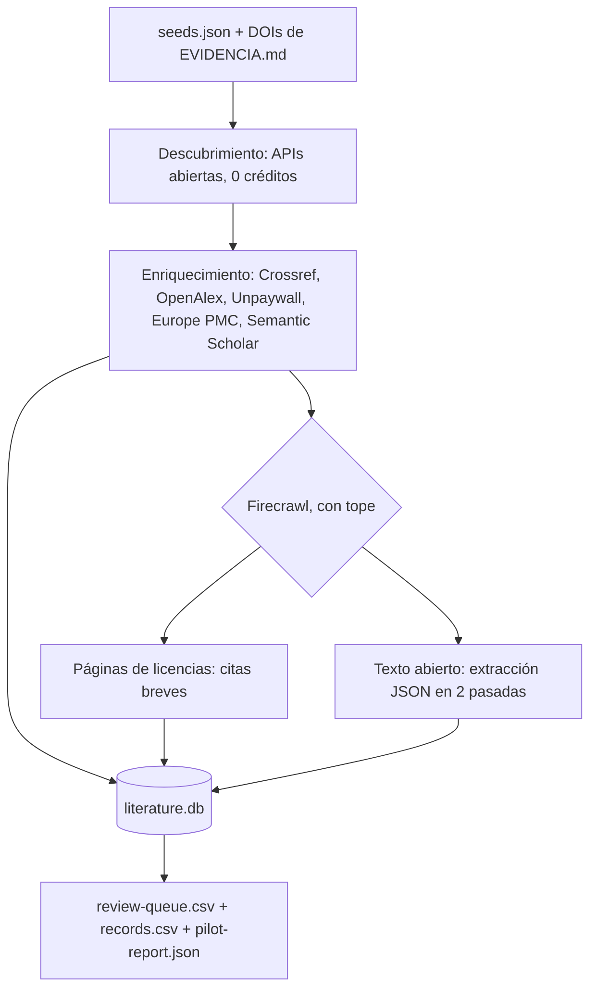

# Pipeline de literatura (Fase 1 del afinado)

> Estado: **piloto ejecutado el 2026-11-01**. Todo lo extraído está en
> `verificacion: "pendiente_humana"` y **no alimenta ningún parámetro** de
> `data/*.json` hasta que una persona lo apruebe en
> `data/literature/review-queue.csv`.

## 1. Qué hace



| Etapa | Fuente | Costo |
|---|---|---|
| Descubrimiento | OpenAlex (búsqueda por título, autor y año), Europe PMC, PsyArXiv (OSF), arXiv | 0 |
| Enriquecimiento | Crossref, OpenAlex, Unpaywall, Europe PMC, Semantic Scholar | 0 |
| Licencias e instrumentos | Firecrawl `/v2/scrape` (y `/v2/search` cuando no hay URL conocida) | 1 por página, 2 por búsqueda |
| Extracción | Firecrawl `/v2/scrape` con formato `json` y esquema, dos pasadas con instrucciones distintas | ≈ 10 por artículo HTML, ≈ 20 por PDF |

Firecrawl **complementa** las APIs abiertas: solo se usa para lo que ellas no
dan (páginas de licencias y texto completo de acceso abierto).

## 2. Uso

```bash
npm run data:literature                      # dry-run: APIs abiertas reales, Firecrawl solo estimado
npm run data:literature -- --run             # corrida real dentro de los topes
npm run data:literature -- --run --resume    # repite sin volver a pagar (caché en disco)
npm run data:literature -- --skip-firecrawl  # solo descubrimiento y exportación
```

- **Dry-run por defecto.** Escribe en una base temporal y no toca `literature.db`.
- **Topes** en `data/literature/crawler-config.json` (validado con Zod):
  900 créditos globales (de ~1000) y 300 por corrida (ADR-014). Antes de cada
  llamada se comprueba la **estimación**; después se registra lo que la API
  reporta en `metadata.creditsUsed`. Un HTTP 402 detiene la corrida.
- **Caché** por método + URL + cuerpo en `data/literature/cache/` (ignorada
  por git). Reanudar sirve las respuestas desde la caché a 0 créditos.
- **Registro** de cada llamada en `literature.db` → tabla `calls`: fuente,
  endpoint, URL, estado, créditos, si vino de caché, SHA-256 del contenido y
  fecha. La cabecera `Authorization` nunca se registra.
- **Reintentos** con *backoff* exponencial en 408/429/5xx (respeta
  `Retry-After`) e intervalo mínimo por fuente.

## 3. Cumplimiento y seguridad

| Regla | Cómo se aplica |
|---|---|
| Clave | `FIRECRAWL_API_KEY` solo desde el entorno (`.env.local`, ignorado). `.env.example` lleva el nombre vacío. Nunca se imprime |
| Escaneo de secretos | `npm run secrets:check` (también dentro de `npm run check`) recorre los archivos rastreados, los no ignorados y `data/literature/logs/`. El hook `.githooks/pre-commit` revisa las líneas añadidas en *staging*. Activarlo una vez por clon: `npm run hooks:install` |
| `robots.txt` | Evaluador propio (RFC 9309: grupo por agente, regla más larga, `Allow` gana empates, `*` y `$`). Un 4xx en `robots.txt` = sin reglas; un error de red = denegar |
| Muros de pago | Solo se pide texto completo si hay licencia de reutilización explícita: PMC, licencia Creative Commons o servidor de *preprints*. "Gratis para leer" no basta |
| Repositorios piratas | Lista de bloqueo de hosts en la config |
| Derechos | De cada página solo se guardan hash, metadatos, campos extraídos y citas ≤ 300 caracteres (≤ 4 por página de licencia). El texto completo vive solo en la caché local |
| Inyección | Todo el contenido externo es dato no confiable. `detectInjection` busca instrucciones dirigidas a una IA (en inglés y español) y las registra en la tabla `anomalies`; el pipeline **nunca** cambia su comportamiento por ellas. Las dos instrucciones de extracción piden explícitamente ignorar texto de la página dirigido a la IA |
| CSV | Las celdas que empiezan con `=`, `+`, `-` o `@` se neutralizan (inyección de fórmulas) |

## 4. Esquema de extracción

Cada campo devuelve `{ value, quote, location }`: valor, cita literal y
sección o tabla. Campos: `design`, `n_individuals`, `n_dyads`, `population`,
`instruments`, `similarity_construct`, `outcome`, `effect_size`,
`effect_size_type`, `ci_low`, `ci_high`, `covariates`, `preregistered` y
`open_data`.

- **Dos pasadas independientes** con instrucciones redactadas de forma
  distinta. Para los campos numéricos se marca `discrepancy` si no coinciden.
- **Comprobación de cita**: `quote_in_source` indica si la cita aparece
  literalmente en el texto descargado (normalizando espacios, Markdown y
  comillas; las citas con "…" deben aparecer por segmentos y en orden).
- Valores como `"null"`, `"N/A"` o `"not reported"` se convierten en `null`.
- Ningún valor se calcula ni se redondea: lo que no está en el texto queda
  `null`.

## 5. Resultados del piloto (2026-11-01)

### 5.1 Créditos

| Concepto | Valor |
|---|---|
| Saldo antes (`GET /v2/team/credit-usage`) | 1025 |
| Saldo después | 868 |
| **Gastado** | **157** (estimación previa del dry-run: 164) |
| Reanudaciones posteriores (2) | 0 créditos (todo desde caché) |
| Tope por corrida / global | 300 / 900 |

### 5.2 Registros (100)

| Origen | Registros | Acceso abierto |
|---|---|---|
| DOIs de `EVIDENCIA.md` | 60 | 15 |
| Estudios nombrados en `docs/investigacion/` | 15 | 6 |
| Búsquedas por capa candidata (OpenAlex) | 24 | 16 |
| Búsqueda de acceso abierto (Europe PMC) | 1 | 1 |

Los 16 estudios nombrados en la investigación se buscaron por título, autor
y año (±1). **Se resolvieron 16 de 16**, después de corregir las consultas: la
primera versión aceptó un falso positivo para Weidmann et al. 2016 (un
metaanálisis sobre servicio público) y por eso ahora se exige que coincida
el apellido del autor. Ejemplos de DOI resueltos: Dyrenforth 2010
`10.1037/a0020385`, van Scheppingen 2019 `10.1037/pspp0000211`, Luo 2008
`10.1111/j.1467-6494.2008.00520.x`, Romero 2015 `10.1016/j.paid.2014.11.056`,
Ashton & Lee 2009 (HEXACO-60) `10.1080/00223890902935878`, Wei 2007 (ECR-S)
`10.1080/00223890701268041`.

> Nota: van Scheppingen et al. aparece como **2018** en la investigación,
> pero la versión publicada en *JPSP* es de 2019. Se registra con el año del
> DOI.

### 5.3 Llamadas a Firecrawl

| Tipo | Llamadas | Resultado |
|---|---|---|
| Páginas de licencias | 9 (7 sembradas + 2 de búsqueda) | 8 con HTTP 200; 1 (`courses.rochester.edu`, CSI) **omitida por `robots.txt`**, sin costo |
| Búsquedas de licencias | 2 | PVQ-RR y ECR-S; se tomó el primer resultado permitido |
| Extracciones (2 pasadas) | 14 objetivos | 10 extraídas; 1 omitida por `robots.txt`; 3 respondieron 403/404/418 (se cobraron 5 créditos cada una porque Firecrawl devolvió documento) |
| Anomalías de inyección | — | **0** |

### 5.4 Concordancia entre pasadas (10 artículos)

| Campo | Coinciden | Discrepan | Una nula | Ambas nulas |
|---|---|---|---|---|
| `n_individuals` | 6 | 0 | 0 | 4 |
| `n_dyads` | 3 | 1 | 1 | 5 |
| `effect_size` | 1 | 2 | 1 | 6 |
| `ci_low` / `ci_high` | 1 | 0 | 1 | 8 |
| `preregistered` | 3 | 0 | 0 | 7 |
| `open_data` | 5 | 0 | 1 | 4 |
| `design` | 3 | 4 | 1 | 2 |
| `similarity_construct` | 0 | 5 | 2 | 3 |
| `outcome` / `population` | 2 / 1 | 6 / 6 | 0 / 0 | 2 / 3 |

Citas encontradas literalmente en el texto: **43 de 72** valores no nulos en
la pasada A y **39 de 71** en la B. Las demás son paráfrasis del extractor y
no cuentan como procedencia.

**Lectura.** Los tamaños de muestra son fiables (6/6 coinciden). Los tamaños
de efecto **no**: en Joel et al. 2020 una pasada dio `0.45` y la otra `45`
(misma cita: "predicted baseline satisfaction quite powerfully (45%)"), y en
un artículo de 2026 una dio `R² = 0.193` y la otra `0.27`. Los campos de
texto casi nunca coinciden literalmente, lo que es esperable; solo sirven de
orientación para la persona revisora.

### 5.5 Ejemplos con procedencia (todos `pendiente_humana`)

| Registro | Campo | Valor (A / B) | Cita | ¿Literal? |
|---|---|---|---|---|
| Joel et al. 2020, *PNAS* | `n_dyads` | 11196 / 11196 | "It examines 43 longitudinal datasets from 29 laboratories, with 11,196 couples" | no (paráfrasis del abstract) |
| Joel et al. 2020 | `effect_size` | 0.45 / 45 → **discrepancia** | "Actor-reported relationship variables predicted baseline satisfaction quite powerfully (45%)…" | sí |
| Character strengths en parejas, *JRP* 2022 | `n_dyads` | 211 / 211 | "In Study 1, N =68 couples … and in Study 2, N =143 couples…" | sí |
| Dyadic empathy, *EJOP* 2014 | `n_dyads` | 187 / 187 | "A sample of 187 couples was recruited for participation." | no (PDF con formato distinto) |
| Love styles, *SAGE Open* 2025 | `n_individuals` | 823 / 823 | "The study used a cross-sectional design and recruited 823 Spanish participants…" | sí |

El dato de Joel 2020 aclara la contradicción de `docs/investigacion/README.md`:
el **45 %** corresponde a las variables relacionales reportadas por la propia
persona sobre la satisfacción **inicial**. Sigue pendiente de revisión humana.

### 5.6 Licencias (citas breves, pendientes de revisión)

| Instrumento | Cita | Fuente |
|---|---|---|
| HEXACO-PI-R | "You can download any of these forms free of charge, but only for the purpose of non-profit academic research." | hexaco.org/hexaco-inventory |
| IPIP (incluye IPIP-HEXACO) | "Because the IPIP has been placed in the public domain, permission has already been automatically granted for any person to use IPIP items, scales, and inventories for any purpose, commercial or non-commercial." | ipip.ori.org/newPermission.htm |
| ECR / ECR-R (Fraley) | "Because the chapters are copyrighted by Guilford Press, they should not be reproduced without permission." (se refiere a los capítulos; los cuestionarios están en la misma página) | labs.psychology.illinois.edu/~rcfraley |
| PVQ-RR | Solo se encontró un artículo CC BY-NC sobre su validación; **no** es una declaración de licencia del instrumento | PMC9131418 |
| ECR-S | El primer resultado fue un sitio comercial sin texto de licencia (0 citas) | novopsych.com |
| CSI | No consultado: `robots.txt` lo impide | courses.rochester.edu |

**Consecuencia para la Fase 3:** el uso del HEXACO-PI-R es compatible con
"non-profit academic research" (ADR-014); IPIP-HEXACO es de dominio público
y queda como respaldo seguro. Las licencias de PVQ-RR, ECR-S y CSI **siguen
sin verificar**.

### 5.7 Problemas encontrados

- **Semantic Scholar** respondió 429 en unas 70 de 150 llamadas, incluso con
  1.1 s entre peticiones. Se subió el intervalo a 3.5 s; la API es
  complementaria y su ausencia no rompe el registro.
- Tres objetivos de extracción respondieron con error (403, 404, 418) y se
  cobraron igual (15 créditos). La caché evita repetirlos.
- Algunas búsquedas por capa trajeron registros poco pertinentes (por
  ejemplo, amistad en búfalos de agua). La Fase 2 filtra por criterios de
  admisión; ningún registro entra al modelo por aparecer aquí.

## 6. Archivos

| Archivo | Versionado | Contenido |
|---|---|---|
| `data/literature/crawler-config.json` | sí | Topes, tasas, costos y cumplimiento |
| `data/literature/seeds.json` | sí | Estudios nombrados, búsquedas y páginas de licencias |
| `data/literature/records.csv` | sí | 100 registros con metadatos |
| `data/literature/review-queue.csv` | sí | Cola de revisión humana; regenerarla conserva las columnas `verificacion`, `decision`, `reviewer`, `reviewed_on` y `notes` |
| `data/literature/pilot-report.json` | sí | Reporte de la última corrida |
| `data/literature/literature.db` | no (`*.db`) | Registro completo de llamadas, páginas, citas, extracciones y anomalías |
| `data/literature/cache/` | no | Respuestas crudas (incluye texto completo; no se redistribuye) |

Código en `scripts/literature/` (Node 24 con *type stripping*, sin
dependencias nuevas; `node:sqlite` para la base). Tests de la lógica pura en
`scripts/literature/lib/literature.test.ts`.
