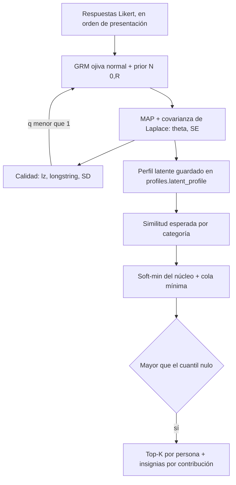

# Modelo de matching por capas

> Afinidad **estimada**, no destino. El modelo es reproducible, calibrable y
> transparente, pero **no tiene validez predictiva demostrada**: no hay datos
> reales de relaciones, y la literatura indica que la similitud de personalidad
> explica muy poco de la satisfacción relacional (EV-01, EV-02, EV-03).

Resultados numéricos: [`MATCHING_RESULTADOS.md`](MATCHING_RESULTADOS.md)
(generado por `npm run data:matching`). Decisión: ADR-017.

## 1. Flujo

## 2. Puntuación latente (`src/domain/psychometrics/latent.ts`)

Modelo de respuesta graduada (Samejima), **ojiva normal**, con los parámetros
estimados offline (`data/psychometric-params.json`):

- P(X′ ≥ j+1 | θ) = Φ(a(θ − b_j)), con X′ = 6 − X en los ítems inversos.
- Posterior: log p(θ | x) = q · Σᵢ log P(xᵢ | θ_f(i)) − ½ θᵀR⁻¹θ.
- θ̂ se obtiene por *Fisher scoring* con retroceso: la log-verosimilitud del GRM
  es cóncava, así que el objetivo es estrictamente cóncavo.
- Σ̂ = (R⁻¹ + q · diag(I))⁻¹ es la covarianza de Laplace. Se guarda SE = √diag(Σ̂).
- **Sin imputación.** Un factor sin respuestas conserva el prior condicional a lo
  respondido. Su SE queda cerca de 1, lo que se verifica en un test.
- **Calidad q ∈ [0.35, 1].** Es el mínimo de tres rampas:
  - el índice de ajuste de persona lz (Drasgow et al., 1985) `[VERIFICAR]`;
  - el longstring;
  - la desviación estándar intrapersona.

  Con q < 1 se repite la estimación con la verosimilitud templada (posterior de
  potencia): el perfil se contrae hacia la media y su incertidumbre crece. La
  persona nunca ve este índice.

Lecturas de identidad (`derived.ts`), capa 4, solo para el avatar y la narrativa:

- **MBTI:** el signo de cada eje latente da la letra. El eje se marca ambiguo si |θ| < 1 · SE.
- **Eneagrama:** p = softmax(θ_ennea / T), con T = 0.5.
  - Se calcula la entropía normalizada H / log 9; si H > 0.85, no se fuerza un tipo.
  - El ala es el vecino más probable en el anillo.

## 3. Compatibilidad por categoría (`src/domain/matching/layers.ts`)

Todas las funciones devuelven la **similitud esperada** bajo ambas posteriores. La
brecha de cada factor se trata como δ ~ N(μ, s²), con μ = θ̂ₐ − θ̂_b y
s² = SEₐ² + SE_b² (aproximación diagonal). Así, un perfil incierto **no puede**
producir un match falsamente alto.

| Forma | Ecuación | Categorías |
|---|---|---|
| Núcleo gaussiano (tipo Mahalanobis diagonal) | ∏_f r/√(r²+s²) · exp(−½ μ²/(r²+s²)), con r² = h²/w_f y h = c√d | personalidad (HEXACO), valores, estilo, big_five, mbti |
| Asimetría en H-H | μ ← μ · (1 + η · max(0, −min(θₐ, θ_b))), η = 0.5 | personalidad: brechas en H-H baja penalizan más |
| Ventana de tolerancia | g(δ) = exp(−½ (max(0, \|δ\| − tol) / escala)²), con su esperanza por Gauss–Hermite (21 nodos) | dealbreakers (producto; desde ADR-043 solo `meta_crianza`), relacional, conflicto, apego y afecto (media geométrica) |
| Solapamiento de distribuciones | Coeficiente de Bhattacharyya Σ√(p·q) de los softmax, contraído hacia `neutral` por (1 − Hₐ)(1 − H_b) | eneagrama |

Propiedades probadas (`layers.test.ts` y `matching.test.ts`):

- simetría;
- rango [0, 1];
- monotonía en cada factor de núcleo y de ventana;
- s(a, a) máximo;
- más incertidumbre nunca sube s(a, a);
- el eneagrama sin información vale exactamente `neutral`;
- no hay NaN/Inf con SE ≈ 0 ni con θ = ±40;
- determinismo.

## 4. Agregación (`src/domain/matching/pair-score.ts`)

- S_núcleo = −(1/β) log Σ_c w_c e^{−β s_c}, un soft-min ponderado:
  - cumple min(s) ≤ S ≤ Σ w s;
  - β = 6 en romance y β = 4 en amistad.
- **F = 1: no hay pisos.** Desde ADR-043 ninguna categoría lleva piso, en ningún track. Un piso es un veto
  multiplicativo sobre una similitud *estimada* desde θ̂, y en este modelo toda categoría lo está; el soft-min
  ya hace el trabajo que la evidencia permite («una categoría núcleo débil duele», no «esa pareja no existe»).
  El veto que sí tiene sentido es una declaración explícita y vive en `hard_filters`. El mecanismo queda en
  el código y el validador lo mantiene honesto: un piso solo es legal sobre una categoría cuyos factores
  tienen ≥ 2 ítems (`src/config/config.test.ts`).
- total = (1 − Σ τ) · F · S_núcleo + Σ_t τ_t s_t, donde la cola son los extras y la capa 4 (con F ≡ 1 el
  término sobra, pero la fórmula es la que ejecuta `pair-score.ts`).
- **Descomposición exacta para la explicación.**
  - Se define π_c = w_c e^{−β s_c} / Σ w e^{−β s}.
  - Entonces S = Σ π_c s_c + KL(π‖w)/β.
  - La contribución de una categoría del núcleo es (1 − Στ) · F · π_c · (s_c + KL/β).
  - La de una categoría de cola es τ_t s_t.
  - Las contribuciones suman el total con error menor que 10⁻¹⁰ (verificado en un test).
  - Las insignias de cada match son las categorías con **mayor contribución real**.

### Pesos (prior débil, `data/matching-config.json`)

| Categoría | Romance | Amistad | Etiqueta | Fuente |
|---|---|---|---|---|
| personalidad (HEXACO) | .40 | .40 | prior_literatura | EV-101, EV-104 (Liu 2018: H y O) |
| valores | .25 | .25 | prior_literatura | EV-105 (efecto pequeño) |
| dealbreakers (solo crianza) | .05 | — | supuesto_diseno | EV-105 (metas); ADR-043 saca espiritualidad e igualdad |
| relacional | .20 | — | supuesto_diseno | EV-105 |
| estilo e intereses (17 factores) | .10 | .35 | supuesto_diseno | sin evidencia predictiva; sin `soc_politica` (ADR-043) |
| conflicto / apego / afecto (cola) | .02 / .02 / .01 | — | prior_literatura / supuesto | EV-58, EV-54, EV-107: efectos actor, nunca piso |
| MBTI / Eneagrama (cola) | .005 / .005 | .005 / .005 | prior_literatura | Pittenger 1993; Hook et al. 2021: identidad |
| Big Five | 0 | 0 | supuesto_diseno | derivado de HEXACO; no se cuenta dos veces |

El validador de la configuración rechaza:

- pesos del núcleo que no sumen 1;
- una categoría que esté en el núcleo y en la cola a la vez;
- pisos sobre categorías de cola (los extras nunca son dealbreaker);
- extras por encima de 0.05 o capa 4 por encima de 0.02;
- constantes sin etiqueta de procedencia.

## 5. Umbral (`scripts/matching/`)

- **Nula por permutación.** Cada perfil nulo toma cada factor (θ̂ y su SE) de una
  persona real distinta, elegida al azar. Se conservan las marginales y la
  precisión de la medición, pero se destruye la coherencia interna del perfil.
- El umbral es el cuantil 1 − α de los puntajes nulos: α = .05 en romance y α = .15 en amistad.
- El script lo escribe en la configuración con la etiqueta `estimado_sintetico`, la semilla y N.
- `reference_high` (cuantil .999 de los puntajes reales) es el techo alcanzable.
  Escala las bandas de química y las órbitas de la constelación, porque la
  similitud esperada nunca llega a 1.

**Reproducibilidad.**

- Semilla 1515870810, 600 perfiles y 179 700 pares.
- Se usa una semilla derivada por etapa, con SHA-256 del nombre de la etapa.
- El reporte incluye el hash de las entradas.
- Comando: `npm run data:matching` (unos 135 s).

## 6. Lo que esto NO demuestra

- Los datos son sintéticos: validan el **código y la sensibilidad**, no el mundo real.
- La recuperación de la "forma verdadera" es circular en la hipótesis de similitud
  (el generador usa las mismas funciones). Las hipótesis de ventana y de
  complementariedad en X son las pruebas no circulares.
- El estudio piloto con variables de resultado queda para la Fase 6 (`PREREGISTRO.md`).
