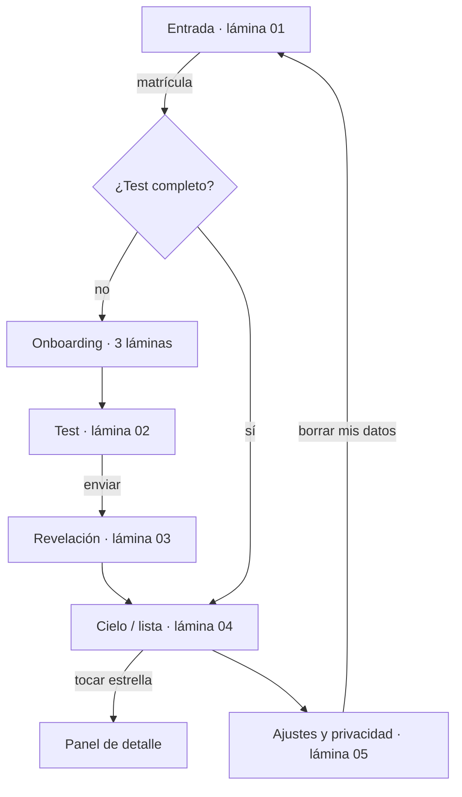

# Pantallas y flujo (Fase 3)

Dirección A, "Atlas de bolsillo". Todas las pantallas comparten `AtlasShell`
(`src/ui/kit/atlas-shell.tsx`): el cielo pixel, el atlas de iconos montado una
sola vez, una cabecera con la marca y el número de "lámina", y el pie "proyecto
estadístico, no una medida de tu valor". Los estilos viven en
`src/app/screens.css`. Los parámetros de ritmo y presentación están en
`data/experience.json`, validado por `src/config/experience.ts`.

---

## 1. Entrada (`/`, `src/ui/entry/matricula-entry.tsx`)

- **Objetivo:** entrar o retomar con la matrícula y entender en una línea qué es
  y qué no es.
- **Escena:** `DawnSky` enciende 21 estrellas sembradas, una tras otra, y al
  final la tuya (dorada, con un destello pixel en cruz). Son pasos CSS, sin
  timers de JavaScript. La geometría está en `src/ui/design/dawn.ts` y es pura,
  determinista y testeada.
- **Estados:**
  - vacío: campo con pista de privacidad;
  - inválido: "Escribe tu matrícula completa: 9 números, sin letras ni guiones"
    (el campo solo admite dígitos);
  - clave: la primera vez queda fijada; después, si no coincide, "La matrícula o
    la clave no coinciden" (no revela si la matrícula existe); tras varios
    intentos, aviso de espera (ADR-023);
  - enviando: botón ocupado con la estrella que parpadea;
  - error: "El cielo no responde ahora";
  - éxito: redirige a `/cuestionario` o `/resultado`;
  - después de borrar datos: confirmación amable de una sola vez.
- **Móvil:** texto arriba y formulario abajo, en una columna. **Desktop:** dos
  columnas, con el formulario alineado abajo a la derecha, como un marbete de
  atlas.
- **Qué evita lo genérico:** no es un hero centrado con botón y blobs. La
  promesa está alineada a la izquierda en Pixelify, el cielo amanece en lugar de
  usar un degradado y el formulario es un marco de atlas con escalón doble.

## 2. Onboarding (`src/ui/entry/onboarding.tsx`)

- **Objetivo:** en 3 láminas como máximo, explicar qué es el test (número de
  ítems y minutos calculados desde la configuración), qué significa anonimato y
  que es estadística y no una medida de valor.
- **Comportamiento:** aparece solo la primera vez (bandera en localStorage), se
  puede saltar en cualquier lámina, tiene "Atrás", y el foco se mueve al título
  de cada lámina.
- **Estados:** sin carga ni error (todo es local).
- **Qué evita lo genérico:** no es un carrusel de ilustraciones de "personas con
  laptops". Cada lámina es una ficha de atlas con un icono pixel ×3 y un
  contador "Lámina n de 3".

## 3. Test (`/cuestionario`, `src/ui/quiz/public-quiz.tsx`)

- **Objetivo:** una pregunta por pantalla, cómoda con el pulgar.
- **Progreso con significado:** `ConstellationProgress`. Cada respuesta enciende
  una estrella y la actual parpadea en dorado. No hay cronómetro ni porcentaje.
- **Ritmo:** cada 12 respuestas aparece una nota breve ("tu avance ya está
  guardado").
- **Lo sensible va al final:** `presentationOrder` mueve `identidad_filtros` al
  final y antes muestra una nota que explica para qué se usa. "Prefiero no decir"
  es exclusiva: deselecciona las demás opciones y viceversa (`toggleOption`).
- **Pausa y reanudación:** el borrador se guarda en localStorage. "Pausar" lleva
  a la entrada y, al volver, retomas en la primera pregunta sin responder. "Atrás"
  no penaliza.
- **Estados:**
  - carga: "Recuperando tus respuestas…";
  - error de sesión: enlace para volver a entrar; el avance se conserva;
  - error genérico: reintentar;
  - éxito: revelación.
- **Móvil:** la navegación queda fija abajo, al alcance del pulgar. **Desktop:**
  columna de 44 rem centrada.
- **Qué evita lo genérico:** la escala Likert son gemas pixel y no radios del
  navegador; las opciones múltiples son chips con estrella de verificación. El
  estado nunca depende solo del color.

## 4. Revelación (`src/ui/quiz/reveal.tsx`)

- **Objetivo:** presentar tu animalito con tu alias, tipo y ala en lenguaje
  amable, y "cómo te vemos" en dos frases.
- **Secuencia:** las 256 celdas del sprite se descubren desde el centro hacia
  afuera, en un orden sembrado (`reveal-order.ts`). Luego aparece el texto. Se
  puede saltar en cualquier momento. Con `prefers-reduced-motion` se muestra
  completa desde el inicio.
- **Datos:** `POST /api/quiz` ahora devuelve, **solo para el propio perfil**,
  `animalName`, `colorName`, `mbtiCode` y `enneagram {code, nombre, arquetipo}`.
  Nunca incluye vectores ni respuestas.
- **Honestidad:** "El tipo y el ala son una lectura amable de tus respuestas, no
  una etiqueta fija."

## 5. Resultado / constelación (`/resultado`, `src/ui/result/result-view.tsx`)

- **Objetivo:** un solo foco por pantalla. Por defecto se muestra el cielo; la
  "Ver lista" alterna con la lista textual completa.
- **Controles mínimos:** pestañas Romance/Amistad con contador (compartidas
  entre cielo y lista), "Ver lista / Ver cielo", "Recentrar" (vuelve a montar el
  lienzo), ajustes en la cabecera y "Cómo se calcula" en el pie.
- **Rendimiento:** el lienzo se carga con `dynamic import` (`ssr: false`) después
  de pintar el resultado.
- **Estados:**
  - carga: "Encendiendo estrellas…" (mínimo de 1.2 s para no parpadear; tiempo
    máximo de 9 s);
  - error de red: "Se nubló la conexión" y reintentar;
  - error de sesión: "Volver a entrar";
  - recálculo pendiente: nota tranquila;
  - **sin match:** tu nodo solo, con el mensaje canónico (`NO_MATCH_MESSAGE`);
  - **pocas personas:** si el pool activo está por debajo de
    `fewPeopleThreshold`, el servidor manda solo el booleano `few_people` (nunca
    el conteo) y se muestra "Todavía somos pocxs en el cielo…".
- **Qué evita lo genérico:** no hay tarjetas translúcidas ni anillos con
  gradiente cónico. La afinidad es un número pixel grande con "afinidad
  estimada"; las tarjetas son marcos de atlas con el borde del color de la pista.

## 6. Panel de detalle (`src/ui/constellation/NodeDetailSheet.tsx`)

- **Base:** `Dialog` del kit (`<dialog>` nativo). En móvil es una hoja inferior
  y en desktop un panel lateral. El foco, Escape y el retorno los gestiona la
  plataforma.
- **Contenido** (todo calculado en el servidor):
  - alias, animal y color;
  - **afinidad estimada** y chip de **confianza** ("alta" o "media") con su
    motivo;
  - **por qué conectan:** barras de constelación de las 5 categorías con su
    porcentaje real (`WhyBars`);
  - **tensión sana** o "algo para platicar" (la categoría más baja, con su
    porcentaje);
  - badges con icono pixel por categoría;
  - "en el día a día";
  - **contacto con consentimiento mutuo:** marcador honesto ("muy pronto"). El
    mecanismo se elige en el Prompt 2.
- **Verificabilidad:** `confidence` y `tension` se derivan del mismo `breakdown`
  que se muestra. Los tests de `explainability.test.ts` comprueban que
  `tension.percentage === min(breakdown)` y que `confidence` coincide con
  `computeMatchConfidence(chemistry, breakdown)`.

## 7. Notificaciones (`src/ui/shared/notification-provider.tsx`)

- **Discretas:** `ToastStack` del kit, una región `polite` que nunca roba el foco
  y nunca caduca por tiempo.
- **Agrupadas:** un aviso por tipo; si hay varios, "(y 2 avisos más)". Hay un
  máximo visible configurable. Al descartar uno se marcan como leídos todos los
  que agrupaba.
- **Pausables:** desde Ajustes. Con los avisos en pausa no se hace polling;
  tampoco con la pestaña oculta.
- **Sin urgencia ni emojis:** se quitaron de la copia del dominio y del SQL
  (`notify_matches`), junto con "a la perfección".

## 8. Ajustes y privacidad (`/ajustes`, `src/ui/settings/settings-view.tsx`)

- **En este dispositivo:**
  - cielo (sistema, noche, día y los dos de alto contraste);
  - lenguaje inclusivo;
  - pausar avisos;
  - sonido y vibración apagados, que llegan en la Fase 5.
- **Tu perfil** (con backend real, en `/api/privacy`):
  - **Pausar mi perfil:** pone `profiles.paused_at`. Un trigger mueve la versión
    del pool y las afinidades se republican al instante; nadie te ve mientras
    estés en pausa.
  - **Borrar mis datos:** confirmación única con el texto de la guía. Borra el
    usuario de Auth, y perfil, respuestas, matches y avisos caen en cascada; se
    republican las afinidades, se cierra la sesión y la entrada lo confirma.
- **Chats** (`chat-security-section.tsx`): cambiar el PIN (actual + nuevo dos
  veces), «Olvidé mi PIN» (lleva a `/chats`), actividad de seguridad reciente e
  intentos fallidos recientes (agregado; sin IP ni dispositivo).
- **Cómo se calcula:** 4 pasos en lenguaje simple. Los umbrales se leen de la
  configuración y se declaran los límites (sin validación con parejas reales).
- **Estados:** "Revisando tu perfil…"; sin sesión, enlace a la entrada; error al
  guardar o borrar con mensaje amable ("nada se perdió").

## 8b. Tu carta (`/perfil`, `src/ui/profile/profile-view.tsx`)

- **Objetivo:** ver tus resultados cuando quieras, no solo en la revelación.
- **Contenido:** sprite, alias, MBTI (con ejes en equilibrio) y Eneagrama;
  hasta 4 virtudes; afinidades (conteo y top 3 por track); lecturas por
  sección (HEXACO abierta; Big Five, MBTI, valores, relacional, afecto y
  estilo plegadas en `
`).
- **Cada escala:** una pista pixel de 24 celdas. La banda tenue es la duda, la
  celda dorada es la estimación y la marca central es la mitad. El texto dice
  hacia qué polo se inclina y con qué confianza, así que nada depende solo del
  color.
- **Aviso de matemática** (`src/ui/profile/math-update-notice.tsx`, B9/ADR-052), encima de
  «¿Quieres afinar tu perfil?». Dos casos que no se mezclan: si cambió el *puntaje*, una
  línea de recálculo que sale una sola vez por firma y nunca a quien llega por primera vez;
  si cambió la *medición*, «Actualizamos la matemática» con «Afinar mi perfil» y «Ahora no»
  (el cierre se recuerda por sello, no por fecha). Un perfil anterior al sello solo recibe la
  variante de una línea: nadie re-contesta lo que sigue siendo válido y nadie sale del pool.
- **Estados:** carga («Desplegando tu carta…»); sin sesión → entrada; sin test
  → cuestionario; error → reintentar.
- **Anti-plantilla:** marcos de atlas con coordenadas AR, pistas de celdas en
  lugar de barras de progreso redondeadas y sin porcentajes de rasgo (no
  rankea).

## 8c. Chats (`/chats`, `src/ui/chat/chats-view.tsx`)

- **Objetivo:** el candado frente a tus chats (ADR-029, `docs/CHAT.md`). El chat
  todavía no existe; esta pantalla es su puerta.
- **Estados**, según `GET /api/chat/status`:
  - sin PIN → «Crea tu PIN» en dos pasos; si es trivial, «Elige uno que solo tú
    recuerdes» y se vuelve al primer paso;
  - con PIN y candado cerrado → pedir PIN, con «Te quedan N intentos» y, en
    pausa, «Tómate un respiro…» con cuenta regresiva y el enlace «Olvidé mi PIN»;
  - restablecimiento pendiente → aviso visible, cancelar con el PIN actual y,
    cuando termina la espera de 24 h, crear el PIN nuevo;
  - abierto → estado vacío «Aquí vivirán tus chats cuando tú y un match acepten
    conversar» y el botón «Cerrar el candado».
- **PIN:** un solo `<input>` numérico (sin autocompletar ni gestor de
  contraseñas) bajo 4 casillas pixel decorativas. Cada dígito enciende una
  estrella, y el botón de mostrar u ocultar vuelve a enmascararlo. Usa
  `aria-live` para errores y pausas. Sin animación con `prefers-reduced-motion`.
- **Al ocultar la página** (`pagehide`), `sendBeacon` cierra el candado.
- **Enlaces:** línea fina del resultado y Ajustes → Chats (cambiar PIN, olvidé mi
  PIN, actividad reciente e intentos fallidos).

## 9. Admin (`/admin`, `/admin/login`)

- Mismo sistema visual, más sobrio: marcos de atlas, botones del kit y **barras
  pixel propias** (`pixel-bars.tsx`) en lugar de `recharts`, que se desinstaló.
- **Solo agregados**, con **piso de k-anonimato** (`admin.kAnonymity`): los
  conteos de 1 a k−1 se muestran como "< k". Con menos de k perfiles se ocultan
  los desgloses. Cada gráfica tiene su tabla accesible.

---

## Pendientes para las fases 4 a 6

- Física del lienzo (paso fijo, sueño, pinch zoom, coreografías): Fase 4.
  En esta fase solo se re-estilizó el chrome del lienzo (sin blur, radios ni
  nebulosas CSS).
- Sonido y háptica (opcionales, apagados), 404 ilustrada y easter egg: Fase 5.
- Verificación visual en dispositivos reales y antes/después: Fase 6
  (`docs/QA.md`). Las capturas headless de Edge (`.qa/`, no versionadas)
  confirmaron que las rutas renderizan. La revisión visual fina queda pendiente.
